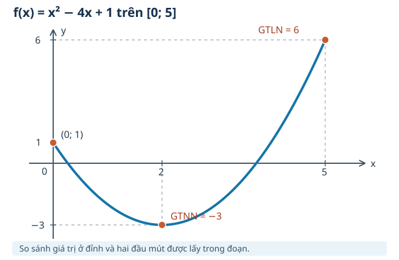

# Bài 2. Giá trị lớn nhất và giá trị nhỏ nhất của hàm số

TOÁN 12 · CHƯƠNG I · KIẾN THỨC SGK KNTT · TẬP MỘT

Tìm giá trị cao nhất và thấp nhất mà hàm số thực sự đạt được trên miền đang xét; dùng đạo hàm để lựa chọn kích thước, thời điểm hoặc phương án tối ưu.

<nav class="thpt-r4-lesson-tabs"><a href="../">Chương I</a><a href="../bai-1/">Bài trước</a><a href="../luyen-tap/#b02-core">Core/Luyện tập</a><a href="../bai-3/">Bài tiếp theo</a></nav>

=== "Khám phá kiến thức"

    ### 1.1. Định nghĩa

    Giả sử có một tấm bìa hình vuông cạnh \(60\) cm. Cắt bốn hình vuông bằng nhau ở bốn góc rồi gấp các mép lên để làm hộp không nắp. Nếu cắt quá ít, hộp rất thấp; nếu cắt quá nhiều, đáy hộp lại quá nhỏ. Ta muốn chọn kích thước phần cắt sao cho thể tích hộp lớn nhất. Đây là bài toán tìm một giá trị **tốt nhất trong toàn bộ những lựa chọn được phép**, không chỉ tìm một đỉnh hay đáy gần một vị trí nào đó.

    Để hiểu giá trị lớn nhất và nhỏ nhất, xét \(f(x)=x^2-4x+1\) trên đoạn \([0;5]\). Viết \(f(x)=(x-2)^2-3\), ta thấy giá trị nhỏ nhất là \(-3\), đạt tại \(x=2\). Nhưng giá trị lớn nhất ở đâu? Nhìn đồ thị dưới đây: đoạn đường cong đi xuống tới đỉnh thấp nhất rồi đi lên; hai đầu mút đều thuộc miền xét.

    <figure class="thpt-r4-plot thpt-r4-calculus-figure"><figcaption><strong>Cách đọc hình:</strong> so độ cao của cả hai đầu mút và đỉnh. Điểm \((5;6)\) cao nhất, điểm \((2;-3)\) thấp nhất. Chấm đặc cho biết những điểm này được lấy trong miền xét.</figcaption></figure>

    Vì \(f'(x)=2x-4\) âm trước \(2\), dương sau \(2\), hàm nghịch biến trên \([0;2]\) rồi đồng biến trên \([2;5]\). So \(f(0)=1\) với \(f(5)=6\), ta tìm được giá trị lớn nhất là \(6\), mặc dù \(x=5\) không phải nghiệm của \(f'(x)=0\).

    Như vậy, một số \(M\) chỉ là **giá trị lớn nhất** nếu vừa không có giá trị hàm nào vượt quá \(M\) trong miền xét, vừa có ít nhất một điểm trong miền đạt đúng \(M\). Giá trị nhỏ nhất cũng phải thỏa hai điều kiện tương tự. Ta viết \(\max_{[0;5]}f(x)=6\) và \(\min_{[0;5]}f(x)=-3\). Số \(6,-3\) là **giá trị**, còn \(5,2\) là **hoành độ nơi đạt giá trị**.

    Nếu thay miền xét thành \((0;5)\), đồ thị mất hai đầu mút. Hàm vẫn đạt \(-3\) tại \(2\), nhưng không đạt \(6\). Thật vậy, với \(0<x<5\), \(|x-2|<3\), nên \(f(x)<6\); đồng thời \(f(x)\to6\) khi \(x\to5^-\). Bất cứ giá trị hàm nào nhỏ hơn \(6\) đều có thể bị vượt qua khi chọn \(x\) đủ gần \(5\). Vậy trên \((0;5)\), hàm không có GTLN. **Tiến gần một giá trị không đồng nghĩa đạt được giá trị đó.**

    Một cách tìm GTLN/GTNN là dùng định nghĩa trực tiếp. Chẳng hạn \(g(x)=\sqrt{4-x^2}\) có miền xác định \([-2;2]\). Ta có \(0\le g(x)\le2\), đạt \(0\) tại \(\pm2\) và đạt \(2\) tại \(0\). Như vậy không cần đạo hàm vẫn tìm được cả hai giá trị. Khi không dễ tìm một bất đẳng thức chặn, bảng biến thiên sẽ giúp kiểm toàn bộ miền, kể cả miền vô hạn.

    Ví dụ \(h(x)=x+4/x\) trên \((0;+\infty)\). Ta có \(h'=1-4/x^2\), âm trên \((0;2)\), dương trên \((2;+\infty)\). Hai giới hạn khi \(x\to0^+\) và \(x\to+\infty\) đều là \(+\infty\). Bảng biến thiên:

    | \(x\) | \(0^+\) | \((0;2)\) | \(2\) | \((2;+\infty)\) | \(+\infty\) |
    | :-- | :--: | :--: | :--: | :--: | :--: |
    | \(h'(x)\) | | \(-\) | \(0\) | \(+\) | |
    | \(h(x)\) | \(+\infty\) | ↘ | \(4\) | ↗ | \(+\infty\) |

    Hàm có GTNN \(4\), đạt tại \(2\); không có GTLN vì giá trị hàm lớn tùy ý. Dấu vô cực ở đầu bảng biểu thị giới hạn, **không phải giá trị hàm tại một điểm**.

    **Vận dụng.** Xét \(p(x)=1-(x-1)^2\) trên khoảng \((0;2)\). Hàm có GTLN và GTNN không? Nếu đổi miền thành đoạn \([0;2]\), kết quả thay đổi thế nào?

    ??? question "Đối chiếu"

        Trên \((0;2)\), \(0<p(x)\le1\), đạt \(1\) tại \(x=1\). Hàm tiến tới \(0\) ở hai đầu nhưng không đạt \(0\); với mọi giá trị dương, có thể chọn \(x\) gần \(0\) để \(p(x)\) nhỏ hơn giá trị ấy. Vậy GTLN bằng \(1\), không có GTNN.

        Trên \([0;2]\), hai đầu được lấy. GTLN vẫn bằng \(1\), còn GTNN bằng \(0\) đạt tại cả \(0\) và \(2\).

    ??? tip "Kiểm lỗi"

        Nếu em ghi GTNN \(0\) trên khoảng mở, hãy giải \(p(x)=0\). Hai nghiệm \(0,2\) có thuộc miền không? Hãy kiểm cả bất đẳng thức chặn lẫn khả năng đạt dấu bằng.

    ### 1.2. Cách tìm giá trị lớn nhất và giá trị nhỏ nhất của hàm số trên một đoạn

    Trên một đoạn đóng \([a;b]\), nếu hàm liên tục, đồ thị không bị đứt và có cả hai đầu mút. Một kết quả quan trọng bảo đảm hàm **luôn đạt cả GTLN lẫn GTNN** trên đoạn ấy. Khi đi tìm chúng, ta cần biết những nơi nào có khả năng cao nhất hoặc thấp nhất.

    Nếu hàm đạt GTLN hoặc GTNN tại một điểm bên trong đoạn và có đạo hàm tại điểm ấy, đạo hàm ở đó bằng \(0\). Điều này vẫn đúng khi nhiều điểm cùng đạt giá trị lớn nhất hoặc nhỏ nhất. Nếu hàm không khả vi tại một điểm trong đoạn, điểm ấy vẫn có thể là nơi đạt GTLN/GTNN, như đỉnh của đồ thị trị tuyệt đối. Ngoài ra, một đầu mút cũng có thể cao nhất hoặc thấp nhất dù đạo hàm không bằng \(0\).

    Bởi vậy, với hàm liên tục và chỉ có hữu hạn điểm đạo hàm bằng \(0\) hoặc không tồn tại trong đoạn, ta không nhất thiết lập toàn bộ bảng biến thiên: chỉ cần tính giá trị hàm tại **hai đầu mút và mọi điểm bên trong thuộc hai loại trên**, rồi so sánh.

    Chẳng hạn \(f(x)=x^3-3x+1\) trên \([-2;2]\). Ta tính \(f'=3(x-1)(x+1)\), có nghiệm trong đoạn là \(-1,1\). Bốn ứng viên:

    | \(x\) | \(-2\) | \(-1\) | \(1\) | \(2\) |
    | :-- | :--: | :--: | :--: | :--: |
    | \(f(x)\) | \(-1\) | \(3\) | \(-1\) | \(3\) |

    GTLN là \(3\), đạt tại cả \(-1,2\); GTNN là \(-1\), đạt tại cả \(-2,1\). Một giá trị có thể đạt tại nhiều điểm. Ta không chọn số lớn nhất trong các **hoành độ**, mà chọn số lớn nhất trong hàng **giá trị hàm số**.

    **Vận dụng.** Tìm GTLN và GTNN của \(q(x)=x^3-6x\) trên \([0;3]\) bằng cách so sánh giá trị tại các ứng viên, không cần lập bảng biến thiên.

    ??? question "Đối chiếu"

        \(q\) liên tục trên đoạn và \(q'=3x^2-6\). Trong \((0;3)\), chỉ có nghiệm \(x=\sqrt2\). Tính \(q(0)=0,\ q(\sqrt2)=-4\sqrt2,\ q(3)=9\). Vậy GTLN bằng \(9\) tại \(3\); GTNN bằng \(-4\sqrt2\) tại \(\sqrt2\).

    ??? tip "Kiểm lỗi"

        Nghiệm \(-\sqrt2\) của phương trình đạo hàm bằng \(0\) không thuộc miền xét. Không đưa nó vào danh sách ứng viên. Hai đầu \(0,3\) thì phải tính dù đạo hàm không bằng \(0\).

    Trở lại bài toán gấp hộp. Gọi \(x\) là cạnh phần vuông cắt đi, tính bằng cm. Sau khi gấp, chiều cao là \(x\), cạnh đáy là \(60-2x\), nên thể tích

    \[
    V(x)=x(60-2x)^2,\qquad 0<x<30.
    \]

    Miền là khoảng mở, vì \(x=0\) hoặc \(x=30\) không tạo ra chiếc hộp có thể tích dương. Ta tính \(V'(x)=12(x-10)(x-30)\). Trên miền thực tế, dấu đạo hàm dương khi \(0<x<10\) và âm khi \(10<x<30\); vì vậy \(V\) tăng rồi giảm, đạt lớn nhất tại \(x=10\). Thể tích lúc đó là \(10\cdot40^2=16000\) cm³. Dù hàm có thể được mở rộng liên tục tới \([0;30]\) để tính toán, hai đầu không phải phương án sản xuất hợp lệ.

    Các bài tối ưu thực tế đều có cùng mạch: xác định đại lượng cần tối ưu, chọn biến và miền hợp lệ, biểu diễn đại lượng ấy thành hàm, tìm GTLN/GTNN đúng trên miền, rồi trả lời bằng kích thước hoặc thời điểm và đơn vị thích hợp.

=== "Kiến thức SGK"

    ### 2.1. Định nghĩa

    
<strong>Định nghĩa — Giá trị lớn nhất (GTLN)</strong>
Cho \(f\) xác định trên tập \(D\). Số \(M\) là GTLN của \(f\) trên \(D\) nếu \(f(x)\le M\) với mọi \(x\in D\) và có ít nhất một \(x_0\in D\) thỏa \(f(x_0)=M\). Kí hiệu \(M=\max_{x\in D}f(x)=\max_D f(x)\).

    
<strong>Định nghĩa — Giá trị nhỏ nhất (GTNN)</strong>
Số \(m\) là GTNN của \(f\) trên \(D\) nếu \(f(x)\ge m\) với mọi \(x\in D\) và có ít nhất một \(x_0\in D\) thỏa \(f(x_0)=m\). Kí hiệu \(m=\min_{x\in D}f(x)=\min_D f(x)\).

    Cũng có thể dùng \(\max_D y,\min_D y\) cho hàm số \(y=f(x)\). Khi đề không nêu rõ \(D\), hiểu rằng ta xét trên toàn tập xác định. GTLN/GTNN có thể không tồn tại; nếu tồn tại thì mỗi giá trị là duy nhất, nhưng điểm đạt giá trị có thể nhiều hơn một.

    **Phân biệt với cực trị:** GTLN/GTNN so sánh với mọi điểm trong tập đang xét; cực trị so sánh trong lân cận. Đầu mút có thể cho GTLN/GTNN dù không là điểm cực trị theo định nghĩa ở Bài 1.

    **Hai cách thường dùng trên tập xét cho trước:**

    - Tìm bất đẳng thức \(m\le f(x)\le M\), rồi kiểm có điểm thuộc tập xét đạt mỗi dấu bằng hay không.
    - Lập bảng biến thiên trên tập xét: tìm miền, đạo hàm, các mốc, chiều biến thiên, giá trị tại điểm được lấy và giới hạn ở biên. Nếu một giới hạn hữu hạn không đạt ở bất cứ điểm nào và là cận tốt nhất, không gọi nó là GTLN/GTNN. Nếu hàm không bị chặn trên (dưới) thì không có GTLN (GTNN).

    <figure class="thpt-r4-plot thpt-r4-calculus-figure"><figcaption>Ví dụ: trên \([0;5]\), \(x^2-4x+1\) có GTLN \(6\) tại đầu mút \(5\), GTNN \(-3\) tại \(2\).</figcaption></figure>

    ### 2.2. Cách tìm giá trị lớn nhất và giá trị nhỏ nhất của hàm số trên một đoạn

    
<strong>Tính chất — Hàm liên tục trên đoạn</strong>
Hàm số liên tục trên đoạn hữu hạn, đóng \([a;b]\) luôn có GTLN và GTNN trên đoạn đó.

    
<strong>Quy tắc so sánh các giá trị ứng viên</strong>
Giả sử \(f\) liên tục trên \([a;b]\), có đạo hàm trong \((a;b)\) trừ nhiều nhất hữu hạn điểm; số điểm trong khoảng mà \(f'=0\) cũng hữu hạn. Tìm mọi \(x_i\in(a;b)\) mà \(f'(x_i)=0\) hoặc \(f'\) không tồn tại. Tính các giá trị \(f(a),f(b),f(x_1),\ldots,f(x_n)\). GTLN là số lớn nhất và GTNN là số nhỏ nhất trong danh sách ấy.

    Nếu hàm không đổi trên cả đoạn, GTLN và GTNN đều bằng giá trị không đổi, không cần giải phương trình đạo hàm. Với hàm có vô hạn điểm tới hạn, quy tắc danh sách hữu hạn không áp dụng máy móc; phải xét tính chất riêng của hàm. Với khoảng mở hoặc miền vô hạn, dùng định nghĩa hoặc bảng biến thiên thay vì coi giới hạn là giá trị tại đầu mút.

    **Ứng dụng thực tế:** đặt biến, biểu diễn đại lượng cần tối ưu và ghi miền vật lí; áp dụng phương pháp phù hợp với miền; kiểm nghiệm thuộc miền và trả lời đúng đại lượng, đơn vị.

=== "Ví dụ"

    ### 3.1. Dùng định nghĩa khi dễ chặn giá trị

    **Đề bài.** Tìm GTLN và GTNN của \(y=\sqrt{2x-x^2}\).

    **Phân tích:** Biểu thức dưới căn viết được dưới dạng \(1-(x-1)^2\). Dùng chặn trực tiếp, đồng thời kiểm các điểm đạt dấu bằng.

    

<strong>Lời giải.</strong> Tập xác định \([0;2]\). Vì \(0\le1-(x-1)^2\le1\) trên đoạn, ta có \(0\le y\le1\). Tại \(x=0,2\), \(y=0\); tại \(x=1\), \(y=1\). Vậy GTNN bằng \(0\), GTLN bằng \(1\).

    **Kiểm lại:** Cả ba điểm đạt giá trị đều thuộc miền. Không cần dùng đạo hàm tại hai đầu mút.

    ### 3.2. Dùng tính đơn điệu trên miền vô hạn

    **Đề bài.** Tìm GTLN, GTNN (nếu có) của \(f(x)=x\ln x\) trên tập xác định.

    **Phân tích:** Miền \(x>0\) không phải đoạn đóng. Tìm điểm đổi chiều rồi kiểm giới hạn ở hai biên.

    

<strong>Lời giải.</strong> \(D=(0;+\infty)\), \(f'=\ln x+1\), bằng \(0\) tại \(x=e^{-1}\). Đạo hàm âm trước mốc, dương sau mốc. Do đó hàm giảm rồi tăng, GTNN bằng \(f(e^{-1})=-1/e\). Khi \(x\to+\infty\), \(x\ln x\to+\infty\), nên không có GTLN.

    **Kiểm lại:** Điểm \(e^{-1}>0\) thuộc miền. Chỉ cần xu hướng không bị chặn trên ở vô cực để loại GTLN; không cần gán giá trị cho \(x=0\).

    ### 3.3. Có GTLN nhưng không có GTNN

    **Đề bài.** Xét \(f(x)=xe^{-x}\) trên \(\mathbb R\).

    **Phân tích:** Dùng bảng dấu đạo hàm trên toàn trục số, không chỉ xét \(x\ge0\).

    

<strong>Lời giải.</strong> \(f'=e^{-x}(1-x)\). Vì \(e^{-x}>0\), hàm tăng khi \(x&lt;1\) và giảm khi \(x&gt;1\). GTLN bằng \(f(1)=1/e\). Khi \(x\to-\infty\), \(xe^{-x}\to-\infty\), nên hàm không có GTNN.

    **Kiểm lại:** Không nhận \(0\) làm GTNN từ giới hạn ở \(+\infty\): \(f(-1)=-e<0\).

    ### 3.4. So sánh đầu mút và điểm tới hạn

    **Đề bài.** Tìm GTLN và GTNN của \(f(x)=x^4-4x^2+3\) trên \([0;3]\).

    **Phân tích:** Đa thức liên tục trên đoạn. Chỉ cần xét nghiệm \(f'=0\) trong khoảng và hai đầu mút.

    

<strong>Lời giải.</strong> \(f'=4x(x^2-2)\). Nghiệm bên trong là \(\sqrt2\); \(0\) được xét với vai trò đầu mút. Tính \(f(0)=3,\ f(\sqrt2)=-1,\ f(3)=48\). Vậy GTLN bằng \(48\) tại \(3\), GTNN bằng \(-1\) tại \(\sqrt2\).

    **Kiểm lại:** \(f=(x^2-2)^2-1\ge-1\), đạt dấu bằng ở \(\sqrt2\) trong đoạn.

    ### 3.5. Hàm lượng giác trên đoạn

    **Đề bài.** Tìm GTLN và GTNN của \(f(x)=\sin x+\cos x\) trên \([0;\pi]\).

    **Phân tích:** Hàm liên tục; giải phương trình đạo hàm và giữ nghiệm thuộc khoảng \((0;\pi)\).

    

<strong>Lời giải.</strong> \(f'=\cos x-\sin x=0\) khi \(x=\pi/4+k\pi,\ k\in\mathbb Z\). Trong \((0;\pi)\) chỉ có \(\pi/4\). Tính \(f(0)=1,\ f(\pi/4)=\sqrt2,\ f(\pi)=-1\). GTLN bằng \(\sqrt2\) tại \(\pi/4\); GTNN bằng \(-1\) tại \(\pi\).

    **Kiểm lại:** \(5\pi/4\) không thuộc đoạn; không lấy \(-\sqrt2\) làm GTNN chỉ vì đó là giá trị nhỏ nhất của hàm trên toàn \(\mathbb R\).

    ### 3.6. Điểm không có đạo hàm

    **Đề bài.** Tìm GTLN và GTNN của \(f(x)=|x-2|+1\) trên \([0;5]\).

    **Phân tích:** Hàm liên tục, đạo hàm không tồn tại tại \(2\), còn ở các điểm khác trong khoảng đạo hàm bằng \(\pm1\). Phải đưa \(2\) vào danh sách ứng viên.

    

<strong>Lời giải.</strong> Tính \(f(0)=3,\ f(2)=1,\ f(5)=4\). Vậy GTNN bằng \(1\) tại \(2\) và GTLN bằng \(4\) tại \(5\).

    **Kiểm lại:** \(|x-2|\ge0\), nên \(f(x)\ge1\) và đạt bằng tại \(2\). Nếu chỉ tìm nghiệm \(f'=0\), sẽ bỏ mất GTNN.

    ### 3.7. Tối ưu diện tích hình chữ nhật

    **Đề bài.** Một khu vườn hình chữ nhật có chu vi \(40\) m. Tìm kích thước cho diện tích lớn nhất.

    **Phân tích:** Với chiều rộng \(x\), chiều dài là \(20-x\). Cả hai phải dương, nên \(0<x<20\).

    

<strong>Lời giải.</strong> Diện tích \(A(x)=x(20-x)=100-(x-10)^2\le100\). Dấu bằng xảy ra tại \(x=10\), thuộc miền xét. Vậy diện tích lớn nhất \(100\) m² khi khu vườn là hình vuông \(10\) m × \(10\) m.

    **Kiểm lại:** Chu vi \(2(10+10)=40\) m. Dùng đạo hàm \(A'=20-2x\) cũng cho hàm tăng rồi giảm qua \(10\).

    ### 3.8. Tối ưu kích thước hộp không nắp

    **Đề bài.** Hộp đáy vuông không nắp có diện tích vật liệu \(108\) cm². Tìm cạnh đáy \(x\) và chiều cao \(h\) để thể tích lớn nhất.

    **Phân tích:** Diện tích gồm đáy \(x^2\) và bốn mặt bên \(4xh\), không có mặt trên. Dùng điều kiện diện tích để loại \(h\).

    

<strong>Lời giải.</strong> \(x^2+4xh=108\), nên \(h=(108-x^2)/(4x)\). Điều kiện \(x&gt;0,h&gt;0\) cho \(0&lt;x&lt;6\sqrt3\). Thể tích \(V=x^2h=27x-x^3/4\) (cm³). \(V'=27-3x^2/4\) bằng \(0\) tại \(x=6\); dương trước \(6\), âm sau \(6\) trên miền. Vậy GTLN đạt khi \(x=6\) cm, \(h=(108-36)/24=3\) cm, thể tích \(108\) cm³.

    **Kiểm lại:** \(6^2+4\cdot6\cdot3=108\) cm²; \(6^2\cdot3=108\) cm³. Đơn vị diện tích và thể tích khác nhau.

    ### 3.9. Tối ưu chi phí vật liệu hình trụ

    **Đề bài.** Một bình trụ kín có dung tích \(1000\) cm³. Vật liệu hai đáy giá \(1{,}2\) nghìn đồng/cm²; vật liệu mặt bên giá \(0{,}75\) nghìn đồng/cm². Tìm bán kính và chiều cao để chi phí nhỏ nhất.

    **Phân tích:** Cần tối ưu **chi phí**, không chỉ diện tích, vì hai loại vật liệu có đơn giá khác nhau. Đặt \(r>0\), dùng \(\pi r^2 h=1000\) để biểu diễn \(h\).

    

<strong>Lời giải.</strong> \(h=1000/(\pi r^2)\). Hai đáy có tổng diện tích \(2\pi r^2\), mặt bên có diện tích \(2\pi rh\). Nhân với đơn giá tương ứng, chi phí (nghìn đồng) là \(C=1{,}2\cdot2\pi r^2+0{,}75\cdot2\pi rh\). Thay \(h=1000/(\pi r^2)\), ta được \(C(r)=2{,}4\pi r^2+1500/r\). Do đó \(C'=4{,}8\pi r-1500/r^2=(4{,}8\pi r^3-1500)/r^2\). Trên \(r&gt;0\), tử tăng từ giá trị âm tới dương và chỉ có một nghiệm \(r_0=\sqrt[3]{312{,}5/\pi}\). Hàm giảm trước \(r_0\), tăng sau \(r_0\); chi phí nhỏ nhất tại \(r_0\approx4{,}63\) cm. Từ \(\pi r_0^3=312{,}5\), suy ra \(h_0=3{,}2r_0\approx14{,}83\) cm.

    **Kiểm lại:** Dùng kích thước chưa làm tròn cho \(\pi r_0^2h_0=1000\). Tỉ lệ \(h_0/r_0=3{,}2\), không phải \(2\) như bài toán giảm diện tích toàn phần với đơn giá đồng nhất.

    ### 3.10. Phân biệt số lượng lớn nhất và tốc độ tăng lớn nhất

    **Đề bài.** Trong một mô hình toán học, số người nhiễm được biểu diễn bởi \(N(t)=-t^3+12t^2\) (trăm người), \(0\le t\le12\) (tuần). Tìm số người nhiễm lớn nhất và thời điểm tốc độ tăng \(N'(t)\) lớn nhất.

    **Phân tích:** Có hai hàm cần tối ưu trên cùng đoạn: \(N(t)\) và \(v(t)=N'(t)\). Đây là kết quả trong mô hình giả định, không phải dự báo dịch thực tế.

    

<strong>Lời giải.</strong> \(N'=-3t(t-8)\), điểm tới hạn bên trong là \(8\). So \(N(0)=0,\ N(8)=256,\ N(12)=0\), được số nhiễm lớn nhất theo mô hình \(256\) trăm người, tức \(25600\) người, tại tuần thứ \(8\). Với \(v(t)=-3t^2+24t\), \(v'=24-6t=0\) tại \(4\). So \(v(0)=0,\ v(4)=48,\ v(12)=-144\); tốc độ tăng lớn nhất là \(48\) trăm người/tuần tại tuần thứ \(4\).

    **Kiểm lại:** \(v(t)=48-3(t-4)^2\), xác nhận đỉnh tốc độ tại \(4\). Dấu âm của \(N'\) sau \(8\) biểu thị số lượng đang giảm trong mô hình, không phải số người nhiễm âm.

=== "Lỗi thường gặp"

    ### 4.1. Nhận một cận không đạt được là GTLN/GTNN

    **Sai ở đâu:** \(f(x)=x\) trên \((0;1)\) có GTLN bằng \(1\) và GTNN bằng \(0\).

    **Vì sao sai:** Hai giá trị chỉ là giới hạn ở biên; không có \(x\) trong khoảng cho \(f(x)=0\) hay \(1\).

    **Cách sửa:** Kiểm tồn tại điểm đạt dấu bằng sau khi tìm cận. Hàm này không có cả GTLN lẫn GTNN.

    ### 4.2. Chỉ tìm nghiệm đạo hàm mà quên đầu mút

    **Sai ở đâu:** Tìm được điểm cực tiểu của \(f(x)=x^2-4x+1\) tại \(2\), rồi kết luận không có GTLN trên \([0;5]\).

    **Vì sao sai:** GTLN có thể đạt tại đầu mút.

    **Cách sửa:** Tính \(f(0),f(2),f(5)\) rồi so. GTLN bằng \(6\) tại \(5\).

    ### 4.3. Bỏ điểm không khả vi

    **Sai ở đâu:** Hàm trị tuyệt đối không có nghiệm \(f'=0\), nên không có GTNN.

    **Vì sao sai:** Đỉnh góc nhọn có thể đạt GTNN dù đạo hàm không tồn tại.

    **Cách sửa:** Liệt kê cả điểm trong đoạn mà đạo hàm không tồn tại, miễn hàm xác định và liên tục ở đó.

    ### 4.4. Quên kiểm miền xét và nghiệm ngoại lai

    **Sai ở đâu:** Khi giải \(f'=0\), lấy mọi nghiệm thực kể cả ngoài đoạn cho trước.

    **Vì sao sai:** Chỉ các điểm trong miền mới có thể là nơi đạt GTLN/GTNN của bài toán.

    **Cách sửa:** Ghi miền đầu tiên; lọc nghiệm đạo hàm và kiểm điều kiện vật lí trước khi so giá trị.

    ### 4.5. Nhầm hoành độ với giá trị tối ưu hoặc bỏ điểm cùng đạt

    **Sai ở đâu:** Viết \(\max f=2\) chỉ vì hàm đạt lớn nhất tại \(x=2\).

    **Vì sao sai:** \(2\) là đầu vào, không nhất thiết bằng \(f(2)\).

    **Cách sửa:** Tính \(f(2)\), ghi riêng giá trị tối ưu và mọi điểm đạt giá trị ấy trong miền.

    ### 4.6. Áp dụng quy tắc đoạn cho hàm không liên tục

    **Sai ở đâu:** Chỉ so \(f(-1),f(1)\) để tìm GTLN/GTNN của \(1/x\) trên \([-1;1]\).

    **Vì sao sai:** Hàm không xác định tại \(0\), không liên tục trên đoạn. Trên phần miền xác định trong đoạn, hàm không bị chặn ở hai phía \(0\).

    **Cách sửa:** Tìm miền và kiểm liên tục trước. Tách hai khoảng tại \(0\) và xét giới hạn, không áp dụng quy tắc so ứng viên của đoạn đóng.

    ### 4.7. Tối ưu nhầm đại lượng

    **Sai ở đâu:** Muốn tốc độ tăng lớn nhất nhưng chỉ tìm GTLN của số lượng \(N(t)\).

    **Vì sao sai:** Tốc độ tăng là \(N'(t)\), khác hàm số lượng.

    **Cách sửa:** Viết rõ hàm mục tiêu. Nếu cần tối ưu \(N'\), xét đạo hàm của \(N'\), tức \(N''\), và kiểm toàn miền thời gian.

    **Học tiếp:** [Core và Luyện tập Bài 2](../luyen-tap/#b02-core) · [Tự kiểm tra cuối chương](../tu-kiem-tra-chuong/).

    
Nguồn đối chiếu: SGK KNTT Toán 12 tập 1, trang in 15–19.

