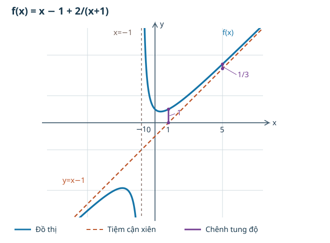

# Bài 3. Đường tiệm cận của đồ thị hàm số

TOÁN 12 · CHƯƠNG I · KIẾN THỨC SGK KNTT · TẬP MỘT

Đọc xu hướng của đồ thị ở xa hoặc gần một vị trí đặc biệt, từ đó nhận biết đường tiệm cận ngang, đứng và xiên bằng giới hạn.

<nav class="thpt-r4-lesson-tabs"><a href="../">Chương I</a><a href="../bai-2/">Bài trước</a><a href="../luyen-tap/#b03-core">Core/Luyện tập</a><a href="../bai-4/">Bài tiếp theo</a></nav>

=== "Khám phá kiến thức"

    ### 1.1. Đường tiệm cận ngang

    Trong một mô hình phân rã, lượng chất còn lại sau \(t\) ngày là \(m(t)=15e^{-0{,}012t}\) gam, với \(t\ge0\). Ban đầu có \(15\) gam. Thời gian càng dài, lượng chất càng nhỏ; trong mô hình này, nó luôn dương tại mọi thời điểm hữu hạn. Vì \(e^{-0{,}012t}\to0\) khi \(t\to+\infty\), đồ thị tiến sát trục hoành \(y=0\). Đường thẳng này giúp mô tả xu hướng của lượng chất về lâu dài, dù mô hình không cho \(m(t)=0\) tại thời điểm hữu hạn nào.

    Hãy xét một đường cong khác, \(f(x)=\dfrac{3x+1}{x-2}\). Với \(x\ne2\), ta viết lại

    \[
    f(x)=3+\frac7{x-2}.
    \]

    Khi \(x\) rất lớn hoặc rất âm, phân số \(7/(x-2)\) trở nên nhỏ về độ lớn. Chẳng hạn tại \(x=102\), \(f(x)=3{,}07\); tại \(x=-98\), \(f(x)=2{,}93\). Cả hai giá trị đều chỉ cách \(3\) một lượng \(0{,}07\), và khoảng cách ấy có thể nhỏ tùy ý khi \(|x|\) đủ lớn.

    <figure class="thpt-r4-plot thpt-r4-calculus-figure"><figcaption><strong>Đọc hình:</strong> đường cong màu xanh là đồ thị, hai đường đứt nét là đường thẳng tiệm cận. Trước hết nhìn hai đầu xa của đường cong: nhánh trái tiến gần \(y=3\) từ dưới, nhánh phải tiến gần \(y=3\) từ trên. Đường đứng sẽ được giải thích ở mục tiếp theo.</figcaption></figure>

    Về hình học, điểm \(M(x;f(x))\) trên đồ thị cách đường ngang \(y=L\) một khoảng \(|f(x)-L|\). Nếu khoảng cách này tiến về \(0\) khi \(x\to+\infty\) hoặc \(x\to-\infty\), ta gọi \(y=L\) là **đường tiệm cận ngang**. Với hàm trên, \(L=3\) vì \(|f(x)-3|=7/|x-2|\to0\) ở cả hai phía.

    Không nhất thiết hai phía phải tiến tới cùng một đường. Xét \(g(x)=x/\sqrt{x^2+1}\). Vì \(\sqrt{x^2+1}=|x|\sqrt{1+1/x^2}\) khi \(x\ne0\), nên \(g(x)\to1\) khi \(x\to+\infty\) nhưng \(g(x)\to-1\) khi \(x\to-\infty\). Hai đường \(y=1\), \(y=-1\) đều là tiệm cận ngang, mỗi đường ứng với một đầu của đồ thị.

    **Vận dụng.** Tìm tiệm cận ngang của \(f(x)=\dfrac{5x-3}{2x+1}\). Tính riêng giới hạn ở hai đầu vô cực.

    ??? question "Đối chiếu"

        Khi \(x\ne0,-1/2\), \(f(x)=\dfrac{5-3/x}{2+1/x}\). Vì \(1/x\to0\) ở cả hai đầu vô cực nên cả hai giới hạn đều bằng \(5/2\). Đồ thị có một tiệm cận ngang \(y=5/2\).

    ??? tip "Kiểm lỗi"

        Nếu em viết \(x=5/2\), hãy kiểm lại: giới hạn đang xét là giá trị của \(f(x)\), tức tung độ, nên đường thẳng phải có dạng \(y=L\). Hai giới hạn cùng bằng \(5/2\) chỉ cho một đường, không phải hai đường trùng nhau.

    ### 1.2. Đường tiệm cận đứng

    Quay lại hàm \(f(x)=3+7/(x-2)\). Lần này không cho \(x\) đi ra xa, mà cho \(x\) đến gần \(2\). Khoảng cách từ điểm trên đồ thị đến đường đứng \(x=2\) bằng \(|x-2|\). Khi \(x=2{,}1\), tung độ bằng \(73\); khi \(x=2{,}01\), tung độ bằng \(703\). Khoảng cách ngang đến đường \(x=2\) giảm, nhưng tung độ tăng rất nhanh và có thể lớn tùy ý. Nếu tiến từ phía trái, mẫu \(x-2\) âm nên tung độ lại giảm không giới hạn.

    \[
    \lim_{x\to2^-}f(x)=-\infty,\qquad
    \lim_{x\to2^+}f(x)=+\infty.
    \]

    <figure class="thpt-r4-plot thpt-r4-calculus-figure"><figcaption><strong>Đọc hình:</strong> lần này chỉ nhìn gần đường đứng \(x=2\). Nhánh bên trái đi xuống, nhánh bên phải đi lên. Không nối hai nhánh qua \(x=2\), vì giá trị hàm không tồn tại ở đó.</figcaption></figure>

    Đường \(x=a\) là **tiệm cận đứng** nếu ít nhất một giới hạn một phía khi \(x\) đến \(a\) bằng \(+\infty\) hoặc \(-\infty\). Chỉ một phía đã đủ. Chẳng hạn \(1/\sqrt{x}\) có miền \(x>0\); khi \(x\to0^+\), hàm tiến tới \(+\infty\), nên \(x=0\) là tiệm cận đứng dù không có nhánh trái trong miền xác định.

    Mẫu bằng \(0\) không tự động tạo tiệm cận đứng. Với \(h(x)=(x^2-1)/(x-1)\), hàm chỉ xác định khi \(x\ne1\), và trên miền đó \(h(x)=x+1\). Khi \(x\) đến \(1\) từ hai phía, tung độ tiến tới \(2\), không ra vô cực. Đồ thị là đường thẳng \(y=x+1\) khuyết điểm \((1;2)\). Đây là một lỗ trên đồ thị, không phải tiệm cận đứng tại \(x=1\).

    Trong thực tế, tiệm cận đứng đôi khi chỉ ra giới hạn của một mô hình. Chẳng hạn chi phí để loại bỏ \(p\%\) tảo độc được mô hình hóa bằng \(C(p)=45p/(100-p)\) triệu đồng với \(0\le p<100\). Khi \(p\to100^-\), mẫu dương tiến về \(0\), tử tiến tới \(4500\), nên \(C(p)\to+\infty\). Đường \(p=100\) là tiệm cận đứng: theo mô hình, chi phí tăng không giới hạn khi mức loại bỏ tiến đến \(100\%\). Không thể thay \(p=100\) để tính một chi phí hữu hạn, cũng không kết luận mô hình đúng bên ngoài miền đã cho.

    **Vận dụng.** Tìm các tiệm cận đứng của \(g(x)=\dfrac{x^2-4}{(x-2)(x+1)}\).

    ??? question "Đối chiếu"

        Miền xác định loại \(2,-1\). Với \(x\) thuộc miền, \(g(x)=(x+2)/(x+1)=1+1/(x+1)\). Khi \(x\to-1^-\), hàm tiến tới \(-\infty\); khi \(x\to-1^+\), hàm tiến tới \(+\infty\). Khi \(x\to2\), giới hạn bằng \(4/3\). Vậy chỉ có tiệm cận đứng \(x=-1\); tại \(x=2\) là điểm khuyết.

    ??? tip "Kiểm lỗi"

        Nếu em chọn cả \(x=2\), hãy phân tích \(x^2-4=(x-2)(x+2)\) rồi tính lại giới hạn. Rút gọn không làm \(2\) trở lại miền xác định, nhưng cho thấy tung độ tiến tới số hữu hạn.

    ### 1.3. Đường tiệm cận xiên

    Một đường cong có thể tiến gần một đường thẳng nghiêng chứ không tiến gần một mức ngang. Xét \(f(x)=x-1+2/(x+1)\). Khi \(x\) đi ra xa về hai phía, số hạng \(x-1\) không tiến tới một số hữu hạn. Tuy nhiên, **hiệu giữa tung độ của đường cong và tung độ của đường thẳng cùng hoành độ** là

    \[
    f(x)-(x-1)=\frac2{x+1}\longrightarrow0
    \quad\text{khi }x\to\pm\infty.
    \]

    <figure class="thpt-r4-plot thpt-r4-calculus-figure"><figcaption><strong>Đọc hình:</strong> đường cong và đường thẳng xiên cùng tăng về phía phải, cùng giảm về phía trái khi đi ra xa. Tại hai hoành độ \(1\) và \(5\), độ chênh tung độ tương ứng là \(1\) và \(1/3\). Đường cong tiến sát đường xiên khi đi xa, không phải khi \(x\) tiến sát \(-1\).</figcaption></figure>

    Đối với đường \(y=ax+b\), khoảng cách vuông góc từ \(M(x;f(x))\) đến đường ấy là \(|f(x)-(ax+b)|/\sqrt{1+a^2}\). Hệ số ở mẫu không đổi, nên việc hiệu tung độ tiến tới \(0\) cũng làm khoảng cách này tiến tới \(0\). Khi \(a\ne0\), đường ấy được gọi là **tiệm cận xiên** nếu hiệu tiến tới \(0\) ở ít nhất một đầu vô cực.

    Làm thế nào tìm \(a,b\) khi chưa biết đường thẳng? Nếu ở một đầu vô cực ta có \(f(x)=ax+b+\varepsilon(x)\), trong đó \(\varepsilon(x)\to0\), chia hai vế cho \(x\) cho

    \[
    \frac{f(x)}x=a+\frac bx+\frac{\varepsilon(x)}x\longrightarrow a.
    \]

    Sau khi tìm được \(a\), lấy \(f(x)-ax=b+\varepsilon(x)\to b\). Vì thế có thể tìm hệ số góc trước rồi tìm tung độ gốc bằng hai giới hạn **ở cùng một phía**. Nếu cả hai hữu hạn và \(a\ne0\), ta có tiệm cận xiên. Khi \(a=0\) và \(b\) hữu hạn, kết quả là tiệm cận ngang \(y=b\).

    Với phân thức hữu tỉ có bậc tử lớn hơn bậc mẫu đúng một đơn vị, phép chia đa thức giúp thấy ngay phần bậc nhất. Ví dụ

    \[
    \frac{x^2+1}{x-1}=x+1+\frac2{x-1}.
    \]

    Phần dư tiến về \(0\) ở hai đầu vô cực, nên đường xiên là \(y=x+1\). Ngoài ra, khi \(x\to1^\pm\), phần dư đi ra vô cực nên còn có tiệm cận đứng \(x=1\).

    **Vận dụng.** Tìm tiệm cận đứng và xiên của \(q(x)=\dfrac{2x^2+3}{x+2}\).

    ??? question "Đối chiếu"

        \(q(x)=2x-4+11/(x+2)\), với \(x\ne-2\). Phần dư tiến về \(0\) ở hai đầu vô cực nên \(y=2x-4\) là tiệm cận xiên. Khi \(x\to-2^+\), phần dư tiến tới \(+\infty\), khi \(x\to-2^-\) tiến tới \(-\infty\); vậy \(x=-2\) là tiệm cận đứng. Không có tiệm cận ngang vì phần bậc nhất đi ra vô cực ở cả hai đầu.

    ??? tip "Kiểm lỗi"

        Nhân lại \((x+2)(2x-4)+11=2x^2+3\) để kiểm phép chia. Không bỏ số hạng \(-4\) khi viết phương trình tiệm cận.

    Tiệm cận diễn tả xu hướng khi đi ra xa hoặc gần một mốc có tung độ vô hạn. Nó không có nghĩa đường cong tuyệt đối không được cắt đường thẳng. Chẳng hạn \(y=x/(x^2+1)\) có tiệm cận ngang \(y=0\) ở hai đầu vô cực, nhưng đồ thị đi qua \((0;0)\).

=== "Kiến thức SGK"

    ### 2.1. Đường tiệm cận ngang

    
<strong>Định nghĩa</strong>
Với \(L\in\mathbb R\), đường thẳng \(y=L\) là tiệm cận ngang của đồ thị \(y=f(x)\) nếu \(\displaystyle\lim_{x\to+\infty}f(x)=L\) hoặc \(\displaystyle\lim_{x\to-\infty}f(x)=L\).

    Tính giới hạn ở mỗi đầu vô cực mà miền xác định cho phép. Mỗi giới hạn hữu hạn cho một đường ngang; hai giới hạn bằng nhau chỉ cho một đường. Một giới hạn vô cực không cho tiệm cận ngang tại đầu đó.

    **Cách tính phân thức:** Với hai đa thức khác không, chia tử và mẫu cho lũy thừa bậc cao nhất của mẫu. Nếu bậc tử nhỏ hơn bậc mẫu, giới hạn bằng \(0\); nếu bằng nhau, giới hạn là tỉ số hai hệ số dẫn đầu; nếu bậc tử lớn hơn, không có tiệm cận ngang. Khi có căn, lưu ý \(\sqrt{x^2}=|x|\) để xét đúng từng phía.

    ### 2.2. Đường tiệm cận đứng

    
<strong>Định nghĩa</strong>
Đường thẳng \(x=x_0\) là tiệm cận đứng của đồ thị \(y=f(x)\) nếu ít nhất một trong bốn giới hạn sau đúng:

\(\displaystyle\lim_{x\to x_0^-}f(x)=+\infty\), \(\displaystyle\lim_{x\to x_0^-}f(x)=-\infty\), \(\displaystyle\lim_{x\to x_0^+}f(x)=+\infty\), \(\displaystyle\lim_{x\to x_0^+}f(x)=-\infty\).

    Tìm miền xác định, xét các mốc có khả năng làm hàm đi ra vô cực (chẳng hạn nghiệm mẫu hoặc đầu mút miền của căn, lôgarit). Tính giới hạn một phía qua các giá trị thuộc miền. Với phân thức, nếu mẫu tiến về \(0\) và tử tiến tới một số khác \(0\), xét dấu mẫu để xác định chiều vô cực. Nếu cả tử và mẫu cùng về \(0\), phải biến đổi, không kết luận vội. Một giới hạn hữu hạn không xác nhận tiệm cận đứng.

    ### 2.3. Đường tiệm cận xiên

    
<strong>Định nghĩa</strong>
Đường \(y=ax+b\), với \(a,b\in\mathbb R,\ a\ne0\), là tiệm cận xiên của đồ thị \(y=f(x)\) nếu \(\displaystyle\lim_{x\to+\infty}[f(x)-(ax+b)]=0\) hoặc \(\displaystyle\lim_{x\to-\infty}[f(x)-(ax+b)]=0\).

    
<strong>Cách tìm hệ số của tiệm cận</strong>
Xét riêng từng đầu vô cực. Chẳng hạn, ở đầu \(+\infty\), tính \(\displaystyle a=\lim_{x\to+\infty}\frac{f(x)}x\); nếu \(a\) hữu hạn, tính tiếp \(\displaystyle b=\lim_{x\to+\infty}[f(x)-ax]\). Ở đầu \(-\infty\), thay cả hai hướng giới hạn bằng \(x\to-\infty\). Nếu \(b\) hữu hạn và \(a\ne0\), đường \(y=ax+b\) là tiệm cận xiên ở đầu đang xét. Nếu \(a=0\) và \(b\) hữu hạn, đường \(y=b\) là tiệm cận ngang. Khi cần tìm tất cả tiệm cận, xét riêng hai đầu vô cực mà hàm xác định.

    Với phân thức có bậc tử hơn bậc mẫu đúng \(1\), chia đa thức: \(f(x)=ax+b+R(x)/Q(x)\) với bậc của dư \(R\) nhỏ hơn bậc mẫu \(Q\) (hoặc dư bằng \(0\)). Khi ấy hiệu \(f(x)-(ax+b)\) tiến về \(0\) ở hai đầu vô cực. Giữ nguyên miền xác định ban đầu.

    | Loại đường | Dạng phương trình | Giới hạn quyết định |
    | :-- | :-- | :-- |
    | Ngang | \(y=L\) | \(f(x)\to L\in\mathbb R\) tại một đầu vô cực |
    | Đứng | \(x=x_0\) | \(f(x)\to+\infty\) hoặc \(-\infty\) ở ít nhất một phía của \(x_0\) |
    | Xiên | \(y=ax+b,\ a\ne0\) | \(f(x)-(ax+b)\to0\) tại một đầu vô cực |

    Các đường ngang và xiên phụ thuộc vào giới hạn ở vô cực, không phụ thuộc việc đồ thị có giao chúng ở một hoành độ hữu hạn hay không.

=== "Ví dụ"

    ### 3.1. Tìm đồng thời tiệm cận ngang và đứng của phân thức

    **Đề bài.** Tìm tất cả tiệm cận của đồ thị \(y=(3-x)/(2x+1)\).

    **Phân tích:** Tách phần hằng và phần dư, đồng thời giữ điều kiện mẫu khác \(0\).

    

<strong>Lời giải.</strong> Miền xác định \(x\ne-1/2\). Viết \(f(x)=-1/2+7/[2(2x+1)]\). Hai giới hạn ở vô cực bằng \(-1/2\), nên tiệm cận ngang \(y=-1/2\). Khi \(x\to(-1/2)^-\), hàm tiến tới \(-\infty\), và từ phải tiến tới \(+\infty\), nên tiệm cận đứng \(x=-1/2\). Không có tiệm cận xiên vì hàm có giới hạn hữu hạn tại cả hai đầu vô cực.

    **Kiểm lại:** Hai phương trình cùng chứa số \(-1/2\) nhưng là hai đường khác nhau.

    ### 3.2. Hai tiệm cận ngang khác nhau

    **Đề bài.** Tìm các tiệm cận ngang của \(f(x)=\sqrt{x^2+4}/x\).

    **Phân tích:** Tách trị tuyệt đối của \(x\) ra khỏi căn, không sử dụng \(\sqrt{x^2}=x\) ở phía âm.

    

<strong>Lời giải.</strong> Với \(x\ne0\), \(f(x)=\dfrac{|x|}{x}\sqrt{1+4/x^2}\). Khi \(x\to+\infty\), giới hạn bằng \(1\); khi \(x\to-\infty\), giới hạn bằng \(-1\). Hai tiệm cận ngang là \(y=1\), \(y=-1\).

    **Kiểm lại:** \(f(10)>1\) còn \(f(-10)<-1\); dấu hai phía phù hợp.

    ### 3.3. Phân biệt điểm khuyết với tiệm cận đứng

    **Đề bài.** Tìm tiệm cận đứng của \(f(x)=(x^2+2x-3)/(x-1)\).

    **Phân tích:** Tại \(x=1\) cả tử và mẫu bằng \(0\). Phân tích tử trước khi xét giới hạn.

    

<strong>Lời giải.</strong> \(D=\mathbb R\setminus\{1\}\). Vì \(x^2+2x-3=(x-1)(x+3)\), nên \(f(x)=x+3\) với \(x\ne1\). Hai giới hạn khi \(x\to1^\pm\) đều bằng \(4\). Do hàm liên tục tại mọi điểm khác \(1\), đồ thị không có tiệm cận đứng.

    **Kiểm lại:** Điểm \((1;4)\) không thuộc đồ thị ban đầu dù giới hạn bằng \(4\).

    ### 3.4. Miền xác định chỉ có một phía

    **Đề bài.** Tìm tiệm cận ngang và đứng của đồ thị \(y=\ln(x-2)\).

    **Phân tích:** Miền là \(x>2\); chỉ xét giới hạn bên phải của \(2\) và khi \(x\to+\infty\).

    

<strong>Lời giải.</strong> Khi \(x\to2^+\), \(\ln(x-2)\to-\infty\), nên có tiệm cận đứng \(x=2\). Khi \(x\to+\infty\), hàm tiến tới \(+\infty\), không có tiệm cận ngang.

    **Kiểm lại:** Không yêu cầu giới hạn bên trái ở \(2\); phía đó không thuộc miền xác định.

    ### 3.5. Tìm tiệm cận xiên bằng phép chia

    **Đề bài.** Tìm các tiệm cận của đồ thị \(y=(2x^2+x-1)/(x+2)\).

    **Phân tích:** Bậc tử hơn bậc mẫu \(1\); chia đa thức để tách phần bậc nhất.

    

<strong>Lời giải.</strong> Với \(x\ne-2\), \(f(x)=2x-3+5/(x+2)\). Hiệu \(f(x)-(2x-3)\to0\) tại hai đầu vô cực, nên tiệm cận xiên \(y=2x-3\). Khi \(x\to-2^-\) hàm tiến tới \(-\infty\), từ phải tiến tới \(+\infty\), nên tiệm cận đứng \(x=-2\). Không có tiệm cận ngang.

    **Kiểm lại:** \((x+2)(2x-3)+5=2x^2+x-1\).

    ### 3.6. Tìm hệ số tiệm cận bằng giới hạn

    **Đề bài.** Tìm các tiệm cận xiên của đồ thị \(y=\sqrt{x^2+4}\).

    **Phân tích:** Không có phép chia đa thức. Tính \(a,b\) riêng tại hai đầu vô cực, dùng biểu thức liên hợp để khử dạng vô định.

    

<strong>Lời giải.</strong> Khi \(x\to+\infty\), \(f(x)/x\to1\). Ta có \(f(x)-x=4/(\sqrt{x^2+4}+x)\to0\), nên \(y=x\) là tiệm cận xiên phía phải. Khi \(x\to-\infty\), \(f(x)/x\to-1\). Ta có \(f(x)+x=4/(\sqrt{x^2+4}-x)\to0\), nên \(y=-x\) là tiệm cận xiên phía trái.

    **Kiểm lại:** Cả hai mẫu liên hợp đi tới \(+\infty\) ở đúng phía đang xét. Không dùng một hệ số góc cho cả hai phía.

    ### 3.7. Đồ thị có thể cắt tiệm cận xiên

    **Đề bài.** Cho \(f(x)=x+2+x/(x^2+1)\). Tìm tiệm cận xiên và giao điểm của đồ thị với đường ấy.

    **Phân tích:** Tách sẵn phần bậc nhất; điều kiện giao điểm là hiệu bằng \(0\), khác điều kiện giới hạn.

    

<strong>Lời giải.</strong> \(f(x)-(x+2)=x/(x^2+1)\to0\) ở cả hai đầu vô cực, nên \(y=x+2\) là tiệm cận xiên. Phương trình giao điểm \(x/(x^2+1)=0\) có nghiệm duy nhất \(x=0\), suy ra giao điểm \((0;2)\).

    **Kiểm lại:** \(f(0)=2\) và \(0+2=2\). Sự tồn tại giao điểm không làm thay đổi giới hạn ở vô cực.

    ### 3.8. Phân tích ba nhánh đồ thị có hai tiệm cận đứng

    **Đề bài.** Cho \(f(x)=2x^2/(x^2-1)\). Xác định các tiệm cận và chiều tiến sát của từng nhánh tại hai mốc \(x=\pm1\).

    **Phân tích:** \(f(x)=2+2/(x^2-1)\). Mẫu dương ở ngoài đoạn \([-1;1]\), âm ở bên trong; tử phần dư luôn dương.

    

<strong>Lời giải.</strong> Hai giới hạn tại vô cực bằng \(2\), nên \(y=2\) là tiệm cận ngang. Tại \(-1\), giới hạn bên trái \(+\infty\), bên phải \(-\infty\). Tại \(1\), giới hạn bên trái \(-\infty\), bên phải \(+\infty\). Vậy \(x=-1,\ x=1\) là hai tiệm cận đứng. Không có tiệm cận xiên.

    **Kiểm lại:** Hàm chẵn; hai nhánh ngoài đối xứng qua trục tung và nhánh giữa đi qua \(O(0;0)\).

    ### 3.9. Chi phí trung bình giảm về một mức giới hạn

    **Đề bài.** Tổng chi phí sản xuất \(x\) sản phẩm được mô hình hóa bởi \(C(x)=3x+60\) triệu đồng, \(x\) nguyên dương. Xét hàm mở rộng \(A(x)=C(x)/x\) với \(x>0\); tìm tiệm cận ngang và giải thích ý nghĩa.

    **Phân tích:** Chi phí trung bình khác tổng chi phí. Khi sản lượng tăng, phần chi phí cố định được chia cho nhiều sản phẩm.

    

<strong>Lời giải.</strong> \(A(x)=3+60/x\) triệu đồng/sản phẩm; \(A'(x)=-60/x^2&lt;0\) trên \(x&gt;0\). Khi \(x\to+\infty\), \(A(x)\to3\), nên \(y=3\) là tiệm cận ngang của đồ thị hàm mở rộng. Theo mô hình, sản lượng tăng làm chi phí trung bình giảm dần về \(3\) triệu đồng/sản phẩm nhưng vẫn lớn hơn mức ấy với mọi sản lượng hữu hạn.

    **Kiểm lại:** Với \(x=60\), chi phí trung bình là \(4\) triệu đồng; với \(x=120\), là \(3{,}5\) triệu đồng. Không suy diễn rằng tổng chi phí giảm.

    ### 3.10. Tiệm cận của mô hình hình học

    **Đề bài.** Hình chữ nhật có diện tích \(96\) m², một cạnh dài \(x\) m. Viết hàm chu vi và tìm các tiệm cận trên miền thực tế.

    **Phân tích:** Cạnh còn lại bằng \(96/x\); vì hai cạnh dương, miền thực tế chỉ có \(x>0\).

    

<strong>Lời giải.</strong> \(P(x)=2(x+96/x)=2x+192/x\) mét. Khi \(x\to0^+\), \(P(x)\to+\infty\), nên \(x=0\) là tiệm cận đứng. Khi \(x\to+\infty\), \(P(x)-2x=192/x\to0\), nên \(y=2x\) là tiệm cận xiên của đồ thị \(y=P(x)\). Không có tiệm cận ngang vì \(P(x)\to+\infty\) tại đầu vô cực.

    **Kiểm lại:** Khi một cạnh rất ngắn, cạnh kia rất dài và chu vi tăng không giới hạn. Khi \(x\) rất lớn, phần chu vi do cạnh ngắn đóng góp tiến về \(0\); chu vi gần \(2x\). Không xét các chiều dài âm.

=== "Lỗi thường gặp"

    ### 4.1. Đổi nhầm dạng phương trình

    **Sai ở đâu:** \(\lim_{x\to+\infty}f(x)=3\) rồi viết tiệm cận \(x=3\).

    **Vì sao sai:** Giới hạn là tung độ của đồ thị khi hoành độ đi ra xa.

    **Cách sửa:** Viết tiệm cận ngang \(y=3\). Đường đứng \(x=a\) chỉ xuất hiện khi giới hạn vô cực tại mốc \(a\).

    ### 4.2. Cho rằng mẫu bằng không luôn là tiệm cận đứng

    **Sai ở đâu:** Kết luận \(x=2\) là tiệm cận đứng của \((x^2-4)/(x-2)\).

    **Vì sao sai:** Trên miền \(x\ne2\), hàm bằng \(x+2\), giới hạn tại \(2\) là \(4\).

    **Cách sửa:** Tìm miền, rút gọn nếu có thể rồi tính giới hạn một phía; phân biệt điểm khuyết và giới hạn vô cực.

    ### 4.3. Bắt buộc cả hai giới hạn một phía đều vô cực

    **Sai ở đâu:** Hàm \(1/\sqrt{x}\) không có tiệm cận đứng vì không xác định ở phía trái của \(0\).

    **Vì sao sai:** Chỉ một phía có giới hạn vô cực là đủ.

    **Cách sửa:** Xét \(x\to0^+\), giới hạn \(+\infty\); viết \(x=0\).

    ### 4.4. Không tách hai đầu vô cực

    **Sai ở đâu:** Dùng \(\sqrt{x^2}=x\) cho cả \(x>0\) và \(x<0\).

    **Vì sao sai:** Căn bậc hai số học không âm; \(\sqrt{x^2}=|x|\).

    **Cách sửa:** Xét \(|x|/x\) riêng ở hai phía. Với \(\sqrt{x^2+4}/x\), hai giới hạn là \(1\) và \(-1\).

    ### 4.5. Chỉ tìm hệ số góc của tiệm cận xiên

    **Sai ở đâu:** Tìm được \(\lim f(x)/x=2\) rồi kết luận \(y=2x\) là tiệm cận xiên.

    **Vì sao sai:** Cần biết cả \(b=\lim[f(x)-2x]\), và giới hạn này phải hữu hạn ở cùng một đầu vô cực.

    **Cách sửa:** Tính tiếp \(b\), hoặc kiểm hiệu \(f(x)-(ax+b)\to0\). Ví dụ \(f(x)=2x+\sqrt{x}\) với \(x>0\) có tỉ số tiến tới \(2\) nhưng hiệu \(f(x)-2x\) tiến tới \(+\infty\), không có tiệm cận xiên.

    ### 4.6. Coi giao điểm là lý do loại tiệm cận

    **Sai ở đâu:** Đồ thị cắt đường \(y=0\) nên \(y=0\) không thể là tiệm cận ngang.

    **Vì sao sai:** Một giao điểm hữu hạn không quyết định xu hướng tại vô cực.

    **Cách sửa:** Tính giới hạn. Hàm \(x/(x^2+1)\) đi qua gốc tọa độ và vẫn có tiệm cận ngang \(y=0\).

    ### 4.7. Diễn giải ngoài miền thực tế

    **Sai ở đâu:** Thay \(p=100\) vào mô hình chi phí \(45p/(100-p)\), hoặc xét chi phí với \(p>100\).

    **Vì sao sai:** Mô hình chỉ cho \(0\le p<100\); giới hạn vô cực không phải một giá trị chi phí xác định.

    **Cách sửa:** Ghi giới hạn từ trái và giải thích chi phí tăng không giới hạn theo mô hình khi tiến sát \(100\%\).

    **Học tiếp:** [Core và Luyện tập Bài 3](../luyen-tap/#b03-core) · [Tự kiểm tra cuối chương](../tu-kiem-tra-chuong/).

    
Nguồn đối chiếu: SGK KNTT Toán 12 tập 1, trang in 20–25.

