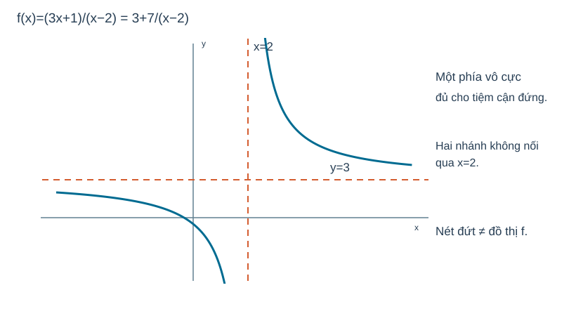

# Toán 12 · Bài 3. Đường tiệm cận của đồ thị hàm số

TOÁN 12 · CHƯƠNG I · SGK KẾT NỐI TRI THỨC · TẬP MỘT · TRANG 20–25

Học Kiến thức trọn vẹn tại đây: hiểu bản chất, xem hình, ví dụ có suy luận và tự thử; sau đó mở Core, Luyện tập, Vận dụng, Tự luận trên trang riêng của Chương I.

<nav class="thpt-r4-lesson-tabs"><a href="../">Chương I</a><a href="../bai-2/">Bài trước</a><a href="../bai-4/">Bài tiếp theo</a></nav>

## 1. Vì sao cần học?

Một mô hình chi phí/đơn vị hoặc đường cong thực nghiệm có thể dần tiến tới mức trần mà không bao giờ chạm đúng mức ấy; một đồ thị có thể tăng/giảm vô hạn gần giá trị đầu vào bị cấm. Các đường thẳng mà đồ thị tiến sát trong các miền đó được gọi là **tiệm cận**. Nhận diện tiệm cận giúp dự đoán xu thế xa và tránh thay trực tiếp một điểm làm mẫu số bằng 0.

## 2. Kiến thức tiền đề

Giới hạn x→±∞, giới hạn một bên x→x0±, phép chia đa thức và rút gọn phân thức, miền xác định, kí hiệu phương trình đường thẳng x=a hoặc y=ax+b. Tự ôn nhanh: 1/(x−2)→+∞ khi x→2+ nhưng →−∞ khi x→2−; một phía đã đủ cho tiệm cận đứng.

## 3. Hiểu bản chất trước công thức

- **Tiệm cận ngang** y=L nếu ít nhất một trong hai giới hạn lim(x→+∞)f(x)=L hoặc lim(x→−∞)f(x)=L hữu hạn. Một đồ thị có thể có **hai đường tiệm cận ngang khác nhau** ở hai phía.
- **Tiệm cận đứng** x=a nếu có ít nhất một giới hạn một bên lim(x→a−)f(x) hoặc lim(x→a+)f(x) bằng +∞ hoặc −∞. Chỉ thấy "mẫu bằng 0" là **ứng viên**, không đủ.
- **Tiệm cận xiên** y=mx+n với m≠0 khi f(x)−(mx+n)→0 lúc x→+∞ hoặc −∞. Nếu muốn tìm hệ số bằng giới hạn và chúng tồn tại: m=lim f(x)/x; n=lim[f(x)−mx] ở cùng một phía. Phép chia đa thức thường nhanh hơn cho phân thức hữu tỉ.
- **Điểm gián đoạn có thể khử:** (x²−1)/(x−1)=(x+1) với x≠1 có lỗ tại (1,2), không có tiệm cận đứng x=1 vì lim x→1 f=2 hữu hạn; không tự "điền" điểm x=1 khi mô tả đồ thị gốc.
- Sự tồn tại tiệm cận là kết luận về **giới hạn**, không phải việc đồ thị không được cắt đường đó. Đồ thị có thể giao tiệm cận ngang hoặc xiên tại một điểm khác.

## 4. Đọc hình và dữ liệu

FIG-G12-B03-01: đường gốc (3x+1)/(x−2), hai nhánh tách bởi **đường đứng x=2**, cùng tiến sát **đường ngang y=3** khi |x| tăng. Đọc phía x=2− xuống −∞, phía x=2+ lên +∞; không nhầm đường kẻ nét đứt là một phần đồ thị. Không suy đoán "giao thì không phải tiệm cận".

<figure class="thpt-r4-plot g12-chi-figure"><figcaption>Hình minh họa 1 · Xem hướng dẫn đọc hình ngay phía trên.</figcaption></figure>

## 5. Ví dụ có suy luận và lý do chọn phương pháp

### Ví dụ 1
f(x)=(3x+1)/(x−2)=3+7/(x−2), x≠2. Tại x→±∞, 7/(x−2)→0 ⇒ tiệm cận ngang y=3. Tại x→2−, f→−∞; x→2+, f→+∞ ⇒ tiệm cận đứng x=2. **Vì sao chia về dạng hằng+phần dư?** Ta nhìn ngay cả hai xu thế. Không nói "x=2 là giá trị lớn nhất" vì x=2 bị loại.

### Ví dụ 2
g(x)=(x²+1)/(x−1)=x+1+2/(x−1). Vì phần dư→0 khi x→±∞ nên tiệm cận xiên y=x+1; g không có tiệm cận ngang. x=1 có lim một bên ±∞ ⇒ tiệm cận đứng x=1. **Vì sao là xiên?** Phần tuyến tính có hệ số x là 1 khác 0.

### Ví dụ 3
h(x)=(x²−1)/(x−1), D=ℝ\{1}; với x≠1, h=x+1. lim(x→1)h=2 hữu hạn. **Không có tiệm cận đứng** x=1 dù mẫu ban đầu bằng0. Đồ thị y=x+1 nhưng khuyết điểm (1,2), không tùy ý sửa D thành ℝ.

### Ví dụ 4
k(x)=x/sqrt(x²+1). x→+∞, k=1/sqrt(1+1/x²)→1. x→−∞, vì sqrt(x²+1)=|x|sqrt(1+1/x²)=−x sqrt(...) nên k→−1. Hai tiệm cận ngang **y=1 ở +∞ và y=−1 ở −∞**, phải tách dấu |x|; dùng máy móc căn x²=x sẽ sai ở phía âm.

### Ví dụ 5
m(x)=e^(−x), D=ℝ. Khi x→+∞, m→0, có y=0 tiệm cận ngang. Khi x→−∞, m→+∞, **không** có tiệm cận ngang tại phía âm; không có tiệm cận đứng vì m liên tục hữu hạn ở mọi x hữu hạn. Có thể tiến tới đường ngang một phía mà không có hai phía.

## 6. Tự thử trước Core

A. Với f=2+1/(x−4), đoán đường nào là tiệm cận đứng/ngang, vì sao phải nói giới hạn? 
B. (x²−4)/(x−2) có "mẫu bằng0" tại 2: tiệm cận đứng hay lỗ? Tự rút gọn trước.
C. Nếu f(x)−(2x+3)→0 khi x→∞, dạng tiệm cận nào phù hợp? 
Tự trả lời bằng lời trước khi mở Core; sai thì dùng HELP đúng outcome.

## 7. Chuyển sang Core và Luyện tập

Sau khi đọc Kiến thức, Ví dụ và hoàn thành các câu **Tự thử** phía trên, em có thể thực hành tại **trang Core và Luyện tập của Chương I**. Câu hỏi vẫn được chia theo từng bài, không cần tìm trong các bài học khác.

<nav class="thpt-r4-lesson-tabs"><a href="../luyen-tap/#b03-core">✎ Core · Bài 3</a><a href="../luyen-tap/#b03-practice">✎ Luyện tập · Vận dụng · Tự luận · Bài 3</a><a href="../luyen-tap/#b03-help">Hướng dẫn khi gặp khó khăn · Bài 3</a></nav>

<nav class="thpt-r4-lesson-tabs"><a href="../">Chương I</a><a href="../bai-4/">Bài tiếp theo</a></nav>

