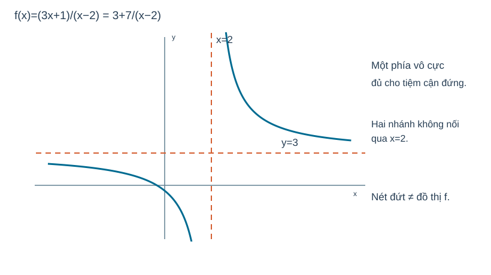

# Toán 12 · Bài 3. Đường tiệm cận của đồ thị hàm số

TOÁN 12 · CHƯƠNG I · SGK KẾT NỐI TRI THỨC · TẬP MỘT · TRANG 20–25

Hiểu bản chất, tự vận dụng, đối chiếu sau khi làm, rồi luyện tập theo từng bài.

<nav class="thpt-r4-lesson-tabs"><a href="../">Chương I</a><a href="../bai-2/">Bài trước</a><a href="../bai-4/">Bài tiếp theo</a></nav>

=== "Khám phá kiến thức"

    Một đường cong có thể ngày càng sát một đường thẳng ở xa hoặc khi tiến gần đầu vào bị loại. Ta đo khoảng cách và xét giới hạn thay vì chỉ nhìn hình. Ôn giới hạn một phía, vô hạn, phép chia đa thức và căn bậc hai.

    ### 1.1. Khoảng cách đến đường ngang
    
    Với M=(x,f(x)) và chân chiếu H=(x,L) trên y=L, khoảng cách $MH=|f(x)-L|$. Nếu nó tiến 0 khi x→+∞ hoặc −∞ thì đồ thị có tiệm cận ngang ở phía đó.
    
    **Vận dụng.** $f(x)=4+2/(x+1)$. Tính MH đến y=4 ở x=9; xét x→∞.
    
    
    
    ??? question "Đối chiếu"
    
        **Lời giải:** $MH=2/|x+1|$, tại 9 bằng 0,2 và tiến 0 ở +∞, nên y=4 là tiệm cận ngang.
    
    
    
    ??? tip "Kiểm lỗi"
    
        Không dùng giá trị tại một điểm làm kết luận giới hạn. [Luyện lại câu tương ứng](../luyen-tap/#thpt-g12-chi-b03-c01)

    ### 1.2. Tiến tới đường đứng
    
    Đường x=a là tiệm cận đứng khi ít nhất một phía f tiến ±∞ khi x→a. Chỉ mẫu bằng 0 chưa đủ.
    
    <figure class="thpt-r4-plot g12-chi-figure"><figcaption>Nhánh trái đi xuống −∞ gần x=2; nhánh phải đi lên +∞. Ở xa hai phía, khoảng cách tới y=3 tiến 0. Nét đứt là tiệm cận.</figcaption></figure>
    
    **Vận dụng.** $f=-2/(x-4)$, xét x→4 từ hai phía.
    
    
    
    ??? question "Đối chiếu"
    
        **Lời giải:** Trái +∞, phải −∞. Đường x=4 là tiệm cận đứng.
    
    
    
    ??? tip "Kiểm lỗi"
    
        Kiểm dấu tử và mẫu từng phía. [Luyện lại câu tương ứng](../luyen-tap/#thpt-g12-chi-b03-c02)

    ### 1.3. Đường xiên
    
    Với y=mx+n, m≠0, khoảng cách vuông góc từ M đến đường là $|f(x)-mx-n|/\sqrt{m^2+1}$. Khoảng cách tiến 0 nếu hiệu tiến 0.
    
    **Vận dụng.** $g=(x^2+3x+5)/(x+2)$. Tìm tiệm cận xiên.
    
    
    
    ??? question "Đối chiếu"
    
        **Lời giải:** $g=x+1+3/(x+2)$; hiệu với x+1 tiến 0 khi x→±∞, nên y=x+1.
    
    
    
    ??? tip "Kiểm lỗi"
    
        Chia đa thức; không lấy tỉ số hệ số bậc cao làm tiệm cận ngang. [Luyện lại câu tương ứng](../luyen-tap/#thpt-g12-chi-b03-c03)

    ### 1.4. Điểm khuyết không phải tiệm cận
    
    Nếu rút gọn được nhân tử gây mẫu bằng 0 nhưng giới hạn hữu hạn thì có thể chỉ là điểm khuyết; miền gốc vẫn giữ.
    
    **Vận dụng.** $f=(x^2-16)/(x-4)$. Điểm x=4 là tiệm cận đứng không?
    
    
    
    ??? question "Đối chiếu"
    
        **Lời giải:** $f=x+4$ với x≠4; giới hạn bằng 8. Không tiệm cận đứng, khuyết (4;8).
    
    
    
    ??? tip "Kiểm lỗi"
    
        Không điền chấm đặc ở điểm bị loại. [Luyện lại câu tương ứng](../luyen-tap/#thpt-g12-chi-b03-c04)

    ### 1.5. Một phía hợp lệ là đủ
    
    Nếu miền chỉ ở bên phải a, chỉ xét giới hạn bên phải. Không bịa thêm nhánh bên trái.
    
    **Vận dụng.** $f=2/\sqrt{x-5}$ có tiệm cận đứng nào?
    
    
    
    ??? question "Đối chiếu"
    
        **Lời giải:** D=(5,+∞); khi x→5+ thì f→+∞, nên x=5.
    
    
    
    ??? tip "Kiểm lỗi"
    
        Kiểm điều kiện căn ở mẫu >0. [Luyện lại câu tương ứng](../luyen-tap/#thpt-g12-chi-b03-p04)

    ### 1.6. Vị trí nhánh so với tiệm cận
    
    Dấu của $f(x)-L$ cho biết đồ thị trên hay dưới y=L. Đường tiệm cận nói về xu thế, không phải lệnh cấm giao.
    
    **Vận dụng.** $f=2-3/(x+4)$. Nhánh trái và phải ở đâu so với y=2?
    
    
    
    ??? question "Đối chiếu"
    
        **Lời giải:** Trái x<−4: hiệu dương, trên; phải x>−4: hiệu âm, dưới.
    
    
    
    ??? tip "Kiểm lỗi"
    
        Tìm dấu phần dư, không đoán từ chữ 'tiệm cận'. [Luyện lại câu tương ứng](../luyen-tap/#thpt-g12-chi-b03-p06)

=== "Kiến thức SGK"

    ### 2.1. Đường tiệm cận ngang
    
    
<strong>Đường tiệm cận ngang</strong>
Đường y=L là tiệm cận ngang nếu \(\lim_{x\to+\infty}f(x)=L\) hoặc \(\lim_{x\to-\infty}f(x)=L\) hữu hạn. Hai phía có thể cho hai đường khác nhau. Không đòi cả hai phía cùng tồn tại.

    ### 2.2. Đường tiệm cận đứng
    
    
<strong>Đường tiệm cận đứng</strong>
Đường x=a là tiệm cận đứng nếu ít nhất một trong các giới hạn \(\lim_{x\to a^-} f(x)\), \(\lim_{x\to a^+} f(x)\) bằng \(+\infty\) hoặc \(-\infty\) (chỉ xét phía có miền xác định tiến tới a). Mẫu bằng 0 chỉ là nơi cần xét.

    ### 2.3. Đường tiệm cận xiên
    
    
<strong>Đường tiệm cận xiên</strong>
Đường y=mx+n với m≠0 là tiệm cận xiên nếu \(\lim_{x\to+\infty}[f(x)-(mx+n)]=0\) hoặc giới hạn tương ứng khi x→−∞ bằng 0. Nếu tìm bằng giới hạn, \(m=\lim f(x)/x\), \(n=\lim[f(x)-mx]\) hữu hạn ở cùng phía, m≠0; kiểm lại hiệu. Phép chia đa thức thường nhanh với phân thức. Đồ thị nói chung có thể giao tiệm cận tại điểm hữu hạn.

=== "Ví dụ"

    ### 3.1. Phân thức có ngang và đứng
    
    

<strong>Đề bài:</strong> \(f=(3x+1)/(x-2)\).

<strong>Phân tích:</strong> Tách hằng và phần dư.

<strong>Lời giải:</strong> \(f=3+7/(x-2)\), x≠2; hai phía vô hạn tiến 3; x→2− cho −∞, x→2+ cho +∞. Tiệm cận y=3, x=2.

<strong>Kiểm lại:</strong> Khớp hình.

    ### 3.2. Tiệm cận xiên
    
    

<strong>Đề bài:</strong> \(g=(x^2+4)/(x-1)\).

<strong>Phân tích:</strong> Chia đa thức.

<strong>Lời giải:</strong> \(g=x+1+5/(x-1)\); xiên y=x+1, đứng x=1. Không ngang vì phần tuyến tính không bị chặn.

<strong>Kiểm lại:</strong> Dư 5 khác 0.

    ### 3.3. Điểm khuyết
    
    

<strong>Đề bài:</strong> \(h=(x^2-1)/(x-1)\).

<strong>Phân tích:</strong> Rút gọn nhưng giữ miền.

<strong>Lời giải:</strong> \(h=x+1\) với x≠1; giới hạn tại 1 bằng 2, không đứng. Đồ thị đường thẳng khuyết (1;2).

<strong>Kiểm lại:</strong> Không thêm điểm x=1.

    ### 3.4. Hai tiệm cận ngang
    
    

<strong>Đề bài:</strong> \(k=2x/\sqrt{x^2+1}\).

<strong>Phân tích:</strong> Tách |x| khi đưa x ra ngoài căn.

<strong>Lời giải:</strong> \(k=2(x/|x|)/\sqrt{1+1/x^2}\) với x≠0. Giới hạn phải 2, trái −2; hai tiệm cận ngang.

<strong>Kiểm lại:</strong> Không nhầm căn x² bằng x khi x âm.

    ### 3.5. Một phía vô hạn
    
    

<strong>Đề bài:</strong> \(m=e^{-2x}\).

<strong>Phân tích:</strong> Xét riêng hai hướng.

<strong>Lời giải:</strong> Khi x→+∞, m→0; khi x→−∞, m→+∞. Ngang y=0 ở phía phải; không đứng vì hàm liên tục trên \(\mathbb R\).

<strong>Kiểm lại:</strong> Không có ngang ở phía trái.

    ### 3.6. Chi phí bình quân
    
    

<strong>Đề bài:</strong> Tổng chi phí \(C(q)=150+6q\) nghìn đồng, q&gt;0. Tìm tiệm cận chi phí mỗi sản phẩm.

<strong>Phân tích:</strong> Chia tổng chi phí cho sản lượng.

<strong>Lời giải:</strong> \(c(q)=6+150/q\). Khi q→∞, c→6 nghìn đồng/sp; khi q→0+, c→+∞. Tiệm cận ngang y=6 và đứng q=0 trong mô hình liên tục.

<strong>Kiểm lại:</strong> Sản lượng thật nguyên dương, giới hạn ở 0 là lý tưởng hóa.

=== "Lỗi thường gặp"

    ### 4.1. Khoảng cách đến đường ngang
    
    ??? tip "Cách tự sửa"
    
        Không dùng giá trị tại một điểm làm kết luận giới hạn. Sau khi kiểm lại lý do, tự giải một câu khác trong [Core/Luyện tập](../luyen-tap/#thpt-g12-chi-b03-c01).

    ### 4.2. Tiến tới đường đứng
    
    ??? tip "Cách tự sửa"
    
        Kiểm dấu tử và mẫu từng phía. Sau khi kiểm lại lý do, tự giải một câu khác trong [Core/Luyện tập](../luyen-tap/#thpt-g12-chi-b03-c02).

    ### 4.3. Đường xiên
    
    ??? tip "Cách tự sửa"
    
        Chia đa thức; không lấy tỉ số hệ số bậc cao làm tiệm cận ngang. Sau khi kiểm lại lý do, tự giải một câu khác trong [Core/Luyện tập](../luyen-tap/#thpt-g12-chi-b03-c03).

    ### 4.4. Điểm khuyết không phải tiệm cận
    
    ??? tip "Cách tự sửa"
    
        Không điền chấm đặc ở điểm bị loại. Sau khi kiểm lại lý do, tự giải một câu khác trong [Core/Luyện tập](../luyen-tap/#thpt-g12-chi-b03-c04).

    ### 4.5. Một phía hợp lệ là đủ
    
    ??? tip "Cách tự sửa"
    
        Kiểm điều kiện căn ở mẫu >0. Sau khi kiểm lại lý do, tự giải một câu khác trong [Core/Luyện tập](../luyen-tap/#thpt-g12-chi-b03-p04).

    ### 4.6. Vị trí nhánh so với tiệm cận
    
    ??? tip "Cách tự sửa"
    
        Tìm dấu phần dư, không đoán từ chữ 'tiệm cận'. Sau khi kiểm lại lý do, tự giải một câu khác trong [Core/Luyện tập](../luyen-tap/#thpt-g12-chi-b03-p06).

    [Core Bài 3](../luyen-tap/#b03-core) · [Luyện tập, Vận dụng, Tự luận](../luyen-tap/#b03-practice) · [Hỗ trợ khi gặp khó khăn](../luyen-tap/#b03-help) · [Tự kiểm tra cuối chương](tu-kiem-tra-chuong.md)

*Nguồn đối chiếu: SGK Toán 12 Kết nối tri thức, Tập một, trang in 20–25.*
