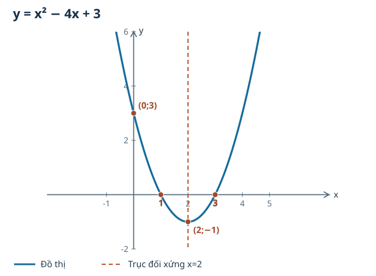
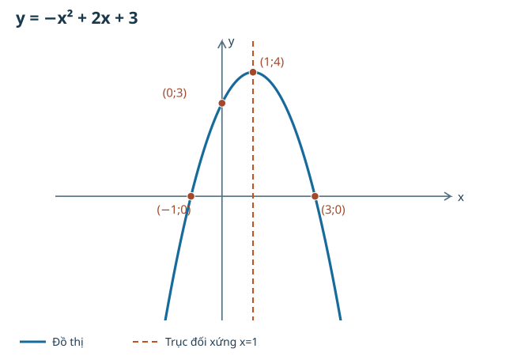
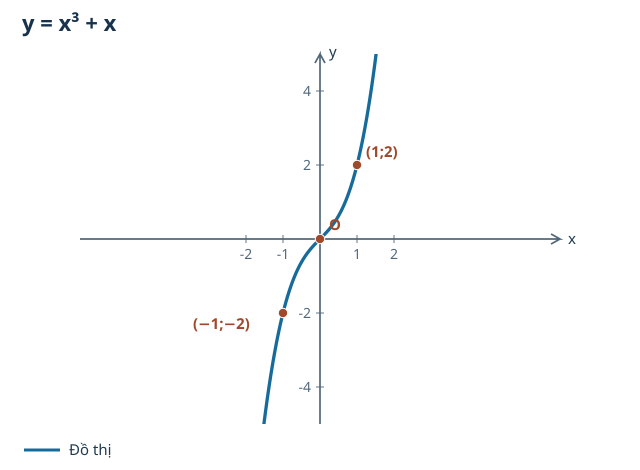
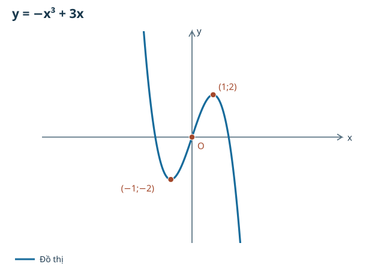
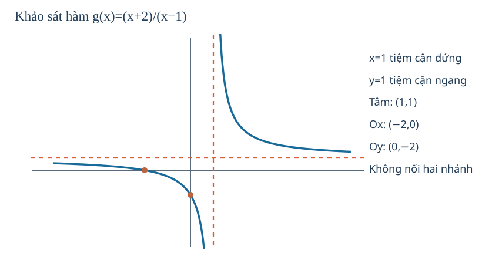
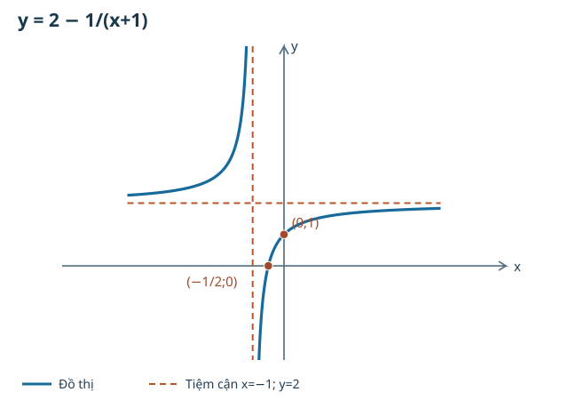
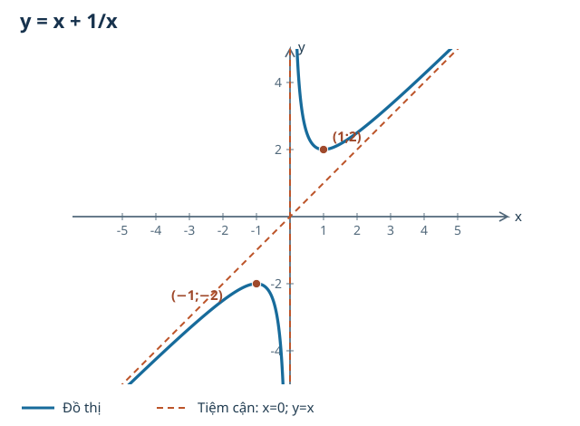
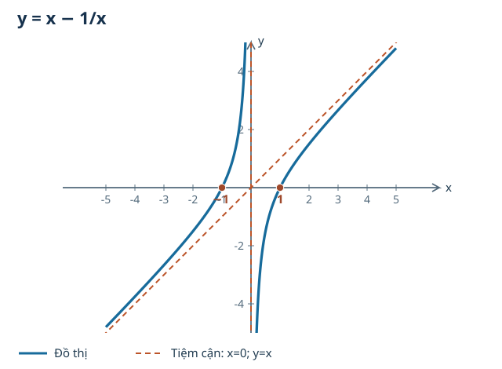
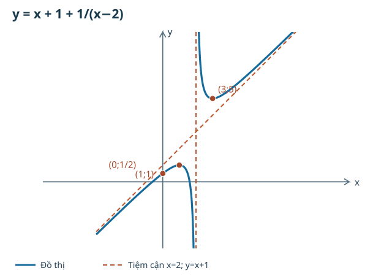

# Bài 4. Khảo sát sự biến thiên và vẽ đồ thị của hàm số

TOÁN 12 · CHƯƠNG I · KIẾN THỨC SGK KNTT · TẬP MỘT

Kết hợp miền xác định, đạo hàm, cực trị và giới hạn để dựng đồ thị; nhận biết hình dạng và tính đối xứng của các hàm số thường gặp.

<nav class="thpt-r4-lesson-tabs"><a href="../">Chương I</a><a href="../bai-3/">Bài trước</a><a href="../luyen-tap/#b04-core">Core/Luyện tập</a><a href="../bai-5/">Bài tiếp theo</a></nav>

=== "Khám phá kiến thức"

    ### 1.1. Sơ đồ khảo sát hàm số

    Ở ba bài trước, ta đã học cách nhận biết hàm tăng hay giảm, tìm cực trị và tiệm cận. Bây giờ hãy tưởng tượng chỉ biết phương trình của một đường cong nhưng chưa nhìn thấy hình của nó. Mỗi kết quả đã học cung cấp một mảnh thông tin: miền xác định cho biết nơi có thể vẽ; dấu đạo hàm cho biết đường đi lên hay xuống; cực trị cho biết vị trí đổi chiều; giới hạn cho biết đường sẽ đi đâu khi đến biên miền. Khảo sát hàm số là ghép các thông tin này lại trước khi vẽ.

    Bắt đầu với một hàm quen thuộc \(f(x)=x^2-4x+3\). Hàm xác định trên \(\mathbb R\). Vì \(f'(x)=2(x-2)\), đạo hàm âm trước \(2\), bằng \(0\) tại \(2\) và dương sau \(2\). Hàm giảm tới \(x=2\), sau đó tăng; \(f(2)=-1\). Khi \(x\to\pm\infty\), \(f(x)\to+\infty\). Bảng biến thiên tập hợp các kết quả vừa tìm:

    | \(x\) | \(-\infty\) | \((-\infty;2)\) | \(2\) | \((2;+\infty)\) | \(+\infty\) |
    | :-- | :--: | :--: | :--: | :--: | :--: |
    | \(f'\) | | \(-\) | \(0\) | \(+\) | |
    | \(f\) | \(+\infty\) | ↘ | \(-1\) | ↗ | \(+\infty\) |

    Để đặt đúng vị trí đường cong trên hệ trục, ta tính thêm \(f(0)=3\) và giải \(f(x)=0\): \((x-1)(x-3)=0\). Vậy giao với hai trục lần lượt là \((0;3)\), \((1;0)\), \((3;0)\). Viết \(f(x)=(x-2)^2-1\) còn cho thấy đồ thị đối xứng qua đường \(x=2\).

    <figure class="thpt-r4-plot thpt-r4-calculus-figure"><figcaption>Đối chiếu lần lượt bảng biến thiên, đỉnh, các giao điểm và trục đối xứng với đường cong. Không cần tính thật nhiều điểm để biết hình dạng chung.</figcaption></figure>

    Điều quan trọng là **bảng biến thiên không phải hình vẽ**. Nó cho chiều biến thiên và giá trị ở các mốc, nhưng để dựng đường cong, ta còn cần đặt các điểm đặc biệt, vẽ tiệm cận nếu có và lưu ý sự đối xứng. Đồ thị phải nhất quán với tất cả thông tin đó.

    **Vận dụng.** Khảo sát \(g(x)=-x^2+2x+3\) và phác đồ thị trên giấy.

    ??? question "Đối chiếu"

        \(D=\mathbb R,\ g'=-2(x-1)\). Hàm tăng trên \((-\infty;1)\), giảm trên \((1;+\infty)\), cực đại bằng \(g(1)=4\). Hai giới hạn ở vô cực đều là \(-\infty\).

        | \(x\) | \(-\infty\) | \((-\infty;1)\) | \(1\) | \((1;+\infty)\) | \(+\infty\) |
        | :-- | :--: | :--: | :--: | :--: | :--: |
        | \(g'\) | | \(+\) | \(0\) | \(-\) | |
        | \(g\) | \(-\infty\) | ↗ | \(4\) | ↘ | \(-\infty\) |

        Giao \(Oy\) tại \((0;3)\), giao \(Ox\) tại \((-1;0),(3;0)\). Phác parabol mở xuống qua các điểm này, đỉnh \((1;4)\), đối xứng qua \(x=1\).

        <figure class="thpt-r4-plot thpt-r4-calculus-figure"><figcaption>Kiểm vị trí đỉnh, giao trục và hai nhánh.</figcaption></figure>

    ??? tip "Kiểm lỗi"

        Nếu phác parabol mở lên, hãy so dấu của \(g'\) tại \(0\) và \(2\) với hai mũi tên. Đỉnh \((1;4)\) phải nằm cao hơn các điểm lân cận.

    ### 1.2. Khảo sát và vẽ đồ thị hàm số đa thức bậc ba

    Với \(f(x)=ax^3+bx^2+cx+d\), \(a\ne0\), miền xác định luôn là \(\mathbb R\). Khi \(|x|\) rất lớn, số hạng \(ax^3\) chi phối chiều đi của đồ thị. Nếu \(a>0\), đầu trái đi xuống \(-\infty\), đầu phải đi lên \(+\infty\); nếu \(a<0\) thì ngược lại. Đạo hàm là một tam thức bậc hai, nên cách xét dấu đã học giúp ta tìm hình dạng ở giữa hai đầu.

    Xét \(f(x)=x^3-3x^2\). Ta có \(f'=3x(x-2)\), với hai nghiệm \(0,2\). Vì đạo hàm dương ngoài hai nghiệm, âm ở giữa, hàm tăng, giảm rồi tăng. Tại \(0\), \(f(0)=0\) là giá trị cực đại; tại \(2\), \(f(2)=-4\) là giá trị cực tiểu.

    | \(x\) | \(-\infty\) | \((-\infty;0)\) | \(0\) | \((0;2)\) | \(2\) | \((2;+\infty)\) | \(+\infty\) |
    | :-- | :--: | :--: | :--: | :--: | :--: | :--: | :--: |
    | \(f'\) | | \(+\) | \(0\) | \(-\) | \(0\) | \(+\) | |
    | \(f\) | \(-\infty\) | ↗ | \(0\) | ↘ | \(-4\) | ↗ | \(+\infty\) |

    Phương trình \(f(x)=x^2(x-3)=0\) cho hai giao điểm với \(Ox\): \((0;0)\), \((3;0)\). Gần \(0\), \(x^2(x-3)\) âm ở cả hai phía trừ chính \(0\); do đó đồ thị chạm trục rồi quay xuống, không xuyên qua trục. Qua \(3\), dấu của hàm đổi nên đồ thị cắt trục.

    <figure class="thpt-r4-plot thpt-r4-calculus-figure"><figcaption>So hình với bảng: tăng tới \((0;0)\), giảm tới \((2;-4)\), rồi tăng qua \((3;0)\). Hai điểm cực trị đối xứng nhau qua \(I(1;-2)\).</figcaption></figure>

    Vì sao \(I(1;-2)\) là tâm? Ta đặt \(x=1+u\), khi đó \(f(1+u)=u^3-3u-2\), nên \(f(1+u)+f(1-u)=-4=2f(1)\). Hai điểm có hoành độ đối xứng qua \(1\) có trung điểm đúng \(I\). Tổng quát, đặt \(x=x_0+u\). Khi khai triển đa thức bậc ba, hệ số của \(u^2\) là \(3ax_0+b\). Chọn \(x_0=-b/(3a)\) thì hệ số này bằng 0; sau khi trừ \(f(x_0)\), chỉ còn \(au^3+(3ax_0^2+2bx_0+c)u\), gồm các lũy thừa lẻ. Vì vậy \(f(x_0+u)+f(x_0-u)=2f(x_0)\). Đó là lý do đồ thị bậc ba có tâm \(I(x_0;f(x_0))\). Cũng có thể tìm \(x_0\) bằng cách giải \(f''(x)=6ax+2b=0\).

    Không phải đồ thị bậc ba nào cũng có hai cực trị. Chẳng hạn \(y=x^3+x\) có \(y'=3x^2+1>0\) trên \(\mathbb R\), do đó đồng biến trên toàn trục số và không có cực trị.

    | \(x\) | \(-\infty\) | | \(+\infty\) |
    | :-- | :--: | :--: | :--: |
    | \(y'\) | | \(+\) | |
    | \(y\) | \(-\infty\) | ↗ | \(+\infty\) |

    <figure class="thpt-r4-plot thpt-r4-calculus-figure"><figcaption>Hàm luôn tăng, qua \(O\), có tâm \(O\). Không cố tạo đỉnh hay đáy chỉ vì đây là hàm bậc ba.</figcaption></figure>

    Trường hợp đạo hàm có nghiệm kép cũng cần chú ý: \(y=x^3\) có \(y'=3x^2\ge0\), bằng \(0\) duy nhất tại \(0\), nhưng không đổi dấu; hàm vẫn đồng biến trên \(\mathbb R\). Các hàm bậc ba không có tiệm cận, vì chúng liên tục trên \(\mathbb R\) và khi đi ra xa, phần bậc ba không thể tiến sát một đường thẳng.

    **Vận dụng.** Khảo sát và phác đồ thị \(y=-x^3+3x\). Tìm cả tâm đối xứng.

    ??? question "Đối chiếu"

        \(D=\mathbb R,\ y'=3(1-x^2)\). Hàm giảm trên \((-\infty;-1)\), tăng trên \((-1;1)\), giảm trên \((1;+\infty)\). Giá trị cực tiểu \(y(-1)=-2\); cực đại \(y(1)=2\).

        | \(x\) | \(-\infty\) | | \(-1\) | | \(1\) | | \(+\infty\) |
        | :-- | :--: | :--: | :--: | :--: | :--: | :--: | :--: |
        | \(y'\) | | \(-\) | \(0\) | \(+\) | \(0\) | \(-\) | |
        | \(y\) | \(+\infty\) | ↘ | \(-2\) | ↗ | \(2\) | ↘ | \(-\infty\) |

        Giao \(Ox\) tại \(x=-\sqrt3,0,\sqrt3\); giao \(Oy\) tại \(O\). Tâm \(O\) vì \(y''=-6x=0\) tại \(0\) và hàm lẻ. Vẽ đường giảm từ đầu trái cao xuống \((-1;-2)\), tăng qua \(O\) tới \((1;2)\), rồi giảm về phía phải thấp, đi qua các giao điểm đã tìm.

        <figure class="thpt-r4-plot thpt-r4-calculus-figure"><figcaption>Kiểm hai cực trị, chiều đi của hai đầu và tâm O.</figcaption></figure>

    ??? tip "Kiểm lỗi"

        Nếu vẽ đầu phải đi lên, kiểm dấu hệ số bậc ba. Nếu hoán đổi cực đại và cực tiểu, xét lại dấu đạo hàm tại \(x=-2,0,2\).

    ### 1.3. Khảo sát và vẽ đồ thị hàm số phân thức hữu tỉ

    **a) Hàm phân thức bậc nhất trên bậc nhất**

    Với \(g(x)=(x+2)/(x-1)=1+3/(x-1)\), ta không được vẽ một đường liền trên toàn trục số. Miền xác định loại \(1\); hai phía của \(1\) phải khảo sát riêng. Đạo hàm \(g'=-3/(x-1)^2<0\) tại mọi điểm xác định, nên hàm nghịch biến trên từng khoảng \((-\infty;1)\), \((1;+\infty)\), không có cực trị.

    Khi \(x\to1^-\), \(g\to-\infty\), khi \(x\to1^+\), \(g\to+\infty\). Hai giới hạn ở vô cực đều bằng \(1\), do đó hai tiệm cận là \(x=1\), \(y=1\).

    | \(x\) | \(-\infty\) | \((-\infty;1)\) | \(1^-\) | \(x=1\) | \(1^+\) | \((1;+\infty)\) | \(+\infty\) |
    | :-- | :--: | :--: | :--: | :--: | :--: | :--: | :--: |
    | \(g'\) | | \(-\) | | ‖ | | \(-\) | |
    | \(g\) | \(1\) | ↘ | \(-\infty\) | ‖ | \(+\infty\) | ↘ | \(1\) |

    Đồ thị cắt \(Ox\) tại \((-2;0)\), cắt \(Oy\) tại \((0;-2)\). Dùng hai giao điểm để xác định nhánh trái. Nhánh phải luôn nằm trên \(y=1\), vì \(3/(x-1)>0\) khi \(x>1\).

    <figure class="thpt-r4-plot thpt-r4-calculus-figure"><figcaption>Vạch đôi trong bảng ứng với đường đứng ngăn hai nhánh. Không nối đường cong qua \(x=1\). Giao hai tiệm cận là tâm \(I(1;1)\).</figcaption></figure>

    Nếu đặt \(u=x-1,\ v=y-1\), phương trình trở thành \(uv=3\). Khi đổi \((u,v)\) thành \((-u,-v)\), tích không đổi; vì vậy đồ thị có tâm \(I\). Khi đổi \((u,v)\) thành \((v,u)\) hoặc \((-v,-u)\), tích cũng không đổi; đây chính là hai phép đối xứng qua \(v=u\) và \(v=-u\). Trong hệ tọa độ ban đầu, hai đường \(y-1=\pm(x-1)\) là hai đường phân giác của hai tiệm cận và là hai trục đối xứng.

    **Vận dụng.** Khảo sát \(y=(2x+1)/(x+1)\) và phác đồ thị. Nêu tâm và hai trục đối xứng.

    ??? question "Đối chiếu"

        \(D=\mathbb R\setminus\{-1\}\), \(y=2-1/(x+1)\), \(y'=1/(x+1)^2>0\). Hàm tăng trên từng khoảng, không có cực trị. Tiệm cận đứng \(x=-1\), ngang \(y=2\).

        | \(x\) | \(-\infty\) | | \(-1^-\) | \(x=-1\) | \(-1^+\) | | \(+\infty\) |
        | :-- | :--: | :--: | :--: | :--: | :--: | :--: | :--: |
        | \(y'\) | | \(+\) | | ‖ | | \(+\) | |
        | \(y\) | \(2\) | ↗ | \(+\infty\) | ‖ | \(-\infty\) | ↗ | \(2\) |

        Giao trục tại \((-1/2;0)\) và \((0;1)\). Tâm \((-1;2)\), trục đối xứng \(y-2=\pm(x+1)\). Vẽ nhánh trái trên \(y=2\), nhánh phải dưới \(y=2\), mỗi nhánh đi lên theo chiều tăng của \(x\).

        <figure class="thpt-r4-plot thpt-r4-calculus-figure"><figcaption>Kiểm mỗi nhánh với dấu phần dư và các điểm giao trục.</figcaption></figure>

    ??? tip "Kiểm lỗi"

        Với \(x<-1\), số \(-1/(x+1)\) dương, nên nhánh trái phải ở trên \(y=2\), không phải dưới. Đừng suy dấu của phần dư chỉ từ dấu tử.

    **b) Hàm phân thức bậc hai trên bậc nhất**

    Nếu tử bậc hai, phép chia đa thức cho dạng tổng quát \(y=mx+n+k/(x-h)\), trong đó \(m\ne0,\ k\ne0\) khi tử không chia hết cho mẫu. Phần dư cho biết nhánh nào nằm trên hoặc dưới tiệm cận xiên; đạo hàm \(y'=m-k/(x-h)^2\) giúp biết có cực trị hay không.

    Xét \(f(x)=x+1/x=(x^2+1)/x\), miền \(x\ne0\). Đạo hàm \(f'=1-1/x^2=(x-1)(x+1)/x^2\) có hai nghiệm \(-1,1\). Hàm tăng trên \((-\infty;-1)\), \((1;+\infty)\), giảm trên \((-1;0)\), \((0;1)\); cực đại tại \(-1\), giá trị \(-2\), cực tiểu tại \(1\), giá trị \(2\).

    Khi \(x\to0^-\), hàm tiến tới \(-\infty\); khi \(x\to0^+\), tiến tới \(+\infty\). Hiệu \(f(x)-x=1/x\to0\) ở hai đầu vô cực. Tiệm cận đứng \(x=0\), xiên \(y=x\).

    | \(x\) | \(-\infty\) | | \(-1\) | | \(0^-\) | \(x=0\) | \(0^+\) | | \(1\) | | \(+\infty\) |
    | :-- | :--: | :--: | :--: | :--: | :--: | :--: | :--: | :--: | :--: | :--: | :--: |
    | \(f'\) | | \(+\) | \(0\) | \(-\) | | ‖ | | \(-\) | \(0\) | \(+\) | |
    | \(f\) | \(-\infty\) | ↗ | \(-2\) | ↘ | \(-\infty\) | ‖ | \(+\infty\) | ↘ | \(2\) | ↗ | \(+\infty\) |

    Không có giao với \(Oy\) vì \(0\) bị loại; không có giao \(Ox\) vì \(x^2+1>0\). Tâm đối xứng \(O\), do \(f(-x)=-f(x)\).

    <figure class="thpt-r4-plot thpt-r4-calculus-figure"><figcaption>Nhánh trái nằm dưới đường \(y=x\), nhánh phải nằm trên. Hai cực trị thuộc hai nhánh khác nhau, nên giá trị cực đại \(-2\) nhỏ hơn giá trị cực tiểu \(2\) không có gì mâu thuẫn.</figcaption></figure>

    Nếu đổi dấu phần dư thành \(y=x-1/x\), đạo hàm trở thành \(1+1/x^2>0\). Hàm luôn tăng trên từng khoảng xác định và không có cực trị. Tiệm cận vẫn là \(x=0\) và \(y=x\), nhưng các giới hạn tại \(0\) đổi dấu.

    | \(x\) | \(-\infty\) | | \(0^-\) | \(x=0\) | \(0^+\) | | \(+\infty\) |
    | :-- | :--: | :--: | :--: | :--: | :--: | :--: | :--: |
    | \(y'\) | | \(+\) | | ‖ | | \(+\) | |
    | \(y\) | \(-\infty\) | ↗ | \(+\infty\) | ‖ | \(-\infty\) | ↗ | \(+\infty\) |

    <figure class="thpt-r4-plot thpt-r4-calculus-figure"><figcaption>Cùng hai tiệm cận với hình trước nhưng không có cực trị; nhánh trái nằm trên đường xiên, nhánh phải nằm dưới. Dấu của phần dư và đạo hàm quyết định hình dạng.</figcaption></figure>

    Với dạng tổng quát \(y=mx+n+k/(x-h)\), đặt \(u=x-h\), \(v=y-(mh+n)\). Khi ấy \(v=mu+k/u\) là hàm lẻ theo \(u\), nên giao điểm \(I(h;mh+n)\) của tiệm cận đứng và xiên là tâm đối xứng. Hai trục đối xứng là hai đường phân giác của các góc tạo bởi hai tiệm cận. Khác trường hợp tiệm cận ngang, các đường phân giác này không nhất thiết có hệ số góc \(\pm1\).

    Để hình dung hai trục đối xứng, hãy vẽ hai tiệm cận rồi vẽ hai đường phân giác của các góc chúng tạo thành. Khi phản chiếu một điểm qua một đường phân giác, hai khoảng cách đến hai tiệm cận đổi chỗ cho nhau. Nếu muốn hiểu thêm vì sao đây là trục đối xứng: trong hệ tọa độ tâm, khoảng cách có dấu đến \(u=0\) là \(u\); đến \(v=mu\) là \((v-mu)/\sqrt{1+m^2}\). Dấu cho biết điểm nằm ở phía nào của đường thẳng. Hai khoảng cách có dấu đổi chỗ, có thể đồng thời đổi dấu. Tích của chúng không đổi; mà phương trình \(u(v-mu)=k\) chính là điều kiện tích hai khoảng cách có dấu bằng một hằng số (sau khi chia cho \(\sqrt{1+m^2}\)). Vì vậy điểm sau phản chiếu vẫn nằm trên đồ thị. Khi phác hình, dùng tính đối xứng này để kiểm tra vị trí các nhánh.

    **Vận dụng.** Khảo sát \(y=(x^2-x-1)/(x-2)\) và phác đồ thị.

    ??? question "Đối chiếu"

        \(D=\mathbb R\setminus\{2\}\). Chia đa thức được \(y=x+1+1/(x-2)\), đạo hàm \(y'=1-1/(x-2)^2\), bằng \(0\) tại \(1,3\). Giá trị cực đại \(y(1)=1\), cực tiểu \(y(3)=5\).

        | \(x\) | \(-\infty\) | | \(1\) | | \(2^-\) | \(x=2\) | \(2^+\) | | \(3\) | | \(+\infty\) |
        | :-- | :--: | :--: | :--: | :--: | :--: | :--: | :--: | :--: | :--: | :--: | :--: |
        | \(y'\) | | \(+\) | \(0\) | \(-\) | | ‖ | | \(-\) | \(0\) | \(+\) | |
        | \(y\) | \(-\infty\) | ↗ | \(1\) | ↘ | \(-\infty\) | ‖ | \(+\infty\) | ↘ | \(5\) | ↗ | \(+\infty\) |

        Tiệm cận \(x=2,\ y=x+1\); tâm \(I(2;3)\). Giao \(Oy\) tại \((0;1/2)\), giao \(Ox\) tại \(x=(1\pm\sqrt5)/2\). Vẽ hai nhánh giống dạng \(x+1/x\) nhưng tịnh tiến: nhánh trái dưới đường xiên, đi qua hai giao điểm \(Ox\) và cực đại \((1;1)\); nhánh phải trên đường xiên, đi qua cực tiểu \((3;5)\). Hai trục đối xứng là hai đường phân giác của \(x=2\) và \(y=x+1\).

        <figure class="thpt-r4-plot thpt-r4-calculus-figure"><figcaption>Kiểm hai cực trị, giao trục, hai giới hạn gần tiệm cận đứng và vị trí so với tiệm cận xiên.</figcaption></figure>

    ??? tip "Kiểm lỗi"

        Nếu chỉ tìm được \(1,3\), hãy nhớ mốc \(2\) vẫn phải chia bảng dù không phải nghiệm đạo hàm. Không ghi cực trị tại \(2\); hàm không xác định ở đó.

    Khảo sát đồ thị còn giúp đọc xu hướng thực tế. Nếu chi phí sản xuất \(x\) sản phẩm là \(C(x)=2x+45\) triệu đồng, chi phí trung bình là \(A(x)=2+45/x\) triệu đồng/sản phẩm. Xét mô hình mở rộng trên \(x\ge1\), \(A'<0\); tại \(1\), \(A=47\), rồi giảm và tiến về \(2\) khi \(x\to+\infty\). Đồ thị chỉ lấy nhánh ứng với \(x\ge1\); không sử dụng các giá trị sản lượng âm. Mức \(2\) là giới hạn, không phải chi phí trung bình đạt được với một sản lượng hữu hạn.

=== "Kiến thức SGK"

    ### 2.1. Sơ đồ khảo sát hàm số

    
<strong>Sơ đồ khảo sát và vẽ đồ thị</strong>
<strong>1. Tập xác định:</strong> tìm miền xác định của hàm.

<strong>2. Sự biến thiên:</strong> tính đạo hàm, tìm các điểm đạo hàm bằng 0 hoặc không tồn tại; xét dấu, kết luận khoảng đơn điệu và cực trị; tính giới hạn ở vô cực và tại các biên có liên quan, tìm tiệm cận; lập bảng biến thiên.

<strong>3. Đồ thị:</strong> dựa vào bảng biến thiên, xác định thêm điểm đặc biệt (giao trục, các điểm dễ tính), vẽ tiệm cận nếu có, lưu ý tính đối xứng và dựng các nhánh.

    Kiểm tra mỗi mũi tên với dấu đạo hàm; mỗi tung độ mốc với giá trị hàm; mỗi đầu nhánh với giới hạn. Vạch đôi phân tách các khoảng tại điểm loại khỏi miền xác định.

    ### 2.2. Khảo sát và vẽ đồ thị hàm số đa thức bậc ba

    
<strong>Hàm bậc ba</strong>
Với \(y=ax^3+bx^2+cx+d,\ a\ne0\): \(D=\mathbb R,\ y'=3ax^2+2bx+c,\ y''=6ax+2b\). Đồ thị có tâm đối xứng \(I(x_0;f(x_0))\), với \(x_0=-b/(3a)\), là nghiệm của \(y''=0\). Không có tiệm cận.

    | Dấu hệ số \(a\) | Giới hạn bên trái | Giới hạn bên phải |
    | :-- | :--: | :--: |
    | \(a>0\) | \(-\infty\) | \(+\infty\) |
    | \(a<0\) | \(+\infty\) | \(-\infty\) |

    Khi đạo hàm có hai nghiệm phân biệt, dấu đổi qua từng nghiệm và hàm có hai cực trị. Khi đạo hàm không có nghiệm hoặc chỉ có nghiệm kép, dấu không đổi và hàm đơn điệu trên \(\mathbb R\), không có cực trị. Giao với \(Oy\) là \((0;d)\); giao với \(Ox\) tìm bằng phương trình \(f(x)=0\) nếu giải được. Có thể lấy thêm cặp điểm đối xứng qua tâm để hỗ trợ phác đồ thị.

    ### 2.3. Khảo sát và vẽ đồ thị hàm số phân thức hữu tỉ

    **a) Phân thức bậc nhất trên bậc nhất**

    
<strong>Dạng \(\displaystyle y=\frac{ax+b}{cx+d}\)</strong>
Điều kiện \(c\ne0,\ ad-bc\ne0\). Miền xác định \(D=\mathbb R\setminus\{-d/c\}\). Đạo hàm \(\displaystyle y'=\frac{ad-bc}{(cx+d)^2}\), dấu không đổi trên miền, nên hàm đơn điệu trên từng khoảng xác định và không có cực trị.

Tiệm cận đứng \(x=-d/c\), ngang \(y=a/c\). Tâm đối xứng là giao hai tiệm cận \(I(-d/c;a/c)\). Hai trục đối xứng là hai đường phân giác \(\displaystyle y-a/c=\pm(x+d/c)\).

    Tách \(y=a/c+k/(x+d/c)\), \(k=(bc-ad)/c^2\ne0\). Dấu \(k\) và dấu mẫu xác định vị trí mỗi nhánh so với đường ngang, đồng thời cho chiều giới hạn ở tiệm cận đứng.

    **b) Phân thức bậc hai trên bậc nhất**

    
<strong>Dạng \(\displaystyle y=\frac{ax^2+bx+c}{px+q}\)</strong>
Điều kiện \(a\ne0,\ p\ne0\), tử không chia hết cho mẫu. Miền \(D=\mathbb R\setminus\{-q/p\}\). Chia đa thức được \(\displaystyle y=mx+n+\frac{k}{x-h}\) với \(h=-q/p,\ m=a/p\ne0,\ k\ne0\).

Đạo hàm \(\displaystyle y'=m-\frac{k}{(x-h)^2}\). Giải phương trình \(y'=0\), xét dấu trên từng khoảng sau khi tách tại \(h\). Tiệm cận đứng \(x=h\), xiên \(y=mx+n\). Tâm \(I(h;mh+n)\); hai trục đối xứng là hai đường phân giác của các góc tạo bởi hai tiệm cận.

    Nếu \(k/m>0\), đạo hàm có hai nghiệm \(h\pm\sqrt{k/m}\), dấu đổi qua mỗi nghiệm và có hai cực trị. Nếu \(k/m<0\), đạo hàm không có nghiệm và hàm đơn điệu trên từng khoảng xác định. Tính giá trị tại các nghiệm thực sự thuộc miền. Đừng gọi điểm loại \(h\) là cực trị.

    | Dấu phần dư | Giới hạn tại \(h^-\) | Giới hạn tại \(h^+\) |
    | :-- | :--: | :--: |
    | \(k>0\) | \(-\infty\) | \(+\infty\) |
    | \(k<0\) | \(+\infty\) | \(-\infty\) |

    Khi \(x\to\pm\infty\), chiều đi của đồ thị theo phần \(mx+n\). Trên mỗi nhánh, dấu \(k/(x-h)\) cho biết đồ thị nằm trên hay dưới tiệm cận xiên.

=== "Ví dụ"

    ### 3.1. Khảo sát hàm bậc ba có hai cực trị

    **Đề bài.** Khảo sát sự biến thiên và vẽ đồ thị \(y=-x^3+3x^2-4\).

    **Phân tích:** Hệ số bậc ba âm; đạo hàm có thể có hai nghiệm. Sau khi lập bảng, tìm giao trục và tâm.

    

<strong>Lời giải.</strong> \(D=\mathbb R,\ y'=-3x(x-2)\). Hàm nghịch biến trên \((-\infty;0)\), \((2;+\infty)\), đồng biến trên \((0;2)\). Cực tiểu \(y(0)=-4\), cực đại \(y(2)=0\). Hai giới hạn khi \(x\to-\infty,+\infty\) lần lượt là \(+\infty,-\infty\).

    | \(x\) | \(-\infty\) | | \(0\) | | \(2\) | | \(+\infty\) |
    | :-- | :--: | :--: | :--: | :--: | :--: | :--: | :--: |
    | \(y'\) | | \(-\) | \(0\) | \(+\) | \(0\) | \(-\) | |
    | \(y\) | \(+\infty\) | ↘ | \(-4\) | ↗ | \(0\) | ↘ | \(-\infty\) |

    \(y=-(x-2)^2(x+1)\); giao \(Ox\) tại \((-1;0),(2;0)\), giao \(Oy\) tại \((0;-4)\). \(y''=-6x+6\) bằng \(0\) tại \(1\), tâm \(I(1;-2)\). Vẽ đồ thị giảm qua \((-1;0)\) xuống \((0;-4)\), tăng tới \((2;0)\), rồi giảm; không xuyên trục tại \(2\).

    **Kiểm lại:** Hai điểm cực trị có trung điểm \((1;-2)\). Hai phía sát \(2\) đều có tung độ âm.

    ### 3.2. Hàm bậc ba có một nghiệm kép của đạo hàm

    **Đề bài.** Khảo sát \(y=(x+2)^3-1\).

    **Phân tích:** Đạo hàm bằng \(0\) ở một điểm nhưng không đổi dấu qua điểm đó.

    

<strong>Lời giải.</strong> \(D=\mathbb R,\ y'=3(x+2)^2\ge0\), bằng \(0\) duy nhất tại \(-2\). Hàm đồng biến trên \(\mathbb R\), không có cực trị. Hai giới hạn ở vô cực lần lượt \(-\infty,+\infty\).

    | \(x\) | \(-\infty\) | | \(-2\) | | \(+\infty\) |
    | :-- | :--: | :--: | :--: | :--: | :--: |
    | \(y'\) | | \(+\) | \(0\) | \(+\) | |
    | \(y\) | \(-\infty\) | ↗ | \(-1\) | ↗ | \(+\infty\) |

    Giao \(Ox\) tại \((-1;0)\), \(Oy\) tại \((0;7)\), tâm \((-2;-1)\). Đồ thị là hình \(y=x^3\) tịnh tiến sang trái \(2\), xuống \(1\); nó có tiếp tuyến ngang tại tâm nhưng vẫn đi lên qua đó.

    **Kiểm lại:** \(y(-3)=-2<y(-2)=-1<y(-1)=0\).

    ### 3.3. Hàm bậc ba có đạo hàm luôn âm

    **Đề bài.** Khảo sát \(y=-x^3-x+2\).

    **Phân tích:** Đạo hàm là tổng hai số hạng luôn âm hoặc không dương, nên không cần giải phương trình đạo hàm bằng 0; dùng tâm để đặt thêm điểm.

    

<strong>Lời giải.</strong> \(D=\mathbb R,\ y'=-3x^2-1&lt;0\) trên toàn trục số. Hàm nghịch biến trên \(\mathbb R\), không có cực trị. Giới hạn bên trái \(+\infty\), bên phải \(-\infty\).

    | \(x\) | \(-\infty\) | | \(+\infty\) |
    | :-- | :--: | :--: | :--: |
    | \(y'\) | | \(-\) | |
    | \(y\) | \(+\infty\) | ↘ | \(-\infty\) |

    Giao \(Oy\) tại \((0;2)\), giao \(Ox\) tại \((1;0)\) vì \(y=-(x-1)(x^2+x+2)\) và tam thức sau luôn dương. Tâm \(I(0;2)\); lấy thêm \((-1;4)\), đối xứng với \((1;0)\). Vẽ đường giảm liên tục qua ba điểm.

    **Kiểm lại:** \(y(-x)+y(x)=4\) xác nhận tâm \((0;2)\).

    ### 3.4. Phân thức bậc nhất trên bậc nhất có hai nhánh đồng biến

    **Đề bài.** Khảo sát và phác đồ thị \(y=(x+3)/(1-x)\).

    **Phân tích:** Đưa về dạng hằng cộng phần dư, cẩn thận đổi dấu mẫu.

    

<strong>Lời giải.</strong> \(D=\mathbb R\setminus\{1\}\), \(y=-1-4/(x-1)\), \(y'=4/(x-1)^2&gt;0\). Hàm đồng biến trên từng khoảng xác định, không có cực trị. Giới hạn hai đầu vô cực bằng \(-1\), tại \(1^-\) là \(+\infty\), tại \(1^+\) là \(-\infty\). Tiệm cận \(x=1,\ y=-1\).

    | \(x\) | \(-\infty\) | | \(1^-\) | \(x=1\) | \(1^+\) | | \(+\infty\) |
    | :-- | :--: | :--: | :--: | :--: | :--: | :--: | :--: |
    | \(y'\) | | \(+\) | | ‖ | | \(+\) | |
    | \(y\) | \(-1\) | ↗ | \(+\infty\) | ‖ | \(-\infty\) | ↗ | \(-1\) |

    Giao trục tại \((-3;0),(0;3)\); tâm \(I(1;-1)\); hai trục \(y+1=\pm(x-1)\). Vẽ nhánh trái trên đường ngang, đi qua cả hai giao điểm; nhánh phải dưới đường ngang.

    **Kiểm lại:** \(y(2)=-5<-1\) và \(y(0)=3>-1\), đúng vị trí hai nhánh.

    ### 3.5. Phân thức bậc hai có hai cực trị

    **Đề bài.** Khảo sát \(y=(x^2-2x+5)/(x-1)\).

    **Phân tích:** Chia đa thức giúp tìm ngay tiệm cận và đạo hàm: \(y=x-1+4/(x-1)\).

    

<strong>Lời giải.</strong> \(D=\mathbb R\setminus\{1\}\). \(y'=1-4/(x-1)^2\), bằng \(0\) tại \(-1,3\). Dấu lần lượt \(+,-,-,+\) trên bốn khoảng chia bởi \(-1,1,3\). Cực đại \(y(-1)=-4\), cực tiểu \(y(3)=4\). Tiệm cận \(x=1,\ y=x-1\). 

    | \(x\) | \(-\infty\) | | \(-1\) | | \(1^-\) | \(x=1\) | \(1^+\) | | \(3\) | | \(+\infty\) |
    | :-- | :--: | :--: | :--: | :--: | :--: | :--: | :--: | :--: | :--: | :--: | :--: |
    | \(y'\) | | \(+\) | \(0\) | \(-\) | | ‖ | | \(-\) | \(0\) | \(+\) | |
    | \(y\) | \(-\infty\) | ↗ | \(-4\) | ↘ | \(-\infty\) | ‖ | \(+\infty\) | ↘ | \(4\) | ↗ | \(+\infty\) |

    Giao \(Oy\) tại \((0;-5)\); không giao \(Ox\) vì tử \((x-1)^2+4>0\). Tâm \(I(1;0)\); vẽ nhánh trái dưới đường xiên qua \((-1;-4),(0;-5)\), nhánh phải trên đường xiên qua \((3;4)\).

    **Kiểm lại:** Hai cực trị đối xứng qua tâm. Với \(x=2\), \(y=5>1\), đúng phía trên tiệm cận xiên.

    ### 3.6. Phân thức bậc hai không có cực trị

    **Đề bài.** Khảo sát \(y=(x^2+x-2)/(x+1)\).

    **Phân tích:** Chia đa thức để xác định dấu phần dư; kiểm xem đạo hàm có nghiệm thực hay không trước khi lập bảng.

    

<strong>Lời giải.</strong> \(D=\mathbb R\setminus\{-1\}\), \(y=x-2/(x+1)\). Đạo hàm \(y'=1+2/(x+1)^2&gt;0\), hàm đồng biến trên từng khoảng, không có cực trị. Tiệm cận đứng \(x=-1\), xiên \(y=x\). Tại \(-1^-\) giới hạn \(+\infty\), tại \(-1^+\) giới hạn \(-\infty\); ở hai đầu vô cực lần lượt \(-\infty,+\infty\).

    | \(x\) | \(-\infty\) | | \(-1^-\) | \(x=-1\) | \(-1^+\) | | \(+\infty\) |
    | :-- | :--: | :--: | :--: | :--: | :--: | :--: | :--: |
    | \(y'\) | | \(+\) | | ‖ | | \(+\) | |
    | \(y\) | \(-\infty\) | ↗ | \(+\infty\) | ‖ | \(-\infty\) | ↗ | \(+\infty\) |

    Vì tử \((x+2)(x-1)\), giao \(Ox\) tại \((-2;0),(1;0)\), giao \(Oy\) tại \((0;-2)\). Tâm \((-1;-1)\); nhánh trái nằm trên tiệm cận xiên, nhánh phải nằm dưới.

    **Kiểm lại:** \(y(-2)=0>-2\), \(y(1)=0<1\), phù hợp với vị trí so với đường \(y=x\).

    ### 3.7. Khảo sát mô hình nồng độ theo thời gian

    **Đề bài.** Một bể ban đầu có \(200\) lít nước không chứa chất khử trùng. Mỗi phút thêm \(40\) lít nước và \(20\) gam chất khử trùng hòa tan; giả sử không có dòng ra và thể tích chất hòa tan không đáng kể. Khảo sát nồng độ sau \(t\ge0\) phút.

    **Phân tích:** Nồng độ bằng khối lượng chất chia thể tích, không phải chỉ khối lượng chất thêm vào.

    

<strong>Lời giải.</strong> Thể tích \(200+40t\) lít, khối lượng \(20t\) gam. Nồng độ \(f(t)=20t/(200+40t)=t/[2(t+5)]\) gam/lít. Trên \(t\ge0\), \(f'=5/[2(t+5)^2]&gt;0\); \(f(0)=0\), \(\lim_{t\to+\infty}f=1/2\).

    | \(t\) | \(0\) | \((0;+\infty)\) | \(+\infty\) |
    | :-- | :--: | :--: | :--: |
    | \(f'\) | | \(+\) | |
    | \(f\) | \(0\) | ↗ | \(1/2\) |

    Vẽ nhánh bắt đầu ở \((0;0)\), qua \((5;1/4)\), tăng dần về đường ngang \(y=1/2\) từ phía dưới. Không có tiệm cận đứng trong miền thực tế đang xét.

    **Kiểm lại:** \(f=1/2-5/[2(t+5)]<1/2\) ở mọi \(t\ge0\) hữu hạn. Nồng độ không vượt mức \(0{,}5\) gam/lít theo mô hình.

    ### 3.8. Đọc xu hướng điện trở tương đương

    **Đề bài.** Mắc song song điện trở \(6\,\Omega\) với biến trở \(x>0\). Điện trở tương đương \(R(x)=6x/(6+x)\). Khảo sát và giải thích giới hạn trên.

    **Phân tích:** Chỉ xét miền vật lí dương; tách phần hằng để thấy giới hạn trên và dùng đạo hàm để xác nhận chiều biến thiên.

    

<strong>Lời giải.</strong> \(R=6-36/(x+6)\), \(R'=36/(x+6)^2&gt;0\) với \(x&gt;0\). Khi \(x\to0^+\), \(R\to0\); khi \(x\to+\infty\), \(R\to6\). Hàm đồng biến trên \((0;+\infty)\), không có cực trị.

    | \(x\) | \(0^+\) | | \(+\infty\) |
    | :-- | :--: | :--: | :--: |
    | \(R'\) | | \(+\) | |
    | \(R\) | \(0\) | ↗ | \(6\) |

    Phác nhánh trong góc phần tư thứ nhất, qua \((6;3)\), tiến tới đường \(y=6\) từ dưới. Vì \(36/(x+6)>0\), điện trở tương đương luôn nhỏ hơn \(6\,\Omega\) với \(x>0\).

    **Kiểm lại:** Khi \(x=6\), hai điện trở bằng nhau mắc song song cho \(R=3\,\Omega\), phù hợp công thức.

=== "Lỗi thường gặp"

    ### 4.1. Vẽ trước rồi tìm kết quả cho khớp hình

    **Sai ở đâu:** Dựng một đường cong theo trí nhớ, sau đó suy dấu đạo hàm hoặc giới hạn từ đường đã phác.

    **Vì sao sai:** Hai hàm có cùng dạng đại số vẫn có thể có hình dạng khác nhau.

    **Cách sửa:** Khảo sát miền, đạo hàm, giới hạn và bảng biến thiên trước. Dùng hình để kiểm kết quả, không thay phép tính.

    ### 4.2. Coi mọi nghiệm đạo hàm là điểm cực trị

    **Sai ở đâu:** Hàm \((x+2)^3-1\) có cực trị tại \(-2\).

    **Vì sao sai:** Đạo hàm bằng \(0\) nhưng dương cả hai phía.

    **Cách sửa:** Kiểm dấu qua từng nghiệm; chỉ kết luận cực đại/cực tiểu khi chiều biến thiên đổi tương ứng.

    ### 4.3. Nối hai nhánh qua điểm loại

    **Sai ở đâu:** Vẽ một nét liền từ nhánh trái sang nhánh phải của \(1+3/(x-1)\).

    **Vì sao sai:** \(x=1\) không thuộc miền và có giới hạn vô cực.

    **Cách sửa:** Đặt vạch đôi ở mốc loại, viết riêng hai giới hạn một phía; vẽ từng nhánh không nối qua đường đứng.

    ### 4.4. Bỏ giới hạn hoặc vẽ nhầm chiều ở vô cực

    **Sai ở đâu:** Hàm bậc ba có hệ số dẫn đầu âm nhưng vẽ đầu phải đi lên.

    **Vì sao sai:** Số hạng bậc cao nhất chi phối giá trị ở xa.

    **Cách sửa:** Tính và ghi giới hạn hai đầu trước khi vẽ; với phân thức, kiểm cả giới hạn một phía tại tiệm cận đứng.

    ### 4.5. Nhầm tâm đối xứng với trục đối xứng

    **Sai ở đâu:** Hàm bậc ba có tâm \((1;-2)\) nên đồ thị đối xứng qua đường \(x=1\).

    **Vì sao sai:** Đối xứng tâm là quay \(180^\circ\), không phải phản xạ qua đường thẳng.

    **Cách sửa:** Kiểm \(f(1+u)+f(1-u)=2f(1)\). Với phân thức, tâm là giao tiệm cận và trục là các đường phân giác, không phải chính các tiệm cận.

    ### 4.6. Đọc sai vị trí nhánh so với tiệm cận xiên

    **Sai ở đâu:** Cho rằng nhánh bên phải luôn nằm trên tiệm cận xiên.

    **Vì sao sai:** Hiệu \(y-(mx+n)=k/(x-h)\) còn phụ thuộc dấu \(k\).

    **Cách sửa:** Kiểm dấu hiệu trên từng miền, dùng một điểm thật trên mỗi nhánh để đối chiếu.

    ### 4.7. Nhầm phạm vi mô hình thực tế

    **Sai ở đâu:** Khảo sát nồng độ \(t/[2(t+5)]\) trên toàn \(\mathbb R\setminus\{-5\}\) rồi diễn giải \(t=-5\) phút như một thời điểm có ý nghĩa.

    **Vì sao sai:** Miền vật lí chỉ là \(t\ge0\).

    **Cách sửa:** Tách miền của công thức đại số với miền của bài toán. Chỉ vẽ và diễn giải phần đồ thị thuộc miền thực tế.

    **Học tiếp:** [Core và Luyện tập Bài 4](../luyen-tap/#b04-core) · [Tự kiểm tra cuối chương](../tu-kiem-tra-chuong/).

    
Nguồn đối chiếu: SGK KNTT Toán 12 tập 1, trang in 26–32.

