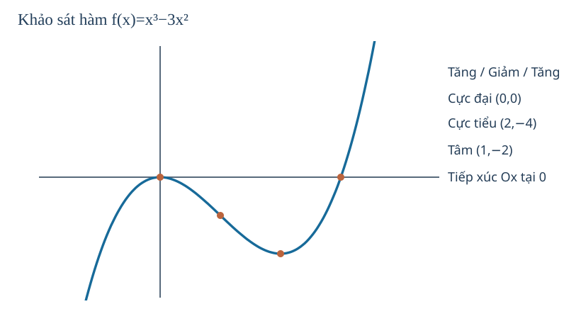

# Toán 12 · Bài 4. Khảo sát sự biến thiên và vẽ đồ thị của hàm số

TOÁN 12 · CHƯƠNG I · SGK KẾT NỐI TRI THỨC · TẬP MỘT · TRANG 26–32

Hiểu bản chất, tự vận dụng, đối chiếu sau khi làm, rồi luyện tập theo từng bài.

<nav class="thpt-r4-lesson-tabs"><a href="../">Chương I</a><a href="../bai-3/">Bài trước</a><a href="../bai-5/">Bài tiếp theo</a></nav>

=== "Khám phá kiến thức"

    Khảo sát là ghép miền, đạo hàm, giới hạn và các điểm đặc biệt thành một đồ thị có thể tự kiểm. Ôn dấu đạo hàm, giới hạn một phía, phép chia đa thức, và phép tịnh tiến tọa độ. Không nối nhánh qua điểm loại khỏi miền.

    ### 1.1. Trình tự khảo sát
    
    Miền xác định trước, rồi tính đạo hàm, giới hạn/tiệm cận, lập bảng biến thiên, giao trục và vẽ. Mỗi bước ràng buộc bước sau.
    
    **Vận dụng.** Với $f=(x+3)/(x-4)$, cần loại điểm nào trước?
    
    
    
    ??? question "Đối chiếu"
    
        **Lời giải:** x=4; $D=\mathbb R\setminus\{4\}$. Không vẽ điểm có hoành độ 4.
    
    
    
    ??? tip "Kiểm lỗi"
    
        Viết D trước khi giải giao trục. [Luyện lại câu tương ứng](../luyen-tap/#thpt-g12-chi-b04-c01)

    ### 1.2. Đồ thị bậc ba
    
    Đạo hàm bậc hai có thể có hai nghiệm, một nghiệm kép hoặc không nghiệm; dấu quyết định cực trị. Hệ số bậc ba quyết định hướng hai đuôi.
    
    <figure class="thpt-r4-plot g12-chi-figure"><figcaption>Tại x=0 đồ thị tiếp xúc Ox, tại x=3 cắt Ox. Hai đuôi đi theo hệ số bậc ba dương.</figcaption></figure>
    
    **Vận dụng.** $y=x^3+3x$ có cực trị không?
    
    
    
    ??? question "Đối chiếu"
    
        **Lời giải:** $y'=3x^2+3>0$, tăng trên ℝ, không cực trị; hai đuôi −∞ và +∞.
    
    
    
    ??? tip "Kiểm lỗi"
    
        Không mặc định mọi bậc ba có hai cực trị. [Luyện lại câu tương ứng](../luyen-tap/#thpt-g12-chi-b04-c02)

    ### 1.3. Phân thức bậc nhất trên bậc nhất
    
    Viết $y=b+k/(x-a)$ với k≠0. Đạo hàm $-k/(x-a)^2$ có dấu không đổi trên từng khoảng; tiệm cận x=a, y=b.
    
    <figure class="thpt-r4-plot g12-chi-figure"><figcaption>Nhánh trái có giao Ox (−2;0) và Oy (0;−2); hai nhánh đều giảm, không nối qua x=1.</figcaption></figure>
    
    **Vận dụng.** $f=3-2/(x+2)$ tăng hay giảm ở từng nhánh?
    
    
    
    ??? question "Đối chiếu"
    
        **Lời giải:** $f'=2/(x+2)^2>0$, tăng trên $(-\infty,-2)$ và $(-2,+\infty)$.
    
    
    
    ??? tip "Kiểm lỗi"
    
        Dấu ngược với k; tách hai nhánh. [Luyện lại câu tương ứng](../luyen-tap/#thpt-g12-chi-b04-c03)

    ### 1.4. Giao điểm và hướng đuôi
    
    Giao Ox giải f(x)=0 trong D; giao Oy cần 0∈D. Giao điểm không cho biết hướng đi nếu chưa có giới hạn và dấu đạo hàm.
    
    **Vận dụng.** $f=(2x-6)/(x+1)$ cắt hai trục ở đâu?
    
    
    
    ??? question "Đối chiếu"
    
        **Lời giải:** Ox: (3;0); Oy: (0;−6). x=−1 bị loại.
    
    
    
    ??? tip "Kiểm lỗi"
    
        Thay lại tọa độ vào hàm gốc. [Luyện lại câu tương ứng](../luyen-tap/#thpt-g12-chi-b04-c04)

    ### 1.5. Tâm và trục đối xứng
    
    Tịnh tiến $u=x-a,v=y-b$. Dạng v=k/u bảo toàn khi (u,v)→(−u,−v); còn phản xạ qua v=u hoặc v=−u cũng giữ uv=k. Hai trục là các phân giác hai tiệm cận vuông góc.
    
    **Vận dụng.** $y=4+3/(x-2)$ có tâm và trục đối xứng nào?
    
    
    
    ??? question "Đối chiếu"
    
        **Lời giải:** Tâm (2;4), trục $y-4=\pm(x-2)$.
    
    
    
    ??? tip "Kiểm lỗi"
    
        Không nhầm chính các tiệm cận là trục đối xứng. [Luyện lại câu tương ứng](../luyen-tap/#thpt-g12-chi-b04-p01)

    ### 1.6. Đọc bảng trước khi vẽ
    
    Hàng x gồm điểm chia; hàng f′ ghi dấu và nghiệm; hàng y ghi giới hạn, cực trị, mũi tên. Mỗi khoảng domain là một đoạn riêng của bảng.
    
    **Vận dụng.** Dấu f′ là −,+,− chia tại −2 và 3, f liên tục. Loại cực trị?
    
    
    
    ??? question "Đối chiếu"
    
        **Lời giải:** Cực tiểu tại −2, cực đại tại 3. Chưa có tung độ nếu thiếu f.
    
    
    
    ??? tip "Kiểm lỗi"
    
        Đọc dấu từ trái sang phải, không đảo mũi tên. [Luyện lại câu tương ứng](../luyen-tap/#thpt-g12-chi-b04-p02)

    ### 1.7. Nhánh tách ở tiệm cận đứng
    
    Nếu $x=a$ bị loại và là tiệm cận đứng, không nối đường qua đó. Hình cần ghi giới hạn từng phía, đặc biệt khi dấu đạo hàm giống nhau.
    
    **Vận dụng.** $f=2-1/(x-1)$. Hai giới hạn khi x→1?
    
    
    
    ??? question "Đối chiếu"
    
        **Lời giải:** Trái +∞, phải −∞; không có điểm nối ở 1.
    
    
    
    ??? tip "Kiểm lỗi"
    
        Dấu 1/(x−1) khác nhau qua 1. [Luyện lại câu tương ứng](../luyen-tap/#thpt-g12-chi-b04-p03)

    ### 1.8. Phân thức bậc hai trên bậc nhất
    
    Chia đa thức thành $y=mx+n+k/(x-a)$, m,k≠0. Đặt $u=x-a$, đạo hàm $m-k/u^2$. Nếu m,k cùng dấu sẽ có hai nghiệm $u=\pm\sqrt{k/m}$; nếu trái dấu không có nghiệm. Vẫn phải xét dấu, giới hạn và giao trục.
    
    <figure class="thpt-r4-plot g12-chi-figure"><figcaption>Đọc bảng và đồ thị từ trái sang phải: đỉnh trái (−1;−3), đáy phải (3;5); tâm (1;1). Hai nhánh tiến gần đường xiên ở xa, không nối qua x=1.</figcaption></figure>
    
    **Vận dụng.** $f=x+2+9/(x-1)$. Tìm tiệm cận và điểm dừng, loại cực trị.
    
    
    
    ??? question "Đối chiếu"
    
        **Lời giải:** Đứng x=1, xiên y=x+2. $f'=1-9/(x-1)^2=0$ tại −2 và 4. Dấu +,− | −,+; cực đại (−2;−3), cực tiểu (4;9).
    
    
    
    ??? tip "Kiểm lỗi"
    
        Chia bảng tại cả x=1; kiểm giá trị gốc. [Luyện lại câu tương ứng](../luyen-tap/#thpt-g12-chi-b04-c03)

    ### 1.9. Dựng mô hình từ nồng độ
    
    Trộn V lít dung dịch có khối lượng chất tan M gam với x lít dung dịch nồng độ c g/L (giả sử thể tích cộng được). Nồng độ $f(x)=(M+cx)/(V+x)$, x≥0.
    
    **Vận dụng.** V=10 L, M=20 g, c=5 g/L. Tìm xu thế khi thêm dung dịch.
    
    
    
    ??? question "Đối chiếu"
    
        **Lời giải:** $f=(20+5x)/(10+x)=5-30/(10+x)$, tăng trên [0,+∞), tiến tới 5 nhưng không đạt. Ban đầu 2 g/L.
    
    
    
    ??? tip "Kiểm lỗi"
    
        Không dùng nhánh x<0 trong tình huống thực. [Luyện lại câu tương ứng](../luyen-tap/#thpt-g12-chi-b04-a01)

    ### 1.10. Tự khảo sát đủ một phân thức bậc hai trên bậc nhất

    Phép chia đa thức là bước mở khóa. Với biểu thức đã tách, hãy lần lượt xác định miền, đạo hàm, các giới hạn, bảng biến thiên, giao trục và đối xứng. Dữ liệu chính xác quan trọng hơn hình đẹp.

    **Vận dụng.** Khảo sát $g(x)=2x-1+8/(x+2)$, tự vẽ đồ thị. Nêu cả tâm và hai trục đối xứng.

    

    ??? question "Đối chiếu"

        **Lời giải:** $D=\mathbb R\setminus\{-2\}$, $g'=2-8/(x+2)^2$; nghiệm −4 và 0, dấu +,− | −,+. Cực đại (−4;−13), cực tiểu (0;3). Giới hạn tại −∞ là −∞, tại −2 từ trái là −∞, từ phải là +∞, tại +∞ là +∞. Đứng x=−2, xiên y=2x−1. Giao Oy (0;3); phương trình giao Ox là $2x^2+3x+6=0$ vô nghiệm thực. Tâm (−2;−5), hai trục $y+5=(2\pm\sqrt5)(x+2)$. Nhánh trái dưới xiên, nhánh phải trên xiên. Dựa vào dấu, vẽ hai nhánh riêng; không nối qua −2.

    

    ??? tip "Kiểm lỗi"

        Nếu thiếu một giới hạn, hãy viết lại $g$ thành tổng phần xiên và phần dư rồi lập bảng cho từng khoảng. Kiểm giao trục qua phương trình g=0. [Ôn cách đọc bảng biến thiên](../luyen-tap/#thpt-g12-chi-b04-p02).

=== "Kiến thức SGK"

    ### 2.1. Sơ đồ khảo sát hàm số
    
    
<strong>Sơ đồ khảo sát hàm số</strong>
(1) Tập xác định; (2) sự biến thiên: đạo hàm, giới hạn ở vô hạn và biên miền, tiệm cận nếu có, bảng biến thiên; (3) đồ thị: giao trục, điểm đặc biệt, đối xứng và phác họa. Đọc lại bảng để kiểm đồ thị.

    ### 2.2. Khảo sát hàm số bậc ba
    
    
<strong>Khảo sát hàm số bậc ba</strong>
\(y=ax^3+bx^2+cx+d\), a≠0, có D=ℝ; \(y'=3ax^2+2bx+c\). Hai nghiệm phân biệt cho hai cực trị; nghiệm kép không đổi dấu, hoặc không nghiệm, thì không cực trị. Dấu a quyết định giới hạn hai đầu. Tâm đối xứng \(I(x_0,f(x_0))\) với \(x_0=-b/(3a)\): khi đặt u=x−x₀, hiệu \(f(x_0+u)-f(x_0)\) là đa thức lẻ. Không bắt buộc dùng đạo hàm cấp hai để kết luận.

    ### 2.3. Khảo sát phân thức bậc nhất trên bậc nhất
    
    
<strong>Khảo sát phân thức bậc nhất trên bậc nhất</strong>
Với \(y=(ax+b)/(cx+d)\), c≠0 và ad−bc≠0, D loại \(x=-d/c\). Chia thành \(y=B+k/(x-A)\), k≠0. Tiệm cận x=A, y=B; đạo hàm \(-k/(x-A)^2\); không cực trị. Tâm I(A;B), hai trục đối xứng \(y-B=\pm(x-A)\).

    ### 2.3.1. Khảo sát phân thức bậc hai trên bậc nhất
    
    
<strong>Khảo sát phân thức bậc hai trên bậc nhất</strong>
Với mẫu bậc nhất, tử bậc hai, không có nhân tử chung: \(y=mx+n+k/(x-A)\) với m,k≠0. D loại A; đứng x=A, xiên y=mx+n; \(y'=m-k/(x-A)^2\). Nếu k/m&gt;0 thì hai điểm dừng \(A\pm\sqrt{k/m}\), xét dấu quanh từng điểm để phân loại; nếu k/m&lt;0 thì không có điểm dừng. Tâm I(A;mA+n). Hai trục đối xứng là hai đường phân giác của hai tiệm cận: trong tọa độ u=x−A,v=y−(mA+n), phương trình \(u=\pm(v-mu)/\sqrt{1+m^2}\). Vì phép phản xạ qua mỗi phân giác đổi hai khoảng cách có hướng tới các tiệm cận (có thể đồng thời đổi dấu), tích \(u(v-mu)=k\) được bảo toàn. Đây là tính chất theo đúng dạng, không tự suy cho mọi đồ thị.

=== "Ví dụ"

    ### 3.1. Đa thức bậc ba
    
    

<strong>Đề bài:</strong> Khảo sát \(f=x^3-3x^2\).

<strong>Phân tích:</strong> D=ℝ, đạo hàm phân tích được.

<strong>Lời giải:</strong> \(f'=3x(x-2)\) dấu +,−,+; cực đại (0;0), cực tiểu (2;−4); giới hạn −∞,+∞. Ox tại 0 (tiếp xúc) và 3 (cắt), Oy (0;0), tâm (1;−2). Bảng: −∞ ↗ 0 ↘ −4 ↗ +∞, x: −∞,0,2,+∞.

<strong>Kiểm lại:</strong> Khớp hình; ví dụ này dùng lại ở Practice để ôn, không là câu chưa xem.

    ### 3.2. Phân thức bậc nhất/bậc nhất
    
    

<strong>Đề bài:</strong> Khảo sát \(g=(x+2)/(x-1)\).

<strong>Phân tích:</strong> Tách phần dư.

<strong>Lời giải:</strong> \(g=1+3/(x-1)\); D loại 1, \(g'&lt;0\). Tiệm cận x=1,y=1. Bảng trái \(1\searrow-\infty\), phải \(+\infty\searrow1\). Giao (−2;0),(0;−2), tâm (1;1), trục \(y-1=\pm(x-1)\).

<strong>Kiểm lại:</strong> Khớp hình; không nối nhánh.

    ### 3.3. Bậc ba hệ số âm
    
    

<strong>Đề bài:</strong> \(h=-x^3+12x\).

<strong>Phân tích:</strong> Xét dấu 3(4−x²).

<strong>Lời giải:</strong> Giảm trên \((-\infty,-2)\), tăng \((-2,2)\), giảm \((2,+\infty)\). Cực tiểu (−2;−16), cực đại (2;16); đuôi trái +∞, phải −∞; tâm (0;0). Giao Ox tại \(0,\pm2\sqrt3\).

<strong>Kiểm lại:</strong> Dấu hệ số âm đảo hướng đuôi.

    ### 3.4. Tâm và hai trục
    
    

<strong>Đề bài:</strong> \(k=(2x+5)/(x-3)\).

<strong>Phân tích:</strong> Tịnh tiến theo hai tiệm cận.

<strong>Lời giải:</strong> \(k=2+11/(x-3)\). Tâm (3;2), trục \(y-2=\pm(x-3)\). Cả hai nhánh giảm.

<strong>Kiểm lại:</strong> Tích (x−3)(y−2)=11 giữ qua phản xạ.

    ### 3.5. Phân thức hai nhánh
    
    

<strong>Đề bài:</strong> \(r=2+1/(x+1)\).

<strong>Phân tích:</strong> Xét giới hạn và dấu phần dư.

<strong>Lời giải:</strong> D loại −1, đứng x=−1, ngang y=2; \(r'&lt;0\). Trái \(2\searrow-\infty\); phải \(+\infty\searrow2\).

<strong>Kiểm lại:</strong> Không gộp miền thành một khoảng.

    ### 3.6. Khảo sát đầy đủ bậc hai trên bậc nhất
    
    

<strong>Đề bài:</strong> \(f=(x^2-x+4)/(x-1)=x+4/(x-1)\).

<strong>Phân tích:</strong> Phải chia đa thức để thấy xiên; xét hai điểm dừng và điểm loại.

<strong>Lời giải:</strong> D loại 1. \(f'=1-4/(x-1)^2=(x+1)(x-3)/(x-1)^2\). Đứng x=1, xiên y=x. \(f(-1)=-3\), \(f(3)=5\). Bảng biến thiên dưới đây. Tử \(x^2-x+4\) có biệt thức −15 nên không giao Ox; giao Oy (0;−4). Tâm (1;1), trục là hai phân giác \(y-1=(1\pm\sqrt2)(x-1)\).

<strong>Kiểm lại:</strong> Kiểm f′ đổi +→− tại −1, −→+ tại 3; nhánh trái nằm dưới y=x, nhánh phải trên.

    | $x$ | $-\infty$ | $(-\infty,-1)$ | $-1$ | $(-1,1)$ | $1^-$ | $1^+$ | $(1,3)$ | $3$ | $(3,+\infty)$ | $+\infty$ |
    |---|---|---|---|---|---|---|---|---|---|---|
    | $f'(x)$ |  | + | 0 | − |  |  | − | 0 | + | |
    | $f(x)$ | $-\infty$ | ↗ | −3 | ↘ | $-\infty$ | $+\infty$ | ↘ | 5 | ↗ | $+\infty$ |
    
    Các cột $1^-,1^+$ là hai giới hạn, không phải giá trị tại x=1. Trong khoảng (−1,1), đạo hàm âm; trong (1,3) cũng âm.

    ### 3.7. Bậc hai trên bậc nhất không cực trị
    
    

<strong>Đề bài:</strong> \(g=x-1/(x+2)\).

<strong>Phân tích:</strong> D loại −2, đạo hàm luôn dương.

<strong>Lời giải:</strong> \(g'=1+1/(x+2)^2&gt;0\). Đứng x=−2, xiên y=x; tâm (−2;−2). Tăng từng nhánh, không cực trị. Trái tiến +∞ khi x→−2−; phải tiến −∞ khi x→−2+.

<strong>Kiểm lại:</strong> Không áp đặt luôn hai cực trị.

    ### 3.8. Mô hình pha trộn
    
    

<strong>Đề bài:</strong> Bình có 20 L nước chứa 10 g chất tan; thêm x L dung dịch 2 g/L, thể tích cộng được.

<strong>Phân tích:</strong> Tổng chất tan chia tổng thể tích.

<strong>Lời giải:</strong> \(c=(10+2x)/(20+x)=2-30/(20+x)\), x≥0. \(c'=30/(20+x)^2&gt;0\). Ban đầu 0,5 g/L; tăng và tiến 2 g/L, không đạt ở x hữu hạn.

<strong>Kiểm lại:</strong> Vẽ chỉ nhánh x≥0; tiệm cận x=−20 của biểu thức không là lượng dung dịch hợp lệ.

=== "Lỗi thường gặp"

    ### 4.1. Trình tự khảo sát
    
    ??? tip "Cách tự sửa"
    
        Viết D trước khi giải giao trục. Sau khi kiểm lại lý do, tự giải một câu khác trong [Core/Luyện tập](../luyen-tap/#thpt-g12-chi-b04-c01).

    ### 4.2. Đồ thị bậc ba
    
    ??? tip "Cách tự sửa"
    
        Không mặc định mọi bậc ba có hai cực trị. Sau khi kiểm lại lý do, tự giải một câu khác trong [Core/Luyện tập](../luyen-tap/#thpt-g12-chi-b04-c02).

    ### 4.3. Phân thức bậc nhất trên bậc nhất
    
    ??? tip "Cách tự sửa"
    
        Dấu ngược với k; tách hai nhánh. Sau khi kiểm lại lý do, tự giải một câu khác trong [Core/Luyện tập](../luyen-tap/#thpt-g12-chi-b04-c03).

    ### 4.4. Giao điểm và hướng đuôi
    
    ??? tip "Cách tự sửa"
    
        Thay lại tọa độ vào hàm gốc. Sau khi kiểm lại lý do, tự giải một câu khác trong [Core/Luyện tập](../luyen-tap/#thpt-g12-chi-b04-c04).

    ### 4.5. Tâm và trục đối xứng
    
    ??? tip "Cách tự sửa"
    
        Không nhầm chính các tiệm cận là trục đối xứng. Sau khi kiểm lại lý do, tự giải một câu khác trong [Core/Luyện tập](../luyen-tap/#thpt-g12-chi-b04-p01).

    ### 4.6. Đọc bảng trước khi vẽ
    
    ??? tip "Cách tự sửa"
    
        Đọc dấu từ trái sang phải, không đảo mũi tên. Sau khi kiểm lại lý do, tự giải một câu khác trong [Core/Luyện tập](../luyen-tap/#thpt-g12-chi-b04-p02).

    ### 4.7. Nhánh tách ở tiệm cận đứng
    
    ??? tip "Cách tự sửa"
    
        Dấu 1/(x−1) khác nhau qua 1. Sau khi kiểm lại lý do, tự giải một câu khác trong [Core/Luyện tập](../luyen-tap/#thpt-g12-chi-b04-p03).

    ### 4.8. Phân thức bậc hai trên bậc nhất
    
    ??? tip "Cách tự sửa"
    
        Chia bảng tại cả x=1; kiểm giá trị gốc. Sau khi kiểm lại lý do, tự giải một câu khác trong [Core/Luyện tập](../luyen-tap/#thpt-g12-chi-b04-c03).

    ### 4.9. Dựng mô hình từ nồng độ
    
    ??? tip "Cách tự sửa"
    
        Không dùng nhánh x<0 trong tình huống thực. Sau khi kiểm lại lý do, tự giải một câu khác trong [Core/Luyện tập](../luyen-tap/#thpt-g12-chi-b04-a01).

    ### 4.10. Bỏ sót khảo sát một nhánh

    ??? tip "Cách tự sửa"

        Trở lại các giới hạn một phía và cả hai điểm dừng. [Luyện đọc bảng biến thiên](../luyen-tap/#thpt-g12-chi-b04-p02).

    [Core Bài 4](../luyen-tap/#b04-core) · [Luyện tập, Vận dụng, Tự luận](../luyen-tap/#b04-practice) · [Hỗ trợ khi gặp khó khăn](../luyen-tap/#b04-help) · [Tự kiểm tra cuối chương](tu-kiem-tra-chuong.md)

*Nguồn đối chiếu: SGK Toán 12 Kết nối tri thức, Tập một, trang in 26–32.*
