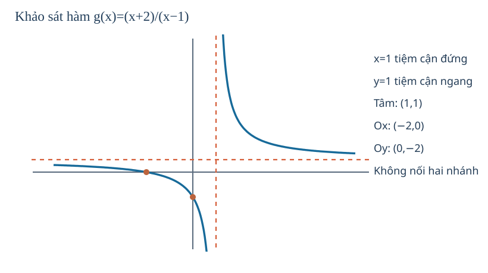
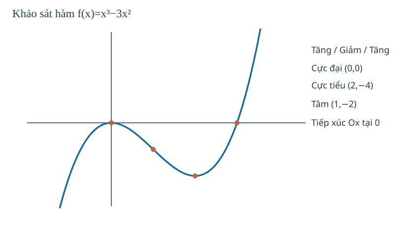

# Toán 12 · Bài 4. Khảo sát sự biến thiên và vẽ đồ thị của hàm số

TOÁN 12 · CHƯƠNG I · SGK KẾT NỐI TRI THỨC · TẬP MỘT · TRANG 26–32

Học trọn bài tại đây: hiểu bản chất, xem hình, ví dụ có suy luận, tự thử, Core, Luyện tập, Vận dụng, Tự luận và các hướng dẫn tự khắc phục.

<nav class="thpt-r4-lesson-tabs"><a href="../">Chương I</a><a href="../bai-3/">Bài trước</a><a href="../bai-5/">Bài tiếp theo</a></nav>

## 1. Vì sao cần học?

Có thể biết một hàm tăng giảm, có cực trị và có tiệm cận nhưng vẫn chưa hình dung được toàn bộ đồ thị. "Khảo sát" là ghép tất cả chứng cứ thành một bức tranh hợp lý: miền xác định, các hướng đi, đỉnh/đáy, các đường tiến sát, điểm giao trục. Kỹ năng này biến công thức thành dự đoán hình dạng và ngược lại giúp phát hiện sai sót trong phép tính.

## 2. Kiến thức tiền đề

Cần biết lấy đạo hàm, xét dấu trên các khoảng hợp lệ, tính cực trị và giới hạn ở ±∞/hai phía điểm loại khỏi D, phương trình đường thẳng tiệm cận. Từ f'=0 không được tự suy cực trị; từ mẫu 0 không được tự suy tiệm cận đứng. Bài này tự nhắc lại cả hai điểm ngay trong từng ví dụ.

## 3. Hiểu bản chất trước công thức

1. **Miền xác định** trước tất cả, vì đồ thị không được đi qua điểm x bị loại.
2. **Đạo hàm và dấu** để biết tăng/giảm, điểm tới hạn và cực trị; ghi giá trị tại điểm, không chỉ hoành độ.
3. **Giới hạn và tiệm cận**, nhất là hai phía điểm loại; các mũi tên ở ±∞ phải khớp với dạng hàm.
4. **Bảng biến thiên** ghép các miền liên thông, tuyệt đối không nối nhánh qua tiệm cận đứng.
5. **Giao trục và điểm đặc biệt** để đặt đồ thị đúng tỉ lệ tương đối. Vẽ đường cong dựa trên những chứng cứ đã có; không dùng "hình đẹp" thay cho tính toán.
6. **Tâm đối xứng**: đồ thị đa thức bậc ba y=ax³+bx²+cx+d (a≠0) có tâm đối xứng tại điểm uốn x0=−b/(3a), y0=f(x0); đồ thị phân thức (ax+b)/(cx+d) với c≠0 và ad−bc≠0 có tâm là giao hai tiệm cận (−d/c,a/c). Đây là tính chất riêng của các dạng nguồn SGK học, không suy rộng mọi đồ thị.

## 4. Đọc hình và dữ liệu

**FIG-G12-B04-01** (G12_B04_FIG01_RATIONAL_SURVEY_R00.svg): đồ thị g=(x+2)/(x−1) có đường x=1, y=1 và hai điểm giao trục, phân biệt nét đứt tiệm cận với nhánh thật. D5 học sinh đọc từng nhánh theo dấu g'<0 trên từng khoảng, kiểm tra g(−2)=0 và g(0)=−2 trước khi xác định nhánh trái.

**FIG-G12-B04-02** (G12_B04_FIG02_CUBIC_SURVEY_R00.svg): đồ thị cubic y=x³−3x². Học sinh nhìn cực đại tại (0,0) tiếp xúc Ox, cực tiểu tại (2,−4) và điểm uốn (1,−2), kiểm tra đối xứng tâm chứ không nhầm trục đối xứng. Khi chưa có SVG thì dùng bảng dữ liệu chính xác của EX01, không coi hình vẽ chưa kiểm chứng là chứng cứ toán học.

<figure class="thpt-r4-plot g12-chi-figure"><figcaption>Hình minh họa 1 · Xem hướng dẫn đọc hình ngay phía trên.</figcaption></figure>
<figure class="thpt-r4-plot g12-chi-figure"><figcaption>Hình minh họa 2 · Xem hướng dẫn đọc hình ngay phía trên.</figcaption></figure>

## 5. Ví dụ có suy luận và lý do chọn phương pháp

### Ví dụ 1 — Đa thức bậc ba có hai cực trị
Khảo sát f(x)=x³−3x². D=ℝ, f'=3x(x−2). Dấu: + trên (−∞,0), − trên (0,2), + trên (2,+∞). Cực đại (0,0), cực tiểu (2,−4). lim x→−∞ f=−∞, lim x→+∞ f=+∞. Giao Ox: x²(x−3)=0 ⇒ (0,0) là nghiệm kép tiếp xúc Ox, (3,0) là nghiệm đơn cắt Ox; giao Oy (0,0). f''=6x−6, điểm uốn và tâm đối xứng (1,−2). **Lý do**: nếu không phân biệt nghiệm kép, dễ vẽ đồ thị xuyên trục ở x=0 dù f≥/≤ cùng dấu hai phía.

### Ví dụ 2 — Phân thức bậc nhất/bậc nhất
Khảo sát g(x)=(x+2)/(x−1)=1+3/(x−1). D=ℝ\{1}, g'=−3/(x−1)²<0 trên từng khoảng (−∞,1),(1,+∞). lim x→1−=−∞, lim x→1+=+∞; lim ±∞=1. Tiệm cận đứng x=1, ngang y=1, tâm (1,1). Cắt Ox (−2,0), cắt Oy (0,−2). **Lý do**: kiểm tra các giao điểm sau khi tìm tiệm cận để định vị nhánh; không nối hai nhánh xuyên x=1.

### Ví dụ 3 — Đạo hàm bảng biến thiên từ phản chiều
h(x)=−x³+3x. h'=3(1−x²), âm khi |x|>1, dương khi |x|<1; hàm giảm trên (−∞,−1), tăng trên (−1,1), giảm trên (1,+∞). Cực tiểu (−1,−2), cực đại (1,2). Khi x→−∞ h→+∞, khi x→+∞ h→−∞. **Lý do**: hệ số bậc ba âm làm hướng đuôi hai bên đảo so với hệ số dương; chỉ nhìn hai cực trị chưa đủ.

### Ví dụ 4 — Đối xứng trung tâm có điều kiện
k(x)=(2x+5)/(x−3)=2+11/(x−3), D=ℝ\{3}; các tiệm cận x=3, y=2, tâm đối xứng (3,2). Từ việc tịnh tiến biến u=x−3, v=y−2 được v=11/u, hàm nghịch biến từng nhánh. **Lý do**: giao hai đường tiệm cận là tâm cho đồ thị hyperbol chữ nhật loại này, không lấy giao trục làm tâm.

### Ví dụ 5 — Vẽ sai nhánh khi quên giới hạn
r(x)=2+1/(x+1) có x=−1 tiệm cận đứng và y=2 ngang; r'=−1/(x+1)²<0. Với x>−1, r>2 và đi từ +∞ xuống2; x<−1, r<2 và đi từ2 (phía −∞) xuống−∞. **Không** dùng một đường "giảm trên ℝ\{−1}" theo định nghĩa mọi cặp điểm; phải tách hai khoảng.

## 6. Tự thử trước Core

A. Nếu y'=−3/(x−1)² với x≠1, liệu có thể vẽ một nét giảm liên tục băng qua x=1?
B. Nghiệm bội hai x=0 của y=x³−3x² khiến đường cong tiếp xúc hay cắt trục Ox?
C. Với g=2+11/(x−3), dự đoán tâm đối xứng trước khi xem ví dụ.
Tự ghi dự đoán rồi kiểm tra lại bằng tính toán, không mở đáp án trước khi tự làm.

## 7. Core, Luyện tập, Vận dụng, Tự luận và hỗ trợ

Đang mở bài tập đã kiểm duyệt...

<nav class="thpt-r4-lesson-tabs"><a href="../">Chương I</a><a href="../bai-5/">Bài tiếp theo</a></nav>

