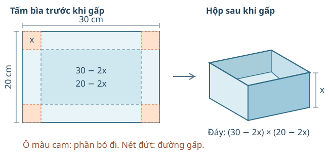
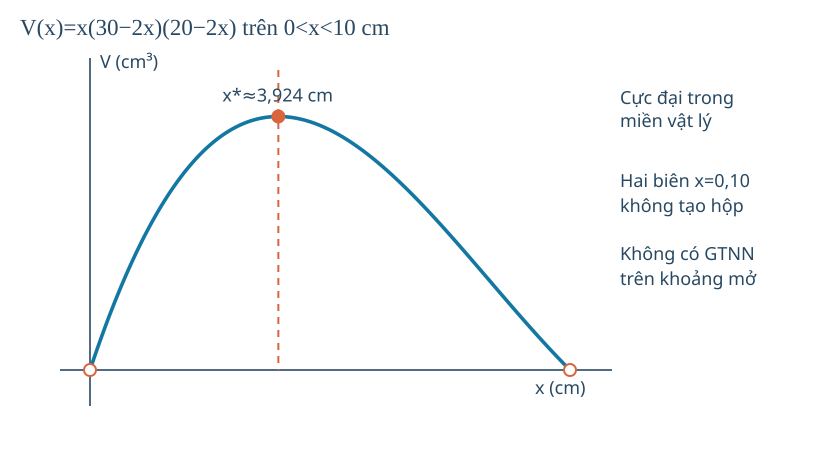
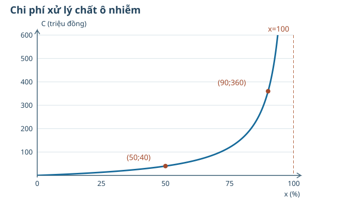
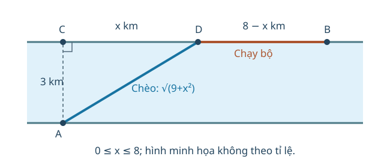
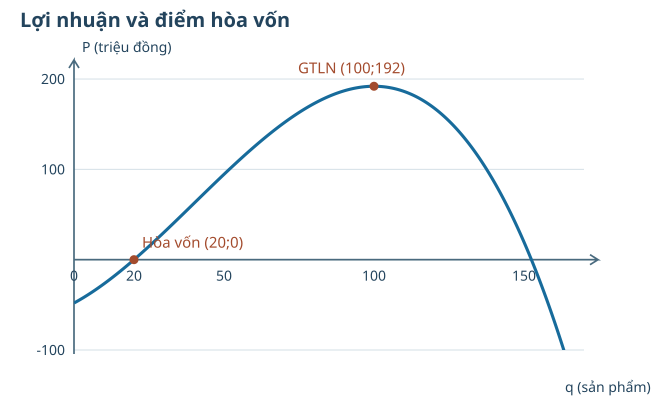

# Bài 5. Ứng dụng đạo hàm để giải quyết một số vấn đề liên quan đến thực tiễn

TOÁN 12 · CHƯƠNG I · KIẾN THỨC SGK KNTT · TẬP MỘT

Dùng đạo hàm để giải thích tốc độ thay đổi của các đại lượng và lựa chọn phương án tốt nhất trong những điều kiện thực tế.

<nav class="thpt-r4-lesson-tabs"><a href="../">Chương I</a><a href="../bai-4/">Bài trước</a><a href="../luyen-tap/#b05-core">Core/Luyện tập</a><a href="../tu-kiem-tra-chuong/">Tự kiểm tra</a></nav>

=== "Khám phá kiến thức"

    ### 1.1. Tốc độ thay đổi của một đại lượng

    Một cửa hàng muốn biết chi phí tăng nhanh đến mức nào khi sản xuất thêm hàng; một nhà sinh học muốn biết quần thể đang lớn lên nhanh hay chậm. Cả hai đều cần biết **một đại lượng thay đổi bao nhiêu khi đại lượng khác thay đổi**. Không nhất thiết đại lượng đầu vào phải là thời gian.

    Xét tọa độ của một vật \(s(t)=t^2\) mét, với \(t\) tính bằng giây. Từ \(t=2\) đến \(t=3\), tọa độ tăng từ \(4\) lên \(9\), tức trung bình \(5\) m/s. Nhưng muốn biết vận tốc ngay lúc \(t=2\), khoảng thời gian một giây có thể quá dài: vật không chuyển động đều. Ta đo trên những khoảng thời gian ngày càng ngắn, từ \(2\) đến \(2+h\), với \(h>0\):

    | \(h\) (s) | \(s(2+h)-s(2)\) (m) | \(\dfrac{s(2+h)-s(2)}h\) (m/s) |
    | :--: | :--: | :--: |
    | \(1\) | \(5\) | \(5\) |
    | \(0{,}1\) | \(0{,}41\) | \(4{,}1\) |
    | \(0{,}01\) | \(0{,}0401\) | \(4{,}01\) |

    Vì \(\big((2+h)^2-4\big)/h=4+h\) với \(h\ne0\), giới hạn khi \(h\to0\) bằng \(4\). Đó chính là vận tốc tức thời \(s'(2)=4\) m/s. Ta không cần thực hiện phép chia cho \(0\); đạo hàm là **giới hạn của tỉ số** khi khoảng thay đổi tiến về \(0\).

    Tổng quát, nếu \(y=f(x)\), thì \(\Delta x=x_2-x_1\), \(\Delta y=f(x_2)-f(x_1)\). Tỉ số \(\Delta y/\Delta x\) (với \(\Delta x\ne0\)) cho biết mức thay đổi trung bình của \(y\) trên mỗi đơn vị thay đổi của \(x\). Khi \(x_2\) tiến sát \(x_1\), giới hạn của tỉ số này, nếu tồn tại hữu hạn, cho tốc độ thay đổi tức thời \(f'(x_1)\). Đơn vị luôn là đơn vị của \(y\) chia cho đơn vị của \(x\).

    Với chuyển động thẳng, \(v=s'\) là vận tốc có dấu, còn \(a=v'=s''\) là gia tốc. Hãy hình dung vật có tọa độ \(s(t)=t^3-6t^2+9t\) (m), \(t\ge0\). Tại \(t=2\), ta có \(s(2)=2\) m nhưng \(v(2)=-3\) m/s. Vật đang nằm phía dương của gốc tọa độ và đi theo chiều âm; tốc độ lúc đó là \(3\) m/s. Ba thông tin vị trí, hướng chuyển động và độ lớn vận tốc không được nhầm với nhau.

    Ta tính \(v(t)=3(t-1)(t-3)\) và \(a(t)=6t-12\). Vận tốc đổi dấu tại \(1,3\); vật đổi chiều qua các thời điểm này. Trên các khoảng mà \(v\ne0\), tốc độ \(|v|\) tăng nếu \(v\) và \(a\) cùng dấu, giảm nếu trái dấu. Chẳng hạn trên \((1;2)\), cả \(v,a\) đều âm, vật đi theo chiều âm và nhanh dần. Trên \((2;3)\), \(v<0,a>0\), vật vẫn đi theo chiều âm nhưng chậm dần.

    Để tính quãng đường từ \(t=0\) đến \(t=4\), ta chia tại hai mốc đổi chiều. Các tọa độ lần lượt là \(s(0)=0,\ s(1)=4,\ s(3)=0,\ s(4)=4\). Quãng đường bằng \(|4-0|+|0-4|+|4-0|=12\) m; độ dời chỉ bằng \(s(4)-s(0)=4\) m. Cộng các độ dài, không cộng các độ dời có dấu, khi cần tính quãng đường.

    **Vận dụng.** Vật có tọa độ \(s(t)=t^2-4t+5\) (m), \(0\le t\le5\). Tìm thời điểm đổi chiều, quãng đường từ \(0\) đến \(5\) và nhận xét tốc độ trước, sau thời điểm đổi chiều.

    ??? question "Đối chiếu"

        \(v(t)=2t-4,\ a(t)=2\). Vận tốc âm trên \((0;2)\), dương trên \((2;5)\), nên vật đổi chiều tại \(t=2\). Tọa độ tại \(0,2,5\) lần lượt là \(5,1,10\) m. Quãng đường bằng \(|1-5|+|10-1|=13\) m. Trước \(2\), \(v<0,a>0\) nên chậm dần; sau \(2\), \(v>0,a>0\) nên nhanh dần.

    ??? tip "Kiểm lỗi"

        Nếu thu được \(5\) m, đó là độ dời, không phải quãng đường. Hãy tách tại mốc \(v=0\) có đổi dấu. Không dùng dấu của gia tốc một mình để kết luận vật nhanh hay chậm dần.

    Cùng một ý tưởng đạo hàm áp dụng cho nhiều lĩnh vực. Trong hoá học, giả sử nồng độ một chất đang bị tiêu thụ giảm theo \(C(t)=8/(1+t)\) mol/lít, \(t\) tính bằng phút. Ta có \(C'(t)=-8/(1+t)^2\); tại phút thứ \(3\), nồng độ giảm với tốc độ \(0{,}5\) mol/(lít·phút). Dấu âm biểu thị tốc độ thay đổi có dấu của nồng độ; độ lớn tốc độ tiêu thụ là \(-C'(3)=0{,}5\). Không đồng nhất đạo hàm có dấu của nồng độ với mọi quy ước tốc độ phản ứng hoá học.

    Trong sinh học, \(P'(t)\) là tốc độ tăng trưởng tức thời nếu \(P(t)\) mô hình hoá số cá thể. Ví dụ \(P(t)=100-80e^{-t/2}\), \(t\) tính bằng giờ. Ban đầu \(P(0)=20\), tốc độ ban đầu \(P'(0)=40\) cá thể/giờ. Vì \(P'(t)=40e^{-t/2}>0\), quần thể tăng, nhưng càng về sau tốc độ càng nhỏ. Giới hạn \(P(t)\to100\) cho thấy mô hình dự đoán quần thể tiến gần mức \(100\), không vượt mức ấy. Tốc độ tăng trưởng \(P'\) và quy mô quần thể \(P\) là hai đại lượng khác nhau.

    Trong kinh tế, tổng chi phí sản xuất \(q\) sản phẩm có thể là \(C(q)=0{,}02q^2+5q+1200\) (nghìn đồng). Chi phí biên \(C'(q)=0{,}04q+5\) có đơn vị nghìn đồng/sản phẩm. Khi \(q=100\), \(C'(100)=9\), nghĩa là mô hình ước tính chi phí thêm một sản phẩm tiếp theo khoảng \(9\) nghìn đồng. Chi phí tăng chính xác là \(C(101)-C(100)=9{,}02\) nghìn đồng. Hai số gần nhau nhưng không bắt buộc bằng nhau, bởi đạo hàm mô tả tốc độ ở một điểm còn sai phân mô tả thay đổi qua cả một khoảng.

    **Vận dụng.** Một cơ sở có hàm tổng chi phí \(C(q)=0{,}05q^2+8q+500\) (nghìn đồng). Tính chi phí biên tại \(q=60\), so sánh với chi phí tăng chính xác để làm sản phẩm thứ \(61\).

    ??? question "Đối chiếu"

        \(C'(q)=0{,}1q+8\), nên \(C'(60)=14\) nghìn đồng/sản phẩm. \(C(61)-C(60)=0{,}05(61^2-60^2)+8=14{,}05\) nghìn đồng. Đạo hàm được tính trên hàm chi phí mở rộng cho \(q\) thực. Với bước tăng một sản phẩm, \(C'(60)\cdot1=14\) nghìn đồng là mức tăng ước tính, thấp hơn mức tăng chính xác \(0{,}05\) nghìn đồng.

    ??? tip "Kiểm lỗi"

        Không lấy \(C(60)\) hay \(C(61)\) làm chi phí của một sản phẩm thêm. Tính hiệu của hai tổng chi phí; so sánh với \(C'(60)\) sau khi hiểu bước tăng là một sản phẩm.

    ### 1.2. Một vài bài toán tối ưu hoá đơn giản

    Giả sử cần làm một chiếc hộp không nắp từ tấm bìa \(30\) cm × \(20\) cm. Cắt bốn hình vuông cạnh \(x\) rồi gấp các mép. Cắt ít thì hộp thấp; cắt nhiều thì đáy quá nhỏ. Cần chọn \(x\) để thể tích lớn nhất. Khó khăn đầu tiên không phải tính đạo hàm mà là tìm hàm số thực sự mô tả chiếc hộp.

    <figure class="thpt-r4-plot thpt-r4-concept-figure"><figcaption>Hai kích thước đáy đều mất hai đoạn dài \(x\). Vì vậy chiều dài là \(30-2x\), chiều rộng là \(20-2x\), chiều cao là \(x\).</figcaption></figure>

    Chiều cao và hai cạnh đáy phải dương, nên \(0<x<10\). Thể tích cần tối ưu:

    \[
    V(x)=x(30-2x)(20-2x)=600x-100x^2+4x^3.
    \]

    Ta có \(V'(x)=600-200x+12x^2\). Hai nghiệm đạo hàm là \(\dfrac{25\pm5\sqrt7}{3}\), nhưng chỉ nghiệm \(x_*=\dfrac{25-5\sqrt7}{3}\approx3{,}924\) nằm trong miền. Dấu đạo hàm dương trước \(x_*\), âm sau \(x_*\) trong \((0;10)\).

    <figure class="thpt-r4-plot thpt-r4-calculus-figure"><figcaption>Nhìn từ trái sang phải: thể tích tăng rồi giảm. Hai đầu mút rỗng biểu thị hộp suy biến, không phải phương án hợp lệ.</figcaption></figure>

    Vậy thể tích lớn nhất đạt khi cắt cạnh khoảng \(3{,}924\) cm, giá trị chính xác là \(V(x_*)\), xấp xỉ \(1056{,}3\) cm³. Mô hình không có thể tích nhỏ nhất: thể tích luôn dương nhưng có thể nhỏ tùy ý khi \(x\) tiến tới \(0\) hoặc \(10\). Nếu chỉ giải \(V'=0\) rồi lấy cả hai nghiệm, ta chưa giải xong bài toán thực tế.

    **Vận dụng.** Làm một hộp không nắp từ bìa vuông cạnh \(24\) cm bằng cách cắt bốn hình vuông bằng nhau. Tìm cạnh phần cắt và thể tích lớn nhất.

    ??? question "Đối chiếu"

        Gọi cạnh phần cắt là \(x\) cm, \(0<x<12\). \(V(x)=x(24-2x)^2\); \(V'=12(x-4)(x-12)\). Trong miền, \(V'>0\) khi \(x<4\), \(V'<0\) khi \(x>4\). Do đó \(x=4\) cm là phương án tối ưu, \(V_{\max}=4\cdot16^2=1024\) cm³.

    ??? tip "Kiểm lỗi"

        Nếu chọn \(x=12\), đáy có cạnh bằng \(0\); đó không phải hộp. Hãy viết đầy đủ miền trước khi chọn nghiệm.

    Một bài toán kinh tế cũng có cách lập mô hình tương tự, nhưng cần phân biệt giá bán, doanh thu, chi phí và lợi nhuận. Giả sử khi bán \(q\) sản phẩm, mỗi sản phẩm có giá \(p(q)=30-0{,}1q\) nghìn đồng, với \(0\le q\le300\). Theo mô hình, nếu bán nhiều sản phẩm hơn thì giá bán mỗi sản phẩm giảm; giá này áp dụng cho toàn bộ số sản phẩm bán được. Doanh thu là \(R(q)=qp(q)=30q-0{,}1q^2\), không phải chỉ \(p(q)\). Doanh thu biên \(R'(q)=30-0{,}2q\) là tốc độ thay đổi doanh thu theo số lượng.

    Nếu tổng chi phí \(C(q)=10q+400\), lợi nhuận \(P(q)=R(q)-C(q)=20q-0{,}1q^2-400\). Lợi nhuận biên \(P'=R'-C'=20-0{,}2q\). Đạo hàm bằng \(0\) tại \(q=100\), dương trước \(100\), âm sau \(100\). Trên miền đã cho, \(P(0)=-400,\ P(100)=600,\ P(300)=-3400\) (nghìn đồng), nên lợi nhuận lớn nhất là \(600\) nghìn đồng tại \(100\) sản phẩm. Giá bán lúc đó là \(20\) nghìn đồng/sản phẩm.

    Nếu chỉ tối đa hoá doanh thu, \(R'=0\) lại cho \(q=150\). Hai mục tiêu khác nhau dẫn đến hai lựa chọn khác nhau. Tại điểm tối ưu lợi nhuận khả vi bên trong miền, \(P'=0\) nghĩa là doanh thu biên bằng chi phí biên; nhưng vẫn phải kiểm dấu hoặc so sánh giá trị để biết lợi nhuận tại đó có lớn nhất trên toàn miền hay không.

    **Vận dụng.** Mô hình bán \(q\) sản phẩm, \(0\le q\le200\), có giá \(p(q)=40-0{,}2q\) nghìn đồng và chi phí \(C(q)=12q+300\) nghìn đồng. Tìm lượng bán và giá bán để lợi nhuận lớn nhất.

    ??? question "Đối chiếu"

        \(R=q(40-0{,}2q)\), \(P=28q-0{,}2q^2-300\). \(P'=28-0{,}4q=0\) tại \(q=70\). Dấu đổi từ dương sang âm trong miền, nên đạt GTLN tại \(70\) sản phẩm. Giá \(p(70)=26\) nghìn đồng, lợi nhuận \(P(70)=680\) nghìn đồng.

    ??? tip "Kiểm lỗi"

        Nếu chọn \(q=100\), đó là lượng bán tối đa hoá doanh thu. Hãy trừ chi phí rồi mới đạo hàm. Lợi nhuận tối đa không nhất thiết đạt tại cùng lượng bán với doanh thu tối đa.

    Có những bài yêu cầu tối thiểu thời gian hay khoảng cách. Khi chuyển động gồm hai chặng có vận tốc khác nhau, tổng thời gian là tổng của từng quãng đường chia cho vận tốc tương ứng. Ta không thể chỉ chọn quãng đường ngắn nhất nếu hai chặng có tốc độ khác nhau. Tương tự, muốn giảm chi phí vật liệu, phải tính đúng những mặt cần dùng và đơn giá từng loại. Dù tình huống thay đổi, cách làm vẫn là chọn mục tiêu, biểu diễn bằng một biến trên miền hợp lệ, tìm GTLN hoặc GTNN, rồi diễn giải kết quả.

=== "Kiến thức SGK"

    ### 2.1. Tốc độ thay đổi của một đại lượng

    
<strong>Khái niệm — Tốc độ thay đổi trung bình và tức thời</strong>
Với \(y=f(x)\), \(x_1\lt x_2\) thuộc miền xác định, tốc độ thay đổi trung bình của \(y\) theo \(x\) trên đoạn đang xét là \(\displaystyle\frac{f(x_2)-f(x_1)}{x_2-x_1}\). Tốc độ thay đổi tức thời tại \(x=a\) là \(\displaystyle f'(a)=\lim_{h\to0}\frac{f(a+h)-f(a)}h\), nếu đạo hàm tồn tại. Đơn vị: đơn vị của \(y\) trên đơn vị của \(x\).

    | Đại lượng | Tốc độ thay đổi | Ý nghĩa |
    | :-- | :-- | :-- |
    | Tọa độ \(s(t)\) | \(v(t)=s'(t)\) | Vận tốc tức thời có dấu |
    | Vận tốc \(v(t)\) | \(a(t)=v'(t)=s''(t)\) | Gia tốc tức thời |
    | Nồng độ \(C(t)\) | \(C'(t)\) | Tốc độ thay đổi nồng độ; dấu chỉ tăng/giảm |
    | Quy mô quần thể \(P(t)\) | \(P'(t)\) | Tốc độ tăng trưởng tức thời |
    | Tổng chi phí \(C(q)\) | \(C'(q)\) | Chi phí biên theo sản lượng |

    Với chuyển động thẳng, tốc độ là \(|v|\); tại thời điểm \(v\ne0\), tốc độ tăng khi \(va>0\), giảm khi \(va<0\). Xét dấu vận tốc hai phía để xác định đổi chiều. Để tính quãng đường trên một khoảng có hữu hạn mốc đổi chiều, chia khoảng tại các mốc ấy và cộng độ lớn độ dời của từng đoạn chuyển động cùng chiều.

    Chi phí biên tại sản lượng \(q\) thường được dùng để ước lượng chi phí sản xuất thêm một đơn vị: \(C(q+1)-C(q)\approx C'(q)\) khi mô hình biến thiên đủ ít về đạo hàm trên bước một đơn vị. Đây là xấp xỉ, không phải đẳng thức tổng quát.

    ### 2.2. Một vài bài toán tối ưu hoá đơn giản

    
<strong>Quy tắc — Mô hình hóa và tối ưu</strong>
<strong>Bước 1:</strong> xác định đại lượng cần tối ưu và các đại lượng liên quan; viết quan hệ, ràng buộc theo đề.

<strong>Bước 2:</strong> chọn một biến độc lập, biểu diễn đại lượng mục tiêu \(Q=Q(x)\) và xác định miền khả thi của biến.

<strong>Bước 3:</strong> tìm GTLN hoặc GTNN của \(Q\) trên đúng miền bằng đạo hàm, bảng biến thiên hoặc phương pháp thích hợp; kết luận phương án tối ưu và giá trị tương ứng, với đơn vị và điều kiện thực tế.

    Trên đoạn đóng có hàm liên tục và hữu hạn ứng viên, so sánh các giá trị tại hai đầu mút và điểm bên trong mà đạo hàm bằng \(0\) hoặc không tồn tại. Trên khoảng mở hay miền vô hạn, cần xét dấu đạo hàm và giới hạn ở biên, kiểm giá trị tối ưu thực sự đạt được. Nếu biến chỉ nhận số nguyên (sản lượng, số căn hộ), nghiệm liên tục là bước tham khảo: với hàm tăng tới rồi giảm sau một điểm, kiểm hai số nguyên khả thi sát điểm đó và biên nếu cần; không mặc định làm tròn là tối ưu.

    
<strong>Khái niệm — Hàm giá, doanh thu và lợi nhuận</strong>
\(p(q)\) là giá bán mỗi đơn vị ứng với lượng bán \(q\) (hàm cầu hay hàm giá trong mô hình). \(C(q)\) là tổng chi phí. Tổng doanh thu \(R(q)=qp(q)\), tổng lợi nhuận \(P(q)=R(q)-C(q)\). Các đạo hàm \(R'(q)\), \(P'(q)\) lần lượt là doanh thu biên và lợi nhuận biên; \(P'(q)=R'(q)-C'(q)\).

    **Ứng dụng — Tối ưu diện tích hình trụ kín.** Với thể tích \(V>0\) cố định, bán kính \(r>0\) và chiều cao \(h=V/(\pi r^2)\), diện tích toàn phần là \(S=2\pi r^2+2V/r\). Diện tích nhỏ nhất khi \(r=\sqrt[3]{V/(2\pi)}\), tức \(h=2r\). Nếu hai đáy và mặt bên có cùng đơn giá vật liệu dương, không tính hao hụt hay chi phí khác, phương án này cũng cho chi phí vật liệu nhỏ nhất.

    Công thức trên xuất phát từ \(S'(r)=4\pi r-2V/r^2\) đổi dấu từ âm sang dương tại nghiệm duy nhất. Với hộp không nắp, đơn giá khác nhau, kích thước bị giới hạn hoặc biến rời rạc, phải lập lại mô hình tương ứng.

=== "Ví dụ"

    ### 3.1. Vận tốc, độ cao lớn nhất và lúc chạm đất

    **Đề bài.** Bỏ qua sức cản, một vật được phóng lên từ độ cao \(5\) m. Mô hình độ cao \(h(t)=5+20t-5t^2\) (m), \(t\) tính bằng giây, chỉ dùng tới lúc chạm đất. Tìm vận tốc sau \(1\) giây, độ cao lớn nhất và vận tốc lúc chạm đất.

    **Phân tích:** Lấy đạo hàm để biết vận tốc và thời điểm đổi chiều. Trước khi kết luận, tìm thời gian kết thúc mô hình bằng phương trình độ cao bằng \(0\).

    

<strong>Lời giải.</strong> \(v(t)=20-10t\), nên \(v(1)=10\) m/s. Giải \(5+20t-5t^2=0\) được \(t=2\pm\sqrt5\); chỉ \(T=2+\sqrt5\) dương. Trên \([0;T]\), đạo hàm dương trước \(2\), âm sau \(2\), nên đạt độ cao lớn nhất \(h(2)=25\) m tại \(t=2\) giây. Vận tốc khi chạm đất là \(v(T)=-10\sqrt5\approx-22{,}36\) m/s, hướng xuống.

    **Kiểm lại:** \(h=25-5(t-2)^2\); đỉnh đạt \(25\). \(T>2\) nên vận tốc tại \(T\) âm.

    ### 3.2. Tốc độ thay đổi nồng độ

    **Đề bài.** Trong một mô hình, nồng độ chất phản ứng là \(C(t)=12/(2+t)\) mol/lít, \(t\ge0\) phút. Tìm tốc độ thay đổi tức thời ở phút thứ \(2\) và mức giảm trung bình trên \([2;4]\).

    **Phân tích:** Dùng đạo hàm cho tốc độ tại một thời điểm, sai phân chia khoảng thời gian cho tốc độ trung bình.

    

<strong>Lời giải.</strong> \(C'(t)=-12/(t+2)^2\), \(C'(2)=-3/4\) mol/(lít·phút). \(C(2)=3,\ C(4)=2\), nên tốc độ thay đổi trung bình \((2-3)/(4-2)=-1/2\) mol/(lít·phút), tức giảm trung bình \(0{,}5\) mol/(lít·phút).

    **Kiểm lại:** Đạo hàm âm nhưng tăng dần về \(0\), nên độ lớn tốc độ tiêu thụ giảm theo thời gian.

    ### 3.3. Xác định tham số mô hình tăng trưởng

    **Đề bài.** Mô hình quy mô quần thể \(P(t)=120/(1+ae^{-bt})\), \(t\ge0\) giờ, có \(a,b>0\). Ban đầu \(P(0)=30,\ P'(0)=18\). Tìm \(a,b\) và dự đoán xu hướng lâu dài.

    **Phân tích:** Một dữ kiện cho giá trị hàm, dữ kiện kia cho giá trị đạo hàm; không thay cả hai vào cùng một công thức.

    

<strong>Lời giải.</strong> \(120/(1+a)=30\) cho \(a=3\). Đạo hàm \(P'=120ab e^{-bt}/(1+ae^{-bt})^2\). Tại \(0\), \(P'(0)=360b/16=18\), suy ra \(b=0{,}8\) (giờ\(^{-1}\)). Vì \(P'&gt;0\) và \(\lim_{t\to+\infty}P(t)=120\), quy mô tăng và tiến gần \(120\) cá thể theo mô hình.

    **Kiểm lại:** \(360\cdot0{,}8/16=18\); mẫu luôn lớn hơn \(1\) ở thời điểm hữu hạn nên \(P(t)<120\). Mô hình liên tục là xấp xỉ số cá thể.

    ### 3.4. Chi phí biên và mức tăng chính xác

    **Đề bài.** Tổng chi phí \(C(q)=1000+6q+0{,}03q^2+0{,}001q^3\) (nghìn đồng). Tính chi phí biên tại \(q=20\) và chi phí chính xác của đơn vị thứ \(21\).

    **Phân tích:** Chi phí biên là đạo hàm, còn chi phí của sản phẩm thêm là hiệu hai tổng.

    

<strong>Lời giải.</strong> \(C'=6+0{,}06q+0{,}003q^2\). \(C'(20)=6+1{,}2+1{,}2=8{,}4\) nghìn đồng/sản phẩm. Mức tăng chính xác là \(6+0{,}03(441-400)+0{,}001(9261-8000)=8{,}491\) nghìn đồng.

    **Kiểm lại:** Sai khác \(0{,}091\) nghìn đồng, phù hợp chi phí biên đang tăng trong khoảng từ \(20\) tới \(21\).

    ### 3.5. Khảo sát chi phí xử lý chất ô nhiễm

    **Đề bài.** Theo một mô hình, chi phí loại bỏ \(x\%\) chất gây ô nhiễm là \(C(x)=40x/(100-x)\) triệu đồng, \(0\le x<100\). Hãy khảo sát và giải thích điều gì xảy ra khi mục tiêu tiến tới \(100\%\).

    **Phân tích:** Đây là hàm chi phí có giới hạn miền; không thể thế \(x=100\) để tìm chi phí.

    

<strong>Lời giải.</strong> \(C'=4000/(100-x)^2&gt;0\), nên chi phí tăng trên miền. \(C(0)=0\); khi \(x\to100^-\), \(C(x)\to+\infty\). Đồ thị có tiệm cận đứng \(x=100\), đi lên từ gốc tọa độ trên miền đã cho. Theo mô hình, không có chi phí hữu hạn ứng với \(100\%\).

    | \(x\) | \(0\) | \(50\) | \(90\) | \(99\) | \(100^-\) |
    | :-- | :--: | :--: | :--: | :--: | :--: |
    | \(C(x)\) (triệu đồng) | \(0\) | \(40\) | \(360\) | \(3960\) | \(+\infty\) (giới hạn) |

    <figure class="thpt-r4-plot thpt-r4-calculus-figure"><figcaption>Ở gần 100%, đường cong tăng rất nhanh. Khung hình chỉ hiển thị đến 600 triệu đồng, không có nghĩa chi phí bị chặn ở 600.</figcaption></figure>

    **Kiểm lại:** \(C(99)>C(90)\); đây là kết luận của mô hình giả định, không phải khẳng định mọi công nghệ thực tế đều có cùng giới hạn.

    ### 3.6. Quây vườn sát tường

    **Đề bài.** Có \(40\) m hàng rào dùng cho ba cạnh của một khu vườn chữ nhật sát tường. Tìm kích thước cho diện tích lớn nhất.

    **Phân tích:** Không cần rào cạnh sát tường; có hai cạnh vuông góc tường và một cạnh song song tường.

    

<strong>Lời giải.</strong> Gọi \(x\) là chiều vuông góc tường, \(y\) là chiều song song, tính bằng mét. \(2x+y=40\), nên \(y=40-2x\), miền \(0&lt;x&lt;20\). Diện tích \(A=x(40-2x)\), \(A'=40-4x\) đổi dấu từ dương sang âm tại \(10\). Vậy diện tích lớn nhất \(200\) m² đạt khi \(x=10\) m, \(y=20\) m.

    **Kiểm lại:** \(2\cdot10+20=40\), đúng lượng rào; \(A=200-2(x-10)^2\), xác nhận GTLN.

    ### 3.7. Hình trụ kín tiết kiệm vật liệu

    **Đề bài.** Một bình trụ kín dung tích \(1\) lít cần ít vật liệu nhất, giả sử độ dày và đơn giá vật liệu đồng nhất. Tìm bán kính và chiều cao, làm tròn đến hai chữ số thập phân.

    **Phân tích:** Đổi dung tích sang cm³. Diện tích toàn phần gồm hai đáy và mặt bên; điều kiện thể tích giúp loại chiều cao.

    

<strong>Lời giải.</strong> \(1\) lít \(=1000\) cm³. Với \(r&gt;0,\ h=1000/(\pi r^2)\), ta có \(S(r)=2\pi r^2+2000/r\). \(S'=4\pi r-2000/r^2\). Phương trình \(S'=0\) cho \(r_0=\sqrt[3]{500/\pi}\). Dấu \(S'\) âm trước \(r_0\), dương sau \(r_0\); nên diện tích nhỏ nhất tại \(r_0\). Vì \(\pi r_0^3=500\), \(h=2r_0\). Kích thước cần chọn \(r\approx5{,}42\) cm, \(h\approx10{,}84\) cm.

    **Kiểm lại:** Dùng giá trị chưa làm tròn, \(\pi r_0^2(2r_0)=1000\) cm³. Không áp dụng kết quả chiều cao bằng đường kính cho mọi bình không nắp.

    ### 3.8. Chọn đường đi tốn ít thời gian nhất

    **Đề bài.** Sông rộng \(3\) km, \(A\) đối diện \(C\), đích \(B\) cách \(C\) dọc bờ \(8\) km. Một người chèo thuyền từ \(A\) đến \(D\) trên đoạn \(CB\), rồi chạy đến \(B\). Vận tốc chèo \(6\) km/h, vận tốc chạy \(8\) km/h; bỏ qua dòng chảy. Tìm điểm lên bờ cho tổng thời gian nhỏ nhất.

    <figure class="thpt-r4-plot thpt-r4-concept-figure"><figcaption>Đặt \(CD=x\) km. Chặng chèo là cạnh huyền \(AD=\sqrt{9+x^2}\), chặng chạy dài \(8-x\).</figcaption></figure>

    **Phân tích:** Cần tối thiểu tổng thời gian, không chỉ tổng quãng đường; hai tốc độ khác nhau nên phải chia riêng.

    

<strong>Lời giải.</strong> Miền \(0\le x\le8\). \(T(x)=\sqrt{9+x^2}/6+(8-x)/8\) giờ. \(T'=x/(6\sqrt{9+x^2})-1/8\). Giải \(T'=0\) được \(4x=3\sqrt{9+x^2}\); với \(x\ge0\), bình phương tương đương cho \(7x^2=81\), nên \(x_0=9/\sqrt7\) km, nằm trong đoạn. Hàm \(x/\sqrt{9+x^2}\) tăng trên đoạn (đạo hàm \(9/(9+x^2)^{3/2}&gt;0\)); do đó \(T'\) âm trước \(x_0\), dương sau \(x_0\). Chọn \(D\) cách \(C\) khoảng \(3{,}40\) km về phía \(B\). Thời gian nhỏ nhất là \(1+\sqrt7/8\approx1{,}331\) giờ.

    **Kiểm lại:** Chèo vuông góc rồi chạy cho \(T(0)=1{,}5\) giờ; chèo thẳng đến \(B\) cho \(T(8)=\sqrt{73}/6\approx1{,}424\) giờ. Cả hai đều lâu hơn phương án tối ưu.

    ### 3.9. Tối đa hoá doanh thu với sức chứa hữu hạn

    **Đề bài.** Một sân có \(55\,000\) chỗ. Khi giá vé \(100\) nghìn đồng, dự kiến \(27\,000\) người mua; giảm \(10\) nghìn đồng thì lượng cầu tăng \(3000\) người. Giả sử quan hệ tuyến tính, giá không âm, lượng vé thực bán không vượt sức chứa. Tìm giá cho doanh thu lớn nhất.

    **Phân tích:** Đặt \(q\) là lượng cầu trong mô hình. Tìm hàm giá từ hai cặp số liệu, sau đó kiểm sức chứa. Nếu cầu vượt sức chứa, số vé bán chỉ bằng sức chứa.

    

<strong>Lời giải.</strong> Hệ số góc của hàm giá là \(-10/3000=-1/300\), nên \(p=190-q/300\) (nghìn đồng). Với \(0\le q\le55000\), \(R=190q-q^2/300\). \(R'=190-q/150\) đổi dấu từ dương sang âm tại \(q=28500\); \(p=95\) nghìn đồng và \(R=2707500\) nghìn đồng. Nếu giá dưới \(p(55000)=190-55000/300=20/3\) nghìn đồng, vé bán bị giới hạn \(55000\) và doanh thu không vượt doanh thu tại giá \(20/3\). Nếu giá trên \(190\), mô hình nhu cầu không âm cho lượng bán bằng \(0\). Do đó giá tối ưu vẫn là \(95\) nghìn đồng.

    **Kiểm lại:** \(28500<55000\) và là số nguyên, giá dương; doanh thu bằng \(28500\cdot95\). Đây là dự đoán phụ thuộc giả định tuyến tính.

    ### 3.10. Hoà vốn và tối ưu lợi nhuận

    **Đề bài.** Lợi nhuận hàng tháng (nghìn đồng) được mô hình hóa bởi \(P(q)=-0{,}3q^3+36q^2+1800q-48000\) với \(q\ge0\) sản phẩm. Tìm lượng sản xuất ít nhất để hoà vốn hoặc có lãi và lợi nhuận lớn nhất.

    **Phân tích:** Hoà vốn nghĩa là \(P=0\), có lãi là \(P>0\); tối đa lợi nhuận là một bài toán khác, cần xét \(P'\).

    

<strong>Lời giải.</strong> \(P'=-0{,}9(q-100)(q+20)\). Trên miền, hàm tăng tới \(100\) rồi giảm. \(P(0)=-48000,\ P(20)=0,\ P(100)=192000\). Vì hàm tăng nghiêm ngặt trên \([0;100]\), mọi \(q&lt;20\) cho lợi nhuận âm; lượng ít nhất để hoà vốn hoặc có lãi là \(20\). Lợi nhuận lớn nhất \(192\) triệu đồng tại \(100\) sản phẩm. Chẳng hạn \(P(200)=-648000\) nghìn đồng nên sản xuất \(200\) theo mô hình không có lợi.

    <figure class="thpt-r4-plot thpt-r4-calculus-figure"><figcaption>Đọc giao điểm đầu tiên với trục hoành để tìm lượng hòa vốn; đọc điểm cao nhất để tìm lợi nhuận tối đa. Trục dọc đã đổi từ nghìn đồng sang triệu đồng.</figcaption></figure>

    **Kiểm lại:** \(100\) là số nguyên; \(P'\) đổi dấu đúng chiều. Không dùng phương trình \(P'=0\) để tìm điểm hoà vốn.

    ### 3.11. Tối ưu số lượng nguyên

    **Đề bài.** Lợi nhuận (nghìn đồng) của cơ sở được mô hình hóa bởi \(P(q)=-2q^2+43q-100\), \(q\) là số nguyên từ \(0\) đến \(30\). Tìm số lượng tối ưu.

    **Phân tích:** Đỉnh của parabol cho nghiệm liên tục \(q=10{,}75\), không phải số nguyên. Hàm tăng trước đỉnh, giảm sau đỉnh, nên trong miền nguyên chỉ cần so \(10,11\).

    

<strong>Lời giải.</strong> \(P'=43-4q\). \(P(10)=130,\ P(11)=131\). Vì \(131&gt;130\), chọn \(11\) sản phẩm, lợi nhuận lớn nhất \(131\) nghìn đồng.

    **Kiểm lại:** \(P(0)=-100,\ P(30)=-610\); các điểm nguyên ở xa hơn nằm trên phần tăng hoặc giảm nên không thể vượt \(P(10)\) hoặc \(P(11)\).

=== "Lỗi thường gặp"

    ### 4.1. Nhầm vị trí với vận tốc, tốc độ với vận tốc

    **Sai ở đâu:** Vật có \(s>0\) nên chuyển động theo chiều dương; hoặc ghi tốc độ \(-3\) m/s.

    **Vì sao sai:** Vị trí không cho biết hướng đi. Vận tốc có dấu, tốc độ là độ lớn không âm.

    **Cách sửa:** Tính \(v=s'\), xét dấu \(v\) để tìm hướng; tính \(|v|\) để tìm tốc độ.

    ### 4.2. Dùng dấu gia tốc một mình hoặc lấy độ dời làm quãng đường

    **Sai ở đâu:** \(a>0\) thì luôn nhanh dần; quãng đường bằng \(s(t_2)-s(t_1)\) dù vật đổi chiều.

    **Vì sao sai:** Khi \(v<0,a>0\), vật chậm dần. Độ dời có thể triệt tiêu giữa những đoạn đi ngược chiều.

    **Cách sửa:** Xét dấu \(v,a\) khi \(v\ne0\); chia khoảng tại các mốc đổi chiều rồi cộng độ lớn độ dời từng đoạn.

    ### 4.3. Nhầm tốc độ trung bình, tức thời và chi phí biên

    **Sai ở đâu:** Viết \(C'(q)=C(q+1)-C(q)\) như một đẳng thức luôn đúng.

    **Vì sao sai:** Đạo hàm là giới hạn tại một điểm; hiệu là mức tăng qua cả một đơn vị sản lượng.

    **Cách sửa:** Tính đạo hàm và hiệu riêng, ghi đúng đơn vị, chỉ dùng xấp xỉ khi phù hợp mô hình.

    ### 4.4. Không viết miền vật lí

    **Sai ở đâu:** Chọn nghiệm \(x=12\) khi gấp hộp từ bìa cạnh \(24\) cm.

    **Vì sao sai:** Cạnh đáy bằng \(0\), không còn hộp thực sự.

    **Cách sửa:** Dùng ràng buộc kích thước, thời gian, sức chứa, giá không âm trước khi chọn nghiệm.

    ### 4.5. Tìm điểm tới hạn nhưng không chứng minh tối ưu

    **Sai ở đâu:** \(Q'(x_0)=0\) nên \(Q(x_0)\) chắc chắn là giá trị tốt nhất.

    **Vì sao sai:** Điểm tới hạn có thể là cực tiểu, không là cực trị, hoặc không cho GTLN/GTNN trên toàn miền.

    **Cách sửa:** Xét dấu đạo hàm, so sánh ứng viên và biên theo dạng miền; kiểm có đạt giá trị hay không.

    ### 4.6. Tối ưu sai đại lượng kinh tế

    **Sai ở đâu:** Tối đa giá bán hoặc doanh thu khi đề hỏi lợi nhuận; giải \(P'=0\) để tìm hoà vốn.

    **Vì sao sai:** Giá, doanh thu, lợi nhuận và lợi nhuận biên là các hàm khác nhau.

    **Cách sửa:** Viết \(R=qp(q)\), \(P=R-C\). Hoà vốn: giải \(P=0\); tối ưu: tìm GTLN của \(P\).

    ### 4.7. Làm tròn nghiệm liên tục mà không kiểm số nguyên

    **Sai ở đâu:** Bán \(10{,}75\) sản phẩm hoặc tự làm tròn mà không so giá trị.

    **Vì sao sai:** Sản lượng thực tế có thể phải nguyên; làm tròn tùy ý không bảo đảm tối ưu.

    **Cách sửa:** Với hàm tăng rồi giảm, so hai số nguyên khả thi sát đỉnh và các biên cần thiết. Ghi giá trị chính xác trước khi làm tròn kích thước liên tục.

    ### 4.8. Dùng mô hình ngoài điều kiện giả định

    **Sai ở đâu:** Cho rằng kết quả tối ưu trong mô hình đúng bất kể công nghệ, dòng chảy, đơn giá hoặc thị trường thay đổi.

    **Vì sao sai:** Các giả định tạo ra hàm mục tiêu và miền; thay đổi chúng có thể làm thay đổi bài toán.

    **Cách sửa:** Nêu điều kiện sử dụng khi kết luận, phân biệt kết quả toán học trong mô hình với dự báo thực tế.

    **Học tiếp:** [Core và Luyện tập Bài 5](../luyen-tap/#b05-core) · [Tự kiểm tra cuối chương](../tu-kiem-tra-chuong/).

    
Nguồn đối chiếu: SGK KNTT Toán 12 tập 1, trang in 33–41.

