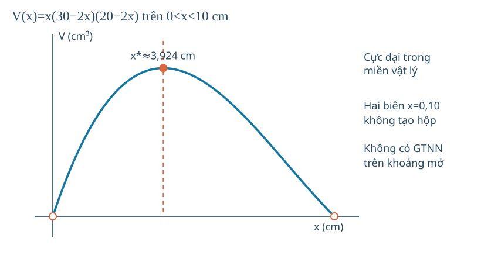

# Toán 12 · Bài 5. Ứng dụng đạo hàm để giải quyết một số vấn đề liên quan đến thực tiễn

TOÁN 12 · CHƯƠNG I · SGK KẾT NỐI TRI THỨC · TẬP MỘT · TRANG 33–41

Học trọn bài tại đây: hiểu bản chất, xem hình, ví dụ có suy luận, tự thử, Core, Luyện tập, Vận dụng, Tự luận và các hướng dẫn tự khắc phục.

<nav class="thpt-r4-lesson-tabs"><a href="../">Chương I</a><a href="../bai-4/">Bài trước</a><a href="../tu-kiem-tra-chuong/">Tự kiểm tra</a></nav>

## 1. Vì sao cần học?

Khi sản lượng thay đổi một chút, chi phí tăng nhanh đến đâu? Khi một vật đi lùi, vị trí có thể vẫn dương không? Một hình hộp có thể tích lớn nhất với tấm bìa cho trước? Đây là ba loại quyết định cần **tốc độ biến thiên**, **điểm tối ưu** và quan trọng hơn là **miền khả thi**. Đạo hàm chỉ có ý nghĩa khi đi kèm mô hình, đơn vị và giả định thực tế.

## 2. Kiến thức tiền đề

Tỉ số thay đổi Δy/Δx và giới hạn khi Δx→0; quy tắc đạo hàm đa thức/phân thức; bảng dấu và max/min trên miền có thể bị giới hạn; thể tích hộp chữ nhật; chi phí/doanh thu/lợi nhuận. Nếu vị trí s tính bằng m và thời gian t tính bằng s, đạo hàm s'(t) có đơn vị m/s, đạo hàm lần hai có m/s². Không nhầm số âm của vận tốc với "độ lớn vận tốc" (tốc độ |v|≥0).

## 3. Hiểu bản chất trước công thức

**Tốc độ thay đổi tức thời:** Khi x tăng h rất nhỏ, [f(x+h)−f(x)]/h xấp xỉ độ đổi y theo 1 đơn vị x. Giới hạn khi h→0, nếu tồn tại, là f'(x); đơn vị là "đơn vị y / đơn vị x". Đạo hàm không mặc định là tốc độ theo thời gian: chỉ gọi "vận tốc" khi f là vị trí theo thời gian.

**Chuyển động thẳng:** v=s'(t), a=v'(t)=s''(t). Chiều theo trục dương/âm phụ thuộc dấu v; **tốc độ** là |v|; khi v≠0, tốc độ tăng nếu v·a>0 và giảm nếu v·a<0. Ngay tại v=0 không khẳng định "tốc độ tăng" chỉ nhờ a>0; cần xét lân cận thời điểm.

**Chi phí cận biên:** C'(q) là tốc độ đổi chi phí theo sản lượng; khi q đo bằng đơn vị sản phẩm, C'(q) ≈ C(q+1)−C(q) nếu bước 1 đủ nhỏ so với quy mô mô hình. Đạo hàm không bằng đúng sai phân hữu hạn trong mọi mô hình.

**Bài toán tối ưu hóa:** (1) đặt biến có nghĩa và đơn vị; (2) viết ràng buộc vật lý; (3) biểu diễn mục tiêu bằng một biến; (4) tìm điểm tới hạn/biên; (5) so sánh và diễn giải kết quả phù hợp giả định. Nếu miền là khoảng mở, không tự tuyên bố giá trị min bằng giới hạn không đạt.

## 4. Đọc hình và dữ liệu

**FIG-G12-B05-01** (G12_B05_FIG01_BOX_VOLUME_R00.svg, original SVG source ready): V(x)=x(30−2x)(20−2x), miền **chỉ 0<x<10**; trục ngang x cm, dọc V cm³; đỉnh tại x*≈3.9237, hai biên không được tô chấm đặc vì hộp suy biến. Dạy đọc hình: xác định miền hợp lệ trước, xem dấu V' rồi mới đọc đỉnh; đồ thị ngoài (0,10) chỉ là đa thức toán, không là hộp vật lý.

<figure class="thpt-r4-plot g12-chi-figure"><figcaption>Hình minh họa 1 · Xem hướng dẫn đọc hình ngay phía trên.</figcaption></figure>

## 5. Ví dụ có suy luận và lý do chọn phương pháp

### Ví dụ 1 — Vận tốc âm không có nghĩa vị trí âm
Vật đi trên trục với s(t)=t³−6t²+9t (m), t≥0 (s). v(t)=3t²−12t+9=3(t−1)(t−3) (m/s). Trên 0<t<1 và t>3, v>0 nên chuyển động theo chiều dương; trên 1<t<3 v<0 nên đi theo chiều âm. Ở t=2: s(2)=8−24+18=2 m dương, v(2)=12−24+9=−3 m/s âm; đây là phản ví dụ trực tiếp cho lối nghĩ "tọa độ dương thì luôn đi về phía dương". a(t)=6t−12, a(2)=0; tại một thời điểm có thể tốc độ khác 0 nhưng gia tốc bằng 0.

### Ví dụ 2 — Chi phí cận biên không phải chênh lệch chính xác
C(q)=0.02q²+5q+1200 (nghìn đồng), q≥0 (sản phẩm); C'(q)=0.04q+5 (nghìn đồng/sản phẩm). Khi q=100, C'(100)=9. Nhưng C(101)−C(100)=0.02·201+5=9.02 nghìn đồng. **Vì sao hai số khác nhau?** Đạo hàm là tốc độ giới hạn; sai phân 1 sản phẩm có thêm tác động độ cong của C. Không đồng nhất C'(100) với tổng chi phí C(100).

### Ví dụ 3 — Quây vườn sát tường, chỉ dùng ba cạnh
Có 40 m hàng rào cho ba cạnh một mảnh vườn chữ nhật sát bức tường. Gọi x là chiều vuông góc tường, chiều song song là 40−2x. Miền 0<x<20. A=x(40−2x), A'=40−4x nên max A=200 m² tại x=10, cạnh song song 20 m. **Giới hạn mô hình**: không cần hàng rào ở cạnh sát tường; nếu dùng cả bốn cạnh sẽ ra công thức khác, trái yêu cầu. Không có diện tích nhỏ nhất dương trên miền hình chữ nhật không suy biến.

### Ví dụ 4 — Gấp hộp từ tấm bìa
Tấm bìa 30 cm × 20 cm; cắt ở bốn góc bốn hình vuông cạnh x cm, gấp thành hộp không nắp. Miền 0<x<10. V(x)=x(30−2x)(20−2x)=600x−100x²+4x³ (cm³); V'=600−200x+12x². Giải V'=0: x=(25±5√7)/3; nghiệm (25+5√7)/3>10, bị loại. Nghiệm hợp lệ x*=(25−5√7)/3≈3.9237 cm; V' dương trước x*, âm sau x*, nên V lớn nhất tại x*. Khi x→0+ hoặc10−, V→0 nhưng không đạt thể tích 0 nếu hộp vẫn là hộp không suy biến. *Lý do chọn bảng dấu*: trên miền mở chỉ nghiệm bên trong thỏa vật lý mới được chọn.

### Ví dụ 5 — Tối ưu lợi nhuận có điều kiện giá không âm
Một sản phẩm bán theo lượng q liên tục trong mô hình 0≤q≤300; giá bán p(q)=30−0.1q (nghìn đồng/sản phẩm), chi phí C(q)=10q+400 (nghìn đồng). Doanh thu R(q)=qp(q), lợi nhuận P=R−C=20q−0.1q²−400. P'(q)=20−0.2q=0 tại q=100, P''=−0.2<0; P(100)=600 nghìn đồng. Đầu biên P(0)=−400; P(300)=−3400. **GTLN** P=600 tại 100 sản phẩm. Nếu sản lượng là nguyên, 100 vẫn hợp lệ; cần kiểm tra điểm gần nhất nếu nghiệm tối ưu không nguyên. Mô hình p≥0 cho giới hạn q≤300, không được tối ưu trên tất cả ℝ.

## 6. Tự thử trước Core

A. s(t)=5−2t có vị trí dương lúc t=1, vật đi theo chiều nào? Tốc độ bao nhiêu?
B. Chi phí C(q) có đơn vị triệu đồng, q sản phẩm. Đơn vị C'(q) là gì?
C. Bốn cạnh hay ba cạnh hàng rào sẽ làm thay đổi điều kiện x+y hay 2x+y?
D. Khi x cắt vuông ở góc hộp 30×20, tại sao x=12 cm không hợp lệ?
Đoán trước rồi mới xem Core, sai thì chọn HELP theo outcome, tự thử khác và quay lại.

## 7. Core, Luyện tập, Vận dụng, Tự luận và hỗ trợ

Đang mở bài tập đã kiểm duyệt...

<nav class="thpt-r4-lesson-tabs"><a href="../">Chương I</a><a href="../tu-kiem-tra-chuong/">Tự kiểm tra cuối chương</a></nav>

