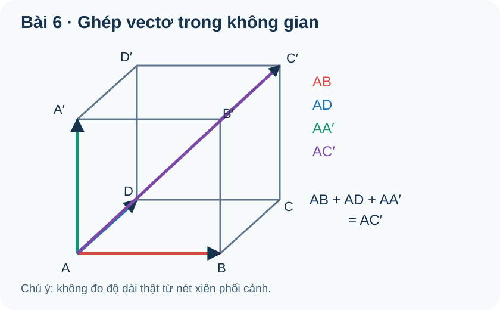

# Toán 12 · Bài 6. Vectơ trong không gian

TOÁN 12 · CHƯƠNG II · SGK KẾT NỐI TRI THỨC · TẬP MỘT · TRANG 45–59

Học theo mạch: hiểu bản chất, đọc hình, xem ví dụ có suy luận, tự thử, Core, Luyện tập, Tự luận và tự khắc phục ngay trong bài.

<nav class="thpt-r4-lesson-tabs"><a href="../">Chương II</a><a href="../bai-7/">Bài tiếp theo</a></nav>

## 1. Vì sao cần học?

Trong phòng học, một vật có thể chuyển động sang trái/phải, lên/xuống hoặc tiến/lùi. Một mũi tên trên mặt giấy chỉ biểu diễn được một phần tình huống. Để mô tả lực kéo sợi dây, hướng bay của máy bay hay cạnh của hình hộp, ta cần **vectơ trong không gian**: không chỉ “bao nhiêu” mà còn “theo hướng nào”. Tính tổng vectơ cho phép kết hợp nhiều dịch chuyển; tích vô hướng cho biết hai lực hoặc hai hướng có hỗ trợ nhau hay vuông góc.

**Câu hỏi dẫn nhập:** Một người đi 3 m về phía đông rồi 4 m về phía bắc. Quãng đường đi được là 7 m, nhưng độ dài vectơ từ điểm đầu tới điểm cuối có nhất thiết là 7 m? Vì sao? (Sau bài, em tự đối chiếu với kết quả 5 m khi hai hướng vuông góc.)

## 2. Kiến thức tiền đề

- Vectơ phẳng lớp 10: đoạn thẳng có hướng, độ dài, hai vectơ bằng nhau; quy tắc hình tam giác, hình bình hành; tích một số với vectơ.
- Định lí Pythagore, góc và cosin từ hình học; hình hộp/hình chóp trong hình học không gian.
- **Điểm mới:** các điểm đầu/cuối không nhất thiết cùng nằm trên mặt phẳng hình vẽ; cần giữ đúng phương và chiều khi “dời” vectơ từ hình này sang hình khác.

**Tự kiểm tiền đề:** Nếu $A,B,C$ là ba điểm bất kì, em còn nhớ vì sao $\overrightarrow{AB}+\overrightarrow{BC}=\overrightarrow{AC}$? Giải thích bằng hành trình $A\to B\to C$, không cần học thuộc công thức.

## 3. Bản chất và điều kiện áp dụng

### 3.1. Vectơ không gian: hình dung mũi tên tự do

Cho hai điểm $A,B$ trong không gian. $\overrightarrow{AB}$ có điểm đầu $A$, điểm cuối $B$, độ dài bằng khoảng cách $AB$. Hai vectơ bằng nhau khi **cùng hướng và cùng độ dài**, dù đặt ở vị trí khác nhau. Vectơ-không $\vec 0$ có hai đầu trùng nhau, độ dài 0 và **không có hướng xác định**; tránh nói vectơ-không “chỉ lên”. Hai vectơ khác không cùng phương khi giá song song hoặc trùng nhau, có thể cùng hoặc ngược hướng.

Khi đọc một hình phối cảnh, đừng dựa vào độ dài vẽ trên màn hình để quyết định độ dài thật của cạnh. Hình chiếu có thể làm đoạn thẳng trông ngắn hơn. Xem **FIG-G12-CHII-B06-R00.svg**: các mũi tên $\overrightarrow{AB}$ và $\overrightarrow{DC}$ song song và bằng nhau trong một mặt của hình hộp; đường chéo $\overrightarrow{AC}$ là đường đi rút gọn của hai cạnh liên tiếp.

### 3.2. Từ hành trình đến tổng, hiệu

Muốn đi $A\to C$ qua $B$, ghép hai mũi tên $\overrightarrow{AB}$ và $\overrightarrow{BC}$ **đầu–đuôi**. Mũi tên từ đầu hành trình đến cuối hành trình là $\overrightarrow{AC}$. Đó là ý nghĩa của quy tắc cộng, trước khi viết

$$\overrightarrow{AB}+\overrightarrow{BC}=\overrightarrow{AC}. $$

Nếu hai vectơ có cùng điểm đầu $A$ và làm hai cạnh hình bình hành $ABCD$ thì đường chéo $\overrightarrow{AC}=\overrightarrow{AB}+\overrightarrow{AD}$. Muốn trừ $\vec b$, hãy cộng vectơ đối $-\vec b$; **hiệu là một phép cộng có đổi chiều**. Trên hình hộp $ABCD.A'B'C'D'$:

$$\overrightarrow{AC'}=\overrightarrow{AB}+\overrightarrow{AD}+\overrightarrow{AA'}.$$

**Vì sao chọn phương pháp này?** Khi đề cho điểm hình hộp, nên tìm các cạnh tạo đường đi và đưa về cùng hướng trước khi tính. Không nên đo bằng thước trên ảnh xiên. Phương pháp không phụ thuộc việc hình hộp có phải hình lập phương hay không.

### 3.3. Nhân vectơ với số: độ dài và chiều thay đổi thế nào?

Nếu $\vec a$ là dịch chuyển 2 m về một hướng, $3\vec a$ là dịch chuyển 6 m **cùng hướng**; $-\vec a$ dài 2 m nhưng **ngược hướng**. Công thức là

$$|k\vec a|=|k|\,|\vec a|.$$

Khi $k>0$, giữ hướng; khi $k<0$, đổi hướng; khi $k=0$, được $\vec 0$ không có hướng xác định. Với $\vec b\ne\vec 0$, điều kiện hai vectơ cùng phương có thể viết $\vec a=k\vec b$ với một số thực $k$. Không kết luận “cùng hướng” chỉ từ cùng phương: hãy xét dấu $k$.

### 3.4. Tích vô hướng: một hướng có “đóng góp” bao nhiêu cho hướng kia?

Giữa hai vectơ **khác** $\vec 0$, dời hai mũi tên về cùng gốc rồi đọc góc $\theta$ trong khoảng $0^\circ\le\theta\le180^\circ$. Chiếu vectơ $\vec a$ lên hướng $\vec b$ tạo thành thành phần có dấu $|\vec a|\cos\theta$. Nhân với độ dài $|\vec b|$ cho ta **tích vô hướng**:

$$\vec a\cdot\vec b=|\vec a|\,|\vec b|\cos\theta.$$

Nếu $\theta=90^\circ$, hai vectơ vuông góc và tích bằng 0. Nếu góc tù, tích âm. Nếu góc nhọn, tích dương. **Không dùng công thức góc khi một vectơ bằng $\vec 0$** vì góc khi đó không xác định; tuy nhiên tích vô hướng với $\vec 0$ vẫn bằng 0 theo tính chất đại số. Hai vectơ khác không mới suy từ tích bằng 0 sang vuông góc.

Tính chất quan trọng: giao hoán $\vec a\cdot\vec b=\vec b\cdot\vec a$, phân phối $\vec a\cdot(\vec b+\vec c)=\vec a\cdot\vec b+\vec a\cdot\vec c$, và $\vec a\cdot\vec a=|\vec a|^2$.

## 4. Đọc hình minh họa

**Hình FIG-G12-CHII-B06-R00.svg:** đọc cạnh/mũi tên bằng tên hai đầu; xác định vectơ cùng hướng trước, rồi ghép $A\to B\to C$; không suy độ dài bằng độ dài biểu diễn trong phối cảnh. Hình tự tạo để giảng giải, không trích ảnh SGK.

| OUTCOME_ID | Triệu chứng sai | Đường khắc phục trực tiếp |
|---|---|---|
| O01 | Đo cạnh trên hình xiên rồi cho là độ dài thật | Quay §3.1 và EX01, dựng ba cạnh vuông góc |
| O02 | Nhầm song song với bằng nhau | Quay §3.1 và EX02, so chiều từng mũi tên |
| O03 | Cộng vectơ không cùng đầu–đuôi | Quay §3.2 và EX03, vẽ lại đường đi |
| O04 | Quên dấu âm của $k$ | Quay §3.3 và EX04, xét phương/chiều riêng |
| O05 | Dùng $\cos$ với vectơ-không | Quay §3.4 và EX05, kiểm điều kiện khác $\vec0$ |
| O06 | Lấy độ dài lực nhân quãng đường mà bỏ góc | Quay §3.4 và EX06, xác định hướng chuyển động |

**Checkpoint học sinh:** Em có thể tự giải thích vì sao $\vec a\cdot\vec b$ âm khi góc tù, và khi nào không được nói “góc giữa hai vectơ”? Nếu chưa, học lại §3.4 rồi thử câu O05 trước khi sang B07.

<figure class="thpt-r4-plot g12-chi-figure"><figcaption>Hình gốc của học liệu Bài 6, đọc cùng hướng dẫn ngay phía trên.</figcaption></figure>

## 5. Ví dụ có suy luận và lựa chọn phương pháp

**EX-G12-B06-01 · O01 — Hình lập phương:** Trong hình lập phương cạnh 3 cm, các vectơ $\overrightarrow{AB}$ và $\overrightarrow{AC'}$ có cùng độ dài không? **Giải:** $|\overrightarrow{AB}|=3$ cm. Đường chéo không gian $AC'$ đi qua ba chiều vuông góc nên $AC'=\sqrt{3^2+3^2+3^2}=3\sqrt3$ cm. **Vì sao:** cần phân biệt mũi tên trên ảnh 2D với độ dài thật trong 3D; dùng Pythagore không gian, không đo trực tiếp hình vẽ.

**EX-G12-B06-02 · O02 — So sánh vectơ:** Với hình bình hành $ABCD$, hãy so sánh $\overrightarrow{AB}$, $\overrightarrow{DC}$ và $\overrightarrow{BA}$. **Giải:** $\overrightarrow{AB}=\overrightarrow{DC}$ do cùng hướng, cùng độ dài; $\overrightarrow{BA}=-\overrightarrow{AB}$. **Lưu ý:** $\overrightarrow{CD}$ ngược chiều $\overrightarrow{AB}$; đừng chỉ nhìn hai cạnh song song.

**EX-G12-B06-03 · O03 — Tổng trong hình hộp:** Đưa $\overrightarrow{AB}+\overrightarrow{AD}+\overrightarrow{AA'}$ về một vectơ duy nhất. **Giải:** trong đáy $\overrightarrow{AB}+\overrightarrow{AD}=\overrightarrow{AC}$; tiếp theo $\overrightarrow{AC}+\overrightarrow{CC'}=\overrightarrow{AC'}$, và $\overrightarrow{CC'}=\overrightarrow{AA'}$. **Vì sao:** dùng vectơ bằng nhau để nối đầu–đuôi; không đòi hình hộp vuông.

**EX-G12-B06-04 · O04 — Trung điểm:** $M$ là trung điểm $AB$, $N$ trên tia đối của $AB$ sao cho $AN=2AB$. Tìm $\overrightarrow{AM}$ và $\overrightarrow{AN}$ theo $\overrightarrow{AB}$. **Giải:** $\overrightarrow{AM}=\tfrac12\overrightarrow{AB}$, $\overrightarrow{AN}=-2\overrightarrow{AB}$. **Vì sao:** tỉ số độ dài chỉ cho $|k|$; muốn xác định $k$ phải xét chiều.

**EX-G12-B06-05 · O05 — Tích vô hướng:** $|\vec u|=4$, $|\vec v|=6$, $(\vec u,\vec v)=120^\circ$. Tính $\vec u\cdot\vec v$. **Giải:** $4\cdot6\cdot(-\tfrac12)=-12$. **Vì sao:** góc tù làm hình chiếu có dấu âm. Không đổi góc thành $60^\circ$ vì ảnh vẽ có thể khiến em nhầm góc giữa vectơ và đường thẳng.

**EX-G12-B06-06 · O06 — Công của lực:** Một lực không đổi $20$ N hợp với hướng dịch chuyển 3 m góc $60^\circ$. Tính công lực đó. **Giải:** công theo hướng dịch chuyển là $W=\vec F\cdot\vec s=20\cdot3\cdot\tfrac12=30$ J. Nếu lực vuông góc chuyển động, công bằng 0. **Điều kiện:** đây là mô hình lực không đổi và độ dời thẳng; không tính công cho lực biến thiên tùy ý theo cùng một công thức đơn giản.

## 6. Tự thử trước Core

**TỰ THỬ B06-T01 (không tính Mastery):** Trong hình hộp $ABCD.A'B'C'D'$, hãy viết $\overrightarrow{AB}+\overrightarrow{AD}+\overrightarrow{AA'}$ thành một vectơ; giải thích bằng hành trình từ $A$. Sau đó, nếu $\vec a$ và $\vec b$ lần lượt dài 2 và 5 với góc $60^\circ$, dự đoán dấu và giá trị $\vec a\cdot\vec b$.

Tự mở phần đối chiếu (sau khi tự làm)

Lần lượt theo ba cạnh của hình hộp, điểm kết thúc là $C'$, nên tổng bằng $\overrightarrow{AC'}$. Tích vô hướng bằng $2\cdot5\cdot\cos60^\circ=5>0$; góc nhọn nên dấu dương. Nếu sai vectơ đường chéo, hãy vẽ đường đi đầu–đuôi trước khi áp dụng công thức.

## 7. Core · Luyện tập · Tự luận · Hỗ trợ khắc phục

Đang mở bài tập gốc đã kiểm duyệt...

<nav class="thpt-r4-lesson-tabs"><a href="../">Chương II</a><a href="../bai-7/">Bài tiếp theo</a></nav>

