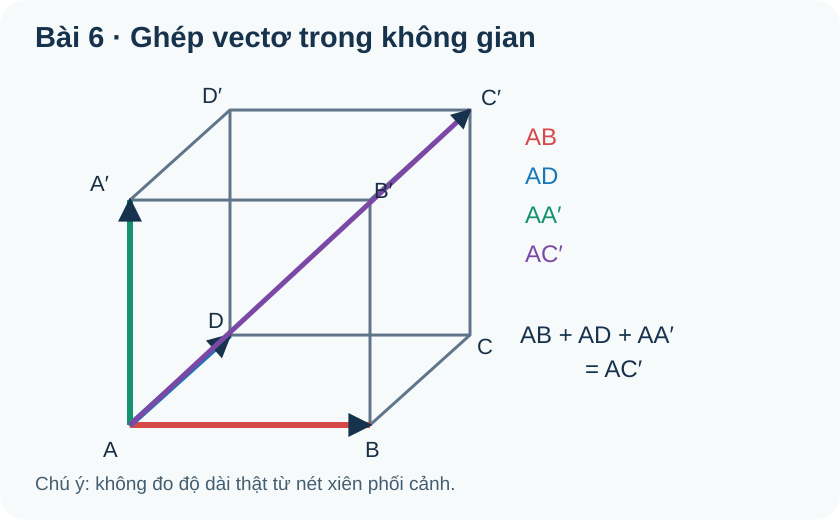
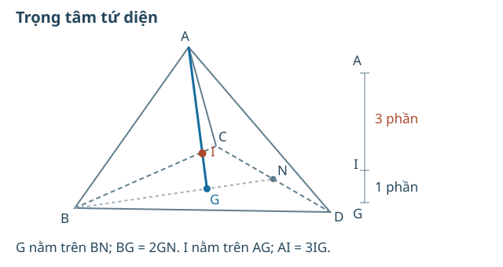
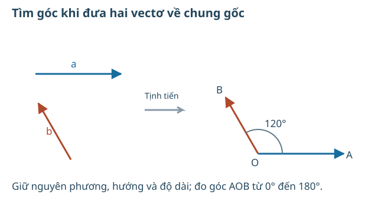

# Bài 6. Vectơ trong không gian

TOÁN 12 · CHƯƠNG II · KIẾN THỨC SGK KNTT · TẬP MỘT

Mở rộng vectơ từ mặt phẳng ra không gian: biểu diễn độ dời, ghép các hướng, xác định trung điểm và trọng tâm, tính góc và công của lực.

<nav class="thpt-r4-lesson-tabs"><a href="../">Chương II</a><a href="../luyen-tap/#b06-core">Core/Luyện tập</a><a href="../tu-kiem-tra-chuong/">Tự kiểm tra cuối chương</a><a href="../bai-7/">Bài tiếp theo</a></nav>

=== "Khám phá kiến thức"

    ### 1.1. Vectơ trong không gian

    Một chiếc máy bay có thể chuyển động về phía trước, sang bên hoặc lên cao. Nếu chỉ biết tốc độ của nó là \(500\) km/h, ta chưa biết nó đang bay về đâu. Cần thêm phương và chiều của chuyển động. Tương tự, các dây cáp nâng một kiện hàng có thể kéo theo những hướng khác nhau, không nhất thiết nằm trong cùng một mặt phẳng. Ta dùng vectơ để mô tả độ lớn và hướng của các đại lượng ấy.

    Cho hai điểm \(A,B\) trong không gian. Vectơ \(\overrightarrow{AB}\) là đoạn thẳng có hướng từ \(A\) đến \(B\); \(A\) là điểm đầu, \(B\) là điểm cuối. Nếu \(A\ne B\), đường thẳng \(AB\) là **giá** của vectơ. Độ dài \(|\overrightarrow{AB}|=AB\) chỉ là một số không âm; nó không cho biết chiều của mũi tên.

    Hãy hình dung một hình hộp \(ABCD.A'B'C'D'\), các đỉnh được đặt theo thứ tự quanh hai mặt đáy. Trong hình dưới, \(AB,AD,AA'\) là ba cạnh cùng xuất phát từ \(A\), nhưng chúng đi theo ba hướng khác nhau trong không gian.

    <figure class="thpt-r4-plot"><figcaption>Đọc điểm đầu rồi đến điểm cuối của mỗi mũi tên. Các cạnh xiên trông ngắn hơn do phối cảnh; không đo độ dài thật bằng thước trên hình. Đường chéo \(AC'\) nối hai đỉnh đối diện.</figcaption></figure>

    Hai vectơ khác không cùng phương nếu giá của chúng song song hoặc trùng nhau. Chúng có thể cùng hướng hoặc ngược hướng. Chẳng hạn, trong đáy hình bình hành \(ABCD\), \(\overrightarrow{AB}\) và \(\overrightarrow{DC}\) cùng hướng, cùng độ dài, nên bằng nhau. Còn \(\overrightarrow{CD}\) có độ dài bằng \(AB\) nhưng ngược hướng với \(\overrightarrow{AB}\). Hai vectơ bằng nhau không bắt buộc phải có chung điểm đầu.

    Ta có thể dời một mũi tên đến bất kì điểm \(O\) mà vẫn giữ nguyên hướng và độ dài. Khi đó điểm cuối \(M\) được xác định duy nhất sao cho \(\overrightarrow{OM}\) bằng vectơ ban đầu. Nhờ vậy ta có thể đem các vectơ ở những vị trí khác nhau về cùng gốc để cộng hoặc tìm góc giữa chúng.

    Nếu quay lại đúng điểm xuất phát, độ dời là \(\overrightarrow{AA}=\vec0\), dù quãng đường đã đi có thể khác \(0\). Vectơ-không có độ dài \(0\). SGK KNTT quy ước nó cùng hướng và cùng phương với mọi vectơ. Quy ước này không có nghĩa ta phải tưởng tượng một mũi tên độ dài \(0\) đang chỉ theo một chiều vật lí nhất định.

    **Vận dụng.** Trong hình lập phương \(ABCD.A'B'C'D'\) cạnh \(2\) cm, so sánh \(\overrightarrow{BC}\), \(\overrightarrow{A'D'}\), \(\overrightarrow{D'A'}\) về phương, hướng và độ dài. Tính \(|\overrightarrow{AC'}|\).

    ??? question "Đối chiếu"

        Cả ba vectơ cạnh đều cùng phương và có độ dài \(2\) cm. \(\overrightarrow{BC}=\overrightarrow{A'D'}\); \(\overrightarrow{D'A'}\) ngược hướng với hai vectơ ấy. Đường chéo đáy \(AC=2\sqrt2\) cm. Vì \(CC'\perp(ABCD)\), tam giác \(ACC'\) vuông tại \(C\), nên \(AC'=\sqrt{AC^2+CC'^2}=2\sqrt3\) cm.

    ??? tip "Kiểm lỗi"

        Nếu coi \(\overrightarrow{D'A'}=\overrightarrow{BC}\), hãy đọc lại chiều từ \(D'\) đến \(A'\). Nếu tính \(AC'=6\), em đã cộng độ dài ba cạnh thay vì tính độ dài đường chéo không gian.

    ### 1.2. Tổng và hiệu của hai vectơ trong không gian

    Giả sử em đi từ \(A\) tới \(B\), rồi từ \(B\) tới \(C\). Hai chặng có thể đi theo những hướng khác nhau, nhưng độ dời tổng hợp chỉ nối điểm xuất phát với điểm đến. Do đó \(\overrightarrow{AB}+\overrightarrow{BC}=\overrightarrow{AC}\). Đây là quy tắc ba điểm; nó đúng cả khi ba điểm thẳng hàng.

    Với hai vectơ \(\vec a,\vec b\) bất kì, chọn điểm đầu \(A\), dựng \(B,C\) sao cho \(\overrightarrow{AB}=\vec a,\overrightarrow{BC}=\vec b\). Khi ấy \(\overrightarrow{AC}\) biểu diễn \(\vec a+\vec b\). Đổi điểm xuất phát chỉ tịnh tiến cả hành trình, không đổi độ dời tổng hợp. Nếu hai vectơ khác không, không cùng phương và có chung gốc, có thể dựng hình bình hành với chúng làm hai cạnh: vectơ đường chéo từ gốc chung là tổng.

    Trong không gian, ta thường cần ghép ba hướng. Trở lại hình hộp ở mục 1.1. Trong mặt \(ABCD\), \(\overrightarrow{AB}+\overrightarrow{AD}=\overrightarrow{AC}\). Vì \(\overrightarrow{CC'}=\overrightarrow{AA'}\), ghép tiếp từ \(C\) đến \(C'\) cho

    \[
    \overrightarrow{AB}+\overrightarrow{AD}+\overrightarrow{AA'}
    =\overrightarrow{AC}+\overrightarrow{CC'}
    =\overrightarrow{AC'}.
    \]

    <figure class="thpt-r4-plot"><figcaption>Chọn ba cạnh đi ra từ cùng đỉnh \(A\). Ghép hai cạnh đáy thành đường chéo \(AC\), rồi dời cạnh đứng \(AA'\) đến \(C\). Kết quả là đường chéo không gian \(AC'\). Quy tắc đúng với mọi hình hộp, không chỉ hình hộp chữ nhật.</figcaption></figure>

    Phép cộng có tính giao hoán, kết hợp như trong mặt phẳng. Ta được phép đổi thứ tự các vectơ trong tổng và gom các cặp thích hợp. Cộng vectơ-không không làm thay đổi vectơ. Nếu một vật chịu nhiều lực, tổng các vectơ lực biểu diễn hợp lực; hợp lực bằng \(\vec0\) nghĩa là các lực cân bằng, không phải từng lực đều bằng không.

    Muốn trừ \(\vec b\) khỏi \(\vec a\), ta cộng \(\vec a\) với vectơ đối \(-\vec b\): giữ độ dài của \(\vec b\) nhưng đảo hướng. Chẳng hạn \(-\overrightarrow{AB}=\overrightarrow{BA}\), và hai vectơ đối có tổng \(\vec0\). Nếu \(\overrightarrow{OA}=\vec a,\overrightarrow{OB}=\vec b\), hiệu \(\vec b-\vec a\) là \(\overrightarrow{AB}\), bởi \(\overrightarrow{OA}+\overrightarrow{AB}=\overrightarrow{OB}\). Khi hai mũi tên có chung gốc, **hiệu nối đầu mút của vectơ bị trừ tới đầu mút của vectơ đứng trước dấu trừ**.

    **Vận dụng.** Trong hình hộp \(ABCD.A'B'C'D'\), rút gọn \(\overrightarrow{BA}+\overrightarrow{BC}+\overrightarrow{BB'}\), và \(\overrightarrow{AC'}-\overrightarrow{AB}\).

    ??? question "Đối chiếu"

        Ba cạnh ở câu đầu xuất phát từ \(B\). Vì \(\overrightarrow{BC}=\overrightarrow{AD}\), tổng hai cạnh đáy bằng \(\overrightarrow{BD}\); thay \(\overrightarrow{BB'}\) bằng \(\overrightarrow{DD'}\), ta được \(\overrightarrow{BD'}\). Câu sau có hai vectơ cùng gốc \(A\); theo quy tắc hiệu, \(\overrightarrow{AC'}-\overrightarrow{AB}=\overrightarrow{BC'}\).

    ??? tip "Kiểm lỗi"

        Nếu kết quả hiệu là \(\overrightarrow{C'B}\), em đã đảo chiều. Hãy cộng lại \(\overrightarrow{AB}+\overrightarrow{BC'}\) để kiểm phải thu được \(\overrightarrow{AC'}\).

    ### 1.3. Tích của một số với một vectơ trong không gian

    Nếu một vectơ mô tả độ dời \(2\) m về một hướng, nhân với \(3\) sẽ tạo độ dời \(6\) m cùng hướng; nhân với \(-3\) tạo độ dời \(6\) m theo chiều ngược lại. Như vậy, trị tuyệt đối của số nhân quyết định độ dài thay đổi bao nhiêu lần, còn dấu của nó quyết định hướng. Với \(k=0\), tích là \(\vec0\); nhân vectơ-không với bất kì số nào cũng cho \(\vec0\).

    Với \(\vec b\ne\vec0\), nếu \(\vec a\) cùng phương với \(\vec b\) thì \(\vec a=k\vec b\) với một số thực \(k\). Ngược lại, viết được như vậy chứng minh chúng cùng phương. Khi \(\vec a\ne\vec0\), \(k>0\) cho cùng hướng, \(k<0\) cho ngược hướng. Tính chất này giúp biến điều kiện song song, thẳng hàng thành đẳng thức vectơ.

    Ví dụ, nếu \(M\) là trung điểm của \(AB\), thì \(\overrightarrow{AM}=\frac12\overrightarrow{AB}\). Với điểm \(O\) bất kì, cộng hai hành trình \(O\to M\to A\) và \(O\to M\to B\):

    \[
    \overrightarrow{OA}+\overrightarrow{OB}
    =2\overrightarrow{OM}+\overrightarrow{MA}+\overrightarrow{MB}
    =2\overrightarrow{OM}.
    \]

    Công thức tương tự cho trọng tâm \(G\) của tam giác \(ABC\): \(\overrightarrow{OA}+\overrightarrow{OB}+\overrightarrow{OC}=3\overrightarrow{OG}\). Để thấy vì sao, lấy \(M\) là trung điểm \(BC\). Trên trung tuyến, \(\overrightarrow{AG}=\frac23\overrightarrow{AM}\), nên \(\overrightarrow{GA}=-2\overrightarrow{GM}\); đồng thời \(\overrightarrow{GB}+\overrightarrow{GC}=2\overrightarrow{GM}\). Tổng ba vectơ xuất phát từ \(G\) bằng \(\vec0\). Chèn gốc \(O\) vào mỗi vectơ cho hệ thức đã nêu.

    Trong tứ diện \(ABCD\), gọi \(G\) là trọng tâm mặt \(BCD\). Theo hệ thức trọng tâm tam giác, \(\overrightarrow{AB}+\overrightarrow{AC}+\overrightarrow{AD}=3\overrightarrow{AG}\). Nếu chọn \(I\) trên \(AG\) sao cho \(AI=3IG\), ta có \(\overrightarrow{IA}=-3\overrightarrow{IG}\). Do \(\overrightarrow{IB}+\overrightarrow{IC}+\overrightarrow{ID}=3\overrightarrow{IG}\), suy ra tổng bốn vectơ từ \(I\) đến bốn đỉnh bằng \(\vec0\). Điểm \(I\) được gọi là trọng tâm tứ diện.

    <figure class="thpt-r4-plot"><figcaption>Trước hết tìm trung điểm \(N\) của \(CD\), rồi \(G\) trên trung tuyến \(BN\) với \(BG=2GN\). Sau đó lấy \(I\) trên \(AG\) với \(AI=3IG\). Trọng tâm tam giác chia trung tuyến theo tỉ số \(2:1\); trọng tâm tứ diện chia đoạn nối đỉnh với trọng tâm mặt đối diện theo tỉ số \(3:1\).</figcaption></figure>

    **Vận dụng.** Trong tứ diện \(ABCD\), \(M,N\) lần lượt là trung điểm của \(AB,CD\); \(I\) là trung điểm \(MN\). Chứng minh \(I\) là trọng tâm tứ diện.

    ??? question "Đối chiếu"

        Vì \(M,N\) là trung điểm, \(\overrightarrow{IA}+\overrightarrow{IB}=2\overrightarrow{IM}\) và \(\overrightarrow{IC}+\overrightarrow{ID}=2\overrightarrow{IN}\). Vì \(I\) là trung điểm \(MN\), tổng bốn vectơ bằng \(2(\overrightarrow{IM}+\overrightarrow{IN})=\vec0\). Theo đặc trưng trọng tâm tứ diện, \(I\) chính là trọng tâm.

    ??? tip "Kiểm lỗi"

        Tứ diện bất kì không có các cạnh đối song song. Dùng công thức trung điểm với cùng gốc \(I\), thay vì giả sử \(ABCD\) là hình bình hành.

    ### 1.4. Tích vô hướng của hai vectơ trong không gian

    Muốn đo góc giữa hai mũi tên không cùng điểm đầu, trước hết dời chúng về cùng gốc mà không xoay hay thay đổi độ dài. Hai vectơ khác không \(\vec a,\vec b\) được biểu diễn bởi \(\overrightarrow{OA},\overrightarrow{OB}\); góc giữa chúng là góc \(AOB\), nằm từ \(0^\circ\) đến \(180^\circ\).

    <figure class="thpt-r4-plot"><figcaption>Giữ nguyên hướng và độ dài của từng mũi tên. Góc ở gốc chung trong hình là \(120^\circ\), không lấy góc nhọn \(60^\circ\) giữa hai đường thẳng chứa chúng.</figcaption></figure>

    Góc không phụ thuộc việc chọn gốc \(O\). Với hai vectơ không cùng phương, tam giác tạo bởi hai mũi tên có ba cạnh với độ dài \(|\vec a|,|\vec b|,|\vec b-\vec a|\); định lí côsin xác định cùng một góc dù đặt tam giác ở đâu. Nếu chúng cùng hướng, góc bằng \(0^\circ\); ngược hướng thì bằng \(180^\circ\). SGK quy ước góc giữa vectơ-không và một vectơ bất kì có thể nhận giá trị tùy ý trong đoạn từ \(0^\circ\) đến \(180^\circ\), không phải một góc duy nhất.

    Tại sao cần biết góc? Nếu kéo một vật bằng lực không đổi \(\vec F\), theo độ dời \(\vec s\), không phải toàn bộ độ lớn lực đều đóng góp vào công theo hướng chuyển động. Thành phần có dấu của lực theo hướng đó là \(|\vec F|\cos\theta\). Nhân với \(|\vec s|\), ta thu được một số gọi là công của lực, \(W=\vec F\cdot\vec s\). Đây là ứng dụng của **tích vô hướng**:

    \[
    \vec a\cdot\vec b=|\vec a|\,|\vec b|\cos(\vec a,\vec b)
    \qquad(\vec a,\vec b\ne\vec0).
    \]

    Kết quả là một **số thực**, không phải vectơ. Nếu góc nhọn, tích dương; nếu góc tù, tích âm; nếu vuông góc, tích bằng \(0\). Hai vectơ cùng hướng có tích bằng tích hai độ dài; ngược hướng thì bằng số đối của tích hai độ dài. Khi có vectơ-không, SGK quy ước tích bằng \(0\); không cần chọn góc tùy ý để tính.

    Chẳng hạn trong hình lập phương cạnh \(a>0\), muốn tính \(\overrightarrow{AC}\cdot\overrightarrow{B'A'}\), ta có thể đưa vectơ thứ hai về gốc \(A\): \(\overrightarrow{B'A'}=\overrightarrow{BA}=-\overrightarrow{AB}\). Đường chéo đáy \(AC\) tạo góc \(45^\circ\) với \(AB\), nên tạo góc \(135^\circ\) với vectơ đối của \(AB\). Tích bằng \(a\sqrt2\cdot a\cdot\cos135^\circ=-a^2\). Cũng có thể dùng \(\overrightarrow{AC}=\overrightarrow{AB}+\overrightarrow{AD}\); vì hai cạnh đáy vuông góc, tích bằng \(-|\overrightarrow{AB}|^2=-a^2\).

    **Vận dụng.** Một lực không đổi có độ lớn \(50\) N tạo góc \(120^\circ\) với độ dời dài \(4\) m. Tính công của lực, giải thích dấu. Với cùng độ lớn lực và độ dời, công lớn nhất bằng bao nhiêu?

    ??? question "Đối chiếu"

        \(W=50\cdot4\cos120^\circ=-100\) J. Dấu âm nghĩa là thành phần lực theo hướng độ dời ngược chiều chuyển động. Vì \(\cos\theta\le1\), công lớn nhất bằng \(200\) J khi lực cùng hướng với độ dời, tức \(\theta=0^\circ\).

    ??? tip "Kiểm lỗi"

        Không lấy góc nhọn giữa hai đường thẳng thay góc giữa hai vectơ. Nếu công tính được luôn dương, hãy xét lại dấu của cosin. Lực vuông góc với độ dời có công bằng \(0\).

=== "Kiến thức SGK"

    ### 2.1. Vectơ trong không gian

    
<strong>Định nghĩa — Vectơ</strong>
Vectơ trong không gian là một đoạn thẳng có hướng. Vectơ \(\overrightarrow{AB}\) có điểm đầu \(A\), điểm cuối \(B\); độ dài \(|\overrightarrow{AB}|=AB\). Nếu \(A\ne B\), đường thẳng \(AB\) là giá của vectơ. Khi không cần chỉ rõ hai đầu, dùng kí hiệu \(\vec a,\vec b,\ldots\).

    
<strong>Định nghĩa — Cùng phương, cùng hướng, bằng nhau</strong>
Hai vectơ khác không cùng phương nếu giá song song hoặc trùng nhau; khi đó chúng cùng hướng hoặc ngược hướng. Hai vectơ bằng nhau nếu cùng hướng và cùng độ dài. Với mỗi điểm \(O\) và vectơ \(\vec a\), có duy nhất điểm \(M\) sao cho \(\overrightarrow{OM}=\vec a\).

    Vectơ có điểm đầu trùng điểm cuối gọi là vectơ-không, kí hiệu chung \(\vec0\). Theo quy ước SGK, \(|\vec0|=0\), vectơ-không cùng hướng và cùng phương với mọi vectơ. Tất cả các vectơ-không đều bằng nhau.

    ### 2.2. Tổng và hiệu của hai vectơ trong không gian

    
<strong>Định nghĩa — Tổng hai vectơ</strong>
Với \(\vec a,\vec b\) bất kì, dựng \(\overrightarrow{AB}=\vec a,\overrightarrow{BC}=\vec b\); tổng \(\vec a+\vec b=\overrightarrow{AC}\).

    
<strong>Quy tắc ba điểm, hình bình hành và hình hộp</strong>
Với ba điểm \(A,B,C\), \(\overrightarrow{AB}+\overrightarrow{BC}=\overrightarrow{AC}\).

Với hình bình hành \(ABCD\), \(\overrightarrow{AB}+\overrightarrow{AD}=\overrightarrow{AC}\).

Với hình hộp \(ABCD.A'B'C'D'\), \(\overrightarrow{AB}+\overrightarrow{AD}+\overrightarrow{AA'}=\overrightarrow{AC'}\).

    <figure class="thpt-r4-plot"><figcaption>Quy tắc hình hộp là hai lần áp dụng quy tắc hình bình hành hoặc quy tắc ba điểm.</figcaption></figure>

    Tính chất: \(\vec a+\vec b=\vec b+\vec a\), \((\vec a+\vec b)+\vec c=\vec a+(\vec b+\vec c)\), \(\vec a+\vec0=\vec a\). Nhờ tính kết hợp, có thể bỏ ngoặc khi viết tổng nhiều vectơ.

    
<strong>Định nghĩa — Vectơ đối và hiệu</strong>
Vectơ đối của vectơ khác không \(\vec a\) có cùng độ dài và ngược hướng, kí hiệu \(-\vec a\); vectơ đối của \(\vec0\) là chính nó. Hai vectơ đối nhau khi và chỉ khi tổng của chúng bằng \(\vec0\). Hiệu \(\vec a-\vec b=\vec a+(-\vec b)\).

    Quy tắc hiệu với gốc chung: \(\overrightarrow{OB}-\overrightarrow{OA}=\overrightarrow{AB}\). Đặc biệt \(-\overrightarrow{AB}=\overrightarrow{BA}\).

    ### 2.3. Tích của một số với một vectơ trong không gian

    
<strong>Định nghĩa</strong>
Với \(k\ne0,\vec a\ne\vec0\), tích \(k\vec a\) là vectơ cùng hướng với \(\vec a\) nếu \(k&gt;0\), ngược hướng nếu \(k&lt;0\), và có độ dài \(|k|\,|\vec a|\). Quy ước \(0\vec a=\vec0\), \(k\vec0=\vec0\).

    
<strong>Tính chất và điều kiện cùng phương</strong>
Với \(h,k\in\mathbb R\): \(h(k\vec a)=(hk)\vec a\), \((h+k)\vec a=h\vec a+k\vec a\), \(k(\vec a+\vec b)=k\vec a+k\vec b\), \(1\vec a=\vec a\), \((-1)\vec a=-\vec a\).

Với \(\vec b\ne\vec0\), \(\vec a,\vec b\) cùng phương khi và chỉ khi có số thực \(k\) sao cho \(\vec a=k\vec b\).

    Với hai điểm phân biệt \(A,B\), điểm \(M\) thuộc đường thẳng \(AB\) khi và chỉ khi \(\overrightarrow{AM}=k\overrightarrow{AB}\) với \(k\in\mathbb R\). Nếu \(M\) thuộc đoạn \(AB\) thì \(0\le k\le1\).

    
<strong>Hệ thức trung điểm, trọng tâm</strong>
Với điểm \(O\) tùy ý, nếu \(M\) là trung điểm \(AB\), \(2\overrightarrow{OM}=\overrightarrow{OA}+\overrightarrow{OB}\); nếu \(G\) là trọng tâm tam giác \(ABC\), \(3\overrightarrow{OG}=\overrightarrow{OA}+\overrightarrow{OB}+\overrightarrow{OC}\).

Nếu \(I\) là trọng tâm tứ diện \(ABCD\), \(4\overrightarrow{OI}=\overrightarrow{OA}+\overrightarrow{OB}+\overrightarrow{OC}+\overrightarrow{OD}\). Tương đương, \(\overrightarrow{IA}+\overrightarrow{IB}+\overrightarrow{IC}+\overrightarrow{ID}=\vec0\).

    Tính duy nhất của trọng tâm theo hệ thức trên: nếu \(I,J\) đều cho tổng bốn vectơ bằng \(\vec0\), chèn gốc \(I\) vào tổng xuất phát từ \(J\) cho \(4\overrightarrow{JI}=\vec0\), tức \(I=J\).

    ### 2.4. Tích vô hướng của hai vectơ trong không gian

    
<strong>Định nghĩa — Góc giữa hai vectơ</strong>
Với \(\vec a,\vec b\ne\vec0\), lấy \(O,A,B\) sao cho \(\overrightarrow{OA}=\vec a,\overrightarrow{OB}=\vec b\). Góc \((\vec a,\vec b)=\widehat{AOB}\) thuộc \([0^\circ;180^\circ]\). Nếu có vectơ-không, SGK quy ước góc có thể nhận giá trị tùy ý trong đoạn ấy.

    
<strong>Định nghĩa — Tích vô hướng</strong>
Nếu cả hai vectơ khác không, \(\displaystyle\vec a\cdot\vec b=|\vec a|\,|\vec b|\cos(\vec a,\vec b)\). Nếu ít nhất một vectơ là \(\vec0\), quy ước tích bằng \(0\).

    
<strong>Tính chất</strong>
\(\vec a\cdot\vec b=\vec b\cdot\vec a\).

\(\vec a\cdot(\vec b+\vec c)=\vec a\cdot\vec b+\vec a\cdot\vec c\).

\((k\vec a)\cdot\vec b=k(\vec a\cdot\vec b)=\vec a\cdot(k\vec b)\).

\(\vec a^2=\vec a\cdot\vec a=|\vec a|^2\).

Với hai vectơ khác không: \(\vec a\perp\vec b\Longleftrightarrow\vec a\cdot\vec b=0\), và \(\displaystyle\cos(\vec a,\vec b)=\frac{\vec a\cdot\vec b}{|\vec a|\,|\vec b|}\).

    | Góc giữa hai vectơ khác không | Dấu tích vô hướng |
    | :-- | :-- |
    | \(0^\circ\le\theta<90^\circ\) | Dương |
    | \(\theta=90^\circ\) | Bằng \(0\) |
    | \(90^\circ<\theta\le180^\circ\) | Âm |

    Hệ quả: \(|\vec a+\vec b|^2=|\vec a|^2+2\vec a\cdot\vec b+|\vec b|^2\); \(|\vec a-\vec b|^2=|\vec a|^2-2\vec a\cdot\vec b+|\vec b|^2\). Dùng các hệ thức này để tính độ dài hoặc chứng minh vuông góc. Công của lực không đổi \(\vec F\) trên độ dời \(\vec s\) là \(W=\vec F\cdot\vec s\) (J nếu lực tính bằng N và độ dời bằng m).

=== "Ví dụ"

    ### 3.1. Độ dài và giá trong hình hộp chữ nhật

    **Đề bài.** Cho hình hộp chữ nhật \(ABCD.A'B'C'D'\) với \(AB=4,AD=3,AA'=12\) cm. Tính độ dài \(\overrightarrow{BD},\overrightarrow{BD'}\); trong hai vectơ đó, vectơ nào có giá nằm trong mặt phẳng đáy?

    **Phân tích:** \(BD\) là đường chéo đáy; \(DD'\) vuông góc đáy. Dùng định lí Pythagore hai lần.

    

<strong>Lời giải.</strong> \(BD=\sqrt{4^2+3^2}=5\) cm, \(BD'=\sqrt{5^2+12^2}=13\) cm. Chỉ giá của \(\overrightarrow{BD}\) nằm trong mặt đáy vì \(D'\) không thuộc mặt đáy.

    **Kiểm lại:** \(13^2=4^2+3^2+12^2\). Không đọc chiều dài thật từ hình phối cảnh.

    ### 3.2. Dời vectơ trong lăng trụ

    **Đề bài.** Cho lăng trụ \(ABC.A'B'C'\), \(M\) là trung điểm \(AC\). Xác định \(M'\) sao cho \(\overrightarrow{MM'}=\overrightarrow{BB'}\).

    **Phân tích:** Các cạnh bên của lăng trụ biểu diễn cùng vectơ tịnh tiến. Điểm giữa cạnh đáy được dời tới điểm giữa cạnh tương ứng.

    

<strong>Lời giải.</strong> Chọn \(M'\) là trung điểm \(A'C'\). Trong hình bình hành \(ACC'A'\), hai đoạn \(AM,A'M'\) bằng nhau, cùng hướng; do đó \(AMM'A'\) là hình bình hành. Suy ra \(\overrightarrow{MM'}=\overrightarrow{AA'}=\overrightarrow{BB'}\). Điểm \(M'\) là duy nhất theo tính chất đặt vectơ từ gốc \(M\).

    **Kiểm lại:** Không cần lăng trụ đứng; chỉ dùng tính chất hình bình hành của mặt bên.

    ### 3.3. Ghép tổng và hiệu trong hình hộp

    **Đề bài.** Trong hình hộp \(ABCD.A'B'C'D'\), rút gọn \(\overrightarrow{DC}+\overrightarrow{B'C'}+\overrightarrow{A'A}\) và \(\overrightarrow{DA'}-\overrightarrow{DB'}\).

    **Phân tích:** Dời các vectơ cạnh bằng nhau về điểm thuận lợi; với hiệu, nhận ra cùng gốc \(D\).

    

<strong>Lời giải.</strong> \(\overrightarrow{DC}=\overrightarrow{AB}=\overrightarrow{A'B'}\), \(\overrightarrow{B'C'}\) nối tiếp từ \(B'\), \(\overrightarrow{A'A}=\overrightarrow{C'C}\). Tổng bằng \(\overrightarrow{A'B'}+\overrightarrow{B'C'}+\overrightarrow{C'C}=\overrightarrow{A'C}\). Hiệu bằng \(\overrightarrow{B'A'}\).

    **Kiểm lại:** \(\overrightarrow{DB'}+\overrightarrow{B'A'}=\overrightarrow{DA'}\). Dấu trừ làm thứ tự đầu mút thay đổi.

    ### 3.4. Chứng minh một đẳng thức trong tứ diện

    **Đề bài.** Cho tứ diện \(ABCD\). Chứng minh \(\overrightarrow{AB}+\overrightarrow{CD}=\overrightarrow{AD}+\overrightarrow{CB}\).

    **Phân tích:** Bốn điểm không đồng phẳng nên không dựng hình bình hành tùy tiện. Chèn một điểm để xuất hiện hai vectơ đối.

    

<strong>Lời giải.</strong> \(\overrightarrow{AB}=\overrightarrow{AD}+\overrightarrow{DB}\). Do đó \(\overrightarrow{AB}+\overrightarrow{CD}=\overrightarrow{AD}+\overrightarrow{CD}+\overrightarrow{DB}=\overrightarrow{AD}+\overrightarrow{CB}\).

    **Kiểm lại:** Chuyển vế cho \(\overrightarrow{AB}-\overrightarrow{AD}=\overrightarrow{CB}-\overrightarrow{CD}=\overrightarrow{DB}\).

    ### 3.5. Tỉ lệ vectơ và hướng của lực

    **Đề bài.** Một máy bay giữ nguyên hướng bay; theo mô hình lực cản có độ lớn tỉ lệ với bình phương tốc độ. Khi tốc độ tăng từ \(600\) lên \(750\) km/h, hai lực cản là \(\vec F_1,\vec F_2\). Biểu diễn \(\vec F_2\) theo \(\vec F_1\).

    **Phân tích:** Hai lực cản đều ngược hướng bay nên cùng hướng với nhau. Lấy tỉ số độ lớn, không lấy tỉ số tốc độ trực tiếp.

    

<strong>Lời giải.</strong> \(|\vec F_2|/|\vec F_1|=(750/600)^2=25/16\). Hai vectơ cùng hướng, nên \(\vec F_2=\frac{25}{16}\vec F_1\).

    **Kiểm lại:** \(25/16>1\); độ lớn lực cản tăng, nhưng hướng của hai lực cản không đổi. Đây là kết quả theo giả định của mô hình.

    ### 3.6. Biểu diễn vectơ bằng trung điểm

    **Đề bài.** Trong tứ diện \(ABCD\), \(M,N\) là trung điểm của \(AB,CD\). Chứng minh \(2\overrightarrow{MN}=\overrightarrow{AC}+\overrightarrow{BD}\).

    **Phân tích:** Viết hai hệ thức trung điểm với cùng gốc \(O\), sau đó trừ.

    

<strong>Lời giải.</strong> \(2\overrightarrow{OM}=\overrightarrow{OA}+\overrightarrow{OB}\), \(2\overrightarrow{ON}=\overrightarrow{OC}+\overrightarrow{OD}\). Lấy hệ thức thứ hai trừ hệ thức thứ nhất, \(2\overrightarrow{MN}=(\overrightarrow{OC}-\overrightarrow{OA})+(\overrightarrow{OD}-\overrightarrow{OB})=\overrightarrow{AC}+\overrightarrow{BD}\).

    **Kiểm lại:** Đảo \(M,N\) thì cả hai vectơ vế phải phải đổi dấu. Nếu \(AC,BD\) cùng vuông góc với \(AB\), tích vô hướng hai vế với \(\overrightarrow{AB}\) bằng \(0\), suy ra \(MN\perp AB\) về phương.

    ### 3.7. Cân bằng của ba lực

    **Đề bài.** Ba lực khác không tác dụng tại một điểm, có hợp lực bằng \(\vec0\). Chứng minh ba giá của lực nằm trong cùng một mặt phẳng.

    **Phân tích:** Chuyển điều kiện cân bằng thành tổng vectơ. Hai lực đầu cùng gốc; tổng của chúng nằm trong mặt phẳng chứa chúng.

    

<strong>Lời giải.</strong> Gọi các lực \(\vec F_1,\vec F_2,\vec F_3\). Ta có \(\vec F_3=-(\vec F_1+\vec F_2)\). Nếu \(\vec F_1,\vec F_2\) không cùng phương, quy tắc hình bình hành cho tổng nằm trong mặt phẳng chứa hai giá; vectơ đối cũng nằm trong đó khi đặt tại điểm tác dụng chung. Nếu hai lực đầu cùng phương, tổng và lực thứ ba cùng phương với chúng; ba giá trùng nhau vì cùng điểm đặt, nên nằm trong một mặt phẳng.

    **Kiểm lại:** Không suy ra ba lực có cùng độ lớn hoặc từng lực bằng \(\vec0\).

    ### 3.8. Tính góc trong hình lăng trụ đứng

    **Đề bài.** Cho lăng trụ tam giác đều \(ABC.A'B'C'\), cạnh đáy \(a>0\), cạnh bên \(2a\). Tính góc và tích vô hướng của \(\overrightarrow{AA'}\) với \(\overrightarrow{BC}\), và của \(\overrightarrow{AB}\) với \(\overrightarrow{C'A'}\).

    **Phân tích:** Cạnh bên vuông góc đáy; dời vectơ \(\overrightarrow{C'A'}\) về dạng \(-\overrightarrow{AC}\).

    

<strong>Lời giải.</strong> Cạnh bên \(AA'\perp(ABC)\), nên góc giữa \(\overrightarrow{AA'}\) và \(\overrightarrow{BC}\) bằng \(90^\circ\), tích bằng \(0\). Vì \(\overrightarrow{C'A'}=-\overrightarrow{AC}\), góc giữa \(\overrightarrow{AB}\) và \(\overrightarrow{C'A'}\) là \(180^\circ-60^\circ=120^\circ\). Tích bằng \(a^2\cos120^\circ=-a^2/2\).

    **Kiểm lại:** Nếu đổi thứ tự hai đầu của vectơ thứ hai thì góc đổi thành \(60^\circ\) và tích đổi dấu.

    ### 3.9. Khai triển tích vô hướng

    **Đề bài.** Cho \(|\vec u|=2,|\vec v|=3\) và \((\vec u,\vec v)=60^\circ\). Tính \((2\vec u-\vec v)\cdot(\vec u+\vec v)\) và \(|\vec u-\vec v|\).

    **Phân tích:** Tính ba số cơ bản \(\vec u^2,\vec v^2,\vec u\cdot\vec v\), sau đó dùng tính phân phối.

    

<strong>Lời giải.</strong> \(\vec u^2=4,\vec v^2=9,\vec u\cdot\vec v=2\cdot3\cdot\frac12=3\). Tích cần tìm bằng \(2\vec u^2+(2-1)\vec u\cdot\vec v-\vec v^2=8+3-9=2\). Bình phương độ dài hiệu bằng \(4-2\cdot3+9=7\), nên \(|\vec u-\vec v|=\sqrt7\).

    **Kiểm lại:** Định lí côsin trong tam giác có hai cạnh \(2,3\) và góc xen giữa \(60^\circ\) cũng cho cạnh còn lại dài \(\sqrt7\).

    ### 3.10. Chứng minh hai đường vuông góc bằng tích vô hướng

    **Đề bài.** Cho hình lập phương \(ABCD.A'B'C'D'\) cạnh \(a>0\). Chứng minh \(\overrightarrow{AC'}\cdot\overrightarrow{BD}=0\).

    **Phân tích:** Đưa về ba vectơ cạnh đôi một vuông góc xuất phát từ \(A\).

    

<strong>Lời giải.</strong> Đặt \(\vec u=\overrightarrow{AB},\vec v=\overrightarrow{AD},\vec w=\overrightarrow{AA'}\). Khi đó \(\overrightarrow{AC'}=\vec u+\vec v+\vec w\), \(\overrightarrow{BD}=\vec v-\vec u\). Các tích chéo giữa \(\vec u,\vec v,\vec w\) bằng \(0\), còn \(\vec u^2=\vec v^2=a^2\). Suy ra \((\vec u+\vec v+\vec w)\cdot(\vec v-\vec u)=a^2-a^2=0\). Vì hai vectơ khác không, hai đường \(AC',BD\) vuông góc về phương.

    **Kiểm lại:** Hai đường không cần cắt nhau mới có thể vuông góc trong không gian. Nếu đổi hình lập phương thành hình hộp chữ nhật có \(AB\ne AD\), kết quả tích không còn bằng \(0\).

=== "Lỗi thường gặp"

    ### 4.1. Nhìn hình chiếu thay cho tính độ dài thật

    **Sai ở đâu:** Hai mũi tên có nét vẽ dài như nhau nên hai vectơ bằng nhau.

    **Vì sao sai:** Hình phối cảnh không bảo toàn độ dài thật và có thể làm méo góc.

    **Cách sửa:** Dựa vào giả thiết hình học để so độ dài, phương và hướng.

    ### 4.2. Cùng phương nhưng kết luận ngay bằng nhau

    **Sai ở đâu:** \(\overrightarrow{AB}=\overrightarrow{CD}\) trong hình bình hành không suy biến.

    **Vì sao sai:** Hai vectơ có cùng độ dài nhưng ngược hướng.

    **Cách sửa:** Đọc đúng thứ tự điểm đầu, điểm cuối; \(\overrightarrow{AB}=\overrightarrow{DC}\).

    ### 4.3. Đảo chiều khi trừ vectơ

    **Sai ở đâu:** \(\overrightarrow{OB}-\overrightarrow{OA}=\overrightarrow{BA}\).

    **Vì sao sai:** Hiệu nối từ đầu mút của vectơ bị trừ tới đầu mút của vectơ đứng trước dấu trừ.

    **Cách sửa:** Viết \(\overrightarrow{OA}+\overrightarrow{AB}=\overrightarrow{OB}\) rồi chuyển vế.

    ### 4.4. Nhầm tổng vectơ với tổng độ dài

    **Sai ở đâu:** Độ dài tổng ba vectơ cạnh hình lập phương bằng \(3a\).

    **Vì sao sai:** Tổng là đường chéo không gian, không phải tổng chiều dài hành trình.

    **Cách sửa:** Rút gọn tổng về một vectơ rồi tính độ dài của nó; đường chéo hình lập phương là \(a\sqrt3\).

    ### 4.5. Quên dấu âm của số nhân và trường hợp vectơ-không

    **Sai ở đâu:** \(-2\vec a\) có độ dài âm hoặc cùng hướng với vectơ khác không \(\vec a\).

    **Vì sao sai:** Độ dài luôn không âm, còn dấu của số nhân quyết định hướng.

    **Cách sửa:** Dùng \(|k\vec a|=|k|\,|\vec a|\), xét dấu \(k\) khi cả hai vectơ khác không; riêng vectơ-không dùng đúng quy ước SGK.

    ### 4.6. Nhầm hai loại trọng tâm

    **Sai ở đâu:** Lấy \(AI=\frac23AG\) để xác định trọng tâm tứ diện khi \(G\) là trọng tâm mặt đối diện.

    **Vì sao sai:** Tỉ số \(2:1\) thuộc trung tuyến tam giác; trong tứ diện là \(3:1\).

    **Cách sửa:** Dùng \(AI=3IG\), tức \(AI=\frac34AG\); kiểm bằng tổng bốn vectơ từ \(I\).

    ### 4.7. Dùng góc giữa hai đường thẳng thay góc giữa hai vectơ

    **Sai ở đâu:** Hai giá tạo góc nhọn \(60^\circ\) nên tích vô hướng chắc chắn dương.

    **Vì sao sai:** Hai vectơ có thể tạo góc \(120^\circ\) khi đưa về chung gốc.

    **Cách sửa:** Dời đúng hướng, giữ nguyên độ dài, đọc góc từ \(0^\circ\) tới \(180^\circ\), rồi tính cosin.

    ### 4.8. Suy vuông góc từ tích bằng 0 mà không kiểm vectơ-không

    **Sai ở đâu:** \(\vec0\cdot\vec a=0\) nên đã xác định được góc duy nhất bằng \(90^\circ\).

    **Vì sao sai:** Theo SGK, góc với vectơ-không được quy ước tùy ý; tích với vectơ-không bằng \(0\) theo quy ước riêng.

    **Cách sửa:** Chỉ dùng tương đương tích bằng \(0\) và vuông góc khi cả hai vectơ khác không; không chia cho độ dài bằng \(0\).

    **Học tiếp:** [Core và Luyện tập Bài 6](../luyen-tap/#b06-core) · [Tự kiểm tra cuối chương](../tu-kiem-tra-chuong/).

    
Nguồn đối chiếu: SGK KNTT Toán 12 tập 1, trang in 45–59.

