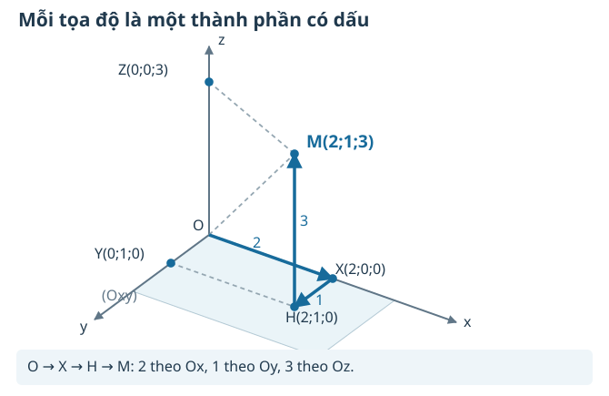
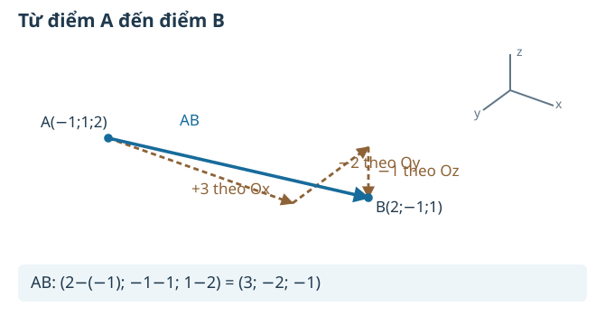

# Bài 7. Hệ trục tọa độ trong không gian

TOÁN 12 · CHƯƠNG II · KIẾN THỨC SGK KNTT · TẬP MỘT

Dùng ba tọa độ để xác định vị trí, đọc hình chiếu và biểu diễn sự dịch chuyển trong không gian.

<nav class="thpt-r4-lesson-tabs"><a href="../">Chương II</a><a href="../bai-6/">Bài trước</a><a href="../luyen-tap/#b07-core">Core/Luyện tập</a><a href="../tu-kiem-tra-chuong/">Tự kiểm tra cuối chương</a><a href="../bai-8/">Bài tiếp theo</a></nav>

=== "Khám phá kiến thức"

    ### 1.1. Hệ trục tọa độ trong không gian

    Giả sử em cần hướng dẫn một người lắp camera trong căn phòng. Nói camera cách sàn \(2{,}5\) m chưa đủ: ở cùng độ cao ấy có rất nhiều vị trí. Nếu còn biết camera cách hai bức tường vuông góc lần lượt \(1\) m và \(3\) m, ta có thể mô tả chính xác vị trí của nó, miễn là xác định rõ bức tường nào ứng với số nào và phía nào của mỗi bức tường.

    Chọn một góc sàn làm \(O\), hai chiều dọc hai cạnh sàn làm chiều dương của \(Ox,Oy\), chiều lên trên làm chiều dương của \(Oz\). Giống hệ \(Oxy\) đã học ở lớp 10, ta cần gốc, chiều dương và đơn vị đo trên mỗi trục. Điểm mới là trục thứ ba cho phép mô tả cả chiều ngoài mặt phẳng \(Oxy\). Chẳng hạn, nếu khoảng cách 1 m ứng với tường \(Oyz\), khoảng cách 3 m ứng với tường \(Ozx\), và camera nằm về phía dương của cả hai trục, thì với đơn vị mét, vị trí camera là \((1;3;2{,}5)\).

    Ba trục đôi một vuông góc, giao nhau tại \(O\), tạo thành hệ tọa độ Descartes vuông góc \(Oxyz\). Ba vectơ đơn vị \(\vec i,\vec j,\vec k\) chỉ một đơn vị theo các chiều dương tương ứng của \(Ox,Oy,Oz\). Ba mặt phẳng tọa độ là \((Oxy),(Oyz),(Ozx)\), lần lượt chứa hai trục có tên trong ngoặc. Chúng đôi một vuông góc: chẳng hạn \(Oz\) vuông góc với cả \(Ox\) và \(Oy\), nên \(Oz\perp(Oxy)\). Vì \(Oz\) nằm trong \((Oyz)\) và \((Ozx)\), hai mặt phẳng này đều vuông góc với \((Oxy)\); tương tự cho cặp còn lại.

    Góc phòng là một hình ảnh thuận tiện của hệ trục này: sàn là một mặt phẳng tọa độ, hai tường là hai mặt phẳng còn lại. Tuy nhiên, ta không bắt buộc luôn chọn \(Oz\) hướng lên hay \((Oxy)\) là mặt sàn. Nếu lấy gốc ở góc trần và trục dương hướng xuống, vật nằm thấp hơn gốc vẫn có thể có cao độ dương. Tọa độ phụ thuộc vào cách chọn hệ trục.

    Trong hình hộp chữ nhật, ba cạnh cùng xuất phát từ một đỉnh đôi một vuông góc. Vì vậy có thể chọn đỉnh ấy làm gốc, cho ba vectơ đơn vị lần lượt cùng hướng với ba cạnh. Nếu các cạnh dài \(2,3,4\) đơn vị, vectơ đơn vị phải dài \(1\); không đồng nhất vectơ cạnh với vectơ đơn vị. Chẳng hạn nếu \(AB=2,\ AD=3,\ AA'=4\), chọn \(A=O\) và hướng trục theo \(AB,AD,AA'\), thì \(\vec i=\frac12\overrightarrow{AB},\ \vec j=\frac13\overrightarrow{AD},\ \vec k=\frac14\overrightarrow{AA'}\).

    **Vận dụng.** Trong hình hộp chữ nhật \(ABCD.A'B'C'D'\), có \(AB=5,\ AD=2,\ AA'=3\). Chọn \(B\) làm gốc, chiều dương của ba trục lần lượt theo \(BA,BC,BB'\). Có lập được hệ tọa độ vuông góc không? Hãy viết ba vectơ đơn vị.

    ??? question "Đối chiếu"

        Ba cạnh \(BA,BC,BB'\) đôi một vuông góc và có chung đầu \(B\). Vì \(BA=5,\ BC=2,\ BB'=3\), có thể chọn hệ tọa độ với

        \[
        \vec i=\tfrac15\overrightarrow{BA},\quad
        \vec j=\tfrac12\overrightarrow{BC},\quad
        \vec k=\tfrac13\overrightarrow{BB'}.
        \]

        Mỗi vectơ đều có độ dài \(1\), theo đúng chiều đã chọn.

    ??? tip "Kiểm lỗi"

        Nếu chọn \(\vec i=\overrightarrow{AB}\), em đã đảo hướng trục thứ nhất và quên chuẩn hóa độ dài. Đọc từ gốc \(B\) đến \(A\), rồi chia độ dài vectơ cạnh cho \(5\).

    ### 1.2. Tọa độ của điểm, tọa độ của vectơ trong không gian

    Sau khi chọn hệ trục, làm thế nào chỉ ra một điểm bằng ba số? Hãy quan sát điểm \(M\) trong hình. Để đi từ \(O\) tới \(M\), ta có thể đi theo ba chặng: \(2\) đơn vị theo chiều \(Ox\), \(1\) đơn vị theo chiều \(Oy\), rồi \(3\) đơn vị theo chiều \(Oz\).

    <figure class="thpt-r4-plot"><figcaption>Đọc lần lượt \(O\to X\to H\to M\). Các mũi tên xanh biểu diễn ba thành phần; nét đứt hỗ trợ xác định hình chiếu. Phối cảnh không bảo toàn góc hay độ dài nhìn thấy trên màn hình.</figcaption></figure>

    Áp dụng quy tắc cộng vectơ,

    \[
    \overrightarrow{OM}=2\vec i+\vec j+3\vec k.
    \]

    Ba hệ số chính là tọa độ của điểm \(M\), viết \(M(2;1;3)\). Số đầu là hoành độ, số thứ hai là tung độ, số cuối là cao độ. Trong hệ đã chọn, mỗi điểm có một bộ ba tọa độ duy nhất; ngược lại, mỗi bộ ba số thực xác định một điểm.

    Vì sao không có hai bộ ba khác nhau cho cùng một điểm? Ba hướng trục độc lập: phần dịch chuyển theo \(Ox\) không thể được tạo bằng hai dịch chuyển theo \(Oy,Oz\), vì hai hướng sau nằm trong mặt phẳng vuông góc với \(Ox\). Chiếu vuông góc lên từng trục, ta đọc được riêng từng thành phần có dấu. Do đó bộ ba hệ số trong biểu diễn \(\overrightarrow{OM}=x\vec i+y\vec j+z\vec k\) là duy nhất.

    Nếu một thành phần âm, đi ngược chiều dương của trục ấy; nếu bằng \(0\), không có dịch chuyển theo hướng đó. Ví dụ \(N(-2;4;-1)\) mô tả ba bước có dấu \(-2,4,-1\), chứ không phải ba độ dài âm. Gốc \(O\) có tọa độ \((0;0;0)\).

    **Đọc hình chiếu.** Muốn chiếu vuông góc \(M(x;y;z)\) xuống \((Oxy)\), chỉ cần bỏ phần dịch chuyển theo \(Oz\), giữ nguyên hai thành phần còn lại. Vì vậy hình chiếu có tọa độ \((x;y;0)\). Tương tự, khi chiếu lên \((Oyz)\), bỏ thành phần \(x\); lên \((Ozx)\), bỏ thành phần \(y\). Khi chiếu lên một trục, chỉ giữ thành phần theo trục ấy. Trong hình trên, \(H(2;1;0)\) là hình chiếu của \(M\) xuống \((Oxy)\), còn \(X,Y,Z\) là các hình chiếu lên \(Ox,Oy,Oz\).

    Ta cũng nhận ra một điểm thuộc mặt phẳng nào bằng cách kiểm tọa độ bằng \(0\). Chẳng hạn \(P(0;-3;2)\) nằm trong \((Oyz)\) nhưng không nằm trên \(Oy\) hay \(Oz\). Điểm có hai tọa độ bằng \(0\) nằm trên trục còn lại; gốc nằm trên cả ba trục và cả ba mặt phẳng.

    **Vận dụng.** Cho \(P(-3;2;-4)\). Tìm hình chiếu vuông góc của \(P\) trên \((Oxy),(Oyz),(Ozx)\) và trên trục \(Oz\). Điểm \(P\) có nằm trong mặt phẳng tọa độ nào không?

    ??? question "Đối chiếu"

        Ba hình chiếu trên các mặt phẳng lần lượt là \((-3;2;0),(0;2;-4),(-3;0;-4)\). Hình chiếu trên \(Oz\) là \((0;0;-4)\). Vì cả ba tọa độ của \(P\) đều khác \(0\), \(P\) không thuộc mặt phẳng tọa độ nào.

    ??? tip "Kiểm lỗi"

        Khi chiếu lên \(Oz\), không đặt \(z=0\); phải giữ \(z=-4\), đặt \(x=y=0\). Dấu âm của tọa độ còn lại cũng phải giữ nguyên.

    Để mô tả một vectơ bất kì, ta dời nó về gốc \(O\). Theo Bài 6, có duy nhất một điểm \(M\) sao cho \(\overrightarrow{OM}=\vec a\). Vì điểm \(M\) có tọa độ \((x;y;z)\), ta viết được \(\vec a=x\vec i+y\vec j+z\vec k\). Bộ ba \((x;y;z)\) được gọi là tọa độ của vectơ \(\vec a\). Vậy \(M(2;1;3)\) và \(\overrightarrow{OM}=(2;1;3)\) có cùng bộ số nhưng là hai đối tượng khác nhau: một là vị trí, một là vectơ độ dời.

    Chẳng hạn \(\vec u=-2\vec i+5\vec k\) có tọa độ \((-2;0;5)\). Hệ số của \(\vec j\) không xuất hiện vì bằng \(0\); không được bỏ chỗ thứ hai. Hai vectơ bằng nhau khi cả ba tọa độ tương ứng bằng nhau, dù các mũi tên đặt tại những nơi khác nhau.

    Nếu vectơ xuất phát từ \(A\ne O\) và kết thúc tại \(B\), tọa độ của nó không phải tọa độ điểm \(B\). Xét \(A(-1;1;2)\), \(B(2;-1;1)\). Từ \(A\) đến \(B\), hoành độ tăng \(3\), tung độ giảm \(2\), cao độ giảm \(1\).

    <figure class="thpt-r4-plot"><figcaption>Mũi tên liền nối \(A\) đến \(B\); ba mũi tên nét đứt biểu diễn từng độ thay đổi có dấu. Các hướng trục được ghi ở góc hình. Dời cả hai đầu mút cùng một vectơ thì ba độ thay đổi không đổi.</figcaption></figure>

    Vì \(\overrightarrow{OA}+\overrightarrow{AB}=\overrightarrow{OB}\), ta có

    \[
    \begin{aligned}
    \overrightarrow{AB}
    &=\overrightarrow{OB}-\overrightarrow{OA}\\
    &=(2-(-1))\vec i+(-1-1)\vec j+(1-2)\vec k\\
    &=3\vec i-2\vec j-\vec k.
    \end{aligned}
    \]

    Do đó \(\overrightarrow{AB}=(3;-2;-1)\). Đây là nguồn gốc của quy tắc **tọa độ điểm cuối trừ tọa độ điểm đầu**, theo từng thành phần. Nếu đảo chiều thành \(\overrightarrow{BA}\), cả ba dấu đổi ngược. Khi hai điểm trùng nhau, cả ba hiệu bằng \(0\).

    Nhờ quy tắc này, ta có thể tìm điểm chưa biết nếu biết điểm xuất phát và vectơ độ dời. Trong một lăng trụ, các vectơ cạnh bên tương ứng bằng nhau. Vì thế chỉ cần biết tọa độ của một cặp đỉnh tương ứng là có thể tìm độ thay đổi chung, rồi xác định các đỉnh còn thiếu. Ví dụ nếu \(A(0;1;2)\) được dời đến \(A'(2;1;5)\), thì vectơ độ dời là \((2;0;3)\). Đỉnh \(B(-1;4;0)\) sẽ được dời tới \(B'(1;4;3)\), vì phải có \(\overrightarrow{BB'}=\overrightarrow{AA'}\).

    **Vận dụng.** Cho \(A(3;-2;4)\), \(B(-1;1;4)\). Tìm tọa độ \(\overrightarrow{AB}\), \(\overrightarrow{BA}\) và điểm \(D\) sao cho \(\overrightarrow{CD}=\overrightarrow{AB}\), biết \(C(5;0;-2)\).

    ??? question "Đối chiếu"

        \(\overrightarrow{AB}=(-1-3;1-(-2);4-4)=(-4;3;0)\).

        \(\overrightarrow{BA}=(4;-3;0)\).

        Gọi \(D(x;y;z)\). Từ \(\overrightarrow{CD}=(x-5;y;z+2)=(-4;3;0)\), suy ra \(x=1,\ y=3,\ z=-2\). Vậy \(D(1;3;-2)\).

    ??? tip "Kiểm lỗi"

        Nếu nhận \(D(-4;3;0)\), em đã lấy tọa độ vectơ làm tọa độ điểm cuối. Hãy kiểm bằng cách lấy tọa độ \(D\) trừ tọa độ \(C\); kết quả phải đúng \((-4;3;0)\).

    Trong ứng dụng định vị, cần luôn phân biệt vị trí với độ dời. Chọn hệ trục có \(Ox\) về Đông, \(Oy\) về Bắc, \(Oz\) hướng lên, đơn vị km. Một máy bay từ vị trí \(A(12;8;1)\) bay thẳng về phía Nam với tốc độ \(720\) km/h trong \(10\) phút, giữ nguyên độ cao. Nó dịch chuyển \(120\) km theo chiều âm của \(Oy\), nên vectơ độ dời là \((0;-120;0)\) km, còn vị trí mới là \(B(12;-112;1)\) km. Cao độ của vectơ độ dời bằng \(0\) không có nghĩa máy bay đã hạ xuống mặt đất; nó chỉ cho biết độ cao không đổi.

=== "Kiến thức SGK"

    ### 2.1. Hệ trục tọa độ trong không gian

    
<strong>Định nghĩa — Hệ tọa độ Descartes vuông góc</strong>
Hệ \(Oxyz\) gồm ba trục \(Ox,Oy,Oz\) đôi một vuông góc tại gốc chung \(O\), với các vectơ đơn vị \(\vec i,\vec j,\vec k\) lần lượt theo chiều dương của ba trục. Điểm \(O\) gọi là gốc tọa độ; \((Oxy),(Oyz),(Ozx)\) là ba mặt phẳng tọa độ đôi một vuông góc. Không gian được trang bị hệ tọa độ đó gọi là không gian \(Oxyz\).

    Các vectơ đơn vị có độ dài \(1\), đôi một vuông góc. Khi gắn hệ trục vào một hình, chọn gốc và ba hướng vuông góc, sau đó chuẩn hóa đơn vị. Ba giá của các vectơ đôi một vuông góc về phương không nhất thiết đồng quy; có thể chọn các trục song song với các phương ấy qua cùng một điểm, không bắt buộc trùng các giá cũ.

    ### 2.2. Tọa độ của điểm, tọa độ của vectơ trong không gian

    
<strong>Định nghĩa — Tọa độ của điểm</strong>
Với mỗi điểm \(M\), tồn tại duy nhất ba số thực \(x,y,z\) sao cho \(\overrightarrow{OM}=x\vec i+y\vec j+z\vec k\). Bộ ba ấy là tọa độ của \(M\), viết \(M(x;y;z)\) hoặc \(M=(x;y;z)\), trong đó \(x\) là hoành độ, \(y\) là tung độ, \(z\) là cao độ. Mỗi bộ ba số thực cũng xác định duy nhất một điểm.

    <figure class="thpt-r4-plot"><figcaption>Tọa độ của \(M\) được đọc từ các thành phần của \(\overrightarrow{OM}\), theo đúng thứ tự \(x,y,z\).</figcaption></figure>

    
<strong>Quy tắc — Hình chiếu vuông góc</strong>
Với \(M(x;y;z)\), khi chiếu lên trục hoặc mặt phẳng tọa độ, giữ các tọa độ theo trục có trong đối tượng chiếu và đặt các tọa độ còn lại bằng \(0\).

    | Hình chiếu vuông góc của \(M(x;y;z)\) lên | Tọa độ |
    | :-- | :-- |
    | \(Ox\) | \((x;0;0)\) |
    | \(Oy\) | \((0;y;0)\) |
    | \(Oz\) | \((0;0;z)\) |
    | \((Oxy)\) | \((x;y;0)\) |
    | \((Oyz)\) | \((0;y;z)\) |
    | \((Ozx)\) | \((x;0;z)\) |

    Một điểm thuộc mặt phẳng tọa độ nếu tọa độ theo trục vuông góc với mặt phẳng bằng \(0\); chẳng hạn \(M\in(Oxy)\) khi và chỉ khi \(z=0\). Điểm thuộc một trục nếu hai tọa độ còn lại đều bằng \(0\); chẳng hạn \(M\in Oz\) khi và chỉ khi \(x=y=0\). Tọa độ gốc là \(O(0;0;0)\). Nếu điểm ở trên tia dương của một trục, tọa độ theo trục đó dương (trừ gốc); nếu ở trên tia đối, tọa độ tương ứng âm (trừ gốc).

    
<strong>Định nghĩa — Tọa độ của vectơ</strong>
Với mỗi vectơ \(\vec a\), có duy nhất ba số thực \(x,y,z\) sao cho \(\vec a=x\vec i+y\vec j+z\vec k\). Viết \(\vec a=(x;y;z)\) hoặc \(\vec a(x;y;z)\). Nếu \(\overrightarrow{OM}=\vec a\), tọa độ của \(\vec a\) cũng là tọa độ của \(M\).

    \[
    \vec i=(1;0;0),\quad \vec j=(0;1;0),\quad
    \vec k=(0;0;1),\quad \vec0=(0;0;0).
    \]

    Hai vectơ \(\vec a=(x;y;z)\), \(\vec b=(x';y';z')\) bằng nhau khi và chỉ khi \(x=x',\ y=y',\ z=z'\).

    
<strong>Quy tắc — Tọa độ vectơ theo hai đầu mút</strong>
Với \(A(x_A;y_A;z_A)\), \(B(x_B;y_B;z_B)\) trong cùng hệ tọa độ, từ \(\overrightarrow{AB}=\overrightarrow{OB}-\overrightarrow{OA}\) suy ra

\(\displaystyle\overrightarrow{AB}=(x_B-x_A;y_B-y_A;z_B-z_A).\)

Đổi hai đầu mút làm đổi dấu cả ba tọa độ. Nếu \(A=O\), tọa độ \(\overrightarrow{AB}\) chính là tọa độ \(B\).

    Để tìm một điểm cuối khi biết điểm đầu và vectơ độ dời, lập ba phương trình từ quy tắc trên. Trong hình lăng trụ, hình hộp, dùng các vectơ cạnh tương ứng bằng nhau hoặc quy tắc hình bình hành để tìm đỉnh còn thiếu.

    **Liên hệ:** tọa độ Descartes không phải cách duy nhất để xác định vị trí trong không gian. Phần đọc thêm cuối bài SGK giới thiệu tọa độ cầu: khoảng cách \(r=OM\), góc phương vị \(\theta\) đo từ tia \(Ox\) dương tới tia từ \(O\) qua hình chiếu của \(M\) trên \((Oxy)\), theo chiều dương của mặt phẳng \(Oxy\), với \(0\le\theta<2\pi\); góc cực \(\phi\) đo giữa \(OM\) và tia \(Oz\) dương, với \(0\le\phi\le\pi\). Khi \(M\) không nằm trên \(Oz\), ba đại lượng liên hệ bởi

    \[
    x=r\sin\phi\cos\theta,\quad
    y=r\sin\phi\sin\theta,\quad z=r\cos\phi.
    \]

    Trong đó \(r=\sqrt{x^2+y^2+z^2}\), \(\cos\phi=z/r\); nếu \(x\ne0\), \(\tan\theta=y/x\), nhưng phải xét góc phần tư để xác định đúng góc phương vị. Nếu \(x=0,y>0\) thì \(\theta=\pi/2\); nếu \(x=0,y<0\) thì \(\theta=3\pi/2\). Trên trục \(Oz\) không có một góc phương vị duy nhất; tại \(O\) cả hướng đều không xác định. Đây là kiến thức đọc thêm, không phải yêu cầu tính toán chính của Bài 7.

=== "Ví dụ"

    ### 3.1. Chọn gốc và vectơ đơn vị theo yêu cầu

    **Đề bài.** Hình hộp chữ nhật \(ABCD.A'B'C'D'\) có \(AB=6,\ AD=4,\ AA'=2\). Chọn \(C'\) làm gốc, ba chiều dương theo \(C'D',C'B',C'C\). Xác định ba vectơ đơn vị.

    **Phân tích:** Không nhất thiết lấy gốc ở mặt đáy hay chiều dương hướng lên. Ba cạnh tại \(C'\) đôi một vuông góc; chuẩn hóa mỗi vectơ cạnh theo độ dài của nó.

    

<strong>Lời giải.</strong> \(C'D'=6,\ C'B'=4,\ C'C=2\), nên có thể lập hệ trục vuông góc với \(\vec i=\frac16\overrightarrow{C'D'},\ \vec j=\frac14\overrightarrow{C'B'},\ \vec k=\frac12\overrightarrow{C'C}\). Đỉnh \(C'\) là \(O\).

    **Kiểm lại:** Độ dài mỗi vectơ đơn vị bằng \(1\). Trục \(Oz\) ở đây hướng từ mặt trên xuống mặt đáy.

    ### 3.2. Nhận biết điểm trên trục, mặt phẳng

    **Đề bài.** Trong hệ \(Oxyz\), điểm \(A\) nằm trên tia đối của \(Ox\), \(OA=5\). Điểm \(B(0;4;-3)\) và điểm \(C(0;0;2)\) thuộc những trục hoặc mặt phẳng tọa độ nào?

    **Phân tích:** Trên một trục, hai thành phần còn lại đều bằng \(0\); dùng dấu của thành phần theo trục để phân biệt hai tia.

    

<strong>Lời giải.</strong> \(A(-5;0;0)\), thuộc \(Ox,(Oxy),(Ozx)\). Điểm \(B\) có hoành độ bằng \(0\), hai tọa độ còn lại khác \(0\), nên chỉ thuộc mặt phẳng \((Oyz)\) trong ba mặt phẳng tọa độ và không thuộc trục nào. Điểm \(C\) thuộc \(Oz\), đồng thời thuộc \((Oyz),(Ozx)\).

    **Kiểm lại:** \(OA=|-5|=5\), không phải \(-5\). Điểm trên một trục cũng nằm trong hai mặt phẳng tọa độ chứa trục ấy.

    ### 3.3. Tìm hình chiếu và điểm từ các hình chiếu

    **Đề bài.** Hình chiếu vuông góc của \(M\) trên \((Oxy)\) là \(H(-4;3;0)\), còn hình chiếu trên \(Oz\) là \(K(0;0;6)\). Tìm \(M\) và hình chiếu của \(M\) trên \((Ozx)\).

    **Phân tích:** Hình chiếu thứ nhất giữ hai thành phần \(x,y\), hình chiếu thứ hai giữ \(z\). Ghép ba thành phần đúng thứ tự.

    

<strong>Lời giải.</strong> Từ \(H\), suy ra \(x=-4,y=3\); từ \(K\), suy ra \(z=6\). Vậy \(M(-4;3;6)\). Hình chiếu trên \((Ozx)\) là \((-4;0;6)\).

    **Kiểm lại:** Chiếu lại \(M\) lên \((Oxy)\) và \(Oz\) thu được đúng \(H,K\). Không lấy tổng hai tọa độ theo cùng trục khi ghép dữ kiện.

    ### 3.4. Tìm các đỉnh hình hộp chữ nhật

    **Đề bài.** Cho hình hộp chữ nhật \(ABCD.A'B'C'D'\), chọn \(A=O\), ba trục dương dọc theo \(AB,AD,AA'\). Biết \(C'(4;5;2)\). Tìm tọa độ bảy đỉnh còn lại.

    **Phân tích:** \(C'\) là đỉnh đối diện \(A\). Theo quy tắc hình hộp, \(\overrightarrow{AC'}=\overrightarrow{AB}+\overrightarrow{AD}+\overrightarrow{AA'}\). Ba cạnh có độ dài bằng ba tọa độ dương của \(C'\).

    

<strong>Lời giải.</strong> \(AB=4,\ AD=5,\ AA'=2\). Tọa độ các đỉnh là:

\(A(0;0;0),\ B(4;0;0),\ D(0;5;0),\ C(4;5;0)\);

\(A'(0;0;2),\ B'(4;0;2),\ D'(0;5;2)\).

    **Kiểm lại:** Bốn đỉnh đáy có cao độ \(0\); bốn đỉnh trên có cao độ \(2\). Các vectơ \(\overrightarrow{AA'}\), \(\overrightarrow{BB'}\), \(\overrightarrow{CC'}\), \(\overrightarrow{DD'}\) đều có tọa độ \((0;0;2)\). Hình này có thể hình dung bằng cách thay ba độ dài của hình hộp ở tab Khám phá.

    ### 3.5. Tọa độ vectơ và điều kiện bằng nhau

    **Đề bài.** Cho \(\vec a=3\vec k-2\vec i\) và \(\vec b=(m;0;n)\). Tìm \(m,n\) để hai vectơ bằng nhau. Tìm tọa độ của điểm \(M\) sao cho \(\overrightarrow{OM}=\vec a\).

    **Phân tích:** Đọc hệ số theo thứ tự \(\vec i,\vec j,\vec k\), không theo thứ tự xuất hiện trong biểu thức.

    

<strong>Lời giải.</strong> \(\vec a=(-2;0;3)\), nên \(\vec b=\vec a\) khi \(m=-2,n=3\). Vì \(\overrightarrow{OM}=\vec a\), điểm \(M\) có tọa độ \((-2;0;3)\).

    **Kiểm lại:** \(-2\vec i+0\vec j+3\vec k=3\vec k-2\vec i\). Điểm \(M\) nằm trong \((Ozx)\).

    ### 3.6. Vectơ nối hai điểm, kể cả hai điểm trùng nhau

    **Đề bài.** Cho \(P(-2;4;1),Q(3;-1;-2),R(-2;4;1)\). Tính \(\overrightarrow{PQ},\overrightarrow{QP},\overrightarrow{PR}\).

    **Phân tích:** Viết rõ điểm đầu và cuối của mỗi vectơ. Hai điểm có cùng ba tọa độ là cùng một điểm.

    

<strong>Lời giải.</strong> \(\overrightarrow{PQ}=(5;-5;-3)\). Đảo hai đầu cho \(\overrightarrow{QP}=(-5;5;3)\). Vì \(P=R\), \(\overrightarrow{PR}=\vec0=(0;0;0)\).

    **Kiểm lại:** Thành phần thứ ba của \(\overrightarrow{PQ}\) là \(-2-1=-3\); cả ba thành phần của \(\overrightarrow{PR}\) bằng \(0\).

    ### 3.7. Tìm đỉnh còn thiếu của lăng trụ

    **Đề bài.** Cho lăng trụ \(ABC.A'B'C'\) có \(A(1;-2;0),B(3;0;1),C(0;1;2),A'(2;-1;4)\). Tìm \(B',C'\).

    **Phân tích:** Các cạnh bên có cùng vectơ độ dời. Tính vectơ từ \(A\) tới \(A'\), dùng sự bằng nhau của các tọa độ tương ứng.

    

<strong>Lời giải.</strong> \(\overrightarrow{AA'}=(1;1;4)\). Với \(B'(x;y;z)\), điều kiện \(\overrightarrow{BB'}=\overrightarrow{AA'}\) cho \(x-3=1,\ y=1,\ z-1=4\), nên \(B'(4;1;5)\). Tương tự, nếu \(C'(u;v;w)\), thì \(u=1,\ v-1=1,\ w-2=4\). Vậy \(C'(1;2;6)\).

    **Kiểm lại:** \(\overrightarrow{BB'}=(1;1;4)=\overrightarrow{CC'}\). Không giả sử các cạnh bên song song với một trục tọa độ khi đề không cho.

    ### 3.8. Hình hộp không có cạnh song song với trục

    **Đề bài.** Cho hình hộp \(OABC.O'A'B'C'\), trong đó \(O\) là gốc, \(A(2;-1;0),B(3;2;1),C'(4;2;5)\). Tìm \(C,O',A',B'\).

    **Phân tích:** Đáy \(OABC\) là hình bình hành theo thứ tự đỉnh. Dùng \(\overrightarrow{OC}=\overrightarrow{AB}\) để tìm \(C\). Vectơ \(CC'\) xác định sự dịch chuyển của cả mặt đáy tới mặt trên.

    

<strong>Lời giải.</strong> \(\overrightarrow{AB}=(1;3;1)\), nên \(C(1;3;1)\). Từ đó \(\overrightarrow{CC'}=(3;-1;4)=\overrightarrow{OO'}\), nên \(O'(3;-1;4)\).

Dùng \(\overrightarrow{AA'}=\overrightarrow{CC'}\), ba tọa độ của \(A'\) lần lượt là \(2+3,-1-1,0+4\); vậy \(A'(5;-2;4)\). Tương tự, \(B'(6;1;5)\).

    **Kiểm lại:** \(\overrightarrow{A'B'}=(1;3;1)=\overrightarrow{AB}\) và \(\overrightarrow{B'C'}=(-2;1;0)=\overrightarrow{BC}\). Các cạnh bên có chung tọa độ \((3;-1;4)\).

    ### 3.9. Mô tả vị trí trong phòng với gốc ở trần

    **Đề bài.** Một phòng hình hộp có chiều dài \(7\) m, rộng \(5\) m, cao \(3\) m. Chọn \(O\) tại góc trần, hai trục \(Ox,Oy\) dọc hai cạnh trần và hướng vào phòng, \(Oz\) hướng thẳng xuống. Một cảm biến cách bức tường \((Oyz)\) \(2\) m, cách bức tường \((Ozx)\) \(4\) m, cách sàn \(1\) m. Tìm tọa độ cảm biến và hình chiếu lên sàn.

    **Phân tích:** Độ cao so với sàn không phải tọa độ \(z\) khi gốc ở trần và trục dương hướng xuống. Khoảng cách tới hai bức tường cho \(x,y\) vì cảm biến ở phía trong phòng.

    

<strong>Lời giải.</strong> Sàn nằm tại cao độ \(z=3\); cảm biến cách sàn \(1\) m nên tọa độ \(z=3-1=2\). Hai khoảng cách tới tường cho \(x=2,y=4\). Vậy cảm biến ở \(M(2;4;2)\) và hình chiếu vuông góc lên sàn là \(H(2;4;3)\), đơn vị mét.

    **Kiểm lại:** \(0\le2\le7,\ 0\le4\le5,\ 0\le2\le3\). Điểm chiếu lên sàn không phải \((2;4;0)\), vì \((Oxy)\) ở đây là mặt trần.

    ### 3.10. Tìm vị trí từ hành trình trong không gian

    **Đề bài.** Một thiết bị bay ở \(A(1{,}2;-0{,}8;0{,}5)\) km, trong hệ có \(Ox\) hướng Đông, \(Oy\) hướng Bắc, \(Oz\) hướng lên. Sau đó nó dịch chuyển \(600\) m về Tây, \(300\) m về Bắc và hạ độ cao \(100\) m. Tìm vectơ độ dời tổng hợp, vị trí cuối \(B\) và hình chiếu vuông góc của \(B\) trên mặt đất giả định \((Oxy)\).

    **Phân tích:** Đổi các độ dài sang km. Xét dấu theo từng chiều trục; vị trí cuối phải tính từ điểm đầu đã cho.

    

<strong>Lời giải.</strong> Tọa độ độ dời là \(\overrightarrow{AB}=(-0{,}6;0{,}3;-0{,}1)\) km. Gọi \(B(x;y;z)\), ta có \(x-1{,}2=-0{,}6,\ y+0{,}8=0{,}3,\ z-0{,}5=-0{,}1\). Vậy \(B(0{,}6;-0{,}5;0{,}4)\) km, và hình chiếu trên mặt đất là \((0{,}6;-0{,}5;0)\) km.

    **Kiểm lại:** Độ cao giảm từ \(0{,}5\) xuống \(0{,}4\) km, thiết bị vẫn ở trên mặt đất. Tọa độ \(y\) tăng nhưng vẫn âm, vì dịch chuyển về Bắc chưa đủ để vượt qua mặt phẳng \((Ozx)\).

=== "Lỗi thường gặp"

    ### 4.1. Chọn ba hướng không vuông góc hoặc quên vectơ đơn vị

    **Sai ở đâu:** Chọn bất cứ ba cạnh cùng xuất phát từ một đỉnh hình hộp xiên làm ba trục của hệ tọa độ vuông góc; hoặc gọi mọi vectơ cạnh là vectơ đơn vị.

    **Vì sao sai:** Hệ \(Oxyz\) trong bài đòi hỏi ba trục đôi một vuông góc và ba vectơ đơn vị dài \(1\).

    **Cách sửa:** Kiểm phương và góc bằng dữ kiện hình học, không đo góc trên hình phối cảnh. Nếu dùng vectơ cạnh khác không \(\vec u\) để chỉ hướng dương, vectơ đơn vị cùng hướng là \(\vec u/|\vec u|\).

    ### 4.2. Đọc sai thứ tự hoặc bỏ tọa độ bằng 0

    **Sai ở đâu:** Viết \(\vec a=2\vec k-\vec i\) thành \((2;-1)\) hoặc \((2;-1;0)\).

    **Vì sao sai:** Tọa độ luôn theo thứ tự \(\vec i,\vec j,\vec k\), kể cả hệ số không xuất hiện.

    **Cách sửa:** Viết lại \(-\vec i+0\vec j+2\vec k\), rồi đọc \((-1;0;2)\).

    ### 4.3. Chiếu lên trục và mặt phẳng giống nhau

    **Sai ở đâu:** Hình chiếu của \(M(2;-3;4)\) trên \(Oz\) là \((2;-3;0)\).

    **Vì sao sai:** Bộ số ấy là hình chiếu trên \((Oxy)\), không phải trên \(Oz\).

    **Cách sửa:** Giữ thành phần theo trục cần chiếu: hình chiếu trên \(Oz\) là \((0;0;4)\). Với mặt phẳng, giữ hai thành phần theo hai trục nằm trong mặt phẳng.

    ### 4.4. Nhầm tọa độ điểm với tọa độ vectơ

    **Sai ở đâu:** Cho \(A(1;2;3)\), \(B(4;2;1)\), viết \(\overrightarrow{AB}=(4;2;1)\).

    **Vì sao sai:** Đó là tọa độ của \(B\), tức tọa độ của \(\overrightarrow{OB}\), không phải độ dời tính từ \(A\).

    **Cách sửa:** Dùng \(\overrightarrow{OB}-\overrightarrow{OA}\); kết quả đúng là \((3;0;-2)\).

    ### 4.5. Đảo đầu và cuối khi lấy hiệu

    **Sai ở đâu:** Lấy tọa độ \(A\) trừ tọa độ \(B\) khi cần \(\overrightarrow{AB}\).

    **Vì sao sai:** Phép tính đó cho vectơ đi ngược lại, \(\overrightarrow{BA}\).

    **Cách sửa:** Đọc \(A\to B\), viết ba hiệu cuối trừ đầu. Nếu đã biết một vectơ, đổi cả ba dấu để tìm vectơ đối.

    ### 4.6. Mặc định cao độ là khoảng cách tới sàn

    **Sai ở đâu:** Điểm có \(z<0\) luôn nằm dưới mặt đất; hình chiếu lên sàn luôn có \(z=0\).

    **Vì sao sai:** Cao độ phụ thuộc gốc và chiều \(Oz\); mặt sàn không nhất thiết là \((Oxy)\).

    **Cách sửa:** Đọc cách gắn hệ tọa độ trước. Chỉ khi \(Oz\) hướng lên và \((Oxy)\) được chọn làm mặt đất thì \(z<0\) mới biểu thị phía dưới mặt đất trong mô hình.

    ### 4.7. Không kiểm các đỉnh tương ứng của hình hộp, lăng trụ

    **Sai ở đâu:** Tìm đỉnh trên bằng cách chỉ tăng cao độ, mặc dù cạnh bên chưa được cho song song \(Oz\).

    **Vì sao sai:** Vectơ cạnh bên có thể có cả ba thành phần khác \(0\).

    **Cách sửa:** Tìm tọa độ một vectơ cạnh bên rồi dùng sự bằng nhau của các vectơ cạnh tương ứng. Kiểm lại các hiệu tọa độ để xác nhận.

    **Học tiếp:** [Core và Luyện tập Bài 7](../luyen-tap/#b07-core) · [Tự kiểm tra cuối chương](../tu-kiem-tra-chuong/). Bài 8 sẽ học các phép toán vectơ bằng tọa độ, độ dài và tích vô hướng.

    
Nguồn đối chiếu: SGK KNTT Toán 12 tập 1, trang in 60–66.

