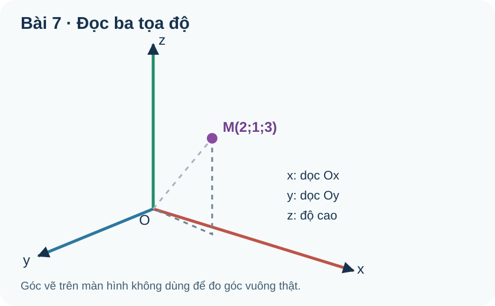

# Toán 12 · Bài 7. Hệ trục tọa độ trong không gian

TOÁN 12 · CHƯƠNG II · SGK KẾT NỐI TRI THỨC · TẬP MỘT · TRANG 60–66

Học theo mạch: hiểu bản chất, đọc hình, xem ví dụ có suy luận, tự thử, Core, Luyện tập, Tự luận và tự khắc phục ngay trong bài.

<nav class="thpt-r4-lesson-tabs"><a href="../">Chương II</a><a href="../bai-6/">Bài trước</a><a href="../bai-8/">Bài tiếp theo</a></nav>

## 1. Vì sao cần học?

Một kiện hàng đặt trên sàn không chỉ có “bên trái/bên phải” và “trước/sau”, mà còn có độ cao. Muốn hệ thống robot hoặc kỹ thuật viên thống nhất nơi đặt hàng, ta phải thống nhất **gốc O, ba trục và đơn vị**. Từ đó, ba con số cho biết vị trí tương đối với hệ quy chiếu. Kiến thức tiền đề: trục số, hệ $Oxy$ trong mặt phẳng, vectơ, phép trừ tọa độ, hình hộp chữ nhật và các phương vuông góc.

**Câu hỏi dẫn nhập:** Cùng một vật, tại sao hai người chọn hai góc phòng khác nhau làm gốc lại ghi tọa độ khác nhau nhưng đều đúng? Vì tọa độ không phải “nhãn tuyệt đối” của vật; nó mô tả vị trí trong **hệ quy chiếu đã chọn**.

## 3. Bản chất và điều kiện áp dụng

### 2.1. Hệ ba trục

Lấy ba đường thẳng $Ox,Oy,Oz$ đôi một vuông góc, cùng đi qua $O$. Chọn ba vectơ đơn vị $\vec i,\vec j,\vec k$ lần lượt trên các chiều dương đó; mỗi vectơ có độ dài 1 và đôi một vuông góc. Ba mặt phẳng $(Oxy),(Oyz),(Oxz)$ là **mặt phẳng tọa độ**; điểm thuộc $(Oxy)$ có $z=0$, thuộc $(Oyz)$ có $x=0$, thuộc $(Oxz)$ có $y=0$. Điểm trên trục $Ox$ có $y=z=0$, tương tự với hai trục kia.

**Cách đọc hình:** trước hết tìm giao điểm của ba trục (gốc), xác định chiều mũi tên dương, xem phép chiếu của điểm xuống các mặt phẳng. Trên hình isometric, các góc của ba trục nhìn bằng mắt thường **không nhất thiết là góc 90 độ**; tính vuông góc đến từ quy ước hình học thật. Hình **FIG-G12-CHII-B07-R00.svg** dùng điểm $M(2;1;3)$ và ba đường trợ giúp theo ba trục; các nét đứt chỉ là đường dẫn mắt, không phải cạnh của vật.

### 2.2. Tọa độ điểm và vectơ khác gì nhau?

Trong hệ $Oxyz$, mọi vectơ $\vec a$ đều viết duy nhất được

$$\vec a=x\vec i+y\vec j+z\vec k,$$

và có tọa độ $(x;y;z)$. Với điểm $M$, viết tọa độ $M(x;y;z)$ nghĩa là **vectơ vị trí** $\overrightarrow{OM}$ có tọa độ $(x;y;z)$. Vectơ tự do $\vec a$ vẫn giữ tọa độ khi dời song song trong cùng hệ; điểm $M$ thì gắn với một vị trí cụ thể. Một điểm tọa độ âm không có nghĩa là “độ dài âm”; dấu chỉ chiều so với trục.

### 2.3. Tọa độ vectơ nối hai điểm: cuối trừ đầu

Nếu $A(x_A;y_A;z_A)$ và $B(x_B;y_B;z_B)$ thì đi từ $A$ tới $B$ làm mỗi thành phần thay đổi một lượng **tọa độ cuối − tọa độ đầu**:

$$\overrightarrow{AB}=(x_B-x_A;\;y_B-y_A;\;z_B-z_A).$$

**Vì sao phải chọn phép trừ?** Một bước đi được định nghĩa bằng “sau trừ trước”; đổi thứ tự thành $\overrightarrow{BA}$ sẽ đổi dấu cả ba thành phần. Công thức chỉ có ý nghĩa khi $A,B$ được mô tả trong **cùng hệ quy chiếu** và cùng đơn vị.

### 2.4. Chọn gốc và đơn vị cho bài thực tiễn

Với một phòng dạng hộp, thường chọn góc phòng làm $O$, hai trục nằm trên sàn, $Oz$ thẳng đứng, đơn vị mét. Với tàu bay, chọn gốc tại nơi xuất phát, trục $x$ theo đông, $y$ theo bắc, $z$ theo độ cao (đã định hướng phù hợp). **Mô hình hóa:** khai báo gốc–trục–đơn vị trước khi gán số; kiểm tra tọa độ $z$ không âm nếu bài đang giới hạn điểm ở phía trên sàn.

## 4. Đọc hình minh họa

**FIG-G12-CHII-B07-R00.svg:** đọc trục có chữ $x,y,z$, xác định điểm $M(2;1;3)$ từ gốc; nét đứt hướng dẫn tách ba thành phần nhưng không biểu diễn độ dài thật trên giấy. Đây là hình giảng giải tự tạo, không phải ảnh nguyên bản SGK.

| OUTCOME_ID | Triệu chứng sai | D6 quay lại |
|---|---|---|
| O01 | Đọc “mặt phẳng Oxy” như một trục | §2.1 / EX01: đặt tọa độ còn lại = 0 |
| O02 | Lẫn tọa độ điểm với vectơ bất kì | §2.2 / EX02: xác định gốc O |
| O03 | Không khai báo hướng trục, đơn vị | §2.4 / EX03: vẽ sơ đồ góc phòng |
| O04 | Lấy đầu trừ cuối | §2.3 / EX04: tính theo biến thiên trước–sau |

**Tự kiểm trước khi sang B08:** Hãy giải thích vì sao $A(-2;1;3)$ không nhất thiết ở “dưới mặt đất”, trong khi $z=-2$ có thể mang nghĩa thấp hơn mặt phẳng $Oxy$ nếu $Oz$ chọn hướng lên. Có thể lấy lại ví dụ trục trước khi tính các phép toán.

<figure class="thpt-r4-plot g12-chi-figure"><figcaption>Hình gốc của học liệu Bài 7, đọc cùng hướng dẫn ngay phía trên.</figcaption></figure>

## 5. Ví dụ có suy luận và lựa chọn phương pháp

**EX-G12-B07-01 · O01 — Hệ ba mặt phẳng:** $P(4;-2;0)$ thuộc mặt phẳng tọa độ nào? **Giải:** $z=0$, vì vậy $P\in(Oxy)$; đồng thời $x,y$ đều khác 0 nên $P$ không thuộc các trục tọa độ. **Vì sao:** dùng điều kiện tọa độ bằng 0, không đọc trực tiếp bằng mắt trên hình phối cảnh.

**EX-G12-B07-02 · O02 — Vectơ vị trí:** Biết $\overrightarrow{OM}=2\vec i-\vec j+3\vec k$. Viết tọa độ $M$ và tọa độ $\vec a=\overrightarrow{OM}$. **Giải:** cả hai bộ số là $(2;-1;3)$, nhưng $M$ là điểm còn $\vec a$ là vectơ. **Vì sao:** tọa độ của điểm được định nghĩa nhờ vectơ gốc $O$ đến điểm đó; không thể suy điểm bất kì chỉ từ tọa độ một vectơ tự do nếu thiếu điểm đầu.

**EX-G12-B07-03 · O03 — Góc phòng:** Phòng hình hộp dài 6 m, rộng 4 m, cao 3 m; chọn góc sàn $O$ và chiều dương lần lượt dọc dài, rộng, lên cao. Tọa độ góc trần đối diện $O$? **Giải:** $(6;4;3)$ mét, bởi cần tiến 6 m, sang ngang 4 m và lên 3 m. **Giới hạn:** nếu chọn gốc hoặc hướng khác thì tọa độ thay đổi nhưng vị trí vật lý không đổi.

**EX-G12-B07-04 · O04 — Hiệu tọa độ:** $A(2;-1;4)$, $B(-1;3;0)$. Tìm $\overrightarrow{AB}$ và $\overrightarrow{BA}$. **Giải:** $\overrightarrow{AB}=(-3;4;-4)$; $\overrightarrow{BA}=(3;-4;4)=-\overrightarrow{AB}$. **Vì sao:** yêu cầu một vectơ có hướng, nên phép trừ không được đảo ngược tùy tiện.

## 6. Tự thử trước Core

**TỰ THỬ B07-T01:** Cho $A(2;-1;3)$ và $B(5;2;1)$. Không học thuộc công thức, hãy giải thích bằng thay đổi từng chiều vì sao $\overrightarrow{AB}$ có tọa độ $(3;3;-2)$. Nếu điểm $N$ thuộc mặt phẳng $(Oyz)$ thì tọa độ nào của $N$ phải bằng 0?

Tự mở phần đối chiếu

Từ $A$ tới $B$, theo $x$ tăng $5-2=3$, theo $y$ tăng $2-(-1)=3$, theo $z$ giảm $1-3=-2$. Điểm nằm trên $(Oyz)$ có $x=0$. Nếu làm sai dấu $y$, hãy đặt hai số vào trục số và tính “cuối trừ đầu” một lần nữa.

## 7. Core · Luyện tập · Tự luận · Hỗ trợ khắc phục

Đang mở bài tập gốc đã kiểm duyệt...

<nav class="thpt-r4-lesson-tabs"><a href="../">Chương II</a><a href="../bai-8/">Bài tiếp theo</a></nav>

