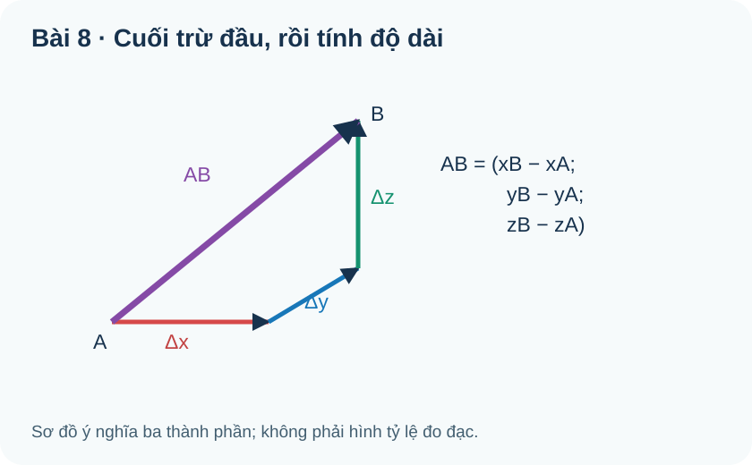
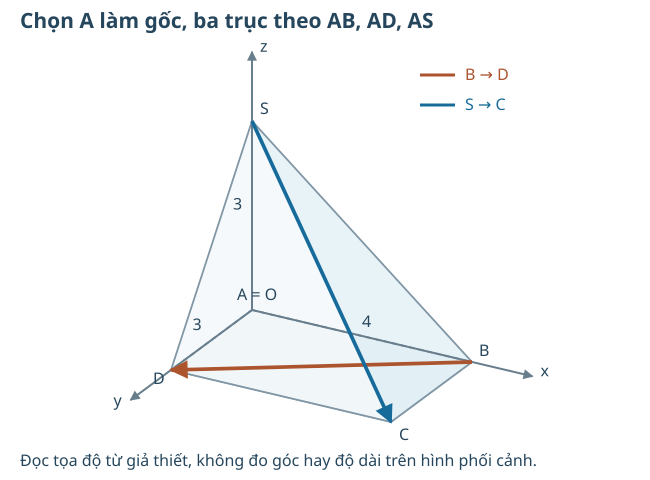
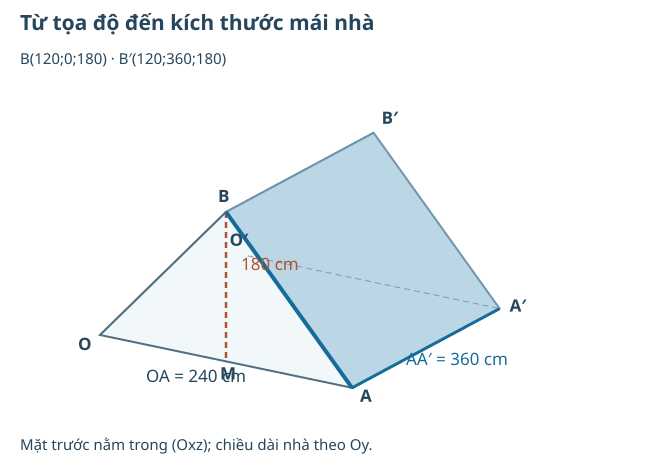

# Bài 8. Biểu thức tọa độ của các phép toán vectơ

TOÁN 12 · CHƯƠNG II · KIẾN THỨC SGK KNTT · TẬP MỘT

Chuyển bài toán hình học không gian thành phép tính với ba tọa độ; tìm vị trí, khoảng cách, góc và giải quyết các tình huống thực tế.

<nav class="thpt-r4-lesson-tabs"><a href="../">Chương II</a><a href="../bai-7/">Bài trước</a><a href="../luyen-tap/#b08-core">Core/Luyện tập</a><a href="../tu-kiem-tra-chuong/">Tự kiểm tra cuối chương</a></nav>

=== "Khám phá kiến thức"

    ### 1.1. Biểu thức tọa độ của phép cộng hai vectơ, phép trừ hai vectơ, phép nhân một số với một vectơ

    Một người thợ có bản vẽ căn nhà mái chữ A trong hệ tọa độ không gian. Biết tọa độ các đỉnh, liệu có thể tính được chiều dài, chiều rộng, độ dài cạnh mái và độ nghiêng của mái mà không phải đo trực tiếp trên bản vẽ phối cảnh? Để làm được điều đó, ta cần biến những quan hệ hình học giữa các vectơ thành những phép tính trên ba tọa độ.

    Ở Bài 7, ta đã biết \(\vec a=(x;y;z)\) nghĩa là \(\vec a=x\vec i+y\vec j+z\vec k\). Ba hệ số mô tả ba thành phần có dấu theo ba trục vuông góc. Nếu \(\vec b=x'\vec i+y'\vec j+z'\vec k\), cộng hai vectơ tức là ghép hai độ dời. Do tính chất giao hoán, kết hợp của phép cộng và tính phân phối của phép nhân với số, ta gom các thành phần cùng trục:

    \[
    \vec a+\vec b=(x+x')\vec i+(y+y')\vec j+(z+z')\vec k.
    \]

    Nhờ tính duy nhất của ba tọa độ, vectơ tổng có tọa độ \((x+x';y+y';z+z')\). Tương tự, trừ hai vectơ tức là cộng với vectơ đối, nên phải trừ cả ba thành phần tương ứng. Nhân một vectơ với số thực \(k\) thì nhân cả ba thành phần với \(k\).

    Chẳng hạn, một thiết bị dịch chuyển theo \(\vec a=(3;-2;1)\), sau đó theo \(\vec b=(-1;4;0)\). Độ dời tổng hợp là \(\vec a+\vec b=(2;2;1)\). Nếu thực hiện độ dời \(-2\vec a\), mỗi thành phần đổi dấu và tăng gấp đôi về độ lớn, kết quả \((-6;4;-2)\). Đó là độ dời theo hướng ngược lại với \(\vec a\), không phải một độ dài âm.

    Cách tính theo tọa độ còn giúp ta so sánh phương của hai vectơ. Nếu \(\vec u=(0;2;-3)\), \(\vec v=(0;-4;6)\), thì \(\vec v=-2\vec u\): cả ba tọa độ cùng tuân theo một hệ số nhân. Hai vectơ khác không này cùng phương nhưng ngược hướng. Ta không cần tính tỉ số \(0/0\); chỉ cần kiểm cả ba đẳng thức. Nếu thay \(\vec v\) bằng \((0;-4;5)\), hệ số từ tung độ vẫn là \(-2\), nhưng cao độ không còn phù hợp, nên không cùng phương.

    Muốn chứng minh ba điểm phân biệt \(A,B,C\) thẳng hàng, ta kiểm \(\overrightarrow{AB},\overrightarrow{AC}\) cùng phương. Khi không cùng phương, ba điểm tạo thành một tam giác. Tương tự, để tìm đỉnh thứ tư của hình bình hành \(ABCD\), ta dùng \(\overrightarrow{AD}=\overrightarrow{BC}\), chứ không chỉ đoán vị trí từ hình chiếu.

    **Vận dụng.** Cho \(\vec u=(2;0;-1),\vec v=(-3;4;2)\). Tính \(3\vec u-2\vec v\). Trong hai vectơ \(\vec p=(-4;0;2),\vec q=(4;1;-2)\), vectơ nào cùng phương với \(\vec u\)? Có cùng hướng không?

    ??? question "Đối chiếu"

        \(3\vec u=(6;0;-3)\), \(2\vec v=(-6;8;4)\). Vì vậy \(3\vec u-2\vec v=(12;-8;-7)\).

        \(\vec p=-2\vec u\), nên cùng phương, ngược hướng với \(\vec u\). Vectơ \(\vec q\) không cùng phương với \(\vec u\), vì mọi bội của \(\vec u\) đều có tung độ bằng \(0\), trong khi tung độ của \(\vec q\) bằng \(1\).

    ??? tip "Kiểm lỗi"

        Nếu nhận hoành độ của hiệu là \(0\), hãy viết \(6-(-6)=12\). Nếu chỉ xét hoành độ và cao độ rồi kết luận \(\vec q=2\vec u\), hãy kiểm nốt tung độ: một hệ số phải đúng ở cả ba thành phần.

    Ta đã biết từ Bài 6: nếu \(M\) là trung điểm của \(AB\), hai vectơ \(\overrightarrow{MA}\) và \(\overrightarrow{MB}\) đối nhau. Chèn gốc \(O\) vào hai vectơ ấy, ta nhận được \(2\overrightarrow{OM}=\overrightarrow{OA}+\overrightarrow{OB}\). Vì phép cộng và nhân số được thực hiện riêng từng tọa độ, trung điểm có tọa độ là trung bình cộng từng cặp tọa độ của \(A,B\).

    Ví dụ \(A(-2;1;5),B(4;3;-1)\). Hoành độ trung điểm là \((-2+4)/2=1\), tung độ là \(2\), cao độ là \(2\). Vậy \(M(1;2;2)\). Kiểm lại: \(\overrightarrow{AM}=(3;1;-3)=\overrightarrow{MB}\). Ta không lấy trung bình hai khoảng cách \(OA,OB\), bởi chúng chỉ là hai số đo độ dài, không xác định được vị trí trung điểm.

    Với tam giác \(ABC\), trọng tâm \(G\) thỏa \(\overrightarrow{GA}+\overrightarrow{GB}+\overrightarrow{GC}=\vec0\). Tương tự,

    \[
    3\overrightarrow{OG}=\overrightarrow{OA}+\overrightarrow{OB}+\overrightarrow{OC}.
    \]

    Vì thế tọa độ trọng tâm là trung bình cộng từng thành phần của ba đỉnh. Công thức cũng dùng theo chiều ngược: nếu biết trọng tâm và hai đỉnh, có thể tìm đỉnh còn lại bằng cách chuyển vế đẳng thức vectơ.

    **Vận dụng.** Tam giác \(ABC\) có \(A(1;3;-2),B(5;-1;4)\), trọng tâm \(G(2;2;1)\). Tìm trung điểm \(M\) của \(AB\) và điểm \(C\).

    ??? question "Đối chiếu"

        \(M(3;1;1)\). Từ \(3\overrightarrow{OG}=\overrightarrow{OA}+\overrightarrow{OB}+\overrightarrow{OC}\), ta có \(C(6-1-5;6-3-(-1);3-(-2)-4)=C(0;4;1)\).

        Kiểm lại tổng ba bộ tọa độ là \((6;6;3)\), chia \(3\) được đúng \((2;2;1)\). Hai vectơ \(\overrightarrow{AB}=(4;-4;6)\) và \(\overrightarrow{AC}=(-1;1;3)\) không cùng phương, nên dữ kiện cho một tam giác không suy biến.

    ??? tip "Kiểm lỗi"

        Để tìm \(C\), trước tiên phải nhân tọa độ \(G\) với \(3\), rồi mới trừ tọa độ \(A,B\). Nếu chỉ lấy từng tọa độ của \(G\) trừ các tọa độ tương ứng của \(A,B\), em đã quên nhân tọa độ của \(G\) với \(3\).

    ### 1.2. Biểu thức tọa độ của tích vô hướng

    Phép cộng, trừ, nhân với số đều cho kết quả là một vectơ. Tích vô hướng thì khác: kết quả là một số thực, giúp ta nhận biết hai vectơ tạo góc nhọn, vuông hay tù, từ đó tính góc và độ dài.

    Trong hệ \(Oxyz\), ba vectơ đơn vị có độ dài \(1\), đôi một vuông góc. Vì vậy \(\vec i\cdot\vec i=\vec j\cdot\vec j=\vec k\cdot\vec k=1\), còn các tích vô hướng giữa hai vectơ đơn vị khác nhau đều bằng \(0\).

    Xét \(\vec a=x\vec i+y\vec j+z\vec k\). Chẳng hạn,

    \[
    \vec a\cdot\vec i=x(\vec i\cdot\vec i)+y(\vec j\cdot\vec i)+z(\vec k\cdot\vec i)=x.
    \]

    Tương tự \(\vec a\cdot\vec j=y,\ \vec a\cdot\vec k=z\). Như vậy tích với từng vectơ đơn vị giúp lấy đúng thành phần theo trục ấy.

    Với \(\vec b=x'\vec i+y'\vec j+z'\vec k\), dùng tính phân phối:

    \[
    \begin{aligned}
    \vec a\cdot\vec b
    &=x'(\vec a\cdot\vec i)+y'(\vec a\cdot\vec j)+z'(\vec a\cdot\vec k)\\
    &=xx'+yy'+zz'.
    \end{aligned}
    \]

    Đây là lý do ta nhân các tọa độ tương ứng rồi cộng ba tích; các tích chéo biến mất do tính vuông góc. Công thức dựa vào hệ trục vuông góc với vectơ đơn vị, không tùy ý dùng cho hệ trục xiên.

    Chẳng hạn \(\vec a=(2;1;-2)\), \(\vec b=(1;2;2)\). Ta có \(\vec a\cdot\vec b=2+2-4=0\). Hai vectơ khác không nên chúng vuông góc. Còn \(\vec a\cdot\vec a=4+1+4=9\), tức \(|\vec a|^2=9\), nên \(|\vec a|=3\).

    **Vì sao độ dài cần căn tổng bình phương?** Nếu độ dời từ \(A\) đến \(B\) có ba thành phần \(\Delta x,\Delta y,\Delta z\), thì bình phương độ dài là tích vô hướng của vectơ ấy với chính nó, bằng \((\Delta x)^2+(\Delta y)^2+(\Delta z)^2\). Cũng có thể hiểu bằng định lí Pythagore hai lần: trước hết tìm độ dài hình chiếu xuống mặt phẳng ngang, sau đó ghép với thành phần thẳng đứng.

    <figure class="thpt-r4-plot"><figcaption>Ba mũi tên thành phần ghép lại thành vectơ \(\overrightarrow{AB}\). Sơ đồ không dùng để đo chiều dài. Hãy lấy đúng ba hiệu tọa độ rồi mới tính căn tổng bình phương để tìm \(AB\).</figcaption></figure>

    Khi cần tìm góc giữa hai vectơ khác không, kết hợp công thức tích vô hướng ở Bài 6 với độ dài vừa tìm:

    \[
    \cos(\vec a,\vec b)=\frac{\vec a\cdot\vec b}{|\vec a|\,|\vec b|}.
    \]

    Mẫu số dương. Vì vậy dấu tích vô hướng quyết định góc nhọn, vuông hay tù; hai trường hợp biên \(0^\circ,180^\circ\) ứng với hai vectơ cùng hướng, ngược hướng. Muốn tính góc \(\widehat{BAC}\), phải chọn hai vectơ cùng xuất phát tại \(A\): \(\overrightarrow{AB},\overrightarrow{AC}\). Nếu chọn \(\overrightarrow{BA}\) thay \(\overrightarrow{AB}\), em có thể nhận góc bù của góc cần tìm.

    Hãy xét hình chóp có đáy \(ABCD\) là hình chữ nhật, \(SA\perp(ABCD)\), \(AB=4,AD=3,SA=3\). Các cạnh \(AB,AD,AS\) cho ba phương vuông góc; chọn \(A=O\), trục dương theo ba cạnh đó. Nhờ cách chọn này, tọa độ các đỉnh được xác định trực tiếp từ độ dài cạnh.

    <figure class="thpt-r4-plot"><figcaption>Trục \(Ox\) theo \(AB\), \(Oy\) theo \(AD\), \(Oz\) theo \(AS\). Đọc từ \(B\) đến \(D\), từ \(S\) đến \(C\) theo chiều mũi tên. Không đo góc giữa hai mũi tên trên hình phối cảnh.</figcaption></figure>

    Ta có \(A(0;0;0),B(4;0;0),D(0;3;0),C(4;3;0),S(0;0;3)\). Vì vậy \(\overrightarrow{BD}=(-4;3;0)\), \(\overrightarrow{SC}=(4;3;-3)\); \(BD=5,\ SC=\sqrt{34}\). Tích vô hướng bằng \(-16+9=-7\), nên góc giữa hai vectơ là góc tù:

    \[
    \cos(\overrightarrow{BD},\overrightarrow{SC})=\frac{-7}{5\sqrt{34}}.
    \]

    Bài toán hình học không gian đã trở thành phép tính tọa độ. Nếu đề hỏi góc giữa hai đường thẳng \(BD,SC\), theo quy ước góc giữa hai đường thẳng ở lớp 11, phải chọn góc không vượt \(90^\circ\), tức dùng trị tuyệt đối của cosin trên. Hai cách hỏi không đồng nhất.

    **Vận dụng.** Cho tam giác \(PQR\) có \(P(1;0;2),Q(3;1;0),R(2;-2;2)\). Tính \(PQ,PR\), chứng minh \(\widehat{QPR}=90^\circ\) và tìm chu vi tam giác.

    ??? question "Đối chiếu"

        \(\overrightarrow{PQ}=(2;1;-2),\overrightarrow{PR}=(1;-2;0)\), nên \(PQ=3,\ PR=\sqrt5\). Hai vectơ khác không có tích vô hướng \(2-2+0=0\); góc \(QPR\) vuông. \(\overrightarrow{QR}=(-1;-3;2)\), do đó \(QR=\sqrt{14}\). Chu vi \(3+\sqrt5+\sqrt{14}\).

        Kiểm lại \(QR^2=14=9+5=PQ^2+PR^2\), phù hợp với tam giác vuông tại \(P\).

    ??? tip "Kiểm lỗi"

        Nếu nhận chu vi bằng tổng ba độ chênh tọa độ, hãy tính riêng mỗi vectơ cạnh và độ dài của nó. Để xét góc tại \(P\), dùng hai vectơ có gốc \(P\); không dùng vectơ cạnh đối diện \(\overrightarrow{QR}\) thay một trong hai.

    ### 1.3. Vận dụng tọa độ của vectơ trong một số bài toán có liên quan đến thực tiễn

    Trở lại căn nhà mái chữ A ở đầu bài. Giả sử mô hình là lăng trụ đứng tam giác \(OAB.O'A'B'\), với mặt trước trong \((Oxz)\), chiều dài nhà theo \(Oy\). Đơn vị là cm, \(A(240;0;0), B(120;0;180), A'(240;360;0), B'(120;360;180)\).

    <figure class="thpt-r4-plot"><figcaption>Chiều rộng là \(OA\), chiều dài là \(AA'\), chiều cao là \(BM\) với \(M\) là hình chiếu của \(B\) xuống đáy. Cạnh mái nghiêng là \(AB\), không phải chiều cao \(BM\).</figcaption></figure>

    Từ \(\overrightarrow{OA}=(240;0;0)\), \(\overrightarrow{AA'}=(0;360;0)\), ta đọc được chiều rộng \(240\) cm, chiều dài \(360\) cm. Cao độ của \(B\) bằng \(180\), nên nhà cao \(180\) cm. Cạnh mái \(AB\) có vectơ \((-120;0;180)\), dài \(\sqrt{120^2+180^2}=60\sqrt{13}\) cm. Hai cạnh mái trước có cùng độ dài vì đỉnh \(B\) nằm trên đường thẳng vuông góc với \(OA\) qua trung điểm \(M\).

    Mặt mái \(ABB'A'\) gặp mặt đất theo đường \(AA'\). Vì lăng trụ đứng, \(AA'\) vuông góc với mặt trước \((OAB)\); do đó cả \(AB\) và hình chiếu \(AM\) đều vuông góc với giao tuyến \(AA'\). Góc nghiêng của mái so với mặt đất vì thế là góc giữa \(\overrightarrow{AB}\) và \(\overrightarrow{AM}=(-120;0;0)\). Tích vô hướng của hai vectơ bằng \(14400\); độ dài của chúng lần lượt là \(60\sqrt{13}\) và \(120\). Vì thế cosin của góc bằng \(14400/(60\sqrt{13}\cdot120)=2/\sqrt{13}\). Dùng arccos trên máy tính ở chế độ độ, ta được góc xấp xỉ \(56{,}3^\circ\). Góc này khác với góc ở đỉnh mái.

    Cách làm trong bài toán chuyển động cũng tương tự: chọn hệ tọa độ và đơn vị, viết vectơ độ dời rồi tính. Nếu một vật có vectơ vận tốc không đổi \(\vec v\) trong thời gian \(t\), độ dời là \(t\vec v\). Chẳng hạn thiết bị bay từ \(A(2;1;4)\) đến \(B(8;5;6)\) trong \(2\) giây, tính theo mét, vận tốc không đổi. Khi đó \(\overrightarrow{AB}=(6;4;2)\), \(\vec v=(3;2;1)\) m/s. Sau \(3\) giây tiếp theo, độ dời là \(3\vec v=(9;6;3)\); vị trí mới \(C(17;11;9)\). Tốc độ không đổi là \(\sqrt{14}\) m/s. Nếu đề không bảo đảm vận tốc không đổi, không thể dự đoán vị trí tiếp theo chỉ từ hai điểm đã biết.

    Với bài toán tìm khoảng cách giữa hai vật, không tính hai khoảng cách tới gốc rồi lấy hiệu. Phải lập vectơ nối đúng hai vị trí. Ví dụ hai khinh khí cầu có tọa độ \((1;2;0{,}5)\) và \((-2;1;0{,}9)\) km; ba độ chênh lần lượt \(-3,-1,0{,}4\) km, nên khoảng cách là \(\sqrt{10{,}16}\) km, khoảng \(3{,}19\) km. Khoảng cách ngang chỉ là \(\sqrt{10}\) km; còn khoảng cách không gian tính thêm chênh lệch độ cao.

    **Vận dụng.** Một trạm quan sát ở \(O(0;0;0)\) theo dõi một thiết bị trong mô hình phạm vi hình cầu bán kính \(13\) km (tính cả biên). Thiết bị ở \(A(6;-8;12)\), sau đó di chuyển tới \(B(3;-4;12)\). Trạm theo dõi được thiết bị ở vị trí nào?

    ??? question "Đối chiếu"

        \(OA=\sqrt{36+64+144}=\sqrt{244}>13\) km, nên vị trí \(A\) nằm ngoài phạm vi.

        \(OB=\sqrt{9+16+144}=13\) km, nên vị trí \(B\) nằm đúng trên biên và thuộc phạm vi theo dõi theo giả thiết.

    ??? tip "Kiểm lỗi"

        Không chỉ kiểm khoảng cách trên mặt đất. Hãy so \(x^2+y^2+z^2\) với \(13^2\), kể cả thành phần độ cao. Kết quả bằng bán kính được tính là trong phạm vi vì đề đã quy định lấy biên.

=== "Kiến thức SGK"

    ### 2.1. Biểu thức tọa độ của phép cộng hai vectơ, phép trừ hai vectơ, phép nhân một số với một vectơ

    
<strong>Quy tắc — Các phép toán theo tọa độ</strong>
Trong hệ \(Oxyz\), với \(\vec a=(x;y;z),\vec b=(x';y';z')\) và \(k\in\mathbb R\):

\(\displaystyle\vec a+\vec b=(x+x';y+y';z+z')\)

\(\displaystyle\vec a-\vec b=(x-x';y-y';z-z')\)

\(\displaystyle k\vec a=(kx;ky;kz).\)

Đặc biệt, \(-\vec a=(-x;-y;-z)\).

    
<strong>Điều kiện cùng phương</strong>
Với \(\vec b=(x';y';z')\ne\vec0\), vectơ \(\vec a=(x;y;z)\) cùng phương với \(\vec b\) khi và chỉ khi tồn tại \(k\in\mathbb R\) thỏa \(x=kx',y=ky',z=kz'\).

Nếu cả hai khác không, \(k\gt 0\) cho cùng hướng, \(k\lt 0\) cho ngược hướng. Với \(k=0\), \(\vec a=\vec0\), xét theo quy ước vectơ-không đã học ở Bài 6. Không dùng tỉ số có mẫu bằng \(0\).

    Với ba điểm phân biệt \(A,B,C\), điều kiện thẳng hàng là \(\overrightarrow{AB}\) và \(\overrightarrow{AC}\) cùng phương.

    
<strong>Tọa độ trung điểm và trọng tâm</strong>
Với \(A(x_A;y_A;z_A),B(x_B;y_B;z_B)\), trung điểm \(M\) của đoạn \(AB\) có tọa độ

\(\displaystyle M\left(\frac{x_A+x_B}{2};\frac{y_A+y_B}{2};\frac{z_A+z_B}{2}\right).\)

Nếu \(A,B,C\) không thẳng hàng, trọng tâm \(G\) của tam giác \(ABC\) có tọa độ

\(\displaystyle G\left(\frac{x_A+x_B+x_C}{3};\frac{y_A+y_B+y_C}{3};\frac{z_A+z_B+z_C}{3}\right).\)

Các công thức suy ra từ \(2\overrightarrow{OM}=\overrightarrow{OA}+\overrightarrow{OB}\) và \(3\overrightarrow{OG}=\overrightarrow{OA}+\overrightarrow{OB}+\overrightarrow{OC}\).

    Khi tìm một đỉnh của hình bình hành từ ba đỉnh còn lại, giữ đúng thứ tự các đỉnh. Chẳng hạn với hình bình hành \(ABCD\), \(\overrightarrow{OD}=\overrightarrow{OA}+\overrightarrow{OC}-\overrightarrow{OB}\). Kiểm ba điểm ban đầu không thẳng hàng để hình không suy biến.

    ### 2.2. Biểu thức tọa độ của tích vô hướng

    
<strong>Công thức — Tích vô hướng</strong>
Trong hệ \(Oxyz\), với \(\vec a=(x;y;z),\vec b=(x';y';z')\):

\(\displaystyle\vec a\cdot\vec b=xx'+yy'+zz'.\)

Với hai vectơ khác không, \(\vec a\perp\vec b\) khi và chỉ khi \(xx'+yy'+zz'=0\). Nếu có vectơ-không, tích bằng \(0\) theo quy ước; không suy ra một góc xác định.

    
<strong>Độ dài vectơ, khoảng cách giữa hai điểm</strong>
\(\displaystyle|\vec a|=\sqrt{\vec a\cdot\vec a}=\sqrt{x^2+y^2+z^2}.\)

Với \(A(x_A;y_A;z_A),B(x_B;y_B;z_B)\):

\(\displaystyle AB=|\overrightarrow{AB}|=\sqrt{(x_B-x_A)^2+(y_B-y_A)^2+(z_B-z_A)^2}.\)

Đặc biệt \(OA=\sqrt{x_A^2+y_A^2+z_A^2}\). Độ dài không âm; \(AB=0\) khi và chỉ khi \(A=B\).

    
<strong>Góc giữa hai vectơ khác không</strong>
\(\displaystyle\cos(\vec a,\vec b)=\frac{xx'+yy'+zz'}{\sqrt{x^2+y^2+z^2}\sqrt{x'^2+y'^2+z'^2}}.\)

Góc thuộc \([0^\circ;180^\circ]\). Hai độ dài trong mẫu đều phải khác \(0\). Khi tính góc giữa hai đường thẳng bằng hai vectơ chỉ phương khác không, lấy góc từ \(0^\circ\) đến \(90^\circ\), tức dùng trị tuyệt đối của cosin.

    ### 2.3. Vận dụng tọa độ của vectơ trong một số bài toán có liên quan đến thực tiễn

    Chọn gốc, chiều dương và đơn vị chung trước khi lập tọa độ. Xác định đại lượng cần tìm là vị trí, độ dời, khoảng cách, góc hay vận tốc.

    Với chuyển động có vectơ vận tốc không đổi \(\vec v\), sau thời gian \(t\) vật dịch chuyển một vectơ \(t\vec v\). Nếu đã đi từ \(A\) tới \(B\) trong thời gian \(t_1>0\) và tiếp tục giữ nguyên vectơ vận tốc trong thời gian \(t_2\ge0\), vị trí \(C\) thỏa

    \[
    \overrightarrow{BC}=\frac{t_2}{t_1}\overrightarrow{AB}.
    \]

    Vận tốc trung bình trong khoảng thời gian \(t>0\) là \(\overrightarrow{AB}/t\); độ lớn của nó là \(AB/t\). Tốc độ trung bình là quãng đường thực đi được chia cho thời gian; hai số chỉ bằng nhau khi quãng đường bằng độ dài độ dời (chẳng hạn đi thẳng không đổi chiều).

    Khi gắn hệ tọa độ vào hình khối, ưu tiên chọn các trục theo ba phương vuông góc thuận lợi. Với góc giữa mặt nghiêng và mặt phẳng ngang, tìm đúng hai đường thẳng trong các mặt phẳng ấy, cùng vuông góc với giao tuyến, rồi dùng công thức góc. Không mặc định mọi cạnh xiên đều cho đúng góc nghiêng của mặt.

=== "Ví dụ"

    ### 3.1. Tổ hợp các vectơ có tọa độ

    **Đề bài.** Cho \(\vec a=(-2;3;1),\vec b=(4;0;-2),\vec c=(1;-5;3)\). Tính \(2\vec a-\vec b+3\vec c\).

    **Phân tích:** Nhân mỗi vectơ với hệ số của nó rồi cộng các tọa độ tương ứng.

    

<strong>Lời giải.</strong> \(2\vec a=(-4;6;2)\), \(-\vec b=(-4;0;2)\), \(3\vec c=(3;-15;9)\). Cộng ba vectơ, được \((-5;-9;13)\).

    **Kiểm lại:** Cao độ là \(2\cdot1-(-2)+3\cdot3=13\). Mỗi phép tính chỉ dùng các tọa độ cùng vị trí.

    ### 3.2. Thẳng hàng với một tọa độ bằng 0

    **Đề bài.** Cho \(A(1;2;0),B(1;5;-2),C(1;-4;4),D(2;8;-4)\). Trong hai điểm \(C,D\), điểm nào thuộc đường thẳng \(AB\)?

    **Phân tích:** So sánh vectơ từ \(A\) đến từng điểm với \(\overrightarrow{AB}\), kể cả hoành độ bằng \(0\).

    

<strong>Lời giải.</strong> \(\overrightarrow{AB}=(0;3;-2)\), \(\overrightarrow{AC}=(0;-6;4)=-2\overrightarrow{AB}\). Vậy \(C\) thuộc đường thẳng \(AB\). Trong khi đó \(\overrightarrow{AD}=(1;6;-4)\) không thể là bội của \(\overrightarrow{AB}\), vì hoành độ khác \(0\). Vậy \(D\) không thuộc đường thẳng \(AB\).

    **Kiểm lại:** \(C\) nằm trên tia đối của tia \(AB\), không nằm trên đoạn \(AB\). Ba điểm \(A,B,C\) phân biệt và thẳng hàng.

    ### 3.3. Tìm đỉnh thứ tư và chu vi hình bình hành

    **Đề bài.** Cho \(A(0;1;2),B(3;1;2),C(3;5;2)\). Tìm \(D\) để \(ABCD\) là hình bình hành và tính chu vi.

    **Phân tích:** Tìm \(\overrightarrow{AB},\overrightarrow{BC}\), kiểm không cùng phương. Dùng \(\overrightarrow{AD}=\overrightarrow{BC}\).

    

<strong>Lời giải.</strong> \(\overrightarrow{AB}=(3;0;0)\), \(\overrightarrow{BC}=(0;4;0)\) không cùng phương. Gọi \(D(x;y;z)\). Từ \(\overrightarrow{AD}=(x;y-1;z-2)=(0;4;0)\), suy ra \(D(0;5;2)\). Hai cạnh liên tiếp có độ dài \(AB=3,BC=4\), nên chu vi bằng \(2(3+4)=14\).

    **Kiểm lại:** \(\overrightarrow{DC}=(3;0;0)=\overrightarrow{AB}\). Các đường chéo có cùng trung điểm \((3/2;3;2)\).

    ### 3.4. Trung điểm, trọng tâm và trung tuyến

    **Đề bài.** Cho tam giác \(ABC\) với \(A(2;-1;3),B(-4;5;1),C(5;2;-4)\). Tìm trung điểm \(M\) của \(BC\) và trọng tâm \(G\). Kiểm hệ thức \(\overrightarrow{AG}=\frac23\overrightarrow{AM}\).

    **Phân tích:** Lấy trung bình hai đỉnh để tìm \(M\); lấy trung bình ba đỉnh để tìm \(G\), rồi tính hai vectơ từ \(A\).

    

<strong>Lời giải.</strong> \(M(1/2;7/2;-3/2)\) và \(G(1;2;0)\). Ta có \(\overrightarrow{AM}=(-3/2;9/2;-9/2)\), \(\overrightarrow{AG}=(-1;3;-3)=\frac23\overrightarrow{AM}\).

    **Kiểm lại:** \(\overrightarrow{GA}= (1;-3;3),\overrightarrow{GB}=(-5;3;1),\overrightarrow{GC}=(4;0;-4)\); tổng bằng \(\vec0\).

    ### 3.5. Tìm tham số để hai vectơ vuông góc

    **Đề bài.** Cho \(\vec u=(m;2;-1),\vec v=(2;-1;4)\). Tìm \(m\) để hai vectơ vuông góc, sau đó tính độ dài \(\vec u+\vec v\).

    **Phân tích:** Hai vectơ luôn khác không. Đặt tích vô hướng bằng \(0\) rồi thay tham số vào vectơ tổng.

    

<strong>Lời giải.</strong> \(\vec u\cdot\vec v=2m-2-4=2m-6\). Do đó \(m=3\). Khi ấy \(\vec u+\vec v=(5;1;3)\), nên độ dài bằng \(\sqrt{25+1+9}=\sqrt{35}\).

    **Kiểm lại:** Với \(m=3\), \(|\vec u|^2=14,|\vec v|^2=21\). Do hai vectơ vuông góc, \(|\vec u+\vec v|^2=14+21=35\).

    ### 3.6. Góc giữa hai vectơ và góc giữa hai đường thẳng

    **Đề bài.** Cho \(A(0;0;0),B(2;2;0),C(-2;0;2)\). Tính \(\widehat{BAC}\) và góc giữa hai đường thẳng \(AB,AC\).

    **Phân tích:** Góc ở \(A\) cần hai vectơ cùng gốc \(A\). Sau đó xét quy ước góc giữa đường thẳng.

    

<strong>Lời giải.</strong> \(\overrightarrow{AB}=(2;2;0)\), \(\overrightarrow{AC}=(-2;0;2)\). Tích vô hướng bằng \(-4\); cả hai độ dài bằng \(2\sqrt2\). Vậy \(\cos\widehat{BAC}=-4/8=-1/2\), suy ra \(\widehat{BAC}=120^\circ\). Góc giữa hai đường thẳng bằng \(180^\circ-120^\circ=60^\circ\).

    **Kiểm lại:** Tích âm phù hợp với góc tù giữa hai vectơ. Góc giữa hai đường thẳng không vượt \(90^\circ\).

    ### 3.7. Tìm góc trong hình hộp chữ nhật

    **Đề bài.** Hình hộp chữ nhật \(ABCD.A'B'C'D'\) có \(AB=2,AD=3,AA'=6\). Tính \(AC'\) và góc giữa \(\overrightarrow{AC'}\) với \(\overrightarrow{BD}\).

    **Phân tích:** Gắn hệ \(Oxyz\) với \(A=O\), ba chiều dương theo \(AB,AD,AA'\). Nhờ vậy tọa độ các đỉnh đọc trực tiếp từ kích thước.

    

<strong>Lời giải.</strong> \(A(0;0;0),B(2;0;0),D(0;3;0),C'(2;3;6)\). Suy ra \(\overrightarrow{AC'}=(2;3;6)\), \(AC'=7\); \(\overrightarrow{BD}=(-2;3;0)\), \(BD=\sqrt{13}\). Tích vô hướng bằng \(-4+9=5\). Vậy \(\cos(\overrightarrow{AC'},\overrightarrow{BD})=5/(7\sqrt{13})\), góc xấp xỉ \(78{,}6^\circ\).

    **Kiểm lại:** \(AC'^2=AC^2+CC'^2=13+36=49\). Nếu đáy là hình vuông thì \(AB=AD\) và hai tích theo trục ngang triệt tiêu; ở đây đáy không vuông nên không được kết luận hai vectơ vuông góc.

    ### 3.8. Tọa độ đèn ở giữa trần phòng

    **Đề bài.** Phòng dài \(10\) m, rộng \(6\) m, cao \(4\) m. Chọn góc sàn làm gốc, \(Ox,Oy\) theo chiều dài, chiều rộng, \(Oz\) hướng lên. Một đèn đặt đúng tâm mặt trần. Tìm tọa độ đèn và khoảng cách từ đèn tới gốc.

    **Phân tích:** Tâm hình chữ nhật là trung điểm của một đường chéo. Hai đỉnh đối diện của trần là \((0;0;4),(10;6;4)\).

    

<strong>Lời giải.</strong> Tọa độ đèn là \(L(5;3;4)\). Khoảng cách tới gốc \(OL=\sqrt{25+9+16}=\sqrt{50}=5\sqrt2\) m.

    **Kiểm lại:** Trung điểm hai đỉnh đối diện còn lại \((10;0;4),(0;6;4)\) cũng là \(L\). Cao độ \(4\) m, không phải \(2\) m.

    ### 3.9. Dự đoán vị trí máy bay

    **Đề bài.** Trong hệ tọa độ tính bằng km, máy bay di chuyển từ \(A(120;80;5)\) tới \(B(180;65;8)\) trong \(6\) phút với vectơ vận tốc không đổi. Tìm vị trí sau \(4\) phút tiếp theo tính từ \(B\).

    **Phân tích:** Hai độ dời cùng hướng, tỉ lệ với thời gian. Dùng \(\overrightarrow{BC}=\frac46\overrightarrow{AB}\), sau đó cộng độ dời vào vị trí \(B\).

    

<strong>Lời giải.</strong> \(\overrightarrow{AB}=(60;-15;3)\). Vì vậy \(\overrightarrow{BC}=(40;-10;2)\) và \(C(220;55;10)\) km.

    **Kiểm lại:** Vectơ độ dời trong mỗi phút của cả hai chặng đều là \((10;-2{,}5;0{,}5)\) km. Nếu vận tốc thay đổi sau \(B\), phép dự đoán này không còn được bảo đảm.

    ### 3.10. Khoảng cách giữa hai thiết bị bay

    **Đề bài.** Chọn \(Ox\) hướng Đông, \(Oy\) hướng Bắc, \(Oz\) hướng lên. Thiết bị thứ nhất ở cách gốc \(3\) km về Tây, \(2\) km về Bắc, cao \(0{,}4\) km. Thiết bị thứ hai ở cách gốc \(1\) km về Đông, \(1\) km về Nam, cao \(0{,}9\) km. Tính khoảng cách giữa chúng, làm tròn đến hàng phần trăm km.

    **Phân tích:** Chuyển hướng địa lí thành dấu tọa độ, sau đó lập vectơ nối hai vị trí.

    

<strong>Lời giải.</strong> Hai vị trí là \(P(-3;2;0{,}4),Q(1;-1;0{,}9)\). \(\overrightarrow{PQ}=(4;-3;0{,}5)\), nên \(PQ=\sqrt{16+9+0{,}25}=\sqrt{25{,}25}\approx5{,}02\) km.

    **Kiểm lại:** Khoảng cách ngang bằng \(5\) km. Do độ cao hai thiết bị khác nhau, khoảng cách không gian phải lớn hơn \(5\) km.

=== "Lỗi thường gặp"

    ### 4.1. Nhân hoặc trừ không đủ ba tọa độ

    **Sai ở đâu:** Tính \(-2(3;-1;4)=(-6;-1;4)\).

    **Vì sao sai:** Số nhân tác động lên cả ba thành phần.

    **Cách sửa:** Nhân lần lượt, được \((-6;2;-8)\). Khi trừ một vectơ, đặt ngoặc và trừ đủ ba tọa độ.

    ### 4.2. Chia cho tọa độ bằng 0 hoặc kiểm tỉ lệ thiếu thành phần

    **Sai ở đâu:** So sánh \((0;2;3),(0;4;7)\) bằng tỉ số hoành độ \(0/0\), hoặc chỉ nhìn thấy tung độ gấp đôi rồi kết luận cùng phương.

    **Vì sao sai:** Cần một hệ số nhân chung cho cả ba thành phần.

    **Cách sửa:** Từ tung độ tìm \(k=2\); kiểm cao độ phải là \(6\), không phải \(7\). Do đó hai vectơ không cùng phương.

    ### 4.3. Nhầm trung điểm với trọng tâm

    **Sai ở đâu:** Lấy tổng tọa độ ba đỉnh tam giác rồi chia \(2\), hoặc lấy trung bình ba độ dài tới gốc để tìm trọng tâm.

    **Vì sao sai:** Trọng tâm xác định từ tổng ba vectơ vị trí, không phải các độ dài.

    **Cách sửa:** Chia \(3\) riêng từng thành phần; kiểm tổng ba vectơ từ trọng tâm tới các đỉnh bằng \(\vec0\). Với trung điểm chỉ dùng hai đầu mút và chia \(2\).

    ### 4.4. Nhầm tích vô hướng với phép nhân từng tọa độ cho ra vectơ

    **Sai ở đâu:** Viết \((1;2;3)\cdot(2;-1;4)=(2;-2;12)\).

    **Vì sao sai:** Tích vô hướng phải là một số thực.

    **Cách sửa:** Cộng ba tích tương ứng \(2-2+12=12\).

    ### 4.5. Không kiểm vectơ-không hoặc chọn sai hướng khi tính góc

    **Sai ở đâu:** Chia cho độ dài \(0\), hoặc dùng \(\overrightarrow{BA}\) và \(\overrightarrow{AC}\) để tính \(\widehat{BAC}\).

    **Vì sao sai:** Công thức cosin cần hai vectơ khác không; đảo một vectơ có thể biến góc thành góc bù.

    **Cách sửa:** Kiểm mẫu khác \(0\). Chọn \(\overrightarrow{AB},\overrightarrow{AC}\) nếu góc có đỉnh \(A\); phân biệt góc giữa vectơ và góc giữa đường thẳng.

    ### 4.6. Bỏ cao độ hoặc cộng tuyến tính khi tính khoảng cách

    **Sai ở đâu:** Với vectơ \((2;-3;6)\), lấy độ dài bằng \(2+3+6=11\), hoặc chỉ tính \(\sqrt{2^2+3^2}\).

    **Vì sao sai:** Độ dài đoạn thẳng trong không gian không phải tổng các chặng theo trục hoặc độ dài hình chiếu ngang.

    **Cách sửa:** Lấy \(\sqrt{2^2+(-3)^2+6^2}=7\). Nếu đề cho hai điểm, tìm tọa độ vectơ nối hai điểm trước.

    ### 4.7. Nhầm vận tốc trung bình và tốc độ trung bình

    **Sai ở đâu:** Vật đi \(5\) m rồi quay lại \(3\) m, mất \(4\) giây; kết luận tốc độ trung bình \(0{,}5\) m/s.

    **Vì sao sai:** \(2/4=0{,}5\) là độ lớn của vận tốc trung bình; quãng đường thực là \(8\) m.

    **Cách sửa:** Tốc độ trung bình bằng \(8/4=2\) m/s. Chỉ dự đoán vị trí bằng tỉ lệ thời gian khi vectơ vận tốc không đổi.

    ### 4.8. Trộn đơn vị và không khai báo chiều trục

    **Sai ở đâu:** Dùng hai thành phần km và một thành phần m trong cùng công thức khoảng cách, hoặc mặc định hướng Tây luôn là tọa độ âm.

    **Vì sao sai:** Tọa độ phải thuộc cùng hệ trục và cùng đơn vị; dấu phụ thuộc chiều dương đã chọn.

    **Cách sửa:** Đổi đơn vị trước, đọc hướng trục từ đề, kiểm vị trí cuối và đơn vị kết quả.

    **Học tiếp:** [Core và Luyện tập Bài 8](../luyen-tap/#b08-core) · [Tự kiểm tra cuối chương](../tu-kiem-tra-chuong/).

    
Nguồn đối chiếu: SGK KNTT Toán 12 tập 1, trang in 67–72. Các số liệu và hình minh họa học liệu được biên soạn riêng để giải thích và tự học.

