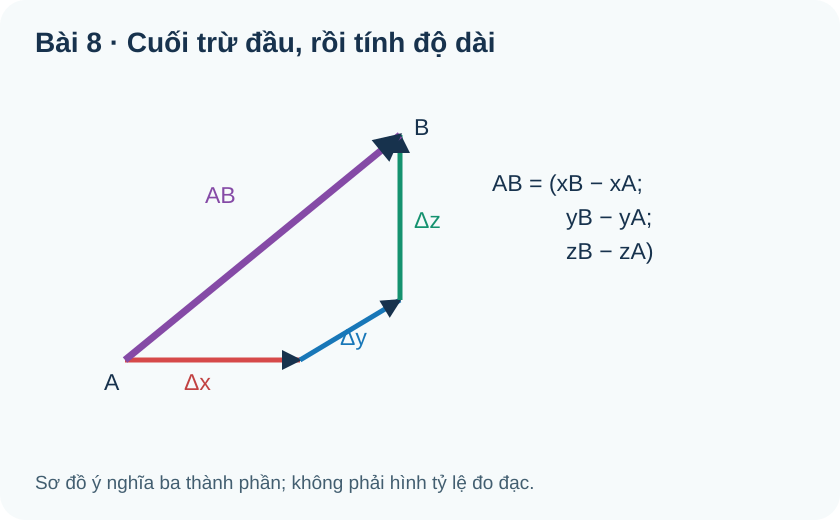

# Toán 12 · Bài 8. Biểu thức tọa độ của các phép toán vectơ

TOÁN 12 · CHƯƠNG II · SGK KẾT NỐI TRI THỨC · TẬP MỘT · TRANG 67–72

Học theo mạch: hiểu bản chất, đọc hình, xem ví dụ có suy luận và Tự thử trước Core; sau đó mở Core, Luyện tập và Tự luận trên trang riêng của Chương II.

<nav class="thpt-r4-lesson-tabs"><a href="../">Chương II</a><a href="../bai-7/">Bài trước</a><a href="../tu-kiem-tra-chuong/">Tự kiểm tra cuối chương</a></nav>

## 1. Vì sao cần học?

Ở Bài 6 em có thể ghép các mũi tên bằng hình; ở Bài 7 em biểu diễn mỗi mũi tên bằng ba thành phần. Khi vật ở rất xa hoặc hình khối phức tạp, tính từng thành phần sẽ đáng tin cậy hơn đo hình. **Bài 8 nối hình học với số học:** tổng dịch chuyển theo ba trục, so sánh hai hướng, tìm trung điểm hoặc khoảng cách, tính góc hai lực và dự đoán vị trí vật.

Tiền đề tối thiểu: quy tắc cộng vectơ; phân tích $\vec a=x\vec i+y\vec j+z\vec k$; tọa độ $\overrightarrow{AB}$ là cuối trừ đầu; tích vô hướng $|\vec a|\,|\vec b|\cos\theta$ khi hai vectơ khác không; định lí Pythagore.

## 3. Bản chất và điều kiện áp dụng

### 3.1. Vì sao cộng/trừ/nhân số theo từng tọa độ?

Giả sử $\vec a$ làm thay đổi vị trí $(x_1;y_1;z_1)$ và $\vec b$ làm thay đổi $(x_2;y_2;z_2)$. Ghép hai bước đi thì độ dịch chuyển theo mỗi trục **cộng độc lập**. Từ tính duy nhất của phân tích theo $\vec i,\vec j,\vec k$, ta được

$\vec a+\vec b=(x_1+x_2;y_1+y_2;z_1+z_2),$

$\vec a-\vec b=(x_1-x_2;y_1-y_2;z_1-z_2),$

$k\vec a=(kx_1;ky_1;kz_1).$

**Cùng phương:** hai vectơ $\vec a,\vec b$ cùng phương khi một vectơ là bội số thực của vectơ kia, nghĩa là $\vec a=k\vec b$ hoặc $\vec b=k\vec a$ (tùy vectơ nào khác không). Nếu **cả hai khác không**, kiểm từng thành phần với cùng một $k$; không viết các tỉ số khi mẫu tọa độ bằng 0. Vectơ-không là ngoại lệ: trong quy ước vectơ, nó cùng phương với mọi vectơ, nhưng không có hướng riêng. Không suy rằng hai vectơ cùng phương thì cùng hướng.

### 3.2. Trung điểm và trọng tâm không phải là trung bình độ dài

Nếu $M$ là trung điểm $AB$ thì $\overrightarrow{OM}=\tfrac12(\overrightarrow{OA}+\overrightarrow{OB})$, do đó

$$M\left(\frac{x_A+x_B}{2};\frac{y_A+y_B}{2};\frac{z_A+z_B}{2}\right).$$

Nếu $G$ là trọng tâm tam giác $ABC$, trung bình ba vectơ vị trí cho

$$G\left(\frac{x_A+x_B+x_C}{3};\frac{y_A+y_B+y_C}{3};\frac{z_A+z_B+z_C}{3}\right).$$

**Vì sao:** trung điểm/trọng tâm cân bằng vị trí, không cân bằng khoảng cách tới gốc. Điều này đúng trong mọi hệ trực giao $Oxyz$ với cùng đơn vị.

### 3.3. Tích vô hướng từ sự độc lập của ba phương vuông góc

Vì $\vec i,\vec j,\vec k$ đôi một vuông góc và có độ dài 1, tích vô hướng của hai vectơ theo tọa độ chỉ còn phần trên cùng trục:

$$\vec a\cdot\vec b=x_1x_2+y_1y_2+z_1z_2.$$

Tích vô hướng bằng 0 với **hai vectơ khác không** nghĩa là vuông góc. Góc giữa hai vectơ khác không thỏa

$$\cos\theta=\frac{\vec a\cdot\vec b}{|\vec a|\,|\vec b|}.$$

Khi đo góc, kiểm trước $|\vec a|>0,|\vec b|>0$; số thực trong biểu thức cos nằm trong $[-1;1]$. Nếu do làm tròn thu được 1,0000001 thì làm tròn/sửa sai số chứ không kết luận góc vô nghĩa một cách máy móc.

### 3.4. Độ dài và khoảng cách không gian

Từ $\vec a\cdot\vec a=|\vec a|^2$, suy ra

$$|\vec a|=\sqrt{x^2+y^2+z^2}.$$

Vì $\overrightarrow{AB}=(x_B-x_A;y_B-y_A;z_B-z_A)$,

$$AB=\sqrt{(x_B-x_A)^2+(y_B-y_A)^2+(z_B-z_A)^2}.$$

**Vì sao chọn:** đề hỏi một độ dài không gian hay khoảng cách từ vị trí này đến vị trí kia thì lập vectơ hiệu trước, sau đó lấy căn tổng bình phương; không cộng ba độ chênh tuyến tính. Không dùng công thức khoảng cách để suy góc nếu dữ liệu góc đã cho thuận tiện để dùng tích vô hướng hơn.

### 3.5. Mô hình hóa và kiểm nghiệm nghiệm vật lý

Trong hệ đơn vị thống nhất, nếu điểm $A$ đổi vị trí thành $B$ trong $t$ giây thì độ dời là $\overrightarrow{AB}$, tốc độ **trung bình theo độ dài độ dời** là $|\overrightarrow{AB}|/t$ (với $t>0$). Đây không nhất thiết là **tốc độ trung bình theo quãng đường đã đi** nếu đường đi cong hoặc đổi hướng. Cần giải thích giả thiết chuyển động thẳng khi dùng một bước vectơ để thay đường bay thật.

## 4. Đọc hình minh họa

**Cách đọc hình:** $A,B$ được nối bằng mũi tên $\overrightarrow{AB}$; nét phụ giúp nhìn biến thiên theo ba chiều. Chỉ dẫn đọc: xác định đầu $A$, cuối $B$, tách từng thay đổi $x,y,z$ trước khi dùng công thức độ dài. Hình minh họa tự tạo, không thay thế giả thiết của đề.

<figure class="thpt-r4-plot g12-chi-figure"><figcaption>Hình gốc của học liệu Bài 8, đọc cùng hướng dẫn ngay phía trên.</figcaption></figure>

### Các lỗi thường gặp và cách tự khắc phục

| Ý | Triệu chứng sai | D6 quay lại |
|---|---|---|
| 1 | Trộn hai tọa độ hoặc bỏ dấu âm khi nhân số | §3.1 / ví dụ 1: tính riêng từng trục |
| 2 | Lấy tỉ số có mẫu bằng 0, suy cùng hướng từ cùng phương | §3.1 / ví dụ 2: kiểm $\vec u=k\vec v$ và dấu k |
| 3 | Lấy trung bình độ dài thay vì vị trí | §3.2 / ví dụ 3: tính ba tọa độ độc lập |
| 4 | Chia cho $|\vec a|=0$ khi tính cos | §3.3 / ví dụ 4: kiểm điều kiện khác không |
| 5 | Quên dấu hiệu $A\to B$ hoặc cộng tuyến tính | §3.4 / ví dụ 5: vectơ hiệu rồi căn tổng bình phương |
| 6 | Nhầm độ dài độ dời với quãng đường cong | §3.5 / ví dụ 6: nêu giả thiết chuyển động thẳng và đơn vị |

**Tự đánh giá kết thúc bài:** Em có thể nói khi nào dùng tích vô hướng, khi nào dùng khoảng cách, khi nào dùng phép cộng tọa độ? Hãy làm lại 3 Core theo ba outcome O01/O04/O05; nếu chưa giải thích được *vì sao* thì quay lại mục tương ứng trước khi xem tự đối chiếu cuối chương.

## 5. Ví dụ có suy luận và lựa chọn phương pháp

**EX-G12-B08-01 · O01 — Tổ hợp tọa độ:** Cho $\vec a=(1;-2;3)$ và $\vec b=(2;1;-1)$. Tính $\vec a+\vec b$ và $2\vec a-\vec b$. **Giải:** $\vec a+\vec b=(3;-1;2)$; $2\vec a-\vec b=(2;-4;6)-(2;1;-1)=(0;-5;7)$. **Vì sao:** mỗi thành phần là một phép đo độc lập theo trục; tránh cộng nhầm $z$ với $y$.

**EX-G12-B08-02 · O02 — Cùng phương:** $\vec u=(2;-4;6)$, $\vec v=(-1;2;-3)$. **Giải:** $\vec u=-2\vec v$, do đó cùng phương và **ngược hướng**. **Vì sao:** dùng một số $k$ cho cả ba tọa độ, kiểm cả thành phần zero nếu có; tỉ số ba tọa độ không phải thủ tục bắt buộc.

**EX-G12-B08-03 · O03 — Trung điểm và trọng tâm:** $A(1;2;-1)$, $B(5;-2;3)$, $C(0;3;2)$. **Giải:** trung điểm $AB$ là $M(3;0;1)$. Trọng tâm $ABC$ là $G(2;1;\tfrac43)$. **Vì sao:** trung bình từng trục, không lấy trung bình ba độ dài $OA,OB,OC$.

**EX-G12-B08-04 · O04 — Vuông góc:** $\vec a=(1;2;-2)$, $\vec b=(2;-1;0)$. **Giải:** $\vec a\cdot\vec b=2-2+0=0$ và $\vec a,\vec b$ đều khác không, nên vuông góc. **Vì sao:** tích vô hướng là cách trực tiếp nhất để kiểm trực giao trong tọa độ; chỉ xét dấu 0 sau khi kiểm khác vectơ-không.

**EX-G12-B08-05 · O05 — Khoảng cách:** $A(1;0;2)$, $B(4;4;2)$. **Giải:** $\overrightarrow{AB}=(3;4;0)$ nên $AB=\sqrt{3^2+4^2}=5$. **Vì sao:** khoảng cách là độ dài vectơ từ $A$ tới $B$, không phải tổng $3+4$.

**EX-G12-B08-06 · O06 — Bay trong không gian:** Thiết bị đi thẳng từ $A(2;4;10)$ đến $B(8;1;12)$, các tọa độ tính theo mét, thời gian 2 giây. **Giải:** $\overrightarrow{AB}=(6;-3;2)$, độ dời $\sqrt{36+9+4}=7$ m, tốc độ theo đường thẳng $7/2=3,5$ m/s. **Điều kiện:** chỉ đồng nhất độ dời với quãng đường nếu thiết bị thực sự đi theo đoạn thẳng $AB$; thời gian dương, đơn vị đã nhất quán.

## 6. Tự thử trước Core

**TỰ THỬ B08-T01:** Cho $\vec u=(2;-1;3)$ và $\vec v=(1;4;-2)$. Trước khi tính, hãy dự đoán dấu của $\vec u\cdot\vec v$ từ dấu từng tích; rồi tính $2\vec u-\vec v$. Nêu khác biệt giữa việc trừ hai vectơ và trừ độ dài của chúng.

Tự mở phần đối chiếu

$\vec u\cdot\vec v=2-4-6=-8<0$, nên góc giữa chúng là góc tù (cả hai khác không). $2\vec u-\vec v=(4;-2;6)-(1;4;-2)=(3;-6;8)$. Trừ vectơ phải trừ từng tọa độ và giữ hướng, không phải lấy hiệu hai số độ dài.

## 7. Core, Luyện tập, Tự luận và hỗ trợ

Sau phần Kiến thức, ví dụ và **Tự thử trước Core**, em sang **trang Core và Luyện tập của Chương II**. Tại đây, em chọn Bài 8, tự làm rồi mới đối chiếu, và có hướng dẫn theo đúng câu nếu gặp khó khăn.

<nav class="thpt-r4-lesson-tabs"><a href="../luyen-tap/#b08-core">✎ Core · Bài 8</a><a href="../luyen-tap/#b08-practice">✎ Luyện tập và Tự luận · Bài 8</a><a href="../luyen-tap/#b08-help">Hỗ trợ khi gặp khó khăn · Bài 8</a></nav>

<nav class="thpt-r4-lesson-tabs"><a href="../">Chương II</a><a href="../tu-kiem-tra-chuong/">Tự kiểm tra cuối chương</a></nav>

