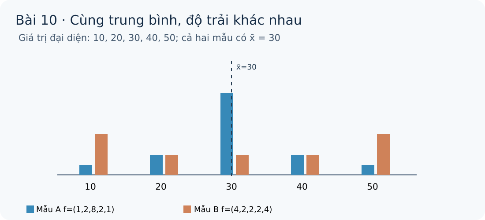

# Toán 12 · Bài 10. Phương sai và độ lệch chuẩn

TOÁN 12 · CHƯƠNG III · SGK KẾT NỐI TRI THỨC · TẬP MỘT · TRANG 80–84

Kiến thức, trực giác, ví dụ có suy luận và Tự thử trước Core. Luyện tập và Tự luận ở trang chung của chương; không trộn câu hỏi canonical vào phần học lý thuyết.
<nav class="thpt-r4-lesson-tabs"><a href="../">Chương III</a><a href="../bai-9/">Bài 9 · Ôn lại tiền đề</a><a href="../tu-kiem-tra-chuong/">Tự kiểm tra cuối chương</a></nav>

## Vì sao cần học phương sai và độ lệch chuẩn?
Một bảng số liệu có thể có trung bình giống nhau nhưng mức biến động rất khác. Điều quan trọng là hiểu đại lượng đang phản ánh *biên cực trị*, *nửa giữa*, hay *độ lệch quanh trung bình* trước khi tính.
Nhiệm vụ của người tự học: đọc bảng, nêu giả thiết, tự thử, giải Core, luyện tập nhiều ngữ cảnh và tự đối chiếu. Mọi kết quả từ bảng **ghép nhóm** là ước lượng theo các giả định của cách ghép.
## Kiến thức (WHY → tiền đề → bản chất → phát biểu → ví dụ suy luận)
**Mạch khái niệm:** Trung điểm đại diện cᵢ → trung bình có trọng số x̄ → bình phương độ lệch và phương sai s² với mẫu số n → căn bậc hai s → ứng dụng kiểm độ ổn định → giới hạn so sánh rủi ro.
### Tự thử trước Core — B10-T01 (tự mở đối chiếu)
Hai số cách trung bình lần lượt −3 và +3. Nếu cộng hai độ lệch trực tiếp, có thể thấy biến động không? Thử bình phương trước khi mở lời giải.

Mở đối chiếu B10-T01 sau khi tự thử
Tổng độ lệch là 0 nhưng tổng bình phương là 18; lấy bình phương tránh triệt tiêu chéo dấu. Nếu còn nhầm, quay lại kiến thức bình phương ở B10-O02.

### Tự thử trước Core — B10-T02 (tự mở đối chiếu)
Một mẫu có phương sai 9 cm². Độ lệch chuẩn mang giá trị và đơn vị nào? Hãy thử trước khi mở.

Mở đối chiếu B10-T02 sau khi tự thử
s=√9=3 cm. Nếu bạn giữ cm², hãy xem B10-O04: lấy căn phục hồi đơn vị gốc.

### Hình D5-03 — trọng số quanh giá trị trung bình
<figure class="thpt-r4-plot g12-chi-figure"><figcaption>Hình gốc của học liệu · đọc cùng lời hướng dẫn bên dưới.</figcaption></figure>
**Đọc hình:** Hai mẫu cùng trung điểm 30 nhưng tần số ở biên khác nhau. Mẫu có nhiều trọng số tại các lớp xa trung bình hơn có s lớn hơn; độ dài cột thể hiện tần số, không thể hiện từng quan sát thật.

### Outcome G12-CHIII-B10-O01 — Lấy giá trị đại diện và trung bình ghép nhóm
- **WHY:** Không biết từng quan sát, ta cần đại diện chung của mỗi nhóm để tiếp tục tính trung bình và độ phân tán.
- **Tiền đề (PREREQUISITE_CONFIRMED):** Tần số, cỡ mẫu n và trung điểm đoạn thẳng.
- **Bản chất trước công thức:** Chọn trung điểm cᵢ=(aᵢ+aᵢ₊₁)/2 như giá trị đại diện ước lượng của các quan sát trong nhóm.
- **Điều kiện/phát biểu (FORMAL):** x̄=(Σfᵢcᵢ)/n, n=Σfᵢ; dữ liệu ghép nhóm làm x̄ chỉ là ước lượng.
- **Tại sao chọn phương pháp này:** Lập cột trung điểm, nhân đúng tần số rồi chia tổng tần số thay vì chia số nhóm.
- **Không áp dụng máy móc khi:** Đơn vị giữ nguyên như dữ liệu; trung điểm không phản ánh vị trí từng quan sát thật.
- **Bẫy điển hình:** Cộng trung điểm chia số lớp khi tần số không đều.
- **Liên hệ Tự thử trước Core:** Tự thử B10-T01: Lớp [10;20) nên đại diện bằng 15 hay 20?
#### Ví dụ giải có lý do EX-G12-B10-01
**Nhận dạng và chọn cách làm:** Lập cột trung điểm, nhân đúng tần số rồi chia tổng tần số thay vì chia số nhóm.
**Ví dụ và suy luận:** Các nhóm [0;10),[10;20),[20;30),[30;40), f=(2,6,6,2), trung bình x̄=20 (đơn vị gốc).
**Tự kiểm:** Đơn vị giữ nguyên như dữ liệu; trung điểm không phản ánh vị trí từng quan sát thật.

### Outcome G12-CHIII-B10-O02 — Hiểu phương sai là bình phương sai lệch trung bình
- **WHY:** Hai nhóm có cùng trung bình nhưng một nhóm phân tán xa hơn; cần đo mọi khoảng cách đến tâm.
- **Tiền đề (PREREQUISITE_CONFIRMED):** O01: x̄; số âm bình phương; số không âm.
- **Bản chất trước công thức:** Phương sai cân bằng các bình phương độ lệch (cᵢ−x̄)² với trọng số tần số fᵢ, chứ không chỉ nhìn hai giá trị biên.
- **Điều kiện/phát biểu (FORMAL):** s²=(1/n)Σ fᵢ(cᵢ−x̄)²; s²≥0, bằng 0 nếu mọi nhóm có tần số dương cùng trung điểm.
- **Tại sao chọn phương pháp này:** Dùng bảng 4 cột c, f, c−x̄, f(c−x̄)², cộng rồi chia n.
- **Không áp dụng máy móc khi:** Đơn vị của phương sai là **bình phương đơn vị đo**; mẫu số n là công thức Core SGK, không tráo với n−1.
- **Bẫy điển hình:** Quên bình phương hoặc chia n−1 theo công thức khác.
- **Liên hệ Tự thử trước Core:** Tự thử B10-T01: Hai lệch −3 và +3 có bình phương như nhau không?
#### Ví dụ giải có lý do EX-G12-B10-02
**Nhận dạng và chọn cách làm:** Dùng bảng 4 cột c, f, c−x̄, f(c−x̄)², cộng rồi chia n.
**Ví dụ và suy luận:** Các trung điểm (5,15,25,35), tần số (2,6,6,2), x̄=20; s²=75.
**Tự kiểm:** Đơn vị của phương sai là **bình phương đơn vị đo**; mẫu số n là công thức Core SGK, không tráo với n−1.

### Outcome G12-CHIII-B10-O03 — Tính phương sai bằng công thức rút gọn và tự kiểm
- **WHY:** Với bảng dài, tính từng độ lệch có thể gây lỗi; công thức đại số gộp cho phép kiểm lại độc lập.
- **Tiền đề (PREREQUISITE_CONFIRMED):** O01–O02; hằng đẳng thức (a−b)².
- **Bản chất trước công thức:** Phương sai bằng trung bình trọng số của bình phương giá trị đại diện trừ bình phương trung bình.
- **Điều kiện/phát biểu (FORMAL):** s²=(Σfᵢcᵢ²)/n−(x̄)² (cùng mẫu số n).
- **Tại sao chọn phương pháp này:** Tính x̄ một lần; tính tổng fᵢcᵢ²; hai công thức phải cho cùng s² không âm (chênh rất nhỏ do làm tròn).
- **Không áp dụng máy móc khi:** Không làm tròn trung bình quá sớm; số âm nhỏ do máy tính làm tròn phải rà soát trước khi lấy căn.
- **Bẫy điển hình:** Lấy (Σ fᵢcᵢ/n)² thay cho Σfᵢcᵢ²/n.
- **Liên hệ Tự thử trước Core:** Tự thử B10-T01: s² tính bằng E(c²)−[E(c)]² hay bằng E(c²)−E(c)?
#### Ví dụ giải có lý do EX-G12-B10-03
**Nhận dạng và chọn cách làm:** Tính x̄ một lần; tính tổng fᵢcᵢ²; hai công thức phải cho cùng s² không âm (chênh rất nhỏ do làm tròn).
**Ví dụ và suy luận:** Với f=(1,3,3,1), c=(1,3,5,7), x̄=4 và (Σfc²)/8=19 nên s²=19−16=3.
**Tự kiểm:** Không làm tròn trung bình quá sớm; số âm nhỏ do máy tính làm tròn phải rà soát trước khi lấy căn.

### Outcome G12-CHIII-B10-O04 — Đọc độ lệch chuẩn và đơn vị
- **WHY:** Phương sai mang đơn vị bình phương, khó nói “lệch khoảng bao nhiêu phút”; lấy căn đưa về đơn vị ban đầu.
- **Tiền đề (PREREQUISITE_CONFIRMED):** O02–O03; căn bậc hai không âm.
- **Bản chất trước công thức:** Độ lệch chuẩn s=√s²≥0 có cùng đơn vị với quan sát; phản ánh mức độ phân tán quanh x̄ ở dữ liệu ghép nhóm.
- **Điều kiện/phát biểu (FORMAL):** s=√((Σ fᵢ(cᵢ−x̄)²)/n), không lấy căn trước khi bình phương/cộng.
- **Tại sao chọn phương pháp này:** Kiểm tra s²≥0, lấy căn cuối cùng, gắn đúng đơn vị và chỉ làm tròn ở bước báo kết quả.
- **Không áp dụng máy móc khi:** Không diễn giải “mọi quan sát đều cách trung bình đúng s”; s không nói chính xác max/min.
- **Bẫy điển hình:** Gán đơn vị phút cho phương sai phút², hoặc ghi s=s².
- **Liên hệ Tự thử trước Core:** Tự thử B10-T02: Nếu phương sai là 9 cm², độ lệch chuẩn là 3 cm hay 9 cm?
#### Ví dụ giải có lý do EX-G12-B10-04
**Nhận dạng và chọn cách làm:** Kiểm tra s²≥0, lấy căn cuối cùng, gắn đúng đơn vị và chỉ làm tròn ở bước báo kết quả.
**Ví dụ và suy luận:** Nếu s²=75 giây² thì s=√75≈8,66 giây, không phải 75 giây.
**Tự kiểm:** Không diễn giải “mọi quan sát đều cách trung bình đúng s”; s không nói chính xác max/min.

### Outcome G12-CHIII-B10-O05 — So sánh mức độ ổn định với cùng thang đo
- **WHY:** Hai phương án có thể cùng trung bình nhưng mức dao động khác nhau; cần phân biệt mức điển hình và độ ổn định.
- **Tiền đề (PREREQUISITE_CONFIRMED):** O01–O04; so sánh số đo cùng đơn vị.
- **Bản chất trước công thức:** Khi mức trung bình tương đương và cùng đơn vị, s nhỏ hơn thường cho biết dữ liệu tập trung hơn quanh x̄; s lớn hơn cho biết biến động nhiều hơn.
- **Điều kiện/phát biểu (FORMAL):** So sánh x̄_A, x̄_B trước; khi tương đương, so sánh s_A, s_B theo giả thiết bài toán.
- **Tại sao chọn phương pháp này:** Kiểm trung bình và đơn vị trước, sau đó tính s cùng công thức n và giải thích bằng ngữ cảnh.
- **Không áp dụng máy móc khi:** Độ lệch chuẩn không phải bảo đảm chất lượng hoặc rủi ro của mọi trường hợp; cần bối cảnh và mẫu phù hợp.
- **Bẫy điển hình:** Kết luận bên nào “tốt hơn” chỉ từ s mà bỏ qua mục tiêu hoặc giá trị trung bình.
- **Liên hệ Tự thử trước Core:** Tự thử B10-T02: Hai máy có cùng đo trung bình nhưng s lần lượt 0,12 và 0,25: máy nào ổn định hơn theo s?
#### Ví dụ giải có lý do EX-G12-B10-05
**Nhận dạng và chọn cách làm:** Kiểm trung bình và đơn vị trước, sau đó tính s cùng công thức n và giải thích bằng ngữ cảnh.
**Ví dụ và suy luận:** Các trung điểm 10,20,30 với A f=(2,6,2), B f=(4,2,4) cùng x̄=20; s_A≈6,32, s_B≈8,94; A ổn định hơn theo tiêu chí dao động.
**Tự kiểm:** Độ lệch chuẩn không phải bảo đảm chất lượng hoặc rủi ro của mọi trường hợp; cần bối cảnh và mẫu phù hợp.

### Outcome G12-CHIII-B10-O06 — Đánh giá rủi ro và giới hạn so sánh
- **WHY:** Độ lệch chuẩn tuyệt đối có thể lớn chỉ vì mức thu nhập/doanh thu nền cao hơn nhiều; so sánh thẳng dễ sai.
- **Tiền đề (PREREQUISITE_CONFIRMED):** O05, trung bình, độ lệch chuẩn, cùng thang đo.
- **Bản chất trước công thức:** Mục tiêu so sánh biến động/tính ổn định gắn với quy mô và ngữ cảnh; chênh trung bình lớn là dấu hiệu cần cẩn trọng.
- **Điều kiện/phát biểu (FORMAL):** Trong Core: không khẳng định mẫu có s lớn hơn thì rủi ro tương đối lớn hơn khi x̄ chênh rất nhiều. SGK có ô “Em có biết” nêu CV=s/x̄; chỉ coi là tham khảo, cần x̄ khác 0 và giải thích dấu/đơn vị.
- **Tại sao chọn phương pháp này:** Xác định liệu so sánh tuyệt đối hay tương đối, kiểm mặt bằng trung bình; khi không tương thích báo hạn chế, đề xuất dữ liệu/kĩ thuật so sánh thích hợp.
- **Không áp dụng máy móc khi:** Không gán CV là yêu cầu Core bắt buộc; CV không xác định nếu x̄=0, và khi x̄ âm cần bối cảnh chứ không áp máy móc.
- **Bẫy điển hình:** So sánh rủi ro tương đối của hai quy mô khác nhau chỉ qua s tuyệt đối.
- **Liên hệ Tự thử trước Core:** Tự thử B10-T02: s_A=4 với trung bình 20, s_B=20 với trung bình 200; chỉ dựa vào s có đủ kết luận rủi ro tương đối không?
#### Ví dụ giải có lý do EX-G12-B10-06
**Nhận dạng và chọn cách làm:** Xác định liệu so sánh tuyệt đối hay tương đối, kiểm mặt bằng trung bình; khi không tương thích báo hạn chế, đề xuất dữ liệu/kĩ thuật so sánh thích hợp.
**Ví dụ và suy luận:** Thu nhập nhóm X trung bình 20 triệu, s=4 triệu; Y trung bình 200 triệu, s=20 triệu. Không kết luận Y rủi ro hơn chỉ do 20>4; hỏi thêm thước đo tương đối và bối cảnh.
**Tự kiểm:** Không gán CV là yêu cầu Core bắt buộc; CV không xác định nếu x̄=0, và khi x̄ âm cần bối cảnh chứ không áp máy móc.

## Đối chiếu sau học (không thay thế Tự kiểm tra cuối chương)
Hãy tự mô tả bằng lời sự khác nhau giữa R, IQR, s² và s; chọn đại lượng tương ứng với câu hỏi và giải thích điều chưa thể biết từ dữ liệu ghép nhóm. Tự luyện từng outcome còn sai qua HELP rồi làm lại một item tương đương chưa xem lời giải.

## Core và Luyện tập theo chương

Sau khi đọc kiến thức và tự thử, em thực hành trong **trang Core và Luyện tập Chương III**, chọn đúng Bài 10; lời giải chỉ mở sau khi tự nộp từng câu.

<nav class="thpt-r4-lesson-tabs"><a href="../luyen-tap/#b10-core">✎ Core · Bài 10</a><a href="../luyen-tap/#b10-practice">✎ Luyện tập và Tự luận · Bài 10</a><a href="../luyen-tap/#b10-help">Hỗ trợ khi gặp khó khăn · Bài 10</a></nav>

