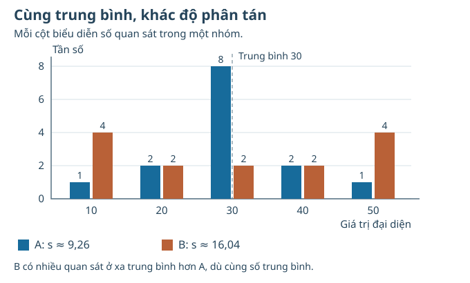

# Toán 12 · Bài 10. Phương sai và độ lệch chuẩn

TOÁN 12 · CHƯƠNG III · SGK KẾT NỐI TRI THỨC · TẬP MỘT · TRANG 80–84

Hiểu số liệu, đọc hình, tự làm và đối chiếu trước khi luyện tập.
<nav class="thpt-r4-lesson-tabs"><a href="../">Chương III</a><a href="../bai-9/">Bài 9 · Ôn lại tiền đề</a><a href="../tu-kiem-tra-chuong/">Tự kiểm tra cuối chương</a></nav>

=== "Khám phá kiến thức"

    Một máy đo có thể đo trung bình đúng nhưng dao động quá nhiều; một phương án có lợi nhuận trung bình cao nhưng biến động lớn. Để đo mức phân tán quanh trung bình từ tất cả nhóm, cần phương sai và độ lệch chuẩn. Ôn tần số, trung điểm, trung bình có trọng số, bình phương và căn bậc hai.

    ### 1.1. Đại diện mỗi lớp và trung bình có trọng số
    
    Bảng nhóm mất số đo riêng lẻ, nên dùng trung điểm $c_i$ đại diện. Nếu có fᵢ quan sát, giá trị đại diện được lặp fᵢ lần khi tính trung bình, không phải mỗi lớp chỉ góp một lần.
    
    **Vận dụng.** Hai nhóm [0;4),[4;8) có tần số 1 và 3. Tìm trung điểm, trung bình nhóm.
    
    
    
    ??? question "Đối chiếu"
    
        **Lời giải:** $c_1=2,c_2=6,n=4$, $\bar x=(1\cdot2+3\cdot6)/4=5$.
    
    
    
    ??? tip "Kiểm lỗi"
    
        Kiểm trung bình gần 6 hơn 2 vì tần số lớp sau lớn hơn. [Ôn câu nền tảng](../luyen-tap/#thpt-g12-b10-c01); [thử câu luyện tập khác](../luyen-tap/#thpt-g12-b10-p01). Sau đó tự làm lại Vận dụng không nhìn lời giải.

    ### 1.2. Vì sao lấy bình phương độ lệch?
    
    Các độ lệch âm và dương cộng lại bằng 0 quanh trung bình. Bình phương mỗi độ lệch để không triệt tiêu chéo dấu, rồi tính trung bình có trọng số.
    
    **Vận dụng.** Hai giá trị đại diện 2 và 8, mỗi giá trị tần số 1. Tính trung bình và phương sai theo n.
    
    
    
    ??? question "Đối chiếu"
    
        **Lời giải:** $\bar x=5$, độ lệch −3,+3; $s^2=(9+9)/2=9$.
    
    
    
    ??? tip "Kiểm lỗi"
    
        Bình phương từng độ lệch trước khi cộng, không bình phương tổng. [Ôn câu nền tảng](../luyen-tap/#thpt-g12-b10-c02); [thử câu luyện tập khác](../luyen-tap/#thpt-g12-b10-p03). Sau đó tự làm lại Vận dụng không nhìn lời giải.

    ### 1.3. Rút gọn bằng tổng bình phương
    
    Khai triển $(c_i-\bar x)^2=c_i^2-2c_i\bar x+\bar x^2$ và dùng $\sum f_ic_i=n\bar x$; còn $s^2=\sum f_ic_i^2/n-\bar x^2$. Công thức nhanh nhưng làm tròn sớm có thể gây sai.
    
    **Vận dụng.** Ba giá trị đại diện 1,3,5 có f=(2,4,2). Tính phương sai bằng công thức rút gọn.
    
    
    
    ??? question "Đối chiếu"
    
        **Lời giải:** $n=8$, $\bar x=3$; $\sum f_ic_i^2=2+36+50=88$. $s^2=88/8-9=2$.
    
    
    
    ??? tip "Kiểm lỗi"
    
        Kiểm lại với độ lệch −2,0,2: tổng bình phương có trọng số 16, chia 8. [Ôn câu nền tảng](../luyen-tap/#thpt-g12-b10-c03); [thử câu luyện tập khác](../luyen-tap/#thpt-g12-b10-p05). Sau đó tự làm lại Vận dụng không nhìn lời giải.

    ### 1.4. Độ lệch chuẩn và đơn vị
    
    Phương sai có đơn vị bình phương, độ lệch chuẩn $s=\sqrt{s^2}$ đưa về đơn vị ban đầu. Không có nghĩa mọi số đo cách trung bình đúng s.
    
    **Vận dụng.** Phương sai 12,25 g². Tìm độ lệch chuẩn và đơn vị.
    
    
    
    ??? question "Đối chiếu"
    
        **Lời giải:** $s=\sqrt{12{,}25}=3{,}5$ g.
    
    
    
    ??? tip "Kiểm lỗi"
    
        Chọn căn không âm và đơn vị g. [Ôn câu nền tảng](../luyen-tap/#thpt-g12-b10-c04); [thử câu luyện tập khác](../luyen-tap/#thpt-g12-b10-p07). Sau đó tự làm lại Vận dụng không nhìn lời giải.

    ### 1.5. Cùng trung bình, khác mức phân tán
    
    Quan sát hình: hai bảng tần số đối xứng quanh 30, nhưng B có nhiều trọng số xa tâm hơn A. Các cột xa trung bình góp bình phương độ lệch lớn, nên B biến động hơn theo s.
    
    <figure class="thpt-r4-plot g12-chi-figure"><figcaption>Các cột xa 30 của B lớn hơn. Bởi bình phương độ lệch tăng nhanh khi xa tâm, s của B lớn hơn A; đây không phải đồ thị từng quan sát thô.</figcaption></figure>
    
    **Vận dụng.** Trung điểm 10,20,30; A f=(1,6,1), B f=(3,2,3). So sánh trung bình và phương sai.
    
    
    
    ??? question "Đối chiếu"
    
        **Lời giải:** Cả hai n=8, trung bình 20. A: $s^2_A=(100+100)/8=25$; B: $s^2_B=(300+300)/8=75$. A có s=5, B có s≈8,66, A ít biến động hơn.
    
    
    
    ??? tip "Kiểm lỗi"
    
        So cùng đơn vị và cùng mục tiêu; trung bình bằng nhau không kéo theo phương sai bằng nhau. [Ôn câu nền tảng](../luyen-tap/#thpt-g12-b10-c05); [thử câu luyện tập khác](../luyen-tap/#thpt-g12-b10-p09). Sau đó tự làm lại Vận dụng không nhìn lời giải.

    ### 1.6. Đo rủi ro: xem mục tiêu và quy mô
    
    Độ lệch chuẩn là một thước đo biến động tuyệt đối; không phản ánh mọi loại rủi ro. Khi mức trung bình rất khác nhau, cần nêu hạn chế của việc so s trực tiếp. Nếu dữ liệu là các đại lượng dương có thang tỷ lệ thích hợp, có thể tham khảo hệ số biến thiên $CV=s/\bar x$ (ngoài yêu cầu Core).
    
    **Vận dụng.** X có trung bình 50, s=5; Y có trung bình 100, s=8 (cùng đơn vị, đại lượng dương). So biến động tuyệt đối và tương đối.
    
    
    
    ??? question "Đối chiếu"
    
        **Lời giải:** Y có s lớn hơn (8>5), nhưng CV_X=10%, CV_Y=8% trong bối cảnh thang tỷ lệ thích hợp. Không kết luận Y rủi ro hơn về mọi mặt.
    
    
    
    ??? tip "Kiểm lỗi"
    
        Không tính CV khi trung bình bằng 0, không dùng máy móc khi âm hoặc thang đo không có gốc 0 ý nghĩa. [Ôn câu nền tảng](../luyen-tap/#thpt-g12-b10-c06); [thử câu luyện tập khác](../luyen-tap/#thpt-g12-b10-p11). Sau đó tự làm lại Vận dụng không nhìn lời giải.

    ### 1.7. Dữ liệu thô → bảng ghép → quyết định
    
    Muốn quyết định theo ngưỡng s, lập bảng từ dữ liệu thật, tính trung bình và phương sai với mẫu số n, lấy căn rồi so với ngưỡng. Nếu s nhóm sát ngưỡng, nên kiểm mẫu thô vì ghép nhóm làm mất thông tin.
    
    **Vận dụng.** 8 sai số (mm): 0,1; 0,2; 0,3; 0,4; 0,6; 0,7; 0,8; 0,9. Ghép lớp [0;0,5),[0,5;1). Thiết bị cần kiểm tra nếu s nhóm >0,22 mm. Tính và quyết định.
    
    
    
    ??? question "Đối chiếu"
    
        **Lời giải:** f=(4,4), c=(0,25;0,75), trung bình 0,5 mm. $s^2=(4\cdot0{,}25^2+4\cdot0{,}25^2)/8=0{,}0625$ mm², s=0,25 mm >0,22 nên cần kiểm tra theo tiêu chí nhóm. Số liệu thô cho s khoảng 0,274 mm, cũng vượt ngưỡng.
    
    
    
    ??? tip "Kiểm lỗi"
    
        Ghi rõ tiêu chí dùng mẫu ghép hay mẫu gốc; đừng thay ngưỡng giữa hai cách. [Ôn câu nền tảng](../luyen-tap/#thpt-g12-b10-c05); [thử câu luyện tập khác](../luyen-tap/#thpt-g12-b10-p09). Sau đó tự làm lại Vận dụng không nhìn lời giải.

    ### 1.8. Phân biệt mẫu số n và n−1
    
    Phương sai mô tả của mẫu trong bài dùng mẫu số n. Trong chú ý SGK có công thức khác dùng n−1 cho n>1 (ước lượng phương sai tổng thể trong bối cảnh lấy mẫu thích hợp). Hai đại lượng khác mục đích, không tráo lẫn.
    
    **Vận dụng.** Một bảng có n=5, tổng bình phương độ lệch có trọng số bằng 20. Tính phương sai mô tả; nếu bài riêng yêu cầu chia n−1 thì được bao nhiêu?
    
    
    
    ??? question "Đối chiếu"
    
        **Lời giải:** Theo Core: $s^2=20/5=4$. Theo yêu cầu riêng $20/(5-1)=5$. Không dùng 5 thay cho 4 khi đề hỏi phương sai mô tả SGK.
    
    
    
    ??? tip "Kiểm lỗi"
    
        Đọc mục đích và mẫu số đề yêu cầu; n−1 không dùng khi n=1. [Ôn câu nền tảng](../luyen-tap/#thpt-g12-b10-c02); [thử câu luyện tập khác](../luyen-tap/#thpt-g12-b10-p03). Sau đó tự làm lại Vận dụng không nhìn lời giải.

=== "Kiến thức SGK"

    ### 2.1. Phương sai và độ lệch chuẩn của mẫu ghép nhóm
    
    
<strong>Phương sai và độ lệch chuẩn của mẫu ghép nhóm.</strong>
Với n quan sát, nhóm i có tần số fᵢ và trung điểm đại diện \(c_i\), đặt \(\bar x=\sum_i f_ic_i/n\), \(n=\sum_i f_i&gt;0\). Phương sai mô tả là \(s^2=\frac1n\sum_i f_i(c_i-\bar x)^2\ge0\). Độ lệch chuẩn \(s=\sqrt{s^2}\). Phương sai mang bình phương đơn vị; độ lệch chuẩn cùng đơn vị số đo. Đây là các đại lượng của mẫu ghép nhóm, ước lượng các đại lượng tương ứng của mẫu gốc.

    ### 2.1.1. Công thức tính và điều kiện
    
    
<strong>Công thức tính và điều kiện.</strong>
\(s^2=\frac1n\sum_i f_ic_i^2-\bar x^2\) tương đương công thức độ lệch. Giữ đủ chữ số trước phép trừ; kiểm s² không âm. s²=0 khi mọi trung điểm có tần số dương giống nhau; không suy tất cả quan sát gốc bằng nhau. Một cách kiểm: tính trung bình trước, lập cột fᵢcᵢ và fᵢcᵢ², đối chiếu bằng tổng fᵢ(cᵢ−x̄)².

    ### 2.2. Sử dụng phương sai, độ lệch chuẩn để đo rủi ro
    
    
<strong>Sử dụng phương sai, độ lệch chuẩn để đo rủi ro.</strong>
Khi cùng thang đo và mục tiêu, s nhỏ hơn nghĩa là ít phân tán quanh trung bình hơn theo tiêu chí này. Khi cùng mức trung bình, phương án có s nhỏ hơn thường ổn định hơn; rủi ro còn phụ thuộc mục tiêu, phân bố, các giá trị cực trị và dữ liệu. Với ngưỡng kiểm định đã cho, so s chưa làm tròn sớm; nêu rõ loại dữ liệu và quy ước tính. Khi trung bình khác đáng kể, không suy rủi ro tương đối từ s tuyệt đối một cách máy móc.

    **Chú ý (không thay công thức Core):** Với n>1, một đại lượng khác dùng mẫu số $n-1$ là $\frac{1}{n-1}\sum_i f_i(c_i-\bar x)^2$. Trong bối cảnh lấy mẫu thống kê phù hợp, đây là dạng ước lượng phương sai tổng thể dựa trên giá trị đại diện. Không tự đổi mẫu số n trong các bài tính phương sai mô tả. Nếu tham khảo $CV=s/\bar x$, chỉ dùng khi trung bình dương và thang đo tỷ lệ thích hợp; không coi là yêu cầu Core.

=== "Ví dụ"

    ### 3.1. Trung bình có trọng số
    
    

<strong>Đề bài:</strong> Các lớp [0;10),[10;20),[20;30),[30;40), f=(2,6,6,2). Tính trung bình.

<strong>Phân tích:</strong> Lấy c=(5,15,25,35), nhân từng tần số.

<strong>Lời giải:</strong> \(n=16\), \(\sum fc=10+90+150+70=320\), \(\bar x=20\).

<strong>Kiểm lại:</strong> Bảng đối xứng quanh 20, nên trung bình hợp lí.

    ### 3.2. Phương sai trực tiếp
    
    

<strong>Đề bài:</strong> c=(5,15,25,35), f=(2,6,6,2), trung bình 20. Tính phương sai.

<strong>Phân tích:</strong> Tính độ lệch −15,−5,5,15, bình phương và nhân tần số.

<strong>Lời giải:</strong> \(\sum f(c-20)^2=450+150+150+450=1200\); \(s^2=1200/16=75\).

<strong>Kiểm lại:</strong> Đơn vị là bình phương đơn vị gốc; tổng độ lệch có trọng số bằng 0.

    ### 3.3. Công thức rút gọn
    
    

<strong>Đề bài:</strong> c=(1,3,5,7), f=(1,3,3,1). Tính phương sai.

<strong>Phân tích:</strong> Dùng cả tổng fc và fc².

<strong>Lời giải:</strong> \(n=8\), \(\sum fc=32\), \(\sum fc^2=1+27+75+49=152\). \(\bar x=4\), \(s^2=152/8-16=3\).

<strong>Kiểm lại:</strong> Công thức trực tiếp cho (9+3+3+9)/8=3.

    ### 3.4. Trở về đơn vị gốc
    
    

<strong>Đề bài:</strong> Phương sai 75 giây². Tính độ lệch chuẩn.

<strong>Phân tích:</strong> Lấy căn không âm cuối cùng.

<strong>Lời giải:</strong> \(s=\sqrt{75}=5\sqrt3\approx8{,}66\) giây.

<strong>Kiểm lại:</strong> Bình phương 5√3 được 75; không viết giây² cho s.

    ### 3.5. So hai phương án
    
    

<strong>Đề bài:</strong> c=(10,20,30); A f=(2,6,2), B f=(4,2,4). So sánh độ ổn định theo s.

<strong>Phân tích:</strong> Cả hai n=10 và trung bình 20; so phương sai.

<strong>Lời giải:</strong> \(s_A^2=400/10=40\), \(s_B^2=800/10=80\), \(s_A\approx6{,}32\), \(s_B\approx8{,}94\). A ổn định hơn theo tiêu chí này.

<strong>Kiểm lại:</strong> B có nhiều quan sát ở hai nhóm xa tâm hơn, đúng với kết quả.

    ### 3.6. Giới hạn khi mức nền khác nhau
    
    

<strong>Đề bài:</strong> Thu nhập X trung bình 20 triệu, s=4 triệu; Y trung bình 200 triệu, s=20 triệu. Có đủ kết luận Y rủi ro tương đối hơn không?

<strong>Phân tích:</strong> Phân biệt biến động tuyệt đối với biến động tương đối.

<strong>Lời giải:</strong> Y biến động tuyệt đối lớn hơn, nhưng với thang tỷ lệ dương, CV tham khảo của X=20%, Y=10%. Chưa đủ để nói Y rủi ro tương đối hơn.

<strong>Kiểm lại:</strong> Không biến kết quả thống kê thành dự báo chắc chắn về thu nhập tương lai.

    ### 3.7. Đo máy và ra quyết định từ dữ liệu thô
    
    

<strong>Đề bài:</strong> 12 số đo lệch (mm): −0,42; −0,28; −0,15; −0,08; −0,03; 0,02; 0,04; 0,12; 0,18; 0,26; 0,33; 0,45. Ghép [-0,6;-0,2),[-0,2;0,2),[0,2;0,6). Quy trình yêu cầu kiểm máy nếu s nhóm &gt;0,25 mm.

<strong>Phân tích:</strong> Đếm nhóm, lập cột giá trị đại diện; dùng công thức rút gọn, so ngưỡng bằng số chưa làm tròn.

<strong>Lời giải:</strong> f=(2,7,3), c=(−0,4;0;0,4), n=12. \(\bar x=0{,}4/12=1/30\) mm. \(\sum fc^2=5\cdot0{,}16=0{,}8\). \(s^2=0{,}8/12-(1/30)^2=59/900\), \(s=\sqrt{59}/30\approx0{,}2560\) mm. Vì &gt;0,25, cần kiểm máy theo quy trình.

<strong>Kiểm lại:</strong> Tổng tần số 12. Sát ngưỡng nên báo thêm kết quả gốc nếu có; không kết luận máy hỏng chỉ bằng một thước đo.

    ### 3.8. Đối chiếu cùng dữ liệu gốc và nhóm
    
    

<strong>Đề bài:</strong> 6 khối lượng (g): 11,12,13,17,18,19. Ghép [10;15),[15;20). So trung bình, phương sai và độ lệch chuẩn trước và sau ghép.

<strong>Phân tích:</strong> Tính trực tiếp từ 6 số, rồi thay mỗi số bằng trung điểm lớp riêng.

<strong>Lời giải:</strong> Gốc: trung bình 15 g, tổng bình phương độ lệch 16+9+4+4+9+16=58, \(s^2=29/3\), \(s\approx3{,}11\) g. Nhóm: f=(3,3), c=(12,5;17,5), trung bình 15 g, \(s^2=6{,}25\), s=2,5 g.

<strong>Kiểm lại:</strong> Cùng trung bình nhưng phương sai khác; ghép nhóm không nhất thiết bảo toàn phương sai.

    ### 3.9. Hai mẫu số, hai mục đích
    
    

<strong>Đề bài:</strong> c=(2,4,6), f=(1,2,1). Tính s² của SGK và đại lượng chia n−1 nếu được yêu cầu.

<strong>Phân tích:</strong> Trước tiên tính tổng bình phương độ lệch.

<strong>Lời giải:</strong> \(n=4\), \(\bar x=4\), tổng 4+0+4=8. Core \(s^2=8/4=2\); đại lượng chia n−1 là \(8/3\).

<strong>Kiểm lại:</strong> n=4&gt;1; không dùng n−1 để thay đáp án Core.

=== "Lỗi thường gặp"

    ### 4.1. Đại diện mỗi lớp và trung bình có trọng số
    
    ??? tip "Cách tự sửa"
    
        Kiểm trung bình gần 6 hơn 2 vì tần số lớp sau lớn hơn. [Ôn lại câu Core](../luyen-tap/#thpt-g12-b10-c01); [luyện câu khác rồi quay lại](../luyen-tap/#thpt-g12-b10-p01).

    ### 4.2. Vì sao lấy bình phương độ lệch?
    
    ??? tip "Cách tự sửa"
    
        Bình phương từng độ lệch trước khi cộng, không bình phương tổng. [Ôn lại câu Core](../luyen-tap/#thpt-g12-b10-c02); [luyện câu khác rồi quay lại](../luyen-tap/#thpt-g12-b10-p03).

    ### 4.3. Rút gọn bằng tổng bình phương
    
    ??? tip "Cách tự sửa"
    
        Kiểm lại với độ lệch −2,0,2: tổng bình phương có trọng số 16, chia 8. [Ôn lại câu Core](../luyen-tap/#thpt-g12-b10-c03); [luyện câu khác rồi quay lại](../luyen-tap/#thpt-g12-b10-p05).

    ### 4.4. Độ lệch chuẩn và đơn vị
    
    ??? tip "Cách tự sửa"
    
        Chọn căn không âm và đơn vị g. [Ôn lại câu Core](../luyen-tap/#thpt-g12-b10-c04); [luyện câu khác rồi quay lại](../luyen-tap/#thpt-g12-b10-p07).

    ### 4.5. Cùng trung bình, khác mức phân tán
    
    ??? tip "Cách tự sửa"
    
        So cùng đơn vị và cùng mục tiêu; trung bình bằng nhau không kéo theo phương sai bằng nhau. [Ôn lại câu Core](../luyen-tap/#thpt-g12-b10-c05); [luyện câu khác rồi quay lại](../luyen-tap/#thpt-g12-b10-p09).

    ### 4.6. Đo rủi ro: xem mục tiêu và quy mô
    
    ??? tip "Cách tự sửa"
    
        Không tính CV khi trung bình bằng 0, không dùng máy móc khi âm hoặc thang đo không có gốc 0 ý nghĩa. [Ôn lại câu Core](../luyen-tap/#thpt-g12-b10-c06); [luyện câu khác rồi quay lại](../luyen-tap/#thpt-g12-b10-p11).

    ### 4.7. Dữ liệu thô → bảng ghép → quyết định
    
    ??? tip "Cách tự sửa"
    
        Ghi rõ tiêu chí dùng mẫu ghép hay mẫu gốc; đừng thay ngưỡng giữa hai cách. [Ôn lại câu Core](../luyen-tap/#thpt-g12-b10-c05); [luyện câu khác rồi quay lại](../luyen-tap/#thpt-g12-b10-p09).

    ### 4.8. Phân biệt mẫu số n và n−1
    
    ??? tip "Cách tự sửa"
    
        Đọc mục đích và mẫu số đề yêu cầu; n−1 không dùng khi n=1. [Ôn lại câu Core](../luyen-tap/#thpt-g12-b10-c02); [luyện câu khác rồi quay lại](../luyen-tap/#thpt-g12-b10-p03).

    [Core Bài 10](../luyen-tap/#b10-core) · [Luyện tập và Tự luận](../luyen-tap/#b10-practice) · [Hỗ trợ khi gặp khó khăn](../luyen-tap/#b10-help) · [Tự kiểm tra cuối chương](../tu-kiem-tra-chuong/)

*Nguồn đối chiếu: SGK Toán 12 Kết nối tri thức, Tập một, trang in 80–84.*
