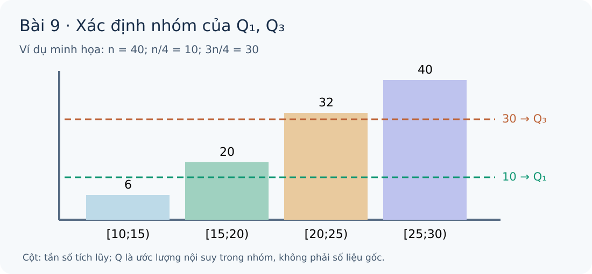
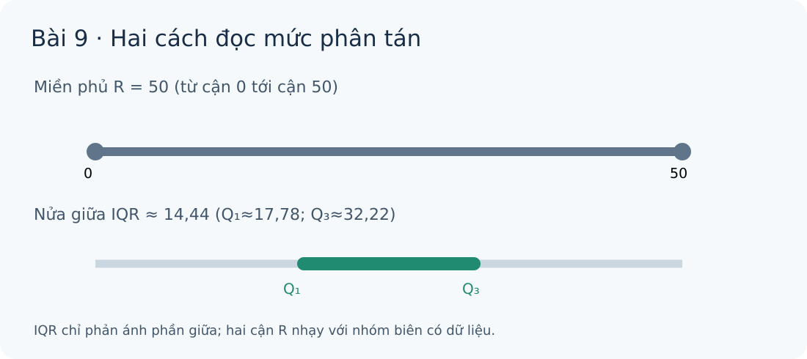

# Toán 12 · Bài 9. Khoảng biến thiên và khoảng tứ phân vị

TOÁN 12 · CHƯƠNG III · SGK KẾT NỐI TRI THỨC · TẬP MỘT · TRANG 75–79

Kiến thức, trực giác, ví dụ có suy luận và Tự thử trước Core. Luyện tập và Tự luận ở trang chung của chương; không trộn câu hỏi luyện tập vào phần học lý thuyết.
<nav class="thpt-r4-lesson-tabs"><a href="../">Chương III</a><a href="../bai-10/">Bài 10 · Học tiếp</a></nav>

## Vì sao cần học khoảng biến thiên và khoảng tứ phân vị?
Một bảng số liệu có thể có trung bình giống nhau nhưng mức biến động rất khác. Điều quan trọng là hiểu đại lượng đang phản ánh *biên cực trị*, *nửa giữa*, hay *độ lệch quanh trung bình* trước khi tính.
Nhiệm vụ của người tự học: đọc bảng, nêu giả thiết, tự thử, giải Core, luyện tập nhiều ngữ cảnh và tự đối chiếu. Mọi kết quả từ bảng **ghép nhóm** là ước lượng theo các giả định của cách ghép.
## Tìm hiểu kiến thức, điều kiện và ví dụ
**Mạch khái niệm:** Bảng lớp và tần số → nhóm đầu/cuối có dữ liệu → khoảng biến thiên R → vị trí n/4,3n/4 và nội suy Q1/Q3 → khoảng tứ phân vị Δ_Q → chọn thước đo theo câu hỏi.
<!-- FIRST_TRY_ID: B09-T01 -->
### Tự thử trước Core — Tình huống 1
Trên các nhóm [0;5), [5;10), [10;15) có f=(0,3,4), hãy chỉ ra lớp đầu có dữ liệu và R. Hãy thử trước khi mở lời giải.

Mở đối chiếu tình huống 1 sau khi tự thử
Nhóm đầu có dữ liệu là [5;10), cuối là [10;15); R=15−5=10. Nếu bạn chọn 15, hãy quay lại mục 1/mục 2 để kiểm nhóm rỗng.

<!-- FIRST_TRY_ID: B09-T02 -->
### Tự thử trước Core — Tình huống 2
Có f=(6,14,12,8) trên bốn lớp liền nhau. n bằng bao nhiêu, n/4 và 3n/4 rơi vào lớp nào?

Mở đối chiếu tình huống 2 sau khi tự thử
n=40, mốc 10 thuộc lớp 2 và mốc 30 thuộc lớp 3 (cộng dồn 6,20,32,40). Nếu chọn lớp 4, hãy ôn cách lập cộng dồn ở mục 4.

<!-- FIG_ROLE: D5-01 -->
### Quan sát hình: đọc đường tứ phân vị
<figure class="thpt-r4-plot g12-chi-figure"><figcaption>Quan sát hình và đọc lời hướng dẫn bên dưới.</figcaption></figure>
**Đọc hình:** So giá trị n/4 và 3n/4 với tần số tích lũy để xác định lớp chứa Q; không đọc độ dài cột tần số như giá trị tứ phân vị. Hình mô phỏng, không cho phép khôi phục mẫu gốc.
<!-- FIG_ROLE: D5-02 -->
### Quan sát hình: khoảng biến thiên và IQR
<figure class="thpt-r4-plot g12-chi-figure"><figcaption>Quan sát hình và đọc lời hướng dẫn bên dưới.</figcaption></figure>
**Đọc hình:** thanh từ cận nhỏ nhất đến cận lớn nhất mô tả R; phần giữa Q1–Q3 mô tả IQR. R nhạy với lớp ngoài cùng; Q1/Q3 là xấp xỉ nội suy.

<!-- OUTCOME_ID: G12-CHIII-B09-O01 -->
### 1. Đọc bảng ghép nhóm và hiểu giới hạn dữ liệu
- **Vì sao cần biết:** Bảng đã gộp nhiều quan sát vào một khoảng: ta biết có bao nhiêu giá trị trong mỗi nhóm, nhưng không còn biết chính xác từng giá trị.
- **Kiến thức cần nhớ:** Tần số; kí hiệu n; khoảng nửa kín [a;b); số liệu gốc và số liệu ghép nhóm.
- **Bản chất trước công thức:** Bề rộng nhóm h=b−a; tổng tần số n; lớp đầu/lớp cuối có tần số dương mới xác định phần hỗ trợ của dữ liệu.
- **Kiến thức và điều kiện:** Với các nhóm [aᵢ;aᵢ₊₁) và fᵢ ≥ 0, n=Σfᵢ; không lấy trung điểm lớp làm giá trị gốc thật của mọi quan sát.
- **Tại sao chọn phương pháp này:** Đọc cột tần số trước, khoanh nhóm không rỗng, rồi mới suy khoảng phủ số liệu.
- **Không áp dụng máy móc khi:** Mẫu đã ghép nhóm không đủ để tái tạo chính xác giá trị lớn nhất/nhỏ nhất của mẫu gốc.
- **Bẫy điển hình:** Đọc một nhóm tần số 0 như nhóm có quan sát.
- **Liên hệ Tự thử trước Core:** Tự thử tình huống 1: Một bảng gồm 3 nhóm liên tiếp có tần số 0,4,6. Nhóm đầu có dữ liệu là nhóm nào?
<!-- EX_ID: EX-G12-B09-01 -->
#### Ví dụ có hướng dẫn
**Nhận dạng và chọn cách làm:** Đọc cột tần số trước, khoanh nhóm không rỗng, rồi mới suy khoảng phủ số liệu.
**Ví dụ và suy luận:** Bảng [0;10), [10;20), [20;30) có tần số 0, 5, 7: cỡ mẫu 12 và nhóm chứa dữ liệu sớm nhất là [10;20), không phải [0;10).
**Tự kiểm:** Mẫu đã ghép nhóm không đủ để tái tạo chính xác giá trị lớn nhất/nhỏ nhất của mẫu gốc.

<!-- OUTCOME_ID: G12-CHIII-B09-O02 -->
### 2. Tính và đọc khoảng biến thiên ghép nhóm
- **Vì sao cần biết:** Muốn ước lượng độ rộng toàn bộ miền quan sát, ta nhìn từ nhóm có dữ liệu đầu tiên tới nhóm cuối cùng.
- **Kiến thức cần nhớ:** mục 1: lớp đầu và cuối có tần số dương.
- **Bản chất trước công thức:** Khoảng biến thiên ghép nhóm đo độ trải dài xấp xỉ của miền dữ liệu; không phải khoảng cách giữa 2 trung điểm nhóm.
- **Kiến thức và điều kiện:** R = cận trên của nhóm có tần số dương cuối − cận dưới của nhóm có tần số dương đầu.
- **Tại sao chọn phương pháp này:** Xác nhận nhóm rỗng ở hai đầu, rồi trừ hai **cận nhóm**; báo đơn vị của biến.
- **Không áp dụng máy móc khi:** R ghép nhóm thường không bằng R mẫu gốc; đừng khẳng định R gốc nếu thiếu dữ liệu thô.
- **Bẫy điển hình:** Lấy cận của nhóm tần số 0 hoặc trừ hai trung điểm.
- **Liên hệ Tự thử trước Core:** Tự thử tình huống 1: R của các nhóm [0;5),[5;10),[10;15) có f=0,3,4 là bao nhiêu?
<!-- EX_ID: EX-G12-B09-02 -->
#### Ví dụ có hướng dẫn
**Nhận dạng và chọn cách làm:** Xác nhận nhóm rỗng ở hai đầu, rồi trừ hai **cận nhóm**; báo đơn vị của biến.
**Ví dụ và suy luận:** Các nhóm [0;5), [5;10), [10;15), [15;20) với f=(0,5,10,0): R=15−5=10, không phải 20−0.
**Tự kiểm:** R ghép nhóm thường không bằng R mẫu gốc; đừng khẳng định R gốc nếu thiếu dữ liệu thô.

<!-- OUTCOME_ID: G12-CHIII-B09-O03 -->
### 3. Nhận biết độ nhạy của khoảng biến thiên
- **Vì sao cần biết:** Một giá trị ở nhóm cực trị có thể đẩy biên của dữ liệu đi xa dù phần lớn quan sát không đổi.
- **Kiến thức cần nhớ:** mục 2: nhóm đầu/nhóm cuối và R.
- **Bản chất trước công thức:** R nhạy với giá trị ngoại lệ và với việc mở rộng lớp ở biên; vì vậy R không mô tả đầy đủ nửa giữa phân bố.
- **Kiến thức và điều kiện:** So sánh hai R chỉ khi cùng đơn vị, phạm vi, cách chia nhóm đủ tương thích; biết R chỉ là một lát cắt sự phân tán.
- **Tại sao chọn phương pháp này:** Đối chiếu biên trước và sau khi thêm một giá trị thuộc nhóm xa hơn, rồi hỏi các nhóm ở giữa có đổi hay không.
- **Không áp dụng máy móc khi:** Không suy ra phương sai, IQR hoặc sự khác biệt từng quan sát chỉ từ R.
- **Bẫy điển hình:** Kết luận mọi giá trị phân tán đều tăng cùng tỷ lệ khi R tăng.
- **Liên hệ Tự thử trước Core:** Tự thử tình huống 1: Chỉ một quan sát chuyển sang lớp rất xa, R có thể thay đổi mạnh không?
<!-- EX_ID: EX-G12-B09-03 -->
#### Ví dụ có hướng dẫn
**Nhận dạng và chọn cách làm:** Đối chiếu biên trước và sau khi thêm một giá trị thuộc nhóm xa hơn, rồi hỏi các nhóm ở giữa có đổi hay không.
**Ví dụ và suy luận:** Nếu bảng có nhóm đầu [10;20) và cuối [30;40) thì R=30; thêm một quan sát ở [60;70) làm R thành 60 trong khi phần giữa có thể hầu như không đổi.
**Tự kiểm:** Không suy ra phương sai, IQR hoặc sự khác biệt từng quan sát chỉ từ R.

<!-- OUTCOME_ID: G12-CHIII-B09-O04 -->
### 4. Tìm nhóm chứa Q₁ và Q₃ theo tần số tích lũy
- **Vì sao cần biết:** Để biết phần giữa của đám dữ liệu nằm ở đâu, ta cần vị trí 25% và 75% số quan sát thay vì chỉ nhìn hai đầu.
- **Kiến thức cần nhớ:** Tần số tích lũy; cỡ mẫu n; các lớp có độ rộng dương.
- **Bản chất trước công thức:** Q₁ và Q₃ là các vị trí phân chia mẫu thành bốn phần theo tỉ lệ; từ bảng ghép nhóm chỉ xác định được lớp và ước lượng nội suy.
- **Kiến thức và điều kiện:** Dùng vị trí n/4 và 3n/4, cộng dồn tần số đến lớp đầu tiên có cộng dồn ≥ vị trí cần xét (tại biên lớp liên tiếp cho cùng giá trị nội suy).
- **Tại sao chọn phương pháp này:** Lập cột cộng dồn và gạch vị trí; tuyệt đối không chọn lớp Q theo tần số lớn nhất.
- **Không áp dụng máy móc khi:** Quy ước định vị theo SGK; không đồng nhất với mọi định nghĩa tứ phân vị cho dữ liệu thô ở từng phần mềm.
- **Bẫy điển hình:** Nhầm 3n/4 thành n/3 hoặc lấy lớp có số người lớn nhất.
- **Liên hệ Tự thử trước Core:** Tự thử tình huống 2: n=40, f=(6,14,12,8). Mốc 3n/4=30 thuộc lớp số mấy?
<!-- EX_ID: EX-G12-B09-04 -->
#### Ví dụ có hướng dẫn
**Nhận dạng và chọn cách làm:** Lập cột cộng dồn và gạch vị trí; tuyệt đối không chọn lớp Q theo tần số lớn nhất.
**Ví dụ và suy luận:** f=(6,14,12,8), n=40; vị trí Q₁=10 ở lớp 2, Q₃=30 ở lớp 3 vì cộng dồn 6,20,32,40.
**Tự kiểm:** Quy ước định vị theo SGK; không đồng nhất với mọi định nghĩa tứ phân vị cho dữ liệu thô ở từng phần mềm.

<!-- OUTCOME_ID: G12-CHIII-B09-O05 -->
### 5. Nội suy hai tứ phân vị và tính IQR
- **Vì sao cần biết:** Biết lớp chứa tứ phân vị vẫn chưa đủ: cần ước lượng tứ phân vị nằm ở đâu bên trong nhóm.
- **Kiến thức cần nhớ:** mục 4: vị trí n/4,3n/4; lớp [L;L+h), tần số f và cộng dồn trước lớp C.
- **Bản chất trước công thức:** Nội suy tuyến tính giả định quan sát phân bố tương đối đều trong lớp để ước lượng vị trí Qᵣ; IQR = Q₃ − Q₁.
- **Kiến thức và điều kiện:** Qᵣ≈ L + ((r n/4 − C)/f)h, r∈{1,3}, f>0; Δ_Q=Q₃−Q₁.
- **Tại sao chọn phương pháp này:** Sau khi xác định lớp, thay từng L,C,f,h vào một công thức; giữ nhiều chữ số trước phép trừ, rồi mới làm tròn.
- **Không áp dụng máy móc khi:** Q₁, Q₃ và Δ_Q từ dữ liệu ghép nhóm đều là xấp xỉ; không dùng công thức nếu f=0 hoặc lớp có bề rộng không dương.
- **Bẫy điển hình:** Dùng nhầm C cộng dồn đến **sau** lớp đang xét, hoặc làm tròn Q₁ sớm.
- **Liên hệ Tự thử trước Core:** Tự thử tình huống 2: Với n=40, lớp Q₁ [15;20), f=14 và cộng dồn trước lớp C=6, phần nội suy là (10−6)/14 của bề rộng lớp, đúng hay sai?
<!-- EX_ID: EX-G12-B09-05 -->
#### Ví dụ có hướng dẫn
**Nhận dạng và chọn cách làm:** Sau khi xác định lớp, thay từng L,C,f,h vào một công thức; giữ nhiều chữ số trước phép trừ, rồi mới làm tròn.
**Ví dụ và suy luận:** Với các lớp [10;15),[15;20),[20;25),[25;30) và f=(6,14,12,8), Q₁≈16,43, Q₃≈24,17, IQR≈7,74.
**Tự kiểm:** Q₁, Q₃ và Δ_Q từ dữ liệu ghép nhóm đều là xấp xỉ; không dùng công thức nếu f=0 hoặc lớp có bề rộng không dương.

<!-- OUTCOME_ID: G12-CHIII-B09-O06 -->
### 6. Chọn R/IQR và so sánh hai mẫu có điều kiện
- **Vì sao cần biết:** Hai lớp có thể có biên khác nhau do một vài giá trị cực trị, nhưng phần lớn dữ liệu ở giữa lại tập trung tương tự nhau.
- **Kiến thức cần nhớ:** mục 2, mục 3, mục 5; cùng đơn vị và cách chia lớp.
- **Bản chất trước công thức:** R xem miền ngoài cùng, IQR xem 50% giữa mẫu; dùng kết hợp khi cần kể cả mức nhạy với giá trị bất thường.
- **Kiến thức và điều kiện:** Nếu nhóm/đơn vị tương thích, so sánh R_A với R_B và IQR_A với IQR_B; nêu rõ đây là phép so sánh **ước lượng** trên dữ liệu ghép nhóm.
- **Tại sao chọn phương pháp này:** Đề bài hỏi “đầu mút” → R; hỏi “phần điển hình/ít bị cực trị tác động” → IQR; trường hợp nhập nhằng nên xem cả hai.
- **Không áp dụng máy móc khi:** IQR không cho biết toàn bộ hình dạng phân bố; đừng suy độ phân tán “tuyệt đối đúng” chỉ từ một con số.
- **Bẫy điển hình:** Dùng R để nhận xét cả nửa giữa hoặc dùng IQR để phủ nhận hoàn toàn tác động biên.
- **Liên hệ Tự thử trước Core:** Tự thử tình huống 2: Chọn R hay IQR nếu yêu cầu so sánh nửa giữa dữ liệu ít nhạy với ngoại lệ?
<!-- EX_ID: EX-G12-B09-06 -->
#### Ví dụ có hướng dẫn
**Nhận dạng và chọn cách làm:** Đề bài hỏi “đầu mút” → R; hỏi “phần điển hình/ít bị cực trị tác động” → IQR; trường hợp nhập nhằng nên xem cả hai.
**Ví dụ và suy luận:** Hai bảng có cùng n=32 trên 5 nhóm [0;10)...[40;50): A f=(1,9,12,9,1) có R=50, B f=(0,7,18,7,0) có R=30; IQR_A cũng lớn hơn IQR_B.
**Tự kiểm:** IQR không cho biết toàn bộ hình dạng phân bố; đừng suy độ phân tán “tuyệt đối đúng” chỉ từ một con số.

## Đối chiếu sau học (không thay thế Tự kiểm tra cuối chương)
Hãy tự mô tả bằng lời sự khác nhau giữa R, IQR, s² và s; chọn đại lượng tương ứng với câu hỏi và giải thích điều chưa thể biết từ dữ liệu ghép nhóm. Hãy ôn lại phần kiến thức còn yếu bằng hướng dẫn phù hợp, rồi tự làm một bài tương tự chưa xem lời giải.

## Core và Luyện tập theo chương

Sau khi đọc kiến thức và tự thử, em thực hành trong **trang Core và Luyện tập Chương III**, chọn đúng Bài 9; lời giải chỉ mở sau khi tự nộp từng câu.

<nav class="thpt-r4-lesson-tabs"><a href="../luyen-tap/#b09-core">✎ Core · Bài 9</a><a href="../luyen-tap/#b09-practice">✎ Luyện tập và Tự luận · Bài 9</a><a href="../luyen-tap/#b09-help">Hỗ trợ khi gặp khó khăn · Bài 9</a></nav>

