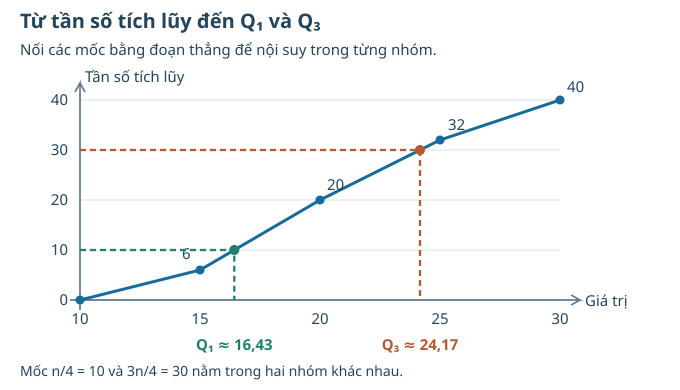
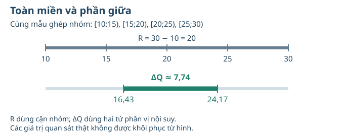

# Bài 9. Khoảng biến thiên và khoảng tứ phân vị

TOÁN 12 · CHƯƠNG III · KIẾN THỨC SGK KNTT · TẬP MỘT

Đọc mức độ phân tán từ bảng số liệu ghép nhóm: toàn bộ miền dữ liệu trải rộng đến đâu và nửa giữa tập trung như thế nào.

<nav class="thpt-r4-lesson-tabs"><a href="../">Chương III</a><a href="../luyen-tap/#b09-core">Core/Luyện tập</a><a href="../bai-10/">Bài tiếp theo</a><a href="../tu-kiem-tra-chuong/">Tự kiểm tra cuối chương</a></nav>

=== "Khám phá kiến thức"

    ### 1.1. Khoảng biến thiên

    Hai máy đóng gói đều có khối lượng sản phẩm trung bình gần \(500\) g. Máy thứ nhất thường cho sản phẩm gần \(500\) g; máy thứ hai có lúc đóng quá ít, lúc quá nhiều. Chỉ nhìn số trung bình, ta không biết máy nào ổn định hơn. Ta cần một đại lượng mô tả mức độ trải rộng của các kết quả đo.

    Ở lớp 10, với mẫu số liệu không ghép nhóm, em đã biết khoảng biến thiên là hiệu giữa giá trị lớn nhất và giá trị nhỏ nhất. Ví dụ mẫu \(12,13,15,16,19\) có khoảng biến thiên \(19-12=7\). Nếu chỉ thay \(19\) bằng \(30\), khoảng biến thiên tăng lên \(18\), dù bốn giá trị còn lại không thay đổi. Đại lượng này nhìn vào hai đầu của mẫu.

    <!-- OUTCOME_ID: G12-CHIII-B09-O01 -->
    <!-- EX_ID: EX-G12-B09-01 -->
    Trong thực tế, đôi khi ta không có từng kết quả đo mà chỉ có bảng ghép nhóm. Xét thời gian hoàn thành một công việc của 40 người (phút):

    | Thời gian (phút) | \([5;10)\) | \([10;15)\) | \([15;20)\) | \([20;25)\) | \([25;30)\) | \([30;35)\) |
    | :-- | :--: | :--: | :--: | :--: | :--: | :--: |
    | Số người | 0 | 6 | 14 | 12 | 8 | 0 |

    Nhóm \([10;15)\) có 6 người nghĩa là mỗi người trong nhóm mất ít nhất 10 phút nhưng chưa tới 15 phút. Ta không biết chính xác thời gian từng người. Vì nhóm đầu có dữ liệu là \([10;15)\), thời gian nhỏ nhất của mẫu gốc thỏa \(10\le x_{\min}<15\). Vì nhóm cuối có dữ liệu là \([25;30)\), thời gian lớn nhất thỏa \(25\le x_{\max}<30\).

    <!-- OUTCOME_ID: G12-CHIII-B09-O02 -->
    Ta chỉ biết giới hạn của thời gian nhanh nhất và chậm nhất, chưa biết hai giá trị chính xác. Do đó dùng hiệu giữa cận trên của nhóm cuối có dữ liệu và cận dưới của nhóm đầu có dữ liệu:

    \[
    R=30-10=20\text{ phút}.
    \]

    Đây là khoảng biến thiên **của mẫu ghép nhóm**. Nó là một xấp xỉ cho khoảng biến thiên mẫu gốc, không khẳng định có người làm đúng 10 phút hay đúng 30 phút. Thực ra \(x_{\max}<30\) và \(x_{\min}\ge10\), nên \(x_{\max}-x_{\min}<20\). Hai nhóm có tần số bằng 0 ở ngoài cùng không kéo dài miền có dữ liệu; nếu lấy \(35-5=30\), kết quả sai.

    <!-- OUTCOME_ID: G12-CHIII-B09-O03 -->
    Khi so sánh hai bảng cùng đo một đại lượng và được ghép nhóm tương thích, khoảng biến thiên lớn hơn cho biết miền phủ từ hai đầu rộng hơn. Nhưng một người hoàn thành đặc biệt chậm có thể làm miền này mở rộng rất nhiều. Vì vậy khoảng biến thiên chưa nói hết dữ liệu điển hình ở giữa tập trung đến mức nào.

    <!-- FIRST_TRY_ID: B09-T01 -->
    **Vận dụng.** Thời gian đọc sách mỗi ngày của một nhóm học sinh được ghi trong bảng sau:

    | Thời gian (phút) | \([0;10)\) | \([10;20)\) | \([20;30)\) | \([30;40)\) | \([40;50)\) |
    | :-- | :--: | :--: | :--: | :--: | :--: |
    | Số học sinh | 0 | 5 | 0 | 7 | 0 |

    Tính khoảng biến thiên của mẫu ghép nhóm. Nếu thời gian nhỏ nhất thực tế là 12 phút, lớn nhất là 37 phút, hãy tính khoảng biến thiên mẫu gốc.

    ??? question "Đối chiếu"

        Nhóm đầu có dữ liệu là \([10;20)\), nhóm cuối là \([30;40)\), nên \(R=40-10=30\) phút. Nhóm rỗng \([20;30)\) ở giữa không làm mất khoảng cách giữa hai nhóm ngoài cùng.

        Khoảng biến thiên mẫu gốc bằng \(37-12=25\) phút, nhỏ hơn \(R=30\) phút của mẫu ghép nhóm.

    ??? tip "Kiểm lỗi"

        Không lấy cận của nhóm rỗng ở ngoài cùng, không cộng riêng độ dài các nhóm có dữ liệu. Hãy xác định hai cận ngoài của miền có quan sát rồi trừ; khi có dữ liệu gốc, dùng trực tiếp giá trị lớn nhất và nhỏ nhất.

    ### 1.2. Khoảng tứ phân vị

    Hãy quay lại bảng thời gian hoàn thành công việc. Nếu quan tâm thời gian của phần lớn người làm việc, ta không muốn một vài người quá nhanh hoặc quá chậm quyết định toàn bộ kết luận. Từ kiến thức về tứ phân vị, ta biết \(Q_1,Q_3\) là hai mốc ôm phần giữa của mẫu đã sắp thứ tự; khoảng tứ phân vị \(\Delta_Q=Q_3-Q_1\) đo độ rộng của phần này.

    Với số liệu gốc, em có thể sắp các quan sát, tìm trung vị của nửa dưới và nửa trên theo quy ước SGK. Nhưng ở đây từng quan sát đã được gộp vào nhóm. Ta cần ước lượng vị trí của hai mốc tứ phân vị bằng tần số tích lũy.

    <!-- OUTCOME_ID: G12-CHIII-B09-O04 -->
    <!-- EX_ID: EX-G12-B09-04 -->
    Bỏ hai nhóm rỗng ở ngoài của bảng trên, lập bảng cộng dồn:

    | Thời gian (phút) | \([10;15)\) | \([15;20)\) | \([20;25)\) | \([25;30)\) |
    | :-- | :--: | :--: | :--: | :--: |
    | Tần số | 6 | 14 | 12 | 8 |
    | Tần số tích lũy | 6 | 20 | 32 | 40 |

    Cỡ mẫu \(n=40\). Mốc một phần tư là \(n/4=10\); mốc ba phần tư là \(3n/4=30\). Hai số 10 và 30 ở đây biểu thị **mốc số lượng tích lũy**, chưa phải số phút. Mốc 10 nằm giữa 6 và 20, nên \(Q_1\) được nội suy trong nhóm \([15;20)\). Mốc 30 nằm giữa 20 và 32, nên \(Q_3\) được nội suy trong nhóm \([20;25)\).

    <!-- OUTCOME_ID: G12-CHIII-B09-O05 -->
    <!-- EX_ID: EX-G12-B09-05 -->
    Vì sao cần nội suy? Trước nhóm chứa \(Q_1\) đã có 6 quan sát, cần thêm \(10-6=4\) trên tổng 14 quan sát của nhóm để tới mốc 10. Vì không biết từng thời gian thực tế, ta tạm coi các giá trị phân bố đều trong nhóm, tức số quan sát tích lũy tăng tuyến tính từ 6 đến 20 khi thời gian tăng từ 15 đến 20 phút. Cần thêm 4 trong tổng 14 quan sát của nhóm, nên ta đi được \(4/14\) bề rộng 5 phút, bắt đầu từ cận dưới 15:

    \[
    Q_1=15+\frac{10-6}{14}\cdot5=\frac{115}{7}\approx16{,}43.
    \]

    Tương tự, trước nhóm chứa \(Q_3\) có 20 quan sát, cần thêm 10 trên 12 quan sát của nhóm:

    \[
    Q_3=20+\frac{30-20}{12}\cdot5=\frac{145}{6}\approx24{,}17.
    \]

    <!-- FIG_ROLE: D5-01 -->
    <figure class="thpt-r4-plot"><figcaption>Đọc từ trục đứng: đi ngang từ mốc 10 tới đường nội suy, rồi đi xuống trục giá trị để được \(Q_1\). Làm tương tự từ mốc 30 cho \(Q_3\). Các đoạn thẳng là mô hình xấp xỉ trong từng nhóm, không phải dữ liệu quan sát gốc.</figcaption></figure>

    Sau khi có hai tứ phân vị, lấy hiệu (giữ giá trị chính xác đến bước cuối):

    \[
    \Delta_Q=\frac{145}{6}-\frac{115}{7}=\frac{325}{42}\approx7{,}74\text{ phút}.
    \]

    <!-- FIG_ROLE: D5-02 -->
    <figure class="thpt-r4-plot"><figcaption>Thanh trên phủ toàn bộ miền dữ liệu ghép nhóm. Đoạn xanh phía dưới chỉ đo độ rộng giữa hai mốc tứ phân vị của chính bảng này. Hai đại lượng có cùng đơn vị phút nhưng trả lời hai câu hỏi khác nhau.</figcaption></figure>

    Với bảng ghép nhóm, các công thức trên cho giá trị xác định theo quy tắc nội suy. Khi dùng chúng để nói về mẫu gốc, đó là các giá trị xấp xỉ. Bảng không cho biết từng quan sát, nên cũng không thể chỉ ra chính xác 20 người nào ở trong khoảng giữa.

    <!-- FIRST_TRY_ID: B09-T02 -->
    **Vận dụng.** Thời gian chờ xe (phút) được ghi như sau. Tính \(Q_1,Q_3,\Delta_Q\), làm tròn khoảng tứ phân vị đến hàng phần trăm.

    | Thời gian (phút) | \([0;4)\) | \([4;8)\) | \([8;12)\) | \([12;16)\) |
    | :-- | :--: | :--: | :--: | :--: |
    | Số lượt | 3 | 9 | 15 | 5 |

    ??? question "Đối chiếu"

        \(n=32\), tần số tích lũy lần lượt là \(3,12,27,32\). Mốc \(8\) nằm trong nhóm thứ hai, mốc \(24\) nằm trong nhóm thứ ba.

        \[
        Q_1=4+\frac{8-3}{9}\cdot4=\frac{56}{9},\qquad
        Q_3=8+\frac{24-12}{15}\cdot4=\frac{56}{5}.
        \]

        Vậy \(\Delta_Q=\frac{56}{5}-\frac{56}{9}=\frac{224}{45}\approx4{,}98\) phút.

    ??? tip "Kiểm lỗi"

        Khi tính \(Q_1\), số cần trừ khỏi mốc 8 là tần số tích lũy **trước** nhóm thứ hai, tức 3, không phải 12. Kiểm \(Q_1\) nằm giữa 4 và 8, \(Q_3\) nằm giữa 8 và 12 trước khi tính hiệu.

    Nếu mốc tích lũy trùng đúng một ranh giới giữa hai nhóm kề nhau có dữ liệu, nội suy đến cuối nhóm trước hay từ đầu nhóm sau đều cho cùng cận chung. Ví dụ tần số của ba nhóm \([0;5),[5;10),[10;15)\) là \(5,10,5\). Mốc \(n/4=5\) đúng ở cận chung 5; mốc \(3n/4=15\) ở cận chung 10. Vậy \(Q_1=5,Q_3=10\). Không cần làm tròn \(n/4\) hoặc \(3n/4\) thành số nguyên trước khi nội suy.

    <!-- OUTCOME_ID: G12-CHIII-B09-O06 -->
    <!-- EX_ID: EX-G12-B09-06 -->
    **Chọn thước đo phù hợp.** Xét hai mẫu thời gian (phút) có cùng 40 quan sát, trên cùng các nhóm:

    | Thời gian | \([0;10)\) | \([10;20)\) | \([20;30)\) | \([30;40)\) | \([40;50)\) |
    | :-- | :--: | :--: | :--: | :--: | :--: |
    | Mẫu A | 1 | 4 | 30 | 4 | 1 |
    | Mẫu B | 0 | 15 | 10 | 15 | 0 |

    Mẫu A có vài quan sát ở hai đầu xa, nên \(R_A=50\) phút; mẫu B chỉ phủ từ 10 đến 40, nên \(R_B=30\) phút. Nhưng tính tứ phân vị cho A, hai mốc 10 và 30 đều nằm trong nhóm \([20;30)\), cho \(Q_1=20+5/30\cdot10\) và \(Q_3=20+25/30\cdot10\), nên \(\Delta_{Q,A}=20/3\approx6{,}67\) phút. Với B, hai mốc ở hai nhóm \([10;20)\), \([30;40)\), cho \(Q_1=10+10/15\cdot10,\ Q_3=30+5/15\cdot10\), nên \(\Delta_{Q,B}=50/3\approx16{,}67\) phút.

    Mẫu A trải rộng hơn nếu nhìn hai đầu, nhưng phần giữa của A lại tập trung hơn B. Hai kết luận không mâu thuẫn: mỗi thước đo mô tả một khía cạnh của sự phân tán. Khoảng tứ phân vị ít nhạy với một vài giá trị cực đoan hơn khoảng biến thiên; tuy nhiên, thay đổi đủ nhiều quan sát hoặc làm thay đổi tần số nhóm có thể làm thay đổi cả tứ phân vị.

    **Vận dụng.** Một bảng thời gian giao hàng có một số ít lượt giao đặc biệt muộn, còn phần lớn thời gian giao hàng tập trung ở vài nhóm gần nhau. Nếu muốn so mức độ ổn định của các lượt điển hình với một đơn vị khác, em ưu tiên khoảng biến thiên hay khoảng tứ phân vị? Nếu muốn biết miền phủ từ nhanh nhất tới chậm nhất thì sao?

    ??? question "Đối chiếu"

        Khi quan tâm phần điển hình ở giữa, ưu tiên khoảng tứ phân vị. Khi cần mô tả độ rộng toàn miền, dùng khoảng biến thiên. Nếu quyết định cần xét cả trải nghiệm giao hàng muộn hiếm gặp, báo cả hai đại lượng và xem thêm các nhóm biên. Hai bảng phải đo cùng đại lượng, cùng đơn vị, có cách ghép nhóm đủ tương thích.

    ??? tip "Kiểm lỗi"

        Khoảng tứ phân vị nhỏ không có nghĩa không tồn tại lượt giao quá muộn. Không tự loại quan sát bất thường chỉ để bảng đẹp hơn; cần kiểm tra dữ liệu và bối cảnh trước khi quyết định.

=== "Kiến thức SGK"

    ### 2.1. Khoảng biến thiên

    Xét mẫu ghép nhóm gồm các nhóm liên tiếp \([a_i;a_{i+1})\) với cận hữu hạn tăng dần, tần số \(m_i\ge0\) và cỡ mẫu \(n=\sum_{i=1}^k m_i>0\). Nếu có nhóm rỗng ngoài cùng, xác định lại nhóm đầu và cuối có dữ liệu; kí hiệu hai cận ngoài lần lượt là \(a_1,a_{k+1}\) sau khi bỏ các nhóm rỗng ở hai đầu.

    
<strong>Định nghĩa — Khoảng biến thiên của mẫu số liệu ghép nhóm</strong>
Với nhóm đầu \([a_1;a_2)\) và nhóm cuối \([a_k;a_{k+1})\) có tần số dương, khoảng biến thiên là

\(\displaystyle R=a_{k+1}-a_1.\)

Khoảng biến thiên cho biết độ rộng từ cận dưới của nhóm đầu có dữ liệu tới cận trên của nhóm cuối có dữ liệu.

    **Ý nghĩa và lưu ý:** \(R\) có cùng đơn vị với dữ liệu và đo mức độ phân tán theo toàn miền. Với các nhóm nửa kín như trên, \(a_1\le x_{\min}\le x_{\max}<a_{k+1}\), nên khoảng biến thiên mẫu gốc \(x_{\max}-x_{\min}<R\). \(R\) là giá trị xấp xỉ cho khoảng biến thiên mẫu gốc; ghép nhóm rộng ở biên có thể làm xấp xỉ kém chính xác. Nếu tất cả tần số bằng 0, không có mẫu để tính khoảng biến thiên.

    ### 2.2. Khoảng tứ phân vị

    
<strong>Công thức — Tứ phân vị của mẫu ghép nhóm</strong>
Với \(r=1,2,3\), đặt mốc \(t=rn/4\). Gọi \([L;U)\) là nhóm dùng để nội suy \(Q_r\), có tần số \(f\gt 0\), tần số tích lũy trước nhóm là \(C\), độ rộng \(h=U-L\gt 0\). Khi \(C\le t\le C+f\), ta tính

\(\displaystyle Q_r=L+\frac{rn/4-C}{f}\,h.\)

Đây là công thức nội suy của mẫu ghép nhóm đã học ở lớp 11; \(Q_2\) là trung vị của mẫu ghép nhóm.

    Cách thực hiện: tính \(n\) và tần số tích lũy; xác định nhóm có dữ liệu đạt mốc cần xét (chọn nhóm có tần số dương đầu tiên có cộng dồn đạt hoặc vượt mốc); dùng đúng cận dưới, tần số nhóm, cộng dồn trước nhóm và độ rộng **của nhóm ấy**.

    **Lưu ý về ranh giới.** Nếu mốc nằm đúng ở ranh giới của hai nhóm kề nhau có dữ liệu, nội suy cho cận chung. Nếu có nhóm rỗng ở giữa, chọn nhóm có dữ liệu đầu tiên đạt mốc, như quy tắc trên; không chia cho tần số 0. Ví dụ với tần số 5, 0, 15 trên các nhóm \([0;5),[5;10),[10;15)\), mốc \(n/4=5\) cho \(Q_1=5\) theo cách chọn nhóm đầu đạt mốc; không nội suy trong nhóm rỗng. Đây là kết quả theo quy tắc nội suy đã chọn, không phải tứ phân vị chính xác của mẫu gốc. Nếu đề quy định cách xử lý ranh giới khác, làm theo đề.

    
<strong>Định nghĩa — Khoảng tứ phân vị</strong>
\(\displaystyle\Delta_Q=Q_3-Q_1.\)

Khoảng tứ phân vị (IQR) đo độ trải của phần giữa mẫu, có cùng đơn vị với dữ liệu. Với mẫu ghép nhóm, nó là một xấp xỉ cho khoảng tứ phân vị của mẫu gốc.

    **Ý nghĩa:** Khoảng tứ phân vị càng lớn thì phần giữa của mẫu càng phân tán. Nó ít chịu tác động của những giá trị bất thường ở hai đầu, nên hữu ích để đánh giá độ phân tán điển hình và hỗ trợ phát hiện giá trị bất thường. Quy tắc đã học ở lớp 10 đối với mẫu gốc dùng hai ngưỡng \(Q_1-1{,}5\Delta_Q,\ Q_3+1{,}5\Delta_Q\). Khi áp dụng các ngưỡng ước lượng từ mẫu ghép nhóm, không xác định chắc chắn từng giá trị bất thường nếu chỉ biết tần số: một nhóm cắt qua ngưỡng có thể chứa cả giá trị ở trong và ngoài ngưỡng. Cần xem dữ liệu gốc và bối cảnh trước khi loại bỏ.

    | Đại lượng | Thông tin sử dụng | Ý nghĩa |
    | :-- | :-- | :-- |
    | \(R\) | Hai cận ngoài của nhóm có dữ liệu | Toàn miền; nhạy với nhóm biên |
    | \(\Delta_Q\) | Hai tứ phân vị nội suy | Phần giữa; ít nhạy với ngoại lệ |
    
    Tự kiểm kết quả: \(Q_1\le Q_2\le Q_3\), các mốc đều nằm trong miền phủ, \(0\le\Delta_Q\le R\). Khi tính xong mới làm tròn. Không suy ra sự phân tán theo mọi thước đo chỉ từ một trong hai số.

=== "Ví dụ"

    <!-- EX_ID: EX-G12-B09-02 -->
    ### 3.1. Khoảng biến thiên khi chỉ một nhóm có dữ liệu

    **Đề bài.** Khối lượng sản phẩm (g) có các nhóm sau:

    | Khối lượng | \([490;495)\) | \([495;500)\) | \([500;505)\) |
    | :-- | :--: | :--: | :--: |
    | Số sản phẩm | 0 | 18 | 0 |

    Tìm khoảng biến thiên mẫu ghép nhóm. Có kết luận được mọi sản phẩm nặng bằng nhau không?

    **Phân tích:** Nhóm \([495;500)\) vừa là nhóm đầu, vừa là nhóm cuối có dữ liệu.

    

<strong>Lời giải.</strong> \(R=500-495=5\) g. Ta chỉ biết mọi khối lượng nằm trong \([495;500)\), nên khoảng biến thiên thật nhỏ hơn 5 g. Không đủ thông tin để kết luận các khối lượng bằng nhau.

    **Kiểm lại:** Nếu cả 18 sản phẩm thực tế đều nặng 497 g thì khoảng biến thiên mẫu gốc là 0, nhưng bảng ghép nhóm vẫn có \(R=5\) g.

    ### 3.2. Nội suy với mốc không nguyên và nhóm có độ rộng khác nhau

    **Đề bài.** Thời gian sử dụng thiết bị (phút) có bảng sau. Tính khoảng tứ phân vị đến hàng phần trăm.

    | Thời gian | \([0;5)\) | \([5;15)\) | \([15;35)\) |
    | :-- | :--: | :--: | :--: |
    | Tần số | 3 | 10 | 8 |
    | Tần số tích lũy | 3 | 13 | 21 |

    **Phân tích:** Mỗi tứ phân vị phải dùng độ rộng của nhóm chứa nó. Mốc \(n/4,3n/4\) không nhất thiết là số nguyên.

    

<strong>Lời giải.</strong> \(n=21\); hai mốc là \(5{,}25\) và \(15{,}75\). Nhóm chứa \(Q_1\) có \(L=5,C=3,f=10,h=10\); nhóm chứa \(Q_3\) có \(L=15,C=13,f=8,h=20\).

\(\displaystyle Q_1=5+\frac{5{,}25-3}{10}\cdot10=7{,}25.\)

\(\displaystyle Q_3=15+\frac{15{,}75-13}{8}\cdot20=21{,}875.\)

Vậy \(\Delta_Q=21{,}875-7{,}25=14{,}625\approx14{,}63\) phút.

    **Kiểm lại:** \(5<7{,}25<15\) và \(15<21{,}875<35\). Không dùng chung độ rộng 5 hoặc 10 cho mọi nhóm.

    ### 3.3. So sánh mẫu gốc và mẫu ghép nhóm

    **Đề bài.** Có 8 kết quả đo chiều dài (cm) đã sắp thứ tự: \(11,12,14,15,17,18,19,22\). Ghép vào ba nhóm \([10;15),[15;20),[20;25)\). Tính khoảng biến thiên và khoảng tứ phân vị của cả hai dạng mẫu.

    **Phân tích:** Mẫu gốc dùng các giá trị cụ thể và trung vị mỗi nửa. Mẫu ghép nhóm dùng cận nhóm và nội suy.

    

<strong>Lời giải.</strong> Mẫu gốc có \(R_{\mathrm{gốc}}=22-11=11\) cm. Nửa dưới gồm \(11,12,14,15\), nên \(Q_{1,\mathrm{gốc}}=(12+14)/2=13\); nửa trên \(17,18,19,22\) cho \(Q_{3,\mathrm{gốc}}=(18+19)/2=18{,}5\). Do đó \(\Delta_{Q,\mathrm{gốc}}=5{,}5\) cm.

    Bảng ghép nhóm:

    | Nhóm | \([10;15)\) | \([15;20)\) | \([20;25)\) |
    | :-- | :--: | :--: | :--: |
    | Tần số | 3 | 4 | 1 |
    | Tích lũy | 3 | 7 | 8 |

    \(R=25-10=15\) cm. Hai mốc tích lũy là 2 và 6, nên

    \[
    Q_1=10+\frac23\cdot5=\frac{40}{3},\qquad
    Q_3=15+\frac{6-3}{4}\cdot5=\frac{75}{4}.
    \]

    Vậy \(\Delta_Q=75/4-40/3=65/12\approx5{,}42\) cm.

    **Kiểm lại:** 15 cm là kết quả chính xác theo định nghĩa khoảng biến thiên của bảng ghép nhóm, nhưng chỉ xấp xỉ cho 11 cm của mẫu gốc. Tương tự, \(65/12\) là khoảng tứ phân vị tính theo quy tắc nội suy, không bằng \(5{,}5\) của mẫu gốc. Quan sát 15 thuộc nhóm \([15;20)\), không thuộc \([10;15)\).

    ### 3.4. Hai mẫu cùng trung bình nhưng mức độ phân tán khác nhau

    **Đề bài.** Thời gian thực hiện một thao tác (giây) của hai dây chuyền được ghi trong bảng.

    | Thời gian | \([10;20)\) | \([20;30)\) | \([30;40)\) | \([40;50)\) | \([50;60)\) |
    | :-- | :--: | :--: | :--: | :--: | :--: |
    | Dây chuyền A | 2 | 6 | 24 | 6 | 2 |
    | Dây chuyền B | 6 | 10 | 8 | 10 | 6 |

    So sánh số trung bình, khoảng biến thiên và khoảng tứ phân vị của hai mẫu ghép nhóm.

    **Phân tích:** Trung bình dùng giá trị đại diện là trung điểm nhóm; \(R\) dùng cận ngoài; \(\Delta_Q\) dùng tần số tích lũy và nội suy.

    

<strong>Lời giải.</strong> Cả hai mẫu có \(n=40\). Các nhóm đối xứng quanh giá trị đại diện 35, tần số đối xứng, nên cả hai số trung bình đều bằng 35 giây. Hai nhóm biên đều có dữ liệu, nên \(R_A=R_B=60-10=50\) giây.

A có cộng dồn \(2,8,32,38,40\); cả mốc 10 và 30 đều ở nhóm \([30;40)\). Do đó \(\Delta_{Q,A}=(30-10)\cdot10/24=25/3\) giây.

B có cộng dồn \(6,16,24,34,40\), nên \(Q_{1,B}=20+(10-6)10/10=24\), \(Q_{3,B}=40+(30-24)10/10=46\), \(\Delta_{Q,B}=22\) giây.

Vậy phần giữa của mẫu A tập trung hơn B, mặc dù hai số trung bình và hai khoảng biến thiên bằng nhau.

    **Kiểm lại:** A có 24/40 quan sát ở nhóm giữa, B chỉ có 8/40. Kết luận về \(\Delta_Q\) phù hợp với bảng.

    <!-- EX_ID: EX-G12-B09-03 -->
    ### 3.5. Ảnh hưởng của một giá trị cực lớn

    **Đề bài.** Hai mẫu thời gian chờ (phút) đều có 20 quan sát. Mẫu thứ hai chỉ khác mẫu thứ nhất ở chỗ một quan sát trong nhóm cuối \([20;25)\) chuyển sang nhóm \([45;50)\).

    | Nhóm | \([0;5)\) | \([5;10)\) | \([10;15)\) | \([15;20)\) | \([20;25)\) | \([25;45)\) | \([45;50)\) |
    | :-- | :--: | :--: | :--: | :--: | :--: | :--: | :--: |
    | Mẫu 1 | 0 | 4 | 12 | 2 | 2 | 0 | 0 |
    | Mẫu 2 | 0 | 4 | 12 | 2 | 1 | 0 | 1 |

    So sánh \(R,\Delta_Q\) trước và sau thay đổi.

    **Phân tích:** Quan sát chuyển sang nhóm biên xa hơn, nhưng vẫn ở sau cả hai mốc tứ phân vị.

    

<strong>Lời giải.</strong> \(R_1=25-5=20\) phút, \(R_2=50-5=45\) phút. Ở cả hai mẫu, mốc 5 và 15 đều ở nhóm \([10;15)\), tần số nhóm 12 và cộng dồn trước nhóm 4 không đổi. Vì vậy \(Q_1=10+(5-4)5/12,\ Q_3=10+(15-4)5/12\), và \(\Delta_Q=50/12=25/6\) phút ở cả hai mẫu.

    **Kiểm lại:** Việc di chuyển một quan sát không làm thay đổi cỡ mẫu hoặc tần số nhóm chứa hai tứ phân vị. Trong tình huống này IQR không đổi; không khái quát rằng IQR không bao giờ thay đổi nếu dữ liệu ở biên thay đổi.

    ### 3.6. Sử dụng khoảng tứ phân vị để nhận diện nhóm bất thường

    **Đề bài.** Thời gian xử lý một yêu cầu (phút) của 20 lượt được ghép nhóm như sau:

    | Nhóm | \([0;5)\) | \([5;10)\) | \([10;15)\) | \([15;20)\) | \([20;25)\) | \([25;30)\) |
    | :-- | :--: | :--: | :--: | :--: | :--: | :--: |
    | Tần số | 0 | 4 | 12 | 2 | 1 | 1 |

    Dùng hai ngưỡng \(Q_1-1{,}5\Delta_Q,\ Q_3+1{,}5\Delta_Q\) tính từ bảng ghép nhóm để sàng lọc. Có xác định chắc chắn từng lượt bất thường theo các ngưỡng này không?

    **Phân tích:** Hai mốc 5 và 15 nằm trong nhóm \([10;15)\); sau khi tính ngưỡng, so cả khoảng nhóm với ngưỡng.

    

<strong>Lời giải.</strong> \(Q_1=125/12,\ Q_3=175/12,\ \Delta_Q=25/6\) phút. Hai ngưỡng là \(125/12-25/4=25/6\) và \(175/12+25/4=125/6\approx20{,}83\) phút. Mọi giá trị trong \([25;30)\) vượt ngưỡng trên, nên lượt thuộc nhóm đó được gắn cờ theo ngưỡng ước lượng. Nhóm \([20;25)\) cắt qua ngưỡng; không biết lượt ở nhóm này có vượt ngưỡng hay không. Nhóm \([0;5)\) rỗng nên không có lượt để xét.

    **Kiểm lại:** Các ngưỡng tính từ bảng là xấp xỉ cho ngưỡng tính từ mẫu gốc. Không kết luận lượt bị gắn cờ chắc chắn là lỗi ghi chép; không tự xóa số liệu.

=== "Lỗi thường gặp"

    ### 4.1. Dùng cận nhóm rỗng hoặc trung điểm nhóm để tính R

    **Sai ở đâu:** Với nhóm \([0;10),[10;20),[20;30)\) có tần số \(0,5,7\), lấy \(R=30\), hoặc lấy \(25-15=10\).

    **Vì sao sai:** Khoảng biến thiên ghép nhóm dùng hai cận ngoài của nhóm có dữ liệu, không dùng trung điểm.

    **Cách sửa:** Nhóm đầu có dữ liệu bắt đầu từ 10, nhóm cuối kết thúc ở 30, nên \(R=20\).

    ### 4.2. Đồng nhất số đặc trưng ghép nhóm với số đặc trưng mẫu gốc

    **Sai ở đâu:** Từ bảng trên, kết luận có một quan sát bằng 10, một quan sát bằng 30.

    **Vì sao sai:** Cận nhóm không nhất thiết là giá trị quan sát. Cận phải 30 còn không thuộc nhóm nửa kín cuối.

    **Cách sửa:** Ghi rõ đang tính số đặc trưng của mẫu ghép nhóm hay của mẫu gốc; chỉ xác định chính xác mẫu gốc khi có đủ dữ liệu.

    ### 4.3. Chọn nhóm chứa tứ phân vị theo tần số lớn nhất

    **Sai ở đâu:** Chọn nhóm đông nhất làm nhóm chứa cả \(Q_1,Q_3\).

    **Vì sao sai:** Tứ phân vị phụ thuộc thứ tự và tần số tích lũy.

    **Cách sửa:** Tính \(n/4,3n/4\), đối chiếu lần lượt với cộng dồn. Không làm tròn các mốc trước khi tính.

    ### 4.4. Dùng sai dữ kiện nội suy hoặc chia cho tần số 0

    **Sai ở đâu:** Với \(n/4=8\), nhóm \([4;8)\) có tần số 9 và tích lũy tới cuối nhóm bằng 12, tính \(4+(8-12)4/9\).

    **Vì sao sai:** Số cần trừ là tích lũy trước nhóm, bằng \(12-9=3\), không phải 12.

    **Cách sửa:** Tính \(4+(8-3)4/9\). Chọn nhóm có tần số dương; kiểm phần nội suy không âm và không lớn hơn độ rộng nhóm.

    ### 4.5. Dùng một độ rộng cho tất cả các nhóm hoặc làm tròn sớm

    **Sai ở đâu:** Đề có nhóm rộng 5, 10, 20 nhưng luôn nhân với 5.

    **Vì sao sai:** Mỗi tứ phân vị được nội suy trong chính nhóm chứa nó.

    **Cách sửa:** Lấy \(h=U-L\) riêng cho từng nhóm. Giữ phân số hoặc đủ chữ số của \(Q_1,Q_3\) đến khi tính hiệu rồi làm tròn theo yêu cầu.

    ### 4.6. Kết luận mọi khía cạnh phân tán từ một thước đo

    **Sai ở đâu:** \(R_A>R_B\) nên chắc chắn \(\Delta_{Q,A}>\Delta_{Q,B}\).

    **Vì sao sai:** Một vài quan sát ở biên có thể làm \(R\) lớn, trong khi nửa giữa vẫn tập trung.

    **Cách sửa:** Nếu cần mô tả toàn miền, dùng \(R\); nếu cần đánh giá phần điển hình ở giữa, dùng \(\Delta_Q\). Khi hai kết luận khác nhau, giải thích rõ thước đo và đọc lại bảng.

    ### 4.7. Xóa dữ liệu bất thường khi chỉ có bảng ghép nhóm

    **Sai ở đâu:** Cả nhóm cắt qua hàng rào \(Q_3+1{,}5\Delta_Q\) đều bị loại.

    **Vì sao sai:** Một số giá trị trong nhóm có thể không vượt ngưỡng; ngưỡng ghép nhóm cũng là xấp xỉ.

    **Cách sửa:** So toàn bộ khoảng nhóm với ngưỡng, nhận diện giới hạn thông tin, kiểm mẫu gốc nếu cần. Dữ liệu bất thường có thể là quan sát thật.

    **Học tiếp:** [Core và Luyện tập Bài 9](../luyen-tap/#b09-core) · [Bài 10 — Phương sai và độ lệch chuẩn](../bai-10/).

    
Nguồn kiến thức: SGK KNTT Toán 12 tập 1, trang in 75–79; các bảng, ví dụ và hình minh họa do SLM biên soạn để hỗ trợ tự học.

