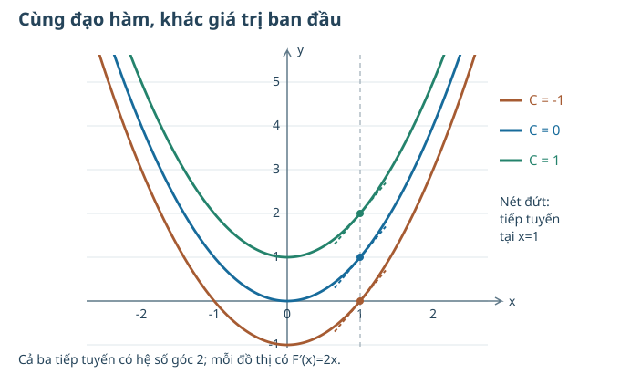

# Bài 11. Nguyên hàm

TOÁN 12 · CHƯƠNG IV · KIẾN THỨC SGK KNTT · TẬP HAI

Tìm lại hàm số khi biết đạo hàm; hiểu họ nguyên hàm, sử dụng các tính chất và bảng nguyên hàm để giải bài toán thực tế.

<nav class="thpt-r4-lesson-tabs"><a href="../">Chương IV</a><a href="../luyen-tap/#b11-core">Core/Luyện tập</a><a href="../bai-12/">Bài tiếp theo</a><a href="../tu-kiem-tra-chuong/">Tự kiểm tra cuối chương</a></nav>

=== "Khám phá kiến thức"

    ### 1.1. Nguyên hàm của một hàm số

    Một xe đang chuyển động thẳng theo chiều dương có vận tốc \(v(t)=2t\) m/s kể từ thời điểm \(t=0\). Ta biết vận tốc ở mọi thời điểm nhưng chưa biết tọa độ của xe. Ở chương I, từ hàm tọa độ \(s(t)\) em đã học cách tính vận tốc \(s'(t)\). Bây giờ ta cần đi theo chiều ngược lại: tìm hàm \(s\) có đạo hàm bằng \(2t\).

    <!-- OUTCOME_ID: G12-CHIV-B11-O01 -->
    Hãy nhớ \((t^2)'=2t\). Vì vậy \(s(t)=t^2\) là một đáp án. Nhưng \(s(t)=t^2+3\) cũng có đạo hàm \(2t\), bởi đạo hàm của 3 bằng 0. Trong toán học, một hàm \(F\) có đạo hàm bằng \(f\) tại mọi điểm thuộc khoảng đang xét được gọi là một nguyên hàm của \(f\) trên khoảng ấy.

    Muốn kiểm một hàm có phải nguyên hàm hay không, chỉ cần lấy đạo hàm. Ví dụ \(F(x)=x^3/3-2x\) có đạo hàm \(x^2-2\), nên là một nguyên hàm của \(f(x)=x^2-2\) trên \(\mathbb R\). Còn \(G(x)=x^3/3+2x\) có đạo hàm \(x^2+2\), không đúng. Muốn chứng minh \(F\) là nguyên hàm của \(f\), phải kiểm tra \(F'(x)=f(x)\) tại mọi điểm của khoảng đang xét. Hai biểu thức trùng nhau tại một điểm riêng lẻ chưa đủ.

    <!-- OUTCOME_ID: G12-CHIV-B11-O02 -->
    Thực ra mọi hàm \(F(x)=x^2+C\), với \(C\) là hằng số thực, đều có đạo hàm bằng \(2x\). Quan sát đồ thị ba trường hợp:

    <figure class="thpt-r4-plot thpt-r4-calculus-figure"><figcaption>Thay đổi \(C\) tịnh tiến đồ thị theo phương thẳng đứng. Tại cùng hoành độ \(x=1\), ba tiếp tuyến đều có hệ số góc 2. Đạo hàm không nhận biết sự khác biệt về tung độ ban đầu.</figcaption></figure>

    Vì sao không còn nguyên hàm nào ngoài họ \(x^2+C\)? Nếu \(G'(x)=2x\) trên một khoảng \(K\), xét \(H(x)=G(x)-x^2\). Khi đó \(H'(x)=0\) tại mọi điểm trong khoảng. Theo tính chất đã học về đạo hàm, hàm có đạo hàm bằng 0 trên một khoảng là hàm hằng trên khoảng ấy. Do đó \(G(x)-x^2=C\), tức \(G(x)=x^2+C\).

    Tổng quát, nếu đã tìm được một nguyên hàm \(F\) của \(f\), toàn bộ họ nguyên hàm trên cùng khoảng là \(F+C\). Ta viết
    \[
    \int f(x)\,dx=F(x)+C.
    \]
    Dấu \(\int\) ở đây biểu thị việc tìm nguyên hàm, không phải một số đo diện tích. Kết quả là một họ hàm số. \(dx\) cho biết biến đang xét là \(x\); vi phân của \(F\) được viết \(dF(x)=F'(x)\,dx=f(x)\,dx\).

    Trở lại chiếc xe: nếu biết \(s(0)=3\) m, từ \(s(t)=t^2+C\) suy ra \(C=3\). Khi đó tọa độ duy nhất là \(s(t)=t^2+3\). Sau 4 giây, xe ở tọa độ 19 m, còn quãng đường đi được từ lúc \(t=0\) là \(19-3=16\) m. Vận tốc không âm trong khoảng này nên quãng đường bằng độ dời. Không nhầm tọa độ với quãng đường.

    <!-- FIRST_TRY_ID: B11-T01 -->
    **Vận dụng.** Cho \(f(x)=6x^2-4\). Trong hai hàm \(F(x)=2x^3-4x+7\), \(G(x)=2x^3+4x\), hàm nào là nguyên hàm của \(f\) trên \(\mathbb R\)? Tìm họ nguyên hàm và chọn nguyên hàm \(H\) thỏa \(H(1)=5\).

    ??? question "Đối chiếu"

        \(F'=6x^2-4=f\); \(G'=6x^2+4\ne f\). Họ nguyên hàm là \(2x^3-4x+C\). Từ \(H(1)=2-4+C=5\), suy ra \(C=7\), nên \(H(x)=2x^3-4x+7\).

    ??? tip "Kiểm lỗi"

        Nếu chỉ viết \(2x^3-4x\), em mới tìm được một nguyên hàm, chưa viết cả họ. Sau khi xác định \(C\), kiểm hai điều kiện: \(H'=f\) và \(H(1)=5\).

    Một nguyên hàm phải được xét trên miền mà cả hàm và đạo hàm phù hợp. Trên đoạn kín, đạo hàm ở hai đầu được hiểu theo phía nằm trong đoạn. Nếu miền bị tách thành nhiều khoảng, kết luận hai nguyên hàm chỉ khác một hằng số áp dụng riêng trên từng khoảng; không bắt buộc dùng cùng một hằng số cho các khoảng tách rời. Các hàm liên tục trên một khoảng luôn có nguyên hàm trên khoảng ấy, dù đôi khi không viết được bằng các công thức sơ cấp quen thuộc.

    ### 1.2. Tính chất cơ bản của nguyên hàm

    Khi lấy đạo hàm, ta được phép đưa hằng số ra ngoài và lấy đạo hàm từng hạng tử của tổng. Tìm nguyên hàm là đi theo chiều ngược lại nên các tính chất này vẫn giúp ta chia bài toán thành những phần đơn giản.

    <!-- OUTCOME_ID: G12-CHIV-B11-O03 -->
    Nếu \(F'=f\), với \(k\ne0\) là hằng số, \((kF)'=kf\). Do đó \(\int kf(x)\,dx=k\int f(x)\,dx\). Vì \(k\ne0\), khi \(C\) chạy qua mọi số thực thì \(kC\) cũng chạy qua mọi số thực. Nếu \(k=0\), xử lí riêng: nguyên hàm của hàm bằng 0 là họ hàm hằng \(C\).

    Tương tự, nếu \(F'=f,\ G'=g\) trên cùng khoảng, thì \((F+G)'=f+g\) và \((F-G)'=f-g\). Ta có thể cộng hoặc trừ các nguyên hàm tương ứng rồi gộp các hằng số thành một \(C\) tùy ý.

    Ví dụ, muốn tìm \(\int (3x^2-4x+2)\,dx\), hãy nhớ \((x^3)'=3x^2,\ (x^2)'=2x,\ (x)'=1\). Do đó
    \[
    \int(3x^2-4x+2)\,dx=x^3-2x^2+2x+C.
    \]
    Đạo hàm kết quả trả lại đúng cả ba hạng tử ban đầu. Đó là cách kiểm tin cậy hơn việc chỉ nhìn hình thức đáp án.

    Không có quy tắc tổng quát cho phép lấy nguyên hàm từng thừa số rồi nhân lại. Chẳng hạn \(\int x\cdot x\,dx=x^3/3+C\), không phải \((x^2/2)^2+C\). Đối với tích đa thức hoặc bình phương, hãy khai triển trước nếu nhờ đó đưa được về tổng các lũy thừa đơn giản.

    <!-- OUTCOME_ID: G12-CHIV-B11-O07 -->
    Trong thực tế, nếu biết tốc độ biến đổi của một đại lượng và giá trị ban đầu, ta có thể khôi phục đại lượng đó. Chẳng hạn một bể đang có 40 lít nước; nước chảy vào với tốc độ \(q'(t)=6+2t\) lít/phút, không có dòng ra. Sau \(t\) phút, lượng nước \(q(t)\) thỏa
    \[
    q(t)=6t+t^2+C,\quad q(0)=40.
    \]
    Vậy \(q(t)=40+6t+t^2\). Sau 5 phút có 95 lít, nếu quy luật dòng vào còn đúng và bể đủ sức chứa. Đạo hàm cho \(6+2t\) lít/phút, khớp dữ kiện.

    **Vận dụng.** Một cơ sở có doanh thu biên \(R'(x)=0{,}08x+12\) nghìn đồng/sản phẩm trong mô hình liên tục, với \(R(0)=0\). Tìm doanh thu khi bán 100 sản phẩm.

    ??? question "Đối chiếu"

        \(R(x)=0{,}04x^2+12x+C\). Từ \(R(0)=0\), \(C=0\). Vậy \(R(100)=0{,}04\cdot10000+1200=1600\) nghìn đồng, tức 1,6 triệu đồng.

    ??? tip "Kiểm lỗi"

        Không lấy \(100R'(100)\) làm doanh thu: tốc độ biến đổi không cố định. Hãy tìm hàm có đạo hàm bằng \(R'\), chọn hằng số từ điều kiện ban đầu, rồi mới thay số lượng.

    ### 1.3. Nguyên hàm của một số hàm số thường gặp

    #### a) Hàm số lũy thừa

    Ta đã biết với \(x>0\), \((x^\alpha)'=\alpha x^{\alpha-1}\) cho mọi số mũ thực \(\alpha\). Muốn tìm hàm có đạo hàm bằng \(x^\alpha\), thử tăng số mũ lên một đơn vị. Đạo hàm \(x^{\alpha+1}\) sẽ có hệ số \(\alpha+1\); để hệ số trở về 1, chia cho \(\alpha+1\). Vì thế, với \(\alpha\ne-1\),
    \[
    \int x^\alpha\,dx=\frac{x^{\alpha+1}}{\alpha+1}+C.
    \]
    Công thức đúng trên \(x>0\); đối với số mũ nguyên, dùng trên các khoảng mà biểu thức ban đầu và nguyên hàm xác định, theo điều kiện cụ thể. Riêng hàm hằng \(1\) có nguyên hàm \(x+C\) trên \(\mathbb R\).

    Ví dụ \(\sqrt{x}=x^{1/2}\) khi \(x>0\), nên nguyên hàm là \(\frac23x^{3/2}+C\). Với \(1/x^3=x^{-3}\), tăng số mũ lên \(-2\), chia cho \(-2\), được \(-1/(2x^2)+C\) trên từng khoảng không chứa 0. Đừng nhầm quy tắc nguyên hàm với đạo hàm vốn giảm số mũ.

    <!-- OUTCOME_ID: G12-CHIV-B11-O04 -->
    Trường hợp \(\alpha=-1\) là ngoại lệ: công thức trên dẫn đến phép chia cho 0. Thay vào đó, hãy nhớ \((\ln x)'=1/x\) khi \(x>0\). Khi \(x<0\), \(\ln(-x)\) xác định và đạo hàm bằng \((-1)/(-x)=1/x\). Gộp hai biểu thức bằng giá trị tuyệt đối:
    \[
    \int\frac1x\,dx=\ln|x|+C.
    \]
    Trên \((-\infty;0)\) và \((0;+\infty)\), các hằng số có thể độc lập. Nếu đề chỉ cho một khoảng dương, dùng \(\ln x+C\) là đủ.

    <!-- FIRST_TRY_ID: B11-T02 -->
    **Vận dụng.** Tìm \(\int(2x^{-3}+3/x-4\sqrt{x})\,dx\) trên \((0;+\infty)\).

    ??? question "Đối chiếu"

        Tách từng hạng tử. \(2\int x^{-3}dx=-x^{-2}+C_1\); \(3\int dx/x=3\ln x+C_2\); \(-4\int x^{1/2}dx=-\frac83x^{3/2}+C_3\). Gộp lại:
        \[
        -\frac1{x^2}+3\ln x-\frac83x^{3/2}+C.
        \]
        Đạo hàm lần lượt là \(2/x^3,\ 3/x,\ -4\sqrt{x}\), khớp đề.

    ??? tip "Kiểm lỗi"

        Không áp dụng công thức lũy thừa cho \(x^{-1}\). Sau khi tăng số mũ, phải chia cho số mũ mới; chú ý dấu âm khi số mũ mới âm.

    #### b) Hàm số lượng giác

    <!-- OUTCOME_ID: G12-CHIV-B11-O06 -->
    Hãy đọc ngược bảng đạo hàm lượng giác. Vì \((\sin x)'=\cos x\), nguyên hàm của \(\cos x\) là \(\sin x+C\). Vì \((\cos x)'=-\sin x\), muốn thu được \(\sin x\) phải đổi dấu: \(-\cos x+C\).

    Hai công thức khác cũng đọc ngược từ \((\tan x)'=1/\cos^2x\), \((\cot x)'=-1/\sin^2x\). Vì vậy nguyên hàm tương ứng là \(\tan x+C\), \(-\cot x+C\). Chúng chỉ dùng trên những khoảng không chứa điểm làm mẫu số bằng 0. Các góc trong công thức đạo hàm và nguyên hàm lượng giác tính bằng radian.

    Nhiều biểu thức trông chưa giống bảng nguyên hàm nhưng có thể biến đổi. Chẳng hạn \(\tan^2x=1/\cos^2x-1\) khi \(\cos x\ne0\), nên nguyên hàm là \(\tan x-x+C\) trên từng khoảng xác định. Với bình phương sin hoặc cos, công thức hạ bậc giúp đưa về tổng của hàm hằng và hàm cosin. Không nhân hai nguyên hàm với nhau để tính nguyên hàm của tích.

    **Vận dụng.** Tính \(\int(3\sin x-2/\cos^2x+\tan^2x)\,dx\) trên \((-\pi/2;\pi/2)\).

    ??? question "Đối chiếu"

        Thay \(\tan^2x=1/\cos^2x-1\), biểu thức dưới dấu nguyên hàm trở thành \(3\sin x-1/\cos^2x-1\). Kết quả \(-3\cos x-\tan x-x+C\). Lấy đạo hàm được \(3\sin x-1/\cos^2x-1\), đúng biểu thức sau biến đổi.

    ??? tip "Kiểm lỗi"

        Đạo hàm của \(\cos x\) có dấu âm; nguyên hàm của \(\sin x\) phải là \(-\cos x+C\). Khoảng đã cho không chứa nghiệm của \(\cos x=0\).

    #### c) Hàm số mũ

    <!-- OUTCOME_ID: G12-CHIV-B11-O05 -->
    Hàm \(e^x\) đặc biệt vì đạo hàm bằng chính nó, nên nguyên hàm là \(e^x+C\). Với \(a>0,\ a\ne1\), đạo hàm của \(a^x\) là \(a^x\ln a\). Chia cho \(\ln a\) để loại hệ số dư, được
    \[
    \int a^x\,dx=\frac{a^x}{\ln a}+C.
    \]
    Nếu \(0<a<1\), \(\ln a\) âm; dấu âm ấy cần giữ. Chẳng hạn \(1/4^x=(1/4)^x\), nên nguyên hàm là \(-1/(4^x\ln4)+C\). Nếu \(a=1\), không chia cho \(\ln1=0\); hàm dưới dấu nguyên hàm là 1.

    **Vận dụng.** Tính \(\int(2e^x-3^x+2^{-x})\,dx\).

    ??? question "Đối chiếu"

        Vì \(2^{-x}=(1/2)^x\), \(\ln(1/2)=-\ln2\), kết quả là
        \[
        2e^x-\frac{3^x}{\ln3}-\frac{2^{-x}}{\ln2}+C.
        \]
        Đạo hàm hạng cuối bằng \(-(-\ln2)2^{-x}/\ln2=2^{-x}\), đúng dấu.

    ??? tip "Kiểm lỗi"

        Chỉ cơ số \(e\) có \(\ln e=1\); với cơ số khác \(e\), đừng quên chia cho logarit tự nhiên của cơ số.

=== "Kiến thức SGK"

    ### 2.1. Nguyên hàm của một hàm số

    
<strong>Định nghĩa — Nguyên hàm</strong>
Cho \(f\) xác định trên một khoảng, đoạn hoặc nửa khoảng \(K\). Hàm \(F\) là một nguyên hàm của \(f\) trên \(K\) nếu \(F'(x)=f(x)\) với mọi \(x\in K\).

Tại đầu mút thuộc \(K\), đạo hàm được hiểu là đạo hàm một phía từ trong \(K\).

    
<strong>Tính chất — Họ nguyên hàm</strong>
Nếu \(F\) là một nguyên hàm của \(f\) trên \(K\), thì mọi nguyên hàm của \(f\) trên \(K\) có dạng \(F(x)+C\), với \(C\in\mathbb R\).

\(\displaystyle\int f(x)\,dx=F(x)+C.\)

    Hàm liên tục trên một khoảng có nguyên hàm trên khoảng đó. Vi phân của nguyên hàm là \(dF(x)=F'(x)\,dx=f(x)\,dx\). Nếu đề không chỉ rõ \(K\), xét tập xác định của hàm dưới dấu nguyên hàm; khi tập xác định gồm các khoảng tách rời, hiểu họ nguyên hàm trên từng khoảng với hằng số độc lập.

    Nếu cần tìm một nguyên hàm thỏa \(F(x_0)=y_0\), tìm họ trước rồi dùng điều kiện để xác định \(C\) trên khoảng chứa \(x_0\).

    ### 2.2. Tính chất cơ bản của nguyên hàm

    
<strong>Tính chất tuyến tính</strong>
Với các hàm \(f,g\) liên tục trên cùng \(K\), và \(k\) là hằng số khác 0:

\(\displaystyle\int kf(x)\,dx=k\int f(x)\,dx\)

\(\displaystyle\int[f(x)\pm g(x)]\,dx=\int f(x)\,dx\pm\int g(x)\,dx.\)

Khi tính cả họ, gộp các hằng số tùy ý thành một \(C\). Nếu \(k=0\), dùng riêng \(\int 0\,dx=C\).

    Các tính chất suy ra từ đạo hàm của tổng, hiệu và tích với hằng số. Không suy ra quy tắc tương tự cho tích hoặc thương hai hàm số.

    ### 2.3. Nguyên hàm của một số hàm số thường gặp

    **Bảng nguyên hàm.** Mỗi hàng ghi một nguyên hàm \(F\); họ đầy đủ là \(F+C\) trên khoảng đang xét.

    | Hàm \(f(x)\) | Một nguyên hàm \(F(x)\) | Điều kiện |
    | :-- | :-- | :-- |
    | \(0\) | \(0\) | \(\mathbb R\) |
    | \(1\) | \(x\) | \(\mathbb R\) |
    | \(x^\alpha\) | \(\dfrac{x^{\alpha+1}}{\alpha+1}\) | \(\alpha\ne-1,\ x>0\); mở rộng theo miền với số mũ nguyên |
    | \(\dfrac1x\) | \(\ln\lvert x\rvert\) | Từng khoảng không chứa 0 |
    | \(\cos x\) | \(\sin x\) | \(\mathbb R\) |
    | \(\sin x\) | \(-\cos x\) | \(\mathbb R\) |
    | \(\dfrac1{\cos^2x}\) | \(\tan x\) | Khoảng không chứa \(\pi/2+k\pi,\ k\in\mathbb Z\) |
    | \(\dfrac1{\sin^2x}\) | \(-\cot x\) | Khoảng không chứa \(k\pi,\ k\in\mathbb Z\) |
    | \(e^x\) | \(e^x\) | \(\mathbb R\) |
    | \(a^x\) | \(\dfrac{a^x}{\ln a}\) | \(a>0,\ a\ne1,\ x\in\mathbb R\) |

    Với lũy thừa nguyên dương, công thức dùng trên \(\mathbb R\); với số mũ nguyên âm, dùng trên từng khoảng không chứa 0. Theo quy ước hàm lũy thừa SGK, \(x^0\) xét khi \(x\ne0\); hàm hằng \(1\) được xét riêng trên toàn \(\mathbb R\). Với số mũ không nguyên, công thức tổng quát được phát biểu cho \(x>0\). Khi biểu thức gốc là căn cụ thể, xét miền xác định của chính biểu thức ấy; không tự mở rộng công thức qua điểm không xác định.

    **Cách tự giải:** Xác định miền → biến đổi biểu thức nếu cần → nhận dạng các công thức trong bảng → áp dụng tính chất tuyến tính → gộp \(C\) → lấy đạo hàm kiểm lại. Khi có điều kiện đầu, dùng thêm điều kiện để tìm \(C\).

=== "Ví dụ"

    ### 3.1. Kiểm nguyên hàm bằng đạo hàm

    **Đề bài.** Trên \((0;+\infty)\), kiểm xem \(F(x)=x\ln x-x\) có là nguyên hàm của \(\ln x\) không.

    **Phân tích:** Dùng quy tắc đạo hàm của tích và kiểm đúng miền.

    

<strong>Lời giải.</strong> \(F'(x)=\ln x+x\cdot1/x-1=\ln x\) với mọi \(x&gt;0\). Vậy \(F\) là một nguyên hàm của \(\ln x\) trên khoảng đã cho; họ nguyên hàm là \(x\ln x-x+C\).

    **Kiểm lại:** Không dùng \(\ln x\) ở \(x\le0\). Một đẳng thức đạo hàm đúng trên cả khoảng xác nhận kết quả.

    ### 3.2. Khai triển bình phương trước khi tìm nguyên hàm

    **Đề bài.** Tìm \(\int(3x-2)^2\,dx\).

    **Phân tích:** Khai triển thành đa thức để dùng các nguyên hàm cơ bản.

    

<strong>Lời giải.</strong> \((3x-2)^2=9x^2-12x+4\). Do đó nguyên hàm là \(3x^3-6x^2+4x+C\) trên \(\mathbb R\).

    **Kiểm lại:** \((3x^3-6x^2+4x)'=9x^2-12x+4=(3x-2)^2\).

    ### 3.3. Phân thức có thể tách thành các lũy thừa

    **Đề bài.** Tìm \(\int (x+2)^2/x^2\,dx\) trên \((-\infty;0)\).

    **Phân tích:** Khai triển tử và chia từng hạng tử cho \(x^2\); miền âm đòi hỏi \(\ln|x|\).

    

<strong>Lời giải.</strong> \((x+2)^2/x^2=1+4/x+4/x^2\). Vậy nguyên hàm là \(x+4\ln(-x)-4/x+C\) trên \((-\infty;0)\).

    **Kiểm lại:** Đạo hàm \(4\ln(-x)\) là \(4/x\), đạo hàm \(-4/x\) là \(4/x^2\).

    ### 3.4. Tích chứa căn thức

    **Đề bài.** Tìm \(\int\sqrt{x}(6x^2-2)\,dx\) với \(x>0\).

    **Phân tích:** Viết căn thành lũy thừa và nhân vào ngoặc.

    

<strong>Lời giải.</strong> \(\sqrt{x}(6x^2-2)=6x^{5/2}-2x^{1/2}\). Nguyên hàm là \(\frac{12}{7}x^{7/2}-\frac43x^{3/2}+C\).

    **Kiểm lại:** \((12/7)(7/2)=6\), \((-4/3)(3/2)=-2\), đúng các hệ số.

    ### 3.5. Hằng số trên hai khoảng tách rời

    **Đề bài.** Tìm tất cả hàm \(F\) trên \(\mathbb R\setminus\{0\}\) sao cho \(F'(x)=1/x\), \(F(1)=2,\ F(-1)=-3\).

    **Phân tích:** Hai điểm thuộc hai khoảng khác nhau, mỗi khoảng có hằng số riêng.

    

<strong>Lời giải.</strong> Trên \(x&gt;0\), \(F(x)=\ln x+C_+\); từ \(F(1)=2\) suy ra \(C_+=2\). Trên \(x&lt;0\), \(F(x)=\ln(-x)+C_-\); từ \(F(-1)=-3\) suy ra \(C_-=-3\).

\(\displaystyle F(x)=\begin{cases}\ln x+2,&amp;x&gt;0,\\\ln(-x)-3,&amp;x&lt;0.\end{cases}\)

    **Kiểm lại:** Cả hai nhánh có đạo hàm \(1/x\) và thỏa điều kiện riêng. Không đặt \(x=0\).

    ### 3.6. Biến đổi lượng giác bằng công thức hạ bậc

    **Đề bài.** Tính \(\int6\cos^2(x/2)\,dx\).

    **Phân tích:** Dùng \(2\cos^2(x/2)=1+\cos x\), tránh xử lí nguyên hàm của bình phương trực tiếp.

    

<strong>Lời giải.</strong> \(6\cos^2(x/2)=3+3\cos x\), nên nguyên hàm là \(3x+3\sin x+C\) trên \(\mathbb R\).

    **Kiểm lại:** Đạo hàm bằng \(3+3\cos x=6\cos^2(x/2)\).

    ### 3.7. Kết hợp lượng giác và phân thức lượng giác

    **Đề bài.** Tìm \(\int(4\cos x-3/\sin^2x)\,dx\) trên \((0;\pi)\).

    **Phân tích:** Dùng hai hàng của bảng. Vì nguyên hàm của \(1/\sin^2x\) mang dấu âm, nhân thêm \(-3\) sẽ cho dấu dương.

    

<strong>Lời giải.</strong> \(\int(4\cos x-3/\sin^2x)\,dx=4\sin x+3\cot x+C\).

    **Kiểm lại:** \((3\cot x)'=-3/\sin^2x\); \(\sin x\ne0\) trong khoảng đã cho.

    ### 3.8. Hàm mũ có cơ số nhỏ hơn 1

    **Đề bài.** Tìm \(\int(5^x+3/2^x-4e^x)\,dx\).

    **Phân tích:** Viết \(1/2^x=(1/2)^x\) và lưu ý \(\ln(1/2)=-\ln2\).

    

<strong>Lời giải.</strong> Nguyên hàm là \(\frac{5^x}{\ln5}-\frac{3}{2^x\ln2}-4e^x+C\) trên \(\mathbb R\).

    **Kiểm lại:** Đạo hàm ba hạng tử lần lượt bằng \(5^x,3/2^x,-4e^x\).

    ### 3.9. Khôi phục hàm số từ hệ số góc tiếp tuyến

    **Đề bài.** Đồ thị \(y=F(x)\) có hệ số góc tiếp tuyến tại hoành độ \(x\) bằng \(3(x+1)^2\). Biết đồ thị đi qua \(A(0;4)\). Tìm \(F\).

    **Phân tích:** Hệ số góc là \(F'(x)\). Khai triển rồi nguyên hàm; điều kiện điểm thuộc đồ thị cho \(F(0)=4\).

    

<strong>Lời giải.</strong> \(F'=3x^2+6x+3\), nên \(F=x^3+3x^2+3x+C\). Từ \(F(0)=4\), \(C=4\). Vậy \(F(x)=x^3+3x^2+3x+4\).

    **Kiểm lại:** \(F'(x)=3(x+1)^2\), \(F(0)=4\).

    ### 3.10. Khôi phục vận tốc và tọa độ từ gia tốc

    **Đề bài.** Vật chuyển động thẳng với gia tốc \(a(t)=4t\) m/s², vận tốc đầu \(v(0)=2\) m/s và tọa độ đầu \(s(0)=5\) m. Tìm \(v(t),s(t)\) và quãng đường trong 3 giây đầu.

    **Phân tích:** \(v'=a,\ s'=v\), cần nguyên hàm hai lần và dùng hai điều kiện đầu. Kiểm dấu vận tốc trước khi tính quãng đường.

    

<strong>Lời giải.</strong> \(v(t)=2t^2+C_1\), từ \(v(0)=2\) được \(v(t)=2t^2+2\). Tiếp theo \(s(t)=\frac23t^3+2t+C_2\), từ \(s(0)=5\) được \(s(t)=\frac23t^3+2t+5\). Vì \(v(t)&gt;0\) trên \([0;3]\), quãng đường bằng \(s(3)-s(0)=29-5=24\) m.

    **Kiểm lại:** \(v'=4t,\ s'=v\), đúng hai điều kiện đầu và đúng đơn vị.

    ### 3.11. Tìm độ cao lớn nhất từ vận tốc

    **Đề bài.** Một vật được ném thẳng đứng lên từ độ cao 2 m, có vận tốc \(v(t)=20-10t\) m/s trong thời gian bay. Tìm độ cao sau 1 giây và độ cao lớn nhất.

    **Phân tích:** Lấy nguyên hàm để tìm độ cao, dùng điều kiện ban đầu. Độ cao đạt cực đại khi vận tốc đổi dấu từ dương sang âm.

    

<strong>Lời giải.</strong> \(h(t)=20t-5t^2+C\), \(h(0)=2\) nên \(h(t)=2+20t-5t^2\). \(h(1)=17\) m. \(v(t)=0\) tại \(t=2\), dương trước và âm sau mốc này. Vật vẫn ở trên mặt đất tại \(t=2\), nên độ cao lớn nhất \(h(2)=22\) m.

    **Kiểm lại:** \(h(t)=22-5(t-2)^2\le22\), xác nhận đỉnh. Mô hình chỉ dùng trong thời gian vật còn bay.

=== "Lỗi thường gặp"

    ### 4.1. Tìm đạo hàm thay vì nguyên hàm

    **Sai ở đâu:** Viết \(\int x^3dx=3x^2+C\).

    **Vì sao sai:** Đó là chiều tính đạo hàm, không phải chiều ngược lại.

    **Cách sửa:** Tăng số mũ, chia số mũ mới: \(x^4/4+C\). Lấy đạo hàm kiểm.

    ### 4.2. Quên hằng số hoặc nhầm một nguyên hàm với cả họ

    **Sai ở đâu:** Viết họ nguyên hàm của \(2x\) chỉ là \(x^2\).

    **Vì sao sai:** Mọi \(x^2+C\) đều có cùng đạo hàm.

    **Cách sửa:** Ghi \(+C\) khi tìm họ; chỉ chọn hằng số cụ thể nếu có điều kiện phù hợp.

    ### 4.3. Dùng công thức lũy thừa cho số mũ -1

    **Sai ở đâu:** Chia cho \(0\) khi tìm nguyên hàm của \(x^{-1}\).

    **Vì sao sai:** Công thức lũy thừa đòi hỏi số mũ khác \(-1\).

    **Cách sửa:** Dùng \(\ln|x|+C\) trên từng khoảng xác định; xét riêng dấu của \(x\).

    ### 4.4. Bỏ điều kiện miền xác định

    **Sai ở đâu:** Dùng \(\ln x\) cho \(x<0\); bắt buộc hai nhánh nguyên hàm của \(1/x\) có cùng hằng số.

    **Vì sao sai:** \(\ln x\) không xác định thực trên miền âm; tính chất hàm có đạo hàm bằng 0 là hàm hằng chỉ áp dụng trên từng khoảng.

    **Cách sửa:** Viết đúng biểu thức và khoảng xét; tách hằng số nếu miền không liên thông.

    ### 4.5. Nhầm tính chất tuyến tính với tích hoặc thương

    **Sai ở đâu:** Lấy tích hai nguyên hàm làm nguyên hàm của tích hai hàm số.

    **Vì sao sai:** Đạo hàm của tích có hai hạng tử, không phải tích hai đạo hàm.

    **Cách sửa:** Khai triển hoặc biến đổi đại số, lượng giác về dạng trong bảng khi có thể.

    ### 4.6. Nhầm dấu lượng giác và hệ số logarit

    **Sai ở đâu:** \(\int\sin xdx=\cos x+C\) hoặc \(\int2^xdx=2^x+C\).

    **Vì sao sai:** Đạo hàm các đáp án lần lượt là \(-\sin x\), \(2^x\ln2\).

    **Cách sửa:** Dùng \(-\cos x+C\), \(2^x/\ln2+C\); kiểm bằng đạo hàm.

    ### 4.7. Nhầm giá trị ban đầu với tốc độ thay đổi

    **Sai ở đâu:** Đặt \(C=v(0)\) trong hàm tọa độ, hoặc coi vận tốc là quãng đường.

    **Vì sao sai:** Mỗi lần tìm nguyên hàm khôi phục một đại lượng khác, có điều kiện đầu và đơn vị riêng.

    **Cách sửa:** Viết \(v'=a,\ s'=v\); xác định hằng số theo đúng đại lượng, kiểm dấu vận tốc khi tính quãng đường.

    **Học tiếp:** [Core và Luyện tập Bài 11](../luyen-tap/#b11-core) · [Bài 12 — Tích phân](../bai-12/).

    
Nguồn kiến thức: SGK KNTT Toán 12 tập 2, trang in 4–11; các ví dụ và hình minh họa được SLM biên soạn riêng.

