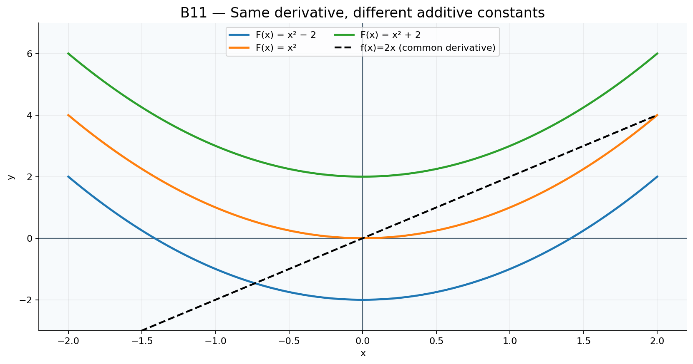

# Toán 12 · Bài 11. Nguyên hàm

TOÁN 12 · CHƯƠNG IV · SGK KẾT NỐI TRI THỨC · TẬP HAI · TRANG 4–11

Hiểu bản chất trước công thức, xem ví dụ có suy luận, đọc hình PNG gốc đã review và tự thử trước Core.
<nav class="thpt-r4-lesson-tabs"><a href="../">Chương IV</a><a href="../bai-12/">Bài 12 · Học tiếp</a></nav>

## 1. Vì sao cần học và kiến thức tiền đề

Từ vị trí lấy đạo hàm để ra vận tốc; muốn khôi phục vị trí từ vận tốc phải đi chiều ngược lại. Nguyên hàm không phải phép chia đạo hàm, và thường có một họ hàm khác nhau bởi hằng số.

**Tiền đề cần tự kiểm:** đạo hàm đa thức, sin/cos, hàm mũ, logarit và ý nghĩa vận tốc; xem lại đạo hàm nếu nhầm chiều biến đổi.

## 2. Hiểu bản chất, công thức và điều kiện

<!-- OUTCOME_ID: G12-CHIV-B11-O01 -->

### 1. Nguyên hàm là phép đảo của đạo hàm

- **Vì sao cần biết:** ừ vận tốc đã biết muốn khôi phục vị trí, ta cần tìm một hàm có đạo hàm bằng tốc độ biến đổi đã cho.

- **Kiến thức tiền đề:** ạo hàm đa thức, quy tắc đạo hàm tổng và tích với hằng số.

- **Bản chất trước công thức:** ếu F'(x)=f(x) trên khoảng K thì F là một nguyên hàm của f trên K. Phân biệt kiểm tra đạo hàm của F với việc chỉ đoán công thức.

- **Định nghĩa và công thức:** (F'(x)=f(x)\quad (x\in K).\)

- **Điều kiện và giới hạn:** uôn nêu khoảng K; kiểm tra đạo hàm từng hạng tử. Hai hàm trùng đạo hàm trên cùng một khoảng chỉ khác một hằng số.

- **Lý do chọn phương pháp:** ạo hàm đáp án ứng viên để kiểm đúng f; không kiểm bằng cách thay một giá trị x.

#### Ví dụ có suy luận

**Đề:** ho F(x)=x^4-3x^2+2. Hãy tìm f(x) sao cho F là nguyên hàm của f.

**Lời giải có suy luận:** ì F'(x)=4x^3-6x, nên f(x)=4x^3-6x trên R. Cách kiểm: lấy đạo hàm F, không phải tích phân F. Lý do chọn cách giải: Đạo hàm đáp án ứng viên để kiểm đúng f; không kiểm bằng cách thay một giá trị x. Kiểm điều kiện áp dụng: Luôn nêu khoảng K; kiểm tra đạo hàm từng hạng tử. Hai hàm trùng đạo hàm trên cùng một khoảng chỉ khác một hằng số.

**Bẫy cần tự phát hiện:** ạo hàm nhầm x^3 thành 3x hoặc kiểm thử tại một điểm rồi kết luận mọi x.

<!-- OUTCOME_ID: G12-CHIV-B11-O02 -->

### 2. Họ nguyên hàm và điều kiện đầu

- **Vì sao cần biết:** ột vận tốc có thể tương ứng nhiều vị trí chỉ khác vị trí xuất phát; điều kiện đầu chọn đúng một hàm.

- **Kiến thức tiền đề:** ạo hàm hằng số bằng 0; nghiệm phương trình tuyến tính đơn giản.

- **Bản chất trước công thức:** ếu F là nguyên hàm của f trên một khoảng, mọi nguyên hàm có dạng F+C. Một dữ kiện F(x0)=y0 xác định C.

- **Định nghĩa và công thức:** (\int f(x)\,dx=F(x)+C.\)

- **Điều kiện và giới hạn:** ệnh đề chỉ được khẳng định trên từng khoảng liên thông; mỗi nhánh tách biệt có thể có hằng số riêng.

- **Lý do chọn phương pháp:** ích phân được F+C; thay x0 vào F+C; giải C; kiểm lại đạo hàm và điều kiện đầu.

#### Ví dụ có suy luận

**Đề:** ho f(x)=2x và F(2)=7. Tìm nguyên hàm F.

**Lời giải có suy luận:** (x)=x^2+C. Từ 4+C=7 suy ra C=3; F(x)=x^2+3 và F'=2x. Lý do chọn cách giải: Tích phân được F+C; thay x0 vào F+C; giải C; kiểm lại đạo hàm và điều kiện đầu. Kiểm điều kiện áp dụng: Mệnh đề chỉ được khẳng định trên từng khoảng liên thông; mỗi nhánh tách biệt có thể có hằng số riêng.

**Bẫy cần tự phát hiện:** uên +C hoặc xem mọi nguyên hàm đều bằng đúng F không có độ dịch.

<!-- OUTCOME_ID: G12-CHIV-B11-O03 -->

### 3. Quy tắc lũy thừa và tính tuyến tính

- **Vì sao cần biết:** ể tính tích phân những tốc độ đa thức, ta cần quy tắc lấy ngược đạo hàm và phân phối theo từng hạng tử.

- **Kiến thức tiền đề:** ạo hàm x^(n+1)=(n+1)x^n, phép biến đổi tổng.

- **Bản chất trước công thức:** ối với n≠−1, nguyên hàm x^n là x^(n+1)/(n+1), đồng thời có thể tách tổng và hệ số ra ngoài.

- **Định nghĩa và công thức:** (\int x^n\,dx=\frac{x^{n+1}}{n+1}+C\ (n\ne-1);\quad \int(af+bg)dx=a\int fdx+b\int gdx.\)

- **Điều kiện và giới hạn:** iều kiện n≠-1; với số mũ không nguyên cần xét miền xác định thực và khoảng làm việc.

- **Lý do chọn phương pháp:** ách đa thức thành các hạng tử, nâng số mũ một đơn vị, chia số mũ mới, rồi lấy đạo hàm kiểm.

#### Ví dụ có suy luận

**Đề:** ính ∫(3x^2−4x+2)dx.

**Lời giải có suy luận:** guyên hàm là x^3−2x^2+2x+C; đạo hàm đúng 3x^2−4x+2. Lý do chọn cách giải: Tách đa thức thành các hạng tử, nâng số mũ một đơn vị, chia số mũ mới, rồi lấy đạo hàm kiểm. Kiểm điều kiện áp dụng: Điều kiện n≠-1; với số mũ không nguyên cần xét miền xác định thực và khoảng làm việc.

**Bẫy cần tự phát hiện:** p quy tắc lũy thừa n=-1 gây chia 0; quên chia cho số mũ mới.

<!-- OUTCOME_ID: G12-CHIV-B11-O04 -->

### 4. Trường hợp 1/x và logarit giá trị tuyệt đối

- **Vì sao cần biết:** ó những tốc độ tỉ lệ nghịch với biến nên quy tắc lũy thừa không dùng được tại số mũ -1.

- **Kiến thức tiền đề:** ạo hàm ln|x|=1/x khi x≠0.

- **Bản chất trước công thức:** guyên hàm 1/x là ln|x|+C trên từng khoảng (−∞,0) hoặc (0,+∞).

- **Định nghĩa và công thức:** (\int\frac{1}{x}\,dx=\ln|x|+C\quad(x\ne0).\)

- **Điều kiện và giới hạn:** hông được lấy một hằng số C chung bắt buộc trên hai khoảng tách rời bởi x=0; trên x>0 có thể dùng ln x.

- **Lý do chọn phương pháp:** hận diện 1/x, tách tuyến tính các hạng khác, ghi điều kiện x≠0 và lấy đạo hàm kiểm.

#### Ví dụ có suy luận

**Đề:** ính ∫(3/x+2x)dx trên K=(0,+∞).

**Lời giải có suy luận:** =3ln x+x^2+C vì F'=3/x+2x trên K; nếu K âm thay ln x bằng ln|x|. Lý do chọn cách giải: Nhận diện 1/x, tách tuyến tính các hạng khác, ghi điều kiện x≠0 và lấy đạo hàm kiểm. Kiểm điều kiện áp dụng: Không được lấy một hằng số C chung bắt buộc trên hai khoảng tách rời bởi x=0; trên x>0 có thể dùng ln x.

**Bẫy cần tự phát hiện:** iết ln x cho x âm hoặc áp 1/(n+1) với n=−1.

<!-- OUTCOME_ID: G12-CHIV-B11-O05 -->

### 5. Nguyên hàm hàm mũ

- **Vì sao cần biết:** ốc độ tăng theo tỉ lệ với lượng hiện có dẫn đến e^x và a^x; nguyên hàm giúp phục hồi tổng lượng.

- **Kiến thức tiền đề:** e^x)'=e^x, (a^x)'=a^x ln a.

- **Bản chất trước công thức:** guyên hàm của e^x là e^x+C; của a^x là a^x/ln a+C.

- **Định nghĩa và công thức:** (\int e^x dx=e^x+C;\quad\int a^x dx=\frac{a^x}{\ln a}+C.\)

- **Điều kiện và giới hạn:** >0 và a≠1; ln a khác 0; hàm xác định trên R. Riêng a=1 cho hàm hằng 1, nguyên hàm là x+C chứ không thể chia cho ln1=0.

- **Lý do chọn phương pháp:** ách hệ số rồi chia ln a nếu cơ số a không phải e.

#### Ví dụ có suy luận

**Đề:** ính ∫(3e^x+4^x)dx.

**Lời giải có suy luận:** ết quả 3e^x+4^x/ln4+C; đạo hàm phần 4^x/ln4 bằng 4^x. Lý do chọn cách giải: Tách hệ số rồi chia ln a nếu cơ số a không phải e. Kiểm điều kiện áp dụng: a>0 và a≠1; ln a khác 0; hàm xác định trên R.

**Bẫy cần tự phát hiện:** hầm ∫2^x dx=2^x+C (thiếu 1/ln2).

<!-- OUTCOME_ID: G12-CHIV-B11-O06 -->

### 6. Nguyên hàm lượng giác và điều kiện miền

- **Vì sao cần biết:** ác vận tốc dao động tuần hoàn có thể được phục hồi từ sin, cos và các đạo hàm của tan, cot.

- **Kiến thức tiền đề:** sin x)'=cos x, (cos x)'=−sin x, (tan x)'=1/cos²x.

- **Bản chất trước công thức:** cos x dx=sin x+C; ∫sin x dx=−cos x+C; ∫sec²x dx=tan x+C; ∫csc²x dx=−cot x+C.

- **Định nghĩa và công thức:** (\int\cos xdx=\sin x+C;\quad\int\sin xdx=-\cos x+C.\)

- **Điều kiện và giới hạn:** hững nguyên hàm tan và cot chỉ tính trên các khoảng liên tục không chứa nghiệm cosx=0 hoặc sinx=0 tương ứng; góc tính bằng radian.

- **Lý do chọn phương pháp:** ách hệ số, ghi dấu âm chính xác ở nguyên hàm sin, kiểm bằng đạo hàm lượng giác.

#### Ví dụ có suy luận

**Đề:** ính ∫(2cos x+4sin x)dx.

**Lời giải có suy luận:** sin x−4cos x+C; đạo hàm là 2cos x+4sin x. Lý do chọn cách giải: Tách hệ số, ghi dấu âm chính xác ở nguyên hàm sin, kiểm bằng đạo hàm lượng giác. Kiểm điều kiện áp dụng: Những nguyên hàm tan và cot chỉ tính trên các khoảng liên tục không chứa nghiệm cosx=0 hoặc sinx=0 tương ứng; góc tính bằng radian.

**Bẫy cần tự phát hiện:** uên dấu âm của nguyên hàm sin hoặc viết tan x trên đoạn đi qua cosx=0.

<!-- OUTCOME_ID: G12-CHIV-B11-O07 -->

### 7. Khôi phục hàm theo tốc độ biến đổi

- **Vì sao cần biết:** hi biết vận tốc, gia tốc hoặc tốc độ tăng sản lượng, cần nguyên hàm và dữ kiện ban đầu để trả về đại lượng thực.

- **Kiến thức tiền đề:** ận tốc s'=v, gia tốc v'=a, đơn vị thời gian và điều kiện đầu.

- **Bản chất trước công thức:** ừ q'(t)=r(t) tìm q(t)=∫r(t)dt; áp q(t0)=q0 chọn C; nếu cho gia tốc phải tích phân hai lần.

- **Định nghĩa và công thức:** (q(t)=F(t)+C,\qquad F'(t)=r(t).\)

- **Điều kiện và giới hạn:** ơn vị q' là đơn vị q trên một đơn vị t; t trong miền thời gian hợp lý; không đổi ý nghĩa của vận tốc với quãng đường.

- **Lý do chọn phương pháp:** ọc đúng đạo hàm, nguyên hàm, chọn C theo trạng thái ban đầu, kiểm thứ nguyên.

#### Ví dụ có suy luận

**Đề:** ật có a(t)=6t, v(0)=1 và s(0)=2. Tính v(t), s(t).

**Lời giải có suy luận:** (t)=3t²+1; s(t)=t³+t+2. Kiểm v'=6t, s'=v và hai điều kiện đầu. Lý do chọn cách giải: Đọc đúng đạo hàm, nguyên hàm, chọn C theo trạng thái ban đầu, kiểm thứ nguyên. Kiểm điều kiện áp dụng: Đơn vị q' là đơn vị q trên một đơn vị t; t trong miền thời gian hợp lý; không đổi ý nghĩa của vận tốc với quãng đường.

**Bẫy cần tự phát hiện:** ùng gia tốc trực tiếp làm vị trí hoặc quên hai điều kiện đầu khi tích phân hai lần.

## 3. Đọc hình minh họa gốc

<figure class="thpt-r4-plot g12-chi-figure"><figcaption>Họ nguyên hàm F(x)=x²+C và đạo hàm f(x)=2x; mọi giá trị C cho cùng đạo hàm, đọc sự tịnh tiến theo trục tung. Hình chính xác là một biểu diễn có trục và nhãn; chỉ suy từ đồ thị những điều có căn cứ và kiểm bằng phép toán.</figcaption></figure>

## 4. Tự thử trước Core

Hãy tự giải rồi mới chủ động mở đối chiếu. Không ghi điểm hay Mastery.

<!-- FIRST_TRY_ID: B11-T01 -->
### Tình huống 1

ột vật có s(t)=t²+3. Hãy tìm tốc độ v(t) và đoán hàm s(t) nếu chỉ biết v(t)=2t.

Mở đối chiếu sau khi tự thử

v(t)=2t. Có vô số vị trí s(t)=t²+C; vị trí xuất phát chọn C.

<!-- FIRST_TRY_ID: B11-T02 -->
### Tình huống 2

ại x>0, kiểm tra xem F(x)=ln x có đạo hàm 1/x không; vì sao không thay bằng ln x trên x<0?

Mở đối chiếu sau khi tự thử

Có. (ln x)'=1/x trên x>0; với x<0 hàm ln x không xác định thực, dùng ln|x|.

## 5. Chuyển sang Core và Luyện tập

Sau khi học kiến thức và tự thử, em luyện đúng Bài 11; hãy tự giải từng câu trước khi nộp để xem lời giải hoặc rubric.

<nav class="thpt-r4-lesson-tabs"><a href="../luyen-tap/#b11-core">✎ Core · Bài 11</a><a href="../luyen-tap/#b11-practice">✎ Luyện tập, Vận dụng và Tự luận</a><a href="../luyen-tap/#b11-help">Khi gặp khó khăn</a></nav>

