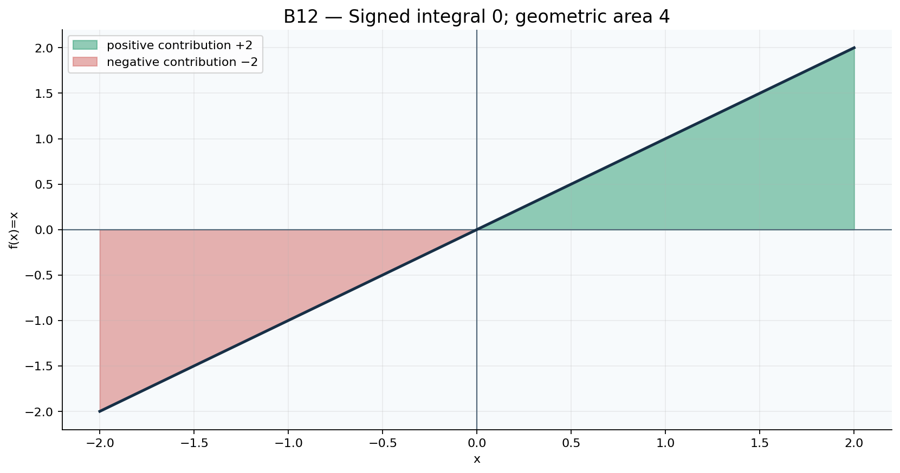
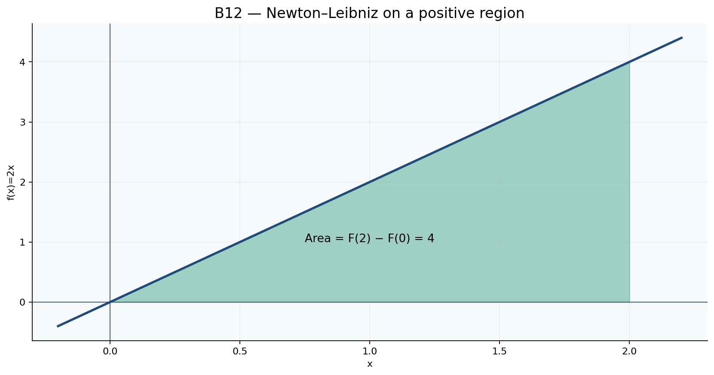

# Toán 12 · Bài 12. Tích phân

TOÁN 12 · CHƯƠNG IV · SGK KẾT NỐI TRI THỨC · TẬP HAI · TRANG 12–18

Hiểu bản chất trước công thức, xem ví dụ có suy luận, đọc hình PNG gốc đã review và tự thử trước Core.
<nav class="thpt-r4-lesson-tabs"><a href="../">Chương IV</a><a href="../bai-11/">Bài 11 · Ôn lại</a><a href="../bai-13/">Bài 13 · Học tiếp</a></nav>

## 1. Vì sao cần học và kiến thức tiền đề

Một lượng biến thiên liên tục phải cộng dồn qua thời gian/khoảng; định lí Newton–Leibniz giúp chuyển bài toán cộng dồn thành hiệu hai giá trị nguyên hàm. Dấu âm có ý nghĩa phương hướng, không làm diện tích âm.

**Tiền đề cần tự kiểm:** nguyên hàm, số có dấu, hàm liên tục trên đoạn, giá trị tại cận; xem lại B11 nếu sai +C.

## 2. Hiểu bản chất, công thức và điều kiện

<!-- OUTCOME_ID: G12-CHIV-B12-O01 -->

### 1. Tích phân xác định: lấy giá trị nguyên hàm ở hai cận

- **Vì sao cần biết:** ộng dồn biến đổi liên tục trên một khoảng thay vì cộng nhiều bước rời rạc.

- **Kiến thức tiền đề:** àm liên tục trên đoạn và nguyên hàm F trên đoạn.

- **Bản chất trước công thức:** ích phân xác định là một số phụ thuộc f và hai cận; nếu F'=f thì lấy F(b)−F(a), không kèm +C.

- **Định nghĩa và công thức:** (\int_a^b f(x)dx=F(b)-F(a).\)

- **Điều kiện và giới hạn:** liên tục trên [a,b] trong mức SGK; kiểm cận trên/dưới và đơn vị khi có ngữ cảnh.

- **Lý do chọn phương pháp:** ìm nguyên hàm F, thế cận b trước a, rút gọn; kiểm bằng ước lượng dấu.

#### Ví dụ có suy luận

**Đề:** ính ∫_0^3 2x dx.

**Lời giải có suy luận:** =x²; F(3)−F(0)=9. Không viết +C vào kết quả tích phân xác định. Lý do chọn cách giải: Tìm nguyên hàm F, thế cận b trước a, rút gọn; kiểm bằng ước lượng dấu. Kiểm điều kiện áp dụng: f liên tục trên [a,b] trong mức SGK; kiểm cận trên/dưới và đơn vị khi có ngữ cảnh.

**Bẫy cần tự phát hiện:** ính F(a)−F(b) (đảo dấu) hoặc giữ +C ở kết quả xác định.

<!-- OUTCOME_ID: G12-CHIV-B12-O02 -->

### 2. Tính tuyến tính của tích phân xác định

- **Vì sao cần biết:** ột tốc độ tổng hợp bởi nhiều thành phần có lượng tích lũy bằng tổng phần tích lũy.

- **Kiến thức tiền đề:** ính tuyến tính nguyên hàm và Newton–Leibniz.

- **Bản chất trước công thức:** ó thể đưa hằng số ra ngoài và tách tổng/hiệu dưới dấu tích phân cùng hai cận.

- **Định nghĩa và công thức:** (\int_a^b(\alpha f+\beta g)dx=\alpha\int_a^b fdx+\beta\int_a^b gdx.\)

- **Điều kiện và giới hạn:** iều kiện các hàm khả tích/liên tục ở mức bài và cùng khoảng tích phân; nếu đổi cận phải đổi dấu.

- **Lý do chọn phương pháp:** hân phối rồi dùng nguyên hàm từng hạng tử, chỉ thế cận một lần khi đã tổng hợp F.

#### Ví dụ có suy luận

**Đề:** ính ∫_0^1 (4x+2)dx.

**Lời giải có suy luận:** =2x²+2x, kết quả F(1)−F(0)=4. Lý do chọn cách giải: Phân phối rồi dùng nguyên hàm từng hạng tử, chỉ thế cận một lần khi đã tổng hợp F. Kiểm điều kiện áp dụng: Điều kiện các hàm khả tích/liên tục ở mức bài và cùng khoảng tích phân; nếu đổi cận phải đổi dấu.

**Bẫy cần tự phát hiện:** ách ∫(f+g) rồi quên một hệ số hoặc dùng hai cận khác nhau.

<!-- OUTCOME_ID: G12-CHIV-B12-O03 -->

### 3. Cận đảo chiều, đoạn ghép và đoạn có độ dài 0

- **Vì sao cần biết:** ại lượng tích lũy khi đi ngược hướng đổi dấu, còn ghép hai chặng phải bằng tổng các chặng.

- **Kiến thức tiền đề:** ố có dấu, cộng đại số, định nghĩa tích phân xác định.

- **Bản chất trước công thức:** _a^a f=0, ∫_b^a f=−∫_a^b f và ∫_a^c f+∫_c^b f=∫_a^b f.

- **Định nghĩa và công thức:** (\int_a^b fdx=-\int_b^a fdx;\quad\int_a^b fdx=\int_a^c fdx+\int_c^b fdx.\)

- **Điều kiện và giới hạn:** liên tục trên khoảng chứa các cận; a,b,c có thể hoán vị, đẳng thức luôn theo dấu.

- **Lý do chọn phương pháp:** ẽ trục cận theo thứ tự, ghép hoặc trừ đúng lượng, kiểm chiều dấu.

#### Ví dụ có suy luận

**Đề:** iết ∫_0^2 f=4, ∫_2^5 f=−1. Tìm ∫_5^0 f.

**Lời giải có suy luận:** _0^5 f=4+(−1)=3, nên ∫_5^0 f=−3. Lý do chọn cách giải: Vẽ trục cận theo thứ tự, ghép hoặc trừ đúng lượng, kiểm chiều dấu. Kiểm điều kiện áp dụng: f liên tục trên khoảng chứa các cận; a,b,c có thể hoán vị, đẳng thức luôn theo dấu.

**Bẫy cần tự phát hiện:** em tích phân như độ dài tuyệt đối nên luôn dương; khi đảo cận quên dấu trừ.

<!-- OUTCOME_ID: G12-CHIV-B12-O04 -->

### 4. Diện tích dưới đồ thị không âm

- **Vì sao cần biết:** ột diện tích liên tục không thể tính bằng tổng hình chữ nhật nhỏ chính xác hữu hạn, nhưng giới hạn của tổng cho tích phân.

- **Kiến thức tiền đề:** ình thang cong với f liên tục không âm, trục Ox và hai đường x=a,b.

- **Bản chất trước công thức:** ếu f(x)≥0 trên [a,b], diện tích hình giới hạn bằng ∫_a^b f(x)dx.

- **Định nghĩa và công thức:** (S=\int_a^b f(x)dx\quad\text{khi }f(x)\ge0.\)

- **Điều kiện và giới hạn:** hải chứng minh hoặc nhận diện f≥0 trên đoạn, đơn vị diện tích là đơn vị x nhân đơn vị y.

- **Lý do chọn phương pháp:** iểm dấu hàm trước khi tích phân; dựng hình/thấy giao điểm với Ox, lấy cận đúng.

#### Ví dụ có suy luận

**Đề:** ính diện tích dưới y=3x trên [0,2].

**Lời giải có suy luận:** ì 3x≥0 trên [0,2], S=∫_0^2 3x dx=[3x²/2]_0²=6 đơn vị². Lý do chọn cách giải: Kiểm dấu hàm trước khi tích phân; dựng hình/thấy giao điểm với Ox, lấy cận đúng. Kiểm điều kiện áp dụng: Phải chứng minh hoặc nhận diện f≥0 trên đoạn, đơn vị diện tích là đơn vị x nhân đơn vị y.

**Bẫy cần tự phát hiện:** ự động gắn S=∫ f cho f âm hoặc qua chỗ cắt trục.

<!-- OUTCOME_ID: G12-CHIV-B12-O05 -->

### 5. Tích phân có dấu khác diện tích và quãng đường

- **Vì sao cần biết:** hi vật quay đầu hoặc đồ thị đi dưới trục, phần âm làm độ dời triệt tiêu nhưng quãng đường/diện tích vẫn có.

- **Kiến thức tiền đề:** iải phương trình f(x)=0 và chia đoạn theo dấu.

- **Bản chất trước công thức:** f là tích lũy có dấu; diện tích là ∫|f|, vận tốc đổi dấu cho độ dời ∫v nhưng quãng đường ∫|v|.

- **Định nghĩa và công thức:** (S=\int_a^b|f(x)|dx\quad\text{(diện tích giữa đồ thị và trục)}.\)

- **Điều kiện và giới hạn:** hia tại mọi nghiệm/điểm đổi dấu trong đoạn; không lấy trị tuyệt đối kết quả tích phân tổng (|∫f| có thể nhỏ hơn ∫|f|).

- **Lý do chọn phương pháp:** ập bảng dấu, chia cận, đổi dấu trên vùng âm, cộng phần diện tích dương.

#### Ví dụ có suy luận

**Đề:** ới f(x)=x trên [−1,1], so sánh ∫f và ∫|f|.

**Lời giải có suy luận:** _{−1}^1 xdx=0 (phần âm triệt dương), nhưng ∫|x|=∫_{−1}^0(−x)+∫_0^1 x=1. Lý do chọn cách giải: Lập bảng dấu, chia cận, đổi dấu trên vùng âm, cộng phần diện tích dương. Kiểm điều kiện áp dụng: Chia tại mọi nghiệm/điểm đổi dấu trong đoạn; không lấy trị tuyệt đối kết quả tích phân tổng (|∫f| có thể nhỏ hơn ∫|f|).

**Bẫy cần tự phát hiện:** ấy |∫f| thay cho ∫|f| hoặc nghĩ đồ thị âm tạo “diện tích âm”.

<!-- OUTCOME_ID: G12-CHIV-B12-O06 -->

### 6. Tích phân xác định của lượng giác, hàm mũ

- **Vì sao cần biết:** ượng tích lũy của biến thiên tuần hoàn hoặc hàm mũ được tính chính xác bằng nguyên hàm đã học.

- **Kiến thức tiền đề:** guyên hàm e^x, sin, cos; π và ln là giá trị chính xác.

- **Bản chất trước công thức:** ùng F(b)−F(a); ∫cos=sin, ∫sin=−cos, ∫e^x=e^x.

- **Định nghĩa và công thức:** (\int_0^\pi\sin xdx=[-\cos x]_0^\pi=2.\)

- **Điều kiện và giới hạn:** ài trig dùng radian; dấu và giá trị đặc biệt ở các cận phải chính xác, ln2 là số dương.

- **Lý do chọn phương pháp:** iữ π, e, ln2 dạng chính xác đến kết quả cuối; không tự quy đổi radian thành độ.

#### Ví dụ có suy luận

**Đề:** ính ∫_0^{π/2}(sin x+cos x)dx.

**Lời giải có suy luận:** =−cos x+sin x; F(π/2)=1, F(0)=−1; tích phân=2. Lý do chọn cách giải: Giữ π, e, ln2 dạng chính xác đến kết quả cuối; không tự quy đổi radian thành độ. Kiểm điều kiện áp dụng: Bài trig dùng radian; dấu và giá trị đặc biệt ở các cận phải chính xác, ln2 là số dương.

**Bẫy cần tự phát hiện:** hầm sinπ=1 hoặc quên dấu khi ∫sinx dx=−cosx.

<!-- OUTCOME_ID: G12-CHIV-B12-O07 -->

### 7. Tích phân tốc độ để tính lượng tích lũy

- **Vì sao cần biết:** ận tốc, lưu lượng và mức tiêu thụ biến thiên theo thời gian; tích phân tạo biến đổi tổng.

- **Kiến thức tiền đề:** ơn vị rate × thời gian; phân biệt độ dời và quãng đường khi rate có dấu.

- **Bản chất trước công thức:** Q=∫_a^b Q'(t)dt; nếu Q'≥0 thì đây là lượng tăng thực, nếu âm có suy giảm.

- **Định nghĩa và công thức:** (Q(b)-Q(a)=\int_a^b Q'(t)dt.\)

- **Điều kiện và giới hạn:** iữ cùng đơn vị thời gian, đổi giây sang giờ nếu đầu bài cần; không giả định độ dời là quãng đường khi v có thể âm.

- **Lý do chọn phương pháp:** ập tích phân từ đầu đến cuối, tính và kiểm thứ nguyên/kịch bản sign.

#### Ví dụ có suy luận

**Đề:** òng chảy q(t)=5+2t (lít/phút) trong 0≤t≤3. Tính nước đã chảy.

**Lời giải có suy luận:** _0³(5+2t)dt=[5t+t²]_0³=15+9=24 lít; q≥0. Lý do chọn cách giải: Lập tích phân từ đầu đến cuối, tính và kiểm thứ nguyên/kịch bản sign. Kiểm điều kiện áp dụng: Giữ cùng đơn vị thời gian, đổi giây sang giờ nếu đầu bài cần; không giả định độ dời là quãng đường khi v có thể âm.

**Bẫy cần tự phát hiện:** ổi vận tốc âm thành dương trước khi tính độ dời hoặc bỏ qua đơn vị phút/giờ.

## 3. Đọc hình minh họa gốc

<figure class="thpt-r4-plot g12-chi-figure"><figcaption>Đồ thị y=x trên [-2,2], vùng âm và dương triệt tiêu khi lấy tích phân có dấu nhưng cùng đóng góp dương vào diện tích. Hình chính xác là một biểu diễn có trục và nhãn; chỉ suy từ đồ thị những điều có căn cứ và kiểm bằng phép toán.</figcaption></figure>

<figure class="thpt-r4-plot g12-chi-figure"><figcaption>Vùng hình thang cong dưới y=2x, 0 đến 2, được tính từ F(2)−F(0). Hình chính xác là một biểu diễn có trục và nhãn; chỉ suy từ đồ thị những điều có căn cứ và kiểm bằng phép toán.</figcaption></figure>

## 4. Tự thử trước Core

Hãy tự giải rồi mới chủ động mở đối chiếu. Không ghi điểm hay Mastery.

<!-- FIRST_TRY_ID: B12-T01 -->
### Tình huống 1

ếu f(x)=x từ −1 đến1, tổng tích phân có dấu có bằng diện tích hình học không?

Mở đối chiếu sau khi tự thử

Không: ∫_{−1}¹x dx=0, nhưng S=∫|x|dx=1.

<!-- FIRST_TRY_ID: B12-T02 -->
### Tình huống 2

ho ∫_0²f=3 và ∫_2⁵f=−4. Không tìm f, hãy tính ∫_5⁰f.

Mở đối chiếu sau khi tự thử

∫_0⁵f=−1 nên ∫_5⁰f=1.

## 5. Chuyển sang Core và Luyện tập

Sau khi học kiến thức và tự thử, em luyện đúng Bài 12; hãy tự giải từng câu trước khi nộp để xem lời giải hoặc rubric.

<nav class="thpt-r4-lesson-tabs"><a href="../luyen-tap/#b12-core">✎ Core · Bài 12</a><a href="../luyen-tap/#b12-practice">✎ Luyện tập, Vận dụng và Tự luận</a><a href="../luyen-tap/#b12-help">Khi gặp khó khăn</a></nav>

