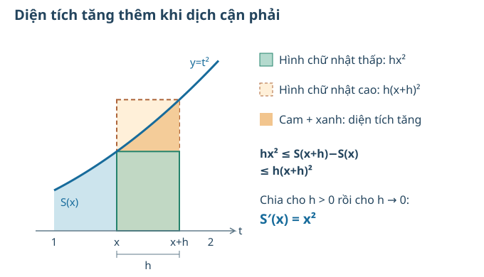
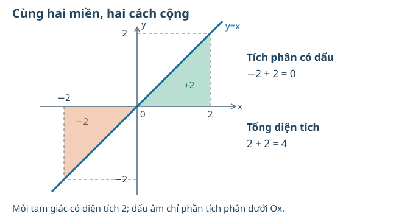

# Bài 12. Tích phân

TOÁN 12 · CHƯƠNG IV · KIẾN THỨC SGK KNTT · TẬP HAI

Từ diện tích và lượng thay đổi tích lũy đến hiệu hai giá trị nguyên hàm; tính tích phân và vận dụng trong chuyển động, kinh tế, đo lường.

<nav class="thpt-r4-lesson-tabs"><a href="../">Chương IV</a><a href="../bai-11/">Bài trước</a><a href="../luyen-tap/#b12-core">Core/Luyện tập</a><a href="../bai-13/">Bài tiếp theo</a><a href="../tu-kiem-tra-chuong/">Tự kiểm tra cuối chương</a></nav>

=== "Khám phá kiến thức"

    ### 1.1. Khái niệm tích phân

    #### a) Diện tích hình thang cong

    Một xe đang chạy với vận tốc \(18\) m/s. Khi phanh, vận tốc giảm đều theo công thức \(v(t)=18-6t\) m/s cho đến khi xe dừng, trong đó \(t\) tính bằng giây. Xe dừng ở \(t=3\). Nếu vận tốc không đổi, quãng đường bằng vận tốc nhân thời gian. Nhưng ở đây vận tốc thay đổi từng lúc, không thể lấy vận tốc ban đầu nhân 3.

    Trên đồ thị vận tốc – thời gian, một chặng rất ngắn \(\Delta t\) cho độ dời xấp xỉ \(v(t)\Delta t\), tương ứng với diện tích một hình chữ nhật hẹp. Khi chia thời gian thành những chặng ngày càng nhỏ, tổng diện tích các hình chữ nhật xấp xỉ ngày càng tốt diện tích dưới đồ thị. Trong ví dụ này, đồ thị là đoạn thẳng từ \((0;18)\) đến \((3;0)\), nên diện tích tam giác bằng \(3\cdot18/2=27\). Tích phân giúp tính chính xác lượng tích lũy ấy, kể cả khi đồ thị là đường cong.

    <!-- OUTCOME_ID: G12-CHIV-B12-O04 -->
    Với hàm \(f\) liên tục, không âm trên \([a;b]\), miền giới hạn bởi đồ thị \(y=f(x)\), trục hoành và hai đường thẳng \(x=a,x=b\) được gọi là hình thang cong (\(a<b\)). Tên gọi này bao gồm cả trường hợp đường biên phía trên là đoạn thẳng. Nếu \(f\) âm trên một phần đoạn, ta không thể gọi toàn miền ấy là hình thang cong theo định nghĩa này.

    Hãy bắt đầu bằng \(f(x)=x+2\) trên \([0;3]\). Với mỗi \(t\in[0;3]\), gọi \(S(t)\) là diện tích từ \(x=0\) đến \(x=t\). Hình thang có hai cạnh song song dài \(2\) và \(t+2\), cách nhau \(t\), nên
    \[
    S(t)=\frac{2+(t+2)}2t=2t+\frac{t^2}{2}.
    \]
    Thật thú vị: \(S'(t)=2+t=f(t)\). Như vậy hàm diện tích là một nguyên hàm của hàm cho đường biên phía trên. \(S(0)=0\); diện tích cần tìm là \(S(3)=21/2\).

    Liệu kết quả này còn đúng khi đường biên thật sự cong? Xét \(f(t)=t^2\) trên \([1;2]\), gọi \(S(x)\) là diện tích từ 1 đến \(x\). Khi dịch cận phải từ \(x\) tới \(x+h\), với \(h>0\), diện tích tăng thêm chính là phần nằm giữa hai cận này.

    <figure class="thpt-r4-plot thpt-r4-calculus-figure"><figcaption>Phần xanh và cam giữa \(x\) và \(x+h\) là diện tích tăng thêm. Hình chữ nhật thấp nằm dưới đường cong, hình chữ nhật cao bao trùm dải ấy. Trục ngang được cắt bớt để nhìn rõ đoạn từ 1 đến 2.</figcaption></figure>

    Vì \(t^2\) tăng trên \([1;2]\), hai hình chữ nhật có cùng chiều rộng \(h\) cho
    \[
    hx^2\le S(x+h)-S(x)\le h(x+h)^2.
    \]
    Chia cho \(h>0\), ta có \(x^2\le [S(x+h)-S(x)]/h\le (x+h)^2\). Khi \(h\to0^+\), hai biên đều tiến tới \(x^2\). Nếu \(h<0\), xét dải từ \(x+h\) đến \(x\), chia diện tích dải ấy cho \(-h>0\); thương sai phân tương tự nằm giữa \((x+h)^2\) và \(x^2\). Khi \(h\to0^-\), ta cũng nhận \(x^2\).

    Do đó \(S'(x)=x^2\), kể cả đạo hàm một phía ở hai đầu. Theo Bài 11,
    \[
    S(x)=\frac{x^3}{3}+C.
    \]
    Vì \(S(1)=0\), \(C=-1/3\). Diện tích toàn phần bằng \(S(2)=8/3-1/3=7/3\). Nếu chọn một nguyên hàm bất kì \(F(x)=x^3/3+C\), hiệu \(F(2)-F(1)\) vẫn là \(7/3\).

    SGK tổng quát hóa kết quả: diện tích hình thang cong dưới hàm liên tục không âm \(f\) bằng \(F(b)-F(a)\), với \(F\) là một nguyên hàm của \(f\). Với hàm liên tục không nhất thiết đồng biến, lập luận kẹp tương tự dùng giá trị nhỏ nhất và lớn nhất trên dải hẹp; khi dải co lại, tính liên tục làm hai giá trị tiến về cùng \(f(x)\).

    **Vận dụng.** Tính diện tích dưới đồ thị \(y=2x^2+1\) trên đoạn \([0;2]\). Trước khi tính, hãy kiểm điều kiện hình thang cong và dự đoán diện tích nằm giữa diện tích hai hình chữ nhật nào.

    ??? question "Đối chiếu"

        Hàm liên tục, không âm và tăng trên \([0;2]\), có giá trị nhỏ nhất 1, lớn nhất 9. Diện tích nằm giữa \(2\cdot1=2\) và \(2\cdot9=18\).

        Một nguyên hàm là \(F(x)=2x^3/3+x\). Vậy \(S=F(2)-F(0)=16/3+2=22/3\), phù hợp với ước lượng.

    ??? tip "Kiểm lỗi"

        Không lấy diện tích hình thang theo hai chiều cao đầu mút khi đường biên là parabol. Công thức hình thang thông thường chỉ đúng khi đường biên trên là đoạn thẳng. Dùng hiệu nguyên hàm và kiểm dấu của hàm.

    #### b) Định nghĩa tích phân

    <!-- OUTCOME_ID: G12-CHIV-B12-O01 -->
    Với hàm liên tục bất kì trên \([a;b]\), kể cả hàm nhận giá trị âm, ta vẫn có thể tính hiệu \(F(b)-F(a)\). Hiệu ấy được gọi là tích phân từ \(a\) đến \(b\) của \(f\), viết
    \[
    \int_a^b f(x)\,dx=F(b)-F(a)=\left.F(x)\right|_a^b.
    \]
    Vì hai nguyên hàm \(F,G\) trên cùng đoạn chỉ khác một hằng số, \(G=F+C\), nên \(G(b)-G(a)=F(b)-F(a)\). Tích phân không phụ thuộc vào việc chọn nguyên hàm nào. Đây là lí do kết quả tích phân là **một số**, không có \(+C\).

    Trong kí hiệu trên, \(a\) là cận dưới, \(b\) là cận trên, \(f(x)\) là hàm dưới dấu tích phân. \(x\) chỉ là biến lấy tích phân: viết \(t\) thay cho \(x\) đồng thời đổi \(dx\) thành \(dt\) không làm đổi kết quả nếu giữ cùng hàm và cận.

    Chẳng hạn,
    \[
    \int_1^3 (2x+1)\,dx=\left.(x^2+x)\right|_1^3
    =(9+3)-(1+1)=10.
    \]
    Hãy đặt ngoặc quanh giá trị ở cận dưới. Nếu hàm chứa nhiều hạng tử, quên ngoặc thường làm sai dấu.

    <!-- OUTCOME_ID: G12-CHIV-B12-O05 -->
    Khi \(a<b\), phần đồ thị phía trên trục hoành cho đóng góp không âm, phần phía dưới cho đóng góp không dương. Thí dụ \(f(x)=x\) trên \([-2;2]\).

    <figure class="thpt-r4-plot thpt-r4-calculus-figure"><figcaption>Tích phân từ \(-2\) đến 2 bằng 0 vì hai đóng góp trái dấu triệt tiêu nhau. Tổng diện tích hai tam giác là 4. Không có diện tích hình học âm.</figcaption></figure>

    Ta kiểm bằng nguyên hàm \(F(x)=x^2/2\): \(F(2)-F(-2)=2-2=0\). Nếu cần tổng diện tích hai phần, phải tính với hàm \(|x|\), luôn không âm. Phương pháp tính diện tích hình phẳng tổng quát sẽ được học ở Bài 13.

    <!-- FIRST_TRY_ID: B12-T01 -->
    **Vận dụng.** Tính \(\int_{-1}^2x\,dx\) và \(\int_{-1}^2|x|\,dx\). Giải thích tại sao hai kết quả khác nhau.

    ??? question "Đối chiếu"

        Tích phân thứ nhất bằng \(2-1/2=3/2\). Đồ thị \(|x|\) tạo hai tam giác phía trên trục hoành có diện tích \(1/2\) và 2, nên tích phân thứ hai bằng \(5/2\). Tích phân thứ nhất lấy hiệu hai diện tích, tích phân thứ hai lấy tổng.

    ??? tip "Kiểm lỗi"

        \(\left|\int_{-1}^2 x\,dx\right|=3/2\), không bằng \(5/2\). Đặt dấu giá trị tuyệt đối bên ngoài tích phân không loại bỏ sự triệt tiêu đã xảy ra bên trong.

    <!-- OUTCOME_ID: G12-CHIV-B12-O06 -->
    Để tính bằng nguyên hàm, trước hết kiểm hàm liên tục trên đoạn lấy tích phân. Sau đó tìm một nguyên hàm bằng bảng ở Bài 11, thay cận trên rồi trừ cận dưới. Ví dụ
    \[
    \int_0^{\pi/3}\cos x\,dx=\sin(\pi/3)-\sin0=\sqrt3/2,
    \quad
    \int_0^1 3^x\,dx=\frac{3-1}{\ln3}.
    \]
    Với hàm \(1/x\) trên \([-1;1]\), không áp dụng được công thức hiệu nguyên hàm vì hàm không xác định tại 0. Hai cận khác 0 chưa đủ: phải kiểm cả đoạn nằm giữa chúng.

    Đôi khi tính bằng hình học nhanh hơn tìm nguyên hàm. Hàm \(y=\sqrt{16-x^2}\) trên \([0;4]\) biểu diễn một phần tư đường tròn bán kính 4 ở góc phần tư thứ nhất, bởi \(x^2+y^2=16,\ y\ge0\). Vậy tích phân bằng diện tích \(16\pi/4=4\pi\). Không cần tìm công thức nguyên hàm mới.

    **Vận dụng.** Dùng ý nghĩa hình học, tính \(\int_{-2}^{2}\sqrt{4-x^2}\,dx\).

    ??? question "Đối chiếu"

        Hàm không âm, liên tục trên \([-2;2]\). Đồ thị là nửa đường tròn phía trên trục hoành, bán kính 2. Tích phân bằng diện tích nửa hình tròn: \(2\pi\).

    ??? tip "Kiểm lỗi"

        Cận từ \(-2\) đến 2 phủ cả nửa đường tròn trên, không phải một phần tư. Dùng \(y\ge0\) để chọn đúng nửa đường tròn.

    ### 1.2. Tính chất của tích phân

    <!-- OUTCOME_ID: G12-CHIV-B12-O02 -->
    Nếu \(F'=f,\ G'=g\), thì \((kF)'=kf\) và \((F\pm G)'=f\pm g\). Lấy hiệu giá trị ở hai cận, ta thu được các tính chất:
    \[
    \int_a^b kf(x)\,dx=k\int_a^b f(x)\,dx,
    \qquad
    \int_a^b(f\pm g)\,dx=\int_a^b f\,dx\pm\int_a^b g\,dx.
    \]
    Khác với họ nguyên hàm, công thức đưa hệ số ra ngoài đúng cả khi \(k=0\), vì tích phân là một số. Hai hàm cần được xét trên cùng đoạn; không tách tích hoặc thương thành tích hoặc thương của các tích phân.

    Ví dụ, nếu biết \(\int_1^4 f(x)\,dx=6\) và \(\int_1^4g(x)\,dx=-2\), ta tính được \(\int_1^4(3f-2g)\,dx=18+4=22\) mà không cần biết biểu thức của \(f,g\).

    <!-- OUTCOME_ID: G12-CHIV-B12-O03 -->
    Khi ghép các chặng liên tiếp, tích phân của toàn đoạn bằng tổng tích phân từng chặng. Thật vậy, nếu \(a<c<b\),
    \[
    [F(c)-F(a)]+[F(b)-F(c)]=F(b)-F(a).
    \]
    Khi hai cận bằng nhau, hiệu bằng 0; khi đảo cận, hiệu đổi dấu. Ví dụ \(\int_3^1 2x\,dx=1-9=-8\), mặc dù \(2x>0\) trên \([1;3]\). Cận dưới và cận trên là tên vị trí viết trong kí hiệu, không có nghĩa số viết phía dưới luôn nhỏ hơn số viết phía trên.

    <!-- FIRST_TRY_ID: B12-T02 -->
    **Vận dụng.** Cho \(f\) liên tục trên \([0;5]\), biết \(\int_0^2 f\,dx=4,\ \int_2^5 f\,dx=-7\). Tính \(\int_0^5 f\,dx,\ \int_5^0 2f\,dx,\ \int_2^2 f\,dx\).

    ??? question "Đối chiếu"

        Ghép đoạn được \(4-7=-3\). Đảo cận và đưa hệ số ra ngoài được \(-2(-3)=6\). Hai cận trùng nhau cho 0.

    ??? tip "Kiểm lỗi"

        Nếu kết quả thứ hai là \(-6\), em đã quên đảo cận. Hãy viết \(\int_5^0 f=-\int_0^5 f\) trước khi nhân 2.

    Tính chất ghép đoạn đặc biệt hữu ích với giá trị tuyệt đối. Chẳng hạn, để tính \(\int_0^4 |x-1|\,dx\), nhận thấy \(x-1\) đổi dấu tại 1. Do đó
    \[
    \begin{aligned}
    \int_0^4|x-1|\,dx
    &=\int_0^1(1-x)\,dx+\int_1^4(x-1)\,dx\\
    &=\frac12+\frac92=5.
    \end{aligned}
    \]
    Mỗi tích phân trên đoạn con dùng đúng biểu thức của giá trị tuyệt đối tại đó. Không cần chia đoạn tại nghiệm nằm ngoài cận. Nếu nghiệm nằm đúng cận, không tạo thêm đoạn có độ dài dương.

    <!-- OUTCOME_ID: G12-CHIV-B12-O07 -->
    **Lượng biến đổi tích lũy.** Nếu \(Q'(t)=q(t)\) liên tục, thì
    \[
    Q(b)-Q(a)=\int_a^b q(t)\,dt.
    \]
    Trở lại bài phanh xe: \(v(t)=18-6t\), xe dừng lúc \(t=3\); trên \([0;3]\), \(v(t)\ge0\). Quãng đường bằng \(\int_0^3(18-6t)\,dt=54-27=27\) m, đúng kết quả hình học. Không dùng công thức vận tốc này sau khi xe đã dừng.

    Nếu vật chuyển động thẳng và vận tốc đổi dấu, tích phân vận tốc cho độ dịch chuyển có dấu, còn tích phân tốc độ \(|v|\) cho tổng quãng đường. Một vật đi 3 m rồi lùi 3 m có độ dịch chuyển 0 nhưng quãng đường 6 m. Vì vậy khi tính quãng đường phải xác định thời điểm đổi chiều, chia khoảng nếu cần.

    Cũng có thể dùng tích phân để tính lượng thay đổi của lợi nhuận từ lợi nhuận biên, hoặc lượng nước từ lưu lượng. Chỉ cần tốc độ biến đổi trên khoảng cần xét, không nhất thiết biết giá trị ban đầu. Nếu muốn tìm giá trị cuối, phải cộng lượng thay đổi vào giá trị ban đầu.

    **Vận dụng.** Bể có 50 lít nước lúc \(t=0\). Lưu lượng thực (dòng vào trừ dòng ra) là \(q(t)=4-2t\) lít/phút trong 4 phút. Tính lượng nước thay đổi, lượng nước cuối và tổng lượng nước tăng thêm hoặc giảm đi xét theo từng giai đoạn.

    ??? question "Đối chiếu"

        \(q(t)\) đổi dấu tại 2. Hai giai đoạn có lượng thay đổi \(\int_0^2(4-2t)\,dt=4\) lít và \(\int_2^4(4-2t)\,dt=-4\) lít. Tổng biến đổi bằng 0, lượng cuối vẫn là 50 lít. Bể tăng 4 lít rồi giảm 4 lít; tổng độ lớn các biến đổi là 8 lít.

        Vì \(q\) là lưu lượng thực, 8 lít không phải tổng lượng nước thật đi qua hai ống nếu dòng vào và dòng ra đồng thời tồn tại; ta không biết từng lưu lượng riêng.

    ??? tip "Kiểm lỗi"

        Không lấy \(|0|=0\) để kết luận lượng nước chưa từng thay đổi. Đọc dấu của \(q\) theo từng giai đoạn và phân biệt lượng thay đổi với giá trị cuối.

    **Giá trị trung bình của hàm số.** Nhiệt độ thay đổi liên tục trong ngày, không thể chỉ lấy nhiệt độ đầu và cuối chia đôi nếu quy luật biến đổi không tuyến tính. Nếu một hàm liên tục \(f\) trên \([a;b]\), \(a<b\), giá trị trung bình là
    \[
    \overline f=\frac{1}{b-a}\int_a^b f(x)\,dx.
    \]
    Có thể hình dung thay đồ thị bởi một đường ngang có chiều cao \(\overline f\) để tích lũy có dấu không đổi trên cùng đoạn. Đơn vị của \(\overline f\) là đơn vị của \(f\), vì đã chia lượng tích lũy cho độ dài đoạn.

    **Vận dụng.** Nhiệt độ (°C) sau \(t\) giờ kể từ 6 giờ sáng được mô hình hóa bởi \(T(t)=18+t^2/4\), \(0\le t\le4\). Tính nhiệt độ trung bình từ 6 đến 10 giờ.

    ??? question "Đối chiếu"

        \[
        \overline T=\frac14\left[18t+\frac{t^3}{12}\right]_0^4
        =18+\frac43=\frac{58}{3}\approx19{,}33^\circ\mathrm C.
        \]
        Kết quả nằm giữa nhiệt độ nhỏ nhất 18 và lớn nhất 22. Trung bình cộng hai giá trị đầu mút là 20, không phải giá trị trung bình của hàm bậc hai này.

    ??? tip "Kiểm lỗi"

        Chia cho độ dài thời gian 4 giờ, không chia cho số mốc giờ được kể tên. Dùng biến \(t\) tính từ 6 giờ sáng, nên cận là 0 và 4.

=== "Kiến thức SGK"

    ### 2.1. Khái niệm tích phân

    
<strong>Hình thang cong.</strong>
Với \(a&lt;b\), hàm \(f\) liên tục và không âm trên \([a;b]\), hình phẳng giới hạn bởi đồ thị \(y=f(x)\), trục hoành, \(x=a\) và \(x=b\) là hình thang cong.

    
<strong>Định lí — Diện tích hình thang cong.</strong>
Diện tích hình thang cong trên bằng \(F(b)-F(a)\), trong đó \(F\) là một nguyên hàm của \(f\) trên đoạn \([a;b]\).

    
<strong>Định nghĩa tích phân.</strong>
Cho \(f\) liên tục trên đoạn \([a;b]\), \(a&lt;b\), và \(F\) là một nguyên hàm của \(f\) trên đoạn ấy.

\(\displaystyle\int_a^b f(x)\,dx=\left.F(x)\right|_a^b=F(b)-F(a).\)

\(a,b\) lần lượt là cận dưới, cận trên; \(f(x)\,dx\) là biểu thức dưới dấu tích phân; \(f(x)\) là hàm dưới dấu tích phân. Giá trị tích phân không phụ thuộc cách chọn nguyên hàm hoặc tên biến lấy tích phân.

    Quy ước \(\int_a^a f(x)\,dx=0\) tại điểm \(a\) thuộc miền xác định, và \(\int_a^b f(x)\,dx=-\int_b^a f(x)\,dx\) khi \(a>b\) và \(f\) liên tục trên \([b;a]\).

    **Ý nghĩa hình học:** nếu \(a<b\) và \(f\) liên tục, không âm trên \([a;b]\), thì \(\int_a^b f(x)\,dx\) bằng diện tích hình thang cong. Tích phân nói chung có dấu, không phải lúc nào cũng là diện tích. Với cận thuận, \(\int_a^b |f(x)|\,dx\ge0\); tính bằng cách chia đoạn theo dấu của \(f\) khi cần.

    **Cách tính bằng nguyên hàm:** kiểm miền xác định và tính liên tục trên cả đoạn; tìm một nguyên hàm; thay cận trên, trừ giá trị tại cận dưới; không ghi \(+C\) ở kết quả. Khi đồ thị không âm tạo thành hình quen thuộc, có thể tính trực tiếp bằng diện tích.

    ### 2.2. Tính chất của tích phân

    
<strong>Tính tuyến tính.</strong>
Nếu \(f,g\) liên tục trên \([a;b]\) và \(k\) là số thực,

\(\displaystyle\int_a^b kf(x)\,dx=k\int_a^b f(x)\,dx.\)

\(\displaystyle\int_a^b[f(x)\pm g(x)]\,dx=\int_a^b f(x)\,dx\pm\int_a^b g(x)\,dx.\)

    
<strong>Tính cộng theo đoạn.</strong>
Với \(a&lt;c&lt;b\) và \(f\) liên tục trên \([a;b]\),

\(\displaystyle\int_a^b f(x)\,dx=\int_a^c f(x)\,dx+\int_c^b f(x)\,dx.\)

Kết hợp quy ước đảo cận, hệ thức vẫn đúng khi thay đổi thứ tự ba mốc, miễn hàm liên tục trên đoạn chứa chúng.

    **Ứng dụng trong tính toán:** Dùng tuyến tính để tách các hạng tử cùng cận, dùng cộng theo đoạn để xử lí biểu thức giá trị tuyệt đối, hàm có công thức khác nhau trên từng phần (trong phạm vi hàm liên tục), hoặc tìm tích phân từ các giá trị đã biết.

    **Ứng dụng thực tiễn:** Nếu \(Q'=q\) liên tục, lượng thay đổi của \(Q\) trên \([a;b]\) là \(\int_a^b q(t)\,dt\). Với chuyển động thẳng trong khoảng thời gian \(a<b\),

    | Đại lượng | Công thức |
    | :-- | :-- |
    | Độ dịch chuyển có dấu | \(\int_a^b v(t)\,dt\) |
    | Tổng quãng đường | \(\int_a^b |v(t)|\,dt\) |
    | Giá trị trung bình của hàm \(f\) | \(\dfrac{1}{b-a}\int_a^b f(t)\,dt\) |

    Kiểm miền của mô hình, đổi đơn vị thống nhất, phân biệt giá trị đầu/cuối với lượng thay đổi. Giá trị trung bình chỉ xác định bằng công thức trên khi \(a<b\).

=== "Ví dụ"

    ### 3.1. Tính tích phân đa thức qua hai cận

    **Đề bài.** Tính \(\int_{-2}^{1}(3x^2-2x+4)\,dx\).

    **Phân tích:** Dùng tuyến tính và nguyên hàm đa thức; cận âm cần đặt ngoặc.

    

<strong>Lời giải.</strong> Một nguyên hàm là \(F(x)=x^3-x^2+4x\). \(F(1)=4,\ F(-2)=-8-4-8=-20\). Do đó tích phân bằng \(4-(-20)=24\).

    **Kiểm lại:** \(3x^2-2x+4=3(x-1/3)^2+11/3>0\); kết quả cận thuận phải dương.

    ### 3.2. Tích phân chứa lũy thừa và logarit

    **Đề bài.** Tính \(\int_1^4(2\sqrt{x}+3/x)\,dx\).

    **Phân tích:** Hai hạng tử liên tục trên \([1;4]\); dùng công thức lũy thừa và logarit.

    

<strong>Lời giải.</strong> \(F(x)=\frac43x^{3/2}+3\ln x\). Tích phân bằng \(\frac43(8-1)+3(\ln4-\ln1)=\frac{28}{3}+3\ln4\).

    **Kiểm lại:** Đạo hàm của \(F\) là \(2\sqrt{x}+3/x\). Không lấy \(\ln1=1\).

    ### 3.3. Tích phân lượng giác

    **Đề bài.** Tính \(\int_0^{\pi/4}(2\cos x-3/\cos^2x)\,dx\).

    **Phân tích:** \(\cos x\ne0\) trên cả đoạn. Dùng hai nguyên hàm \(\sin x,\tan x\).

    

<strong>Lời giải.</strong> \(F(x)=2\sin x-3\tan x\). Vậy \(F(\pi/4)-F(0)=\sqrt2-3\).

    **Kiểm lại:** Hàm dưới dấu tích phân âm trên đoạn vì \(2\cos x\le2\) và \(3/\cos^2x\ge3\). Kết quả âm là hợp lí.

    ### 3.4. Tích phân hàm mũ

    **Đề bài.** Tính \(\int_0^2(2e^x+3\cdot2^{-x})\,dx\).

    **Phân tích:** Chia cho logarit cơ số \(1/2\) khi tìm nguyên hàm của \(2^{-x}\).

    

<strong>Lời giải.</strong> \(F(x)=2e^x-3\cdot2^{-x}/\ln2\). Tích phân là \(2(e^2-1)-3(1/4-1)/\ln2=2(e^2-1)+9/(4\ln2)\).

    **Kiểm lại:** Hai hạng tử của kết quả đều dương. Đạo hàm hạng thứ hai của \(F\) bằng \(3\cdot2^{-x}\).

    ### 3.5. Chọn hình học thay vì tìm nguyên hàm

    **Đề bài.** Tính \(\int_0^3\sqrt{9-x^2}\,dx\) và \(\int_1^4(3x+2)\,dx\) bằng ý nghĩa hình học.

    **Phân tích:** Nhận ra một phần tư hình tròn và một hình thang vuông; cả hai hàm không âm trên đoạn tương ứng.

    

<strong>Lời giải.</strong> Đồ thị thứ nhất thỏa \(x^2+y^2=9,\ x,y\ge0\), nên tích phân bằng \(9\pi/4\). Đồ thị thứ hai là đoạn thẳng với hai tung độ đầu mút 5 và 14; diện tích hình thang là \(3(5+14)/2=57/2\).

    **Kiểm lại:** Tích phân thứ hai cũng bằng \([3x^2/2+2x]_1^4=57/2\).

    ### 3.6. Tính từ dữ kiện tích phân cho trước

    **Đề bài.** Cho \(f,g\) liên tục trên \([0;6]\), \(\int_0^6 f=9,\ \int_0^2 f=5,\ \int_2^6 g=-3\) (các tích phân đều theo \(x\)). Tính \(\int_6^2(2f-3g)\,dx\).

    **Phân tích:** Tìm tích phân \(f\) trên đúng đoạn \([2;6]\), rồi dùng tuyến tính và đảo cận.

    

<strong>Lời giải.</strong> \(\int_2^6 f\,dx=9-5=4\). Vậy \(\int_2^6(2f-3g)\,dx=2\cdot4-3(-3)=17\). Đảo cận được \(-17\).

    **Kiểm lại:** Từng tích phân đã được đưa về cùng hai cận. Không dùng trực tiếp giá trị 9 thay cho tích phân từ 2 đến 6.

    ### 3.7. Giá trị tuyệt đối có hai điểm đổi dấu

    **Đề bài.** Tính \(\int_{-2}^2|x^2-1|\,dx\).

    **Phân tích:** \(x^2-1=0\) tại \(\pm1\). Biểu thức không âm ở hai đoạn ngoài và âm ở đoạn giữa.

    

<strong>Lời giải.</strong> Chia đoạn tại \(-1,1\). Do hàm \(|x^2-1|\) chẵn, hai đoạn ngoài cho cùng giá trị. Tích phân bằng \(2\int_1^2(x^2-1)\,dx+\int_{-1}^1(1-x^2)\,dx\).

Ta có \(\int_1^2(x^2-1)\,dx=[x^3/3-x]_1^2=4/3\), và \(\int_{-1}^1(1-x^2)\,dx=[x-x^3/3]_{-1}^1=4/3\). Tổng bằng \(4\).

    **Kiểm lại:** Nếu bỏ dấu giá trị tuyệt đối, tích phân của \(x^2-1\) chỉ bằng \(4/3\); đó không phải đáp án cần tìm.

    ### 3.8. Độ dịch chuyển và tổng quãng đường

    **Đề bài.** Vật chuyển động thẳng, vận tốc \(v(t)=6-3t\) m/s trên \([0;4]\). Tính độ dịch chuyển và quãng đường.

    **Phân tích:** Vận tốc đổi dấu tại \(t=2\). Tích phân \(v\) tính độ dịch chuyển, còn \(|v|\) tính quãng đường.

    

<strong>Lời giải.</strong> \(F(t)=6t-\frac32t^2\) là một nguyên hàm của \(v\). \(F(0)=0,F(2)=6,F(4)=0\). Độ dịch chuyển bằng \(F(4)-F(0)=0\) m. Hai chặng có độ dịch chuyển lần lượt \(6\) và \(-6\) m, nên quãng đường bằng \(6+6=12\) m.

    **Kiểm lại:** Vật quay về vị trí đầu, không có nghĩa vật đứng yên. Tổng quãng đường luôn lớn hơn hoặc bằng độ lớn độ dịch chuyển.

    ### 3.9. Lợi nhuận thay đổi từ lợi nhuận biên

    **Đề bài.** Lợi nhuận \(P(x)\) tính bằng nghìn đồng khi bán \(x\) sản phẩm, có \(P'(x)=80-0{,}2x\) trên \([100;120]\). Biết \(P(100)=5000\). Tìm mức thay đổi và lợi nhuận khi bán 120 sản phẩm.

    **Phân tích:** Dùng tích phân của lợi nhuận biên. Đơn vị của đạo hàm là nghìn đồng trên một sản phẩm.

    

<strong>Lời giải.</strong> \(P(120)-P(100)=[80x-0{,}1x^2]_{100}^{120}=1600-0{,}1(14400-10000)=1160\) nghìn đồng.

Vậy \(P(120)=5000+1160=6160\) nghìn đồng, tức 6,16 triệu đồng.

    **Kiểm lại:** Lợi nhuận biên giảm từ 60 xuống 56 nghìn đồng/sản phẩm. Lượng tăng nằm giữa \(56\cdot20=1120\) và \(60\cdot20=1200\).

    ### 3.10. Giá trị trung bình theo bán kính

    **Đề bài.** Trong một mô hình dòng chảy, vận tốc tại khoảng cách \(r\) tính từ tâm ống là \(v(r)=k(R^2-r^2)\), \(0\le r\le R\), với \(k>0,R>0\). Tính giá trị trung bình của \(v\) theo biến \(r\) và so sánh với giá trị lớn nhất.

    **Phân tích:** Trung bình ở đây là trung bình theo chiều dài bán kính, không phải trung bình theo diện tích mặt cắt ống.

    

<strong>Lời giải.</strong> \(\overline v=\frac1R\int_0^R k(R^2-r^2)\,dr=\frac{k}{R}[R^2r-r^3/3]_0^R=\frac23kR^2\).

Vì \(r^2\ge0\), vận tốc lớn nhất là \(kR^2\) tại tâm \(r=0\). Giá trị trung bình theo \(r\) bằng \(2/3\) vận tốc lớn nhất.

    **Kiểm lại:** Vận tốc giảm từ \(kR^2\) đến 0, nên giá trị trung bình nằm giữa hai mốc đó. Không kết luận đây là vận tốc trung bình theo diện tích mặt cắt.

=== "Lỗi thường gặp"

    ### 4.1. Giữ hằng số C trong tích phân xác định

    **Sai ở đâu:** \(\int_0^2 x\,dx=2+C\).

    **Vì sao sai:** Hiệu hai giá trị của cùng nguyên hàm làm triệt tiêu hằng số.

    **Cách sửa:** Chọn \(F=x^2/2\), viết \(F(2)-F(0)=2\).

    ### 4.2. Đảo cận hoặc quên ngoặc

    **Sai ở đâu:** Viết \(F(a)-F(b)\) thay cho \(F(b)-F(a)\), hoặc chỉ trừ hạng tử đầu khi thế cận dưới.

    **Vì sao sai:** Tích phân tính hiệu của hai giá trị đầy đủ.

    **Cách sửa:** Ghi riêng \(F(b)\), \(F(a)\), rồi trừ có ngoặc. Nếu đảo cận, đổi dấu.

    ### 4.3. Không kiểm cả đoạn lấy tích phân

    **Sai ở đâu:** Tính \(\int_{-1}^1dx/x\) bằng \(\ln|1|-\ln|-1|=0\).

    **Vì sao sai:** Hàm \(1/x\) không liên tục, thậm chí không xác định tại 0. Không có nguyên hàm trên cả đoạn theo điều kiện của bài.

    **Cách sửa:** Kiểm tất cả điểm trong đoạn; không áp dụng công thức tích phân SGK qua điểm không xác định.

    ### 4.4. Coi tích phân luôn bằng diện tích

    **Sai ở đâu:** Tích phân bằng 0 thì miền giữa đồ thị và trục hoành có diện tích 0.

    **Vì sao sai:** Phần dưới trục có thể triệt tiêu phần trên trong phép cộng có dấu.

    **Cách sửa:** Với cận thuận, dùng \(|f|\) khi cần tổng diện tích các phần. Kiểm các điểm đổi dấu.

    ### 4.5. Dùng sai tính tuyến tính

    **Sai ở đâu:** Viết \(\int fg=(\int f)(\int g)\), hoặc tách tổng với các cận khác nhau.

    **Vì sao sai:** Tính tuyến tính chỉ áp dụng cho cộng, trừ, nhân hằng số và cùng hai cận.

    **Cách sửa:** Biến đổi hàm trước nếu cần; tính đúng nguyên hàm hoặc dùng tính cộng theo đoạn.

    ### 4.6. Nhầm độ dịch chuyển với quãng đường

    **Sai ở đâu:** Tính quãng đường bằng trị tuyệt đối của tích phân vận tốc dù vật đổi chiều.

    **Vì sao sai:** Các độ dịch chuyển trái dấu có thể triệt tiêu.

    **Cách sửa:** Tìm điểm đổi dấu của vận tốc, dùng tích phân \(|v|\) hoặc cộng độ lớn từng chặng.

    ### 4.7. Nhầm tổng tích lũy với giá trị trung bình

    **Sai ở đâu:** Dùng trực tiếp \(\int_a^b f(x)\,dx\) làm giá trị trung bình.

    **Vì sao sai:** Tích phân đo lượng tích lũy trên cả đoạn; đơn vị có thêm đơn vị của biến.

    **Cách sửa:** Chia cho \(b-a>0\) và kiểm kết quả có nằm giữa giá trị nhỏ nhất và lớn nhất của hàm liên tục trên đoạn.

    **Học tiếp:** [Core và Luyện tập Bài 12](../luyen-tap/#b12-core) · [Bài 13 — Ứng dụng hình học của tích phân](../bai-13/).

    
Nguồn kiến thức: SGK KNTT Toán 12 tập 2, trang in 12–18. Các ví dụ và hình do SLM biên soạn để hỗ trợ tự học.

