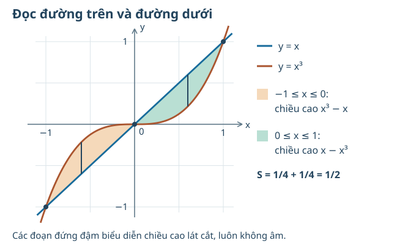
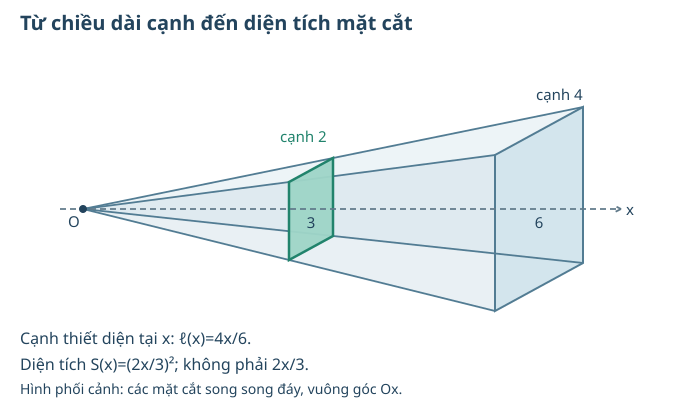
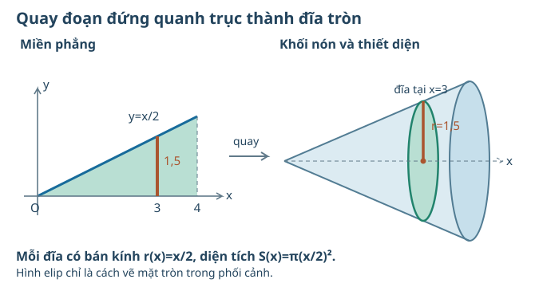

# Bài 13. Ứng dụng hình học của tích phân

TOÁN 12 · CHƯƠNG IV · KIẾN THỨC SGK KNTT · TẬP HAI

Tính diện tích miền có biên cong và thể tích vật thể bằng cách xác định chiều cao hoặc diện tích của từng lát cắt.

<nav class="thpt-r4-lesson-tabs"><a href="../">Chương IV</a><a href="../bai-12/">Bài trước</a><a href="../luyen-tap/#b13-core">Core/Luyện tập</a><a href="../tu-kiem-tra-chuong/">Tự kiểm tra cuối chương</a></nav>

=== "Khám phá kiến thức"

    ### 1.1. Ứng dụng tích phân để tính diện tích hình phẳng

    #### a) Hình phẳng giới hạn bởi một đồ thị hàm số, trục hoành và hai đường thẳng

    Em đã biết cách tính diện tích tam giác, hình thang hay hình tròn. Nhưng nếu một mảnh đất có đường biên cong, làm sao tính diện tích khi biết phương trình của đường biên? Ý tưởng ở Bài 12 là chia miền thành những dải đứng rất hẹp, mỗi dải có diện tích xấp xỉ chiều cao nhân chiều rộng. Tích phân cho phép cộng dồn chính xác các diện tích ấy.

    <!-- OUTCOME_ID: G12-CHIV-B13-O01 -->
    Nếu đường biên trên là \(y=f(x)\ge0\) và đường biên dưới là \(Ox\), giữa hai đường \(x=a,x=b\) với \(a<b\), chiều cao dải tại \(x\) là \(f(x)\). Khi \(f\) liên tục, diện tích là \(\int_a^b f(x)\,dx\). Chẳng hạn phần hình phẳng dưới \(y=x^2\) từ \(0\) đến \(2\) có diện tích \([x^3/3]_0^2=8/3\). Nếu dùng hình chữ nhật cao 4, rộng 2, ta được 8, lớn hơn diện tích thật; điều đó phù hợp vì đường cong nằm dưới cạnh trên của hình chữ nhật.

    <!-- OUTCOME_ID: G12-CHIV-B13-O02 -->
    Nếu đồ thị ở dưới trục hoành, độ cao của dải không phải là số âm. Ví dụ đường \(y=x-1\) từ \(x=0\) đến \(x=3\) tạo hai tam giác. Tam giác trái có đáy và chiều cao đều bằng 1, diện tích \(1/2\); tam giác phải có đáy và chiều cao đều bằng 2, diện tích 2. Tổng bằng \(5/2\). Nhưng tích phân của \(x-1\) trên \([0;3]\) bằng \(3/2\), bởi nó lấy diện tích phải trừ diện tích trái.

    Để cộng cả hai phần, cần dùng độ cao \(|x-1|\):

    \[
    S=\int_0^3|x-1|\,dx
    =\int_0^1(1-x)\,dx+\int_1^3(x-1)\,dx
    =\frac12+2=\frac52.
    \]

    Kết quả đúng với cách tính hình học. Tổng quát, với hàm liên tục \(f\) trên \([a;b]\), diện tích giới hạn bởi đồ thị, \(Ox\) và hai đường đứng \(x=a,x=b\) bằng \(\int_a^b|f(x)|\,dx\). Khi \(f\) đổi dấu, tìm các nghiệm nằm trong khoảng, xét dấu rồi bỏ giá trị tuyệt đối trên từng đoạn. Nghiệm mà hàm chỉ tiếp xúc trục, không đổi dấu, không buộc phải tách tích phân.

    **Vận dụng.** Tính diện tích giới hạn bởi \(y=x^2-1\), trục hoành và hai đường \(x=0,x=2\).

    ??? question "Đối chiếu"

        Hàm liên tục, có nghiệm \(x=1\) trong đoạn. Trên \([0;1]\), \(x^2-1\le0\); trên \([1;2]\), \(x^2-1\ge0\).

        \[
        \begin{aligned}
        S&=\int_0^1(1-x^2)\,dx+\int_1^2(x^2-1)\,dx\\
        &=\frac23+\frac43=2.
        \end{aligned}
        \]

        Hai diện tích đều không âm. Tích phân có dấu của \(x^2-1\) chỉ bằng \(2/3\), không phải diện tích.

    ??? tip "Kiểm lỗi"

        Nếu nhận \(2/3\), em đã cho hai miền triệt tiêu. Hãy viết hai tích phân riêng, chọn biểu thức không âm ở mỗi miền, rồi cộng.

    #### b) Hình phẳng giới hạn bởi hai đồ thị hàm số và hai đường thẳng

    <!-- OUTCOME_ID: G12-CHIV-B13-O03 -->
    Bây giờ đường biên dưới không nhất thiết là \(Ox\). Giả sử trên \([1;2]\), đường \(y=x+2\) nằm trên đường \(y=x^2\) (hai đồ thị gặp nhau ở 2). Tại \(x\), dải đứng dài từ tung độ \(x^2\) tới \(x+2\); chiều cao là \(x+2-x^2\), không phải tổng của hai tung độ. Do đó diện tích là

    \[
    S=\int_1^2(x+2-x^2)\,dx=\frac76.
    \]

    Hai đồ thị có thể nằm cùng phía hoặc khác phía của trục hoành; điều quyết định chiều cao vẫn là tung độ trên trừ tung độ dưới. Ví dụ nếu đường trên là \(y=-1\), đường dưới là \(y=-3\), chiều cao bằng \((-1)-(-3)=2\), không phải 4.

    <!-- OUTCOME_ID: G12-CHIV-B13-O04 -->
    Hai đường cũng có thể đổi vai trò trên và dưới. Quan sát \(y=x\) và \(y=x^3\) trên \([-1;1]\). Giải \(x=x^3\), ta được \(x(x-1)(x+1)=0\); ba giao điểm có hoành độ \(-1,0,1\).

    <figure class="thpt-r4-plot thpt-r4-calculus-figure"><figcaption>Đọc hai đoạn đứng trong vùng tô màu: ở nửa trái, chiều cao là \(x^3-x\); ở nửa phải, chiều cao là \(x-x^3\). Không dùng cùng thứ tự trừ cho cả hai nửa.</figcaption></figure>

    Hiệu \(x-x^3=x(1-x^2)\) âm khi \(-1<x<0\), dương khi \(0<x<1\). Vì vậy

    \[
    \begin{aligned}
    S&=\int_{-1}^0(x^3-x)\,dx+\int_0^1(x-x^3)\,dx\\
    &=\frac14+\frac14=\frac12.
    \end{aligned}
    \]

    Nếu giữ nguyên \(x-x^3\) trên cả đoạn thì tích phân bằng 0 do hàm lẻ, mặc dù hai miền có diện tích dương. Viết gọn công thức tổng quát \(S=\int_a^b|f(x)-g(x)|\,dx\). Nếu hiệu không đổi dấu, có thể lấy trị tuyệt đối của tích phân hiệu; nếu hiệu đổi dấu, phải tính từng phần trước khi cộng.

    <!-- FIRST_TRY_ID: B13-T01 -->
    **Vận dụng.** Tính diện tích giới hạn bởi hai đồ thị \(y=x^2,\ y=x\) và hai đường \(x=0,x=2\). Tại đâu hai đồ thị đổi vai trò?

    ??? question "Đối chiếu"

        \(x^2=x\) cho \(x=0,1\). Trong \((0;1)\), \(x>x^2\); trong \((1;2)\), \(x^2>x\). Vì thế

        \[
        S=\int_0^1(x-x^2)\,dx+\int_1^2(x^2-x)\,dx
        =\frac16+\frac56=1.
        \]

    ??? tip "Kiểm lỗi"

        Nếu chỉ tính từ 0 đến 1, em đã bỏ miền được giới hạn thêm bởi \(x=2\). Đọc đủ các đường biên đề cho, giải giao điểm nằm trong cận, rồi xét dấu.

    Khi đề chỉ cho hai đồ thị mà không cho hai đường đứng, các giao điểm có thể tự tạo cận của miền kín. Chẳng hạn \(y=4-x^2,\ y=0\) tạo miền kín từ \(-2\) đến 2. Nhưng hai đường song song không tự tạo miền kín hữu hạn; không được tự đặt cận theo ý mình. Nếu có nhiều miền kín, xác định miền nào đề yêu cầu và cộng đúng các miền.

    <!-- OUTCOME_ID: G12-CHIV-B13-O05 -->
    **Ứng dụng thực tế.** Một khu đất dài 6 m được mô hình hóa trong hệ tọa độ (đơn vị mét) với đường biên dưới \(g(x)=1+x/3\), đường biên trên \(f(x)=g(x)+3-x^2/12\), \(0\le x\le6\). Bề rộng theo phương \(Oy\) là \(f-g=3-x^2/12\ge0\); ở đầu phải hai đường gặp nhau. Diện tích khu đất là

    \[
    S=\int_0^6(3-x^2/12)\,dx=18-6=12\ \mathrm{m}^2.
    \]

    Cả hai tọa độ đều đo bằng mét nên tích phân chiều cao theo chiều rộng có đơn vị mét vuông. Không cần tính diện tích từ từng đường xuống \(Ox\) rồi trừ nếu đã biết chiều cao.

    Trong kinh tế, diện tích giữa đồ thị giá và số lượng có ý nghĩa khác diện tích đất. Giả sử giá cầu là \(p=D(x)=18-2x\), giá cung là \(p=P(x)=6+x\) (nghìn đồng/sản phẩm), với số lượng \(x\) được coi là biến liên tục. Điểm cân bằng thỏa \(D(x_0)=P(x_0)\), nên \(x_0=4,p_0=10\). Trên \([0;4]\), cầu nằm trên mức giá 10 còn cung nằm dưới mức ấy. Thặng dư tiêu dùng là diện tích giữa cầu và mức giá cân bằng, bằng \(\int_0^4(8-2x)\,dx=16\) nghìn đồng; thặng dư sản xuất bằng \(\int_0^4(4-x)\,dx=8\) nghìn đồng. Các diện tích phản ánh chênh lệch theo mô hình giá; không đồng nhất với tổng doanh thu hoặc lợi nhuận kế toán.

    ### 1.2. Ứng dụng tích phân để tính thể tích vật thể

    #### a) Tính thể tích của vật thể

    <!-- OUTCOME_ID: G12-CHIV-B13-O06 -->
    Hãy hình dung một khối dài được cắt thành nhiều lát mỏng vuông góc với trục \(Ox\). Nếu là khối trụ bán kính \(R\) nằm từ \(x=a\) đến \(x=b\), mọi lát có cùng diện tích \(\pi R^2\). Thể tích bằng diện tích đáy nhân chiều dài \(b-a\), cũng chính là \(\int_a^b\pi R^2\,dx\).

    Nếu tiết diện thay đổi, chẳng hạn một khối chóp nhỏ ở gần đỉnh và lớn ở gần đáy, không thể dùng một diện tích mặt cắt cố định nhân chiều cao. Gọi \(S(x)\) là diện tích mặt cắt của vật thể bởi mặt phẳng vuông góc với \(Ox\) tại \(x\). Với lát dày \(\Delta x\) rất nhỏ, thể tích lát xấp xỉ \(S(x)\Delta x\). Cộng các lát và cho độ dày tiến về 0, ta có công thức \(V=\int_a^b S(x)\,dx\) khi \(S(x)\) liên tục trên \([a;b]\). Đây là tổng của các **diện tích mặt cắt nhân độ dày**, không phải tổng các độ dài.

    Với khối lăng trụ có diện tích đáy \(B\), chiều cao vuông góc \(h\), chọn trục theo chiều cao. Mọi tiết diện song song đáy có diện tích \(B\), nên \(V=\int_0^h B\,dx=Bh\). Điều này đúng cả với lăng trụ xiên: mặt cắt song song đáy có thể dịch sang bên nhưng diện tích vẫn không đổi. Không dùng chiều dài cạnh bên thay chiều cao nếu cạnh bên không vuông góc đáy.

    Xét khối chóp đều đáy vuông cạnh 4 cm, cao 6 cm. Chọn gốc ở đỉnh chóp và trục \(Ox\) đi qua tâm đáy. Mặt cắt tại \(x\) song song với đáy, có cạnh \(\ell(x)\). Theo Thalès, tỉ số độ dài cạnh bằng tỉ số khoảng cách đến đỉnh: \(\ell(x)/4=x/6\).

    <figure class="thpt-r4-plot thpt-r4-calculus-figure"><figcaption>Ở nửa chiều cao \(x=3\), cạnh hình vuông chỉ còn một nửa cạnh đáy, nhưng diện tích chỉ còn một phần tư: \(2^2=4\) thay vì \(4^2=16\). Đây là lý do diện tích phụ thuộc vào bình phương \(x\).</figcaption></figure>

    Từ đó \(S(x)=(2x/3)^2=4x^2/9\) cm². Thể tích là

    \[
    V=\int_0^6\frac{4x^2}{9}\,dx
    =\frac49\cdot\frac{216}{3}=32\ \mathrm{cm}^3.
    \]

    Tổng quát với diện tích đáy \(B\), chiều cao \(h\), mặt cắt cách đỉnh \(x\) có tỉ số đồng dạng \(x/h\), nên \(S(x)=B(x/h)^2\). Do đó \(V=Bh/3\). Nhờ tích phân, ta hiểu hệ số \(1/3\) đến từ \(\int_0^h x^2\,dx=h^3/3\), chứ không chỉ ghi nhớ công thức.

    **Vận dụng.** Một khối chóp cụt đều có hai đáy là hình vuông cạnh 2 cm và 5 cm, chiều cao 3 cm. Chọn \(x=0\) ở đáy nhỏ, \(x=3\) ở đáy lớn. Tìm diện tích tiết diện và thể tích.

    ??? question "Đối chiếu"

        Do các cạnh bên là đoạn thẳng và các mặt cắt song song đáy, cạnh của hình vuông tăng tuyến tính từ 2 đến 5: \(\ell(x)=2+x\). Vì vậy \(S(x)=(2+x)^2\) cm². Theo quy tắc đạo hàm hàm hợp, \([(x+c)^3/3]'=(x+c)^2\) vì \((x+c)'=1\). Đây là cách nhận ra nguyên hàm dùng ở dưới; với \(ax+b\) và \(a\ne0\), nguyên hàm tương ứng là \((ax+b)^3/(3a)\) vì đạo hàm bên trong bằng \(a\).

        \[
        V=\int_0^3(2+x)^2\,dx
        =[(2+x)^3/3]_0^3=\frac{125-8}{3}=39\ \mathrm{cm}^3.
        \]

        Kết quả nằm giữa \(3\cdot4=12\) và \(3\cdot25=75\).

    ??? tip "Kiểm lỗi"

        Không cho diện tích tăng tuyến tính từ 4 tới 25. Cạnh tăng tuyến tính, còn diện tích là bình phương cạnh. Kiểm \(\ell(0)=2,\ell(3)=5\) trước khi bình phương.

    Tổng quát, nếu hai đáy của một hình chóp cụt có diện tích \(B_0,B_1\), cao \(h\), các tiết diện đồng dạng. Căn bậc hai của diện tích tỉ lệ với kích thước dài, nên

    \[
    S(x)=\left[\sqrt{B_0}+\frac{x}{h}(\sqrt{B_1}-\sqrt{B_0})\right]^2.
    \]

    Đặt \(A=\sqrt{B_0}\), \(D=\sqrt{B_1}-\sqrt{B_0}\). Khi khai triển, \(S(x)=A^2+2ADx/h+D^2x^2/h^2\). Tích phân từng số hạng từ 0 đến \(h\) cho \(V=h(A^2+AD+D^2/3)\). Thay \(A,D\) và thu gọn được

    \[
    V=\frac h3(B_0+\sqrt{B_0B_1}+B_1).
    \]

    Khi đáy nhỏ co về đỉnh (\(B_0=0\)), công thức trở về \(V=hB_1/3\).

    <!-- OUTCOME_ID: G12-CHIV-B13-O07 -->
    Tiết diện không nhất thiết là hình vuông. Nếu là hình tròn bán kính \(r(x)\), diện tích là \(\pi r(x)^2\). Nếu đề cho đường kính \(d(x)\), phải chia đôi: \(S(x)=\pi d(x)^2/4\). Tích phân diện tích đó mới cho thể tích. Có thể áp dụng dù tâm các mặt cắt không nằm trên một đường thẳng, miễn ta biết đúng diện tích và các mặt cắt vuông góc với trục tích phân.

    #### b) Tính thể tích khối tròn xoay

    <!-- OUTCOME_ID: G12-CHIV-B13-O08 -->
    Có một cách đặc biệt tạo ra những tiết diện hình tròn: quay cả miền hình phẳng quanh một trục. Chẳng hạn quay miền tam giác nằm giữa \(y=x/2\), \(Ox\), \(x=0,x=4\) quanh \(Ox\), ta được khối nón cao 4, bán kính đáy 2. Tại một giá trị \(x\), đoạn đứng từ 0 đến \(x/2\) quay một vòng quanh trục, quét thành một đĩa tròn bán kính \(x/2\).

    <figure class="thpt-r4-plot thpt-r4-calculus-figure"><figcaption>Ở \(x=3\), bán kính mặt cắt là \(1{,}5\), không phải đường kính 3. Hình elip bên phải biểu diễn mặt tròn trong phối cảnh, không làm thay đổi diện tích thực \(\pi(1{,}5)^2\).</figcaption></figure>

    Vậy

    \[
    V=\int_0^4\pi(x/2)^2\,dx
    =\frac\pi4\cdot\frac{64}{3}=\frac{16\pi}{3}.
    \]

    Kiểm lại bằng công thức khối nón \(V=\pi\cdot 2^2\cdot4/3=16\pi/3\). Từ đó tổng quát hóa: với \(f(x)\) liên tục, không âm trên \([a;b]\), quay miền nằm giữa \(y=f(x)\) và \(Ox\) quanh \(Ox\) cho khối tròn xoay có

    \[
    V=\pi\int_a^b [f(x)]^2\,dx.
    \]

    Bình phương xuất hiện vì diện tích mặt cắt là diện tích hình tròn, không phải vì bản thân phép tích phân cần bình phương. Với đúng miền giữa đồ thị và \(Ox\), kể cả khi \(f\) âm, bán kính là \(|f(x)|\) và bình phương vẫn là \(f(x)^2\).

    <!-- FIRST_TRY_ID: B13-T02 -->
    **Vận dụng.** Quay hình phẳng giới hạn bởi \(y=1+x^2\), \(Ox\), \(x=0,x=1\) quanh \(Ox\). Tính thể tích và kiểm bằng thể tích hai hình trụ bán kính 1 và 2, cùng chiều cao 1.

    ??? question "Đối chiếu"

        Bán kính \(r(x)=1+x^2\) nằm trong \([1;2]\), nên

        \[
        V=\pi\int_0^1(1+2x^2+x^4)\,dx
        =\pi(1+2/3+1/5)=28\pi/15.
        \]

        Hai khối trụ có thể tích lần lượt \(\pi\) và \(4\pi\); kết quả ở giữa, phù hợp với bán kính biến đổi.

    ??? tip "Kiểm lỗi"

        Nếu chỉ lấy \(\pi\int_0^1(1+x^2)\,dx\), em đã tích phân bán kính chứ chưa tính diện tích mặt cắt. Bình phương toàn bộ \(1+x^2\) trước khi tích phân.

    Với khối cầu bán kính \(R>0\), lấy nửa hình tròn phía trên \(Ox\) có đường biên \(y=\sqrt{R^2-x^2}\) trên \([-R;R]\). Quay quanh \(Ox\) tạo cả khối cầu. Bình phương bán kính mặt cắt cho \(R^2-x^2\), nên

    \[
    V=\pi\int_{-R}^R(R^2-x^2)\,dx
    =\frac43\pi R^3.
    \]

    Nếu chỉ lấy từ 0 đến \(R\), ta được nửa khối cầu. Cận lấy theo chiều dài trên trục quay, không theo tung độ lớn nhất.

    Khối nón cụt có bán kính hai đáy \(r,R\) và chiều cao \(h\). Bán kính ở giữa tăng hoặc giảm tuyến tính, \(r(x)=r+(R-r)x/h\) với \(0\le x\le h\). Vậy

    \[
    V=\pi\int_0^h[r+(R-r)x/h]^2\,dx
    =\frac{\pi h}{3}(r^2+rR+R^2).
    \]

    Thử \(r=0\), ta có công thức nón; thử \(r=R\), ta có công thức trụ. Hai trường hợp giúp tự kiểm.

    **Lưu ý mở rộng:** Công thức đĩa nói trên dành cho miền có một biên là trục quay. Nếu quay một miền giữa hai đồ thị đều nằm phía trên \(Ox\) mà không chạm trục, tiết diện thường là vành khăn có diện tích \(\pi(R(x)^2-r(x)^2)\), không phải \(\pi(R-r)^2\). Khi miền cắt qua trục quay, phải xác định lại tiết diện thật sự; không trừ máy móc bình phương hai tung độ. Nếu quay quanh trục khác, cũng phải xác định khoảng cách đến đúng trục và phương mặt cắt.

=== "Kiến thức SGK"

    ### 2.1. Ứng dụng tích phân để tính diện tích hình phẳng

    #### a) Hình phẳng giới hạn bởi đồ thị, trục hoành và hai đường thẳng

    
<strong>Quy tắc — Diện tích với trục hoành.</strong>
Cho \(f\) liên tục trên \([a;b]\), \(a\lt b\). Diện tích hình phẳng giới hạn bởi đồ thị \(y=f(x)\), trục hoành và hai đường thẳng \(x=a,x=b\) bằng

\(\displaystyle S=\int_a^b|f(x)|\,dx.\)

Nếu \(f\) không âm trên đoạn thì bỏ dấu giá trị tuyệt đối; nếu không dương thì tích phân của \(-f\). Khi hàm đổi dấu, tách tại các mốc đổi dấu rồi cộng các diện tích.

    #### b) Hình phẳng giới hạn bởi hai đồ thị và hai đường thẳng

    
<strong>Quy tắc — Diện tích giữa hai đồ thị.</strong>
Cho \(f,g\) liên tục trên \([a;b]\), \(a\lt b\). Diện tích giới hạn bởi \(y=f(x),y=g(x)\) và hai đường thẳng \(x=a,x=b\) là

\(\displaystyle S=\int_a^b|f(x)-g(x)|\,dx.\)

Chiều cao lát đứng bằng tung độ đường trên trừ tung độ đường dưới. Nếu \(f-g\) không đổi dấu trên đoạn thì \(S=\left|\int_a^b(f-g)\,dx\right|\). Nếu đổi dấu, tách tại các mốc đổi dấu.

    <figure class="thpt-r4-plot"><figcaption>Với \(y=x\) và \(y=x^3\) trên \([-1;1]\) (xem mục 1.1b), giao điểm ở \(-1,0,1\), hiệu không âm là \(x^3-x\) ở nửa trái và \(x-x^3\) ở nửa phải.</figcaption></figure>

    Cách lập tích phân diện tích: xác định đúng các đường biên và cận; giải phương trình giao điểm (hoặc nghiệm của \(f\) nếu biên còn lại là \(Ox\)); xét dấu của hiệu hai hàm trên từng khoảng; viết hiệu không âm rồi tính tổng. Với các bài cơ bản có hữu hạn mốc đổi dấu, lập bảng dấu là cách thuận tiện. Nếu đề chỉ cho các đồ thị, cần xác định các miền kín hữu hạn trước khi chọn cận. Kết quả không âm, có đơn vị diện tích khi hai trục đều mang đơn vị độ dài.

    **Ứng dụng:** Nếu giá cầu \(D(x)\) và giá cung \(P(x)\) gặp nhau tại \((x_0;p_0)\), và \(D(x)\ge p_0\ge P(x)\) trên \([0;x_0]\), thặng dư tiêu dùng là \(\int_0^{x_0}(D(x)-p_0)\,dx\), thặng dư sản xuất là \(\int_0^{x_0}(p_0-P(x))\,dx\). Trục đứng biểu diễn giá trên mỗi đơn vị sản phẩm, nên tích phân có đơn vị tiền.

    ### 2.2. Ứng dụng tích phân để tính thể tích vật thể

    #### a) Tính thể tích của vật thể

    
<strong>Quy tắc — Thể tích theo mặt cắt.</strong>
Vật thể nằm giữa hai mặt phẳng vuông góc với \(Ox\) tại \(x=a,x=b\), \(a\lt b\). Nếu mặt cắt tại hoành độ \(x\) có diện tích \(S(x)\) là hàm liên tục trên \([a;b]\), thì

\(\displaystyle V=\int_a^b S(x)\,dx.\)

Diện tích mặt cắt không âm. Độ dày lát tính theo phương vuông góc với mặt cắt, nên đơn vị thể tích là đơn vị diện tích nhân đơn vị độ dài.

    Chọn trục vuông góc với các mặt cắt thuận tiện; xác định cận; tìm kích thước mặt cắt theo \(x\) bằng hình học, Thalès, đồng dạng hoặc phương trình biên; chuyển kích thước thành diện tích rồi tích phân. Với thiết diện hình vuông cạnh \(\ell\), \(S=\ell^2\); với hình tròn bán kính \(r\), \(S=\pi r^2\); nếu biết đường kính \(d\), \(S=\pi d^2/4\).

    | Hình khối | Diện tích thiết diện theo chiều cao \(x\) | Thể tích |
    | :-- | :-- | :-- |
    | Lăng trụ đáy diện tích \(B\), cao \(h\) | \(S(x)=B\) | \(Bh\) |
    | Chóp đáy diện tích \(B\), cao \(h\); gốc ở đỉnh | \(B(x/h)^2\) | \(Bh/3\) |
    | Chóp cụt cao \(h\), hai đáy \(B_0,B_1\) | \([\sqrt{B_0}+(\sqrt{B_1}-\sqrt{B_0})x/h]^2\) | \(\frac h3(B_0+\sqrt{B_0B_1}+B_1)\) |

    Trong bảng, \(0\le x\le h,\ h>0\); mặt cắt song song đáy. Với chóp cụt chọn gốc ở mặt đáy có diện tích \(B_0\). Các công thức thể tích đều thu được bằng tích phân diện tích trong cột giữa. Cách lập diện tích mặt cắt cũng dùng được cho chỏm cầu; xem Ví dụ 3.8 để luyện cách chọn cận và bán kính mặt cắt.

    #### b) Tính thể tích khối tròn xoay

    
<strong>Khái niệm — Khối tròn xoay.</strong>
Cho \(f\) liên tục, không âm trên \([a;b]\). Khi quay miền giới hạn bởi đồ thị \(y=f(x)\), trục hoành và hai đường thẳng \(x=a,x=b\) quanh \(Ox\), ta được một khối tròn xoay. Mặt cắt vuông góc \(Ox\) tại \(x\) là hình tròn bán kính \(f(x)\).

    
<strong>Quy tắc — Thể tích khối tròn xoay quanh Ox.</strong>
Diện tích mặt cắt là \(S(x)=\pi f(x)^2\), do đó

\(\displaystyle V=\pi\int_a^b[f(x)]^2\,dx.\)

Với miền giữa đồ thị bất kì liên tục và \(Ox\), bán kính là \(|f(x)|\), nên công thức vẫn đúng. Không dùng nguyên dạng cho một miền không có biên \(Ox\) hoặc quay quanh một trục khác.

    <figure class="thpt-r4-plot"><figcaption>Đọc từ trái sang phải: đoạn đứng ở \(x=3\) có độ dài \(1{,}5\), quay thành hình tròn diện tích \(2{,}25\pi\). Công thức lấy tích phân diện tích các mặt cắt như vậy.</figcaption></figure>

    | Khối | Bán kính thiết diện \(r(x)\) | Thể tích |
    | :-- | :-- | :-- |
    | Trụ cao \(h\), bán kính \(R\) | \(R,\ 0\le x\le h\) | \(\pi R^2h\) |
    | Nón cao \(h\), bán kính đáy \(R\) | \(Rx/h,\ 0\le x\le h\) | \(\pi R^2h/3\) |
    | Cầu bán kính \(R\) | \(\sqrt{R^2-x^2},\ -R\le x\le R\) | \(4\pi R^3/3\) |
    | Nón cụt cao \(h\), bán kính \(r,R\) | \(r+(R-r)x/h,\ 0\le x\le h\) | \(\pi h(r^2+rR+R^2)/3\) |

    Điều kiện kích thước dương; trường hợp một bán kính nón cụt bằng 0 trở về nón. Khi một miền cho tiết diện vành khăn, dùng quy tắc thể tích tổng quát với diện tích hình tròn ngoài trừ diện tích hình tròn trong. Đây là lưu ý mở rộng từ công thức mặt cắt, không phải công thức đĩa áp dụng máy móc.

=== "Ví dụ"

    ### 3.1. Diện tích khi đồ thị tiếp xúc trục hoành

    **Đề bài.** Tính diện tích giới hạn bởi \(y=-(x-1)^2\), \(Ox\), \(x=0,x=3\).

    **Phân tích:** Hàm không dương trên cả đoạn. Nghiệm \(x=1\) là nghiệm tiếp xúc, không đổi dấu.

    

<strong>Lời giải.</strong> Vì \(|-(x-1)^2|=(x-1)^2\), diện tích là \(\int_0^3(x-1)^2\,dx=[(x-1)^3/3]_0^3=(8-(-1))/3=3\).

    **Kiểm lại:** Diện tích hai phần là \(1/3\) và \(8/3\); tổng bằng 3. Không bắt buộc chia tại 1 vì hiệu không đổi dấu.

    ### 3.2. Diện tích từ đồ thị lượng giác đổi dấu

    **Đề bài.** Tính diện tích giới hạn bởi \(y=\cos x\), \(Ox\), \(x=0,x=3\pi/2\).

    **Phân tích:** Cosin đổi dấu tại \(\pi/2\) và bằng 0 tại cận phải; trên \([\pi/2;3\pi/2]\) cosin không dương.

    

<strong>Lời giải.</strong> \(S=\int_0^{\pi/2}\cos x\,dx-\int_{\pi/2}^{3\pi/2}\cos x\,dx=1-(-1-1)=3\).

    **Kiểm lại:** Diện tích phần dương bằng 1, phần âm về vị trí có diện tích 2. Tích phân có dấu bằng \(-1\), không phải diện tích.

    ### 3.3. Tìm cận từ giao điểm của hai đồ thị

    **Đề bài.** Tính diện tích miền kín giữa \(y=6x-x^2\) và \(y=2x\).

    **Phân tích:** Hai đồ thị tự tạo miền kín. Giải giao điểm, rồi xét dấu hiệu.

    

<strong>Lời giải.</strong> \(6x-x^2=2x\) tương đương \(x(4-x)=0\), nên hai cận là 0 và 4. Hiệu \(4x-x^2=x(4-x)\ge0\) trên đoạn đó. Do vậy \(S=\int_0^4(4x-x^2)\,dx=[2x^2-x^3/3]_0^4=32-64/3=32/3\).

    **Kiểm lại:** Chiều cao lớn nhất bằng 4 tại \(x=2\); diện tích không vượt quá \(4\cdot4=16\).

    ### 3.4. Hai đồ thị lượng giác đổi vị trí

    **Đề bài.** Tính diện tích giữa \(y=\sin x,y=\cos x\) trên \([0;\pi/2]\).

    **Phân tích:** Hai hàm bằng nhau tại \(\pi/4\); so sánh ở hai đầu để nhận biết vị trí.

    

<strong>Lời giải.</strong> Trên \([0;\pi/4]\), \(\cos x\ge\sin x\); trên \([\pi/4;\pi/2]\), thứ tự ngược lại.

Lập diện tích thành hai tích phân: \(\int_0^{\pi/4}(\cos x-\sin x)\,dx\) và \(\int_{\pi/4}^{\pi/2}(\sin x-\cos x)\,dx\). Tính tổng hai tích phân:

\(\displaystyle S=[\sin x+\cos x]_0^{\pi/4}+[-\cos x-\sin x]_{\pi/4}^{\pi/2}=2(\sqrt2-1).\)

    **Kiểm lại:** Hai phần bằng nhau do phép đối xứng \(x\mapsto\pi/2-x\). Tích phân của hiệu không có giá trị tuyệt đối bằng 0.

    ### 3.5. Thiết lập diện tích chênh lệch trong mô hình Lorenz

    **Đề bài.** Trong mô hình minh họa, \(x\in[0;1]\) là tỉ lệ hộ thuộc nhóm thu nhập thấp nhất sau khi sắp xếp tăng dần; \(L(x)=x^2\) là phần tổng thu nhập mà nhóm đó nhận. Chẳng hạn \(L(1/2)=1/4\) nghĩa là 50% hộ thu nhập thấp nhất nhận 25% tổng thu nhập trong mô hình này. Tính diện tích giữa \(y=x\) (mô hình bình đẳng) và \(y=L(x)\).

    **Phân tích:** Trên \([0;1]\), \(x\ge x^2\); dùng tỉ lệ chứ không phải số phần trăm từ 0 đến 100.

    

<strong>Lời giải.</strong> \(S=\int_0^1(x-x^2)\,dx=[x^2/2-x^3/3]_0^1=1/6\).

Diện tích này đo khoảng chênh giữa hai đường trong mô hình trên. Nếu cả hai trục được đổi thành thang phần trăm, diện tích theo tọa độ mới gấp \(100^2\) lần; không so trực tiếp hai số nếu thang đo khác nhau.

    **Kiểm lại:** Hai đường cùng qua \((0;0),(1;1)\), và miền chênh nằm trong tam giác dưới \(y=x\) có diện tích \(1/2\). Đây là mô hình giả định, không phải dữ liệu thu nhập của một quốc gia cụ thể.

    ### 3.6. Thể tích từ tiết diện không phải hình tròn

    **Đề bài.** Một vật thể nằm giữa \(x=0\) và \(x=4\) (cm). Mặt cắt vuông góc \(Ox\) là tam giác vuông có hai cạnh góc vuông \(x+1\) và 3 cm. Tính thể tích.

    **Phân tích:** Diện tích mỗi tam giác là nửa tích hai cạnh góc vuông, không dùng công thức khối tròn xoay.

    

<strong>Lời giải.</strong> \(S(x)=3(x+1)/2\) cm². Vậy \(V=\int_0^4 3(x+1)/2\,dx=\frac32[x^2/2+x]_0^4=18\) cm³.

    **Kiểm lại:** Hai diện tích đầu mút là \(1{,}5\) và \(7{,}5\) cm². Vì \(S(x)\) tuyến tính, trung bình là \(4{,}5\) cm²; nhân 4 cm được 18 cm³.

    ### 3.7. Thể tích khối tròn xoay có biên parabol

    **Đề bài.** Quay miền giữa \(y=4-x^2\), \(Ox\), \(x=0,x=2\) quanh \(Ox\). Tính thể tích.

    **Phân tích:** Hàm liên tục và không âm; bán kính là \(4-x^2\). Cần bình phương trước khi tích phân.

    

<strong>Lời giải.</strong> \(V=\pi\int_0^2(16-8x^2+x^4)\,dx=\pi[16x-8x^3/3+x^5/5]_0^2=\frac{256\pi}{15}\).

    **Kiểm lại:** Khối nằm trong hình trụ bán kính 4, cao 2, thể tích \(32\pi\). Kết quả nhỏ hơn \(32\pi\) và dương.

    ### 3.8. Thể tích chỏm cầu

    **Đề bài.** Một chỏm cầu của khối cầu bán kính 5 cm có chiều cao 2 cm. Tính thể tích chỏm.

    **Phân tích:** Đặt tâm cầu ở gốc, trục \(Ox\) đi qua đỉnh chỏm ở \(x=5\). Mặt phẳng cắt ở \(x=5-2=3\); bán kính tiết diện là \(\sqrt{25-x^2}\).

    

<strong>Lời giải.</strong> \(V=\pi\int_3^5(25-x^2)\,dx=\pi[25x-x^3/3]_3^5=\frac{52\pi}{3}\) cm³.

    **Kiểm lại:** Bán kính tại đáy chỏm là 4 cm, tại đỉnh là 0. Thể tích nhỏ hơn \(2\cdot16\pi=32\pi\) cm³. Tổng quát với \(0<h\le R\), lấy cận \(R-h,R\) cho \(V=\pi h^2(R-h/3)\).

    ### 3.9. Tính thể tích khi biết đường kính mặt cắt

    **Đề bài.** Một chi tiết đặc dài 2 cm có các mặt cắt vuông góc trục là hình tròn đường kính \(d(x)=4+x\) cm, \(0\le x\le2\). Tìm thể tích.

    **Phân tích:** Bán kính chỉ bằng một nửa đường kính, diện tích là \(\pi(4+x)^2/4\).

    

<strong>Lời giải.</strong> \(V=\frac\pi4\int_0^2(4+x)^2\,dx=\frac\pi{12}(6^3-4^3)=\frac{38\pi}{3}\) cm³.

    **Kiểm lại:** Bán kính đầu mút là 2 và 3 cm; thể tích phải nằm giữa \(8\pi\) và \(18\pi\) cm³. Công thức nón cụt với \(h=2,r=2,R=3\) cũng cho \(38\pi/3\).

    ### 3.10. Mở rộng — Thể tích khi mặt cắt là vành khăn

    **Đề bài.** Quay miền giới hạn bởi \(y=x+2\), \(y=1\), \(x=0,x=2\) quanh \(Ox\). Tính thể tích khối thu được.

    **Phân tích:** Miền nằm hoàn toàn phía trên trục và không chạm trục. Khi quay, khoảng từ bán kính 1 đến \(x+2\) được quét, tạo vành khăn.

    

<strong>Lời giải.</strong> \(S(x)=\pi[(x+2)^2-1]\). Vậy \(V=\pi\int_0^2(x^2+4x+3)\,dx=\pi(8/3+8+6)=50\pi/3\).

    **Kiểm lại:** Thể tích bằng thể tích nón cụt ngoài \(2\pi(2^2+2\cdot4+4^2)/3=56\pi/3\) trừ thể tích trụ rỗng \(2\pi\), đúng \(50\pi/3\). Không bình phương riêng hiệu hai bán kính.

=== "Lỗi thường gặp"

    ### 4.1. Bỏ trị tuyệt đối hoặc lấy trị tuyệt đối quá muộn

    **Sai ở đâu:** Tính diện tích bằng \(\left|\int_a^b f(x)\,dx\right|\) dù \(f\) đổi dấu.

    **Vì sao sai:** Các phần trên và dưới trục đã triệt tiêu trước khi lấy trị tuyệt đối.

    **Cách sửa:** Tìm mốc đổi dấu, tích phân biểu thức không âm trên mỗi đoạn rồi cộng. Chỉ dùng trị tuyệt đối ngoài tích phân khi hàm không đổi dấu.

    ### 4.2. Chọn cận theo cảm giác từ hình

    **Sai ở đâu:** Nhìn hình rồi tự đặt cận hoặc bỏ đường đứng đề cho.

    **Vì sao sai:** Miền tích phân được quyết định bởi toàn bộ đường biên, không phải hình phác gần đúng.

    **Cách sửa:** Giải giao điểm chính xác; ghi đủ các đường \(x=a,x=b\) nếu có; xác định miền kín thực sự được hỏi.

    ### 4.3. Lấy tổng tung độ hoặc không đổi thứ tự trên–dưới

    **Sai ở đâu:** Với hai đường nằm dưới \(Ox\), cộng độ lớn hai tung độ để tìm chiều cao.

    **Vì sao sai:** Chiều cao lát đứng là khoảng cách giữa hai tung độ.

    **Cách sửa:** Lập \(|f-g|\). Sau mỗi giao điểm, thử dấu của \(f-g\) để xác định đường trên và đường dưới.

    ### 4.4. Tích phân kích thước thay cho diện tích mặt cắt

    **Sai ở đâu:** Mặt cắt vuông cạnh \(x+1\) nhưng dùng \(V=\int(x+1)\,dx\).

    **Vì sao sai:** Tích phân độ dài theo độ dài chỉ cho đại lượng có đơn vị diện tích.

    **Cách sửa:** Tính \(S(x)=(x+1)^2\) trước, rồi tích phân theo chiều dày lát; kết quả có đơn vị thể tích.

    ### 4.5. Nhầm tỉ số độ dài với tỉ số diện tích

    **Sai ở đâu:** Chóp cắt ở nửa chiều cao thì diện tích mặt cắt bằng một nửa diện tích đáy.

    **Vì sao sai:** Hai hình đồng dạng có tỉ số diện tích bằng bình phương tỉ số độ dài.

    **Cách sửa:** Cạnh giảm còn một nửa thì diện tích còn một phần tư. Với chóp cụt, nội suy kích thước dài rồi bình phương, không nội suy diện tích trực tiếp.

    ### 4.6. Dùng đường kính làm bán kính hoặc quên bình phương khi quay

    **Sai ở đâu:** Tính \(V=\pi\int f(x)\,dx\), hoặc dùng \(S=\pi d^2\) khi \(d\) là đường kính.

    **Vì sao sai:** Diện tích đĩa là \(\pi r^2\), với \(r\) là khoảng cách từ trục đến biên.

    **Cách sửa:** Viết rõ \(r(x)\), đổi \(d\) thành \(d/2\) nếu cần, sau đó lấy bình phương và nhân \(\pi\).

    ### 4.7. Dùng công thức đĩa cho mọi miền và mọi trục quay

    **Sai ở đâu:** Quay miền cách trục một khoảng dương mà vẫn tính như đĩa đặc, hoặc dùng tung độ làm bán kính khi trục quay không phải \(Ox\).

    **Vì sao sai:** Mặt cắt thật có thể là vành khăn; bán kính phải đo tới đúng trục quay.

    **Cách sửa:** Vẽ đoạn trong miền tại một mặt cắt, hình dung đoạn đó quay thành hình gì; tính đúng diện tích mặt cắt trước khi tích phân.

    **Học tiếp:** [Core và Luyện tập Bài 13](../luyen-tap/#b13-core) · [Tự kiểm tra cuối chương IV](../tu-kiem-tra-chuong/).

    
Nguồn kiến thức: SGK KNTT Toán 12 tập 2, trang in 19–26. Các ví dụ, số liệu mô hình và hình minh họa được SLM biên soạn riêng.

