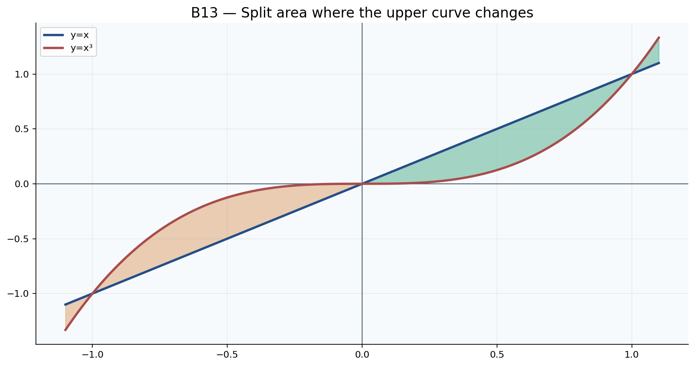
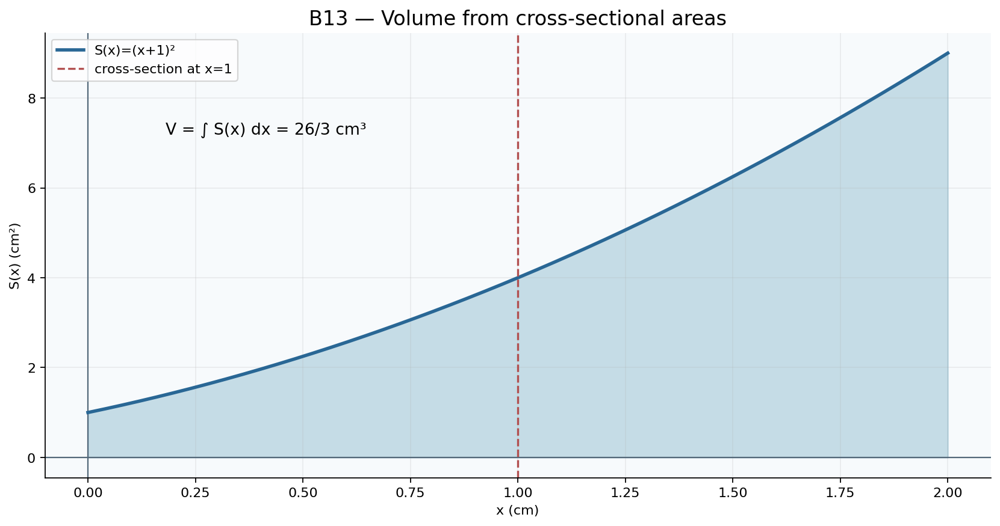
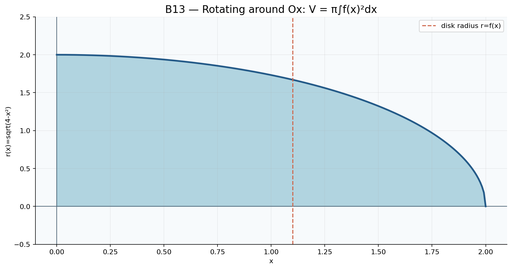

# Toán 12 · Bài 13. Ứng dụng của tích phân

TOÁN 12 · CHƯƠNG IV · SGK KẾT NỐI TRI THỨC · TẬP HAI · TRANG 19–26

Hiểu bản chất trước công thức, xem ví dụ có suy luận, đọc hình PNG gốc đã review và tự thử trước Core.
<nav class="thpt-r4-lesson-tabs"><a href="../">Chương IV</a><a href="../bai-12/">Bài 12 · Ôn lại</a></nav>

## 1. Vì sao cần học và kiến thức tiền đề

Diện tích/ thể tích của miền có biên cong được tính bằng cách cộng vô số lát nhỏ. Điều khó là dựng đúng miền và diện tích lát cắt, không phải thay cận vào một công thức học thuộc.

**Tiền đề cần tự kiểm:** tích phân xác định, diện tích hình phẳng, tìm nghiệm giao điểm, công thức πr² và đơn vị độ dài/diện tích.

## 2. Hiểu bản chất, công thức và điều kiện

<!-- OUTCOME_ID: G12-CHIV-B13-O01 -->

### 1. Diện tích hình phẳng dưới đường cong không âm

- **Vì sao cần biết:** ổng diện tích hình giới hạn bởi trục hoành và đường cong cần nguyên hàm để tính chính xác.

- **Kiến thức tiền đề:** iới hạn hình bởi y=f(x), Ox, x=a,b; kiểm f không âm.

- **Bản chất trước công thức:** ếu f≥0 liên tục [a,b], S=∫_a^b f(x)dx; S có đơn vị bình phương.

- **Định nghĩa và công thức:** (S=\int_a^b f(x)dx,\quad f\ge0.\)

- **Điều kiện và giới hạn:** hông dùng công thức này nguyên dạng nếu hàm âm trên bất kỳ đoạn con; phải dùng trị tuyệt đối.

- **Lý do chọn phương pháp:** iểm dấu, ghi miền hình, lập cận, tích phân và nêu đơn vị.

#### Ví dụ có suy luận

**Đề:** ính diện tích dưới y=x² trên [0,3].

**Lời giải có suy luận:** ì x²≥0, S=∫_0³x²dx=[x³/3]_0³=9 đv². Lý do chọn cách giải: Kiểm dấu, ghi miền hình, lập cận, tích phân và nêu đơn vị. Kiểm điều kiện áp dụng: Không dùng công thức này nguyên dạng nếu hàm âm trên bất kỳ đoạn con; phải dùng trị tuyệt đối.

**Bẫy cần tự phát hiện:** ính F(a)−F(b) hoặc không kiểm hàm âm trên miền hình.

<!-- OUTCOME_ID: G12-CHIV-B13-O02 -->

### 2. Diện tích với đồ thị cắt trục Ox

- **Vì sao cần biết:** ồ thị có thể xuống dưới trục nhưng diện tích hình phẳng vẫn là số không âm.

- **Kiến thức tiền đề:** ghiệm f=0, bảng xét dấu và tích phân từng đoạn.

- **Bản chất trước công thức:** hi f đổi dấu, S=∫_a^b |f(x)|dx phải chia tại nghiệm trong khoảng.

- **Định nghĩa và công thức:** (S=\int_a^b|f(x)|dx.\)

- **Điều kiện và giới hạn:** hia tại toàn bộ giao điểm với Ox; không lấy |∫_a^b f| làm thay thế. Chỉ chia theo các khoảng thật sự thay đổi dấu; nghiệm bội chẵn có thể không làm đổi dấu.

- **Lý do chọn phương pháp:** ìm nghiệm, phân vùng, trên vùng âm dùng −f, tính tổng.

#### Ví dụ có suy luận

**Đề:** iện tích giữa y=x và Ox từ −3 tới 3.

**Lời giải có suy luận:** =∫_{−3}^0(−x)dx+∫_0^3xdx=9. Lý do chọn cách giải: Tìm nghiệm, phân vùng, trên vùng âm dùng −f, tính tổng. Kiểm điều kiện áp dụng: Chia tại toàn bộ giao điểm với Ox; không lấy |∫_a^b f| làm thay thế.

**Bẫy cần tự phát hiện:** ấy tích phân có dấu trực tiếp khi hình cắt trục, làm các vùng triệt tiêu.

<!-- OUTCOME_ID: G12-CHIV-B13-O03 -->

### 3. Diện tích giữa hai đường cong không đổi vị trí trên/dưới

- **Vì sao cần biết:** iện tích kẹp giữa hai đường có thể dùng chiều cao lát cắt là hàm trên trừ hàm dưới.

- **Kiến thức tiền đề:** ai hàm liên tục f,g và xét thứ tự đồ thị trên [a,b].

- **Bản chất trước công thức:** ếu f≥g trên [a,b], S=∫_a^b(f−g)dx, không phải ∫f+∫g.

- **Định nghĩa và công thức:** (S=\int_a^b [f(x)-g(x)]dx\quad(f\ge g).\)

- **Điều kiện và giới hạn:** hải xác định chính xác đường trên/dưới, các giao điểm làm cận và dấu hiệu; đơn vị diện tích.

- **Lý do chọn phương pháp:** ấy hiệu độ cao (trên−dưới), tích phân theo x, kiểm S≥0.

#### Ví dụ có suy luận

**Đề:** ính diện tích giữa y=3x và y=x trên [0,2].

**Lời giải có suy luận:** x≥x, S=∫_0²2x dx=4 đv². Lý do chọn cách giải: Lấy hiệu độ cao (trên−dưới), tích phân theo x, kiểm S≥0. Kiểm điều kiện áp dụng: Phải xác định chính xác đường trên/dưới, các giao điểm làm cận và dấu hiệu; đơn vị diện tích.

**Bẫy cần tự phát hiện:** ấy hàm dưới trừ trên cho diện tích âm hoặc bỏ mất đường biên/cận.

<!-- OUTCOME_ID: G12-CHIV-B13-O04 -->

### 4. Hai đường cong cắt nhau: phải chia miền

- **Vì sao cần biết:** các miền khác nhau, đường trên/dưới có thể đảo vai trò; lấy một hiệu duy nhất sẽ mất diện tích.

- **Kiến thức tiền đề:** iải f(x)=g(x), khảo sát dấu hiệu f−g.

- **Bản chất trước công thức:** iện tích S=∫|f−g|; chia tại mọi giao điểm và chọn hiệu không âm mỗi đoạn.

- **Định nghĩa và công thức:** (S=\int_a^b|f(x)-g(x)|dx.\)

- **Điều kiện và giới hạn:** hông được giả thiết một đồ thị ở trên trên toàn đoạn nếu có giao điểm bên trong.

- **Lý do chọn phương pháp:** iải giao điểm, sắp xếp cận, thử dấu từng khoảng rồi tích phân phần dương.

#### Ví dụ có suy luận

**Đề:** iện tích giới hạn bởi y=x² và y=x trên [0,1].

**Lời giải có suy luận:** iao tại0,1; x≥x² trong [0,1], S=∫_0¹(x−x²)dx=1/6. Lý do chọn cách giải: Giải giao điểm, sắp xếp cận, thử dấu từng khoảng rồi tích phân phần dương. Kiểm điều kiện áp dụng: Không được giả thiết một đồ thị ở trên trên toàn đoạn nếu có giao điểm bên trong.

**Bẫy cần tự phát hiện:** uên giao điểm giữa khoảng và để các vùng triệt dấu.

<!-- OUTCOME_ID: G12-CHIV-B13-O05 -->

### 5. Lập mô hình hình học và kiểm đơn vị

- **Vì sao cần biết:** ể tính diện tích đất, vật liệu, hoặc mặt cắt, cần đổi hình thực thành miền [a,b] và giải thích đơn vị trục.

- **Kiến thức tiền đề:** ơn vị trục Ox/Oy và mô hình biểu thức f(x).

- **Bản chất trước công thức:** iện tích S được tính bằng tích phân độ cao theo chiều rộng, với đơn vị (đơn vị x)×(đơn vị y).

- **Định nghĩa và công thức:** (S=\int_a^b h(x)dx\quad(h\ge0).\)

- **Điều kiện và giới hạn:** hải phân biệt diện tích (m²) với thể tích (m³), không dùng công thức khi độ cao đổi dấu mà chưa chia.

- **Lý do chọn phương pháp:** êu biến x và đơn vị, mô tả hai cận, xét h≥0, rồi tính số và thứ nguyên.

#### Ví dụ có suy luận

**Đề:** ặt cắt có h(x)=3−x/2 (m), 0≤x≤4 (m). Tính diện tích.

**Lời giải có suy luận:** ≥1, S=[3x−x²/4]_0^4=12−4=8m². Lý do chọn cách giải: Nêu biến x và đơn vị, mô tả hai cận, xét h≥0, rồi tính số và thứ nguyên. Kiểm điều kiện áp dụng: Phải phân biệt diện tích (m²) với thể tích (m³), không dùng công thức khi độ cao đổi dấu mà chưa chia.

**Bẫy cần tự phát hiện:** hìn thấy tích phân rồi gọi kết quả m³ thay vì m², hoặc quên kiểm miền vật lý.

<!-- OUTCOME_ID: G12-CHIV-B13-O06 -->

### 6. Thể tích bằng tích phân diện tích mặt cắt

- **Vì sao cần biết:** ột khối không đều có lát cắt vuông góc thay đổi theo vị trí; lấy tích phân mặt cắt khôi phục thể tích.

- **Kiến thức tiền đề:** iện tích mặt cắt S(x) theo một trục dài, tổng thể tích các lát mỏng.

- **Bản chất trước công thức:** ếu lát cắt vuông góc Ox tại x có diện tích S(x)≥0, V=∫_a^b S(x)dx.

- **Định nghĩa và công thức:** (V=\int_a^b S(x)dx.\)

- **Điều kiện và giới hạn:** (x) phải tính bằng đơn vị diện tích, dx là độ dày đơn vị dài; V là đơn vị lập phương.

- **Lý do chọn phương pháp:** ác định hình cắt, tính S(x) đúng hình học, tích phân theo chiều dài.

#### Ví dụ có suy luận

**Đề:** hối có S(x)=3x² (cm²) tại 0≤x≤2 (cm). Tính V.

**Lời giải có suy luận:** =∫_0²3x²dx=[x³]_0²=8 cm³. Lý do chọn cách giải: Xác định hình cắt, tính S(x) đúng hình học, tích phân theo chiều dài. Kiểm điều kiện áp dụng: S(x) phải tính bằng đơn vị diện tích, dx là độ dày đơn vị dài; V là đơn vị lập phương.

**Bẫy cần tự phát hiện:** hầm tích phân cạnh hình vuông với tích phân diện tích (quên bình phương).

<!-- OUTCOME_ID: G12-CHIV-B13-O07 -->

### 7. Khối có lát cắt hình tròn

- **Vì sao cần biết:** iết bán kính của các lát cắt tròn tại từng vị trí cho phép tính thể tích vật có hình dạng biến thiên.

- **Kiến thức tiền đề:** iện tích hình tròn πr², r(x)≥0.

- **Bản chất trước công thức:** ếu mỗi lát vuông góc Ox là hình tròn bán kính r(x), S(x)=πr(x)², V=π∫_a^b r(x)²dx.

- **Định nghĩa và công thức:** (V=\pi\int_a^b r(x)^2dx.\)

- **Điều kiện và giới hạn:** hải phân biệt bán kính và đường kính; r(x) phải không âm và thuộc đơn vị độ dài.

- **Lý do chọn phương pháp:** ổi đường kính→bán kính nếu cần, bình phương r trước khi tích phân; giữ π chính xác.

#### Ví dụ có suy luận

**Đề:** át cắt tròn bán kính r(x)=x+1 (cm), x∈[0,1]cm. Tính V.

**Lời giải có suy luận:** =π∫_0¹(x+1)²dx=π[(x+1)³/3]_0¹=7π/3 cm³. Lý do chọn cách giải: Đổi đường kính→bán kính nếu cần, bình phương r trước khi tích phân; giữ π chính xác. Kiểm điều kiện áp dụng: Phải phân biệt bán kính và đường kính; r(x) phải không âm và thuộc đơn vị độ dài.

**Bẫy cần tự phát hiện:** ình phương đường kính thay vì bán kính, làm kết quả lớn gấp4.

<!-- OUTCOME_ID: G12-CHIV-B13-O08 -->

### 8. Khối tròn xoay quanh trục Ox

- **Vì sao cần biết:** hi quay miền phẳng giới hạn bởi y=f(x) và Ox quanh Ox, mỗi lát cắt thành một đĩa tròn.

- **Kiến thức tiền đề:** iện tích đĩa πr² và tích phân theo chiều dài.

- **Bản chất trước công thức:** hối tròn xoay quay miền giữa y=f(x) và Ox, x=a,b quanh Ox có V=π∫_a^b[f(x)]²dx.

- **Định nghĩa và công thức:** (V=\pi\int_a^b [f(x)]^2dx.\)

- **Điều kiện và giới hạn:** liên tục trên đoạn; nếu f đổi dấu, bán kính là |f| và bình phương f vẫn đúng khi miền giữa đồ thị và Ox; tránh dùng công thức nếu hình đang quay quanh trục khác Ox.

- **Lý do chọn phương pháp:** ác định trục quay, bán kính tại x là |f(x)|, tính π∫f², kiểm thể tích không âm.

#### Ví dụ có suy luận

**Đề:** uay miền dưới y=2x trên [0,2] quanh Ox. Tính V.

**Lời giải có suy luận:** =π∫_0²(2x)²dx=4π[x³/3]_0²=32π/3. Lý do chọn cách giải: Xác định trục quay, bán kính tại x là |f(x)|, tính π∫f², kiểm thể tích không âm. Kiểm điều kiện áp dụng: f liên tục trên đoạn; nếu f đổi dấu, bán kính là |f| và bình phương f vẫn đúng khi miền giữa đồ thị và Ox; tránh dùng công thức nếu hình đang quay quanh trục khác Ox.

**Bẫy cần tự phát hiện:** hầm V=π∫f dx hoặc quên bình phương bán kính; dùng diện tích m² làm thể tích m³.

## 3. Đọc hình minh họa gốc

<figure class="thpt-r4-plot g12-chi-figure"><figcaption>Hai đồ thị y=x và y=x³ trên [-1,1] giao tại -1, 0, 1; đổi đường trên và dưới tại x=0. Hình chính xác là một biểu diễn có trục và nhãn; chỉ suy từ đồ thị những điều có căn cứ và kiểm bằng phép toán.</figcaption></figure>

<figure class="thpt-r4-plot g12-chi-figure"><figcaption>Một khối có lát cắt hình vuông cạnh x+1, diện tích S(x)=(x+1)²; tích phân theo x là thể tích. Hình chính xác là một biểu diễn có trục và nhãn; chỉ suy từ đồ thị những điều có căn cứ và kiểm bằng phép toán.</figcaption></figure>

<figure class="thpt-r4-plot g12-chi-figure"><figcaption>Miền dưới đường y=sqrt(4-x²) từ 0 đến2 quay quanh Ox, mỗi lát cắt là đĩa bán kính y và diện tích πy². Hình chính xác là một biểu diễn có trục và nhãn; chỉ suy từ đồ thị những điều có căn cứ và kiểm bằng phép toán.</figcaption></figure>

## 4. Tự thử trước Core

Hãy tự giải rồi mới chủ động mở đối chiếu. Không ghi điểm hay Mastery.

<!-- FIRST_TRY_ID: B13-T01 -->
### Tình huống 1

ai đồ thị y=x² và y=x trên [0,1]: đồ thị nào ở trên và cần lấy hiệu theo chiều nào?

Mở đối chiếu sau khi tự thử

Trên [0,1], x≥x² nên lấy x−x². Diện tích =1/6.

<!-- FIRST_TRY_ID: B13-T02 -->
### Tình huống 2

hi quay miền dưới y=x (0≤x≤2) quanh Ox, lát cắt tại x có bán kính và diện tích bao nhiêu?

Mở đối chiếu sau khi tự thử

Bán kính r=x, diện tích đĩa S=πx²; thể tích =π∫_0²x²dx=8π/3.

## 5. Chuyển sang Core và Luyện tập

Sau khi học kiến thức và tự thử, em luyện đúng Bài 13; hãy tự giải từng câu trước khi nộp để xem lời giải hoặc rubric.

<nav class="thpt-r4-lesson-tabs"><a href="../luyen-tap/#b13-core">✎ Core · Bài 13</a><a href="../luyen-tap/#b13-practice">✎ Luyện tập, Vận dụng và Tự luận</a><a href="../luyen-tap/#b13-help">Khi gặp khó khăn</a></nav>

