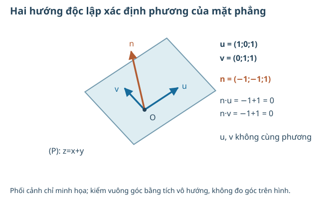
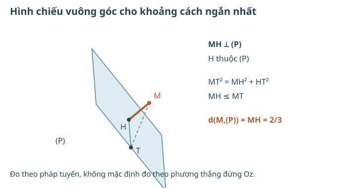

# Bài 14. Phương trình mặt phẳng

TOÁN 12 · CHƯƠNG V · KIẾN THỨC SGK KNTT · TẬP HAI

Mô tả một mặt phẳng bằng tọa độ, lập phương trình từ các dữ kiện hình học và tính khoảng cách theo phương vuông góc.

<nav class="thpt-r4-lesson-tabs"><a href="../">Chương V</a><a href="../luyen-tap/#b14-core">Core/Luyện tập</a><a href="../bai-15/">Bài tiếp theo</a></nav>

=== "Khám phá kiến thức"

    ### 1.1. Vectơ pháp tuyến và cặp vectơ chỉ phương của mặt phẳng

    Một vật đặt trên mặt bàn nằm ngang chịu phản lực của bàn theo phương thẳng đứng. Mũi tên theo phương ấy không chạy dọc mặt bàn mà vuông góc với mặt bàn. Nếu ta nghiêng bàn, phương vuông góc cũng thay đổi. Trong hình học, một vectơ khác không có giá vuông góc với mặt phẳng được gọi là vectơ pháp tuyến của mặt phẳng đó.

    Biết một điểm trên mặt phẳng và một pháp tuyến khác không, ta xác định được duy nhất mặt phẳng: đi qua điểm đó, mặt phẳng phải có mọi hướng nằm ngang theo nghĩa vuông góc với pháp tuyến. Độ dài và chiều của mũi tên pháp tuyến không quyết định mặt phẳng; nhân với số khác 0 vẫn cho cùng phương pháp tuyến.

    <!-- OUTCOME_ID: G12-CHV-B14-O01 -->
    Đôi khi đề chưa cho pháp tuyến mà chỉ cho hai hướng nằm trong hoặc song song với mặt phẳng. Chẳng hạn \(\vec u=(1;0;1),\vec v=(0;1;1)\) là hai hướng của mặt phẳng \(z=x+y\). Chúng không cùng phương. Ta cần một vectơ \(\vec n=(A;B;C)\ne\vec0\) vuông góc với cả hai. Điều kiện tích vô hướng bằng 0 cho \(A+C=0,\ B+C=0\). Chọn \(C=1\), nhận được \(\vec n=(-1;-1;1)\).

    <figure class="thpt-r4-plot thpt-r4-concept-figure"><figcaption>Hai mũi tên xanh nằm dọc mặt phẳng; mũi tên cam vuông góc với cả hai. Không đo góc trên hình phối cảnh. Kiểm bằng hai tích vô hướng bằng 0.</figcaption></figure>

    Với hai vectơ bất kì \(\vec u=(a;b;c),\vec v=(a';b';c')\), có một cách tính trực tiếp vectơ vuông góc với cả hai, gọi là tích có hướng:
    \[
    [\vec u,\vec v]=(bc'-b'c;\ ca'-c'a;\ ab'-a'b).
    \]
    Tính lần lượt theo các cặp tọa độ \(yz,zx,xy\). Vì sao đúng? Tích vô hướng với \(\vec u\) bằng \(a(bc'-b'c)+b(ca'-c'a)+c(ab'-a'b)=0\) do các hạng tử triệt tiêu từng cặp. Tích vô hướng với \(\vec v\) cũng bằng 0. Nếu \(\vec u,\vec v\) không cùng phương, tích có hướng khác không. Nếu chúng cùng phương, kể cả trường hợp có vectơ-không, tích có hướng bằng vectơ-không, nên không xác định được pháp tuyến theo cách này. Khi tích có hướng bằng 0, không nói vectơ-không có một giá vuông góc.

    Ví dụ trên cho \([\vec u,\vec v]=(0\cdot1-1\cdot1;\ 1\cdot0-1\cdot1;\ 1\cdot1-0\cdot0)=(-1;-1;1)\), đúng với cách giải hệ. Đảo thứ tự cho vectơ đối \((1;1;-1)\), vẫn là một pháp tuyến hợp lệ.

    Hai vectơ không cùng phương, có giá nằm trong hoặc song song với mặt phẳng, tạo thành một cặp vectơ chỉ phương. Một hướng riêng lẻ chưa đủ: còn vô số mặt phẳng chứa đường theo hướng đó. Hai hướng độc lập mới xác định được phương của mặt phẳng.

    <!-- FIRST_TRY_ID: B14-T01 -->
    **Vận dụng.** Cho \(\vec u=(2;1;0),\vec v=(1;0;3)\). Tìm tích có hướng và kiểm nó có thể làm pháp tuyến của mặt phẳng nhận hai vectơ trên làm cặp chỉ phương không.

    ??? question "Đối chiếu"

        \([\vec u,\vec v]=(3;-6;-1)\ne\vec0\). Hai tích vô hướng là \(3\cdot2-6\cdot1=0\) và \(3\cdot1-1\cdot3=0\). Vì vậy hai vectơ không cùng phương và tích có hướng là một pháp tuyến của mặt phẳng có cặp chỉ phương này.

    ??? tip "Kiểm lỗi"

        Đặc biệt kiểm thành phần thứ hai: \(0\cdot1-3\cdot2=-6\). Tích vô hướng của vectơ vừa tính với từng vectơ đã cho phải bằng 0; nếu không, hãy kiểm lại thứ tự các tích.

    Tích có hướng còn xuất hiện trong mômen lực. Giả sử tay tác dụng lực \(\vec F=(0;20;0)\) N tại vị trí có vectơ \(\overrightarrow{OP}=(0{,}25;0;0)\) m so với tâm quay. Mômen \(\vec M=[\overrightarrow{OP},\vec F]=(0;0;5)\) N·m. Khi giữ nguyên lực và gấp đôi vectơ vị trí, cả ba thành phần của tích có hướng đều gấp đôi, nên mômen gấp đôi. Điều đó giải thích vì sao với cùng hướng tác dụng thích hợp, cán cờ lê dài hơn có thể tạo cùng mômen bằng lực nhỏ hơn.

    ### 1.2. Phương trình tổng quát của mặt phẳng

    <!-- OUTCOME_ID: G12-CHV-B14-O02 -->
    Giả sử mặt phẳng \((P)\) đi qua \(M_0(1;-2;3)\), nhận \(\vec n=(2;-1;1)\) làm pháp tuyến. Một điểm bất kì \(M(x;y;z)\) thuộc \((P)\) khi và chỉ khi \(\overrightarrow{M_0M}=(x-1;y+2;z-3)\) có tích vô hướng với \(\vec n\) bằng 0. Điều này cũng đúng khi \(M=M_0\), vì tích với vectơ-không bằng 0.

    Vậy \(2(x-1)-(y+2)+(z-3)=0\), hay \(2x-y+z-7=0\). Phương trình này không chỉ biểu diễn vài điểm: mọi bộ tọa độ thỏa phương trình đều thuộc đúng mặt phẳng ấy.

    Tổng quát, từ pháp tuyến \((A;B;C)\ne\vec0\) và một điểm \(M_0(x_0;y_0;z_0)\), khai triển điều kiện tích vô hướng bằng 0 ta được \(Ax+By+Cz+D=0\), trong đó \(D=-(Ax_0+By_0+Cz_0)\). Ngược lại, nếu ít nhất một trong ba hệ số \(A,B,C\) khác 0, phương trình luôn có nghiệm (giải theo biến có hệ số khác 0) và tập nghiệm là mặt phẳng nhận \((A;B;C)\) làm pháp tuyến.

    Đọc phương trình \(z=4\): mọi điểm có cao độ 4 đều thuộc mặt phẳng ngang, pháp tuyến là \((0;0;1)\). Còn \(y=0\) là mặt phẳng tọa độ \(Oxz\), chứa cả trục \(Ox\) lẫn \(Oz\). Hệ số bằng 0 nghĩa là biến tương ứng không bị ràng buộc riêng trong phương trình; không có nghĩa tọa độ của biến ấy luôn bằng 0.

    **Vận dụng.** Trong các phương trình \(2x-y+3=0\), \(x^2+y+z=0\), \(0x+0y+0z-2=0\), phương trình nào là phương trình tổng quát của mặt phẳng? Với phương trình hợp lệ, kiểm điểm \(A(1;5;7)\).

    ??? question "Đối chiếu"

        Chỉ \(2x-y+3=0\) có dạng yêu cầu, pháp tuyến \((2;-1;0)\ne\vec0\). Thay \(A\) được \(2-5+3=0\), nên \(A\) thuộc mặt phẳng. Phương trình thứ hai chứa \(x^2\), không phải dạng tổng quát. Phương trình thứ ba vô nghiệm, không xác định mặt phẳng.

    ??? tip "Kiểm lỗi"

        Không đòi cả ba hệ số phải khác 0; chỉ cần không đồng thời bằng 0. Với hệ số của \(z\) bằng 0, em vẫn kiểm được điểm bằng hai tọa độ còn lại.

    ### 1.3. Lập phương trình tổng quát của mặt phẳng

    Mục tiêu chung của mọi bài lập phương trình là tìm **một điểm thuộc mặt phẳng và một pháp tuyến khác không**. Nếu đề cho những dữ kiện khác, hãy chuyển chúng thành hai thông tin ấy.

    Khi đã biết một điểm và pháp tuyến, như ở mục trước, viết ngay dạng điểm – pháp tuyến. Nếu mặt phẳng qua \(A(2;1;-3)\) và vuông góc với \(Oz\), pháp tuyến có thể là \((0;0;1)\); phương trình \(z+3=0\). Không chọn \((1;0;0)\) chỉ vì nhìn thấy một trục tọa độ.

    <!-- OUTCOME_ID: G12-CHV-B14-O03 -->
    Nếu biết ba điểm không thẳng hàng \(A(1;0;2), B(3;1;2), C(0;2;3)\), hai hướng \(\overrightarrow{AB}=(2;1;0), \overrightarrow{AC}=(-1;2;1)\) cùng nằm trong mặt phẳng. Tích có hướng là \((1;-2;5)\ne\vec0\). Vậy phương trình qua \(A\) là
    \[
    (x-1)-2y+5(z-2)=0\Leftrightarrow x-2y+5z-11=0.
    \]
    Thế \(B\) cho \(3-2+10-11=0\), thế \(C\) cho \(0-4+15-11=0\). Ba điểm đều thỏa phương trình, và tích có hướng khác 0 chứng minh chúng không thẳng hàng. Nếu tích có hướng bằng 0, ba điểm không đủ xác định duy nhất một mặt phẳng.

    <!-- OUTCOME_ID: G12-CHV-B14-O04 -->
    Nếu biết một điểm \(A\) và cặp vectơ chỉ phương \(\vec u,\vec v\), cũng làm như trên nhưng dùng trực tiếp hai vectơ, không cần tìm thêm hai điểm. Chẳng hạn mặt phẳng chứa trục \(Oy\) và điểm \(B(2;1;3)\). Nó chứa \(O\) và nhận \((0;1;0)\), \(\overrightarrow{OB}=(2;1;3)\) làm hai hướng độc lập. Tích có hướng \((3;0;-2)\) cho phương trình \(3x-2z=0\). Thay \((0;t;0)\) với mọi \(t\in\mathbb R\) đều đúng: mặt phẳng thực sự chứa toàn bộ \(Oy\), không chỉ chứa gốc.

    Nếu đề yêu cầu mặt phẳng song song với một đường thẳng (không có điểm chung), điều kiện pháp tuyến vuông góc với hướng đường thẳng mới đảm bảo hướng; cần kiểm thêm một điểm của đường không thuộc mặt phẳng. Nếu đề yêu cầu chứa đường, phải kiểm một điểm của đường thuộc mặt phẳng. Không đánh đồng hai trường hợp.

    **Vận dụng.** Một mặt phẳng cắt ba trục tại \(A(2;0;0),B(0;3;0),C(0;0;6)\). Lập phương trình.

    ??? question "Đối chiếu"

        \(\overrightarrow{AB}=(-2;3;0)\), \(\overrightarrow{AC}=(-2;0;6)\); tích có hướng \((18;12;6)\ne\vec0\). Chọn pháp tuyến \((3;2;1)\), qua \(A\) được \(3x+2y+z=6\). Chia hai vế cho 6, nhận \(x/2+y/3+z/6=1\). Cả ba điểm đều thỏa.

    ??? tip "Kiểm lỗi"

        Các đoạn chắn 2, 3, 6 không phải trực tiếp là ba hệ số của pháp tuyến. Hãy thế từng giao điểm vào phương trình; nếu viết \(2x+3y+6z=1\) thì cả ba không thỏa.

    Tổng quát, nếu mặt phẳng cắt ba trục ở \(A(a;0;0),B(0;b;0),C(0;0;c)\) với \(abc\ne0\), phương trình theo đoạn chắn là \(x/a+y/b+z/c=1\). Thật vậy ba điểm không thẳng hàng, cả ba thỏa phương trình này, và bộ hệ số \((1/a;1/b;1/c)\) khác không. Vì thế đây là duy nhất mặt phẳng qua ba điểm. Không dùng dạng này khi có đoạn chắn bằng 0 hoặc mặt phẳng không có giao điểm duy nhất với một trục.

    Trở lại bài toán chuyển động trong không gian: một vật ở \(M(t)=(2\cos t;\sin t;\cos t+\sin t)\). Có phải vật luôn nằm trên cùng một mặt phẳng? Tại \(t=0,\pi/2,\pi\), ta nhận \((2;0;1),(0;1;1),(-2;0;-1)\). Hai vectơ nối từ điểm đầu là \((-2;1;0),(-4;0;-2)\), tích có hướng \((-2;-4;4)\ne\vec0\), cho mặt phẳng \(x+2y-2z=0\). Thay biểu thức \(M(t)\) vào luôn được \(2\cos t+2\sin t-2(\cos t+\sin t)=0\). Ba điểm giúp tìm mặt phẳng ứng viên, còn đẳng thức đúng với mọi \(t\) mới chứng minh cả quỹ đạo nằm trong mặt phẳng.

    ### 1.4. Điều kiện để hai mặt phẳng vuông góc với nhau

    Hãy tưởng tượng sàn nhà và một bức tường thẳng đứng. Pháp tuyến của sàn hướng thẳng đứng, pháp tuyến của tường nằm ngang. Hai pháp tuyến vuông góc, đúng với góc vuông giữa hai mặt phẳng. Tổng quát, góc giữa hai mặt phẳng bằng góc giữa hai đường thẳng lần lượt vuông góc với chúng. Vì vậy hai mặt phẳng vuông góc khi và chỉ khi hai pháp tuyến khác không vuông góc.

    <!-- OUTCOME_ID: G12-CHV-B14-O05 -->
    Với \((P):Ax+By+Cz+D=0,\ (Q):A'x+B'y+C'z+D'=0\), điều kiện là \(AA'+BB'+CC'=0\). Hệ số tự do không ảnh hưởng tới hướng. Ví dụ \(x+y+z-2=0\) và \(x-y+3=0\) có pháp tuyến \((1;1;1),(1;-1;0)\), tích vô hướng bằng \(1-1+0=0\); hai mặt phẳng vuông góc.

    Khi muốn lập mặt phẳng \((P)\) vuông góc với \((Q)\), có thể dùng pháp tuyến của \((Q)\) làm một hướng nằm trong hoặc song song với \((P)\). Nếu \((P)\) còn chứa đường qua hai điểm phân biệt \(A,B\), dùng \(\overrightarrow{AB}\) làm hướng thứ hai. Tích có hướng của hai vectơ ấy cho pháp tuyến nếu chúng không cùng phương.

    **Vận dụng.** Lập mặt phẳng \((P)\) qua \(A(1;0;0),B(1;2;1)\) và vuông góc với \((Q):x+z-3=0\).

    ??? question "Đối chiếu"

        \(\overrightarrow{AB}=(0;2;1)\), \(\vec n_Q=(1;0;1)\). Tích có hướng là \((2;1;-2)\ne\vec0\). Vậy \((P):2(x-1)+y-2z=0\), hay \(2x+y-2z-2=0\). Cả \(A,B\) thỏa; \((2;1;-2)\cdot(1;0;1)=0\).

    ??? tip "Kiểm lỗi"

        Không lấy luôn \(\vec n_Q\) làm pháp tuyến của \((P)\): như vậy hai pháp tuyến cùng phương, không vuông góc. Đề cho hai điều kiện hình học, cần kiểm cả hai.

    Nếu \(\overrightarrow{AB}\) cùng phương với \(\vec n_Q\), hai điều kiện chỉ xác định một hướng; khi ấy có vô số mặt phẳng qua \(AB\) vuông góc với \((Q)\), không dùng tích có hướng bằng 0 làm pháp tuyến.

    ### 1.5. Điều kiện để hai mặt phẳng song song với nhau

    Hai sàn ở hai tầng khác nhau có cùng phương pháp tuyến nhưng không nằm cùng một mặt phẳng. Nếu chúng ở cùng độ cao, hai mặt phẳng trùng nhau. Vì vậy phải kiểm **cả hướng lẫn vị trí**, không chỉ kiểm ba hệ số đầu.

    Cho \((P):x+2y-z-4=0\). Mặt phẳng \((Q):2x+4y-2z+1=0\) có pháp tuyến gấp đôi pháp tuyến của \((P)\). Chia toàn bộ phương trình \((Q)\) cho 2, được \(x+2y-z+1/2=0\), khác \((P)\) ở hệ số tự do. Hai mặt phẳng song song phân biệt. Nếu thay hệ số tự do của \((Q)\) bằng \(-8\), phương trình sau khi chia 2 trùng hoàn toàn với \((P)\).

    Nếu hai pháp tuyến không cùng phương, hai mặt phẳng cắt nhau theo một đường thẳng. Chúng có thể vuông góc nếu tích vô hướng bằng 0, nhưng không phải mọi trường hợp cắt nhau đều vuông góc.

    **Vận dụng.** Xét \((P):2x-z+1=0\), \((Q):-4x+2z-2=0\), \((R):4x-2z+3=0\), \((S):y+z=0\). Xác định vị trí từng mặt phẳng đối với \((P)\).

    ??? question "Đối chiếu"

        \((Q)\) trùng \((P)\) vì cả bốn hệ số gấp \(-2\) lần. \((R)\) song song phân biệt vì pháp tuyến gấp 2 lần nhưng \(3\ne2\cdot1\). Pháp tuyến \((0;1;1)\) của \((S)\) không cùng phương với \((2;0;-1)\), nên cắt \((P)\); tích vô hướng bằng \(-1\ne0\), nên không vuông góc.

    ??? tip "Kiểm lỗi"

        Dùng cùng một hệ số nhân \(k\ne0\) cho ba hệ số pháp tuyến, rồi kiểm \(D'=kD\). Không chia từng cặp tọa độ nếu một hệ số bằng 0.

    Trong mô hình kết quả ba môn thi, nếu \(x,y,z\) là điểm từng môn, các thí sinh có cùng tổng điểm \(T\) nằm trên mặt phẳng \(x+y+z-T=0\). Các tổng điểm khác nhau cho các mặt phẳng song song phân biệt, dù chỉ một phần của mỗi mặt phẳng ứng với các điểm thi hợp lệ.

    ### 1.6. Khoảng cách từ một điểm đến một mặt phẳng

    <!-- OUTCOME_ID: G12-CHV-B14-O06 -->
    Khoảng cách ngắn nhất từ một vật đến tường là độ dài đoạn vuông góc với mặt phẳng chứa tường. Nếu đo theo một phương xiên hoặc phương thẳng đứng không vuông góc với tường, ta có thể nhận độ dài khác.

    Cho điểm \(M(1;2;3)\) và mặt phẳng \((P):2x-y+2z-4=0\). Gọi \(H\) là hình chiếu vuông góc của \(M\) lên \((P)\). Với mọi \(T\) thuộc \((P)\), \(MH\perp HT\), nên \(MT^2=MH^2+HT^2\ge MH^2\). Do đó \(MH\) là khoảng cách ngắn nhất.

    <figure class="thpt-r4-plot thpt-r4-concept-figure"><figcaption>Đọc đoạn cam \(MH\): đoạn này theo phương pháp tuyến, không nhất thiết theo \(Oz\). Đoạn xiên \(MT\) dài hơn, vì tam giác \(MHT\) vuông tại \(H\).</figcaption></figure>

    Tổng quát, đặt \(\vec n=(A;B;C)\ne\vec0\), \(L=Ax_0+By_0+Cz_0+D\) với \(M(x_0;y_0;z_0)\). Vì \(\overrightarrow{MH}\) cùng phương với \(\vec n\) (hoặc bằng \(\vec0\) khi \(M\) đã thuộc mặt phẳng), viết \(\overrightarrow{MH}=k\vec n\). Suy ra \(H(x_0+kA;y_0+kB;z_0+kC)\). Thế tọa độ vào phương trình mặt phẳng:
    \[
    L+k(A^2+B^2+C^2)=0
    \Rightarrow k=-\frac L{A^2+B^2+C^2}.
    \]
    Vậy \(MH=|k|\sqrt{A^2+B^2+C^2}\), hay
    \[
    d(M,(P))=\frac{|Ax_0+By_0+Cz_0+D|}{\sqrt{A^2+B^2+C^2}}.
    \]
    Tử số đo giá trị vế trái tại \(M\), nhưng chưa phải khoảng cách. Chia cho độ dài pháp tuyến để kết quả không phụ thuộc cách nhân phương trình; lấy trị tuyệt đối để khoảng cách không âm.

    Với ví dụ trên, \(L=2-2+6-4=2,\ |\vec n|=3\), nên khoảng cách \(2/3\). Hình chiếu là \(H=M-(2/9)\vec n=(5/9;20/9;23/9)\). Thế \(H\) vào phương trình được 0, còn \(\overrightarrow{MH}=-(2/9)\vec n\), đúng phương vuông góc.

    Nếu hai mặt phẳng song song có cùng pháp tuyến, viết \((P):Ax+By+Cz+D_1=0\), \((Q):Ax+By+Cz+D_2=0\). Với mọi \(M\) trên \((P)\), \(Ax_0+By_0+Cz_0=-D_1\). Thế vào công thức khoảng cách tới \((Q)\), nhận \(|D_2-D_1|/|\vec n|\). Công thức không phụ thuộc chọn điểm nào trên \((P)\). Nếu pháp tuyến ban đầu chỉ tỉ lệ, cần nhân hoặc chia toàn bộ một phương trình để có cùng ba hệ số đầu trước.

    **Vận dụng.** Hai mặt phẳng \((P):x-2y+2z-3=0,\ (Q):2x-4y+4z+12=0\). Tính khoảng cách giữa chúng.

    ??? question "Đối chiếu"

        Chia phương trình \((Q)\) cho 2, được \(x-2y+2z+6=0\). Hai mặt phẳng song song phân biệt. Khoảng cách bằng \(|6-(-3)|/\sqrt{1+4+4}=9/3=3\).

        Kiểm bằng điểm \(M(3;0;0)\in(P)\): \(d(M,(Q))=|6+12|/\sqrt{4+16+16}=18/6=3\).

    ??? tip "Kiểm lỗi"

        Nếu dùng \(|12-(-3)|/3\), em đã trừ hai hệ số tự do thuộc hai cách chuẩn hóa khác nhau. Viết lại hai phương trình với cùng pháp tuyến rồi mới trừ.

    Một ứng dụng là tính kích thước vùng quan sát. Trong mô hình lý tưởng, camera đặt cách mặt phẳng 4 m theo phương vuông góc, vùng nhìn là hình nón tròn có góc mở toàn phần \(90^\circ\), trục nón vuông góc mặt phẳng. Thiết diện qua trục tạo tam giác vuông với góc tại camera \(45^\circ\); bán kính vùng quan sát \(r=4\tan45^\circ=4\) m. Nếu camera chiếu xiên hoặc trường nhìn không có dạng nón tròn, không thể tự kết luận vùng quan sát là hình tròn. Khoảng cách đến mặt phẳng vô hạn cũng không nhất thiết bằng khoảng cách đến một tấm tường hữu hạn nếu chân chiếu nằm ngoài tấm.

=== "Kiến thức SGK"

    ### 2.1. Vectơ pháp tuyến và cặp vectơ chỉ phương của mặt phẳng

    
<strong>Định nghĩa — Vectơ pháp tuyến.</strong> Vectơ \(\vec n\ne\vec0\) là pháp tuyến của mặt phẳng \((P)\) khi giá của nó vuông góc với \((P)\). Mọi \(k\vec n\) với \(k\ne0\) cũng là pháp tuyến. Một điểm và một pháp tuyến xác định duy nhất một mặt phẳng.

    
<strong>Định nghĩa — Tích có hướng.</strong>
Với \(\vec u=(a;b;c),\vec v=(a';b';c')\), tích có hướng là vectơ

\(\displaystyle [\vec u,\vec v]=(bc'-b'c;\ ca'-c'a;\ ab'-a'b).\)

Hai tích vô hướng \([\vec u,\vec v]\cdot\vec u\), \([\vec u,\vec v]\cdot\vec v\) đều bằng 0. Tích có hướng bằng vectơ-không khi và chỉ khi hai vectơ cùng phương.

    Có thể dùng định thức cấp hai \(\begin{vmatrix}p&q\\r&s\end{vmatrix}=ps-qr\) để tính ba thành phần theo cặp \(yz,zx,xy\). Đảo thứ tự hai vectơ làm đổi dấu tích có hướng. Với \(\vec u,\vec v\) không cùng phương, tích có hướng là vectơ khác không vuông góc với cả hai.

    
<strong>Định nghĩa — Cặp vectơ chỉ phương.</strong> Hai vectơ không cùng phương có giá nằm trong hoặc song song với \((P)\) là cặp vectơ chỉ phương của \((P)\).

    
<strong>Tính chất.</strong> Nếu \(\vec u,\vec v\) là cặp vectơ chỉ phương của \((P)\), thì \([\vec u,\vec v]\) là một vectơ pháp tuyến của \((P)\).

    <figure class="thpt-r4-plot"><figcaption>Ví dụ \(\vec u=(1;0;1),\vec v=(0;1;1)\) cho pháp tuyến \((-1;-1;1)\); cả hai tích vô hướng bằng 0.</figcaption></figure>

    ### 2.2. Phương trình tổng quát của mặt phẳng

    
<strong>Định nghĩa — Phương trình tổng quát.</strong>
Mỗi mặt phẳng trong \(Oxyz\) có phương trình

\(\displaystyle Ax+By+Cz+D=0,\quad A^2+B^2+C^2>0.\)

Ngược lại, mỗi phương trình như vậy xác định một mặt phẳng có pháp tuyến \((A;B;C)\). Điểm thuộc mặt phẳng khi và chỉ khi tọa độ của nó thỏa phương trình.

    Nhân cả bốn hệ số với cùng số khác 0 cho phương trình của cùng mặt phẳng. Nếu \(A=B=C=0\), phương trình hoặc vô nghiệm (\(D\ne0\)) hoặc đúng với toàn bộ không gian (\(D=0\)), không biểu diễn một mặt phẳng. Các mặt phẳng tọa độ \(Oxy,Oyz,Oxz\) lần lượt có phương trình \(z=0,x=0,y=0\).

    ### 2.3. Lập phương trình tổng quát của mặt phẳng

    
<strong>Quy tắc — Qua một điểm, biết pháp tuyến.</strong>
Qua \(M_0(x_0;y_0;z_0)\), nhận \(\vec n=(A;B;C)\ne\vec0\) làm pháp tuyến:

\(\displaystyle A(x-x_0)+B(y-y_0)+C(z-z_0)=0.\)

Điều kiện trên chính là \(\vec n\cdot\overrightarrow{M_0M}=0\). Khi khai triển, \(D=-Ax_0-By_0-Cz_0\).

    | Dữ kiện | Cách tìm pháp tuyến và điểm |
    | :-- | :-- |
    | Qua \(M_0\), có cặp chỉ phương \(\vec u,\vec v\) | \(\vec n=[\vec u,\vec v]\ne\vec0\); dùng \(M_0\) |
    | Qua ba điểm không thẳng hàng \(A,B,C\) | \(\vec n=[\overrightarrow{AB},\overrightarrow{AC}]\ne\vec0\); dùng \(A\) |
    | Vuông góc một trục hay một đường | Lấy vectơ chỉ phương của trục hay đường làm pháp tuyến |
    | Chứa một trục và một điểm ngoài trục | Dùng hướng trục và vectơ từ gốc tới điểm làm cặp chỉ phương |

    Sau khi viết phương trình, thay các điểm được cho và kiểm điều kiện hướng. Nếu hai hướng cùng phương, chúng không phải cặp chỉ phương; phải tìm thêm dữ kiện nếu đề chưa đủ. Mặt phẳng cắt ba trục tại \((a;0;0),(0;b;0),(0;0;c)\), \(abc\ne0\), có phương trình theo đoạn chắn \(x/a+y/b+z/c=1\).

    ### 2.4. Điều kiện để hai mặt phẳng vuông góc với nhau

    
<strong>Quy tắc — Hai mặt phẳng vuông góc.</strong>
Với hai mặt phẳng có pháp tuyến khác không \(\vec n=(A;B;C),\vec n'=(A';B';C')\),

\(\displaystyle (P)\perp(Q)\Leftrightarrow\vec n\cdot\vec n'=0\Leftrightarrow AA'+BB'+CC'=0.\)

Khi đó pháp tuyến của mặt phẳng này có giá nằm trong hoặc song song với mặt phẳng kia. Không cần so sánh hệ số tự do để kiểm vuông góc.

    Nếu cần lập mặt phẳng qua hai điểm phân biệt và vuông góc một mặt phẳng đã biết, dùng hướng nối hai điểm và pháp tuyến mặt phẳng đã biết làm cặp chỉ phương, khi chúng không cùng phương. Nếu chúng cùng phương, điều kiện chưa xác định duy nhất mặt phẳng. Nếu mặt phẳng cần lập vuông góc với hai mặt phẳng có pháp tuyến không cùng phương, tích có hướng của hai pháp tuyến là một pháp tuyến cần tìm.

    ### 2.5. Điều kiện để hai mặt phẳng song song với nhau

    
<strong>Quy tắc — Song song và trùng nhau.</strong>
Cho \((P):Ax+By+Cz+D=0\) và \((Q):A'x+B'y+C'z+D'=0\), cả hai có pháp tuyến khác không. Nếu tồn tại \(k\ne0\) sao cho \((A';B';C')=k(A;B;C)\), thì:

• \(D'\ne kD\): hai mặt phẳng song song phân biệt. • \(D'=kD\): hai mặt phẳng trùng nhau.

Nếu hai pháp tuyến không cùng phương, hai mặt phẳng cắt nhau.

    Cách kiểm: tìm hệ số \(k\) từ một thành phần khác 0 rồi kiểm các thành phần còn lại, kể cả các thành phần bằng 0. Chỉ sau khi pháp tuyến cùng phương mới kiểm \(D'\) với \(kD\).

    ### 2.6. Khoảng cách từ một điểm đến một mặt phẳng

    
<strong>Quy tắc — Khoảng cách điểm đến mặt phẳng.</strong>
Với \(M(x_0;y_0;z_0)\), \((P):Ax+By+Cz+D=0,\ A^2+B^2+C^2>0\),

\(\displaystyle d(M,(P))=\frac{|Ax_0+By_0+Cz_0+D|}{\sqrt{A^2+B^2+C^2}}.\)

Đây là độ dài đoạn vuông góc từ \(M\) đến hình chiếu \(H\) trên mặt phẳng. Khoảng cách bằng 0 khi và chỉ khi \(M\in(P)\).

    Đặt \(L=Ax_0+By_0+Cz_0+D\), khi cần tìm hình chiếu, dùng
    \[
    H=M-\frac{L}{A^2+B^2+C^2}(A;B;C)
    \]
    (hiểu là phép tính từng tọa độ). Kiểm \(H\) thỏa phương trình và \(\overrightarrow{MH}\) là bội của pháp tuyến.

    <figure class="thpt-r4-plot"><figcaption>\(MH\) là khoảng cách ngắn nhất; \(MT^2=MH^2+HT^2\) đối với mọi \(T\) trên mặt phẳng.</figcaption></figure>

    Với hai mặt phẳng song song đã viết cùng pháp tuyến \((A;B;C)\) và hệ số tự do \(D_1,D_2\), khoảng cách là
    \[
    d=\frac{|D_2-D_1|}{\sqrt{A^2+B^2+C^2}}.
    \]
    Nếu mặt phẳng trùng nhau, biểu thức cho 0. Khi hai mặt phẳng cắt nhau, không áp dụng công thức khoảng cách giữa hai mặt phẳng song song. Nếu dùng công thức khoảng cách điểm–mặt phẳng trong mô hình thực tế, cần xác định đúng hệ tọa độ vuông góc và đơn vị độ dài.

=== "Ví dụ"

    ### 3.1. Tìm pháp tuyến của mặt phẳng trong hình lập phương

    **Đề bài.** Cho hình lập phương \(ABCD.A'B'C'D'\) cạnh 2, đặt \(A(0;0;0),B(2;0;0),D(0;2;0),A'(0;0;2)\). Tìm một pháp tuyến của \((ACC'A')\).

    **Phân tích:** Mặt phẳng chứa hai hướng \(\overrightarrow{AC}\) và \(\overrightarrow{AA'}\).

    

<strong>Lời giải.</strong> \(C(2;2;0)\). Hai hướng \((2;2;0),(0;0;2)\) không cùng phương; tích có hướng \((4;-4;0)\). Chọn \(\vec n=(1;-1;0)\).

    **Kiểm lại:** Hai tích vô hướng đều bằng 0. Vectơ \(\overrightarrow{BD}=(-2;2;0)\) cũng là pháp tuyến vì bằng \(-2\vec n\).

    ### 3.2. Lập mặt phẳng trung trực

    **Đề bài.** Cho \(A(1;2;-1), B(5;0;3)\). Lập phương trình mặt phẳng trung trực của \(AB\).

    **Phân tích:** Mặt phẳng qua trung điểm \(I\) và vuông góc \(AB\).

    

<strong>Lời giải.</strong> \(I(3;1;1)\), \(\overrightarrow{AB}=(4;-2;4)\). Chọn pháp tuyến \((2;-1;2)\), phương trình \(2(x-3)-(y-1)+2(z-1)=0\), tức \(2x-y+2z-7=0\).

    **Kiểm lại:** \(I\) thỏa phương trình. Hai đầu mút có giá trị vế trái lần lượt \(-9,9\), nên ở hai phía với khoảng cách tới mặt phẳng bằng nhau.

    ### 3.3. Mặt phẳng qua ba điểm với một hệ số bằng 0

    **Đề bài.** Cho \(A(1;0;2),B(1;3;2),C(4;0;5)\). Viết \((ABC)\).

    **Phân tích:** Tìm hai hướng từ \(A\), kiểm không cùng phương rồi dùng tích có hướng.

    

<strong>Lời giải.</strong> \(\overrightarrow{AB}=(0;3;0),\overrightarrow{AC}=(3;0;3)\). Tích có hướng \((9;0;-9)\ne\vec0\); chọn \((1;0;-1)\). Phương trình \(x-1-(z-2)=0\), tức \(x-z+1=0\).

    **Kiểm lại:** Cả ba điểm cho vế trái bằng 0. Không có biến \(y\) vì mặt phẳng có hướng song song trục \(Oy\).

    ### 3.4. Dùng hình hộp để tìm mặt phẳng

    **Đề bài.** Hình hộp có \(A(0;0;0), B(3;0;0), D(0;2;0), A'(1;1;4)\). Lập mặt phẳng \((CB'D')\).

    **Phân tích:** Dùng quy tắc hình bình hành và các vectơ cạnh bên bằng nhau để tìm ba đỉnh.

    

<strong>Lời giải.</strong> \(C(3;2;0),B'(4;1;4),D'(1;3;4)\). Từ \(C\) có hai hướng \((1;-1;4),(-2;1;4)\). Tích có hướng \((-8;-12;-1)\ne\vec0\); chọn \((8;12;1)\). Phương trình \(8(x-3)+12(y-2)+z=0\), hay \(8x+12y+z-48=0\).

    **Kiểm lại:** Tại \(C,B',D'\), tổng \(8x+12y+z\) lần lượt đều bằng 48. Ba hướng của hình hộp ban đầu không đồng phẳng vì \(AB,AD\) nằm ngang độc lập và \(AA'\) có cao độ khác 0.

    ### 3.5. Mặt phẳng vuông góc với hai mặt phẳng đã biết

    **Đề bài.** Lập mặt phẳng qua \(M(1;-1;2)\) và vuông góc với \(Q:x+2y+3z=0,\ R:2x-y+z-1=0\).

    **Phân tích:** Pháp tuyến cần tìm phải vuông góc với hai pháp tuyến đã biết.

    

<strong>Lời giải.</strong> Tích có hướng của \((1;2;3),(2;-1;1)\) là \((5;5;-5)\ne\vec0\). Chọn \((1;1;-1)\). Phương trình \((x-1)+(y+1)-(z-2)=0\), hay \(x+y-z+2=0\).

    **Kiểm lại:** \(M\) thỏa; hai tích vô hướng \(1+2-3=0,\ 2-1-1=0\).

    ### 3.6. Mặt phẳng song song trục và vuông góc mặt phẳng

    **Đề bài.** Lập mặt phẳng \((P)\) qua \(M(1;2;3)\), song song với trục \(Ox\) và vuông góc với \((Q):x+y+2z-1=0\).

    **Phân tích:** Hai hướng của \((P)\) là \((1;0;0)\) và \((1;1;2)\). Sau khi lập phương trình phải kiểm \(Ox\) không có điểm chung.

    

<strong>Lời giải.</strong> Tích có hướng \((0;-2;1)\ne\vec0\). Phương trình \(-2(y-2)+(z-3)=0\), hay \(-2y+z+1=0\).

    **Kiểm lại:** \(M\) thỏa; \((0;-2;1)\cdot(1;1;2)=0\). Với mọi điểm \((t;0;0)\) trên \(Ox\), vế trái bằng 1, nên \(Ox\) song song phân biệt với \((P)\).

    ### 3.7. Xét vị trí các bức tường

    **Đề bài.** Sàn phòng là tứ giác \(OABC\) với \(O(0;0;0),A(4;0;0),B(4;3;0),C(0;2;0)\). Bốn tường vuông góc với sàn. Lập phương trình các mặt phẳng tường, tìm các cặp vuông góc.

    **Phân tích:** Mỗi tường chứa cạnh sàn tương ứng và có hướng \((0;0;1)\). Vì vậy phương trình không chứa \(z\).

    

<strong>Lời giải.</strong> Tường \(OA\): \(y=0\); tường \(AB\): \(x=4\); tường \(BC\): \(x-4y+8=0\); tường \(CO\): \(x=0\). Pháp tuyến lần lượt là \((0;1;0),(1;0;0),(1;-4;0),(1;0;0)\). Tường \(OA\) vuông góc với \(AB\) và \(CO\); không còn cặp vuông góc nào khác.

    **Kiểm lại:** \(B,C\) đều thỏa \(x-4y+8=0\). Tường \(AB,CO\) song song, không vuông góc. Cả bốn pháp tuyến đều vuông góc với \((0;0;1)\), đúng điều kiện tường vuông góc sàn.

    ### 3.8. Tìm tham số để hai mặt phẳng song song

    **Đề bài.** Cho \((P):x-2y+z+3=0,\ (Q):2x+my+2z+5=0\). Tìm \(m\) để chúng song song phân biệt.

    **Phân tích:** Hai hệ số của \(x\) đã cho hệ số tỉ lệ 2; kiểm \(y,z,D\) theo cùng hệ số.

    

<strong>Lời giải.</strong> \(m=2(-2)=-4\). Khi đó pháp tuyến của \(Q\) gấp đôi pháp tuyến của \(P\), nhưng \(5\ne2\cdot3=6\), nên song song phân biệt.

    **Kiểm lại:** Nếu \(D_Q=6\) thì với \(m=-4\) hai mặt phẳng sẽ trùng nhau, không còn song song phân biệt.

    ### 3.9. Khoảng cách và hình chiếu

    **Đề bài.** Tính khoảng cách từ \(M(2;1;-1)\) đến \(P:x+2y-2z+3=0\) và tìm hình chiếu.

    **Phân tích:** \(L=2+2+2+3=9\), bình phương độ dài pháp tuyến bằng 9.

    

<strong>Lời giải.</strong> \(d=9/3=3\). Tọa độ hình chiếu \(H=M-(9/9)(1;2;-2)=(1;-1;1)\).

    **Kiểm lại:** \(1-2-2+3=0\), \(\overrightarrow{MH}=(-1;-2;2)\), độ dài 3 và cùng phương pháp tuyến.

    ### 3.10. Tìm điểm cách đều hai mặt phẳng

    **Đề bài.** Tìm \(M\in Ox\) cách đều hai mặt phẳng \(P:x+2y+2z-1=0,\ Q:2x+y-2z+3=0\).

    **Phân tích:** Đặt \(M(t;0;0)\). Hai pháp tuyến cùng độ dài 3. Khoảng cách bằng nhau dẫn đến phương trình trị tuyệt đối.

    

<strong>Lời giải.</strong> \(|t-1|/3=|2t+3|/3\). Nếu \(t-1=2t+3\), được \(t=-4\). Nếu \(t-1=-(2t+3)\), được \(t=-2/3\). Hai điểm là \((-4;0;0),(-2/3;0;0)\).

    **Kiểm lại:** Với \(t=-4\), hai tử số bằng 5; với \(t=-2/3\), chúng đều bằng \(5/3\). Không bỏ một nhánh trị tuyệt đối.

=== "Lỗi thường gặp"

    ### 4.1. Lấy tích vô hướng thay cho tích có hướng

    **Sai ở đâu:** Dùng \(\vec u\cdot\vec v\) làm pháp tuyến hoặc quên dấu thành phần thứ hai.

    **Vì sao sai:** Tích vô hướng là số; pháp tuyến phải là vectơ khác không.

    **Cách sửa:** Tính tích có hướng theo thứ tự \(yz,zx,xy\); thử hai tích vô hướng bằng 0 và kiểm vectơ kết quả khác không.

    ### 4.2. Chấp nhận dữ kiện suy biến

    **Sai ở đâu:** Dùng ba điểm thẳng hàng, hoặc hai vectơ cùng phương, để lập duy nhất một mặt phẳng.

    **Vì sao sai:** Các dữ kiện ấy chưa xác định hai hướng độc lập; tích có hướng bằng 0.

    **Cách sửa:** Kiểm tính không cùng phương trước khi lập phương trình; nếu thiếu dữ kiện, không tự chọn pháp tuyến tùy ý rồi kết luận duy nhất.

    ### 4.3. Sai hệ số tự do hoặc hiểu nhầm hệ số 0

    **Sai ở đâu:** Từ điểm \(M_0\) và pháp tuyến, viết \(D=Ax_0+By_0+Cz_0\).

    **Vì sao sai:** Thay điểm vào phương trình sẽ không nhất thiết cho 0; \(D\) phải là số đối của tổng đó.

    **Cách sửa:** Viết dạng hiệu tọa độ trước khi khai triển. Kiểm \(A^2+B^2+C^2>0\); không đòi cả ba hệ số khác 0.

    ### 4.4. Nhầm hướng với vị trí

    **Sai ở đâu:** Pháp tuyến vuông góc với hướng \(Ox\) thì kết luận mặt phẳng chứa \(Ox\).

    **Vì sao sai:** Điều kiện chỉ đảm bảo hướng trục nằm trong hoặc song song với mặt phẳng.

    **Cách sửa:** Kiểm gốc \(O\) thuộc mặt phẳng nếu yêu cầu chứa trục; nếu yêu cầu song song phân biệt, kiểm \(O\) không thuộc.

    ### 4.5. Nhầm song song, trùng nhau và vuông góc

    **Sai ở đâu:** Hai pháp tuyến cùng phương thì luôn kết luận hai mặt phẳng song song phân biệt, hoặc lấy tích vô hướng bằng 0 để kết luận song song.

    **Vì sao sai:** Cùng phương chỉ xác định hướng; phải kiểm cả vị trí. Tích vô hướng bằng 0 là điều kiện vuông góc đối với hai pháp tuyến khác không.

    **Cách sửa:** Kiểm tỉ lệ ba hệ số đầu, rồi kiểm hệ số tự do. Dùng tích vô hướng riêng cho câu hỏi vuông góc.

    ### 4.6. Sai dấu hoặc thiếu căn khi tính khoảng cách

    **Sai ở đâu:** Lấy \(Ax_0+By_0+Cz_0+D\) chia \(A^2+B^2+C^2\) làm khoảng cách.

    **Vì sao sai:** Khoảng cách cần không âm và mẫu là độ dài pháp tuyến, không phải bình phương độ dài.

    **Cách sửa:** Lấy trị tuyệt đối ở tử và căn ở mẫu. Thử nhân cả phương trình với \(-2\); kết quả khoảng cách phải không đổi.

    ### 4.7. Trừ hệ số tự do khi hai pháp tuyến chưa giống nhau

    **Sai ở đâu:** Trừ ngay hai hệ số tự do của hai phương trình song song có pháp tuyến tỉ lệ khác 1.

    **Vì sao sai:** Hai phương trình đang dùng thang đo pháp tuyến khác nhau.

    **Cách sửa:** Chuẩn hóa để cùng bộ ba hệ số đầu, hoặc lấy một điểm trên mặt phẳng này rồi dùng công thức khoảng cách tới mặt phẳng kia.

    **Học tiếp:** [Core và Luyện tập Bài 14](../luyen-tap/#b14-core) · [Bài 15 — Phương trình đường thẳng trong không gian](../bai-15/).

    
Nguồn kiến thức: SGK KNTT Toán 12 tập 2, trang in 29–40. Các ví dụ và hình minh họa được SLM biên soạn riêng.

