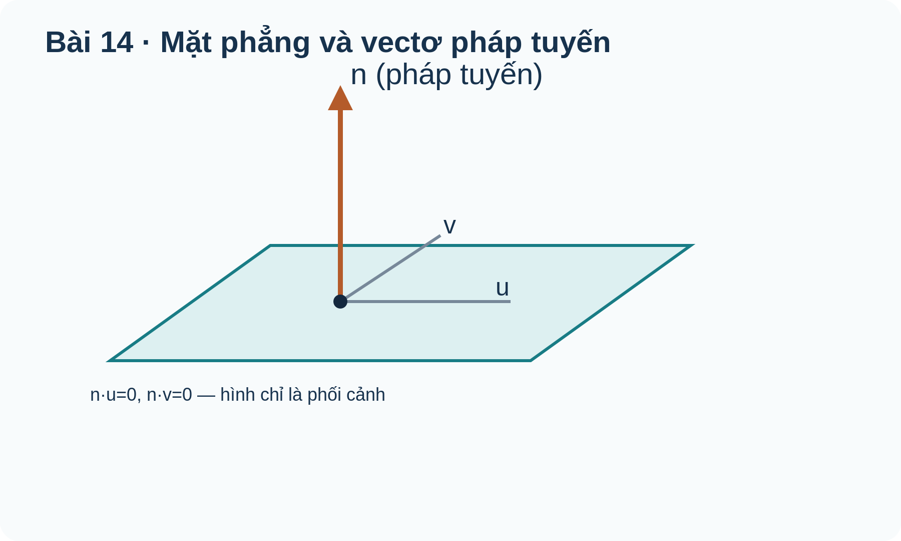

# Toán 12 · Bài 14. Phương trình mặt phẳng

TOÁN 12 · CHƯƠNG V · SGK KẾT NỐI TRI THỨC · TẬP HAI

Học từ lý do và bản chất trước khi áp dụng công thức; có ví dụ giải thích phương pháp, hình gốc và Tự thử.
<nav class="thpt-r4-lesson-tabs"><a href="../">Chương V</a><a href="../bai-15/">Bài 15</a></nav>

## 1. Vì sao cần học và kiến thức tiền đề

Khoảng cách tường, mặt phẳng qua điểm và hướng.

**Tự kiểm tra tiền đề:** Ôn lại vectơ pháp tuyến, tích vô hướng, tích có hướng, điểm Oxyz. Nếu chưa tự giải được câu thử ở dưới, ôn vectơ/tích vô hướng/đạo hàm phù hợp trước khi tiếp tục.

## 2. Hiểu bản chất, điều kiện và ví dụ

<!-- OUTCOME_ID: G12-CHV-B14-O01 -->
### 1. Vectơ pháp tuyến từ hai vectơ chỉ phương

- **Vì sao cần biết:** Muốn xác định hướng của một tấm phẳng, cần một vectơ vuông góc với cả hai hướng nằm trong tấm.
- **Kiến thức tiền đề:** Tích vô hướng bằng 0, tích có hướng và định nghĩa hai vectơ không cùng phương.
- **Bản chất trước công thức:** Hai hướng độc lập trong mặt phẳng xác định một pháp tuyến; không chọn tích có hướng bằng 0.
- **Định nghĩa và công thức:** \(\vec n=\vec u\times\vec v\ne\vec0,\quad\vec n\cdot\vec u=\vec n\cdot\vec v=0\).
- **Điều kiện và giới hạn:** Hai vectơ chỉ phương phải không cùng phương; pháp tuyến phải khác vectơ 0.
- **Lý do chọn phương pháp:** Tính tích có hướng rồi thử lại hai tích vô hướng bằng 0.
- **Bẫy cần tự phát hiện:** Lấy chính vectơ nằm trong mặt phẳng làm pháp tuyến hoặc quên kiểm tích có hướng khác 0.

#### Ví dụ có suy luận

**Đề:** Hai hướng u=(1,0,1), v=(0,1,1) nằm trong mặt phẳng. Tìm pháp tuyến.

**Lời giải có suy luận:** u×v=(-1,-1,1); n·u=-1+1=0 và n·v=-1+1=0; hai hướng không cùng phương.

**Kiểm tra kết quả và điều kiện:** n=(-1,-1,1). **Kiểm tra phạm vi:** Hai vectơ chỉ phương phải không cùng phương; pháp tuyến phải khác vectơ 0.

<!-- OUTCOME_ID: G12-CHV-B14-O02 -->
### 2. Viết phương trình qua một điểm và một pháp tuyến

- **Vì sao cần biết:** Một điểm neo và hướng vuông góc đủ xác định vị trí mặt phẳng trong không gian.
- **Kiến thức tiền đề:** Tích vô hướng; tọa độ hiệu M−M0.
- **Bản chất trước công thức:** M nằm trên (P) khi vectơ M0M vuông góc n; nhân vô hướng bằng 0 tạo phương trình bậc nhất.
- **Định nghĩa và công thức:** \(A(x-x_0)+B(y-y_0)+C(z-z_0)=0\), với \((A,B,C)\ne(0,0,0)\).
- **Điều kiện và giới hạn:** Pháp tuyến không phải vectơ không; phương trình tổng quát chỉ khác nhau bởi hệ số nhân khác 0.
- **Lý do chọn phương pháp:** Thế đúng điểm đã cho vào phương trình cuối để kiểm hệ số tự do.
- **Bẫy cần tự phát hiện:** Đổi dấu nhầm hệ số tự do hoặc viết pháp tuyến bằng vectơ chỉ phương.

#### Ví dụ có suy luận

**Đề:** Qua P(1,-2,3), n=(2,-1,1), lập mặt phẳng.

**Lời giải có suy luận:** 2(x−1)−(y+2)+(z−3)=0 ⇒ 2x−y+z−7=0; thay P cho 2+2+3−7=0.

**Kiểm tra kết quả và điều kiện:** 2x−y+z−7=0. **Kiểm tra phạm vi:** Pháp tuyến không phải vectơ không; phương trình tổng quát chỉ khác nhau bởi hệ số nhân khác 0.

<!-- OUTCOME_ID: G12-CHV-B14-O03 -->
### 3. Mặt phẳng qua ba điểm không thẳng hàng

- **Vì sao cần biết:** Ba mốc không thẳng hàng xác định mặt phẳng của mái hoặc tường.
- **Kiến thức tiền đề:** Hiệu tọa độ, hai hướng AB, AC, tích có hướng.
- **Bản chất trước công thức:** Hai vectơ AB và AC không song song nằm trên cùng mặt phẳng; AB×AC là pháp tuyến.
- **Định nghĩa và công thức:** \(\vec n=\overrightarrow{AB}\times\overrightarrow{AC}\ne0\); mặt phẳng đi qua A.
- **Điều kiện và giới hạn:** Nếu A,B,C thẳng hàng thì không xác định duy nhất một mặt phẳng.
- **Lý do chọn phương pháp:** Tìm hai hướng, tích có hướng, dùng công thức điểm–pháp tuyến và thử B,C.
- **Bẫy cần tự phát hiện:** Dùng tích vô hướng của AB và AC thay cho tích có hướng hoặc quên xét thẳng hàng.

#### Ví dụ có suy luận

**Đề:** A(0,0,1),B(1,0,1),C(0,1,1). Viết (ABC).

**Lời giải có suy luận:** AB=(1,0,0), AC=(0,1,0), n=(0,0,1); A có z=1; kiểm B,C.

**Kiểm tra kết quả và điều kiện:** z=1. **Kiểm tra phạm vi:** Nếu A,B,C thẳng hàng thì không xác định duy nhất một mặt phẳng.

<!-- OUTCOME_ID: G12-CHV-B14-O04 -->
### 4. Mặt phẳng chứa hai hướng hoặc một trục

- **Vì sao cần biết:** Kĩ thuật dựng một bức tường song song với hai hướng hoặc chứa đường thẳng.
- **Kiến thức tiền đề:** Hai vectơ không cùng phương, pháp tuyến, định nghĩa chứa một trục.
- **Bản chất trước công thức:** Mặt phẳng chứa mọi dịch chuyển theo hai hướng độc lập; n vuông góc cả hai.
- **Định nghĩa và công thức:** \(\vec n=\vec u\times\vec v\); nếu (P) chứa Ox thì thành phần x của n bằng 0.
- **Điều kiện và giới hạn:** Điểm và hai hướng phải nhất quán; 2 hướng không được cùng phương.
- **Lý do chọn phương pháp:** Chuyển điều kiện song song/chứa trục thành hai hướng trước khi viết phương trình.
- **Bẫy cần tự phát hiện:** Hiểu nhầm mặt phẳng chứa Oy thì nhất thiết y=0.

#### Ví dụ có suy luận

**Đề:** Qua O chứa hai hướng (1,0,2), (0,1,1). Tìm (P).

**Lời giải có suy luận:** n=(-2,-1,1). Qua O nên −2x−y+z=0.

**Kiểm tra kết quả và điều kiện:** −2x−y+z=0. **Kiểm tra phạm vi:** Điểm và hai hướng phải nhất quán; 2 hướng không được cùng phương.

<!-- OUTCOME_ID: G12-CHV-B14-O05 -->
### 5. Quan hệ song song và vuông góc giữa hai mặt phẳng

- **Vì sao cần biết:** Phải biết hai bề mặt có cùng hướng hay vuông góc để thiết kế cấu kiện.
- **Kiến thức tiền đề:** Hai pháp tuyến và tích vô hướng.
- **Bản chất trước công thức:** Góc giữa hai mặt phẳng được đo qua góc nhọn của hai pháp tuyến; pháp tuyến cùng phương là hai mặt phẳng song song/trùng.
- **Định nghĩa và công thức:** \(\vec n_1\parallel\vec n_2\) hoặc \(\vec n_1\cdot\vec n_2=0\).
- **Điều kiện và giới hạn:** Nếu pháp tuyến cùng phương, còn phải kiểm hằng số để phân biệt trùng và song song phân biệt.
- **Lý do chọn phương pháp:** So sánh n trước; kiểm một điểm nếu hai n cùng phương; dùng dot=0 để kết luận vuông góc.
- **Bẫy cần tự phát hiện:** Thấy hai phương trình khác dấu rồi vội kết luận chúng cắt nhau.

#### Ví dụ có suy luận

**Đề:** So sánh x+y+z−1=0 và 2x+2y+2z+4=0.

**Lời giải có suy luận:** Pháp tuyến thứ hai bằng 2 lần thứ nhất; chuẩn hóa Q thành x+y+z+2=0 khác P nên song song phân biệt.

**Kiểm tra kết quả và điều kiện:** Song song phân biệt. **Kiểm tra phạm vi:** Nếu pháp tuyến cùng phương, còn phải kiểm hằng số để phân biệt trùng và song song phân biệt.

<!-- OUTCOME_ID: G12-CHV-B14-O06 -->
### 6. Khoảng cách từ điểm đến mặt phẳng

- **Vì sao cần biết:** Ước lượng khoảng cách an toàn từ một vật tới tường hoặc sàn.
- **Kiến thức tiền đề:** Trị tuyệt đối, căn bậc hai, vectơ pháp tuyến.
- **Bản chất trước công thức:** Giá trị Ax0+By0+Cz0+D đo độ lệch có dấu; chia độ dài n để ra khoảng cách không âm.
- **Định nghĩa và công thức:** \(d(M,(P))=\frac{|Ax_0+By_0+Cz_0+D|}{\sqrt{A^2+B^2+C^2}}\).
- **Điều kiện và giới hạn:** A,B,C không đồng thời bằng 0; thay đúng tọa độ và có giá trị tuyệt đối.
- **Lý do chọn phương pháp:** Thay số → lấy trị tuyệt đối → chia chuẩn pháp tuyến; kiểm đơn vị và liệu điểm có nằm trên mặt.
- **Bẫy cần tự phát hiện:** Bỏ dấu trị tuyệt đối hoặc quên căn dưới mẫu.

#### Ví dụ có suy luận

**Đề:** M(1,2,3) và P:2x−y+2z−4=0. Tính d.

**Lời giải có suy luận:** Tử |2−2+6−4|=2; mẫu √(4+1+4)=3; d=2/3.

**Kiểm tra kết quả và điều kiện:** 2/3. **Kiểm tra phạm vi:** A,B,C không đồng thời bằng 0; thay đúng tọa độ và có giá trị tuyệt đối.

## 3. Đọc hình minh họa gốc

<figure class="thpt-r4-plot g12-chi-figure"><figcaption>Hình 1: Phương trình mặt phẳng. Đọc nhãn và quan hệ hình học; không suy số đo trong không gian từ tỷ lệ hình phẳng.</figcaption></figure>

## 4. Tự thử trước Core

Em tự làm trước, rồi chủ động mở đối chiếu; không tính điểm hay Mastery.

<!-- FIRST_TRY_ID: B14-T01 -->
### Tự thử

Tính u·n với u=(1,2,0),n=(2,-1,0).

Mở đối chiếu sau khi tự thử

**Đối chiếu:** 0.

**Vì sao:** Tích vô hướng bằng 0, tích có hướng và định nghĩa hai vectơ không cùng phương..

## 5. Core và Luyện tập

<nav class="thpt-r4-lesson-tabs"><a href="../luyen-tap/#b14-core">Core · Bài 14</a><a href="../luyen-tap/#b14-practice">Luyện tập, Vận dụng và Tự luận</a><a href="../luyen-tap/#b14-help">Khi gặp khó khăn</a></nav>

