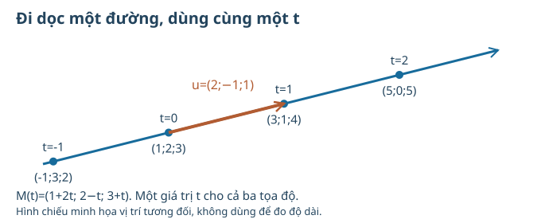
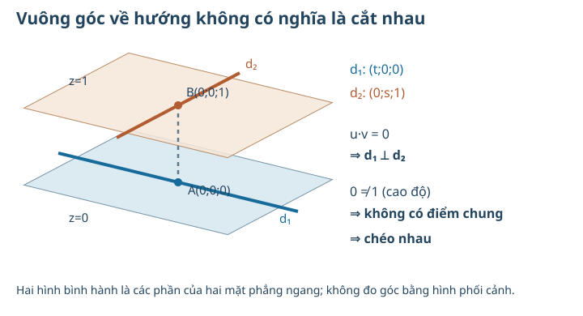

# Bài 15. Phương trình đường thẳng trong không gian

TOÁN 12 · CHƯƠNG V · KIẾN THỨC SGK KNTT · TẬP HAI

Từ một điểm và một hướng đến phương trình đường thẳng; kiểm điểm chung, sự vuông góc và vị trí tương đối trong không gian.

<nav class="thpt-r4-lesson-tabs"><a href="../">Chương V</a><a href="../bai-14/">Bài trước</a><a href="../luyen-tap/#b15-core">Core/Luyện tập</a><a href="../bai-16/">Bài tiếp theo</a></nav>

=== "Khám phá kiến thức"

    ### 1.1. Phương trình đường thẳng

    #### a) Vectơ chỉ phương của đường thẳng

    Một thiết bị bay theo đường thẳng từ một vị trí đã biết. Nếu chỉ biết vị trí xuất phát, ta chưa xác định được nó bay theo hướng nào. Nếu biết thêm một vectơ vận tốc không đổi, khác không, ta xác định được đường thẳng chứa quỹ đạo. Đây là hai dữ kiện cơ bản để mô tả đường thẳng trong không gian: một điểm và một hướng.

    <!-- OUTCOME_ID: G12-CHV-B15-O01 -->
    Vectơ khác không có giá song song hoặc trùng với đường thẳng được gọi là vectơ chỉ phương của đường thẳng đó. Nhân vectơ với một số khác 0 có thể đổi độ dài hoặc đảo chiều, nhưng không làm đổi phương của đường thẳng. Chẳng hạn \((2;-1;1)\) và \((-4;2;-2)\) cùng chỉ một phương. Vectơ-không không chỉ được phương nào.

    Khác với mặt phẳng ở Bài 14, một đường thẳng chỉ cần một hướng. Có duy nhất đường thẳng qua một điểm và song song hoặc trùng với giá của một vectơ khác không; nhưng có vô số đường thẳng qua điểm ấy và vuông góc với phương đã cho.

    #### b) Phương trình tham số của đường thẳng

    Cho đường thẳng \(d\) qua \(A(1;2;3)\) có chỉ phương \(\vec u=(2;-1;1)\). Từ \(A\), dịch chuyển theo vectơ \(\vec u\) tức tăng hoành độ 2, giảm tung độ 1 và tăng cao độ 1, ta tới \((3;1;4)\). Dịch chuyển theo \(2\vec u\) từ \(A\) thì tới \((5;0;5)\); theo \(-\vec u\) thì tới \((-1;3;2)\).

    <figure class="thpt-r4-plot thpt-r4-concept-figure"><figcaption>Điểm ứng với \(t=0\) là \(A\). Mỗi lần tăng \(t\) thêm 1, ba tọa độ đồng thời thay đổi \(+2,-1,+1\). Hướng mũi tên cam là vectơ chỉ phương.</figcaption></figure>

    Tổng quát, \(M\in d\) khi và chỉ khi \(\overrightarrow{AM}=t\vec u\) với \(t\in\mathbb R\). Từ \((x-1;y-2;z-3)=t(2;-1;1)\) suy ra

    \[
    d:\begin{cases}
    x=1+2t,\\
    y=2-t,\\
    z=3+t,
    \end{cases}\quad t\in\mathbb R.
    \]

    Khi \(t\) nhận mọi giá trị thực, \(M\) chạy qua toàn bộ đường thẳng. Đó là phương trình tham số. Tham số có thể là thời gian trong bài toán chuyển động nếu vectơ được chọn đúng là vận tốc; nói chung nó chỉ là hệ số nhân của vectơ hướng.

    <!-- OUTCOME_ID: G12-CHV-B15-O04 -->
    Để kiểm điểm \(B(5;0;5)\) thuộc đường thẳng, lấy phương trình \(5=1+2t\) cho \(t=2\). Thay cùng \(t=2\) vào hai phương trình còn lại được \(y=0,z=5\), nên \(B\in d\). Điểm \(C(5;0;6)\) không thuộc \(d\), vì với \(t=2\) thì \(z\) phải bằng 5. Không được tự dùng một giá trị \(t\) khác cho tọa độ \(z\).

    <!-- FIRST_TRY_ID: B15-T01 -->
    **Vận dụng.** Đường thẳng \(d\) có phương trình \(x=2-t,\ y=1+3t,\ z=4\). Hãy chỉ ra một điểm và một chỉ phương; kiểm \(B(0;7;4)\), \(C(0;7;5)\).

    ??? question "Đối chiếu"

        Tại \(t=0\), được \(A(2;1;4)\); chỉ phương \((-1;3;0)\ne\vec0\). Với cả hai điểm cần kiểm, hoành độ cho \(t=2\), tung độ khi đó bằng 7. Tọa độ \(z\) luôn bằng 4, nên \(B\) thuộc \(d\), còn \(C\) không thuộc.

    ??? tip "Kiểm lỗi"

        Không bỏ qua phương trình \(z=4\) chỉ vì không chứa \(t\). Thành phần chỉ phương thứ ba bằng 0 có nghĩa cao độ luôn cố định.

    #### c) Phương trình chính tắc của đường thẳng

    <!-- OUTCOME_ID: G12-CHV-B15-O03 -->
    Từ phương trình của đường qua \(A(1;2;3)\) có chỉ phương \((2;-1;1)\), vì cả ba thành phần đều khác 0, ta chia được

    \[
    t=\frac{x-1}{2}=\frac{y-2}{-1}=\frac{z-3}{1}.
    \]

    Bỏ tên tham số, ba phân số bằng nhau là phương trình chính tắc của đường thẳng. Ngược lại, đặt giá trị chung bằng \(t\) thì khôi phục phương trình tham số. Hai dạng mô tả cùng tập hợp điểm.

    Với đường thẳng \(x=2-t,\ y=1+3t,\ z=4\), ta có thể viết tương đương \(z=4,\ (x-2)/(-1)=(y-1)/3\), nhưng không viết \((z-4)/0\). Theo định nghĩa SGK, đường thẳng có một thành phần chỉ phương bằng 0 không có phương trình chính tắc; dùng phương trình tham số hoặc hệ tương đương trên.

    Đọc đường thẳng \((x+2)/3=(y-1)/2=(z+4)/(-1)\): điểm tại giá trị chung bằng 0 là \((-2;1;-4)\), chỉ phương là \((3;2;-1)\). Chú ý dấu của tọa độ điểm gốc là dấu đối với số được cộng ở tử.

    #### d) Lập phương trình đường thẳng đi qua hai điểm

    <!-- OUTCOME_ID: G12-CHV-B15-O02 -->
    Hai điểm phân biệt \(A(2;1;-1), B(5;3;2)\) xác định một đường thẳng. Vectơ \(\overrightarrow{AB}=(3;2;3)\ne\vec0\) chính là một chỉ phương. Vì thế

    \[
    AB:\begin{cases}x=2+3t,\\y=1+2t,\\z=-1+3t.\end{cases}
    \]

    Tại \(t=0\) được \(A\), tại \(t=1\) được \(B\). Nếu \(0\le t\le1\), chỉ thu được đoạn thẳng \(AB\); cho mọi \(t\in\mathbb R\) mới được toàn bộ đường thẳng. Vì cả ba thành phần hướng khác 0, dạng chính tắc là \((x-2)/3=(y-1)/2=(z+1)/3\).

    Nếu đề cho đường thẳng qua một điểm và song song với đường thẳng đã biết, dùng một chỉ phương của đường đã biết; kiểm điểm gốc mới không thuộc đường cũ nếu yêu cầu song song phân biệt. Nếu đường thẳng cần lập vuông góc với một mặt phẳng, dùng pháp tuyến của mặt phẳng làm chỉ phương của đường thẳng.

    <!-- OUTCOME_ID: G12-CHV-B15-O07 -->
    **Tìm giao với mặt phẳng để giải bài toán đoạn thẳng.** Một mắt quan sát ở \(M(1;2;-3)\), vật ở \(N(4;-1;6)\); tấm chắn tròn tâm \(O\), bán kính 2 nằm trong \(Oxy\). Đường nhìn có phương trình

    \[
    (x;y;z)=(1+3t;2-3t;-3+9t).
    \]

    Đường xuyên qua \(Oxy\) khi \(z=0\), tức \(t=1/3\), cho \(D(2;1;0)\). Vì \(0<1/3<1\), \(D\) nằm giữa mắt và vật. Tuy nhiên \(OD=\sqrt5>2\), nên đường nhìn không xuyên qua tấm chắn. Cần kiểm cả hai điều kiện: giao điểm nằm trên đoạn nhìn và thuộc hình tròn hữu hạn.

    Tổng quát, với \(d:M=A+t\vec u\) và mặt phẳng \((P):\vec n\cdot\overrightarrow{OM}+D=0\), thay tọa độ \(M\) vào phương trình \((P)\), ta nhận

    \[
    (\vec n\cdot\vec u)t+\vec n\cdot\overrightarrow{OA}+D=0.
    \]

    Nếu hệ số của \(t\) khác 0, có một giao điểm. Nếu hệ số bằng 0, đường thẳng nằm trong mặt phẳng khi hằng số cũng bằng 0, và song song phân biệt khi hằng số khác 0.

    <!-- FIRST_TRY_ID: B15-T02 -->
    **Vận dụng.** Một thiết bị chuyển động từ \(A(1;0;2)\) với vận tốc không đổi \((2;1;-1)\) trong 3 giây, đơn vị mét và giây. Nó có chạm mặt phẳng \(x+z-5=0\) trong thời gian đó không?

    ??? question "Đối chiếu"

        Vị trí tại thời điểm \(t\) là \((1+2t;t;2-t)\). Thay vào mặt phẳng được \(1+2t+2-t-5=t-2=0\), nên \(t=2\). Vì \(0\le2\le3\), thiết bị chạm mặt phẳng tại \((5;2;0)\).

    ??? tip "Kiểm lỗi"

        Nếu tìm được giao điểm của đường thẳng chứa quỹ đạo, vẫn phải kiểm \(t\) trong thời gian chuyển động. Không suy rằng thiết bị đã đi đến mọi điểm trên đường thẳng vô hạn.

    ### 1.2. Hai đường thẳng vuông góc

    <!-- OUTCOME_ID: G12-CHV-B15-O05 -->
    Ở hình học không gian, để xét góc giữa hai đường thẳng, ta có thể dựng qua cùng một điểm hai đường lần lượt song song với chúng. Vì vậy hai đường thẳng vuông góc khi hai hướng của chúng tạo góc \(90^\circ\), **không bắt buộc có giao điểm**.

    Hãy xét \(d_1:(x;y;z)=(t;0;0)\) và \(d_2:(x;y;z)=(0;s;1)\). Hai chỉ phương là \(\vec u=(1;0;0),\vec v=(0;1;0)\), nên \(\vec u\cdot\vec v=0\). Hai đường vuông góc theo định nghĩa trong không gian. Nhưng đường thứ nhất có mọi điểm cao độ 0, đường thứ hai có mọi điểm cao độ 1: chúng không thể gặp nhau. Hai chỉ phương không cùng phương, do đó chúng chéo nhau.

    <figure class="thpt-r4-plot thpt-r4-concept-figure"><figcaption>Hai đường có phương vuông góc và không đồng phẳng. Quan sát cao độ của hai điểm A, B, rồi kiểm hai chỉ phương bằng tích vô hướng. Không cần đo góc trên hình.</figcaption></figure>

    Ví dụ này tách hai câu hỏi: **vuông góc hay không** là câu hỏi về hướng; **cắt hay chéo** là câu hỏi về vị trí. Hai đường có thể đồng thời vuông góc và chéo nhau.

    **Vận dụng.** Cho hai đường \(d_1:(x;y;z)=(1+t;2t;0)\) và \(d_2:(x;y;z)=(2s;1-s;3)\). Chúng có vuông góc không? Có gặp nhau không?

    ??? question "Đối chiếu"

        Chỉ phương \((1;2;0),(2;-1;0)\) có tích vô hướng \(2-2=0\), nên hai đường vuông góc. Tuy nhiên cao độ luôn lần lượt bằng 0 và 3, không có điểm chung; chúng không cùng phương nên chéo nhau.

    ??? tip "Kiểm lỗi"

        Nếu kết luận không vuông góc chỉ vì không gặp nhau, em đang dùng điều kiện của hình học phẳng cho không gian. Kiểm tích vô hướng để xét vuông góc, kiểm hệ tọa độ để xét giao điểm.

    ### 1.3. Vị trí tương đối giữa hai đường thẳng

    <!-- OUTCOME_ID: G12-CHV-B15-O06 -->
    Hai đường thẳng trong không gian có bốn khả năng về vị trí: trùng, song song phân biệt, cắt và chéo. Bước đầu luôn là xét chỉ phương. Gọi \(A,B\) là điểm gốc của hai đường, \(\vec u,\vec v\ne\vec0\) là chỉ phương.

    Nếu \(\vec u,\vec v\) cùng phương, hai đường có cùng phương, nhưng chưa chắc là hai đường phân biệt. Chỉ cần kiểm \(B\) thuộc đường qua \(A\) hay không. Nếu có, chúng trùng nhau; nếu không, chúng song song phân biệt. Dùng \(\overrightarrow{AB}=k\vec u\) (cho phép \(k=0\)) hoặc kiểm bằng tham số, tránh chia cho thành phần bằng 0.

    Nếu hai chỉ phương không cùng phương, có đúng một mặt phẳng qua \(A\) chứa cả hai hướng, nhận \(\vec n=[\vec u,\vec v]\ne\vec0\) làm pháp tuyến. Đường thứ nhất nằm trong mặt phẳng này. Đường thứ hai có hướng vuông góc với \(\vec n\), nên nằm trong mặt phẳng khi \(B\) thuộc mặt phẳng, tức \(\overrightarrow{AB}\cdot\vec n=0\). Khi ấy hai đường đồng phẳng và khác phương nên cắt nhau. Nếu tích này khác 0, đường thứ hai không nằm trong mặt phẳng: hai đường chéo nhau.

    Chẳng hạn \(A=(0;0;0), B=(0;0;1),\vec u=(1;0;0),\vec v=(0;1;0)\) như hình ở mục trước. Tích có hướng bằng \((0;0;1)\); tích với \(\overrightarrow{AB}=(0;0;1)\) bằng 1, xác nhận chéo nhau.

    Cách khác là tìm điểm chung. Viết \(A+t\vec u=B+s\vec v\) với hai tham số độc lập \(t,s\), rồi giải hệ ba phương trình tọa độ. Ví dụ

    \[
    d_1:(t;2t;1+t),\qquad d_2:(2+s;4-s;3).
    \]

    Từ \(1+t=3\) được \(t=2\); từ \(t=2+s\) được \(s=0\). Phương trình tung độ \(2t=4-s\) cũng đúng. Hai hướng \((1;2;1),(1;-1;0)\) không cùng phương, nên hai đường cắt nhau tại \((2;4;3)\).

    | Hướng | Hệ tìm điểm chung | Vị trí |
    | :-- | :-- | :-- |
    | Cùng phương | Vô nghiệm | Song song phân biệt |
    | Cùng phương | Vô số nghiệm | Trùng nhau |
    | Không cùng phương | Một nghiệm | Cắt nhau |
    | Không cùng phương | Vô nghiệm | Chéo nhau |

    **Vận dụng.** Xét \(d_1:(t;2t;1+t)\), \(d_2:(2+s;4-s;4)\). Hãy dùng tích có hướng để xét vị trí, rồi kiểm bằng hệ tham số.

    ??? question "Đối chiếu"

        \(\vec u=(1;2;1),\vec v=(1;-1;0)\), \([\vec u,\vec v]=(1;1;-3)\ne\vec0\). Với \(A(0;0;1), B(2;4;4)\), \(\overrightarrow{AB}=(2;4;3)\), tích vô hướng bằng \(2+4-9=-3\ne0\), nên hai đường chéo nhau. Từ cao độ, \(t=3\); từ hoành độ, \(s=1\); tung độ đòi \(6=3\), vô lý. Hai cách cho cùng kết luận.

    ??? tip "Kiểm lỗi"

        Đừng dừng sau khi tìm được \(t,s\) từ hai tọa độ. Phải thử tọa độ thứ ba. Tích hỗn hợp bằng 0 cũng chưa đủ kết luận cắt nhau nếu chưa kiểm tích có hướng khác 0.

    **Ứng dụng chuyển động.** Hai vật xuất phát cùng lúc, có vị trí \(M(t)=(t;0;0)\), \(N(t)=(2;t-1;0)\), \(t\ge0\). Hai đường chứa quỹ đạo cắt nhau tại \((2;0;0)\), nhưng vật thứ nhất tới đó ở \(t=2\), vật thứ hai ở \(t=1\). Chúng không va chạm trong mô hình chất điểm. Để xét giao hai đường, dùng hai tham số độc lập; để xét va chạm khi cùng mốc thời gian, dùng cùng một thời điểm. Nếu thời điểm xuất phát khác nhau, phải quy về cùng đồng hồ.

    **Vận dụng.** Hai thiết bị xuất phát đồng thời tại \(A(0;0;1)\), \(B(4;2;1)\), vận tốc lần lượt \((2;1;0)\), \((-2;-1;0)\). Xét vị trí hai đường chứa quỹ đạo và khả năng gặp nhau sau khi xuất phát.

    ??? question "Đối chiếu"

        Hai chỉ phương đối nhau, \(B-A=(4;2;0)=2(2;1;0)\), nên hai đường trùng nhau. Đặt vị trí bằng nhau tại cùng thời điểm: \(2t=4-2t\), được \(t=1\). Tung độ hai bên đều bằng 1, cao độ bằng 1. Hai thiết bị gặp ở \((2;1;1)\) nếu cả hai tiếp tục chuyển động theo mô hình tới thời điểm ấy.

    ??? tip "Kiểm lỗi"

        Đường trùng nhau không bảo đảm gặp nhau: hai vật có thể đi cùng chiều với cùng tốc độ và luôn cách nhau. Phải giải điều kiện vị trí bằng nhau tại cùng thời điểm hợp lệ.

=== "Kiến thức SGK"

    ### 2.1. Phương trình đường thẳng

    #### a) Vectơ chỉ phương

    
<strong>Khái niệm — Vectơ chỉ phương.</strong> Vectơ \(\vec u\ne\vec0\) là vectơ chỉ phương của đường thẳng \(d\) nếu giá của \(\vec u\) song song hoặc trùng với \(d\). Mọi \(k\vec u\), \(k\ne0\), cũng là chỉ phương. Một điểm và một chỉ phương xác định duy nhất một đường thẳng.

    #### b) Phương trình tham số

    
<strong>Định nghĩa — Phương trình tham số.</strong>
Đường thẳng qua \(A(x_0;y_0;z_0)\), có chỉ phương \(\vec u=(a;b;c)\ne\vec0\), gồm các điểm thỏa hệ

\(\displaystyle \begin{cases}x=x_0+at\\y=y_0+bt\\z=z_0+ct\end{cases},\quad t\in\mathbb R.\)

Hệ này gọi là phương trình tham số của đường thẳng. Mỗi điểm ứng với đúng một giá trị \(t\), do có ít nhất một thành phần hướng khác 0.

    <figure class="thpt-r4-plot"><figcaption>Ví dụ phương trình \((1+2t;2-t;3+t)\): ba tọa độ dùng chung \(t\); thay \(t=0\) đọc được điểm gốc.</figcaption></figure>

    #### c) Phương trình chính tắc

    
<strong>Định nghĩa — Phương trình chính tắc.</strong>
Với đường thẳng qua \(A(x_0;y_0;z_0)\) và chỉ phương \((a;b;c)\) có \(abc\ne0\), hệ

\(\displaystyle\frac{x-x_0}{a}=\frac{y-y_0}{b}=\frac{z-z_0}{c}\)

được gọi là phương trình chính tắc. Ba phân số bằng cùng một số thực là tham số của phương trình tham số tương ứng.

    Nếu có thành phần hướng bằng 0 thì không có phương trình chính tắc theo định nghĩa này. Dùng tham số; tọa độ tương ứng cố định. Không viết phân số có mẫu 0.

    #### d) Lập phương trình đường thẳng đi qua hai điểm

    
<strong>Kiến thức cần nhớ — Đường thẳng qua hai điểm.</strong>
Với \(A(x_1;y_1;z_1)\ne B(x_2;y_2;z_2)\), chọn \(A\) làm điểm gốc, \(\overrightarrow{AB}=(x_2-x_1;y_2-y_1;z_2-z_1)\) làm chỉ phương. Phương trình tham số là

\(\displaystyle\begin{cases}x=x_1+(x_2-x_1)t\\y=y_1+(y_2-y_1)t\\z=z_1+(z_2-z_1)t\end{cases},\quad t\in\mathbb R.\)

Khi cả ba hiệu tọa độ khác 0, phương trình chính tắc là

\(\displaystyle\frac{x-x_1}{x_2-x_1}=\frac{y-y_1}{y_2-y_1}=\frac{z-z_1}{z_2-z_1}.\)

    Với đường thẳng vuông góc mặt phẳng, dùng pháp tuyến mặt phẳng làm chỉ phương; với đường thẳng song song đường đã biết, dùng chỉ phương của đường đã biết và kiểm vị trí nếu cần. Muốn tìm giao với mặt phẳng, thế tọa độ tham số vào phương trình mặt phẳng rồi xét số nghiệm; nếu mô hình là đoạn hoặc tia, kiểm miền tham số.

    ### 2.2. Hai đường thẳng vuông góc

    
<strong>Tính chất — Điều kiện vuông góc.</strong>
Cho \(d_1,d_2\) có chỉ phương \(\vec u_1=(a_1;b_1;c_1),\vec u_2=(a_2;b_2;c_2)\) khác không. Khi đó

\(\displaystyle d_1\perp d_2\Leftrightarrow \vec u_1\cdot\vec u_2=0\Leftrightarrow a_1a_2+b_1b_2+c_1c_2=0.\)

Hai đường thẳng vuông góc trong không gian có thể cắt nhau hoặc chéo nhau. Không thêm điều kiện phải có giao điểm.

    <figure class="thpt-r4-plot"><figcaption>Hai chỉ phương \((1;0;0),(0;1;0)\) có tích vô hướng 0, còn cao độ khác nhau chứng minh không có giao điểm.</figcaption></figure>

    ### 2.3. Vị trí tương đối giữa hai đường thẳng

    Cho \(d_1\) qua \(A\), chỉ phương \(\vec u\); \(d_2\) qua \(B\), chỉ phương \(\vec v\), cả hai khác không. Đặt \(\vec n=[\vec u,\vec v]\), \(K=\overrightarrow{AB}\cdot\vec n\).

    
<strong>Kiến thức cần nhớ — Vị trí tương đối.</strong>
Điều kiện cần và đủ:
<ul><li>Song song phân biệt: \(\vec n=\vec0,\ A\notin d_2\).</li><li>Trùng nhau: \(\vec n=\vec0,\ A\in d_2\).</li><li>Cắt nhau: \(\vec n\ne\vec0,\ K=0\).</li><li>Chéo nhau: \(K\ne0\).</li></ul>

    Khi \(K\ne0\), tự động \(\vec n\ne\vec0\). Khi \(K=0\), phải kiểm \(\vec n\) để phân biệt cắt với cùng phương. Đổi chiều hoặc nhân chỉ phương với số khác 0 không làm thay đổi điều kiện bằng 0 hay khác 0.

    **Cách dùng hệ phương trình:** Với \(d_1:A+t\vec u,\ d_2:B+s\vec v\), giải ba phương trình tọa độ theo hai ẩn \(t,s\). Một nghiệm duy nhất nghĩa là cắt, vô số nghiệm nghĩa là trùng. Nếu vô nghiệm, cùng phương thì song song phân biệt, khác phương thì chéo. Khi tìm giao điểm, thay nghiệm vào cả hai phương trình đường thẳng.

    **Ứng dụng:** Đường chứa quỹ đạo và vị trí thực của vật là hai khái niệm khác nhau. Kiểm miền tham số và thời điểm nếu đề hỏi gặp nhau, va chạm hoặc đi qua một vật cản hữu hạn.

=== "Ví dụ"

    ### 3.1. Lập hai dạng phương trình

    **Đề bài.** Viết phương trình tham số và chính tắc của đường thẳng qua \(A(-2;3;1)\) và có chỉ phương \((3;-2;4)\).

    **Phân tích:** Đã biết điểm và hướng; cả ba thành phần khác 0 nên có cả hai dạng.

    

<strong>Lời giải.</strong>

\(\displaystyle d:\begin{cases}x=-2+3t\\y=3-2t\\z=1+4t\end{cases},\quad t\in\mathbb R.\)

Dạng chính tắc: \((x+2)/3=(y-3)/(-2)=(z-1)/4\).

    **Kiểm lại:** \(t=0\) cho đúng \(A\), \(t=1\) cho \((1;1;5)\) với hiệu tọa độ đúng chỉ phương.

    ### 3.2. Đường qua hai điểm có một tọa độ cố định

    **Đề bài.** Cho \(A(2;1;-3),B(2;4;3)\). Viết phương trình đường thẳng \(AB\).

    **Phân tích:** Hai điểm khác nhau; chỉ phương có thành phần \(x\) bằng 0.

    

<strong>Lời giải.</strong> \(\overrightarrow{AB}=(0;3;6)\). Chọn \((0;1;2)\) làm chỉ phương. Phương trình \(x=2,\ y=1+t,\ z=-3+2t,\ t\in\mathbb R\). Đường này không có phương trình chính tắc theo định nghĩa SGK.

    **Kiểm lại:** \(t=0\) cho \(A\), \(t=3\) cho \(B\). Nếu cần đoạn \(AB\) với chỉ phương rút gọn này, giới hạn \(0\le t\le3\), không mặc định \(0\le t\le1\).

    ### 3.3. Đường vuông góc với mặt phẳng và hình chiếu

    **Đề bài.** Lập đường thẳng qua \(M(2;1;-1)\) vuông góc với \((P):x+2y-2z+3=0\). Tìm giao điểm \(H\) với \((P)\).

    **Phân tích:** Pháp tuyến \((1;2;-2)\) là chỉ phương của đường cần lập.

    

<strong>Lời giải.</strong> \(d:(x;y;z)=(2+t;1+2t;-1-2t)\). Thay vào mặt phẳng được \(9+9t=0\), suy ra \(t=-1\). Vậy \(H(1;-1;1)\).

    **Kiểm lại:** \(1-2-2+3=0\). Vectơ \(\overrightarrow{MH}=(-1;-2;2)\) cùng phương với pháp tuyến; \(H\) là hình chiếu vuông góc của \(M\).

    ### 3.4. Tìm tham số từ điều kiện vuông góc

    **Đề bài.** Hai đường thẳng có chỉ phương \((2;m;1)\), \((1;-2;4)\). Tìm \(m\) để hai đường vuông góc.

    **Phân tích:** Hai chỉ phương khác không với mọi \(m\); chỉ cần tích vô hướng bằng 0.

    

<strong>Lời giải.</strong> \(2-2m+4=0\), suy ra \(m=3\).

    **Kiểm lại:** \(2-6+4=0\). Không cần biết điểm gốc để xét vuông góc; cũng không suy ra hai đường cắt nhau.

    ### 3.5. Phân biệt song song và trùng

    **Đề bài.** Cho \(d:(1+2t;3-t;4)\), \(d_1:(5-4s;1+2s;4)\), \(d_2:(5-4s;1+2s;6)\). Xét \(d_1,d_2\) đối với \(d\).

    **Phân tích:** Hai đường sau đều có chỉ phương bằng \(-2\) lần chỉ phương của \(d\).

    

<strong>Lời giải.</strong> Điểm gốc \((5;1;4)\) của \(d_1\) thuộc \(d\) khi \(t=2\), nên \(d_1\) trùng \(d\). Điểm \((5;1;6)\) của \(d_2\) không thuộc \(d\) vì cao độ khác 4, nên \(d_2\) song song phân biệt với \(d\).

    **Kiểm lại:** Với \(d_1\), đặt \(t=2-2s\) cho cùng ba tọa độ với mọi \(s\); với \(d_2\), cao độ không bao giờ bằng nhau.

    ### 3.6. Hai đường cắt nhau và mặt phẳng chứa chúng

    **Đề bài.** Cho \(d_1:(1+t;2+2t;t)\), \(d_2:(3+s;6-s;2+2s)\). Tìm giao điểm và phương trình mặt phẳng chứa hai đường.

    **Phân tích:** Giải hệ tham số, sau đó dùng hai chỉ phương không cùng phương để tìm pháp tuyến mặt phẳng.

    

<strong>Lời giải.</strong> Từ hoành độ có \(t=2+s\); thay vào tung độ \(2+2(2+s)=6-s\) được \(s=0,t=2\). Cao độ đều bằng 2. Giao điểm là \(I(3;6;2)\).

Hai chỉ phương \((1;2;1),(1;-1;2)\) có tích có hướng \((5;-1;-3)\). Mặt phẳng qua \(I\) có phương trình \(5(x-3)-(y-6)-3(z-2)=0\), tức \(5x-y-3z-3=0\).

    **Kiểm lại:** Hai chỉ phương có tích vô hướng với pháp tuyến bằng 0, và \(I\) thỏa phương trình. Do đó cả hai đường nằm trong mặt phẳng.

    ### 3.7. Hai đường song song và mặt phẳng chứa chúng

    **Đề bài.** Cho \(d_1:(t;2t;1)\), \(d_2:(2+s;1+2s;3)\). Lập mặt phẳng chứa cả hai đường.

    **Phân tích:** Hai hướng giống nhau; cao độ khác nhau chứng minh song song phân biệt. Dùng hướng chung và vectơ nối hai điểm gốc làm cặp chỉ phương của mặt phẳng.

    

<strong>Lời giải.</strong> \(\vec u=(1;2;0)\), \(\overrightarrow{AB}=(2;1;2)\), với \(A(0;0;1), B(2;1;3)\). Tích có hướng bằng \((4;-2;-3)\ne\vec0\). Mặt phẳng qua \(A\) là \(4x-2y-3z+3=0\).

    **Kiểm lại:** Thay điểm gốc của từng đường đều được 0, và pháp tuyến vuông góc hướng chung. Không lấy tích có hướng của hai chỉ phương cùng phương (kết quả bằng 0).

    ### 3.8. Mô hình đường tia sáng qua đỉnh cột

    **Đề bài.** Cột cao 4 m, chân tại \(O\), trục \(Oz\) hướng lên; \(Ox,Oy\) lần lượt hướng nam và đông. Bóng đỉnh cột dài 2 m, theo hướng tạo góc \(60^\circ\) với hướng nam về phía đông. Lập đường thẳng chứa tia sáng qua đỉnh cột và đầu bóng.

    **Phân tích:** Đỉnh cột \(A(0;0;4)\); đầu bóng nằm ở \(z=0\). Dùng lượng giác để tách chiều dài bóng thành hai tọa độ.

    

<strong>Lời giải.</strong> Đầu bóng \(B(2\cos60^\circ;2\sin60^\circ;0)=(1;\sqrt3;0)\). Hướng từ đỉnh tới đầu bóng là \((1;\sqrt3;-4)\). Đường thẳng có phương trình \(x=t,\ y=\sqrt3t,\ z=4-4t,\ t\in\mathbb R\).

    **Kiểm lại:** \(t=0\) cho đỉnh, \(t=1\) cho đầu bóng; \(OB=\sqrt{1+3}=2\) m. Tia ánh sáng đi từ đỉnh về phía đầu bóng tương ứng với \(t\ge0\), khác toàn bộ đường thẳng.

=== "Lỗi thường gặp"

    ### 4.1. Dùng vectơ-không làm chỉ phương

    **Sai ở đâu:** Cho \(A=B\) rồi lấy \(\overrightarrow{AB}\) để lập đường thẳng duy nhất.

    **Vì sao sai:** Vectơ-không không xác định hướng; qua một điểm có vô số đường thẳng.

    **Cách sửa:** Kiểm hai điểm phân biệt, hoặc kiểm \(a^2+b^2+c^2>0\).

    ### 4.2. Dùng các tham số khác nhau cho từng tọa độ

    **Sai ở đâu:** Kiểm \(x,y,z\) với ba giá trị tham số riêng và kết luận điểm thuộc đường.

    **Vì sao sai:** Mỗi điểm trên đường ứng với một tham số chung.

    **Cách sửa:** Giải tham số từ một tọa độ có hệ số khác 0, thử đồng thời hai tọa độ còn lại.

    ### 4.3. Chia cho thành phần chỉ phương bằng 0

    **Sai ở đâu:** Viết \((z-4)/0\) khi phương trình tham số có \(z=4\).

    **Vì sao sai:** Không thể chia cho 0.

    **Cách sửa:** Giữ dạng tham số; nếu cần khử tham số, giữ điều kiện tọa độ cố định và chỉ chia theo thành phần khác 0.

    ### 4.4. Nhầm vuông góc với cắt nhau

    **Sai ở đâu:** Từ \(\vec u\cdot\vec v=0\), suy ra hai đường luôn cắt nhau; hoặc từ chéo nhau, suy ra không thể vuông góc.

    **Vì sao sai:** SGK định nghĩa vuông góc theo góc giữa hai phương đường thẳng, kể cả khi hai đường chéo.

    **Cách sửa:** Dùng tích vô hướng để xét vuông góc; dùng hệ tham số hoặc tiêu chuẩn vị trí để xét giao điểm.

    ### 4.5. Kết luận cắt nhau chỉ từ tích hỗn hợp bằng 0

    **Sai ở đâu:** \(\overrightarrow{AB}\cdot[\vec u,\vec v]=0\) nên hai đường cắt nhau.

    **Vì sao sai:** Khi chỉ phương cùng phương thì tích có hướng bằng 0, tích hỗn hợp cũng bằng 0, kể cả với hai đường song song phân biệt.

    **Cách sửa:** Kiểm tích có hướng trước. Nếu bằng 0, kiểm điểm thuộc; nếu khác 0, kiểm tích hỗn hợp.

    ### 4.6. Chỉ kiểm hai phương trình tọa độ khi tìm giao

    **Sai ở đâu:** Tìm được \(t,s\) từ hai tọa độ rồi bỏ qua tọa độ thứ ba.

    **Vì sao sai:** Điểm chung phải đồng thời thỏa cả ba tọa độ. Hai đường có hình chiếu cắt nhau vẫn có thể chéo nhau.

    **Cách sửa:** Thử nghiệm vào phương trình còn lại và vào cả hai đường.

    ### 4.7. Nhầm đường thẳng vô hạn với chuyển động thực tế

    **Sai ở đâu:** Hai đường chứa quỹ đạo cắt nhau nên hai vật chắc chắn va chạm; giao điểm thuộc đường nhìn nên chắc chắn bị chắn.

    **Vì sao sai:** Vật chỉ đi qua đoạn hoặc tia trong miền thời gian phù hợp; giao điểm phải xảy ra đúng thời điểm hoặc thuộc vật cản hữu hạn.

    **Cách sửa:** Kiểm miền tham số, cùng mốc thời gian khi xét gặp nhau, và kích thước vật cản khi xét đường nhìn.

    **Học tiếp:** [Core và Luyện tập Bài 15](../luyen-tap/#b15-core) · [Bài 16 — Công thức tính góc trong không gian](../bai-16/).

    
Nguồn kiến thức: SGK KNTT Toán 12 tập 2, trang in 41–49. Các ví dụ, mô hình và hình minh họa được SLM biên soạn riêng.

