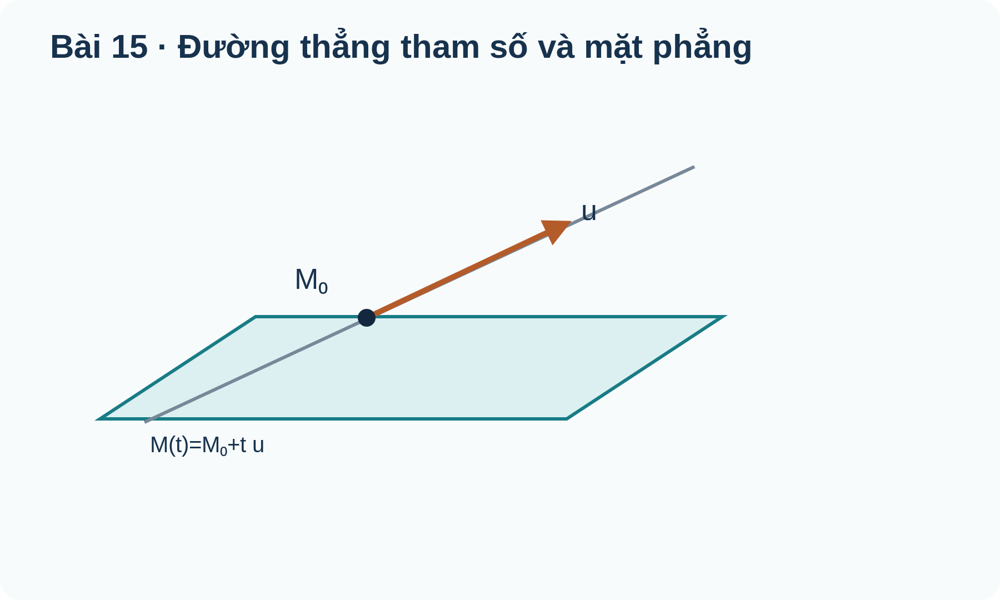
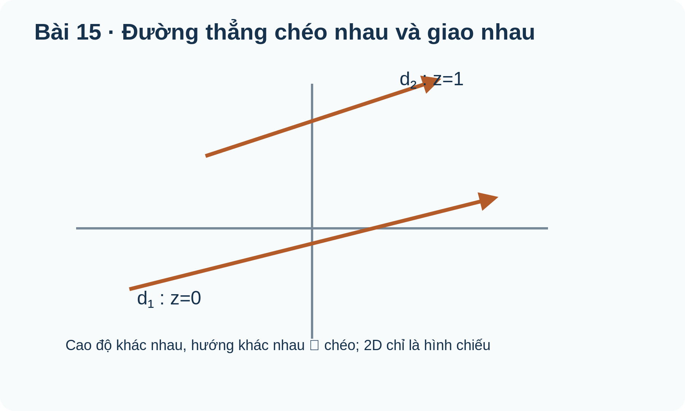

# Toán 12 · Bài 15. Phương trình đường thẳng trong không gian

TOÁN 12 · CHƯƠNG V · SGK KẾT NỐI TRI THỨC · TẬP HAI

Học từ lý do và bản chất trước khi áp dụng công thức; có ví dụ giải thích phương pháp, hình gốc và Tự thử.
<nav class="thpt-r4-lesson-tabs"><a href="../">Chương V</a><a href="../bai-14/">Bài 14</a><a href="../bai-16/">Bài 16</a></nav>

## 1. Vì sao cần học và kiến thức tiền đề

Mô hình quỹ đạo, cáp và điểm giao.

**Tự kiểm tra tiền đề:** Ôn lại vectơ chỉ phương, biểu diễn điểm M0+t u và giải hệ hai tham số. Nếu chưa tự giải được câu thử ở dưới, ôn vectơ/tích vô hướng/đạo hàm phù hợp trước khi tiếp tục.

## 2. Hiểu bản chất, điều kiện và ví dụ

<!-- OUTCOME_ID: G12-CHV-B15-O01 -->
### 1. Vectơ chỉ phương và phương trình tham số đường thẳng

- **Vì sao cần biết:** Một điểm xuất phát và hướng chuyển động xác định quỹ đạo thẳng của máy bay không người lái.
- **Kiến thức tiền đề:** Cộng vectơ và tọa độ điểm M0+t u.
- **Bản chất trước công thức:** Tham số t đo bao nhiêu lần vectơ hướng được cộng vào vị trí ban đầu.
- **Định nghĩa và công thức:** \((x,y,z)=(x_0,y_0,z_0)+t(a,b,c),\;t\in\mathbb R\).
- **Điều kiện và giới hạn:** Vectơ chỉ phương (a,b,c) khác 0; t thay đổi trên toàn R đối với đường thẳng vô hạn.
- **Lý do chọn phương pháp:** Chọn M0 và u rồi viết đủ ba tọa độ theo cùng một t.
- **Bẫy cần tự phát hiện:** Dùng ba tham số t khác nhau cho ba tọa độ, vô tình tạo mặt phẳng.

#### Ví dụ có suy luận

**Đề:** M0=(1,2,3),u=(2,-1,1). Viết tham số.

**Lời giải có suy luận:** M=M0+t u; kiểm t=0 cho M0 và t=1 cho (3,1,4).

**Kiểm tra kết quả và điều kiện:** (1+2t,2−t,3+t). **Kiểm tra phạm vi:** Vectơ chỉ phương (a,b,c) khác 0; t thay đổi trên toàn R đối với đường thẳng vô hạn.

<!-- OUTCOME_ID: G12-CHV-B15-O02 -->
### 2. Đường thẳng qua hai điểm phân biệt

- **Vì sao cần biết:** Dựng đường đi thẳng qua hai mốc đo đạc trong không gian.
- **Kiến thức tiền đề:** Trừ tọa độ hai điểm và phương trình tham số.
- **Bản chất trước công thức:** Hai điểm phân biệt tạo hướng AB, mọi điểm đường thẳng có dạng A+tAB.
- **Định nghĩa và công thức:** \(\overrightarrow{AB}=B-A\ne0,\;M=A+t(B-A)\).
- **Điều kiện và giới hạn:** Hai điểm phải khác nhau; có thể nhân vectơ chỉ phương với số khác 0.
- **Lý do chọn phương pháp:** Tính AB rồi viết tham số; kiểm A ở t=0 và B ở t=1.
- **Bẫy cần tự phát hiện:** Lấy hiệu tọa độ sai hoặc hai điểm trùng nhau vẫn nói xác định một đường thẳng duy nhất.

#### Ví dụ có suy luận

**Đề:** A(1,0,-1),B(3,2,1). Lập đường thẳng AB.

**Lời giải có suy luận:** AB=(2,2,2); A+tAB đưa t=1 về B; có thể rút hướng (1,1,1).

**Kiểm tra kết quả và điều kiện:** (1+2t,2t,−1+2t). **Kiểm tra phạm vi:** Hai điểm phải khác nhau; có thể nhân vectơ chỉ phương với số khác 0.

<!-- OUTCOME_ID: G12-CHV-B15-O03 -->
### 3. Phương trình chính tắc và tọa độ hướng bằng 0

- **Vì sao cần biết:** Dạng chính tắc giúp nhận nhanh giao điểm với mặt phẳng và thành phần hướng.
- **Kiến thức tiền đề:** Quy tắc chia và ý nghĩa tham số x−x0=a t.
- **Bản chất trước công thức:** Khử chung t chỉ khi thành phần hướng được đem chia khác 0; nếu một thành phần bằng 0, tọa độ đó là hằng.
- **Định nghĩa và công thức:** \(\frac{x-x_0}{a}=\frac{y-y_0}{b}=\frac{z-z_0}{c}\) khi \(abc\ne0\).
- **Điều kiện và giới hạn:** Nếu a=0, viết x=x0 và chỉ chia theo các thành phần còn lại; không chia cho 0.
- **Lý do chọn phương pháp:** Kiểm hướng trước khi chuyển; giữ một t chung hoặc điều kiện tọa độ cố định.
- **Bẫy cần tự phát hiện:** Viết (x−1)/0 vì tưởng công thức luôn có ba phân số.

#### Ví dụ có suy luận

**Đề:** Qua (1,-2,3),u=(2,1,-1). Viết chính tắc.

**Lời giải có suy luận:** Đặt ba biểu thức bằng t, vì cả ba thành phần u khác 0.

**Kiểm tra kết quả và điều kiện:** (x−1)/2=(y+2)/1=(z−3)/(−1). **Kiểm tra phạm vi:** Nếu a=0, viết x=x0 và chỉ chia theo các thành phần còn lại; không chia cho 0.

<!-- OUTCOME_ID: G12-CHV-B15-O04 -->
### 4. Kiểm điểm thuộc đường thẳng bằng một tham số

- **Vì sao cần biết:** Một vị trí có nằm trên tuyến cáp hay đường bay đã thiết kế?
- **Kiến thức tiền đề:** Nghiệm phương trình bậc nhất và tính nhất quán ba tọa độ.
- **Bản chất trước công thức:** Thuộc đường thẳng khi có một giá trị t duy nhất (hoặc phù hợp) thỏa đồng thời cả ba phương trình.
- **Định nghĩa và công thức:** \(M\in d\iff\exists t\in\mathbb R: M=M_0+t\vec u\).
- **Điều kiện và giới hạn:** Không được dùng t khác nhau cho từng phương trình; nếu một tọa độ hướng bằng 0, điểm phải có tọa độ cố định tương ứng.
- **Lý do chọn phương pháp:** Giải t từ một tọa độ có hệ số khác 0 rồi thay vào hai tọa độ còn lại.
- **Bẫy cần tự phát hiện:** Chỉ kiểm được x rồi bỏ qua y,z.

#### Ví dụ có suy luận

**Đề:** d=(1+t,2−2t,3+t). M(3,-2,5) có thuộc d?

**Lời giải có suy luận:** Từ x=3 ⇒ t=2; y=2−4=−2, z=3+2=5 đều khớp.

**Kiểm tra kết quả và điều kiện:** Có, t=2. **Kiểm tra phạm vi:** Không được dùng t khác nhau cho từng phương trình; nếu một tọa độ hướng bằng 0, điểm phải có tọa độ cố định tương ứng.

<!-- OUTCOME_ID: G12-CHV-B15-O05 -->
### 5. Quan hệ hướng giữa hai đường thẳng

- **Vì sao cần biết:** Hai tuyến giao thông có cùng hướng hay tạo góc vuông theo vectơ?
- **Kiến thức tiền đề:** Tích vô hướng và vectơ cùng phương.
- **Bản chất trước công thức:** Điều kiện song song của hướng khác với vị trí hình học của hai đường thẳng; hướng vuông góc không đủ khẳng định hai đường thẳng cắt nhau.
- **Định nghĩa và công thức:** \(\vec u\parallel\vec v \iff\vec u\times\vec v=0;\quad\vec u\perp\vec v\iff\vec u\cdot\vec v=0\).
- **Điều kiện và giới hạn:** Kiểm vị trí có giao điểm trước khi gọi hai đường thẳng vuông góc theo nghĩa hình học.
- **Lý do chọn phương pháp:** Phân biệt xét hướng và xét vị trí; nêu rõ kết luận đang dùng.
- **Bẫy cần tự phát hiện:** Từ u·v=0 kết luận ngay hai đường thẳng luôn cắt nhau trong không gian.

#### Ví dụ có suy luận

**Đề:** u=(1,1,0),v=(1,-1,0). Hướng hai đường thẳng thế nào?

**Lời giải có suy luận:** u·v=1−1=0; chưa đủ để khẳng định hai đường thẳng cắt nhau.

**Kiểm tra kết quả và điều kiện:** Hai hướng vuông góc. **Kiểm tra phạm vi:** Kiểm vị trí có giao điểm trước khi gọi hai đường thẳng vuông góc theo nghĩa hình học.

<!-- OUTCOME_ID: G12-CHV-B15-O06 -->
### 6. Hai đường thẳng cắt nhau, song song, trùng hoặc chéo nhau

- **Vì sao cần biết:** Các tuyến dây trong không gian có thể không giao nhau dù hình chiếu trông như cắt.
- **Kiến thức tiền đề:** Giải hệ ba tọa độ với hai tham số t,s và xét hướng.
- **Bản chất trước công thức:** Hai đường không cùng phương mà không có nghiệm chung trong ba phương trình thì chéo nhau; hình chiếu 2D không đủ.
- **Định nghĩa và công thức:** \(M_1+t\vec u=M_2+s\vec v\), kiểm đồng thời x,y,z.
- **Điều kiện và giới hạn:** Hệ có nghiệm là cắt (nếu khác hướng) hoặc trùng; không nghiệm + khác hướng là chéo; cùng hướng + khác vị trí là song song.
- **Lý do chọn phương pháp:** Viết hai t,s khác nhau, giải hai tọa độ rồi bắt buộc kiểm tọa độ thứ ba.
- **Bẫy cần tự phát hiện:** Thấy đường vẽ cắt trên giấy rồi kết luận thật sự giao trong không gian.

#### Ví dụ có suy luận

**Đề:** d1=(t,0,t), d2=(0,s,1−s). Hai đường có cắt?

**Lời giải có suy luận:** x: t=0; y: s=0; z: 0≠1 nên không giao; hướng (1,0,1),(0,1,-1) không cùng phương.

**Kiểm tra kết quả và điều kiện:** Chéo nhau. **Kiểm tra phạm vi:** Hệ có nghiệm là cắt (nếu khác hướng) hoặc trùng; không nghiệm + khác hướng là chéo; cùng hướng + khác vị trí là song song.

<!-- OUTCOME_ID: G12-CHV-B15-O07 -->
### 7. Giao của đường thẳng với mặt phẳng

- **Vì sao cần biết:** Tìm điểm một đường bay xuyên qua mặt phẳng quy định hoặc chạm nền.
- **Kiến thức tiền đề:** Thế phương trình tham số vào phương trình mặt phẳng.
- **Bản chất trước công thức:** Giao điểm tương ứng giá trị t thỏa cùng lúc điều kiện mặt phẳng và đường thẳng.
- **Định nghĩa và công thức:** \(A(x_0+at)+B(y_0+bt)+C(z_0+ct)+D=0\).
- **Điều kiện và giới hạn:** Hệ có nghiệm duy nhất: cắt; vô nghiệm: song song; đúng mọi t: đường thẳng nằm trong mặt phẳng.
- **Lý do chọn phương pháp:** Thế đủ ba tọa độ, giải t, thay lại cả hai phương trình.
- **Bẫy cần tự phát hiện:** Tìm giao chỉ qua một tọa độ hoặc quên kiểm trường hợp hệ số t bằng 0.

#### Ví dụ có suy luận

**Đề:** d=(t,1,2t), P:x+z−6=0. Tìm giao.

**Lời giải có suy luận:** Thế t+2t−6=0 ⇒ t=2; điểm (2,1,4) thuộc cả d và P.

**Kiểm tra kết quả và điều kiện:** (2,1,4). **Kiểm tra phạm vi:** Hệ có nghiệm duy nhất: cắt; vô nghiệm: song song; đúng mọi t: đường thẳng nằm trong mặt phẳng.

## 3. Đọc hình minh họa gốc

<figure class="thpt-r4-plot g12-chi-figure"><figcaption>Hình 1: Phương trình đường thẳng trong không gian. Đọc nhãn và quan hệ hình học; không suy số đo trong không gian từ tỷ lệ hình phẳng.</figcaption></figure>

<figure class="thpt-r4-plot g12-chi-figure"><figcaption>Hình 2: Phương trình đường thẳng trong không gian. Đọc nhãn và quan hệ hình học; không suy số đo trong không gian từ tỷ lệ hình phẳng.</figcaption></figure>

## 4. Tự thử trước Core

Em tự làm trước, rồi chủ động mở đối chiếu; không tính điểm hay Mastery.

<!-- FIRST_TRY_ID: B15-T01 -->
### Tự thử

Tại t=0, M0+t u bằng gì?

Mở đối chiếu sau khi tự thử

**Đối chiếu:** M0.

**Vì sao:** Cộng vectơ và tọa độ điểm M0+t u..

<!-- FIRST_TRY_ID: B15-T02 -->
### Tự thử

d=(t,1,2t), P:x+z−6=0. Tìm giao.

Mở đối chiếu sau khi tự thử

**Đối chiếu:** (2,1,4).

**Vì sao:** Thế phương trình tham số vào phương trình mặt phẳng..

## 5. Core và Luyện tập

<nav class="thpt-r4-lesson-tabs"><a href="../luyen-tap/#b15-core">Core · Bài 15</a><a href="../luyen-tap/#b15-practice">Luyện tập, Vận dụng và Tự luận</a><a href="../luyen-tap/#b15-help">Khi gặp khó khăn</a></nav>

