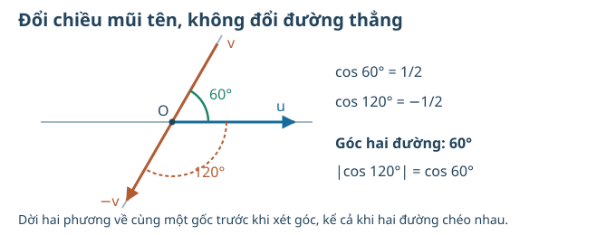
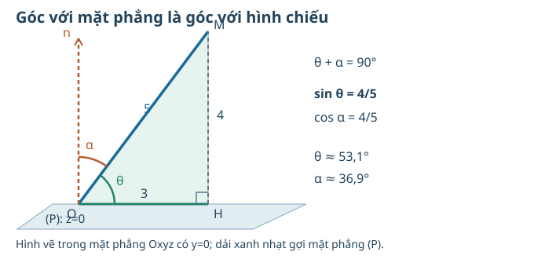
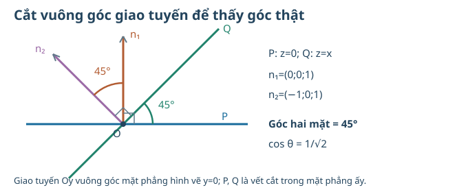

# Bài 16. Công thức tính góc trong không gian

TOÁN 12 · CHƯƠNG V · KIẾN THỨC SGK KNTT · TẬP HAI

Chọn đúng vectơ, hiểu vì sao dùng sin hoặc cos, rồi tính góc giữa các đường và mặt phẳng trong không gian.

<nav class="thpt-r4-lesson-tabs"><a href="../">Chương V</a><a href="../bai-15/">Bài trước</a><a href="../luyen-tap/#b16-core">Core/Luyện tập</a><a href="../bai-17/">Bài tiếp theo</a></nav>

=== "Khám phá kiến thức"

    ### 1.1. Công thức tính góc giữa hai đường thẳng

    Khi hai tuyến đường trong không gian không gặp nhau, ta vẫn có thể hỏi hướng của chúng tạo thành góc bao nhiêu. Chẳng hạn hai thanh giằng của một công trình đặt ở hai cao độ khác nhau: để so sánh hướng, hãy tưởng tượng tịnh tiến một thanh về vị trí sao cho hai thanh có chung một điểm. Ta đo góc giữa hai đường thẳng đã đưa về cùng một gốc.

    <!-- OUTCOME_ID: G12-CHV-B16-O01 -->
    Khác với vectơ, đường thẳng không có chiều cố định. Nếu hai vectơ chỉ phương \(\vec u,\vec v\) tạo góc \(60^\circ\), thì \(\vec u,-\vec v\) tạo góc \(120^\circ\). Tuy nhiên thay \(\vec v\) bằng \(-\vec v\) không đổi đường thẳng. Vì vậy góc giữa hai đường được chọn là góc không tù, thuộc \([0^\circ;90^\circ]\).

    <figure class="thpt-r4-plot thpt-r4-concept-figure"><figcaption>Góc giữa hai đường không đổi khi đảo chiều một chỉ phương. Trị tuyệt đối biến \(\cos120^\circ=-1/2\) thành \(\cos60^\circ=1/2\).</figcaption></figure>

    Gọi \(\alpha\) là góc giữa hai vectơ chỉ phương khác không. Góc giữa hai đường là \(\theta=\alpha\) nếu \(\alpha\le90^\circ\), và \(\theta=180^\circ-\alpha\) nếu \(\alpha>90^\circ\). Vì \(\cos(180^\circ-\alpha)=-\cos\alpha\), trong cả hai trường hợp
    \[
    \cos\theta=|\cos\alpha|
    =\frac{|\vec u\cdot\vec v|}{\|\vec u\|\|\vec v\|}.
    \]
    Đây chính là lí do cần trị tuyệt đối. Từ Bài 6 và Bài 15, ta đã biết tính tích vô hướng, độ dài vectơ và đọc chỉ phương từ phương trình đường thẳng.

    Ví dụ hai đường có chỉ phương \((1;1;0)\) và \((-1;0;1)\). Tích vô hướng bằng \(-1\), cả hai độ dài bằng \(\sqrt2\). Góc giữa hai vectơ là \(120^\circ\), nhưng góc giữa hai đường là \(60^\circ\), vì \(\cos\theta=1/2\). Vị trí điểm gốc không xuất hiện trong công thức: hai đường cắt hay chéo đều tính theo hướng.

    <!-- FIRST_TRY_ID: B16-T01 -->
    **Vận dụng.** Cho \(d_1:(x;y;z)=(2+t;1-t;3)\) và \(d_2:(x;y;z)=(s;s;1+s)\). Tính góc giữa hai đường. Chúng có cắt nhau không?

    ??? question "Đối chiếu"

        Chỉ phương lần lượt là \((1;-1;0)\), \((1;1;1)\); tích vô hướng \(1-1+0=0\). Do đó góc bằng \(90^\circ\). Từ cao độ \(3=1+s\) suy ra \(s=2\); từ hoành độ \(2+t=2\) suy ra \(t=0\). Nhưng tung độ khi đó là \(1\) và \(2\), không bằng nhau. Hai đường chéo nhau và vuông góc.

    ??? tip "Kiểm lỗi"

        Đừng lấy tọa độ điểm gốc \((2;1;3)\) làm chỉ phương. Đọc hệ số của tham số trong cả ba tọa độ. Góc \(90^\circ\) không bắt buộc có giao điểm trong không gian.

    Hai trường hợp biên giúp tự kiểm: chỉ phương cùng phương cho \(\cos\theta=1\), góc \(0^\circ\); chỉ phương vuông góc cho \(\cos\theta=0\), góc \(90^\circ\). Nếu kết quả tỉ số âm hoặc lớn hơn 1, cần kiểm lại phép tính, trị tuyệt đối và độ dài vectơ.

    ### 1.2. Công thức tính góc giữa đường thẳng và mặt phẳng

    Một đoạn đường dốc tạo góc bao nhiêu với mặt sàn? Nếu đo với phương thẳng đứng thì sẽ nhận một góc khác. Để tránh nhầm, trước hết hãy xác định chính xác góc đề yêu cầu.

    <!-- OUTCOME_ID: G12-CHV-B16-O02 -->
    Xét đường \(OM\) đi qua \(O(0;0;0)\), \(M(3;0;4)\), và mặt phẳng ngang \((P):z=0\). Hình chiếu của \(M\) lên \((P)\) là \(H(3;0;0)\). Góc đường–mặt là \(\theta=\widehat{MOH}\), còn đường pháp tuyến qua \(O\) theo phương \(Oz\) tạo với \(OM\) góc \(\alpha\). Trong tam giác vuông, \(OH=3,\ MH=4,\ OM=5\).

    <figure class="thpt-r4-plot thpt-r4-concept-figure"><figcaption>Quan sát hai cung góc tại \(O\): góc xanh \(\theta\) đo với mặt phẳng, góc cam \(\alpha\) đo với pháp tuyến. Chúng có tổng \(90^\circ\).</figcaption></figure>

    Vì \(\theta+\alpha=90^\circ\), nên \(\sin\theta=\cos\alpha\). Mà \(\alpha\) là góc không tù giữa đường \(OM\) và đường theo phương pháp tuyến, nên với chỉ phương \(\vec u\), pháp tuyến \(\vec n\) khác không:
    \[
    \sin\theta=\frac{|\vec u\cdot\vec n|}{\|\vec u\|\|\vec n\|}.
    \]
    Với \(\vec u=(3;0;4),\vec n=(0;0;1)\), tỉ số là \(4/5\), vậy \(\theta\approx53{,}1^\circ\). Nếu dùng cosin trực tiếp, ta nhận \(36{,}9^\circ\): đó là góc với pháp tuyến, không phải góc với mặt phẳng.

    <!-- OUTCOME_ID: G12-CHV-B16-O04 -->
    Hãy kiểm hai trường hợp đặc biệt. Đường song song hoặc nằm trong mặt phẳng có hướng vuông góc pháp tuyến, tích vô hướng bằng 0 và góc đường–mặt bằng \(0^\circ\). Đường vuông góc với mặt phẳng có chỉ phương cùng phương pháp tuyến, tỉ số bằng 1 và góc bằng \(90^\circ\). Công thức vẫn dùng được khi hình chiếu của đường thẳng suy biến thành một điểm. Nếu cần phân biệt đường nằm trong hay song song phân biệt, ngoài tích vô hướng còn phải thay một điểm của đường vào phương trình mặt phẳng.

    <!-- OUTCOME_ID: G12-CHV-B16-O05 -->
    Trong bài toán độ dốc, nếu hai điểm có hiệu cao độ \(\Delta z\), khoảng cách theo đường thẳng là \(L>0\), thì góc với mặt ngang thỏa \(\sin\theta=|\Delta z|/L\). Nếu biết khoảng cách ngang \(h>0\) thay cho \(L\), dùng \(\tan\theta=|\Delta z|/h\). Độ dốc phần trăm là \(100|\Delta z|/h\%\), không phải số đo góc. Ví dụ đường dốc cao 1 m và chiếu ngang 10 m có độ dốc 10%, nhưng góc chỉ khoảng \(5{,}7^\circ\).

    <!-- FIRST_TRY_ID: B16-T02 -->
    **Vận dụng.** Một thanh nối hai vị trí \(A(1;2;1)\) và \(B(5;5;3)\), đơn vị mét. Tính góc giữa thanh và mặt ngang \(z=0\). Tính thêm độ dốc phần trăm theo chiều đi từ \(A\) tới \(B\).

    ??? question "Đối chiếu"

        \(\overrightarrow{AB}=(4;3;2)\), độ dài \(\sqrt{29}\), pháp tuyến của mặt ngang là \((0;0;1)\). Suy ra \(\sin\theta=2/\sqrt{29}\), \(\theta\approx21{,}8^\circ\). Hình chiếu ngang dài \(\sqrt{4^2+3^2}=5\) m; độ cao tăng 2 m, nên độ dốc \(2/5\cdot100\%=40\%\). Kiểm lại bằng \(\tan\theta=2/5\).

    ??? tip "Kiểm lỗi"

        Nếu chia độ cao 2 cho độ dài thanh \(\sqrt{29}\), phải dùng sin; nếu chia cho khoảng cách ngang 5 thì dùng tan. Không gọi tỉ số \(2/\sqrt{29}\) là độ dốc phần trăm.

    ### 1.3. Công thức tính góc giữa hai mặt phẳng

    <!-- OUTCOME_ID: G12-CHV-B16-O03 -->
    Một mái nghiêng và sàn ngang tạo với nhau một góc. Để nhìn góc thật giữa hai mặt phẳng cắt nhau, hãy chọn một mặt phẳng phụ vuông góc với giao tuyến của chúng. Trong mặt phẳng phụ ấy, mỗi mặt phẳng ban đầu để lại một đường thẳng. Góc không tù giữa hai đường này chính là góc giữa hai mặt phẳng.

    Xét \((P):z=0\) và \((Q):z=x\), giao tuyến là \(Oy\). Cắt bằng mặt phẳng \(y=0\) vuông góc \(Oy\), ta được đường ngang và đường nghiêng \(45^\circ\). Cả hai pháp tuyến \(\vec n_1=(0;0;1)\), \(\vec n_2=(-1;0;1)\) đều nằm theo phương của thiết diện. Mỗi pháp tuyến vuông góc với đường vết cắt tương ứng.

    <figure class="thpt-r4-plot thpt-r4-concept-figure"><figcaption>Quay đồng thời hai phương vết cắt một góc \(90^\circ\) ta nhận hai phương pháp tuyến. Góc không tù giữa chúng được bảo toàn.</figcaption></figure>

    Do đó góc giữa hai mặt phẳng bằng góc không tù giữa hai đường pháp tuyến. Với \(\vec n_1,\vec n_2\ne\vec0\),
    \[
    \cos\theta=\frac{|\vec n_1\cdot\vec n_2|}{\|\vec n_1\|\|\vec n_2\|}.
    \]
    Nếu hai mặt phẳng song song hoặc trùng nhau thì pháp tuyến cùng phương và góc bằng \(0^\circ\); nếu hai pháp tuyến vuông góc thì góc bằng \(90^\circ\). Hệ số tự do không ảnh hưởng tới góc. Cũng như ở Bài 14, nếu chưa có phương trình mặt phẳng, ta tìm pháp tuyến bằng tích có hướng của hai hướng độc lập nằm trong mặt phẳng.

    **Vận dụng — mái nhà.** Ba chân cột đứng trên nền ngang ở \(A(0;0;0)\), \(B(4;0;0)\), \(C(0;4;0)\) (m). Độ cao cột lần lượt là 3 m, 5 m, 4 m. Mái là mặt phẳng qua ba đỉnh cột. Hỏi mái nghiêng với nền một góc bao nhiêu?

    ??? question "Đối chiếu"

        Đỉnh cột lần lượt là \(A'(0;0;3)\), \(B'(4;0;5)\), \(C'(0;4;4)\). Hai hướng của mái là \(\overrightarrow{A'B'}=(4;0;2)\), \(\overrightarrow{A'C'}=(0;4;1)\). Tích có hướng \((-8;-4;16)\ne\vec0\), chọn pháp tuyến \((-2;-1;4)\). Pháp tuyến nền là \((0;0;1)\).

        \[
        \cos\theta=\frac4{\sqrt{21}},\qquad \theta\approx29{,}2^\circ.
        \]
        Kiểm phương trình mái \(z=3+x/2+y/4\): thay cả ba đỉnh đều đúng. Mái nghiêng theo cả hai phương ngang, nên không được tự lấy góc dốc của riêng một cạnh làm góc của toàn mái.

    ??? tip "Kiểm lỗi"

        Đừng dùng vectơ thẳng đứng của cột làm pháp tuyến mái. Dựng hai vectơ nối các đỉnh cột, lấy tích có hướng, rồi kiểm vuông góc với từng vectơ đó. Dùng cos cho mặt–mặt.

=== "Kiến thức SGK"

    ### 2.1. Công thức tính góc giữa hai đường thẳng

    Gọi \(\theta=(d_1,d_2)\) là góc giữa hai đường thẳng. Luôn có \(0^\circ\le\theta\le90^\circ\); hai đường chéo nhau vẫn có góc xác định.

    
<strong>Công thức — Góc giữa hai đường thẳng.</strong>
Với hai vectơ chỉ phương khác không \(\vec u_1=(a_1;b_1;c_1),\vec u_2=(a_2;b_2;c_2)\),

\(\displaystyle \cos\theta=\frac{|\vec u_1\cdot\vec u_2|}{\|\vec u_1\|\|\vec u_2\|}=\frac{|a_1a_2+b_1b_2+c_1c_2|}{\sqrt{a_1^2+b_1^2+c_1^2}\sqrt{a_2^2+b_2^2+c_2^2}}.\)

Tìm \(\theta\) bằng arccos của tỉ số trên. Trị tuyệt đối đảm bảo kết quả không đổi khi đảo chiều một chỉ phương.

    Đọc chỉ phương từ hệ số của tham số hoặc các mẫu số ở phương trình chính tắc; nếu cho hai điểm phân biệt, lấy hiệu tọa độ hai điểm. Với hai chỉ phương cùng phương, góc bằng \(0^\circ\); nếu tích vô hướng bằng 0, góc bằng \(90^\circ\). Không cần tìm giao điểm để tính góc.

    ### 2.2. Công thức tính góc giữa đường thẳng và mặt phẳng

    Gọi \(\theta=(d,(P))\), \(0^\circ\le\theta\le90^\circ\). Nếu đường cắt mặt phẳng và không vuông góc với mặt phẳng, góc này là góc giữa đường và hình chiếu vuông góc của nó trên mặt phẳng. Góc bằng \(0^\circ\) nếu đường song song hoặc nằm trong mặt phẳng; bằng \(90^\circ\) nếu đường vuông góc với mặt phẳng.

    
<strong>Công thức — Góc giữa đường thẳng và mặt phẳng.</strong>
Với chỉ phương \(\vec u=(a;b;c)\ne\vec0\) của \(d\), pháp tuyến \(\vec n=(A;B;C)\ne\vec0\) của \((P)\),

\(\displaystyle \sin\theta=\frac{|\vec u\cdot\vec n|}{\|\vec u\|\|\vec n\|}=\frac{|aA+bB+cC|}{\sqrt{a^2+b^2+c^2}\sqrt{A^2+B^2+C^2}}.\)

Tìm \(\theta\) bằng arcsin; góc với phương pháp tuyến là góc phụ của \(\theta\).

    <figure class="thpt-r4-plot"><figcaption>Trong ví dụ \(OM\) dài 5, độ cao 4, chiếu ngang 3, \(\sin\theta=4/5=\cos\alpha\). Không đổi vai trò hai góc.</figcaption></figure>

    Pháp tuyến đọc từ ba hệ số của \(x,y,z\) trong phương trình tổng quát mặt phẳng. Nếu \(\vec u\cdot\vec n=0\), góc bằng \(0^\circ\); kiểm thêm một điểm nếu cần phân biệt nằm trong và song song phân biệt. Nếu \(\vec u\) cùng phương \(\vec n\), góc bằng \(90^\circ\).

    ### 2.3. Công thức tính góc giữa hai mặt phẳng

    Góc giữa hai mặt phẳng là góc không tù giữa hai đường lần lượt vuông góc với chúng.

    
<strong>Công thức — Góc giữa hai mặt phẳng.</strong>
Với hai pháp tuyến khác không \(\vec n_1=(A_1;B_1;C_1),\vec n_2=(A_2;B_2;C_2)\),

\(\displaystyle \cos\theta=\frac{|\vec n_1\cdot\vec n_2|}{\|\vec n_1\|\|\vec n_2\|}=\frac{|A_1A_2+B_1B_2+C_1C_2|}{\sqrt{A_1^2+B_1^2+C_1^2}\sqrt{A_2^2+B_2^2+C_2^2}}.\)

Trong đó \(0^\circ\le\theta\le90^\circ\). Hai mặt phẳng có pháp tuyến cùng phương tạo góc \(0^\circ\); hai pháp tuyến vuông góc cho góc \(90^\circ\).

    <figure class="thpt-r4-plot"><figcaption>Thiết diện \(y=0\) cho thấy hai góc không tù bằng nhau: giữa các vết cắt và giữa các pháp tuyến.</figcaption></figure>

    Nếu cho mặt phẳng qua ba điểm không thẳng hàng, lấy tích có hướng của hai vectơ nối từ một điểm chung để tìm pháp tuyến. Nếu tích có hướng bằng 0, ba điểm không xác định duy nhất mặt phẳng.

    
<strong>Kiến thức cần nhớ — Chọn đúng hai vectơ.</strong>
Đường–đường: hai chỉ phương, dùng cos. Đường–mặt: một chỉ phương và một pháp tuyến, dùng sin. Mặt–mặt: hai pháp tuyến, dùng cos.

Cả ba tỉ số đều là độ lớn tích vô hướng chia tích độ dài hai vectơ khác không. Kết quả góc thuộc đoạn từ \(0^\circ\) đến \(90^\circ\).

    Khi tính gần đúng, đặt máy tính ở chế độ DEG và giữ biểu thức chính xác tới bước tìm góc. Theo quy ước của bài SGK, nếu đề không nêu khác thì dùng đơn vị độ và làm tròn đến một chữ số thập phân.

=== "Ví dụ"

    ### 3.1. Góc giữa hai đường thẳng viết ở hai dạng khác nhau

    **Đề bài.** Tính góc giữa \(d_1:(x;y;z)=(1+2t;3-t;t)\) và \(d_2:(x-2)/1=(y+1)/2=(z-3)/(-1)\).

    **Phân tích:** Đọc hai chỉ phương từ hai dạng phương trình, không lấy tọa độ điểm gốc.

    

<strong>Lời giải.</strong> \(\vec u=(2;-1;1),\vec v=(1;2;-1)\). Tích vô hướng bằng \(2-2-1=-1\); hai độ dài đều bằng \(\sqrt6\). Do đó \(\cos\theta=1/6\), suy ra \(\theta\approx80{,}4^\circ\).

    **Kiểm lại:** Đảo chiều \(\vec v\) làm tích vô hướng thành 1 nhưng không đổi kết quả. Hai đường có góc không tù.

    ### 3.2. Góc giữa đường thẳng và một trục tọa độ

    **Đề bài.** Tính góc giữa \(Oz\) và đường qua \(A(1;2;3),B(3;0;5)\).

    **Phân tích:** Chỉ phương của trục \(Oz\) là \((0;0;1)\), còn chỉ phương của đường \(AB\) là \(\overrightarrow{AB}\).

    

<strong>Lời giải.</strong> \(\overrightarrow{AB}=(2;-2;2)\). Rút gọn thành \(\vec u=(1;-1;1)\). Khi đó \(\cos\theta=1/\sqrt3\), nên \(\theta\approx54{,}7^\circ\).

    **Kiểm lại:** Cả hai đường có thành phần theo phương \(Oz\) khác 0 nhưng không cùng phương, nên góc nằm giữa 0 và 90 độ.

    ### 3.3. Góc giữa đường và mặt phẳng không nằm ngang

    **Đề bài.** Cho \(d:(x;y;z)=(2+t;1+t;3-2t)\), \((P):x+2y-2z+4=0\). Tính góc giữa \(d\) và \((P)\).

    **Phân tích:** Dùng chỉ phương của đường và pháp tuyến của mặt phẳng; góc cần tìm dùng sin.

    

<strong>Lời giải.</strong> \(\vec u=(1;1;-2),\vec n=(1;2;-2)\). Tích vô hướng là \(1+2+4=7\). Độ dài lần lượt \(\sqrt6,3\). Do đó \(\sin\theta=7/(3\sqrt6)\), \(\theta\approx72{,}3^\circ\).

    **Kiểm lại:** Hướng đường gần cùng phương pháp tuyến, tỉ số gần 1, nên góc với mặt phẳng lớn. Nếu dùng cosin sẽ nhận góc phụ, khoảng \(17{,}7^\circ\).

    ### 3.4. Tìm tham số khi biết góc đường–mặt

    **Đề bài.** Đường \(d_m\) có chỉ phương \((1;0;m)\). Tìm \(m\) để đường tạo với \((Oxy)\) góc \(30^\circ\).

    **Phân tích:** Pháp tuyến của \((Oxy)\) là \((0;0;1)\). Chỉ phương khác không với mọi \(m\); lấy trị tuyệt đối vì đường có thể nghiêng lên hoặc xuống.

    

<strong>Lời giải.</strong> \(\displaystyle\frac{|m|}{\sqrt{1+m^2}}=\sin30^\circ=\frac12\). Hai vế không âm, bình phương được \(4m^2=1+m^2\), suy ra \(m=\pm1/\sqrt3\).

    **Kiểm lại:** Thay mỗi nghiệm vào tỉ số ban đầu đều được \(1/2\), đúng góc \(30^\circ\). Không bỏ nghiệm âm.

    ### 3.5. Góc giữa hai mặt phẳng từ phương trình tổng quát

    **Đề bài.** Tính góc giữa \((P):2x-y+2z-1=0\) và \((Q):x+2y-z+5=0\).

    **Phân tích:** Chỉ cần ba hệ số đầu; hệ số tự do không ảnh hưởng tới góc.

    

<strong>Lời giải.</strong> \(\vec n_1=(2;-1;2)\), \(\vec n_2=(1;2;-1)\). Tích vô hướng \(2-2-2=-2\), hai độ dài \(3,\sqrt6\). Do đó \(\cos\theta=2/(3\sqrt6)\), \(\theta\approx74{,}2^\circ\).

    **Kiểm lại:** Không cần chuẩn hóa phương trình để có cùng hệ số tự do. Nhân phương trình thứ hai với \(-2\) cho cùng tỉ số.

    ### 3.6. Góc giữa hai mặt bên của hình chóp

    **Đề bài.** Cho \(S(0;0;3), A(0;0;0),B(2;0;0),C(0;2;0)\). Tính góc giữa \((SAB)\) và \((SBC)\).

    **Phân tích:** Hai mặt phẳng được cho bằng các điểm; xác định hai pháp tuyến.

    

<strong>Lời giải.</strong> \((SAB)\) là mặt phẳng \(y=0\), có pháp tuyến \(\vec n_1=(0;1;0)\). Với mặt \((SBC)\), hai hướng \(\overrightarrow{SB}=(2;0;-3),\overrightarrow{SC}=(0;2;-3)\) có tích có hướng \((6;6;4)\). Chọn \(\vec n_2=(3;3;2)\).

\(\displaystyle\cos\theta=\frac3{\sqrt{22}}\), suy ra \(\theta\approx50{,}2^\circ\).

    **Kiểm lại:** \(\vec n_2\cdot\overrightarrow{SB}=6-6=0\), \(\vec n_2\cdot\overrightarrow{SC}=6-6=0\). Cả hai mặt phẳng đều không suy biến. Góc giữa hai mặt phẳng là góc không tù, không nhất thiết là góc nhị diện trong của khối.

    ### 3.7. Từ độ cao của bốn điểm đến độ nghiêng mặt phẳng

    **Đề bài.** Một tấm phẳng có bốn góc với hình chiếu xuống nền là bốn đỉnh hình chữ nhật \(2\) m × \(3\) m. Đặt \(A(0;0;1),B(2;0;1{,}2),C(2;3;1{,}5)\). Tìm độ cao góc \(D\) có hình chiếu \((0;3;0)\) và góc nghiêng của tấm với nền.

    **Phân tích:** Ba điểm xác định mặt phẳng. Do các hình chiếu tạo hình chữ nhật, độ cao trên mặt phẳng biến thiên tuyến tính theo hai tọa độ ngang.

    

<strong>Lời giải.</strong> Hai hướng là \(\overrightarrow{AB}=(2;0;0{,}2)\), \(\overrightarrow{BC}=(0;3;0{,}3)\). Tích có hướng \((-0{,}6;-0{,}6;6)\), chọn \((-1;-1;10)\). Qua \(A\), phương trình là \(-x-y+10z-10=0\), hay \(z=1+(x+y)/10\). Từ đó \(D(0;3;1{,}3)\).

Nền có pháp tuyến \((0;0;1)\). Vậy \(\cos\theta=10/\sqrt{102}\), \(\theta\approx8{,}0^\circ\).

    **Kiểm lại:** \(z_D=z_A+z_C-z_B=1+1{,}5-1{,}2=1{,}3\) m. Thay bốn điểm vào phương trình đều đúng. Không lấy trung bình cộng ba độ cao để đoán độ cao thứ tư.

=== "Lỗi thường gặp"

    ### 4.1. Đọc nhầm chỉ phương và pháp tuyến

    **Sai ở đâu:** Lấy tọa độ điểm gốc của đường làm chỉ phương hoặc dùng hệ số tự do của mặt phẳng làm thành phần pháp tuyến.

    **Vì sao sai:** Điểm gốc và hệ số tự do xác định vị trí, không xác định hướng.

    **Cách sửa:** Đọc hệ số của tham số hoặc mẫu số chính tắc để lấy chỉ phương; đọc đúng ba hệ số \(x,y,z\) của phương trình mặt phẳng.

    ### 4.2. Quên trị tuyệt đối

    **Sai ở đâu:** Góc giữa hai chỉ phương bằng \(120^\circ\) thì kết luận góc hai đường bằng \(120^\circ\).

    **Vì sao sai:** Đường thẳng không có chiều cố định; góc giữa hai đường phải không tù.

    **Cách sửa:** Lấy trị tuyệt đối của tích vô hướng, hoặc đổi góc tù thành góc bù của nó.

    ### 4.3. Nhầm sin và cos

    **Sai ở đâu:** Dùng cos cho góc đường–mặt hoặc dùng sin cho góc mặt–mặt.

    **Vì sao sai:** Góc đường–mặt là góc phụ của góc giữa hướng đường và pháp tuyến.

    **Cách sửa:** Tự hỏi “đang đo với mặt hay với pháp tuyến?”. Đường song song mặt phải cho góc 0 độ; thử trường hợp này để phát hiện công thức sai.

    ### 4.4. Nhầm quan hệ hướng với quan hệ vị trí

    **Sai ở đâu:** Hai đường có góc \(90^\circ\) thì phải cắt; hoặc đường có góc 0 độ với mặt phẳng thì phải nằm trong mặt phẳng.

    **Vì sao sai:** Góc chỉ phụ thuộc vào phương. Vị trí cần dữ kiện về điểm.

    **Cách sửa:** Tính góc bằng vectơ; nếu đề hỏi cắt, chéo, nằm trong hoặc song song phân biệt, kiểm thêm điều kiện điểm chung ở Bài 14–15.

    ### 4.5. Dùng vectơ không hoặc thiếu điều kiện khi tìm tham số

    **Sai ở đâu:** Chia cho tích độ dài khi một vectơ bằng 0; bỏ nghiệm âm sau khi bình phương.

    **Vì sao sai:** Vectơ-không không xác định hướng; biểu thức góc có trị tuyệt đối có thể có hai nhánh.

    **Cách sửa:** Kiểm vectơ khác không trước khi lập phương trình; kiểm lại từng nghiệm vào biểu thức ban đầu.

    ### 4.6. Nhầm độ dốc phần trăm với góc

    **Sai ở đâu:** Độ dốc 10% thì góc bằng \(10^\circ\).

    **Vì sao sai:** Độ dốc phần trăm bằng 100 lần tỉ số độ cao trên khoảng cách ngang; góc là arctan của tỉ số đó.

    **Cách sửa:** Vẽ tam giác vuông, phân biệt độ cao, khoảng cách ngang và độ dài đoạn nghiêng. Đổi cùng đơn vị trước khi tính.

    ### 4.7. Làm tròn quá sớm hoặc sai chế độ máy tính

    **Sai ở đâu:** Làm tròn cosin thành 0,3 rồi mới tìm góc; đọc kết quả radian thành độ.

    **Vì sao sai:** Sai số tỉ số truyền sang góc, đặc biệt gần các mốc 0 và 90 độ.

    **Cách sửa:** Giữ căn thức hoặc đủ chữ số, dùng DEG, kiểm tỉ số thuộc \([0;1]\), chỉ làm tròn góc cuối theo yêu cầu đề.

    **Học tiếp:** [Core và Luyện tập Bài 16](../luyen-tap/#b16-core) · [Bài 17 — Phương trình mặt cầu](../bai-17/).

    
Nguồn kiến thức: SGK KNTT Toán 12 tập 2, trang in 50–53. Ví dụ và hình minh họa do SLM biên soạn riêng.

