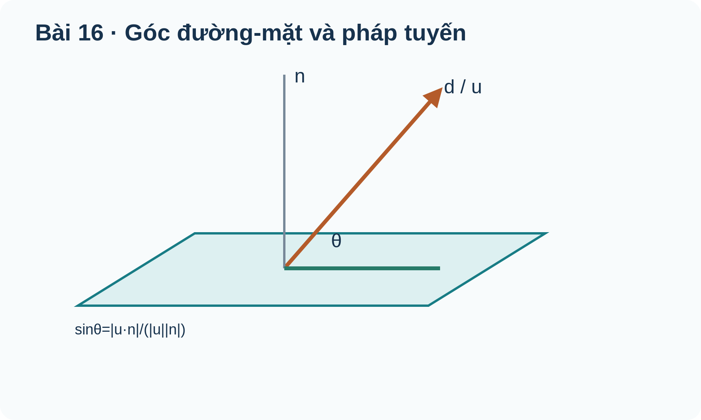
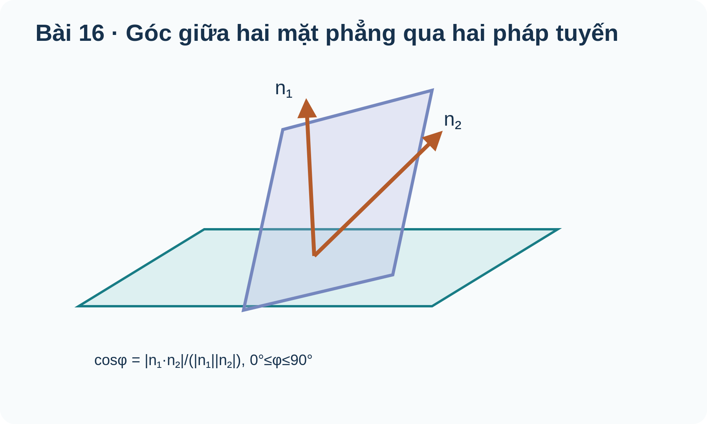

# Toán 12 · Bài 16. Công thức tính góc trong không gian

TOÁN 12 · CHƯƠNG V · SGK KẾT NỐI TRI THỨC · TẬP HAI

Học từ lý do và bản chất trước khi áp dụng công thức; có ví dụ giải thích phương pháp, hình gốc và Tự thử.
<nav class="thpt-r4-lesson-tabs"><a href="../">Chương V</a><a href="../bai-15/">Bài 15</a><a href="../bai-17/">Bài 17</a></nav>

## 1. Vì sao cần học và kiến thức tiền đề

Góc tuyến đường, mái và đường dốc.

**Tự kiểm tra tiền đề:** Ôn lại chuẩn vectơ, tích vô hướng, lượng giác góc nhọn. Nếu chưa tự giải được câu thử ở dưới, ôn vectơ/tích vô hướng/đạo hàm phù hợp trước khi tiếp tục.

## 2. Hiểu bản chất, điều kiện và ví dụ

<!-- OUTCOME_ID: G12-CHV-B16-O01 -->
### 1. Góc giữa hai đường thẳng bằng vectơ chỉ phương

- **Vì sao cần biết:** Đánh giá góc giao hai hành lang, tuyến đường hoặc hướng di chuyển.
- **Kiến thức tiền đề:** Tích vô hướng và chuẩn Euclid của vectơ.
- **Bản chất trước công thức:** Góc giữa hai đường thẳng là góc không tù của hai hướng, nên dùng trị tuyệt đối tích vô hướng.
- **Định nghĩa và công thức:** \(\cos\theta=\frac{|\vec u\cdot\vec v|}{|\vec u||\vec v|},\;0\le\theta\le90^\circ\).
- **Điều kiện và giới hạn:** u,v khác 0, góc đường thẳng không phụ thuộc việc đảo chiều một vectơ.
- **Lý do chọn phương pháp:** Tính dot, hai chuẩn rồi lấy arccos; kiểm góc trong [0°,90°].
- **Bẫy cần tự phát hiện:** Quên |dot| nên có góc 120° giữa hai đường thẳng theo định nghĩa góc nhọn.

#### Ví dụ có suy luận

**Đề:** u=(1,1,0),v=(1,0,1). Tính góc giữa hai hướng.

**Lời giải có suy luận:** |dot|=1, |u|=|v|=√2 ⇒ cosθ=1/2 ⇒60°.

**Kiểm tra kết quả và điều kiện:** 60°. **Kiểm tra phạm vi:** u,v khác 0, góc đường thẳng không phụ thuộc việc đảo chiều một vectơ.

<!-- OUTCOME_ID: G12-CHV-B16-O02 -->
### 2. Góc giữa đường thẳng và mặt phẳng

- **Vì sao cần biết:** Độ dốc của đường dốc hoặc tuyến cáp so với mặt đất là góc đường–mặt.
- **Kiến thức tiền đề:** Pháp tuyến mặt phẳng và vectơ chỉ phương đường thẳng.
- **Bản chất trước công thức:** Góc đường–mặt là góc phụ (tổng 90°) với góc nhọn giữa đường thẳng và pháp tuyến; vì vậy dùng sin chứ không dùng cos.
- **Định nghĩa và công thức:** \(\sin\theta=\frac{|\vec u\cdot\vec n|}{|\vec u||\vec n|},\;0\le\theta\le90^\circ\).
- **Điều kiện và giới hạn:** u,n khác 0; đường có hướng song song mặt là góc0, theo pháp tuyến là góc90.
- **Lý do chọn phương pháp:** Tách hướng của đường và pháp tuyến của mặt; áp dụng sin và kiểm giới hạn.
- **Bẫy cần tự phát hiện:** Dùng cos thay vì sin khiến đường song song mặt bị tính là 90°.

#### Ví dụ có suy luận

**Đề:** u=(1,0,1), (P):z=0. Tính góc đường với mặt.

**Lời giải có suy luận:** n=(0,0,1), sinθ=1/√2 ⇒45°.

**Kiểm tra kết quả và điều kiện:** 45°. **Kiểm tra phạm vi:** u,n khác 0; đường có hướng song song mặt là góc0, theo pháp tuyến là góc90.

<!-- OUTCOME_ID: G12-CHV-B16-O03 -->
### 3. Góc giữa hai mặt phẳng

- **Vì sao cần biết:** Góc nghiêng mái nhà so với nền được đo bằng góc giữa hai mặt.
- **Kiến thức tiền đề:** Pháp tuyến của mỗi mặt và tích vô hướng.
- **Bản chất trước công thức:** Góc nhọn giữa hai mặt phẳng bằng góc nhọn giữa các pháp tuyến, khác với góc đường–mặt.
- **Định nghĩa và công thức:** \(\cos\theta=\frac{|\vec n_1\cdot\vec n_2|}{|\vec n_1||\vec n_2|}\).
- **Điều kiện và giới hạn:** Hai pháp tuyến phải khác 0; chuẩn hóa góc thuộc [0°,90°].
- **Lý do chọn phương pháp:** Đọc hệ số của hai phương trình mặt phẳng rồi dùng cos chuẩn có trị tuyệt đối.
- **Bẫy cần tự phát hiện:** Dùng sin thay cos đối với hai mặt phẳng.

#### Ví dụ có suy luận

**Đề:** Mặt x=0 và x+y=0 tạo góc nào?

**Lời giải có suy luận:** n1=(1,0,0),n2=(1,1,0), cosθ=1/√2.

**Kiểm tra kết quả và điều kiện:** 45°. **Kiểm tra phạm vi:** Hai pháp tuyến phải khác 0; chuẩn hóa góc thuộc [0°,90°].

<!-- OUTCOME_ID: G12-CHV-B16-O04 -->
### 4. Phân biệt song song và vuông góc trong các cặp hình

- **Vì sao cần biết:** Cùng một từ “vuông góc” có thể ám chỉ cặp hướng, cặp mặt hoặc đường với mặt.
- **Kiến thức tiền đề:** Quan hệ u·n=0 và u∥n.
- **Bản chất trước công thức:** u·n=0 nghĩa là hướng đường song song mặt (hoặc nằm trong mặt); u∥n nghĩa là đường vuông góc mặt.
- **Định nghĩa và công thức:** \(d\parallel(P)\text{ theo hướng nếu }\vec u\cdot\vec n=0;\ d\perp(P)\text{ nếu }\vec u\parallel\vec n\).
- **Điều kiện và giới hạn:** Để xác định “nằm trong” hay “song song phân biệt”, còn phải kiểm một điểm của đường trên mặt.
- **Lý do chọn phương pháp:** Vẽ sơ đồ hướng và pháp tuyến, dùng dot và kiểm điểm khi cần.
- **Bẫy cần tự phát hiện:** Nhầm u·n=0 thành đường vuông góc mặt.

#### Ví dụ có suy luận

**Đề:** u=(1,0,0), mặt y=0. Góc giữa đường và mặt?

**Lời giải có suy luận:** n=(0,1,0), u·n=0. Hướng song song mặt; vị trí còn tùy điểm gốc.

**Kiểm tra kết quả và điều kiện:** 0°. **Kiểm tra phạm vi:** Để xác định “nằm trong” hay “song song phân biệt”, còn phải kiểm một điểm của đường trên mặt.

<!-- OUTCOME_ID: G12-CHV-B16-O05 -->
### 5. Ứng dụng độ dốc và độ nghiêng trong thực tế

- **Vì sao cần biết:** Giải thích một đường dốc 5m lên cao 4m có nghiêng mạnh hay không.
- **Kiến thức tiền đề:** Tam giác vuông, độ cao so với đoạn đường, pháp tuyến sàn.
- **Bản chất trước công thức:** Độ cao là thành phần vuông góc sàn, nên sinθ=độ tăng cao/độ dài đường dốc.
- **Định nghĩa và công thức:** \(\sin\theta=|\Delta z|/|\vec u|\text{ (so với nền }z=\mathrm{const}).\)
- **Điều kiện và giới hạn:** Đơn vị tọa độ phải đồng nhất, θ là góc nhỏ nhất với mặt ngang.
- **Lý do chọn phương pháp:** Dùng độ tăng cao thay cho thành phần ngang, và kiểm sin≤1.
- **Bẫy cần tự phát hiện:** Lấy cos = độ cao/độ dốc rồi diễn giải thành góc với nền ngang.

#### Ví dụ có suy luận

**Đề:** Dốc có hướng (3,0,4), chiều dài 5m. Góc với nền?

**Lời giải có suy luận:** Hình chiếu trên nền dài3, độ lên4; sin=4/5.

**Kiểm tra kết quả và điều kiện:** arcsin(4/5) ≈53.13°. **Kiểm tra phạm vi:** Đơn vị tọa độ phải đồng nhất, θ là góc nhỏ nhất với mặt ngang.

## 3. Đọc hình minh họa gốc

<figure class="thpt-r4-plot g12-chi-figure"><figcaption>Hình 1: Công thức tính góc trong không gian. Đọc nhãn và quan hệ hình học; không suy số đo trong không gian từ tỷ lệ hình phẳng.</figcaption></figure>

<figure class="thpt-r4-plot g12-chi-figure"><figcaption>Hình 2: Công thức tính góc trong không gian. Đọc nhãn và quan hệ hình học; không suy số đo trong không gian từ tỷ lệ hình phẳng.</figcaption></figure>

## 4. Tự thử trước Core

Em tự làm trước, rồi chủ động mở đối chiếu; không tính điểm hay Mastery.

<!-- FIRST_TRY_ID: B16-T01 -->
### Tự thử

|(1,0,0)·(-1,0,0)|=?

Mở đối chiếu sau khi tự thử

**Đối chiếu:** 1.

**Vì sao:** Tích vô hướng và chuẩn Euclid của vectơ..

<!-- FIRST_TRY_ID: B16-T02 -->
### Tự thử

Dốc có hướng (3,0,4), chiều dài 5m. Góc với nền?

Mở đối chiếu sau khi tự thử

**Đối chiếu:** arcsin(4/5) ≈53.13°.

**Vì sao:** Tam giác vuông, độ cao so với đoạn đường, pháp tuyến sàn..

## 5. Core và Luyện tập

<nav class="thpt-r4-lesson-tabs"><a href="../luyen-tap/#b16-core">Core · Bài 16</a><a href="../luyen-tap/#b16-practice">Luyện tập, Vận dụng và Tự luận</a><a href="../luyen-tap/#b16-help">Khi gặp khó khăn</a></nav>

