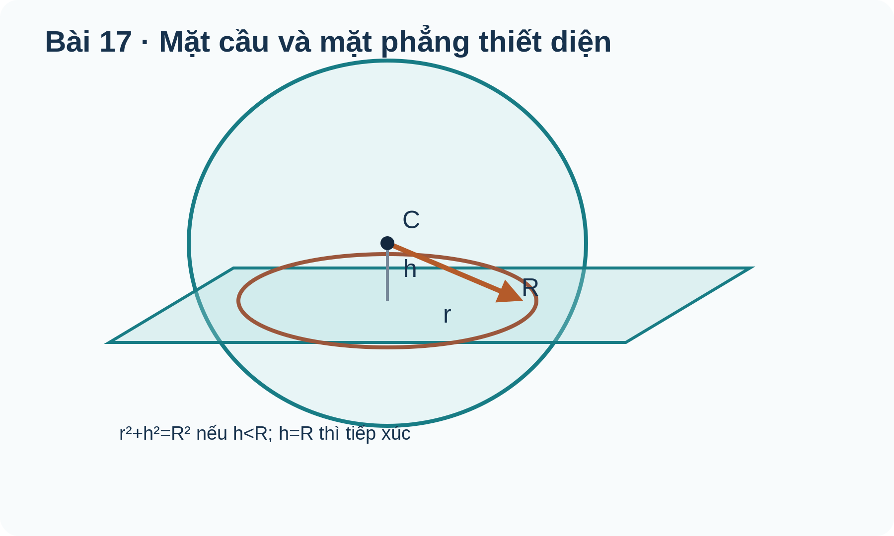

# Toán 12 · Bài 17. Phương trình mặt cầu

TOÁN 12 · CHƯƠNG V · SGK KẾT NỐI TRI THỨC · TẬP HAI

Học từ lý do và bản chất trước khi áp dụng công thức; có ví dụ giải thích phương pháp, hình gốc và Tự thử.
<nav class="thpt-r4-lesson-tabs"><a href="../">Chương V</a><a href="../bai-16/">Bài 16</a><a href="../mo-rong-sau-bai-17/">Mở rộng sau B17</a></nav>

## 1. Vì sao cần học và kiến thức tiền đề

Vùng phủ 3D và mặt cắt cầu.

**Tự kiểm tra tiền đề:** Ôn công thức khoảng cách 3D, bình phương hoàn chỉnh và mặt phẳng. Nếu chưa tự giải được câu thử ở dưới, ôn vectơ/tích vô hướng/đạo hàm phù hợp trước khi tiếp tục.

## 2. Hiểu bản chất, điều kiện và ví dụ

<!-- OUTCOME_ID: G12-CHV-B17-O01 -->
### 1. Phương trình mặt cầu tâm và bán kính

- **Vì sao cần biết:** Mô hình vùng phủ 3D của máy phát hoặc mặt cầu trong thiết kế.
- **Kiến thức tiền đề:** Khoảng cách giữa hai điểm và chuẩn vectơ.
- **Bản chất trước công thức:** Mặt cầu gồm các điểm M cách tâm C đúng R; bình phương hai vế là phương trình ba bình phương.
- **Định nghĩa và công thức:** \((x-a)^2+(y-b)^2+(z-c)^2=R^2\).
- **Điều kiện và giới hạn:** R>0; không nhầm mặt cầu (bề mặt) với khối cầu (phần trong).
- **Lý do chọn phương pháp:** Viết bình phương khoảng cách CM=R và kiểm lại tâm, R.
- **Bẫy cần tự phát hiện:** Dùng vế phải R thay vì R² hoặc nhầm dấu của tọa độ tâm.

#### Ví dụ có suy luận

**Đề:** Tâm C(1,-2,3), R=4. Viết mặt cầu.

**Lời giải có suy luận:** CM²=(x−1)²+(y+2)²+(z−3)²=4².

**Kiểm tra kết quả và điều kiện:** (x−1)²+(y+2)²+(z−3)²=16. **Kiểm tra phạm vi:** R>0; không nhầm mặt cầu (bề mặt) với khối cầu (phần trong).

<!-- OUTCOME_ID: G12-CHV-B17-O02 -->
### 2. Đưa phương trình tổng quát về tâm và bán kính

- **Vì sao cần biết:** Tìm tâm và bán kính khi thiết bị cho phương trình đa thức của biên phủ.
- **Kiến thức tiền đề:** Hằng đẳng thức hoàn chỉnh bình phương.
- **Bản chất trước công thức:** Hoàn chỉnh mỗi bình phương để đưa phương trình thành tổng bình phương bằng R².
- **Định nghĩa và công thức:** \(x^2+y^2+z^2+Dx+Ey+Fz+G=0\Rightarrow C=(-D/2,-E/2,-F/2),\ R^2=\tfrac{D^2+E^2+F^2}{4}-G\).
- **Điều kiện và giới hạn:** R²>0 để là mặt cầu bán kính dương; R²=0 chỉ là một điểm; R²<0 không có điểm thực.
- **Lý do chọn phương pháp:** Nhóm theo biến, hoàn chỉnh bình phương và kiểm dấu/radius trước khi kết luận.
- **Bẫy cần tự phát hiện:** Lấy R bằng R² hoặc bỏ qua trường hợp R² âm.

#### Ví dụ có suy luận

**Đề:** x²+y²+z²−2x+4y−6z+5=0. Xác định C,R.

**Lời giải có suy luận:** Nhóm thành (x−1)²+(y+2)²+(z−3)²=1+4+9−5=9.

**Kiểm tra kết quả và điều kiện:** C(1,-2,3), R=3. **Kiểm tra phạm vi:** R²>0 để là mặt cầu bán kính dương; R²=0 chỉ là một điểm; R²<0 không có điểm thực.

<!-- OUTCOME_ID: G12-CHV-B17-O03 -->
### 3. Điểm nằm trong, trên hay ngoài mặt cầu

- **Vì sao cần biết:** Kiểm một vị trí có trên biên phủ, bên trong vùng sóng hay ngoài vùng sóng.
- **Kiến thức tiền đề:** Khoảng cách hai điểm, bình phương số dương.
- **Bản chất trước công thức:** So sánh CM² với R² tránh khai căn không cần thiết.
- **Định nghĩa và công thức:** \(CM^2<R^2\text{ (trong)};\ CM^2=R^2\text{ (trên)};\ CM^2>R^2\text{ (ngoài)}\).
- **Điều kiện và giới hạn:** Với R>0, “trong khối cầu” khác “trên mặt cầu”.
- **Lý do chọn phương pháp:** Tính CM² và so với R²; kết luận đúng từ.
- **Bẫy cần tự phát hiện:** Nói điểm ở trong mặt cầu khi CM=R, lẫn biên và miền trong.

#### Ví dụ có suy luận

**Đề:** C=O,R=5,P(3,4,0). P nằm đâu?

**Lời giải có suy luận:** OP²=3²+4²=25=R².

**Kiểm tra kết quả và điều kiện:** Trên mặt cầu. **Kiểm tra phạm vi:** Với R>0, “trong khối cầu” khác “trên mặt cầu”.

<!-- OUTCOME_ID: G12-CHV-B17-O04 -->
### 4. Mặt cầu có đường kính cho bởi hai điểm

- **Vì sao cần biết:** Tìm mặt cầu an toàn bao trùm hai mốc đối diện trên một đường kính.
- **Kiến thức tiền đề:** Trung điểm và khoảng cách giữa hai điểm.
- **Bản chất trước công thức:** Tâm là trung điểm đoạn AB, bán kính bằng nửa AB.
- **Định nghĩa và công thức:** \(C=\frac{A+B}{2},\ R=\frac{|B-A|}{2}\).
- **Điều kiện và giới hạn:** A và B khác nhau; không nhầm nửa độ dài với nửa bình phương độ dài.
- **Lý do chọn phương pháp:** Tính trung điểm, tính AB² rồi chia 4 để được R², lập phương trình.
- **Bẫy cần tự phát hiện:** Dùng A làm tâm hoặc đặt R=AB²/2.

#### Ví dụ có suy luận

**Đề:** A(0,0,0),B(2,4,0) là hai đầu đường kính. Viết mặt cầu.

**Lời giải có suy luận:** C=(1,2,0); AB²=2²+4²=20, R²=20/4=5.

**Kiểm tra kết quả và điều kiện:** (x−1)²+(y−2)²+z²=5. **Kiểm tra phạm vi:** A và B khác nhau; không nhầm nửa độ dài với nửa bình phương độ dài.

<!-- OUTCOME_ID: G12-CHV-B17-O05 -->
### 5. Tiếp xúc mặt cầu với mặt phẳng và thiết diện

- **Vì sao cần biết:** Quyết định một mặt phẳng đi qua, chỉ chạm hay không chạm vùng cầu.
- **Kiến thức tiền đề:** Khoảng cách từ điểm đến mặt phẳng và Pythagoras.
- **Bản chất trước công thức:** So sánh khoảng cách h từ tâm đến mặt phẳng với R: h<R cắt theo đường tròn, h=R tiếp xúc, h>R không giao.
- **Định nghĩa và công thức:** \(h=d(C,(P));\quad r=\sqrt{R^2-h^2}\text{ khi }h<R\).
- **Điều kiện và giới hạn:** R>0 và pháp tuyến mặt phẳng khác 0; thiết diện bán kính 0 là tiếp điểm, không là đường tròn dương.
- **Lý do chọn phương pháp:** Tính h từ pháp tuyến và tâm; so sánh với R, rồi mới tính bán kính thiết diện nếu cần.
- **Bẫy cần tự phát hiện:** Thấy phương trình mặt phẳng có nghiệm rồi kết luận luôn là cát tuyến của mặt cầu.

#### Ví dụ có suy luận

**Đề:** C(1,0,0),R=2, P:x=3. Phân loại.

**Lời giải có suy luận:** h=|1−3|=2=R; một tiếp điểm (3,0,0).

**Kiểm tra kết quả và điều kiện:** Tiếp xúc. **Kiểm tra phạm vi:** R>0 và pháp tuyến mặt phẳng khác 0; thiết diện bán kính 0 là tiếp điểm, không là đường tròn dương.

## 3. Đọc hình minh họa gốc

<figure class="thpt-r4-plot g12-chi-figure"><figcaption>Hình 1: Phương trình mặt cầu. Đọc nhãn và quan hệ hình học; không suy số đo trong không gian từ tỷ lệ hình phẳng.</figcaption></figure>

## 4. Tự thử trước Core

Em tự làm trước, rồi chủ động mở đối chiếu; không tính điểm hay Mastery.

<!-- FIRST_TRY_ID: B17-T01 -->
### Tự thử

R=3 thì R² bằng mấy?

Mở đối chiếu sau khi tự thử

**Đối chiếu:** 9.

**Vì sao:** Khoảng cách giữa hai điểm và chuẩn vectơ..

<!-- FIRST_TRY_ID: B17-T02 -->
### Tự thử

C(1,0,0),R=2, P:x=3. Phân loại.

Mở đối chiếu sau khi tự thử

**Đối chiếu:** Tiếp xúc.

**Vì sao:** Khoảng cách từ điểm đến mặt phẳng và Pythagoras..

## 5. Core và Luyện tập

<nav class="thpt-r4-lesson-tabs"><a href="../luyen-tap/#b17-core">Core · Bài 17</a><a href="../luyen-tap/#b17-practice">Luyện tập, Vận dụng và Tự luận</a><a href="../luyen-tap/#b17-help">Khi gặp khó khăn</a></nav>

