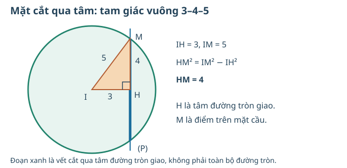
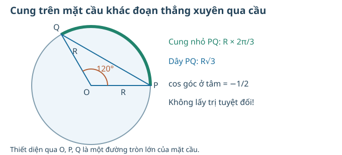

# Bài 17. Phương trình mặt cầu

TOÁN 12 · CHƯƠNG V · KIẾN THỨC SGK KNTT · TẬP HAI

Mô tả mặt cầu bằng khoảng cách đến tâm; ứng dụng tọa độ để xác định vị trí và khoảng cách trên mô hình Trái Đất.

<nav class="thpt-r4-lesson-tabs"><a href="../">Chương V</a><a href="../bai-16/">Bài trước</a><a href="../luyen-tap/#b17-core">Core/Luyện tập</a><a href="../mo-rong-sau-bai-17/">Mở rộng sau B17</a></nav>

=== "Khám phá kiến thức"

    ### 1.1. Phương trình mặt cầu

    Hãy hình dung một chiếc compa có thể quay theo mọi hướng trong không gian. Đầu cố định tại \(I\), đầu còn lại cách \(I\) đúng một khoảng \(R>0\). Tập hợp các vị trí của đầu còn lại tạo thành mặt cầu. Mặt cầu chỉ là bề mặt, không phải toàn bộ khối cầu. Ta đã học phương trình đường tròn ở lớp 10; trong không gian chỉ cần bổ sung tọa độ thứ ba vào công thức khoảng cách.

    <!-- OUTCOME_ID: G12-CHV-B17-O01 -->
    Với \(I(a;b;c)\) và \(M(x;y;z)\), định lí Pythagoras trong không gian cho \(IM^2=(x-a)^2+(y-b)^2+(z-c)^2\). Điểm \(M\) thuộc mặt cầu khi và chỉ khi \(IM=R\). Vì \(IM\) không âm và \(R>0\), bình phương hai vế được
    \[
    (x-a)^2+(y-b)^2+(z-c)^2=R^2.
    \]
    Ví dụ tâm \(I(1;-2;3)\), bán kính 4 cho phương trình \((x-1)^2+(y+2)^2+(z-3)^2=16\). Điểm \(A(5;-2;3)\) thỏa phương trình vì chỉ lệch tâm 4 đơn vị theo \(Ox\).

    <!-- OUTCOME_ID: G12-CHV-B17-O03 -->
    Điểm có \(IM^2<R^2\) nằm trong khối cầu, điểm có \(IM^2>R^2\) nằm ngoài; bằng nhau mới thuộc mặt cầu. Chẳng hạn với mặt cầu vừa cho, \(I\) nằm trong, \(A\) nằm trên, \(B(6;-2;3)\) nằm ngoài vì \(IB^2=25>16\). Không cần khai căn chỉ để so sánh.

    <!-- OUTCOME_ID: G12-CHV-B17-O04 -->
    Nếu biết hai đầu đường kính \(A,B\) phân biệt, tâm là trung điểm và bán kính bằng nửa độ dài \(AB\). Khi tính phương trình, dùng \(R^2=AB^2/4\) để tránh căn thức trung gian. Với \(A(0;0;0),B(2;4;0)\), tâm \(I(1;2;0)\), \(AB^2=20\), nên \((x-1)^2+(y-2)^2+z^2=5\).

    <!-- FIRST_TRY_ID: B17-T01 -->
    **Vận dụng.** Lập phương trình mặt cầu đường kính \(A(-1;2;0),B(3;0;4)\). Điểm \(M(1;1;4)\) nằm trong, trên hay ngoài?

    ??? question "Đối chiếu"

        \(I(1;1;2)\), \(AB^2=4^2+(-2)^2+4^2=36\); \(R^2=36/4=9\). Phương trình \((x-1)^2+(y-1)^2+(z-2)^2=9\). Với \(M\), \(IM^2=4<9\), nên nằm trong khối cầu.

    ??? tip "Kiểm lỗi"

        Tâm là trung điểm, không phải một đầu đường kính. Hãy thử cả hai đầu mút vào phương trình: chúng phải cho vế trái bằng 9. Khi biết bình phương bán kính, chỉ lấy căn nếu cần độ dài bán kính.

    <!-- OUTCOME_ID: G12-CHV-B17-O02 -->
    Đề có thể cho phương trình đã khai triển. Ví dụ
    \[
    x^2+y^2+z^2-2x+4y-6z+5=0.
    \]
    Ta hoàn thành bình phương từng biến: \(x^2-2x=(x-1)^2-1\), \(y^2+4y=(y+2)^2-4\), \(z^2-6z=(z-3)^2-9\). Suy ra tổng ba bình phương bằng \(1+4+9-5=9\). Do đó tâm \(I(1;-2;3)\), bán kính 3.

    Tổng quát, với dạng \(x^2+y^2+z^2-2ax-2by-2cz+d=0\), hoàn thành bình phương được
    \[
    (x-a)^2+(y-b)^2+(z-c)^2=a^2+b^2+c^2-d.
    \]
    Vế phải dương mới có mặt cầu bán kính dương; bằng 0 thì chỉ có một điểm; âm thì vô nghiệm thực. Dạng tổng quát không có hạng tử chéo như \(xy\), và ba hệ số bình phương phải bằng nhau, khác 0 trước khi chuẩn hóa. Nếu cả phương trình có hệ số chung khác 0, chia toàn bộ cho hệ số đó rồi xét.

    **Vận dụng.** Xét \(2x^2+2y^2+2z^2-8x+4y+10=0\). Có phải phương trình mặt cầu không? Nếu thay 10 bằng 2 thì sao?

    ??? question "Đối chiếu"

        Chia 2, phương trình ban đầu trở thành \((x-2)^2+(y+1)^2+z^2=0\), chỉ có điểm \((2;-1;0)\). Khi thay 10 bằng 2, vế phải sau hoàn thành bình phương là \(4+1-1=4\), cho mặt cầu tâm \((2;-1;0)\), bán kính 2.

    ??? tip "Kiểm lỗi"

        Không gọi một điểm là mặt cầu bán kính dương. Chia cả hệ số tự do cùng ba hệ số bình phương trước khi đọc tâm.

    <!-- OUTCOME_ID: G12-CHV-B17-O05 -->
    **Liên hệ hình học — mặt phẳng và mặt cầu.** Cho mặt cầu tâm \(I\), bán kính \(R\), gọi \(H\) là hình chiếu của \(I\) lên mặt phẳng \((P)\), \(h=IH\). Với mọi \(M\in(P)\), \(IM^2=h^2+HM^2\). Nếu \(M\) đồng thời thuộc mặt cầu thì \(HM^2=R^2-h^2\). Vì vậy khi \(h<R\) giao là đường tròn tâm \(H\), bán kính \(\sqrt{R^2-h^2}\); khi \(h=R\) chỉ có tiếp điểm \(H\); khi \(h>R\) không giao.

    <figure class="thpt-r4-plot thpt-r4-concept-figure"><figcaption>Trong mặt cắt qua \(I,H,M\), tam giác vuông có \(IH=3,\ IM=5,\ HM=4\). Đoạn xanh là đường kính của đường tròn giao trong thiết diện này.</figcaption></figure>

    <!-- FIRST_TRY_ID: B17-T02 -->
    **Vận dụng.** Mặt cầu tâm \(I(1;0;0)\), bán kính 2. Mặt phẳng \(x=3\) có bao nhiêu điểm chung với mặt cầu? Tìm điểm đó.

    ??? question "Đối chiếu"

        \(h=|1-3|=2=R\), nên tiếp xúc tại chân chiếu \(H(3;0;0)\). Thay \(x=3\) vào phương trình \((x-1)^2+y^2+z^2=4\) được \(y^2+z^2=0\), xác nhận duy nhất một điểm.

    ??? tip "Kiểm lỗi"

        Không gọi trường hợp bán kính giao bằng 0 là đường tròn có bán kính dương. Nếu \(h>R\), vế phải \(R^2-h^2\) âm nên không có giao điểm.

    ### 1.2. Một số ứng dụng của phương trình mặt cầu trong thực tiễn

    #### a) Khoảng cách trên bề mặt Trái Đất

    Trong mô hình Trái Đất hình cầu, chọn gốc \(O\) ở tâm, \(Oz\) hướng về cực Bắc, \(Ox\) hướng tới giao điểm xích đạo và kinh tuyến gốc, \(Oy\) hướng tới điểm xích đạo có kinh độ \(90^\circ E\). SGK lấy bán kính thực \(6371\) km làm một đơn vị dài, nên bề mặt có phương trình \(x^2+y^2+z^2=1\).

    Vĩ độ \(\varphi\) là góc nâng của bán kính so với mặt phẳng xích đạo, có dấu dương về Bắc, âm về Nam. Kinh độ \(\lambda\) được lấy dương về Đông, âm về Tây. Hình chiếu ngang của bán kính đơn vị có độ dài \(\cos\varphi\); độ cao là \(\sin\varphi\). Tách hình chiếu ngang thành hai thành phần theo góc kinh độ, ta có
    \[
    P(\cos\varphi\cos\lambda;\cos\varphi\sin\lambda;\sin\varphi).
    \]
    Kiểm bằng \(\cos^2\varphi(\cos^2\lambda+\sin^2\lambda)+\sin^2\varphi=1\). Ở cực, kinh độ không xác định duy nhất; công thức vẫn cho đúng điểm cực với mọi kinh độ.

    Để đo khoảng cách ngắn nhất dọc bề mặt cầu, không dùng đoạn thẳng \(PQ\) xuyên vào lòng cầu. Đường tròn lớn đi qua \(P,Q\) có tâm \(O\); độ dài cung nhỏ bằng bán kính nhân góc ở tâm tính theo radian.

    <figure class="thpt-r4-plot thpt-r4-concept-figure"><figcaption>Góc ở tâm có thể tù: góc \(120^\circ\) cho cung dài \(2\pi R/3\), còn dây dài \(R\sqrt3\). Khác Bài 16, đây là góc giữa hai bán kính có chiều, không phải góc không tù giữa hai đường thẳng.</figcaption></figure>

    Với hai điểm trên mặt cầu đơn vị, tính \(\gamma=\arccos(\overrightarrow{OP}\cdot\overrightarrow{OQ})\) theo radian; khoảng cách trên mô hình Trái Đất là \(6371\gamma\) km. Không lấy trị tuyệt đối tích vô hướng. Nếu máy tính cho góc độ, đổi sang radian bằng cách nhân \(\pi/180\). Với hai điểm đối cực, \(\gamma=\pi\), có nhiều nửa đường tròn lớn cùng cho khoảng cách ngắn nhất.

    **Vận dụng.** Hai vị trí nằm trên xích đạo, kinh độ \(0^\circ\) và \(120^\circ E\). Tính khoảng cách ngắn nhất trên mặt cầu mô hình và so với độ dài dây.

    ??? question "Đối chiếu"

        \(P=(1;0;0),Q=(-1/2;\sqrt3/2;0)\). Tích vô hướng bằng \(-1/2\), nên \(\gamma=120^\circ=2\pi/3\). Cung dài \(6371\cdot2\pi/3\) km; dây dài \(6371\sqrt3\) km. Dây ngắn hơn nhưng không phải đường đi trên bề mặt.

    ??? tip "Kiểm lỗi"

        Nếu góc bằng \(60^\circ\), em đã lấy trị tuyệt đối như khi tính góc giữa hai đường. Nếu nhân bán kính với 120, em chưa đổi độ sang radian.

    #### b) Xác định vị trí từ khoảng cách

    Khi biết khoảng cách từ một thiết bị đến một mốc có tọa độ xác định, thiết bị nằm trên mặt cầu tâm là mốc, bán kính là khoảng cách đó. Thêm các mốc tạo thêm phương trình mặt cầu. Giao của chúng là các vị trí ứng viên; không mặc định luôn có duy nhất một nghiệm.

    Trong mô hình đơn giản, giả sử điểm \(P\) nằm trên mặt cầu đơn vị, cách \(A(2;0;0)\) một khoảng \(\sqrt5\), cách \(B(0;2;0)\) một khoảng \(\sqrt2\). Ta có
    \[
    \begin{cases}x^2+y^2+z^2=1,\\(x-2)^2+y^2+z^2=5,\\x^2+(y-2)^2+z^2=2.\end{cases}
    \]
    Trừ phương trình đầu khỏi phương trình thứ hai, được \(-4x+4=4\), nên \(x=0\). Tương tự \(-4y+4=1\), suy ra \(y=3/4\). Thế lại cho \(z=\pm\sqrt7/4\). Nếu biết thiết bị ở bán cầu Bắc thì \(z>0\), chọn \(P(0;3/4;\sqrt7/4)\); vĩ độ \(\arcsin(\sqrt7/4)\approx41{,}4096^\circ N\), kinh độ \(90^\circ E\).

    Bài toán minh họa nguyên lí định vị bằng khoảng cách trong phần đọc thêm SGK. GPS thực tế còn phải xử lí sai số đồng hồ, quỹ đạo, tín hiệu và thường dùng ít nhất bốn vệ tinh để giải ba tọa độ cùng sai lệch đồng hồ; không đồng nhất mô hình toán học lý tưởng với độ chính xác thực tế.

=== "Kiến thức SGK"

    ### 2.1. Phương trình mặt cầu

    
<strong>Định nghĩa — Mặt cầu.</strong> Mặt cầu tâm \(I\), bán kính \(R&gt;0\), là tập các điểm \(M\) trong không gian có \(IM=R\). Đường kính nối hai điểm đối diện qua tâm, có độ dài \(2R\).

    
<strong>Công thức — Phương trình mặt cầu tâm và bán kính.</strong>
Với tâm \(I(a;b;c)\) và \(R&gt;0\),

\(\displaystyle (x-a)^2+(y-b)^2+(z-c)^2=R^2.\)

Đọc tọa độ tâm từ hiệu trong ngoặc; lấy căn bậc hai dương của vế phải để được bán kính.

    Với dạng khai triển \(x^2+y^2+z^2-2ax-2by-2cz+d=0\), hoàn thành bình phương được \(R^2=a^2+b^2+c^2-d\). Nếu \(R^2>0\), phương trình biểu diễn mặt cầu tâm \(I(a;b;c)\), bán kính \(\sqrt{a^2+b^2+c^2-d}\). Nếu \(R^2=0\) chỉ một điểm, nếu âm thì vô nghiệm. Nếu viết dạng \(x^2+y^2+z^2+Dx+Ey+Fz+G=0\), tâm là \((-D/2;-E/2;-F/2)\) và \(R^2=(D^2+E^2+F^2)/4-G\).

    | Dữ kiện hoặc yêu cầu | Cách xử lí |
    | :-- | :-- |
    | Biết tâm \(I\) và điểm \(M\) trên mặt cầu, \(M\ne I\) | \(R^2=IM^2\) |
    | Biết hai đầu đường kính \(A\ne B\) | Tâm là trung điểm, \(R^2=AB^2/4\) |
    | Điểm trong / trên / ngoài | So sánh \(IM^2\) với \(R^2\): nhỏ hơn / bằng / lớn hơn |
    | Biết phương trình khai triển | Chuẩn hóa hệ số bình phương, hoàn thành bình phương, kiểm \(R^2>0\) |

    **Liên hệ với khoảng cách điểm–mặt phẳng:** Nếu \(h=d(I,(P))\) nhỏ hơn \(R\), giao là đường tròn có tâm hình chiếu \(H\) của \(I\) lên \((P)\), bán kính \(\sqrt{R^2-h^2}\). Nếu \(h=R\), tiếp xúc tại \(H\); nếu \(h>R\), không giao. Kết quả suy ra từ \(IM^2=IH^2+HM^2\).

    <figure class="thpt-r4-plot"><figcaption>So khoảng cách \(IH\) với bán kính mặt cầu \(IM\); bán kính đường tròn giao là \(HM\).</figcaption></figure>

    ### 2.2. Một số ứng dụng của phương trình mặt cầu trong thực tiễn

    **Mô hình địa cầu:** Chọn hệ trục như phần Khám phá, đơn vị dài tương ứng 6371 km; mặt cầu đơn vị có phương trình \(x^2+y^2+z^2=1\). Vĩ độ có dấu \(\varphi\in[-90^\circ;90^\circ]\) (Bắc dương, Nam âm), kinh độ có dấu \(\lambda\in[-180^\circ;180^\circ]\) (Đông dương, Tây âm).

    
<strong>Công thức — Tọa độ và độ dài cung.</strong>
\(\displaystyle P=(\cos\varphi\cos\lambda;\cos\varphi\sin\lambda;\sin\varphi).\)

Với \(P,Q\) trên mặt cầu đơn vị, đặt \(\gamma=\arccos(\overrightarrow{OP}\cdot\overrightarrow{OQ})\in[0;\pi]\) (radian). Khoảng cách theo cung nhỏ của đường tròn lớn bằng \(6371\gamma\) km. Nếu tính \(\gamma\) bằng độ, dùng \(6371\pi\gamma/180\).

    Không dùng trị tuyệt đối ở tích vô hướng tính góc ở tâm. Khoảng cách cung là khoảng cách ngắn nhất trên bề mặt cầu trong mô hình, không phải khoảng cách dây cung hay độ dài tuyến đường giao thông. SGK quy ước làm tròn đến bốn chữ số thập phân trong phần tính toán này; khi tự tính nên giữ đủ độ chính xác trung gian và ghi kết quả làm tròn theo đề.

    <figure class="thpt-r4-plot"><figcaption>Cung và dây đều nối \(P,Q\) nhưng khác độ dài; cung được tính từ góc ở tâm có thể đến \(180^\circ\).</figcaption></figure>

    **Đọc thêm — nguyên lí GPS:** Mỗi mốc \(A_i(a_i;b_i;c_i)\) với khoảng cách đo được \(r_i\) cho điều kiện \((x-a_i)^2+(y-b_i)^2+(z-c_i)^2=r_i^2\). Trừ các phương trình để loại \(x^2+y^2+z^2\); giải hệ và kiểm mọi phương trình ban đầu, dùng dữ kiện bổ sung để loại nghiệm không phù hợp.

=== "Ví dụ"

    ### 3.1. Nhận diện mặt cầu sau khi chuẩn hóa

    **Đề bài.** Xét \(3x^2+3y^2+3z^2+6x-12y+9=0\). Xác định tâm và bán kính.

    **Phân tích:** Chia cho 3 rồi hoàn thành bình phương, kiểm vế phải.

    

<strong>Lời giải.</strong> Sau khi chia 3, ta có \(x^2+y^2+z^2+2x-4y+3=0\). Suy ra \((x+1)^2+(y-2)^2+z^2=1+4-3=2&gt;0\). Tâm \(I(-1;2;0)\), bán kính \(\sqrt2\).

    **Kiểm lại:** Khai triển và nhân 3 thu được phương trình ban đầu.

    ### 3.2. Lập mặt cầu qua một điểm

    **Đề bài.** Mặt cầu tâm \(I(2;-1;1)\) đi qua \(A(0;1;4)\). Lập phương trình, xét điểm \(B(3;0;1)\).

    **Phân tích:** Bán kính là \(IA\), không cần tìm căn nếu chỉ lập phương trình.

    

<strong>Lời giải.</strong> \(R^2=(-2)^2+2^2+3^2=17\). Phương trình \((x-2)^2+(y+1)^2+(z-1)^2=17\). \(IB^2=1+1+0=2&lt;17\), nên \(B\) nằm trong khối cầu.

    **Kiểm lại:** Thay \(A\) vào cho đúng 17.

    ### 3.3. Tìm điều kiện của tham số

    **Đề bài.** Với giá trị nào của \(m\), \(x^2+y^2+z^2-4x+2y+2z+m=0\) là phương trình mặt cầu?

    **Phân tích:** Hoàn thành bình phương, yêu cầu bán kính dương.

    

<strong>Lời giải.</strong> \((x-2)^2+(y+1)^2+(z+1)^2=6-m\). Cần \(6-m&gt;0\), tức \(m&lt;6\). Tâm \((2;-1;-1)\), bán kính \(\sqrt{6-m}\).

    **Kiểm lại:** \(m=6\) chỉ một điểm, \(m>6\) vô nghiệm.

    ### 3.4. Mặt cầu tiếp xúc một mặt phẳng

    **Đề bài.** Viết phương trình mặt cầu tâm \(I(1;2;3)\) tiếp xúc với \(P:2x-y+2z-3=0\).

    **Phân tích:** Bán kính bằng khoảng cách từ tâm tới mặt phẳng.

    

<strong>Lời giải.</strong> \(R=|2-2+6-3|/\sqrt{4+1+4}=1\). Mặt cầu \((x-1)^2+(y-2)^2+(z-3)^2=1\).

Hình chiếu \(H=I-\frac13(2;-1;2)=(1/3;7/3;7/3)\) là tiếp điểm.

    **Kiểm lại:** \(2/3-7/3+14/3-3=0\), \(IH^2=1\).

    ### 3.5. Xác định tọa độ và khoảng cách trên địa cầu

    **Đề bài.** Trong mô hình mặt cầu đơn vị, \(P\) ở \(30^\circ S,60^\circ E\), \(Q\) ở \(30^\circ N,60^\circ E\). Tìm tọa độ và khoảng cách trên mặt cầu bán kính thực 6371 km.

    **Phân tích:** Cùng kinh độ nhưng khác dấu vĩ độ; hai điểm nằm trên cùng kinh tuyến.

    

<strong>Lời giải.</strong> \(P=(\sqrt3/4;3/4;-1/2)\), \(Q=(\sqrt3/4;3/4;1/2)\). Tích vô hướng \(3/16+9/16-1/4=1/2\), nên góc ở tâm \(60^\circ=\pi/3\). Khoảng cách \(6371\pi/3\approx6671{,}6956\) km.

    **Kiểm lại:** Hai vectơ có độ dài 1. Cùng kinh độ, hiệu vĩ độ bằng \(60^\circ\), phù hợp góc vừa tính.

    ### 3.6. Kiểm nghiệm vị trí từ các mốc

    **Đề bài.** Một thiết bị \(M\) cách \(O\) một khoảng 3, cách \(A(4;0;0)\) một khoảng 3 và cách \(B(0;4;0)\) một khoảng 3. Biết cao độ dương, tìm \(M\).

    **Phân tích:** Lập ba phương trình mặt cầu và trừ để khử phần bậc hai chung.

    

<strong>Lời giải.</strong> Từ \(x^2+y^2+z^2=9\) và \((x-4)^2+y^2+z^2=9\), suy ra \(x=2\). Từ mặt cầu tâm \(B\) suy ra \(y=2\). Vậy \(z^2=9-4-4=1\), chọn \(z=1\) do cao độ dương. \(M=(2;2;1)\).

    **Kiểm lại:** \(OM^2=AM^2=BM^2=9\). Nếu bỏ điều kiện cao độ dương thì còn nghiệm \((2;2;-1)\).

=== "Lỗi thường gặp"

    ### 4.1. Nhầm tâm, bán kính và bình phương bán kính

    **Sai:** Đọc tâm của \((x+2)^2+(y-1)^2+z^2=9\) là \((2;-1;0)\), bán kính 9.

    **Sửa:** Viết \(x-(-2),y-1,z-0\), đọc tâm \((-2;1;0)\), bán kính 3.

    ### 4.2. Không kiểm điều kiện mặt cầu

    **Sai:** Mọi phương trình có ba bình phương đều là mặt cầu.

    **Sửa:** Kiểm dạng (ba hệ số bình phương bằng nhau, không có tích chéo), chuẩn hóa và hoàn thành bình phương. Vế phải phải dương.

    ### 4.3. Nhầm đường kính với bán kính

    **Sai:** Dùng \(R=AB\) khi \(AB\) là đường kính.

    **Sửa:** Lấy trung điểm làm tâm và \(R^2=AB^2/4\); thử hai đầu mút.

    ### 4.4. Nhầm mặt cầu với khối cầu hoặc đường tròn giao

    **Sai:** \(IM<R\) nghĩa là \(M\) thuộc mặt cầu; bán kính giao với mặt phẳng luôn bằng \(R\).

    **Sửa:** Thuộc bề mặt cần \(IM=R\). Bán kính đường tròn giao chỉ bằng \(R\) khi mặt phẳng qua tâm, còn lại tính từ tam giác vuông.

    ### 4.5. Áp dụng công thức góc giữa đường thẳng cho góc ở tâm

    **Sai:** Lấy trị tuyệt đối của tích vô hướng khi tính khoảng cách cung trên địa cầu.

    **Sửa:** Góc giữa hai bán kính có thể tù; giữ dấu của tích vô hướng và đổi góc sang radian trước khi nhân bán kính.

    ### 4.6. Chỉ giải phương trình hiệu rồi kết luận nghiệm duy nhất

    **Sai:** Bỏ một nghiệm khi tìm vị trí từ khoảng cách hoặc không thử vào hệ ban đầu.

    **Sửa:** Thế vào phương trình gốc, xét đủ nghiệm và dùng dữ kiện bổ sung nếu có. Đổi đúng đơn vị trước khi thiết lập mô hình.

    **Học tiếp:** [Core và Luyện tập Bài 17](../luyen-tap/#b17-core) · [Mở rộng sau Bài 17](../mo-rong-sau-bai-17/).

    
Nguồn kiến thức: SGK KNTT Toán 12 tập 2, trang in 54–60; hình minh họa và phần lớn ví dụ do SLM biên soạn riêng.

