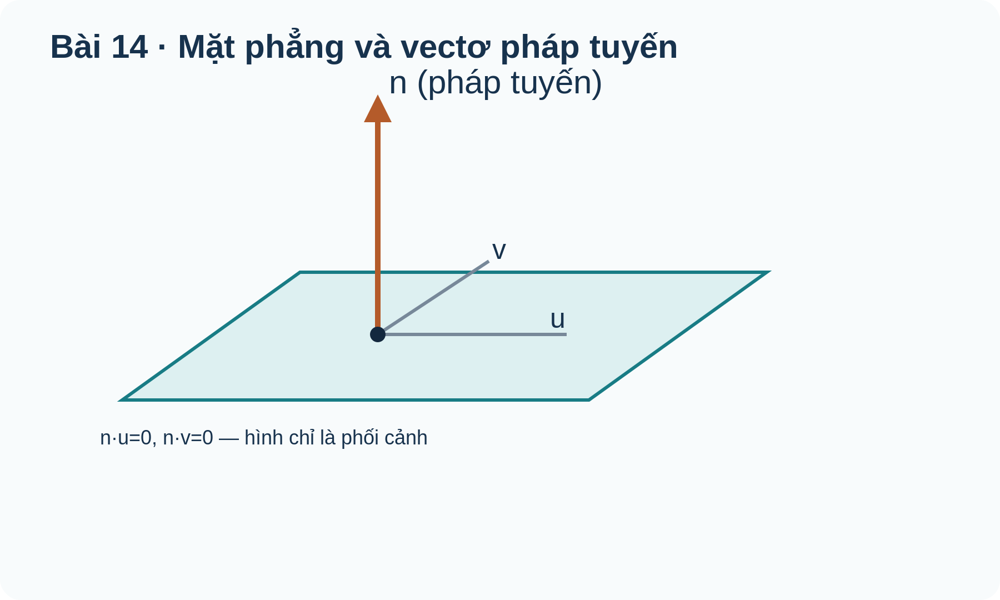

# Toán 12 · Chương V · Ứng dụng mở rộng sau Bài 17

MỞ RỘNG SAU BÀI 17 · KHÔNG BẮT BUỘC VỚI CORE BÀI 14

Kết hợp mặt phẳng và mặt cầu để tìm thiết diện. Đây là vận dụng liên bài chỉ nên học sau Bài 17, không phải kiến thức Core bắt buộc của Bài 14.
<nav class="thpt-r4-lesson-tabs"><a href="../bai-17/">Bài 17</a><a href="../luyen-tap/#b14-optional">Luyện tập mở rộng</a><a href="../">Chương V</a></nav>

## 1. Kiến thức vận dụng mở rộng

<!-- OUTCOME_ID: G12-CHV-B14-O07 -->
### 7. Ứng dụng mặt phẳng: mặt cắt và khoảng cách thực tiễn

- **Vì sao cần biết:** Vùng phủ sóng dạng cầu cắt mặt sàn thành hình tròn; mặt phẳng giúp xác định bán kính vùng phủ.
- **Kiến thức tiền đề:** Khoảng cách từ tâm tới mặt phẳng và hệ thức Pythagoras trong tam giác vuông.
- **Bản chất trước công thức:** Mặt phẳng cách tâm cầu h nhỏ hơn R sẽ tạo đường tròn bán kính r bởi r²+h²=R².
- **Định nghĩa và công thức:** \(r=\sqrt{R^2-h^2}\) nếu \(0\le h<R\).
- **Điều kiện và giới hạn:** Nếu h=R tiếp xúc tại một điểm; h>R không có giao; bán kính dương.
- **Lý do chọn phương pháp:** Tính khoảng cách tâm tới mặt phẳng trước, không đồng nhất R của cầu với r của thiết diện.
- **Bẫy cần tự phát hiện:** Dùng R trực tiếp làm bán kính vùng phủ trên sàn dù tâm ở trên cao.

#### Ví dụ có suy luận

**Đề:** Tâm phát sóng C(0,0,3), R=5m; mặt sàn z=0. Tính bán kính thiết diện.

**Lời giải có suy luận:** h=3m, r=√(25−9)=4m. Vì 3<5 nên có hình tròn.

**Kiểm tra kết quả và điều kiện:** 4m. **Kiểm tra phạm vi:** Nếu h=R tiếp xúc tại một điểm; h>R không có giao; bán kính dương.

## 2. Tự thử cho phần mở rộng

<!-- FIRST_TRY_ID: B14-T02 -->
### Tự thử

Tâm phát sóng C(0,0,3), R=5m; mặt sàn z=0. Tính bán kính thiết diện.

Mở đối chiếu sau khi tự thử

**Đối chiếu:** 4m.

**Vì sao:** Khoảng cách từ tâm tới mặt phẳng và hệ thức Pythagoras trong tam giác vuông..

## 3. Đọc hình minh họa

<figure class="thpt-r4-plot g12-chi-figure"><figcaption>Hình 1: Phương trình mặt phẳng. Đọc nhãn và quan hệ hình học; không suy số đo trong không gian từ tỷ lệ hình phẳng.</figcaption></figure>

## 4. Core/Luyện tập dành riêng cho phần mở rộng

<a href="../luyen-tap/#b14-optional">Đến nhóm câu mở rộng sau Bài 17</a>. Các câu C07/P07/A07/W07 là những mục đã có trong ngân hàng nguồn, không tạo đề mới và không ghi Mastery.
