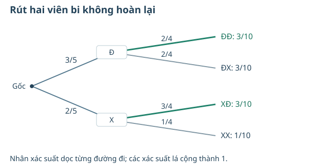

# Bài 18. Xác suất có điều kiện

TOÁN 12 · CHƯƠNG VI · KIẾN THỨC SGK KNTT · TẬP HAI

Khi có thêm thông tin, xác suất thay đổi như thế nào? Chọn đúng nhóm điều kiện, rồi dùng công thức nhân để tính xác suất của các biến cố đồng thời.

<nav class="thpt-r4-lesson-tabs"><a href="../">Chương VI</a><a href="../luyen-tap/#b18-core">Core/Luyện tập</a><a href="../bai-19/">Bài tiếp theo</a><a href="../tu-kiem-tra-chuong/">Tự kiểm tra cuối chương</a></nav>

=== "Khám phá kiến thức"

    ### 1.1. Xác suất có điều kiện

    Em gieo một xúc xắc cân đối. Nếu chưa có thông tin gì, xác suất ra số lớn hơn 3 là \(3/6=1/2\). Nhưng giả sử một người đã nhìn thấy kết quả và cho em biết số chấm là số chẵn. Lúc này chỉ còn ba kết quả có thể xảy ra: \(2,4,6\). Trong đó \(4,6\) lớn hơn 3. Xác suất em cần tính bây giờ là \(2/3\), không còn là \(1/2\).

    Gọi \(A\) là biến cố “số chấm lớn hơn 3”, \(B\) là biến cố “số chấm chẵn”. Ta viết xác suất vừa tìm là \(P(A\mid B)\), đọc là xác suất của A với điều kiện B. Thông tin B không làm đổi kết quả đã gieo; nó thay đổi tập kết quả ta dùng để đánh giá xác suất.

    **Vận dụng.** Chọn đều một số nguyên từ 1 đến 10. Biết số được chọn là số chẵn, xác suất số đó lớn hơn 6 bằng bao nhiêu?

    ??? question "Đối chiếu"

        Đặt \(B=\{2,4,6,8,10\}\), \(A=\{7,8,9,10\}\). Trong B chỉ có \(A\cap B=\{8,10\}\) thỏa A. Năm số của B đồng khả năng sau khi biết B, nên \(P(A\mid B)=2/5\).

    ??? tip "Kiểm lỗi"

        Mẫu số là 5, không phải 10. Số 7 và 9 thuộc A nhưng bị loại khỏi nhóm điều kiện B.

    Nếu các kết quả ban đầu không đồng khả năng thì không thể đếm số kết quả đơn thuần. Ta dùng tổng xác suất. Xác suất của nhóm \(B\) là \(P(B)\); phần của nhóm ấy đồng thời thỏa A là \(P(A\cap B)\). Chuẩn hóa toàn bộ nhóm B thành một đơn vị, ta được
    \[
    P(A\mid B)=\frac{P(A\cap B)}{P(B)},\quad P(B)>0.
    \]
    SGK cũng viết \(AB=A\cap B\). Nếu \(P(B)=0\), công thức chia không xác định; không tự gán \(P(A\mid B)=0\). Do \(0\le P(AB)\le P(B)\), kết quả khi xác định luôn thuộc đoạn \([0;1]\).

    Khi các kết quả sơ cấp đồng khả năng, \(P(AB)=n(AB)/n(\Omega)\), \(P(B)=n(B)/n(\Omega)\). Chia hai phân số và rút gọn \(n(\Omega)\) cho \(P(A\mid B)=n(AB)/n(B)\), đúng với cách đếm ban đầu.

    **Đọc bảng dữ liệu thống kê \(2\times2\).** Chọn đều một trong 100 học sinh, trong đó 30 tham gia CLB nhạc (A), 40 tham gia CLB thể thao (B), 12 tham gia cả hai. Hoàn thiện bảng bằng cách trừ các tổng đã biết:

    | | Thể thao B | Không thể thao | Tổng |
    | :-- | --: | --: | --: |
    | Nhạc A | 12 | 18 | 30 |
    | Không nhạc | 28 | 42 | 70 |
    | Tổng | 40 | 60 | 100 |

    Nếu biết học sinh tham gia thể thao, chỉ đọc cột B, gồm 40 người. Trong đó 12 tham gia nhạc, nên \(P(A\mid B)=12/40=3/10\). Nếu biết học sinh tham gia nhạc, chỉ đọc hàng A, gồm 30 người; \(P(B\mid A)=12/30=2/5\). Cùng một ô giao nhưng hai mẫu số khác nhau. Điều kiện luôn ở bên phải dấu \(\mid\).

    Trong bảng này, \(P(A)=30/100=3/10=P(A\mid B)\); thông tin tham gia thể thao không làm thay đổi xác suất tham gia nhạc trong phép chọn đều từ bảng. Thật vậy, \(P(AB)=12/100=P(A)P(B)\): hai biến cố độc lập.

    Tổng quát, nếu A và B độc lập thì \(P(AB)=P(A)P(B)\). Khi \(P(B)>0\), chia hai vế cho \(P(B)\) được \(P(A\mid B)=P(A)\). Ngược lại, nếu đẳng thức điều kiện này đúng và \(P(B)>0\), nhân lại cho \(P(B)\) sẽ chứng minh độc lập. Tương tự theo chiều ngược khi \(P(A)>0\).

    Biến cố đối của A trong nhóm điều kiện B chiếm phần còn lại: \(P(\overline A\mid B)=1-P(A\mid B)\). Nếu A và B độc lập thì A và \(\overline B\), cũng như \(\overline A\) và B, độc lập; chỉ dùng xác suất có điều kiện khi biến cố điều kiện có xác suất dương. Hai biến cố xung khắc có xác suất dương không độc lập, vì xác suất giao bằng 0 nhưng tích hai xác suất dương.

    **Vận dụng.** Trong 120 lượt kiểm tra thiết bị, 40 lượt ở chế độ A có 24 lượt đạt; 80 lượt ở chế độ khác A có 50 lượt đạt. Chọn đều một lượt. Tính xác suất đạt với điều kiện ở chế độ A, và xác suất ở chế độ A với điều kiện đạt. Hai biến cố có độc lập không?

    ??? question "Đối chiếu"

        Số lượt đạt chung là \(24+50=74\). Gọi B là biến cố đạt, ta có \(P(B\mid A)=24/40=3/5\); \(P(A\mid B)=24/74=12/37\). Vì \(P(B)=74/120=37/60\ne3/5\), hai biến cố không độc lập. Dữ liệu mô tả sự khác biệt xác suất trong tập lượt quan sát, không tự chứng minh chế độ A gây ra khác biệt.

    ??? tip "Kiểm lỗi"

        Với câu hỏi “biết đạt”, mẫu số phải là tổng 74 lượt đạt. Với câu hỏi “biết chế độ A”, mẫu số là 40. Để kiểm độc lập, so \(P(B\mid A)\) với \(P(B)\), không so hai xác suất có điều kiện đảo chiều.

    ### 1.2. Công thức nhân xác suất

    Khi đã biết \(P(A\mid B)=P(AB)/P(B)\) và \(P(B)>0\), nhân hai vế với \(P(B)\) cho
    \[
    P(AB)=P(B)P(A\mid B).
    \]
    Đổi vai trò A, B cho \(P(AB)=P(A)P(B\mid A)\) khi \(P(A)>0\). Đây là công thức nhân xác suất, dùng cả khi hai biến cố phụ thuộc. Nếu xác suất biến cố đầu bằng 0 thì xác suất giao bằng 0 trực tiếp; không cần tính xác suất điều kiện không xác định.

    Hãy xét túi có 3 bi đỏ (Đ), 2 bi xanh (X), các viên bi được rút đều từng viên, không hoàn lại. Xác suất lần đầu đỏ là \(3/5\). Khi biết lần đầu đỏ, túi còn 2 đỏ, 2 xanh, nên xác suất lần hai đỏ là \(2/4\), không phải \(3/5\). Vậy xác suất cả hai đỏ là \((3/5)(2/4)=3/10\).

    <figure class="thpt-r4-plot thpt-r4-probability-figure"><figcaption>Đọc từ gốc đến từng lá. Xác suất trên cạnh thứ hai phụ thuộc màu đã rút ở cạnh thứ nhất. Nhân dọc một đường; cộng các lá xung khắc phù hợp với biến cố hỏi.</figcaption></figure>

    Nếu hỏi hai viên cùng màu, hai đường phù hợp là ĐĐ và XX, không thể đồng thời xảy ra. Cộng \(3/10+1/10=2/5\). Nếu hoàn lại viên đầu trước khi rút lượt hai và hai lần chọn độc lập, xác suất cả hai đỏ mới là \((3/5)^2=9/25\). Hai mô hình khác nhau về điều kiện của lượt sau.

    **Vận dụng.** Với túi 3 đỏ, 2 xanh ở trên, tính xác suất hai viên khác màu và xác suất lượt hai đỏ khi biết lượt đầu đỏ.

    ??? question "Đối chiếu"

        Hai đường ĐX, XĐ có xác suất \(3/5\cdot2/4=3/10\) và \(2/5\cdot3/4=3/10\), tổng bằng \(3/5\). Xác suất lượt hai đỏ khi biết lượt đầu đỏ chỉ là \(2/4=1/2\), không phải xác suất của cả đường ĐĐ.

    ??? tip "Kiểm lỗi"

        Phân biệt xác suất trên cạnh với xác suất của lá. Cạnh thứ hai là xác suất có điều kiện; xác suất lá là tích hai cạnh. Hai lá cùng màu và hai lá khác màu phải có tổng bằng 1.

    **Ứng dụng — trò chơi ba cửa.** Có một phần thưởng được đặt đều ngẫu nhiên sau một trong ba cửa, hai cửa còn lại không có thưởng. Người chơi chọn cửa 1; người dẫn biết vị trí thưởng, luôn mở một cửa chưa chọn không có thưởng, luôn cho đổi cửa, và nếu có hai cửa hợp lệ thì chọn đều. Sau khi người dẫn mở cửa 3, có nên đổi sang cửa 2 không?

    Gọi \(E_i\) là biến cố thưởng ở cửa \(i\), \(H\) là việc mở cửa 3. Ban đầu \(P(E_i)=1/3\). Nếu thưởng ở cửa 1, người dẫn có hai cửa để mở nên \(P(H\mid E_1)=1/2\). Nếu ở cửa 2, phải mở cửa 3 nên \(P(H\mid E_2)=1\). Nếu ở cửa 3, người dẫn không mở cửa 3, nên \(P(H\mid E_3)=0\). Công thức nhân cho \(P(E_1H)=1/6,\ P(E_2H)=1/3,\ P(E_3H)=0\). Các giao này xung khắc và phủ hết H, do đó \(P(H)=1/2\). Khi biết H, xác suất thưởng ở cửa 1 là \((1/6)/(1/2)=1/3\), ở cửa 2 là \((1/3)/(1/2)=2/3\). Đổi cửa có lợi theo đúng quy tắc trò chơi đã nêu. Không suy rằng hai cửa còn đóng đương nhiên đồng khả năng; nếu đổi quy tắc người dẫn, phải lập lại mô hình.

=== "Kiến thức SGK"

    ### 2.1. Xác suất có điều kiện

    
<strong>Định nghĩa — Xác suất có điều kiện.</strong> Xác suất của biến cố A được tính khi biết biến cố B đã xảy ra gọi là xác suất của A với điều kiện B, kí hiệu \(P(A\mid B)\).

    
<strong>Công thức — Xác suất có điều kiện.</strong>
\(\displaystyle P(A\mid B)=\frac{P(AB)}{P(B)},\quad P(B)&gt;0.\)

\(AB=A\cap B\). Trong mô hình hữu hạn đồng khả năng, công thức tương đương \(n(AB)/n(B)\). Không đảo điều kiện; kiểm mẫu số dương.

    Với điều kiện B có xác suất dương, \(P(\overline A\mid B)=1-P(A\mid B)\). Nếu \(P(A),P(B)>0\), hai biến cố độc lập khi và chỉ khi \(P(A\mid B)=P(A)\), tương đương \(P(B\mid A)=P(B)\). Định nghĩa độc lập bằng \(P(AB)=P(A)P(B)\) vẫn dùng được khi một xác suất bằng 0.

    **Đọc bảng \(2\times2\):** Xác định hàng hoặc cột ứng với biến cố điều kiện, dùng tổng của hàng hoặc cột đó làm mẫu số; tử số là ô giao với biến cố được hỏi. Cách đếm áp dụng khi chọn đều từ các đối tượng trong bảng. Nếu có trọng số khác nhau, phải tính theo xác suất.

    ### 2.2. Công thức nhân xác suất

    
<strong>Quy tắc — Công thức nhân xác suất.</strong>
\(\displaystyle P(AB)=P(B)P(A\mid B)\quad\text{khi }P(B)&gt;0.\)

\(\displaystyle P(AB)=P(A)P(B\mid A)\quad\text{khi }P(A)&gt;0.\)

Nếu biến cố được lấy làm điều kiện có xác suất bằng 0, giao cũng có xác suất bằng 0. Không cần chia cho 0. Trường hợp độc lập, \(P(AB)=P(A)P(B)\).

    <figure class="thpt-r4-plot thpt-r4-probability-figure"><figcaption>Tổng các nhánh ra từ mỗi nút bằng 1; xác suất lá là tích các cạnh trên đường từ gốc. Cộng xác suất của các lá xung khắc thỏa đề bài.</figcaption></figure>

    **Cách dùng cây:** Xác định từng giai đoạn, ghi đủ các nhánh xung khắc và phủ hết khả năng ở mỗi nút, tính xác suất cạnh theo thông tin đã biết, nhân dọc đường. Nếu câu hỏi có nhiều đường thuận lợi, cộng chúng. Kiểm tổng xác suất mọi lá bằng 1. Nếu nhánh có xác suất 0, bỏ đóng góp của nhánh đó; không buộc ghi xác suất điều kiện chưa xác định tại nút không thể tới.

=== "Ví dụ"

    ### 3.1. Điều kiện trong mô hình không đồng khả năng

    <!-- EX-G12-B18-O02 -->
    **Đề bài.** Một vòng quay có ba vùng X, Y, Z với xác suất lần lượt \(0{,}2;0{,}3;0{,}5\). Biết kim không chỉ vùng Z. Tính xác suất kim chỉ X.

    **Phân tích:** Hai vùng X, Y còn có thể xảy ra nhưng không đồng khả năng.

    

<strong>Lời giải.</strong> Gọi A là chỉ X, B là không chỉ Z. \(P(B)=0{,}2+0{,}3=0{,}5\), \(A\subseteq B\) nên \(P(AB)=0{,}2\). Vậy \(P(A\mid B)=0{,}2/0{,}5=0{,}4\).

    **Kiểm lại:** Xác suất chỉ Y với cùng điều kiện là \(0{,}6\), cộng thành 1.

    ### 3.2. Đếm trong nhóm điều kiện

    <!-- EX-G12-B18-O01 -->
    **Đề bài.** Gieo xúc xắc cân đối, biết số chấm lớn hơn 2. Tính xác suất số chấm là số nguyên tố.

    **Phân tích:** Liệt kê nhóm điều kiện trước, rồi giao với tập số nguyên tố.

    

<strong>Lời giải.</strong> \(B=\{3,4,5,6\}\), \(A=\{2,3,5\}\), \(AB=\{3,5\}\). Vậy \(P(A\mid B)=2/4=1/2\).

    **Kiểm lại:** Số 2 là số nguyên tố nhưng không thuộc nhóm đã biết.

    ### 3.3. Phân biệt hai chiều điều kiện qua bảng

    <!-- EX-G12-B18-O03 -->
    <!-- EX-G12-B18-O05 -->
    **Đề bài.** Chọn đều một người từ 80 người khảo sát. Có 20 người dùng ứng dụng X, 32 người đọc sách điện tử, 12 người có cả hai đặc điểm. Tính xác suất đọc sách điện tử khi biết dùng X và xác suất dùng X khi biết đọc sách điện tử.

    **Phân tích:** Hai mẫu số là tổng nhóm ứng dụng (20) và tổng nhóm đọc sách (32).

    

<strong>Lời giải.</strong> Gọi A là dùng X, B là đọc sách điện tử. \(P(B\mid A)=12/20=3/5\); \(P(A\mid B)=12/32=3/8\). Bảng bốn ô \(AB,A\overline B,\overline AB,\overline A\overline B\) lần lượt là 12, 8, 20, 40.

    **Kiểm lại:** Tổng bốn ô bằng 80, tổng hàng A bằng 20, tổng cột B bằng 32. Hai chiều không bằng nhau.

    ### 3.4. Kiểm độc lập và biến cố đối

    <!-- EX-G12-B18-O04 -->
    **Đề bài.** Tung một đồng xu cân đối và gieo một xúc xắc cân đối độc lập. A là xu ngửa, B là xúc xắc chẵn. Tính \(P(A\mid B)\), \(P(\overline A\mid B)\), \(P(A\mid\overline B)\).

    **Phân tích:** Hai phép thử độc lập, cả B và biến cố đối của B có xác suất dương.

    

<strong>Lời giải.</strong> \(P(A)=1/2,P(B)=1/2,P(AB)=1/4\). Do đó \(P(A\mid B)=1/2\). Lấy phần bù được \(P(\overline A\mid B)=1/2\). A và \(\overline B\) độc lập nên \(P(A\mid\overline B)=1/2\).

    **Kiểm lại:** Trong 12 cặp kết quả đồng khả năng, có 6 cặp xúc xắc lẻ, trong đó 3 cặp xu ngửa, cho \(3/6=1/2\).

    ### 3.5. Tìm xác suất giao từ dữ kiện điều kiện

    <!-- EX-G12-B18-O06 -->
    **Đề bài.** Có \(P(A)=0{,}4,\ P(B\mid A)=0{,}7\). Tìm \(P(AB)\) và \(P(A\overline B)\).

    **Phân tích:** Biết xác suất của A và hai nhánh B, đối B trong nhóm A.

    

<strong>Lời giải.</strong> \(P(AB)=0{,}4\cdot0{,}7=0{,}28\). Vì \(P(\overline B\mid A)=0{,}3\), \(P(A\overline B)=0{,}4\cdot0{,}3=0{,}12\).

    **Kiểm lại:** Hai giao xung khắc và phủ A; \(0{,}28+0{,}12=0{,}4\).

    ### 3.6. Rút không hoàn lại qua nhiều lượt

    <!-- EX-G12-B18-O07 -->
    **Đề bài.** Túi có 5 đỏ, 3 xanh. Rút đều lần lượt 3 viên không hoàn lại. Tính xác suất đúng thứ tự đỏ, xanh, đỏ.

    **Phân tích:** Cập nhật số bi sau mỗi lần rút; đây là một đường đi ba cạnh.

    

<strong>Lời giải.</strong> Lượt đầu đỏ: \(5/8\). Biết lượt đầu đỏ, lượt hai xanh: \(3/7\). Biết hai lượt đầu là đỏ rồi xanh, lượt ba đỏ: \(4/6\). Nhân được \(5/8\cdot3/7\cdot4/6=5/28\).

    **Kiểm lại:** Đếm có thứ tự cho \(5\cdot3\cdot4=60\) kết quả thuận lợi trong \(8\cdot7\cdot6=336\) kết quả đồng khả năng, cũng được \(5/28\).

=== "Lỗi thường gặp"

    ### 4.1. Giữ mẫu số của không gian mẫu ban đầu

    **Sai:** Sau khi biết B, vẫn chia số kết quả thuận lợi cho \(n(\Omega)\).

    **Vì sao và cách sửa:** Điều kiện thu hẹp nhóm xét. Với kết quả đồng khả năng, chia \(n(AB)\) cho \(n(B)\); nếu không đồng khả năng, chia xác suất tương ứng.

    ### 4.2. Đảo điều kiện

    **Sai:** \(P(A\mid B)=P(B\mid A)\) vì \(AB=BA\).

    **Vì sao và cách sửa:** Tử số giống nhau nhưng mẫu số có thể khác. Gạch chân từ “biết”, đặt biến cố đó sau dấu \(\mid\).

    ### 4.3. Chia cho xác suất bằng 0

    **Sai:** Gán \(P(A\mid B)=0\) khi \(P(B)=0\).

    **Vì sao và cách sửa:** Công thức điều kiện không xác định; nếu chỉ hỏi xác suất giao, suy ra \(P(AB)=0\) vì \(AB\subseteq B\).

    ### 4.4. Đồng nhất độc lập với xung khắc

    **Sai:** A, B không thể cùng xảy ra thì độc lập.

    **Vì sao và cách sửa:** Khi cả hai có xác suất dương, giao bằng 0 nhưng tích dương, nên không độc lập. Kiểm định nghĩa bằng xác suất giao.

    ### 4.5. Nhân hai xác suất không điều kiện trong phép thử phụ thuộc

    **Sai:** Rút hai bi không hoàn lại mà vẫn bình phương xác suất lấy đỏ lần đầu.

    **Vì sao và cách sửa:** Thành phần túi thay đổi. Ghi rõ xác suất lượt sau với điều kiện kết quả lượt trước, rồi nhân.

    ### 4.6. Nhầm cạnh cây và lá cây

    **Sai:** Cộng các xác suất trên cùng một đường đi, hoặc coi xác suất cạnh cuối là xác suất toàn đường.

    **Vì sao và cách sửa:** Nhân dọc đường để tính giao; cộng xác suất các lá xung khắc cùng thỏa yêu cầu. Kiểm tổng mọi lá bằng 1.

    **Học tiếp:** [Core và Luyện tập Bài 18](../luyen-tap/#b18-core) · [Bài 19 — Công thức xác suất toàn phần và công thức Bayes](../bai-19/).

    
Nguồn kiến thức: SGK KNTT Toán 12 tập 2, trang in 64–71. Bảng, hình và các ví dụ do SLM biên soạn để hỗ trợ tự học.

