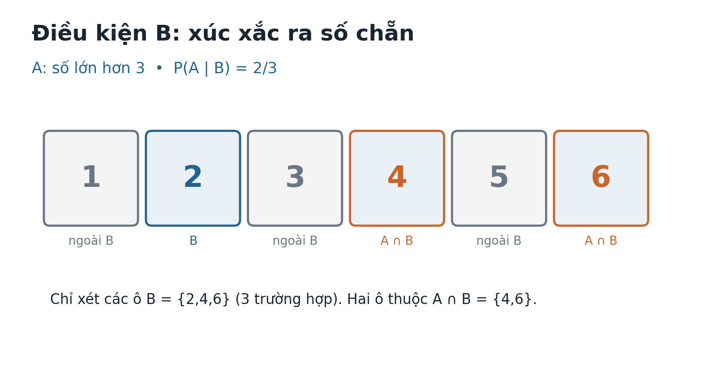
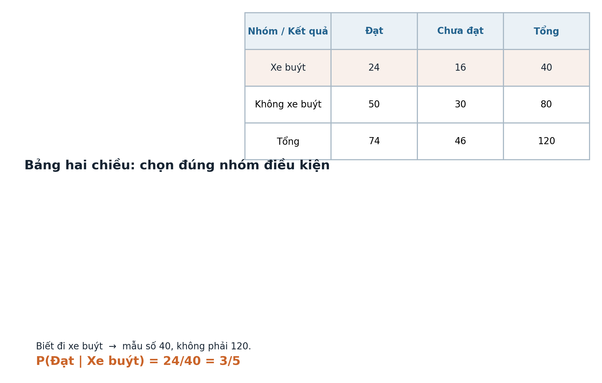
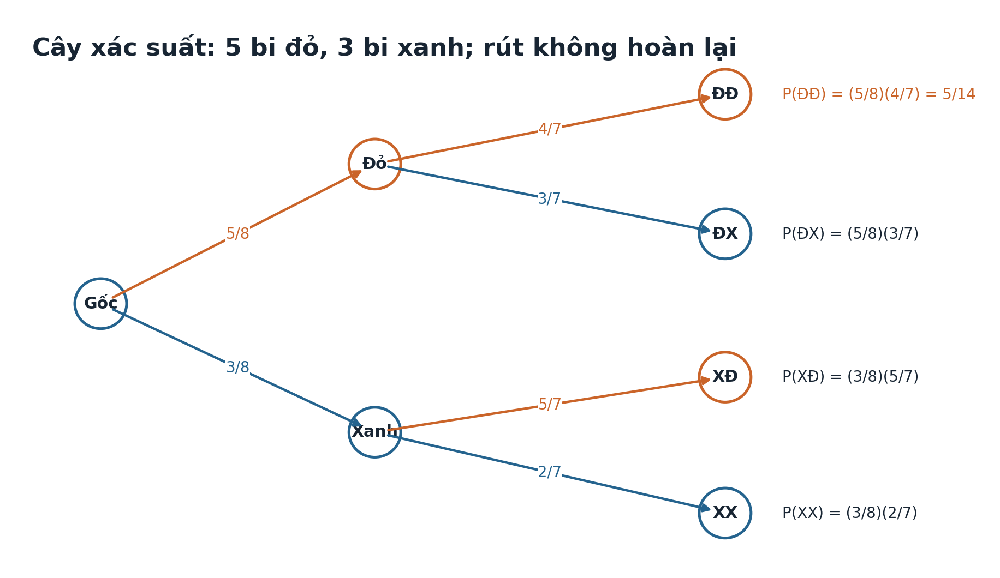

# Toán 12 · Bài 18. Xác suất có điều kiện

TOÁN 12 · CHƯƠNG VI · SGK KẾT NỐI TRI THỨC · TẬP HAI

Từ bản chất đến công thức, ví dụ giải có lý do, đọc hình và Tự thử trước khi vào Core.
<nav class="thpt-r4-lesson-tabs"><a href="../">Chương VI</a><a href="../bai-19/">Bài 19</a><a href="../luyen-tap/#b18-core">Core</a><a href="../luyen-tap/#b18-practice">Luyện tập</a><a href="../tu-kiem-tra-chuong/">Tự kiểm tra</a></nav>

## 1. Vì sao cần học

Một con số xác suất có thể đổi khi ta nhận thêm thông tin. Việc một học sinh bất kỳ đạt điểm cao khác với việc một học sinh **đã thuộc nhóm ôn tập** đạt điểm cao: ta phải xét đúng nhóm đã biết. Xác suất có điều kiện là ngôn ngữ để đặt câu hỏi chính xác thay vì trộn các nhóm.

## 2. Kiến thức tiền đề

Ôn `Ω` — không gian mẫu; biến cố `A`, giao `A∩B`, biến cố đối, cách đếm đều khả năng, xác suất của biến cố và phép nhân phân số. Kiểm tra miệng: “Nếu biết thẻ là chẵn, các thẻ lẻ còn nằm trong không gian điều kiện không?” — Không.

## 3. Hiểu bản chất trước công thức

Xét xúc xắc cân đối, `B={2,4,6}` là “biết ra chẵn”. Khi đã biết B xảy ra, sáu kết quả nguyên gốc không còn ngang vai: ta chỉ so ba kết quả của B. Với A “ra lớn hơn 3”, trong B có `{4,6}`, nên `P(A|B)=2/3`. Kết quả này không có nghĩa xúc xắc bị thay đổi; chỉ thông tin được dùng để đánh giá khác đi. Với các kết quả không đồng khả năng, thay đếm thô bằng xác suất: `P(A|B)=P(A∩B)/P(B)` nếu `P(B)>0`.

**Nhận dạng nguy cơ:** đừng đảo `P(A|B)` thành `P(B|A)`; điều kiện nằm **sau dấu `|`**. Nếu hai biến cố độc lập, việc biết B không đổi P(A), nhưng hai biến cố xung khắc có xác suất dương thì không độc lập. Công thức nhân `P(A∩B)=P(A)P(B|A)` dùng được với các biến cố phụ thuộc, không chỉ độc lập.

## 4. Kiến thức, điều kiện và ví dụ có suy luận

### Diễn giải không gian mẫu khi đã biết một biến cố xảy ra
**Mục tiêu:** Diễn giải không gian mẫu khi đã biết một biến cố xảy ra. **D1 — Họ dạng:** Tập hợp và không gian mẫu điều kiện.

**Vì sao:** Thông tin mới làm thay đổi tập kết quả có thể xảy ra.

**Tiền đề:** Biến cố là tập con của không gian mẫu; mỗi kết quả đồng khả năng có cùng xác suất.

**Giải thích bản chất trước công thức:** Nếu đã biết B xảy ra, chỉ những kết quả trong B còn được xét; không dùng toàn bộ Ω làm mẫu số.

**Điều kiện và công thức (sau bản chất):** `Với kết quả đồng khả năng, P(A|B)=|A∩B|/|B| khi |B|>0.`

**D2 — Chọn phương pháp:** Viết tập B trước, rồi giao A với B, cuối cùng đếm trong B. **Chỉ dùng khi:** B phải không rỗng; nếu các kết quả không đều khả năng thì phải dùng xác suất, không đếm thô.

**EX-G12-B18-O01 — ví dụ có suy luận:** Một con xúc xắc cân đối: B là ra số chẵn, A là số lớn hơn 3. Tính P(A|B).

*Lời giải từng bước:* B={2,4,6}; A∩B={4,6}. Ba kết quả trong B đồng khả năng, hai thuận lợi nên P(A|B)=2/3. **Kết luận:** `2/3`. **Bẫy nhận thức:** Không dùng toàn bộ Ω sau khi đã biết B.

### Sử dụng công thức xác suất có điều kiện đúng mẫu số
**Mục tiêu:** Sử dụng công thức xác suất có điều kiện đúng mẫu số. **D1 — Họ dạng:** Công thức giao / biến cố điều kiện.

**Vì sao:** Đếm thô không còn đủ khi xác suất các kết quả khác nhau.

**Tiền đề:** P(A∩B) là xác suất hai biến cố đồng thời xảy ra; xác suất biến cố >0.

**Giải thích bản chất trước công thức:** P(A|B) biểu diễn phần xác suất của giao A∩B được chuẩn hóa trong B.

**Điều kiện và công thức (sau bản chất):** `P(A|B)=P(A∩B)/P(B), với P(B)>0.`

**D2 — Chọn phương pháp:** Đặt rõ biến cố được hỏi và biến cố được cho, kiểm P(B)>0 rồi thay vào công thức. **Chỉ dùng khi:** Phải có P(B)>0; 0≤P(A∩B)≤P(B), nên kết quả nằm trong [0,1].

**EX-G12-B18-O02 — ví dụ có suy luận:** Cho P(B)=0,5 và P(A∩B)=0,2. Tính P(A|B).

*Lời giải từng bước:* B có xác suất dương, chia 0,2/0,5=0,4; kiểm 0,2≤0,5. **Kết luận:** `2/5`. **Bẫy nhận thức:** Không dùng P(A) làm mẫu số cho P(A|B).

### Phân biệt P(A|B) và P(B|A)
**Mục tiêu:** Phân biệt P(A|B) và P(B|A). **D1 — Họ dạng:** Đảo chiều xác suất trên nhóm chọn.

**Vì sao:** Đổi hướng câu hỏi làm thay đổi mẫu số và thường thay đổi đáp án.

**Tiền đề:** Định nghĩa xác suất có điều kiện, bảng giao hai nhóm.

**Giải thích bản chất trước công thức:** Điều kiện đứng bên phải dấu |; hai hướng dùng hai mẫu số khác nhau.

**Điều kiện và công thức (sau bản chất):** `P(A|B)=P(A∩B)/P(B), P(B|A)=P(A∩B)/P(A), nếu mẫu số dương.`

**D2 — Chọn phương pháp:** Gạch chân từ “biết rằng”, đếm nhóm điều kiện, rồi đếm giao. **Chỉ dùng khi:** Không giả thiết P(A|B)=P(B|A) hay suy xác suất Bayes khi thiếu tỷ lệ nền.

**EX-G12-B18-O03 — ví dụ có suy luận:** Trong 100 học sinh có 30 học CLB nhạc và 40 học CLB thể thao, 12 học cả hai. So sánh P(nhạc|thể thao) và P(thể thao|nhạc).

*Lời giải từng bước:* P(nhạc|thể thao)=12/40=3/10; P(thể thao|nhạc)=12/30=2/5. Khác do mẫu số 40 và 30. **Kết luận:** `3/10 và 2/5`. **Bẫy nhận thức:** P(A|B) không bằng P(B|A) chỉ vì giao là cùng một biến cố.

### Giải thích độc lập bằng xác suất có điều kiện
**Mục tiêu:** Giải thích độc lập bằng xác suất có điều kiện. **D1 — Họ dạng:** Độc lập, giao và xung khắc.

**Vì sao:** Muốn biết thông tin B có làm thay đổi cơ hội xảy ra A hay không.

**Tiền đề:** Độc lập nghĩa là P(A∩B)=P(A)P(B).

**Giải thích bản chất trước công thức:** Nếu A và B độc lập thì việc biết B xảy ra không làm đổi P(A), với P(B)>0.

**Điều kiện và công thức (sau bản chất):** `A độc lập B ⇔ P(A∩B)=P(A)P(B); nếu P(B)>0 thì P(A|B)=P(A).`

**D2 — Chọn phương pháp:** Dùng xác suất giao hoặc so P(A|B) với P(A); phân biệt xung khắc. **Chỉ dùng khi:** Hai biến cố có xác suất dương mà xung khắc thì không độc lập.

**EX-G12-B18-O04 — ví dụ có suy luận:** Tung đồng xu cân đối và xúc xắc cân đối độc lập. A: xu ngửa, B: xúc xắc chẵn. Tính P(A|B).

*Lời giải từng bước:* Hai phép thử độc lập nên P(A|B)=P(A)=1/2; không cần nhân với P(B) lần nữa. **Kết luận:** `1/2`. **Bẫy nhận thức:** Xung khắc khác độc lập; không áp dụng P(A|B)=P(A) khi chưa có chứng cứ.

### Đọc bảng hai chiều và xác suất theo nhóm điều kiện
**Mục tiêu:** Đọc bảng hai chiều và xác suất theo nhóm điều kiện. **D1 — Họ dạng:** Bảng tần suất 2×2.

**Vì sao:** Dữ liệu thống kê thường báo kết quả theo từng nhóm khác kích thước.

**Tiền đề:** Đọc tổng hàng, tổng cột, ô giao trên bảng.

**Giải thích bản chất trước công thức:** Biết một người thuộc hàng hay cột nào thì tổng của hàng/cột điều kiện là mẫu số.

**Điều kiện và công thức (sau bản chất):** `P(Kết quả|Nhóm)=số người vừa ở nhóm vừa có kết quả / tổng số người thuộc nhóm.`

**D2 — Chọn phương pháp:** Tạo bảng 2×2, thêm tổng hàng/cột, chỉ rõ hướng điều kiện. **Chỉ dùng khi:** Nhóm điều kiện phải có số quan sát >0; dữ liệu không ngẫu nhiên không tự suy nhân quả.

**EX-G12-B18-O05 — ví dụ có suy luận:** 120 học sinh: xe buýt 24 đạt,16 chưa đạt; không xe buýt 50 đạt,30 chưa đạt. Tính P(đạt|xe buýt).

*Lời giải từng bước:* Hàng xe buýt 24+16=40; đạt trong nhóm là 24; P=24/40=3/5. **Kết luận:** `3/5`. **Bẫy nhận thức:** Đổi P(Kết quả|Nhóm) thành P(Nhóm|Kết quả) khi đọc bảng 2×2.

### Suy luận và vận dụng công thức nhân xác suất
**Mục tiêu:** Suy luận và vận dụng công thức nhân xác suất. **D1 — Họ dạng:** Tính xác suất giao theo điều kiện.

**Vì sao:** Hai điều kiện xảy ra liên tiếp thường phải nhân xác suất của từng bước.

**Tiền đề:** Công thức xác suất có điều kiện với mẫu số dương.

**Giải thích bản chất trước công thức:** Từ P(B|A)=P(A∩B)/P(A), nhân hai vế với P(A) để tìm giao.

**Điều kiện và công thức (sau bản chất):** `P(A∩B)=P(A)P(B|A)=P(B)P(A|B), với điều kiện tương ứng >0.`

**D2 — Chọn phương pháp:** Đặt tên hai biến cố, chọn chiều đã có dữ liệu, nhân hai xác suất. **Chỉ dùng khi:** Không tự nhân P(A)P(B) trừ khi độc lập; xác suất nhánh thay đổi sau thông tin.

**EX-G12-B18-O06 — ví dụ có suy luận:** P(A)=0,4 và P(B|A)=0,7. Tính P(A∩B).

*Lời giải từng bước:* P(A∩B)=0,4×0,7=0,28; không thể dùng P(B) khi chưa biết. **Kết luận:** `7/25`. **Bẫy nhận thức:** Công thức nhân xác suất có điều kiện không yêu cầu A,B độc lập.

### Giải bài toán nhiều lượt bằng sơ đồ cây có điều kiện
**Mục tiêu:** Giải bài toán nhiều lượt bằng sơ đồ cây có điều kiện. **D1 — Họ dạng:** Lấy vật không hoàn lại và phân nhánh.

**Vì sao:** Kết quả lượt đầu làm thay đổi cơ hội của lượt sau.

**Tiền đề:** Tính xác suất theo số lượng và công thức nhân; phân biệt hoàn lại/không hoàn lại.

**Giải thích bản chất trước công thức:** Mỗi đường cây là một giao biến cố theo thứ tự; xác suất đường = tích xác suất điều kiện dọc đường.

**Điều kiện và công thức (sau bản chất):** `P(X₁∩X₂)=P(X₁)P(X₂|X₁). Với nhiều lượt, nhân lần lượt các điều kiện.`

**D2 — Chọn phương pháp:** Vẽ cây, cập nhật tử/mẫu sau mỗi lượt, cộng các đường khác nhau nếu bài hỏi nhiều cách. **Chỉ dùng khi:** Chỉ cập nhật số lượng khi không hoàn lại; các đường khác nhau là xung khắc.

**EX-G12-B18-O07 — ví dụ có suy luận:** Túi 5 bi đỏ và 3 bi xanh, rút 2 bi không hoàn lại. Xác suất cả hai đỏ?

*Lời giải từng bước:* Lượt đầu đỏ 5/8, tiếp tục đỏ 4/7; P=(5/8)(4/7)=5/14. **Kết luận:** `5/14`. **Bẫy nhận thức:** Sau rút không hoàn lại, mẫu số lượt sau giảm 1; không bỏ sót thứ tự khác.

## 5. Hướng dẫn đọc hình

`Temp_FIG-G12-CHVI-B18-SET-R00.png` tô vùng điều kiện B và phần A∩B. Đọc **vùng B làm mẫu**, không đếm toàn bộ Ω. `Temp_FIG-G12-CHVI-B18-TABLE-R00.png` là bảng hai nhóm; nhìn **đúng hàng/cột điều kiện** trước khi lấy ô giao. `Temp_FIG-G12-CHVI-B18-TREE-R00.png` là cây rút không hoàn lại: xác suất trên **cạnh** là xác suất theo điều kiện trước đó, không phải xác suất của lá; xác suất lá bằng tích dọc đường.

<figure class="thpt-r4-plot g12-chi-figure"><figcaption>Hình 1: Vùng điều kiện và giao biến cố. Xem hướng dẫn đọc hình phía trên.</figcaption></figure>

<figure class="thpt-r4-plot g12-chi-figure"><figcaption>Hình 2: Bảng hai nhóm theo điều kiện. Xem hướng dẫn đọc hình phía trên.</figcaption></figure>

<figure class="thpt-r4-plot g12-chi-figure"><figcaption>Hình 3: Sơ đồ cây nhiều lượt. Xem hướng dẫn đọc hình phía trên.</figcaption></figure>

## 6. Tự thử trước Core

Hãy tự giải trên giấy trước khi mở phần đối chiếu.

**Tự thử 1.** Chọn đều số 1–10. Biết số được chọn là số chẵn, xác suất số lớn hơn 6? **Tự thử trước:** ghi tập điều kiện rồi đếm.

Mở đối chiếu sau khi tự thử

trong `{2,4,6,8,10}`, thuận lợi `{8,10}` nên `2/5`. Sai thì quay lại `B18-O01`, xem hình `FIG-CHVI-B18-SET` và thử tiếp `C01`.

**Tự thử 2.** Hai lần rút **không hoàn lại**, túi có 3 đỏ 2 xanh. Biết lần đầu đỏ, xác suất lần hai đỏ? **Tự thử trước:** cập nhật số bi.

Mở đối chiếu sau khi tự thử

còn 2 đỏ trên 4 bi, nên `1/2`. Sai thì xem D6 `B18-O07` và sơ đồ `FIG-CHVI-B18-TREE`.

## 7. Chuyển sang Core và Luyện tập

- <a href="../luyen-tap/#b18-core">Mở Core Bài 18</a>
- <a href="../luyen-tap/#b18-practice">Luyện tập, Vận dụng và Tự luận Bài 18</a>
- Nếu gặp khó khăn, dùng hướng dẫn D6 gắn với từng câu trong Core và Luyện tập.
