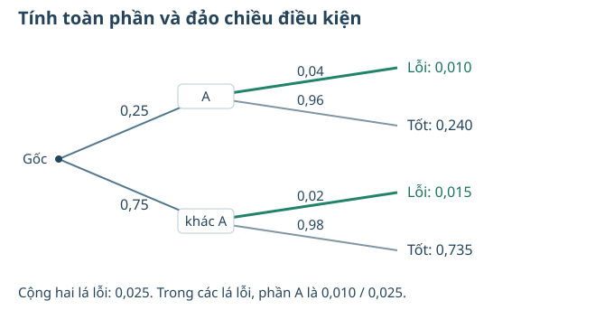

# Bài 19. Công thức xác suất toàn phần và công thức Bayes

TOÁN 12 · CHƯƠNG VI · KIẾN THỨC SGK KNTT · TẬP HAI

Tính xác suất một kết quả từ các nhóm khác nhau, rồi cập nhật xác suất của nhóm khi đã biết kết quả.

<nav class="thpt-r4-lesson-tabs"><a href="../">Chương VI</a><a href="../bai-18/">Bài trước</a><a href="../luyen-tap/#b19-core">Core/Luyện tập</a><a href="../tu-kiem-tra-chuong/">Tự kiểm tra cuối chương</a></nav>

=== "Khám phá kiến thức"

    ### 1.1. Công thức xác suất toàn phần

    Một kho nhận sản phẩm từ hai xưởng. Xưởng A làm 25% tổng số sản phẩm và có tỉ lệ lỗi 4%; xưởng còn lại làm 75% và có tỉ lệ lỗi 2%. Chọn đều một sản phẩm trong kho. Em dự đoán tỉ lệ lỗi chung là 3% vì trung bình của 4% và 2%? Cách tính đó chỉ phù hợp khi hai xưởng đóng góp bằng nhau. Ở đây cần tính cả tỉ lệ sản phẩm của từng nguồn.

    Gọi \(A\) là biến cố “sản phẩm do xưởng A sản xuất”, \(B\) là biến cố “sản phẩm lỗi”. Mọi sản phẩm thuộc đúng một trong hai nhóm A và \(\overline A\). Hình dung kho có 10 000 sản phẩm với số lượng tương ứng chính xác các tỉ lệ đã cho:

    | Nguồn | Lỗi | Không lỗi | Tổng |
    | :-- | --: | --: | --: |
    | A | 100 | 2400 | 2500 |
    | Khác A | 150 | 7350 | 7500 |
    | Tổng | 250 | 9750 | 10000 |

    Trong 2500 sản phẩm A có \(2500\cdot0{,}04=100\) sản phẩm lỗi. Trong 7500 sản phẩm còn lại có \(7500\cdot0{,}02=150\) sản phẩm lỗi. Vậy tỉ lệ lỗi chung là \(250/10000=0{,}025=2{,}5\%\). Bảng là mô hình tần số để thấy bản chất, không phải khẳng định số sản phẩm lỗi của một mẫu ngẫu nhiên luôn đúng 250.

    Cùng phép tính dưới dạng xác suất: giả sử \(0<P(A)<1\), tức cả hai nhóm đều có xác suất dương. Biến cố B được chia thành hai phần xung khắc \(AB\) và \(\overline A B\), hợp của chúng chính là B. Theo quy tắc cộng và công thức nhân đã học,

    \[
    \begin{aligned}
    P(B)&=P(AB)+P(\overline AB)\\
    &=P(A)P(B\mid A)+P(\overline A)P(B\mid\overline A).
    \end{aligned}
    \]

    Đây là công thức xác suất toàn phần. Mỗi tỉ lệ lỗi theo nhóm được nhân với tỉ lệ của nhóm đó, sau đó cộng lại.

    <figure class="thpt-r4-plot thpt-r4-probability-figure"><figcaption>Nhân hai cạnh theo từng đường đi. Hai lá lỗi được tô xanh; cộng hai xác suất ấy để được xác suất lỗi chung. Bốn lá có tổng bằng 1.</figcaption></figure>

    **Vận dụng.** Một thư viện có 40% sách thuộc nhóm khoa học. Trong nhóm khoa học, 30% là sách tiếng Anh; trong nhóm khác, 10% là sách tiếng Anh. Chọn đều một cuốn sách. Tính xác suất cuốn được chọn là sách tiếng Anh.

    ??? question "Đối chiếu"

        Gọi A là nhóm khoa học, B là sách tiếng Anh. \(P(A)=0{,}4,\ P(\overline A)=0{,}6,\ P(B\mid A)=0{,}3,\ P(B\mid\overline A)=0{,}1\). Do đó \(P(B)=0{,}4\cdot0{,}3+0{,}6\cdot0{,}1=0{,}18\), tức 18%.

    ??? tip "Kiểm lỗi"

        Nếu tính \(20\%\) bằng trung bình cộng, em đã coi hai nhóm lớn bằng nhau. Vẽ cây, ghi trọng số nhóm ở tầng đầu. Kết quả 18% nằm giữa hai tỉ lệ 10% và 30%, phù hợp với trung bình có trọng số.

    Nếu có hơn hai nhóm, ý tưởng vẫn vậy: mỗi sản phẩm thuộc đúng một nhóm \(A_i\), các nhóm xung khắc và phủ hết không gian mẫu. Chẳng hạn ba nguồn chiếm 50%, 30%, 20% với tỉ lệ lỗi 1%, 2%, 4%. Tỉ lệ chung là \(0{,}5\cdot0{,}01+0{,}3\cdot0{,}02+0{,}2\cdot0{,}04=0{,}019\), tức 1,9%. Đây là mở rộng trực tiếp bằng cách cộng các giao xung khắc. Không cộng chồng các nhóm có thể trùng nhau. Nếu một nhóm có xác suất 0 thì phần giao của nó với B cũng có xác suất 0; bỏ phần đóng góp đó, không tính xác suất có điều kiện với mẫu số 0.

    ### 1.2. Công thức Bayes

    Trở lại kho hai xưởng. Bây giờ người kiểm tra đã biết sản phẩm mình chọn bị lỗi. Hỏi xác suất nó do xưởng A sản xuất. Câu hỏi không còn là “chọn từ toàn kho thì có lỗi không?”, mà là “trong những sản phẩm lỗi, bao nhiêu thuộc A?”.

    Từ bảng 10 000 sản phẩm, nhóm điều kiện B chỉ gồm 250 sản phẩm lỗi, trong đó 100 thuộc A. Vậy \(P(A\mid B)=100/250=0{,}4\), tức 40%. Dù A sản xuất 25% toàn kho, A chiếm 40% nhóm sản phẩm lỗi. Tỉ lệ lỗi của A là 4%, không phải đáp án 40%; hai xác suất có điều kiện ngược chiều.

    Dùng cây ở trên, tử số là xác suất đường A rồi lỗi \(0{,}010\), mẫu số là tổng hai đường lỗi \(0{,}025\). Tổng quát, từ định nghĩa ở Bài 18 và công thức toàn phần:

    \[
    \begin{aligned}
    P(A\mid B)&=\frac{P(AB)}{P(B)}\\
    &=\frac{P(A)P(B\mid A)}
    {P(A)P(B\mid A)+P(\overline A)P(B\mid\overline A)}.
    \end{aligned}
    \]

    Đó là công thức Bayes, áp dụng khi \(0<P(A)<1\) và \(P(B)>0\). Nếu nhóm A có xác suất 0 hoặc 1 thì, với \(P(B)>0\), xác suất của A khi biết B cũng lần lượt bằng 0 hoặc 1. Không thay vào công thức một xác suất có điều kiện chưa xác định. Công thức không cần A và B độc lập: chính sự thay đổi xác suất khi nhận thông tin mới là điều ta muốn tính.

    **Vận dụng.** Với bài toán thư viện ở mục 1.1, nếu biết cuốn sách được chọn là sách tiếng Anh, xác suất nó thuộc nhóm khoa học bằng bao nhiêu?

    ??? question "Đối chiếu"

        Trong mô hình 100 cuốn theo tỉ lệ đã cho, có 12 cuốn vừa khoa học vừa tiếng Anh, 6 cuốn tiếng Anh thuộc nhóm khác. Vậy \(P(A\mid B)=12/18=2/3\). Tương đương Bayes: \(0{,}4\cdot0{,}3/0{,}18=2/3\).

    ??? tip "Kiểm lỗi"

        \(30\%\) là xác suất tiếng Anh khi biết khoa học; đề hỏi chiều ngược. \(12\%\) là xác suất của cả hai đặc điểm khi chọn từ toàn bộ thư viện, chưa chia cho nhóm tiếng Anh.

    **Tác động của tỉ lệ nền.** Trong một mô hình kiểm tra giả định, 1% đối tượng có đặc điểm A. Phép kiểm tra phát tín hiệu dương tính B ở 90% đối tượng có A và 5% đối tượng không có A. Một tín hiệu dương không đồng nghĩa xác suất có A là 90%.

    | Đối tượng trong mô hình 10 000 | Dương tính B | Âm tính | Tổng |
    | :-- | --: | --: | --: |
    | Có A | 90 | 10 | 100 |
    | Không A | 495 | 9405 | 9900 |
    | Tổng | 585 | 9415 | 10000 |

    Trong nhóm dương tính có nhiều trường hợp dương giả vì nhóm không A rất lớn. Bayes cho \(P(A\mid B)=90/585=2/13\approx15{,}38\%\). Nếu giữ nguyên tỉ lệ phát tín hiệu nhưng tăng tỉ lệ nền A lên 10%, trong 10000 đối tượng sẽ có 900 dương thật và 450 dương giả; xác suất sau khi biết dương là \(900/1350=2/3\). Cùng một phép kiểm tra, xác suất sau quan sát khác nhau do tỉ lệ nền khác nhau.

    Có thể gọi \(P(A)\) là xác suất trước quan sát và \(P(A\mid B)\) là xác suất sau quan sát B. Bayes giúp cập nhật từ thông tin mới; không suy ra quan hệ nhân quả chỉ từ việc xác suất thay đổi. Ví dụ kiểm tra trên là số liệu giả định để học toán, không dùng để kết luận một cá nhân mắc bệnh hay để quyết định điều trị.

    **Vận dụng.** Với bảng 10 000 đối tượng và tỉ lệ nền 1% ở trên, tính xác suất không có A khi biết tín hiệu âm tính.

    ??? question "Đối chiếu"

        Trong 9415 trường hợp âm tính có 9405 trường hợp không A. Vậy \(P(\overline A\mid\overline B)=9405/9415=1881/1883\approx99{,}89\%\). Cũng có thể lấy \(1-P(A\mid\overline B)\).

    ??? tip "Kiểm lỗi"

        Không lấy \(1-P(A\mid B)\): phép lấy phần bù phải giữ nguyên biến cố điều kiện. Ở câu này điều kiện là âm tính, nên phải dùng cột âm tính.

=== "Kiến thức SGK"

    ### 2.1. Công thức xác suất toàn phần

    
<strong>Công thức — Xác suất toàn phần.</strong>
Với hai biến cố A, B và \(0\lt P(A)\lt 1\),

\(\displaystyle P(B)=P(A)P(B\mid A)+P(\overline A)P(B\mid\overline A).\)

Vì B là hợp của hai giao xung khắc AB và \(\overline AB\). Nếu một nhóm có xác suất 0, giao tương ứng bằng 0; bỏ đóng góp của nhóm đó thay vì tính xác suất điều kiện không xác định.

    <figure class="thpt-r4-plot thpt-r4-probability-figure"><figcaption>Cạnh tầng đầu biểu thị tỉ lệ nguồn; cạnh tầng hai biểu thị xác suất lỗi hoặc không lỗi theo nguồn. Cộng đúng các lá lỗi để tính xác suất lỗi chung.</figcaption></figure>

    **Mở rộng:** Nếu \(A_1,\ldots,A_k\) tạo thành phân hoạch không gian mẫu (đôi một xung khắc, hợp là \(\Omega\), mỗi nhóm có xác suất dương), thì

    \[
    P(B)=\sum_{i=1}^{k}P(A_i)P(B\mid A_i).
    \]

    Tỉ lệ nguồn phải cộng thành 1, còn tỉ lệ kết quả chung là trung bình có trọng số của tỉ lệ từng nhóm. Nếu nhóm có xác suất 0, bỏ nhóm đó khi tính tổng.

    ### 2.2. Công thức Bayes

    
<strong>Công thức — Bayes.</strong>
Với \(P(B)\gt 0\), \(0\lt P(A)\lt 1\),

\(\displaystyle P(A\mid B)=\frac{P(A)P(B\mid A)}{P(A)P(B\mid A)+P(\overline A)P(B\mid\overline A)}.\)

Tử là xác suất giao AB; mẫu là xác suất B tính bằng toàn phần. Nếu \(P(A)=0\), kết quả bằng 0; nếu \(P(A)=1\), kết quả bằng 1, với điều kiện \(P(B)\gt 0\).

    Khi có nhiều nguồn \(A_1,\ldots,A_k\) đôi một xung khắc, phủ hết không gian mẫu và có xác suất dương, xác suất nguồn \(A_j\) sau khi biết biến cố B là

    \[
    P(A_j\mid B)=\frac{P(A_j)P(B\mid A_j)}{\sum_{i=1}^{k}P(A_i)P(B\mid A_i)},\quad P(B)>0.
    \]

    
<strong>Kiến thức cần nhớ — Phân biệt câu hỏi.</strong>
Hỏi xác suất của kết quả B từ các tỉ lệ theo nguồn: tính toàn phần. Hỏi xác suất nguồn A khi đã biết B: lấy xác suất giao chia xác suất toàn phần (Bayes). Nếu có bảng đếm đồng khả năng, có thể lấy số đối tượng thuộc giao chia tổng nhóm điều kiện; đó là cùng một lập luận.

    Quy trình giải: đặt tên biến cố bằng lời; xác định các nhóm không trùng, phủ hết; ghi xác suất nguồn và xác suất theo nhóm; nhân dọc nhánh; cộng những lá tương ứng với B; nếu hỏi điều kiện ngược, chia giao cho \(P(B)\). Kiểm kết quả thuộc \([0;1]\); khi tính cả các xác suất nguồn có điều kiện, tổng phải bằng 1.

=== "Ví dụ"

    ### 3.1. Hai nguồn sản xuất có quy mô khác nhau

    <!-- EX-G12-B19-O01 -->
    <!-- EX-G12-B19-O02 -->
    <!-- EX-G12-B19-O04 -->
    **Đề bài.** Dây chuyền A làm 60% sản phẩm, tỉ lệ lỗi 2%; dây chuyền còn lại làm 40%, tỉ lệ lỗi 5%. Chọn đều một sản phẩm. Tính xác suất lỗi và xác suất do A sản xuất khi biết lỗi.

    **Phân tích:** Hai nguồn xung khắc và phủ hết. Tính hai giao, cộng thành xác suất lỗi rồi chia để đảo điều kiện.

    

<strong>Lời giải.</strong> Gọi A là nguồn A, B là lỗi. \(P(AB)=0{,}6\cdot0{,}02=0{,}012\); \(P(\overline AB)=0{,}4\cdot0{,}05=0{,}020\). Vậy \(P(B)=0{,}032=3{,}2\%\). Do đó \(P(A\mid B)=0{,}012/0{,}032=3/8=37{,}5\%\).

    **Kiểm lại:** Trong nhóm lỗi, nguồn còn lại chiếm \(0{,}020/0{,}032=5/8\); tổng hai nguồn bằng 1.

    ### 3.2. Trạng thái thay đổi qua hai ngày

    <!-- EX-G12-B19-O03 -->
    **Đề bài.** Ngày thứ nhất, xác suất một máy hoạt động là 0,8. Nếu ngày thứ nhất hoạt động, ngày thứ hai hoạt động với xác suất 0,9; nếu ngày thứ nhất không hoạt động, xác suất ngày thứ hai hoạt động là 0,6. Tính xác suất máy hoạt động ngày thứ hai.

    **Phân tích:** Chia theo trạng thái ngày đầu, không giả sử hai ngày độc lập.

    

<strong>Lời giải.</strong> Gọi A là hoạt động ngày đầu, B là hoạt động ngày sau. \(P(B)=0{,}8\cdot0{,}9+0{,}2\cdot0{,}6=0{,}84\).

    **Kiểm lại:** Xác suất không hoạt động ngày sau bằng \(0{,}8\cdot0{,}1+0{,}2\cdot0{,}4=0{,}16\). Tổng bằng 1.

    ### 3.3. Toàn phần và Bayes với ba nhóm

    <!-- EX-G12-B19-O06 -->
    **Đề bài.** Chọn ngẫu nhiên đều một lượt gửi hàng trong tập đang xét. Ba nhóm A, B, C đôi một không giao nhau và phủ hết tập, chiếm lần lượt 50%, 30%, 20% lượt gửi hàng. Tỉ lệ giao muộn tương ứng là 2%, 3%, 6%. Tính tỉ lệ giao muộn chung và xác suất một lượt giao muộn thuộc C.

    **Phân tích:** Có ba nguồn, nên phải cộng đủ ba giao ở mẫu số.

    

<strong>Lời giải.</strong> Gọi M là giao muộn. Ba giao có xác suất \(0{,}5\cdot0{,}02=0{,}010\), \(0{,}3\cdot0{,}03=0{,}009\), \(0{,}2\cdot0{,}06=0{,}012\). Vậy \(P(M)=0{,}031\) (3,1%). \(P(C\mid M)=0{,}012/0{,}031=12/31\approx38{,}71\%\).

    **Kiểm lại:** Ba xác suất nguồn có điều kiện lần lượt là \(10/31,9/31,12/31\), tổng bằng 1.

    ### 3.4. Nhận thông tin mới và kiểm tỉ lệ nền

    <!-- EX-G12-B19-O05 -->
    **Đề bài.** Một hệ thống phát hiện lỗi giả định có tỉ lệ lỗi nền 2%. Nếu có lỗi, hệ thống báo động với xác suất 0,95; nếu không có lỗi, vẫn báo động với xác suất 0,04. Tính xác suất thật sự có lỗi khi báo động.

    **Phân tích:** Báo động có thể đến từ hai nhóm. Tỉ lệ báo đúng trong nhóm lỗi không phải xác suất lỗi sau báo động.

    

<strong>Lời giải.</strong> Gọi A là có lỗi, B là báo động. \(P(AB)=0{,}02\cdot0{,}95=0{,}019\). \(P(\overline AB)=0{,}98\cdot0{,}04=0{,}0392\). Do đó \(P(B)=0{,}0582\), và \(P(A\mid B)=0{,}019/0{,}0582=95/291\approx32{,}65\%\).

    **Kiểm lại:** Nếu hình dung 10000 trường hợp, có 190 báo đúng và 392 báo giả; \(190/(190+392)\) cho cùng kết quả. Không nhầm độ chính xác theo một nhóm với xác suất sau quan sát.

    ### 3.5. Tính Bayes theo biến cố đối

    **Đề bài.** Một lớp có 60% học sinh chọn học phần X. Trong nhóm chọn X, xác suất hoàn thành dự án là 0,9; trong nhóm không chọn X, xác suất đó là 0,7. Chọn đều một học sinh. Biết học sinh chưa hoàn thành dự án, tính xác suất thuộc nhóm chọn X.

    <!-- EX-G12-B19-O07 -->
    **Phân tích:** Điều kiện là chưa hoàn thành, vì thế phải dùng xác suất phần bù trong từng nhóm.

    

<strong>Lời giải.</strong> Gọi A là chọn X, B là hoàn thành. \(P(\overline B\mid A)=0{,}1,\ P(\overline B\mid\overline A)=0{,}3\). Vậy \(P(\overline B)=0{,}6\cdot0{,}1+0{,}4\cdot0{,}3=0{,}18\). \(P(A\mid\overline B)=0{,}06/0{,}18=1/3\).

    **Kiểm lại:** \(P(B)=0{,}82\), nên \(P(\overline B)=1-0{,}82=0{,}18\). Không suy \(P(A\mid\overline B)=1-P(A\mid B)\).

    ### 3.6. Vận dụng xác suất toàn phần kết hợp độc lập

    **Đề bài.** Trong mô hình di truyền đơn giản, bố và mẹ được chọn độc lập từ một quần thể có 30% cá thể kiểu gene bb và 70% kiểu Bb. Tại gen đang xét có hai alen B và b; mỗi bố hoặc mẹ truyền một trong hai alen của mình với xác suất bằng nhau, hai lần truyền độc lập. Tính xác suất con nhận hai alen b.

    **Phân tích:** Với một cá thể, gene b được truyền chắc chắn nếu kiểu bb, và với xác suất \(1/2\) nếu kiểu Bb. Tính toàn phần trước, sau đó dùng độc lập theo giả thiết.

    

<strong>Lời giải.</strong> Xác suất nhận b từ bố là \(0{,}3\cdot1+0{,}7\cdot1/2=0{,}65\). Tương tự từ mẹ là 0,65. Hai lần độc lập theo mô hình, nên xác suất nhận hai gene b bằng \(0{,}65^2=0{,}4225\) (42,25%).

    **Kiểm lại:** Xác suất nhận b ở một lần nằm giữa \(1/2\) và 1. Nếu việc chọn hai cá thể hoặc truyền gene không độc lập, không tự nhân hai xác suất biên.

=== "Lỗi thường gặp"

    ### 4.1. Lấy trung bình cộng thay cho trung bình có trọng số

    **Sai:** Lấy \((4\%+2\%)/2\) dù hai nguồn chiếm 25% và 75%.

    **Vì sao và cách sửa:** Mỗi nguồn đóng góp số sản phẩm khác nhau. Nhân tỉ lệ lỗi với tỉ lệ nguồn rồi cộng; kiểm trọng số tổng bằng 1.

    ### 4.2. Bỏ sót hoặc đếm trùng nhánh

    **Sai:** Mẫu số Bayes chỉ tính lá lỗi của A, hoặc cộng những nhóm có giao nhau.

    **Vì sao và cách sửa:** \(P(B)\) phải gồm tất cả cách B xảy ra, không trùng. Chia theo A và biến cố đối, hoặc phân hoạch hợp lệ.

    ### 4.3. Đảo điều kiện

    **Sai:** \(P(A\mid B)=P(B\mid A)\).

    **Vì sao và cách sửa:** Hai xác suất dùng hai nhóm điều kiện khác nhau. Xác định nhóm đã biết và đặt sau dấu \(\mid\); Bayes tính từ giao chia tổng của nhóm đó.

    ### 4.4. Bỏ qua tỉ lệ nền

    **Sai:** Hệ thống phát hiện đúng 95% lỗi thì mọi báo động đều có 95% khả năng là lỗi thật.

    **Vì sao và cách sửa:** Báo động giả từ nhóm không lỗi cũng góp vào mẫu số. Dựng bảng hoặc cây với cả hai nhóm để tính xác suất sau báo động.

    ### 4.5. Lấy phần bù nhưng thay đổi biến cố điều kiện

    **Sai:** \(P(A\mid\overline B)=1-P(A\mid B)\).

    **Vì sao và cách sửa:** Phần bù giữ nguyên điều kiện: \(P(\overline A\mid B)=1-P(A\mid B)\). Nếu điều kiện đổi sang \(\overline B\), phải lập lại mẫu số.

    ### 4.6. Áp dụng Bayes khi mẫu số bằng 0

    **Sai:** Chia cho \(P(B)=0\) rồi kết luận xác suất sau quan sát.

    **Vì sao và cách sửa:** Công thức điều kiện chỉ dùng khi \(P(B)>0\). Kiểm dữ kiện và miền xác suất trước khi chia. Nếu nhóm ban đầu có xác suất 0, giao của nó với B bằng 0, không cần xác suất điều kiện tại nhóm rỗng.

    **Học tiếp:** [Core và Luyện tập Bài 19](../luyen-tap/#b19-core) · [Tự kiểm tra cuối chương VI](../tu-kiem-tra-chuong/).

    
Nguồn kiến thức: SGK KNTT Toán 12 tập 2, trang in 72–78. Các bảng số liệu, ví dụ và hình minh họa do SLM biên soạn riêng.

