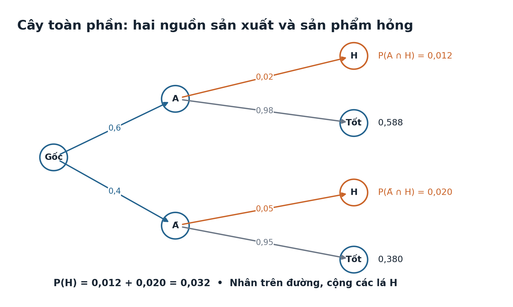
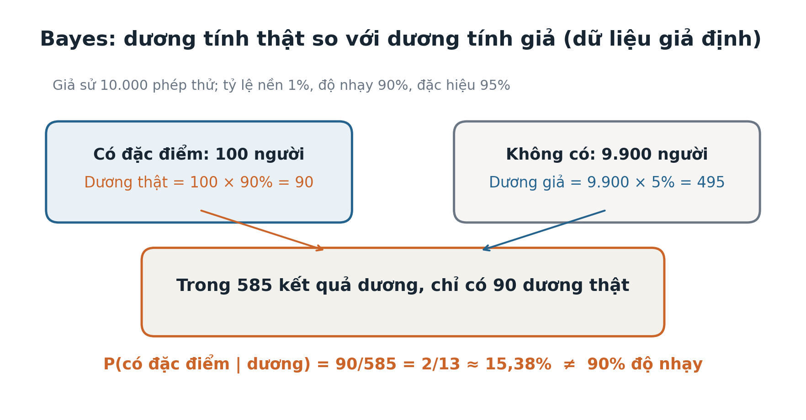

# Toán 12 · Bài 19. Công thức xác suất toàn phần và công thức Bayes

TOÁN 12 · CHƯƠNG VI · SGK KẾT NỐI TRI THỨC · TẬP HAI

Từ bản chất đến công thức, ví dụ giải có lý do, đọc hình và Tự thử trước khi vào Core.
<nav class="thpt-r4-lesson-tabs"><a href="../">Chương VI</a><a href="../bai-18/">Bài 18</a><a href="../luyen-tap/#b19-core">Core</a><a href="../luyen-tap/#b19-practice">Luyện tập</a><a href="../tu-kiem-tra-chuong/">Tự kiểm tra</a></nav>

## 1. Vì sao cần học

Biết từng nhóm có cơ hội B xảy ra không đủ để suy ngay xác suất B trong cả dân số: phải tính theo **tỷ lệ từng nhóm**. Đặc biệt, khi thấy kết quả B (ví dụ một sản phẩm hỏng), ta còn muốn biết nó đến từ nhóm nào; đây là câu hỏi **đảo điều kiện**, cần Bayes, không phải đọc ngay xác suất hỏng khi biết nguồn.

## 2. Kiến thức tiền đề

Nắm `A`, `Ā`, giao, biến cố xung khắc, `P(A)+P(Ā)=1`, công thức nhân xác suất có điều kiện (B18), đọc bảng và sơ đồ cây. Tự kiểm: “0,6 sản phẩm từ A có lỗi 0,02, phần còn lại lỗi 0,05. Xác suất toàn xưởng lỗi có phải (0,02+0,05)/2 không?” — Không, vì hai nhóm không ngang tỷ trọng.

## 3. Hiểu bản chất trước công thức

B xảy ra theo hai đường không trùng: `A rồi B` hoặc `Ā rồi B`. Hai giao biến cố xung khắc và hợp bằng B nên `P(B)=P(A∩B)+P(Ā∩B)`. Áp dụng công thức nhân từng nhánh được `P(B)=P(A)P(B|A)+P(Ā)P(B|Ā)`. Khi biết **B đã xảy ra**, trong số toàn bộ các trường hợp B, phần thuộc A là `P(A∩B)/P(B)`. Vì thế `P(A|B) = P(A)P(B|A)/P(B)` khi `P(B)>0`. Đây là Bayes, không phải một công thức tự nhiên phải nhớ trước khi hiểu cây.

## 4. Kiến thức, điều kiện và ví dụ có suy luận

### Chia không gian thành hai trường hợp A và biến cố đối
**Mục tiêu:** Chia không gian thành hai trường hợp A và biến cố đối. **D1 — Họ dạng:** Phân hoạch hai trường hợp.

**Vì sao:** Khi không biết trước A xảy ra hay không, cần xét đủ mọi đường dẫn đến kết quả.

**Tiền đề:** Biến cố đối; P(Ā)=1−P(A); hợp của biến cố xung khắc.

**Giải thích bản chất trước công thức:** A và Ā xung khắc, hợp bằng toàn bộ không gian; B xảy ra theo đúng một trong hai nhánh.

**Điều kiện và công thức (sau bản chất):** `B=(B∩A) ∪ (B∩Ā) và P(B)=P(B∩A)+P(B∩Ā).`

**D2 — Chọn phương pháp:** Tách A / không A, xác định tỷ lệ mỗi nhánh, không bỏ nhánh. **Chỉ dùng khi:** Hai nhánh phải loại trừ nhau và phủ hết không gian; tổng xác suất nhánh =1.

**EX-G12-B19-O01 — ví dụ có suy luận:** Một kho có 70% hàng loại A, 30% không phải A. Một mặt hàng hỏng thuộc nhánh A hoặc không A; giải thích vì sao phải cộng hai đường.

*Lời giải từng bước:* A∩H và Ā∩H loại trừ, hợp bằng H. Do đó P(H)=P(A∩H)+P(Ā∩H). **Kết luận:** `Hai nhánh xung khắc, đầy đủ`. **Bẫy nhận thức:** B có thể xảy ra theo hai nguyên nhân khác nhau; không thể chọn chỉ một nhánh.

### Tính xác suất toàn phần theo hai trường hợp
**Mục tiêu:** Tính xác suất toàn phần theo hai trường hợp. **D1 — Họ dạng:** Tổng các xác suất giao theo phân hoạch.

**Vì sao:** Kết quả tổng thể được tạo từ nhiều nhóm có tỷ lệ và xác suất riêng.

**Tiền đề:** Biến cố đối và công thức nhân xác suất.

**Giải thích bản chất trước công thức:** Xác suất B bằng tổng xác suất B xảy ra theo từng nhánh A và Ā.

**Điều kiện và công thức (sau bản chất):** `P(B)=P(A)P(B|A)+P(Ā)P(B|Ā).`

**D2 — Chọn phương pháp:** Nhân tỷ lệ nhóm với xác suất điều kiện của nhóm, sau đó cộng. **Chỉ dùng khi:** P(A),P(Ā)≥0 tổng 1; hai tỷ lệ điều kiện ∈[0,1], nhóm có xác suất dương.

**EX-G12-B19-O02 — ví dụ có suy luận:** Dây chuyền A làm 60% sản phẩm hỏng 2%; B làm 40% hỏng 5%. Tính P(hỏng).

*Lời giải từng bước:* P(H)=0,6×0,02+0,4×0,05=0,012+0,020=0,032=4/125. **Kết luận:** `4/125`. **Bẫy nhận thức:** Không lấy trung bình cộng hai tỷ lệ khi tỷ lệ nguồn khác nhau.

### Đọc sơ đồ cây xác suất hai tầng và cộng lá phù hợp
**Mục tiêu:** Đọc sơ đồ cây xác suất hai tầng và cộng lá phù hợp. **D1 — Họ dạng:** Sơ đồ cây toàn phần.

**Vì sao:** Hình cây làm rõ nhân trên nhánh và cộng giữa các đường không trùng.

**Tiền đề:** Công thức nhân và biến cố đối.

**Giải thích bản chất trước công thức:** Tại mỗi nút, các nhánh điều kiện cộng bằng 1; mỗi đường đến lá có xác suất là tích các nhánh.

**Điều kiện và công thức (sau bản chất):** `P(B)=P(A)P(B|A)+P(Ā)P(B|Ā).`

**D2 — Chọn phương pháp:** Ghi xác suất trên cạnh; tính tích từng lá; cộng đúng lá mang B. **Chỉ dùng khi:** Không cộng xác suất cạnh thuộc đường khác nhau mà không nhân; đối chiếu tổng bốn lá =1.

**EX-G12-B19-O03 — ví dụ có suy luận:** Cây gồm A 40%, Ā 60%; P(B|A)=30%, P(B|Ā)=40%. Tính P(B) bằng các lá.

*Lời giải từng bước:* Hai lá B có 0,4×0,3=0,12 và 0,6×0,4=0,24; cộng 0,36. **Kết luận:** `9/25`. **Bẫy nhận thức:** Nhân theo đường, cộng các lá phù hợp; các xác suất tại cùng một nút có tổng 1.

### Dùng Bayes để đảo chiều xác suất điều kiện
**Mục tiêu:** Dùng Bayes để đảo chiều xác suất điều kiện. **D1 — Họ dạng:** Đảo điều kiện: Bayes.

**Vì sao:** Khi thấy kết quả B cần suy xác suất nguyên nhân A, không thể dùng P(B|A) làm đáp án.

**Tiền đề:** Công thức xác suất toàn phần và P(B)>0.

**Giải thích bản chất trước công thức:** Trong số mọi trường hợp gây ra B, ta hỏi bao nhiêu phần thuộc A.

**Điều kiện và công thức (sau bản chất):** `P(A|B)=P(A)P(B|A)/[P(A)P(B|A)+P(Ā)P(B|Ā)], nếu P(B)>0.`

**D2 — Chọn phương pháp:** Tính tử P(A∩B) và mẫu P(B) toàn phần, sau đó chia. **Chỉ dùng khi:** Mẫu P(B)>0; phải có thông tin tỉ lệ nền P(A) và cả nhánh còn lại.

**EX-G12-B19-O04 — ví dụ có suy luận:** Nguồn A cung cấp 60%, tỉ lệ hỏng 2%; nguồn còn lại 40%, hỏng 5%. Nếu phát hiện sản phẩm hỏng, xác suất đến từ A?

*Lời giải từng bước:* Tử 0,6×0,02=0,012; mẫu 0,032; P(A|H)=0,012/0,032=3/8. **Kết luận:** `3/8`. **Bẫy nhận thức:** P(A|B) không bằng P(B|A); dữ kiện nhánh còn lại là cần thiết.

### Giải thích tác động tỷ lệ nền tới xác suất sau quan sát
**Mục tiêu:** Giải thích tác động tỷ lệ nền tới xác suất sau quan sát. **D1 — Họ dạng:** Giả dương và tỷ lệ nền.

**Vì sao:** Một phép thử tốt vẫn có thể tạo nhiều kết quả dương tính giả nếu hiện tượng hiếm.

**Tiền đề:** Tỉ lệ nền, độ nhạy, độ đặc hiệu, xác suất dương tính giả.

**Giải thích bản chất trước công thức:** Số dương thật tỷ lệ với người có đặc điểm; số dương giả tỷ lệ với số người không có đặc điểm. Bayes so sánh hai nhóm.

**Điều kiện và công thức (sau bản chất):** `P(A|+)=[p·s]/[p·s+(1−p)·f], p=P(A), s=P(+|A), f=P(+|Ā).`

**D2 — Chọn phương pháp:** Dùng số người giả định (10.000) hoặc bảng nhánh; tách dương thật/dương giả. **Chỉ dùng khi:** Không coi kết quả toán giả định là tư vấn y tế cá nhân; cần nêu p,s,f đúng đơn vị và ý nghĩa.

**EX-G12-B19-O05 — ví dụ có suy luận:** Tỷ lệ nền 1%, độ nhạy 90%, đặc hiệu 95% (giả định). P(có đặc điểm|dương)?

*Lời giải từng bước:* Trong 10.000: có đặc điểm 100→90 dương thật; không có 9.900→495 dương giả. P=90/(90+495)=2/13. **Kết luận:** `2/13`. **Bẫy nhận thức:** Độ nhạy cao không có nghĩa P(có đặc điểm|dương) cao nếu tỷ lệ nền thấp.

### Giải xác suất toàn phần nhiều nguồn và kiểm đơn vị tỷ lệ
**Mục tiêu:** Giải xác suất toàn phần nhiều nguồn và kiểm đơn vị tỷ lệ. **D1 — Họ dạng:** Nhiều phân nhóm và dữ liệu sản xuất/khí tượng.

**Vì sao:** Các lớp nguồn có thể khác kích thước và mức rủi ro.

**Tiền đề:** Hai nhánh toàn phần, nhân trên nhánh và cộng.

**Giải thích bản chất trước công thức:** Khi {A₁,...,Aₙ} là phân hoạch, P(B)=Σᵢ P(Aᵢ)P(B|Aᵢ).

**Điều kiện và công thức (sau bản chất):** `Với ba nhóm: P(B)=p₁q₁+p₂q₂+p₃q₃, p₁+p₂+p₃=1.`

**D2 — Chọn phương pháp:** Kiểm tổng tỷ trọng nguồn bằng 1; đổi phần trăm về tỷ lệ; nhân rồi cộng; nếu đảo nguồn, dùng Bayes. **Chỉ dùng khi:** Các nguồn loại trừ nhau/phủ hết; mọi tỷ lệ trong [0,1]; không cộng tỷ lệ lỗi thô.

**EX-G12-B19-O06 — ví dụ có suy luận:** Ba xưởng lần lượt làm 50%,30%,20%, tỉ lệ lỗi 1%,2%,4%. Tính P(lỗi).

*Lời giải từng bước:* 0,5×0,01+0,3×0,02+0,2×0,04=0,005+0,006+0,008=0,019. **Kết luận:** `19/1000`. **Bẫy nhận thức:** Tỉ lệ chung phải theo trọng số; kiểm tổng tỉ lệ nguồn và diễn giải phần trăm.

### Giải tự luận tổng hợp: phân hoạch→toàn phần→Bayes→giải thích
**Mục tiêu:** Giải tự luận tổng hợp: phân hoạch→toàn phần→Bayes→giải thích. **D1 — Họ dạng:** Ứng dụng đa bước và Written ôn thi.

**Vì sao:** Đề thi tự luận thường đảo điều kiện sau khi đã tính xác suất tổng thể.

**Tiền đề:** Sơ đồ cây, xác suất giao, toàn phần, Bayes.

**Giải thích bản chất trước công thức:** Tổ chức lời giải theo 3 tầng: mô hình phân nhóm, xác suất kết quả, xác suất nguồn khi thấy kết quả.

**Điều kiện và công thức (sau bản chất):** `P(B)=ΣP(Aᵢ)P(B|Aᵢ); P(Aⱼ|B)=P(Aⱼ)P(B|Aⱼ)/P(B).`

**D2 — Chọn phương pháp:** Gọi tên biến cố, vẽ cây/ghi hai nhánh, tính từng giao, cộng, chia Bayes và kiểm 0≤kết quả≤1. **Chỉ dùng khi:** Nêu rõ tỷ lệ nhóm là trước khi quan sát; xác suất nghịch chỉ khi P(B)>0; không suy quan hệ nhân quả.

**EX-G12-B19-O07 — ví dụ có suy luận:** Lớp A chiếm 60% học sinh và 90% trong đó đạt; lớp B chiếm 40% và 70% đạt. Tính P(đạt), P(A|đạt).

*Lời giải từng bước:* P(đạt)=0,6×0,9+0,4×0,7=0,82=41/50; P(A|đạt)=0,54/0,82=27/41. **Kết luận:** `41/50 và 27/41`. **Bẫy nhận thức:** Không dừng ở P(B), phải chia Bayes khi yêu cầu “biết đã xảy ra B”.

## 5. Hướng dẫn đọc hình

`Temp_FIG-G12-CHVI-B19-TOTAL-R00.png`: tại gốc cây là hai nhóm A/Ā (phải cộng 1); trên cạnh tầng hai là tỷ lệ B có điều kiện; lá B có giá trị bằng **tích** hai cạnh; tổng P(B) bằng **cộng** lá B. `Temp_FIG-G12-CHVI-B19-BAYES-R00.png`: vùng dương thật và dương giả đều đóng góp vào tổng dương; Bayes chọn vùng thuộc A trong tổng vùng dương, không đọc thẳng độ nhạy.

<figure class="thpt-r4-plot g12-chi-figure"><figcaption>Hình 1: Sơ đồ cây xác suất toàn phần. Xem hướng dẫn đọc hình phía trên.</figcaption></figure>

<figure class="thpt-r4-plot g12-chi-figure"><figcaption>Hình 2: Sơ đồ Bayes và tỷ lệ nền. Xem hướng dẫn đọc hình phía trên.</figcaption></figure>

## 6. Tự thử trước Core

Hãy tự giải trên giấy trước khi mở phần đối chiếu.

**Tự thử 1.** Xưởng A chiếm 25%, lỗi 4%; xưởng còn lại 75%, lỗi 2%. Hỏi xác suất lỗi chung.

Mở đối chiếu sau khi tự thử

`0,25×0,04+0,75×0,02=0,025=1/40`. Nếu lấy trung bình cộng, quay lại hình cây `FIG-CHVI-B19-TOTAL` và D6 O02.

**Tự thử 2.** Với dữ kiện T01, nếu biết sản phẩm lỗi, xác suất do A sản xuất?

Mở đối chiếu sau khi tự thử

tử `0,25×0,04=0,01`; mẫu `0,025`; do đó `0,4=2/5`. Không nhầm 4% với 40%; sai thì xem D6 O04/O05 và hình `FIG-CHVI-B19-BAYES`.

## 7. Chuyển sang Core và Luyện tập

- [Mở Core Bài 19](../luyen-tap/#b19-core)
- [Luyện tập, Vận dụng và Tự luận Bài 19](../luyen-tap/#b19-practice)
- Nếu gặp khó khăn, dùng hướng dẫn D6 gắn với từng câu trong Core và Luyện tập.
