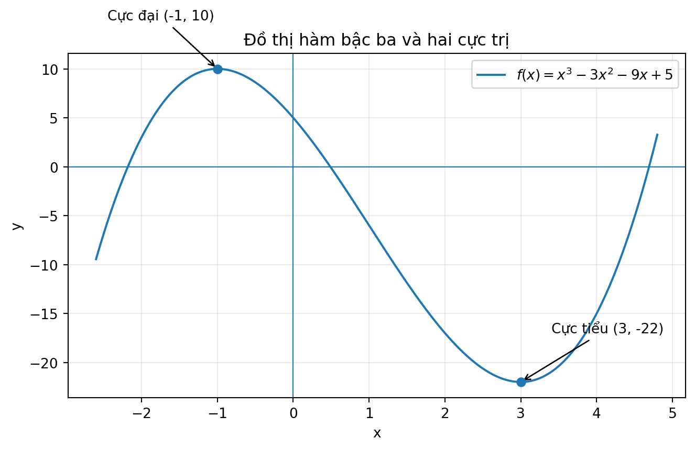
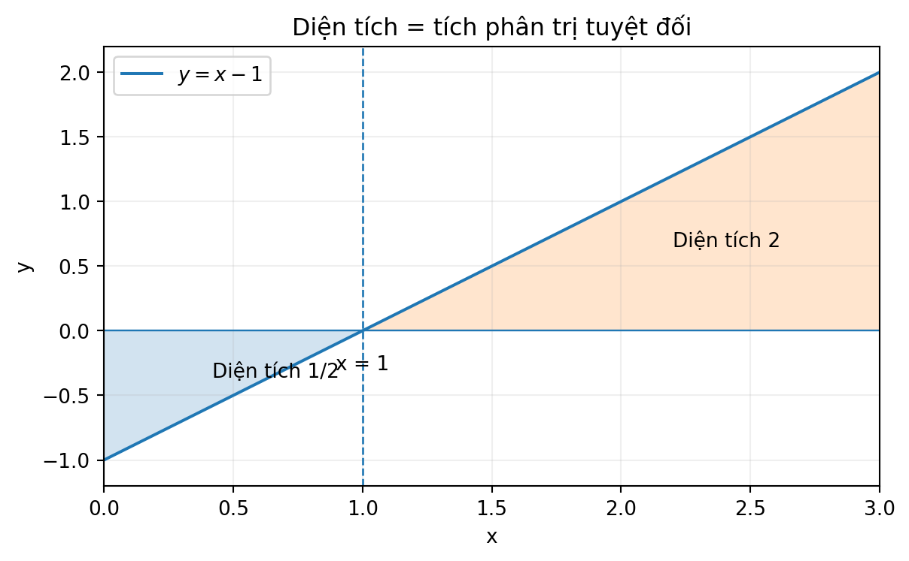
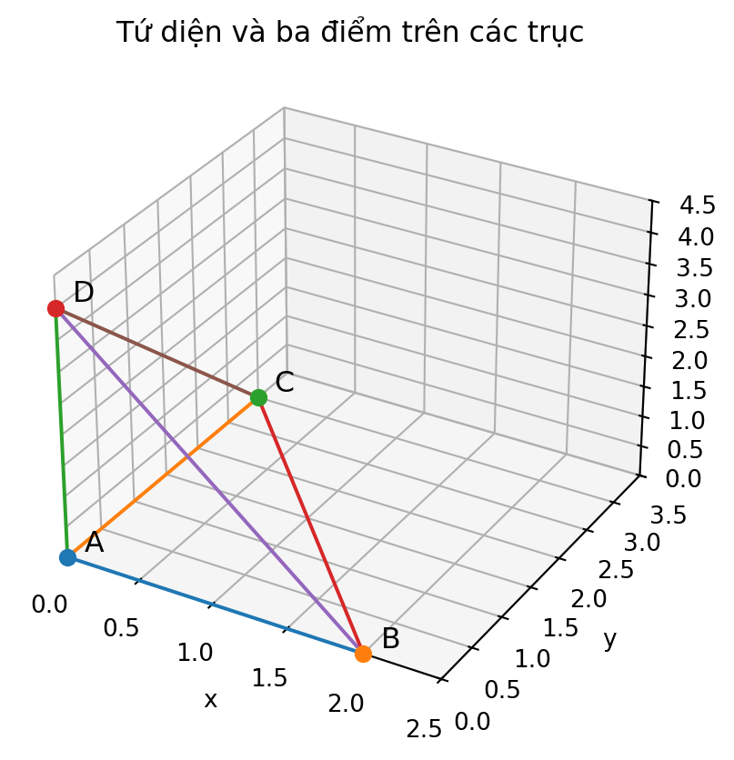
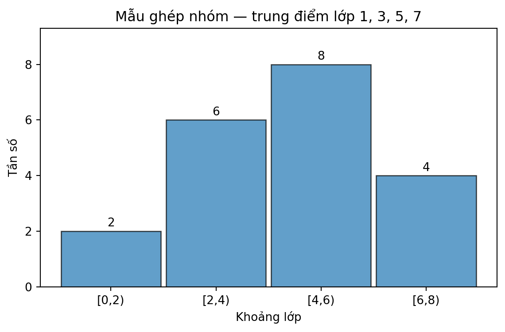

# Toán 12 · Ôn tập cuối năm · Sáu trạm kiến thức

SGK KNTT TẬP HAI · TRANG IN 90–93 · TỰ HỌC THEO SÁU TRẠM

Ôn từ bản chất, điều kiện và ví dụ giải có lý do trước khi thực hành 31 câu. Tự thử có lời giải tự mở; ôn tập công khai chỉ hiện lời giải sau Final Submit, không ghi Mastery. Đây không phải Chương VII hoặc đề đánh giá độc lập.
<nav class="thpt-r4-lesson-tabs"><a href="../">Tổng quan</a><a href="../tu-kiem-tra/">Làm 31 câu ôn tập →</a></nav>

## Trạm 1 · Biến thiên, cực trị và tối ưu hàm số

### Vì sao cần ôn lại?
Muốn chọn một phương án tối ưu, phải biết hàm có thể tăng/giảm và nơi cực trị, thay vì đoán từ vài điểm.

### Tiền đề cần có
Quy tắc đạo hàm, bảng xét dấu, tập xác định, GTLN/GTNN trên đoạn đóng.

### Bản chất trước công thức
Dấu đạo hàm mô tả xu hướng tại từng khoảng; GTLN/GTNN của một đoạn phải so sánh các giá trị biên và điểm dừng nằm trong miền.

### Quy tắc, điều kiện và khi nào dùng
$f\prime>0$ cho tăng, $f\prime<0$ cho giảm. Cực trị đổi dấu; tối ưu $[a,b]$ so sánh $f(a),f(b)$ và $f(x_i)$ với $f\prime(x_i)=0$ (hoặc điểm không khả vi thuộc đoạn).

### Vì sao chọn cách giải này? Giới hạn áp dụng
Từ điều kiện miền → xét dấu → ứng viên tối ưu → đối chiếu biên. Không dùng tiêu chí cực trị nếu hàm không liên tục hoặc ngoài miền.

### Ví dụ có suy luận
$h(x)=x^3-6x$. $h\prime=3(x^2-2)$, dấu dương khi $|x|>\sqrt2$, âm khi $|x|<\sqrt2$. Suy ra cực đại địa phương tại $x=-\sqrt2$, cực tiểu tại $x=\sqrt2$; tính $h(-\sqrt2)=4\sqrt2$, $h(\sqrt2)=-4\sqrt2$. Phải kiểm biên nếu hỏi GTLN/GTNN trên một đoạn.

### Tự thử trước Core
**Tự làm:** Hàm $x^2-4x+5$ đạt GTNN trên $[0,3]$ tại đâu?

Tự mở đối chiếu sau khi làm

$x=2$, giá trị nhỏ nhất là $1$. Đạo hàm $2x-4$ đổi từ âm sang dương tại $2$; kiểm biên $f(0)=5$, $f(3)=2$.

### Hình minh họa và cách đọc
<figure class="thpt-r4-plot g12-xp-original-figure g12-ye-original-figure"><figcaption>Hình tự tạo hỗ trợ trạm O01 · Hãy đọc hướng dẫn ngay dưới hình.</figcaption></figure>

**Hướng dẫn đọc hình, nhãn, điều kiện:** Trục ngang là $x$, trục đứng là $y$. Đường cong có hai điểm đánh dấu $(-1,10)$ và $(3,-22)$ của ví dụ Written W01; đỉnh cao là cực đại **địa phương**, không phải GTLN toàn trục. Các nhánh cho thấy một điểm cực tiểu có thể mang giá trị âm.

Khi gặp khó khăn · Hướng dẫn D6

**Khi mắc lỗi:** Nhầm cực trị và GTLN.
**Chẩn đoán → trở về tiền đề → kiểm bằng ví dụ → tự thử → vận dụng:** Quay lại D1 dấu đạo hàm; đánh dấu nghiệm và biên đoạn; thực hành Tự thử của trạm; làm lại câu trắc nghiệm 2, rồi W02; nếu không liên tục trên đoạn, sửa miền trước.

[Chuyển đến 31 câu ôn tập cuối năm](tu-kiem-tra.md)

## Trạm 2 · Nguyên hàm và tích phân xác định

### Vì sao cần ôn lại?
Làm phép toán ngược đạo hàm hoặc cộng các thay đổi nhỏ có dấu cần phân biệt nguyên hàm, giá trị tích phân và diện tích hình học.

### Tiền đề cần có
Đạo hàm các hàm sơ cấp; $\ln x$ khi $x>0$; ý nghĩa Newton–Leibniz; trị tuyệt đối.

### Bản chất trước công thức
Nguyên hàm không duy nhất (khác hằng số); tích phân xác định là hiệu giá trị của một nguyên hàm, có thể âm. Diện tích luôn không âm nên cần $|f|$ khi cắt trục.

### Quy tắc, điều kiện và khi nào dùng
$F\prime=f\Rightarrow\int f(x)dx=F(x)+C$; $\int_a^b f(x)dx=F(b)-F(a)$ nếu điều kiện áp dụng thỏa. Diện tích với $Ox$ là $\int_a^b|f(x)|dx$.

### Vì sao chọn cách giải này? Giới hạn áp dụng
Kiểm liên tục/miền trước khi lấy nguyên hàm; vẽ dấu nếu hỏi diện tích. Không dùng Newton–Leibniz xuyên điểm không xác định.

### Ví dụ có suy luận
$f(x)=2x+1$, $F(x)=x^2+x$ nên $\int_0^2(2x+1)dx=F(2)-F(0)=6$. Kiểm $F\prime=2x+1$ để tránh thiếu hằng.

### Tự thử trước Core
**Tự làm:** Tính $\int_0^1 4x^3dx$ và nêu có cần $+C$ trong đáp số không.

Tự mở đối chiếu sau khi làm

$[x^4]_0^1=1$. Tích phân xác định là một số nên không ghi $+C$.

### Hình minh họa và cách đọc
<figure class="thpt-r4-plot g12-xp-original-figure g12-ye-original-figure"><figcaption>Hình tự tạo hỗ trợ trạm O02 · Hãy đọc hướng dẫn ngay dưới hình.</figcaption></figure>

**Hướng dẫn đọc hình, nhãn, điều kiện:** Đường $y=x-1$ cắt $Ox$ ở $x=1$. Phần dưới trục trên $[0,1]$ đóng góp diện tích $1/2$ **dương**, phần trên trên $[1,3]$ là $2$; tổng diện tích $5/2$, khác tích phân có dấu.

Khi gặp khó khăn · Hướng dẫn D6

**Khi mắc lỗi:** Quên +C, dùng tích phân có dấu làm diện tích.
**Chẩn đoán → trở về tiền đề → kiểm bằng ví dụ → tự thử → vận dụng:** Xác định nguyên hàm hay tích phân xác định trước; xem hình FIG-O02 và ví dụ Newton–Leibniz; chia miền theo nghiệm dấu; làm M05, M07 rồi W04.

[Chuyển đến 31 câu ôn tập cuối năm](tu-kiem-tra.md)

## Trạm 3 · Ứng dụng tích phân: chuyển động, diện tích, khối tròn xoay

### Vì sao cần ôn lại?
Một vận tốc biến thiên và một hình khối cong không tính đúng bằng công thức hình chữ nhật hay lăng trụ thông thường.

### Tiền đề cần có
Tích phân xác định; dấu của hàm; bán kính khi quay quanh $Ox$; đơn vị m, m/s, m³.

### Bản chất trước công thức
Tích phân cộng dồn đại lượng: quãng đường là cộng độ lớn vận tốc; diện tích cộng dải dọc; thể tích cộng các đĩa có diện tích $\pi r^2$.

### Quy tắc, điều kiện và khi nào dùng
$S_{\text{chuyển động}}=\int_a^b|v(t)|dt$, $S_{\text{giữa hai đồ thị}}=\int_a^b|f-g|dx$, $V_{Ox}=\pi\int_a^b r(x)^2dx$ (cần miền và bán kính đúng).

### Vì sao chọn cách giải này? Giới hạn áp dụng
Chọn phương pháp theo thứ cần tính: tổng thay đổi có dấu ≠ quãng đường; diện tích cần trên–dưới; thể tích khi quay cần bình phương bán kính, không bình phương tích phân.

### Ví dụ có suy luận
Quay miền dưới $y=\sqrt{x}$, $0\le x\le2$ quanh $Ox$: đĩa có $r^2=x$, nên $V=\pi\int_0^2x\,dx=2\pi$ đơn vị thể tích. Không dùng $\int\sqrt{x}dx$ để tính thể tích.

### Tự thử trước Core
**Tự làm:** Một vật chạy $v(t)=-2$ m/s trong 3 s: độ dời và quãng đường bằng bao nhiêu?

Tự mở đối chiếu sau khi làm

Độ dời $-6$ m; quãng đường $6$ m vì tích phân $|v|$.

### Hình/bảng và hình dung thay thế
Dùng hình O02 đọc dấu để phân biệt độ dời và quãng đường/diện tích; khi tính thể tích quay, hình học là đĩa vuông góc trục $Ox$.

Khi gặp khó khăn · Hướng dẫn D6

**Khi mắc lỗi:** Nhầm độ dời/quãng đường hoặc thiếu bình phương bán kính.
**Chẩn đoán → trở về tiền đề → kiểm bằng ví dụ → tự thử → vận dụng:** Viết đại lượng với đơn vị, chọn |v| nếu cần quãng đường, chọn πr² cho thể tích; tự thử v=-2 rồi làm M08, W05, W07.

[Chuyển đến 31 câu ôn tập cuối năm](tu-kiem-tra.md)

## Trạm 4 · Vectơ, hình học Oxyz và kiểm mô hình hình chiếu

### Vì sao cần ôn lại?
Định vị, đo góc, tính khoảng cách hay suy ra bóng của vật trong không gian cần mô hình bằng tọa độ và phương trình, không chỉ một góc nhìn 2D.

### Tiền đề cần có
Vectơ tọa độ, tích vô hướng, pháp tuyến mặt phẳng, tham số đường thẳng; độ dài, định thức.

### Bản chất trước công thức
Một đường thẳng được xác định bằng điểm và hướng; mặt phẳng được xác định bằng điểm và pháp tuyến. Phép chiếu là giao của tia/đường với mặt phẳng; hình chiếu không tự chứng minh giao nhau trong 3D.

### Quy tắc, điều kiện và khi nào dùng
$P: ax+by+cz+d=0$ có pháp tuyến $(a,b,c)$; $d(X,P)=|ax_0+by_0+cz_0+d|/\sqrt{a^2+b^2+c^2}$; $\sin(\angle(d,P))=|\vec u\cdot\vec n|/(\|u\|\|n\|)$.

### Vì sao chọn cách giải này? Giới hạn áp dụng
Xác định quan hệ hình học trước khi viết tọa độ. Muốn kiểm giao duy nhất giữa đường–mặt phẳng, xét $\vec u\cdot\vec n\ne0$. Với bóng chiếu, kiểm tham số tia hợp lệ.

### Ví dụ có suy luận
Mặt phẳng đi qua $M(1,0,1)$ có pháp tuyến $(1,-2,2)$: $(x-1)-2y+2(z-1)=0$, tức $x-2y+2z-3=0$. Thế $M$ vào để kiểm, vì đúng pháp tuyến thôi chưa đủ.

### Tự thử trước Core
**Tự làm:** Tính tích vô hướng của $u=(1,-1,2)$ và $v=(2,2,0)$; suy ra quan hệ góc.

Tự mở đối chiếu sau khi làm

$u\cdot v=2-2+0=0$, hai vectơ khác $0$ nên vuông góc.

### Hình minh họa và cách đọc
<figure class="thpt-r4-plot g12-xp-original-figure g12-ye-original-figure"><figcaption>Hình tự tạo hỗ trợ trạm O04 · Hãy đọc hướng dẫn ngay dưới hình.</figcaption></figure>

**Hướng dẫn đọc hình, nhãn, điều kiện:** Điểm $A$ ở gốc, $B,C,D$ lần lượt nằm trên ba trục tại hoành 2, tung 3, cao 4. Mặt nghiêng qua $B,C,D$ có phương trình $6x+4y+3z=12$; thể tích tứ diện $ABCD=4$. Không lấy độ dài của cạnh nghiêng làm chiều cao từ gốc đến mặt.

Khi gặp khó khăn · Hướng dẫn D6

**Khi mắc lỗi:** Nhầm vectơ chỉ phương và pháp tuyến, suy từ hình chiếu ra giao 3D.
**Chẩn đoán → trở về tiền đề → kiểm bằng ví dụ → tự thử → vận dụng:** Định danh đường = điểm+hướng, mặt = điểm+pháp tuyến; kiểm dot trước khi tìm giao; xem FIG-O04; làm M11/M12 rồi W09/W12.

[Chuyển đến 31 câu ôn tập cuối năm](tu-kiem-tra.md)

## Trạm 5 · Thống kê mẫu số liệu ghép nhóm

### Vì sao cần ôn lại?
Dữ liệu đã ghép khoảng không còn từng số đo gốc, nên tính trung bình và độ phân tán đòi hỏi xấp xỉ có giải thích.

### Tiền đề cần có
Khoảng lớp, tần số, trung điểm lớp, trung bình cộng và bình phương trung bình.

### Bản chất trước công thức
Lấy trung điểm lớp thay cho mỗi quan sát để ước lượng. Sự phân tán đo khoảng cách các đại diện đến trung bình; không nên coi kết quả xấp xỉ là dữ liệu chính xác ban đầu.

### Quy tắc, điều kiện và khi nào dùng
$N=\sum n_i$; $\bar x\approx\sum n_im_i/N$; $s^2\approx\sum n_i m_i^2/N-\bar x^2$, $s=\sqrt{s^2}$ với quy ước chia $N$ dùng ở đây.

### Vì sao chọn cách giải này? Giới hạn áp dụng
Tính đúng điểm giữa/tần số trước, nêu quy ước mẫu số $N$. Nếu chỉ biết các lớp, không thể khôi phục chính xác từng giá trị gốc.

### Ví dụ có suy luận
Hai lớp $[0,2)$ và $[2,4)$ có tần số $2,1$, trung điểm $1,3$. Trung bình xấp xỉ $(2\cdot1+1\cdot3)/3=5/3$. Nếu chưa có dữ liệu đơn lẻ, không được khẳng định trung bình này là chính xác.

### Tự thử trước Core
**Tự làm:** Các lớp $[2,4)$, $[4,6)$ có tần số $1,3$. Trung bình xấp xỉ bằng bao nhiêu?

Tự mở đối chiếu sau khi làm

Trung điểm $3,5$, nên $\bar x\approx(3+3\cdot5)/4=4.5$.

### Hình minh họa và cách đọc
<figure class="thpt-r4-plot g12-xp-original-figure g12-ye-original-figure"><figcaption>Hình tự tạo hỗ trợ trạm O05 · Hãy đọc hướng dẫn ngay dưới hình.</figcaption></figure>

**Hướng dẫn đọc hình, nhãn, điều kiện:** Bốn cột là bốn khoảng $[0,2)$, $[2,4)$, $[4,6)$, $[6,8)$; chiều cao lần lượt 2,6,8,4. Khi tính trung bình, thay lớp bởi trung điểm 1,3,5,7; phân biệt tần số và giá trị giữa lớp.

Khi gặp khó khăn · Hướng dẫn D6

**Khi mắc lỗi:** Lấy tần số thay trung điểm lớp, quên giới hạn xấp xỉ.
**Chẩn đoán → trở về tiền đề → kiểm bằng ví dụ → tự thử → vận dụng:** Tạo cột midpoint m_i trước; tổng số N; tính Σn_i m_i, Σn_i m_i²; xem FIG-O05, làm M13 rồi W14; luôn ghi đang dùng xấp xỉ.

[Chuyển đến 31 câu ôn tập cuối năm](tu-kiem-tra.md)

## Trạm 6 · Xác suất có điều kiện và Bayes

### Vì sao cần ôn lại?
Sau khi biết có kết quả kiểm tra hay một biến cố đã xảy ra, không gian khả năng thay đổi: xác suất ban đầu không còn là xác suất cần hỏi.

### Tiền đề cần có
Biến cố, giao/hợp, xác suất toàn phần, phân hoạch, Bayes; không hoàn lại.

### Bản chất trước công thức
$P(A|B)$ trả lời câu hỏi về $A$ khi **đã biết $B$**; đảo thứ tự điều kiện có thể cho số rất khác. Lựa chọn không hoàn lại làm kết quả lần sau phụ thuộc lần trước.

### Quy tắc, điều kiện và khi nào dùng
$P(A|B)=P(A\cap B)/P(B)$ ($P(B)>0$); $P(A|B)=P(B|A)P(A)/P(B)$, với $P(B)$ từ xác suất toàn phần.

### Vì sao chọn cách giải này? Giới hạn áp dụng
Viết rõ điều kiện ở mẫu số, phân nhánh theo các khả năng đầy đủ; không nhầm $P(B|A)$ và $P(A|B)$. Kiểm các xác suất thành phần cộng thành 1.

### Ví dụ có suy luận
Chọn nhóm $A$ với xác suất $1/3$, nhóm $B$ với $2/3$. Một tín hiệu xuất hiện với xác suất $3/4$ ở $A$ và $1/2$ ở $B$. Khi thấy tín hiệu, $P(A|E)=((1/3)(3/4))/((1/3)(3/4)+(2/3)(1/2))=(1/4)/(7/12)=3/7$.

### Tự thử trước Core
**Tự làm:** Nếu trong 12 người có 8 người chọn món A và 5 người chọn cả A lẫn B, biết người được chọn thuộc A, xác suất họ cũng chọn B là gì?

Tự mở đối chiếu sau khi làm

$5/8$ (điều kiện A có 8 người).

### Hình/bảng và hình dung thay thế
Sơ đồ hai nhánh điều kiện mô tả bằng lời: nhánh chọn nhóm/hộp trước, nhánh tín hiệu/rút thăm sau; đảo điều kiện bằng Bayes.

Khi gặp khó khăn · Hướng dẫn D6

**Khi mắc lỗi:** Đảo sai điều kiện hoặc coi rút không hoàn lại là độc lập.
**Chẩn đoán → trở về tiền đề → kiểm bằng ví dụ → tự thử → vận dụng:** Đặt điều kiện ở mẫu, vẽ hai nhánh P(A),P(B); dùng xác suất toàn phần; làm M14–M15 rồi W15–W16; so sánh P(A|B) với P(B|A).

[Chuyển đến 31 câu ôn tập cuối năm](tu-kiem-tra.md)

