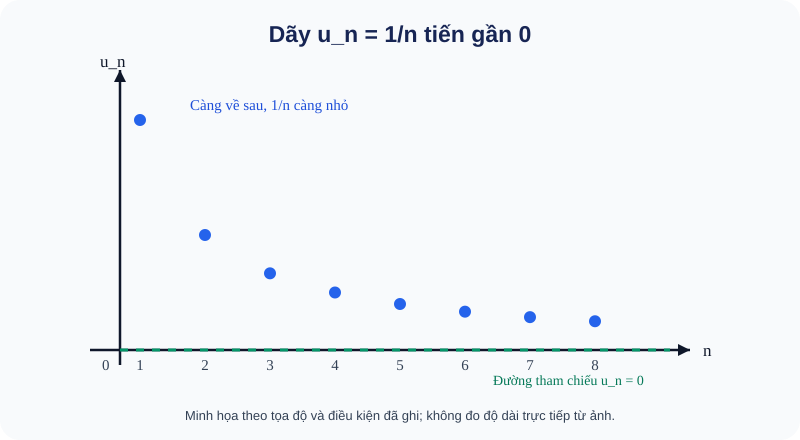
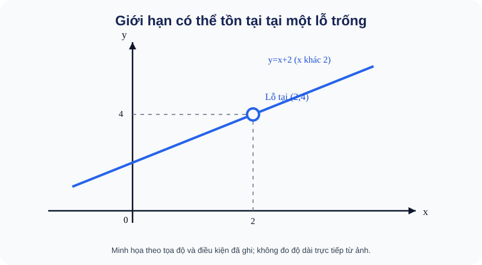
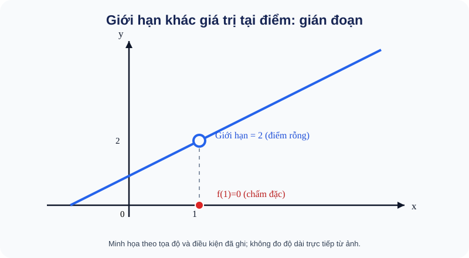

# Toán 11 SGK KNTT Tập 1 — Chương V: Giới hạn. Hàm số liên tục
## R00 pedagogical rewrite (Issue #691): S1 scope, RD0, D1 concept-first, D2 worked examples

**STATUS:** AUTHORING_WIP_ONLY; **NOT** a NotebookLM review source, NOT Academic PASS, NOT A1–A7, NOT a learner website.  
**Scope:** B15, B16, B17 and final SGK Chapter V exercise; independent SGK_CHAPTER_READINESS will be designed as separate protected RD1, NOT published here.  
**Source precedence:** SGK/SBT KNTT S1, Project 08 dual complete paths, 06 review handoff, 07 delta. Public digital scan of official SGK Toán 11 Tập 1, 2022 sample edition TOC and knowledge/skills boxes inspected for initial RD0; original owner S1 PDF and corresponding **SBT** chapter must be verified before source lock. Public browsing is provisional, not an assertion of owner scan provenance.

### Source map — keep boundaries correct

| Unit | Printed SGK pages | Source status |
|---|---|---|
| B15 — Giới hạn của dãy số | 104–110 | Provisional SGK scan TOC and content text |
| B16 — Giới hạn của hàm số | 111–118 | Provisional SGK scan TOC and content text |
| B17 — Hàm số liên tục | 119–122 | Provisional SGK scan TOC and content text |
| Bài tập cuối Chương V | **123 only** | Next heading at p124 is a SEPARATE experiential section |
| Hoạt động thực hành trải nghiệm | 124–129 | **Not part of SGK Chapter V chapter-end Readiness by default** |
| SBT Toán 11 Tập 1, B15–17 | **UNVERIFIED** | Must obtain original SBT exact printed pages, problems and solution pages |

Public cross-check: SGK Toán 11 T1 online TOC at https://media.metaisach.com/2025/09/toan-11-tap-1-ket-noi-tri-thuc-voi-cuoc-song-3c036587.pdf ; verify in owner original S1 before the final packet. Do not copy original textbook examples verbatim: examples below are original self-learning examples aligned to outcome structure.

## RD0. Expected learning outcome coverage (provisional IDs; 17 distinct)

| ID | Learning competency | Required assessment evidence |
|---|---|---|
| G11-B15-FINITE_SEQUENCE | Definition of finite sequence limit, approaching 0 or finite a | D1 + D2 + future Core |
| G11-B15-INFINITE_SEQUENCE | Recognize plus/minus infinity and no-limit divergent oscillation | D1 + comparison + future Practice |
| G11-B15-LIMIT_ARITHMETIC | Compute elementary limits with safe nonzero denominator, powers/signs | D1 + D2 + future Practice |
| G11-B15-GEOMETRIC | Infinite decreasing geometric progression: absolute value of q less than 1 | D1 + D2 + future Anchor |
| G11-B15-GEOMETRIC_APPLICATION | Sum a geometric series and interpret a modeled situation | D2 + future Application |
| G11-B16-LIMIT_AT_POINT | Finite limit at x0, independent of value f(x0) | D1 + D2 + future Core |
| G11-B16-ONE_SIDED | Left/right limits, equality criterion for two-sided limit | D1 + D2 + future Core/Practice |
| G11-B16-ALGEBRAIC_TECHNIQUES | Factorization, rationalization, denominator control | D1 + D2 + future Practice |
| G11-B16-LIMIT_AT_INFINITY | Limits x→±∞, leading terms and sign of radicals | D1 + D2 + future Practice |
| G11-B16-INFINITE_LIMIT | Signed infinite limits and conditions for quotients | D1 + D2 + future Core/Practice |
| G11-B16_REAL_CONTEXT | Interpret domain and limit of a modeled quantity | D2 + future Application |
| G11-B17-CONTINUITY_POINT | f(a) exists, finite limit equals f(a); classify removable/jump cases without overloading Core terms | D1 + D2 + future Core |
| G11-B17-CONTINUITY_INTERVAL | Continuity on open interval and endpoints of closed interval | D1 + D2 + future Practice |
| G11-B17-ELEMENTARY_CONTINUITY | Domain-sensitive continuity of elementary functions | D1 + D2 + future Core |
| G11-B17-CONTINUITY_OPERATIONS | Finite sums/products/quotients, nonzero denominator at point | D1 + D2 + future Practice |
| G11-B17-ZERO_EXISTENCE | Existence of a zero on a closed interval under continuity and opposite endpoint signs | D1 + D2 + future Written |
| G11-CHV-INTEGRATED | Chain: sequences → limits → continuity, compare candidate claims and conditions | Whole chapter Written + protected RD1 |

**Self-learning pedagogy:** D1 for B15–B17 was re-authored concept-first under Issue #691, with motivation, prerequisite bridge, intuition, precise definition, symbol conditions, first-step check. This remains an unreviewed WIP and does NOT mean D3–D6/RD1/complete chapter is ready.

**Outcome status:** RD0 AUTHORING DRAFT. A completed chapter needs a canonical public Core/Practice bank, multiple applications, shared Written/Anchor rubrics, original SVG/graphs, D6 HELP cards, protected RD1 distinct items, author QA, source custody, and ONE independent full-chapter review. Do not infer completeness from this matrix alone.

---

## B15 — D1. Giới hạn của dãy số (giảng từ trực giác đến định nghĩa)

### 1. Vì sao cần khái niệm "giới hạn"?

Em hãy nhìn dãy số: **1; 1/2; 1/3; 1/4; 1/5; ...**. Mỗi số hạng đều lớn hơn 0, nhưng càng về sau giá trị càng nhỏ. Nếu tiếp tục mãi, các số hạng **tiến gần đến 0**, dù không bắt buộc có số hạng nào bằng 0. Ta muốn mô tả chính xác chuyện "ngày càng gần" này, vì nó giúp hiểu những quá trình có thể tiếp tục vô hạn (ví dụ các phần tiết kiệm ngày càng nhỏ).

**Cầu nối kiến thức:** dãy số là các số xếp theo thứ tự u₁,u₂,u₃,...; chỉ số n là số thứ tự. Không phải giới hạn là một "số hạng cuối": dãy có thể không có số hạng cuối.

### 2. Quan sát trước khi định nghĩa

**Hình trực quan D5:** 

**Cách đọc hình:** Mỗi chấm ứng với một chỉ số n và giá trị uₙ=1/n. Các chấm càng về bên phải càng sát trục ngang uₙ=0 nhưng luôn ở phía trên. Vì vậy “tiến đến 0” KHÔNG có nghĩa “đến một số hạng cuối bằng 0”. Hãy quan sát điều này trước khi đọc ε và N trong định nghĩa.

Với u_n=1/n: u₁=1, u₂=0,5, u₁₀=0,1, u₁₀₀=0,01. Nếu chọn một vùng rất gần 0, chẳng hạn khoảng cách nhỏ hơn 0,01, từ khi n>100 trở đi **mọi** u_n đều nằm trong vùng ấy. Nếu em muốn gần hơn nữa, vẫn có thể chọn n đủ lớn. Đó là ý cốt lõi của "giới hạn bằng 0".

Không phải dãy nào cũng tiến gần một số. Với v_n=(−1)^n, các số hạng thay đổi liên tục −1,1,−1,1,..., không thể ngày càng ở sát một số cố định. Dãy này **không có giới hạn**, không phải "có giới hạn vô cực".

### 3. Phát biểu toán học và giải thích ký hiệu

Ta viết **lim_{n→∞}u_n=a** khi các số hạng từ một lúc đủ muộn trở đi có thể gần a tùy ý. Nói chặt chẽ: với mọi sai số ε>0 mà ta chọn, tồn tại một chỉ số N sao cho **mọi n≥N** đều thỏa **|u_n−a|<ε**.

- ε (đọc là *ép-si-lon*) chỉ một mức sai số dương tùy nhỏ, **không** phải số cố định do giáo viên chọn sẵn.
- N là mốc có thể phụ thuộc mức sai số ε; sau mốc đó **tất cả** số hạng đều gần a, không chỉ một vài số hạng.
- |u_n−a| là khoảng cách trên trục số từ số hạng u_n đến a.
- n→∞ nghĩa là xét các chỉ số n tăng mãi, **không** thay n bằng một số gọi là "vô cực".
- Khi a=0, điều kiện trở thành |u_n|<ε từ một lúc đủ muộn; muốn chứng minh lim u_n=a thường đưa về lim(u_n−a)=0.

**Ví dụ áp dụng định nghĩa:** Cho u_n=1/n và sai số ε>0. Chọn một số tự nhiên N lớn hơn 1/ε. Khi n≥N, 1/n≤1/N<ε, nên lim_{n→∞}1/n=0.

### 4. Giới hạn vô cực khác giới hạn hữu hạn thế nào?

Nếu u_n cuối cùng vượt **mọi mốc lớn** M>0, ta viết lim u_n=+∞; nếu u_n cuối cùng nhỏ hơn −M với mọi M>0, viết lim u_n=−∞. Đây là mô tả cách dãy lớn/nhỏ không bị chặn về một phía, **không phải cộng/trừ một số thực có tên "∞"**. Ví dụ u_n=n→+∞; còn (−1)^n n đổi dấu và có độ lớn tăng nên không có giới hạn theo hai nghĩa ±∞ vừa nêu.

### 5. Quy tắc tính được dùng khi nào?

Những giới hạn cơ bản: lim 1/n^p=0 với p>0; lim q^n=0 khi **|q|<1**. Nếu u_n→a, v_n→b **đều hữu hạn**, tổng/hiệu/tích có giới hạn lần lượt a±b, ab. Thương có giới hạn a/b **chỉ khi b≠0**, và mẫu v_n phải khác 0 từ một chỉ số đủ lớn. Nếu cả tử và mẫu tiến đến 0, không được lấy 0/0; hãy biến đổi biểu thức hoặc chọn phương pháp khác.

### 6. Vì sao có tổng của vô hạn số hạng?

Xét 5+5/4+5/16+... . Mỗi số hạng sau bằng **1/4** số hạng trước. Cộng lần lượt các số hạng đầu ta được những tổng riêng tăng dần, nhưng các phần tăng thêm nhỏ dần. Với cấp số nhân có số hạng đầu a và công bội q, khi **|q|<1** thì q^n→0; từ S_n=a(1−q^n)/(1−q) suy ra tổng vô hạn S=a/(1−q). Điều kiện |q|<1 không chỉ là chú thích: nó giải thích vì sao phần còn lại nhỏ dần.

**Tự thử trước bài tập:** Dãy 2+1/n tiến gần số nào? Tại sao không cần có số hạng nào đúng bằng số đó? Sau khi tự nghĩ, kiểm tra: tiến gần 2 vì 1/n→0. Đây là formative tự học, không ghi Skill Mastery.

### B15 — D2. Bốn ví dụ độc lập

**EX-G11-B15-01 — Giới hạn hữu hạn bằng chia bậc cao nhất.** Tính lim_{n→∞}(3n+1)/(n+4). Chia cả tử và mẫu cho n: (3+1/n)/(1+4/n)→3. Mẫu giới hạn 1 khác 0, do đó phép chia giới hạn hợp lệ. **Bẫy:** không được thay n=∞ như một số.

**EX-G11-B15-02 — Dao động và giới hạn 0.** Xét u_n=(−1)^n/n và v_n=(−1)^n. Ta có |u_n|≤1/n→0, nên u_n→0. Nhưng v_n có hai dãy con n chẵn, n lẻ lần lượt bằng 1 và −1, không thể có cùng giới hạn. **Bẫy:** dấu luân phiên không tự quyết định hội tụ.

**EX-G11-B15-03 — Tổng cấp số nhân lùi vô hạn.** Tính T=5+5/4+5/16+... . Ta có a=5, q=1/4, |q|<1; S=5/(1−1/4)=20/3. Thử tổng 3 số hạng đầu 105/16<20/3 để đối chiếu chiều tăng. **Bẫy:** không dùng công thức khi |q|≥1.

**EX-G11-B15-04 — Tình huống vận dụng.** Một thiết bị lần đầu tiết kiệm 120 đơn vị năng lượng, mỗi đợt sau chỉ tiết kiệm bằng 2/5 đợt liền trước. Tổng tiết kiệm lý thuyết sau vô hạn đợt: 120/(1−2/5)=200 đơn vị. Mô hình giả định công bội không đổi; số đợt thực tế hữu hạn thì tổng nhỏ hơn 200. **Bẫy:** phân biệt giới hạn mô hình và quá trình hữu hạn.

## B16 — D1. Giới hạn của hàm số (nhìn hành vi gần điểm trước khi tính)

### 1. Câu hỏi mở đầu: tại một điểm chưa tính được thì sao?

Xét f(x)=(x²−4)/(x−2). Em thử thế x=2: mẫu bằng 0, phép chia không xác định. Nhưng nếu xét **gần 2**, ta có bảng:

| x | 1,9 | 1,99 | 2,01 | 2,1 |
|---|---:|---:|---:|---:|
| f(x) | 3,9 | 3,99 | 4,01 | 4,1 |

Vì x≠2, ta có thể rút gọn f(x)=x+2. Khi x tiến về 2, các giá trị f(x) tiến về **4**, mặc dù chính f(2) **không tồn tại**. Khái niệm **giới hạn của hàm số** giúp mô tả xu hướng ở gần một điểm, không đòi biết giá trị ngay tại điểm ấy.

**Cầu nối:** Em đã biết đọc đồ thị và tính giá trị f(x) tại x có nghĩa. Bài này khác ở chỗ quan sát x **tiến gần** a, không chỉ thay đúng x=a vào công thức.

**Hình trực quan D5:** 

**Cách đọc hình:** Đường màu xanh đi tới độ cao 4 khi x tiến từ trái hoặc phải về 2; vòng tròn rỗng tại (2,4) cho biết hàm gốc **không có giá trị ở x=2**. Đừng nhầm lỗ trống với việc giới hạn không tồn tại.

### 2. Định nghĩa và kí hiệu

Viết **lim_{x→a}f(x)=L** nghĩa là: khi x thuộc miền xác định, khác a và tiến gần a, giá trị f(x) tiến gần L. **Giới hạn không nhất thiết bằng f(a)**, và f(a) có thể chưa được định nghĩa. Một hàm có giới hạn khi x tiến về a qua các giá trị thuộc miền xác định đủ gần a, dù nó có thể bị "thủng" ngay tại a.

- "Giới hạn trái" **x→a⁻** là xét các x<a tiến gần a; "giới hạn phải" **x→a⁺** là xét x>a.
- Nếu miền xác định cho phép tiến gần từ hai phía, một giới hạn hữu hạn hai phía bằng L **chỉ khi cả hai giới hạn một phía đều tồn tại và bằng L**.
- Không được suy giới hạn hai phía từ một phía duy nhất.

### 3. Nhìn đường đi của giá trị

Với g(x)=1/(x−1), khi x→1⁺ thì mẫu là số dương rất nhỏ, g(x)→+∞; khi x→1⁻ thì mẫu âm rất nhỏ, g(x)→−∞. Hai phía **không cùng tiến đến một giá trị hữu hạn**, nên không có giới hạn hữu hạn hai phía tại 1. Dấu của mẫu là thông tin thiết yếu, không phải chi tiết phụ.

Khi nói x→+∞, ta cho x tăng mãi; x→−∞ là cho x giảm mãi về phía âm. **Phải kiểm tra dấu trước khi đưa x ra ngoài căn:** √(x²)=|x|, bằng −x nếu x<0.

### 4. Cách lựa chọn phương pháp

- Thay trực tiếp cho kết quả hữu hạn hợp lệ → có thể dùng tính liên tục/phép toán giới hạn thích hợp.
- Nếu thay trực tiếp ra **0/0** → đây chưa phải đáp số; tìm nhân tử chung, phân tích hoặc nhân liên hợp.
- Nếu tử tiến đến giá trị khác 0, mẫu tiến đến 0 → xét dấu ở từng phía trước khi kết luận ±∞.
- Khi x→±∞ → chia lũy thừa trội hoặc nhân liên hợp; với căn phải nhớ dấu của |x|.

**Tự thử:** Nếu k(x)=(x²−9)/(x−3) với x≠3, em đoán lim_{x→3}k(x) bằng bao nhiêu? Hãy giải thích tại sao phép "rút gọn" chỉ dùng cho x≠3, không phải xác định k(3). (Đối chiếu sau khi nghĩ: 6.)

### B16 — D2. Bốn ví dụ độc lập

**EX-G11-B16-01 — Khử 0/0.** lim_{x→2}(x²−4)/(x−2) = lim_{x→2}(x+2)=4 vì x²−4=(x−2)(x+2) khi x≠2. Hàm gốc không xác định tại 2 nhưng giới hạn vẫn bằng 4.

**EX-G11-B16-02 — Giới hạn một phía khác nhau.** Với f(x)=1/(x−1), khi x→1^+ mẫu dương nhỏ, f(x)→+∞; khi x→1^- mẫu âm nhỏ, f(x)→−∞. Không tồn tại giới hạn hữu hạn hai phía ở 1. Phải ghi **riêng từng phía**, không cộng hai vô cực.

**EX-G11-B16-03 — Liên hợp tại +∞.** Tính lim_{x→+∞}(√(x²+x)−x). Nhân liên hợp được x/(√(x²+x)+x)=1/(√(1+1/x)+1)→1/2, vì x>0 khi x→+∞. **Bẫy:** rút x khỏi căn phải dùng dấu x.

**EX-G11-B16-04 — Dấu của căn khi x âm lớn.** lim_{x→−∞}√(x²+1)/x=lim_{x→−∞}(|x|√(1+1/x²))/x=−1. **Bẫy:** viết √(x²)=x cho x<0 là sai.

## B17 — D1. Hàm số liên tục (vì sao cần giá trị khớp với xu hướng?)

### 1. Từ giới hạn sang liên tục

Ở Bài 16, em thấy một hàm vẫn có thể tiến tới 4 khi x→2 nhưng không được định nghĩa tại x=2. Điều gì xảy ra nếu ta **bổ sung giá trị tại điểm ấy**?

Xét h(x)=x+2 khi x≠2. Nếu đặt h(2)=4, đồ thị không bị "lỗ" ở điểm tương ứng và giá trị tại 2 khớp với những giá trị xung quanh. Nếu cố tình đặt h(2)=0, x ở gần 2 vẫn làm h(x) gần 4, **nhưng h(2) lại bằng 0**: điểm riêng lẻ bị lệch khỏi xu hướng. Ta gọi hiện tượng "khớp" đó là **liên tục tại một điểm**.

**Cầu nối:** Cần biết ở Bài 16 rằng **lim_{x→a}f(x)** mô tả xu hướng ở gần a, còn **f(a)** là giá trị đúng tại a; hai thứ không tự động giống nhau.

**Hình trực quan D5:** 

**Cách đọc hình:** Vòng tròn rỗng ở (1,2) thể hiện xu hướng giá trị hàm khi x gần 1; chấm đỏ đặc ở (1,0) là giá trị f(1) thực sự. Hai độ cao không khớp nên hàm gián đoạn tại 1. Hình cho trực giác; định nghĩa dưới đây mới là tiêu chuẩn kiểm tra chính thức.

### 2. Định nghĩa và điều kiện

Hàm f **liên tục tại a** khi (1) a thuộc tập xác định để f(a) có nghĩa; (2) giới hạn hữu hạn lim_{x→a}f(x) tồn tại; (3) **lim_{x→a}f(x)=f(a)**. Cả ba ý đều phải kiểm tra. "Đồ thị vẽ một nét không nhấc bút" là trực giác giúp hình dung, **không thay thế** điều kiện toán học.

Với hàm cho bởi các công thức khác nhau ở các khoảng, hãy so sánh giới hạn trái, giới hạn phải và **giá trị thật tại điểm nối**. Ví dụ f(x)=x+1 khi x<1 và f(x)=m khi x≥1: phía trái tiến đến 2, phía phải tiến đến m, đồng thời f(1)=m. Liên tục tại 1 khi và chỉ khi m=2.

### 3. Từ điểm sang khoảng, đoạn

Liên tục trên khoảng (a,b) nghĩa là liên tục tại mọi điểm bên trong. Liên tục trên đoạn [a,b] còn cần:
- ở a: **lim_{x→a⁺}f(x)=f(a)**;
- ở b: **lim_{x→b⁻}f(x)=f(b)**.

Tại đầu mút không đòi hỏi phía nằm **ngoài** đoạn xác định. Ví dụ √x liên tục trên [0,9], kiểm tra tại 0 từ bên phải và tại 9 từ bên trái.

Các hàm đa thức liên tục trên R; hàm phân thức liên tục ở nơi mẫu khác 0. Tổng/hiệu/tích của các hàm liên tục là liên tục; thương chỉ khi **mẫu tại điểm xét khác 0**. Không được nói phân thức liên tục trên toàn R nếu mẫu có nghiệm thực.

### 4. Ứng dụng: biết có nghiệm dù chưa giải ra

Nếu f **liên tục trên cả đoạn [a,b]** và f(a), f(b) trái dấu, đồ thị phải đi qua trục hoành ở **ít nhất một điểm** nằm giữa a và b. Ta viết điều kiện f(a)f(b)<0 và kết luận tồn tại c∈(a,b) sao cho f(c)=0. Không thể kết luận chỉ có đúng một nghiệm; muốn chứng minh duy nhất phải có lập luận bổ sung.

Ví dụ f(x)=x³+x−1: f(0)=−1, f(1)=1, và f là đa thức liên tục trên [0,1]. Vậy tồn tại một nghiệm trong (0,1).

**Tự thử:** Giả sử f có giới hạn tại a bằng 3 nhưng f(a)=5. Hàm có liên tục tại a không? Vì sao? (Đối chiếu: không, vì giá trị tại a khác giới hạn.) Sau đó chuyển sang Core/Practice để luyện độc lập, không tính điểm mastery từ câu tự thử.

### B17 — D2. Bốn ví dụ độc lập

**EX-G11-B17-01 — Tham số ghép nhánh.** Cho f(x)=x+1 nếu x<1; f(x)=m nếu x≥1. Hai phía tại 1 lần lượt tiến tới 2 và m, f(1)=m. Để liên tục tại 1 cần và đủ m=2.

**EX-G11-B17-02 — Miền liên tục của phân thức.** Với h(x)=(x+1)/(x−2), mẫu chỉ bằng 0 tại x=2. Vì vậy h liên tục trên (−∞,2) và (2,+∞), không liên tục tại 2 do hàm không xác định. **Bẫy:** không thể gọi liên tục trên toàn R.

**EX-G11-B17-03 — Đoạn có đầu mút.** f(x)=√x liên tục trên [0,9]: với mọi điểm trong (0,9) hàm liên tục; lim_{x→0^+}√x=0=f(0), lim_{x→9^-}√x=3=f(9). Không xét lim_{x→0^-} trong miền R, vì căn không xác định khi x<0.

**EX-G11-B17-04 — Chứng minh tồn tại nghiệm.** Đặt g(x)=x³+x−1. Đa thức liên tục trên [0,1], g(0)=−1<0, g(1)=1>0. Vậy tồn tại c∈(0,1) sao cho g(c)=0. Kết luận mới là **ít nhất một nghiệm**; chưa dùng phép đổi dấu để suy duy nhất.

## Whole-chapter dependencies and author gates

1. S1 full-page and SBT printed-page verification from originals before any claim of complete Core coverage; identify where Chapter V ends at **p123**; p124–129 is not silently included in chapter Readiness.
2. Fill D3 original Core + Practice + Application on **all 17 outcomes**, written solution and unique item IDs; reuse skill and canonical Written/Anchor, never clone.
3. Complete D4 multi-step proof/modeling Written/Anchor and four-criterion rubrics, D5 original SVG convergence/asymptote/continuity graphs, D6 actionable stepwise HELP.
4. Create a **separate PRIVATE** RD1 chapter bank with one held-out original for every required outcome, unique item IDs, independent of public exposure. No private stem/key/rubric/public JS.
5. QA condition checks (nonzero denominator, q range, one-sided limits, x→−∞ sign), source-to-ID reconciliation, AP presentation plan and source custody. Then **ONE whole-chapter NotebookLM review** with both real Temp Markdown files plus short prompt as specified in source 06.
6. No Academic PASS or A6 handoff from this R00; no merge/deploy until owner explicit release authorization. Continue SGK-first sequence; Topic remains held.
