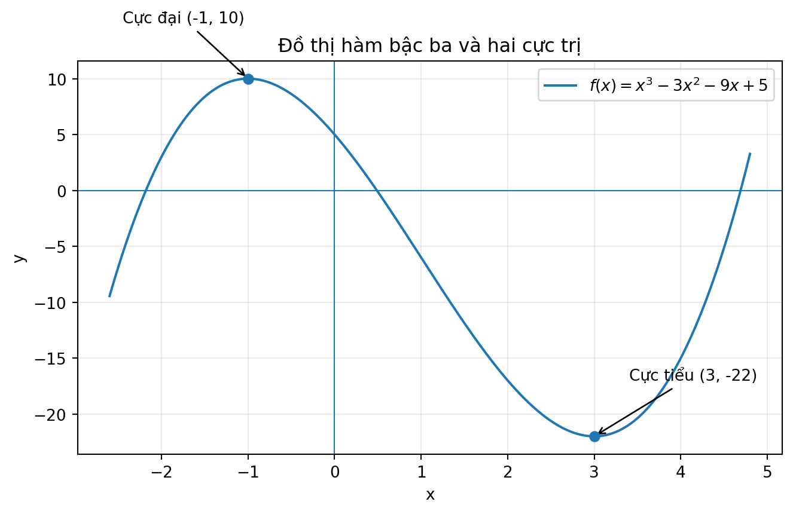
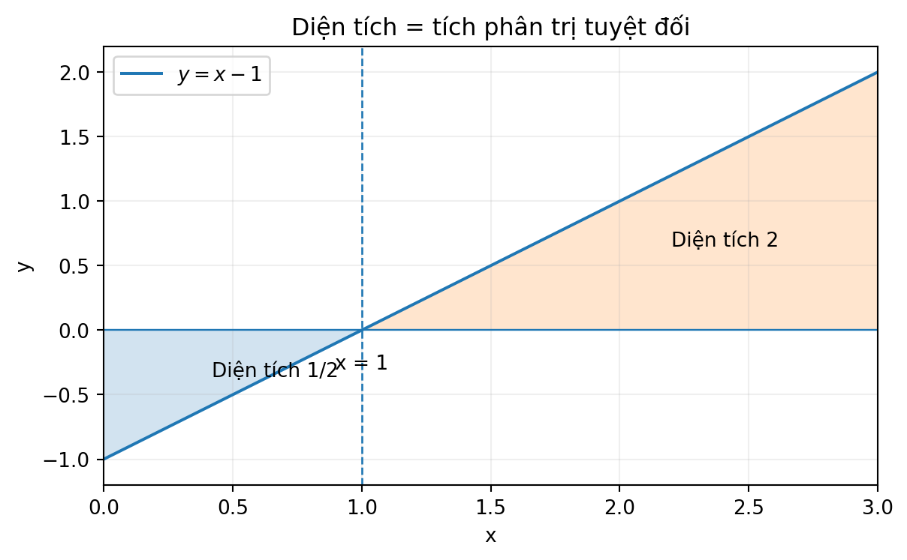
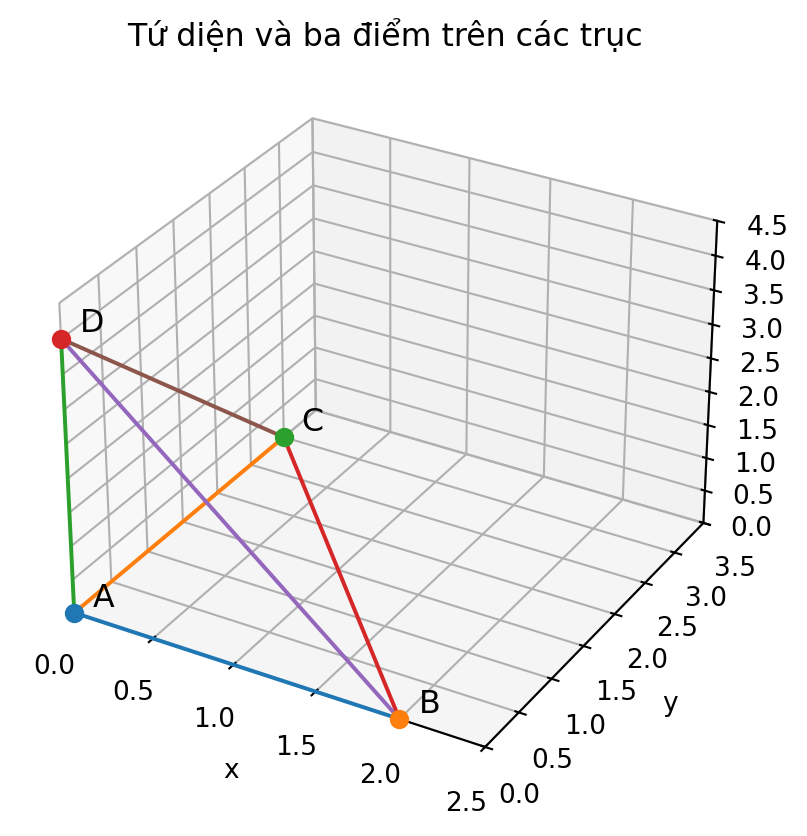
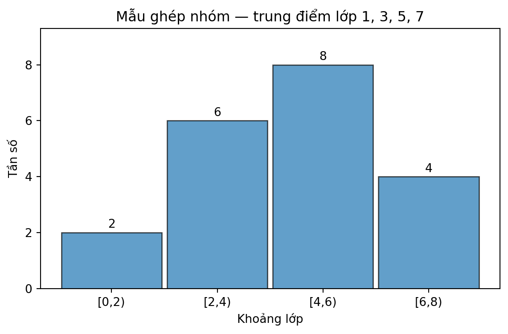

# SGK Toán 12 KNTT Tập Hai — BÀI TẬP ÔN TẬP CUỐI NĂM · R00 REVIEW CANDIDATE

PACKET_ID: G12-SGK-YEAREND-REVIEW-R00
STANDARD_ID: SLM-THPT-QUALITY-ONE
STANDARD_VERSION: 1.1.0
SOURCE: S1 SGK Toán 12 Kết nối tri thức Tập Hai, trang **in 90–93**, tương ứng **PDF1 92–95**.
SOURCE_S1_SHA256: 3c642f2e80d86d699ea62bbcabd0c3074fd5118def96e4b3b8ce1f9ead7f97bb
LEARNING_PATH: SGK_YEAR_END_REVIEW_CANDIDATE
RELEASE_SCOPE: SGK_YEAR_END_REVIEW_SUPPLEMENT_CANDIDATE
ACADEMIC_VERDICT: NOTEBOOKLM_PENDING
PEDAGOGICAL_VERDICT: NOTEBOOKLM_PENDING
CONTENT_READY: NO
ASSESSMENT_MODE: PUBLIC_REVIEW_CLIENT_SELF_CHECK_NO_MASTERY_CANDIDATE
RD1_PRIVATE_COUNT: 0
OFFICIAL_READINESS: NOT_CLAIMED
RELEASE_AUTHORIZATION: NO
MASTERY_ACTIVATION: NO

> **Giới hạn nguồn và bản quyền:** SGK gốc được kiểm trực tiếp trên 4 trang hình; 15 trắc nghiệm + 16 tự luận trong sách được phân loại theo nhóm phương pháp, **không sao chép nguyên văn** đề, hình hoặc đáp án SGK. Các bài dưới đây là câu mới được biên soạn, đáp án và rubric tự kiểm toán. Bài ôn tập cuối năm không phải Chương VII, không phải Chuyên đề, không tạo RD1 độc lập và không thay thế tự kiểm tra cuối chương của sáu chương SGK.

## Hướng dẫn học độc lập và ranh giới đánh giá

- Học theo sáu trạm chủ đề, không phải sáu bài SGK mới; mỗi trạm có vì sao học, tiền đề, bản chất, quy tắc và điều kiện, ví dụ giải có lý do, **Tự thử trước câu luyện**, câu trắc nghiệm/tự luận, cùng đường D6 khắc phục.
- **Tự thử:** làm trước khi mở đối chiếu. Đáp án và lời giải dưới đây là nội dung *nguồn tác giả* để RELEASE hiển thị **chỉ sau thao tác tự mở/Final Submit được phép**; không mặc định mở sẵn trên giao diện học sinh.
- Các câu trắc nghiệm là luyện ôn tập công khai, không được dùng như đề kiểm tra độc lập RD1; tự luận dùng rubric /5 để **tự đối chiếu** chứ không tự chấm chính thức. Không ghi Skill Mastery từ các câu này.
- Cần ôn kiến thức căn bản trước khi làm câu tổng hợp; các đường quay lại D6 là trong chính gói này, không bắt người học rời hành trình SGK hay sang Chuyên đề.
- Hình minh họa PNG là bản tự tạo, kèm diễn giải đọc hình; nếu không xem được hình, mô tả bằng lời và dữ liệu toán tương đương vẫn đủ để học.

## S1 RD0 — kết nối phạm vi cuối năm, không tạo Core mới

Bản gốc gồm 15 trắc nghiệm câu 1–15 và 16 tự luận câu 16–31. Ma trận họ dạng có ở tệp `Temp_G12_SGK_YEAREND_R00_OUTCOME_ITEM_MATRIX_20261104.md`; các số câu là **chỉ mục tham chiếu phạm vi S1**, không phải ID item mới, và câu trong gói không copy đầu bài.

## TRẠM O01 — Biến thiên, cực trị và tối ưu hàm số

LESSON_ID: G12-SGK-YE-TR01
OUTCOME_ID: G12-SGK-YE-O01

### Vì sao cần ôn lại?
Muốn chọn một phương án tối ưu, phải biết hàm có thể tăng/giảm và nơi cực trị, thay vì đoán từ vài điểm.

### Tiền đề cần có
Quy tắc đạo hàm, bảng xét dấu, tập xác định, GTLN/GTNN trên đoạn đóng.

### Bản chất trước công thức
Dấu đạo hàm mô tả xu hướng tại từng khoảng; GTLN/GTNN của một đoạn phải so sánh các giá trị biên và điểm dừng nằm trong miền.

### Quy tắc, điều kiện và khi nào dùng
$f\prime>0$ cho tăng, $f\prime<0$ cho giảm. Cực trị đổi dấu; tối ưu $[a,b]$ so sánh $f(a),f(b)$ và $f(x_i)$ với $f\prime(x_i)=0$ (hoặc điểm không khả vi thuộc đoạn).

### Vì sao chọn cách giải này? Giới hạn áp dụng
Từ điều kiện miền → xét dấu → ứng viên tối ưu → đối chiếu biên. Không dùng tiêu chí cực trị nếu hàm không liên tục hoặc ngoài miền.

### Ví dụ D2 — `EX-G12-SGK-YE-O01`
$h(x)=x^3-6x$. $h\prime=3(x^2-2)$, dấu dương khi $|x|>\sqrt2$, âm khi $|x|<\sqrt2$. Suy ra cực đại địa phương tại $x=-\sqrt2$, cực tiểu tại $x=\sqrt2$; tính $h(-\sqrt2)=4\sqrt2$, $h(\sqrt2)=-4\sqrt2$. Phải kiểm biên nếu hỏi GTLN/GTNN trên một đoạn.

### Tự thử trước Core — `TRY-G12-SGK-YE-O01`
**Tự làm:** Hàm $x^2-4x+5$ đạt GTNN trên $[0,3]$ tại đâu?

**SELF_REVEAL_ONLY — không hiển thị mặc định:** $x=2$, giá trị nhỏ nhất là $1$. Đạo hàm $2x-4$ đổi từ âm sang dương tại $2$; kiểm biên $f(0)=5$, $f(3)=2$.

### Hình D5 — `FIG-G12-SGK-YE-O01`

**Hướng dẫn đọc hình, nhãn, điều kiện:** Trục ngang là $x$, trục đứng là $y$. Đường cong có hai điểm đánh dấu $(-1,10)$ và $(3,-22)$ của ví dụ Written W01; đỉnh cao là cực đại **địa phương**, không phải GTLN toàn trục. Các nhánh cho thấy một điểm cực tiểu có thể mang giá trị âm.

### Ngân hàng luyện tập thuộc O01
Các câu được nhóm theo trạm ở các phần A/B dưới đây; ID canonical không nhân đôi. Mọi đáp án/lời giải phải được che trước thao tác tự đối chiếu trên website.

## TRẠM O02 — Nguyên hàm và tích phân xác định

LESSON_ID: G12-SGK-YE-TR02
OUTCOME_ID: G12-SGK-YE-O02

### Vì sao cần ôn lại?
Làm phép toán ngược đạo hàm hoặc cộng các thay đổi nhỏ có dấu cần phân biệt nguyên hàm, giá trị tích phân và diện tích hình học.

### Tiền đề cần có
Đạo hàm các hàm sơ cấp; $\ln x$ khi $x>0$; ý nghĩa Newton–Leibniz; trị tuyệt đối.

### Bản chất trước công thức
Nguyên hàm không duy nhất (khác hằng số); tích phân xác định là hiệu giá trị của một nguyên hàm, có thể âm. Diện tích luôn không âm nên cần $|f|$ khi cắt trục.

### Quy tắc, điều kiện và khi nào dùng
$F\prime=f\Rightarrow\int f(x)dx=F(x)+C$; $\int_a^b f(x)dx=F(b)-F(a)$ nếu điều kiện áp dụng thỏa. Diện tích với $Ox$ là $\int_a^b|f(x)|dx$.

### Vì sao chọn cách giải này? Giới hạn áp dụng
Kiểm liên tục/miền trước khi lấy nguyên hàm; vẽ dấu nếu hỏi diện tích. Không dùng Newton–Leibniz xuyên điểm không xác định.

### Ví dụ D2 — `EX-G12-SGK-YE-O02`
$f(x)=2x+1$, $F(x)=x^2+x$ nên $\int_0^2(2x+1)dx=F(2)-F(0)=6$. Kiểm $F\prime=2x+1$ để tránh thiếu hằng.

### Tự thử trước Core — `TRY-G12-SGK-YE-O02`
**Tự làm:** Tính $\int_0^1 4x^3dx$ và nêu có cần $+C$ trong đáp số không.

**SELF_REVEAL_ONLY — không hiển thị mặc định:** $[x^4]_0^1=1$. Tích phân xác định là một số nên không ghi $+C$.

### Hình D5 — `FIG-G12-SGK-YE-O02`

**Hướng dẫn đọc hình, nhãn, điều kiện:** Đường $y=x-1$ cắt $Ox$ ở $x=1$. Phần dưới trục trên $[0,1]$ đóng góp diện tích $1/2$ **dương**, phần trên trên $[1,3]$ là $2$; tổng diện tích $5/2$, khác tích phân có dấu.

### Ngân hàng luyện tập thuộc O02
Các câu được nhóm theo trạm ở các phần A/B dưới đây; ID canonical không nhân đôi. Mọi đáp án/lời giải phải được che trước thao tác tự đối chiếu trên website.

## TRẠM O03 — Ứng dụng tích phân: chuyển động, diện tích, khối tròn xoay

LESSON_ID: G12-SGK-YE-TR03
OUTCOME_ID: G12-SGK-YE-O03

### Vì sao cần ôn lại?
Một vận tốc biến thiên và một hình khối cong không tính đúng bằng công thức hình chữ nhật hay lăng trụ thông thường.

### Tiền đề cần có
Tích phân xác định; dấu của hàm; bán kính khi quay quanh $Ox$; đơn vị m, m/s, m³.

### Bản chất trước công thức
Tích phân cộng dồn đại lượng: quãng đường là cộng độ lớn vận tốc; diện tích cộng dải dọc; thể tích cộng các đĩa có diện tích $\pi r^2$.

### Quy tắc, điều kiện và khi nào dùng
$S_{\text{chuyển động}}=\int_a^b|v(t)|dt$, $S_{\text{giữa hai đồ thị}}=\int_a^b|f-g|dx$, $V_{Ox}=\pi\int_a^b r(x)^2dx$ (cần miền và bán kính đúng).

### Vì sao chọn cách giải này? Giới hạn áp dụng
Chọn phương pháp theo thứ cần tính: tổng thay đổi có dấu ≠ quãng đường; diện tích cần trên–dưới; thể tích khi quay cần bình phương bán kính, không bình phương tích phân.

### Ví dụ D2 — `EX-G12-SGK-YE-O03`
Quay miền dưới $y=\sqrt{x}$, $0\le x\le2$ quanh $Ox$: đĩa có $r^2=x$, nên $V=\pi\int_0^2x\,dx=2\pi$ đơn vị thể tích. Không dùng $\int\sqrt{x}dx$ để tính thể tích.

### Tự thử trước Core — `TRY-G12-SGK-YE-O03`
**Tự làm:** Một vật chạy $v(t)=-2$ m/s trong 3 s: độ dời và quãng đường bằng bao nhiêu?

**SELF_REVEAL_ONLY — không hiển thị mặc định:** Độ dời $-6$ m; quãng đường $6$ m vì tích phân $|v|$.

### Hình/bảng và hình dung thay thế
Dùng hình O02 đọc dấu để phân biệt độ dời và quãng đường/diện tích; khi tính thể tích quay, hình học là đĩa vuông góc trục $Ox$.

### Ngân hàng luyện tập thuộc O03
Các câu được nhóm theo trạm ở các phần A/B dưới đây; ID canonical không nhân đôi. Mọi đáp án/lời giải phải được che trước thao tác tự đối chiếu trên website.

## TRẠM O04 — Vectơ, hình học Oxyz và kiểm mô hình hình chiếu

LESSON_ID: G12-SGK-YE-TR04
OUTCOME_ID: G12-SGK-YE-O04

### Vì sao cần ôn lại?
Định vị, đo góc, tính khoảng cách hay suy ra bóng của vật trong không gian cần mô hình bằng tọa độ và phương trình, không chỉ một góc nhìn 2D.

### Tiền đề cần có
Vectơ tọa độ, tích vô hướng, pháp tuyến mặt phẳng, tham số đường thẳng; độ dài, định thức.

### Bản chất trước công thức
Một đường thẳng được xác định bằng điểm và hướng; mặt phẳng được xác định bằng điểm và pháp tuyến. Phép chiếu là giao của tia/đường với mặt phẳng; hình chiếu không tự chứng minh giao nhau trong 3D.

### Quy tắc, điều kiện và khi nào dùng
$P: ax+by+cz+d=0$ có pháp tuyến $(a,b,c)$; $d(X,P)=|ax_0+by_0+cz_0+d|/\sqrt{a^2+b^2+c^2}$; $\sin(\angle(d,P))=|\vec u\cdot\vec n|/(\|u\|\|n\|)$.

### Vì sao chọn cách giải này? Giới hạn áp dụng
Xác định quan hệ hình học trước khi viết tọa độ. Muốn kiểm giao duy nhất giữa đường–mặt phẳng, xét $\vec u\cdot\vec n\ne0$. Với bóng chiếu, kiểm tham số tia hợp lệ.

### Ví dụ D2 — `EX-G12-SGK-YE-O04`
Mặt phẳng đi qua $M(1,0,1)$ có pháp tuyến $(1,-2,2)$: $(x-1)-2y+2(z-1)=0$, tức $x-2y+2z-3=0$. Thế $M$ vào để kiểm, vì đúng pháp tuyến thôi chưa đủ.

### Tự thử trước Core — `TRY-G12-SGK-YE-O04`
**Tự làm:** Tính tích vô hướng của $u=(1,-1,2)$ và $v=(2,2,0)$; suy ra quan hệ góc.

**SELF_REVEAL_ONLY — không hiển thị mặc định:** $u\cdot v=2-2+0=0$, hai vectơ khác $0$ nên vuông góc.

### Hình D5 — `FIG-G12-SGK-YE-O04`

**Hướng dẫn đọc hình, nhãn, điều kiện:** Điểm $A$ ở gốc, $B,C,D$ lần lượt nằm trên ba trục tại hoành 2, tung 3, cao 4. Mặt nghiêng qua $B,C,D$ có phương trình $6x+4y+3z=12$; thể tích tứ diện $ABCD=4$. Không lấy độ dài của cạnh nghiêng làm chiều cao từ gốc đến mặt.

### Ngân hàng luyện tập thuộc O04
Các câu được nhóm theo trạm ở các phần A/B dưới đây; ID canonical không nhân đôi. Mọi đáp án/lời giải phải được che trước thao tác tự đối chiếu trên website.

## TRẠM O05 — Thống kê mẫu số liệu ghép nhóm

LESSON_ID: G12-SGK-YE-TR05
OUTCOME_ID: G12-SGK-YE-O05

### Vì sao cần ôn lại?
Dữ liệu đã ghép khoảng không còn từng số đo gốc, nên tính trung bình và độ phân tán đòi hỏi xấp xỉ có giải thích.

### Tiền đề cần có
Khoảng lớp, tần số, trung điểm lớp, trung bình cộng và bình phương trung bình.

### Bản chất trước công thức
Lấy trung điểm lớp thay cho mỗi quan sát để ước lượng. Sự phân tán đo khoảng cách các đại diện đến trung bình; không nên coi kết quả xấp xỉ là dữ liệu chính xác ban đầu.

### Quy tắc, điều kiện và khi nào dùng
$N=\sum n_i$; $\bar x\approx\sum n_im_i/N$; $s^2\approx\sum n_i m_i^2/N-\bar x^2$, $s=\sqrt{s^2}$ với quy ước chia $N$ dùng ở đây.

### Vì sao chọn cách giải này? Giới hạn áp dụng
Tính đúng điểm giữa/tần số trước, nêu quy ước mẫu số $N$. Nếu chỉ biết các lớp, không thể khôi phục chính xác từng giá trị gốc.

### Ví dụ D2 — `EX-G12-SGK-YE-O05`
Hai lớp $[0,2)$ và $[2,4)$ có tần số $2,1$, trung điểm $1,3$. Trung bình xấp xỉ $(2\cdot1+1\cdot3)/3=5/3$. Nếu chưa có dữ liệu đơn lẻ, không được khẳng định trung bình này là chính xác.

### Tự thử trước Core — `TRY-G12-SGK-YE-O05`
**Tự làm:** Các lớp $[2,4)$, $[4,6)$ có tần số $1,3$. Trung bình xấp xỉ bằng bao nhiêu?

**SELF_REVEAL_ONLY — không hiển thị mặc định:** Trung điểm $3,5$, nên $\bar x\approx(3+3\cdot5)/4=4.5$.

### Hình D5 — `FIG-G12-SGK-YE-O05`

**Hướng dẫn đọc hình, nhãn, điều kiện:** Bốn cột là bốn khoảng $[0,2)$, $[2,4)$, $[4,6)$, $[6,8)$; chiều cao lần lượt 2,6,8,4. Khi tính trung bình, thay lớp bởi trung điểm 1,3,5,7; phân biệt tần số và giá trị giữa lớp.

### Ngân hàng luyện tập thuộc O05
Các câu được nhóm theo trạm ở các phần A/B dưới đây; ID canonical không nhân đôi. Mọi đáp án/lời giải phải được che trước thao tác tự đối chiếu trên website.

## TRẠM O06 — Xác suất có điều kiện và Bayes

LESSON_ID: G12-SGK-YE-TR06
OUTCOME_ID: G12-SGK-YE-O06

### Vì sao cần ôn lại?
Sau khi biết có kết quả kiểm tra hay một biến cố đã xảy ra, không gian khả năng thay đổi: xác suất ban đầu không còn là xác suất cần hỏi.

### Tiền đề cần có
Biến cố, giao/hợp, xác suất toàn phần, phân hoạch, Bayes; không hoàn lại.

### Bản chất trước công thức
$P(A|B)$ trả lời câu hỏi về $A$ khi **đã biết $B$**; đảo thứ tự điều kiện có thể cho số rất khác. Lựa chọn không hoàn lại làm kết quả lần sau phụ thuộc lần trước.

### Quy tắc, điều kiện và khi nào dùng
$P(A|B)=P(A\cap B)/P(B)$ ($P(B)>0$); $P(A|B)=P(B|A)P(A)/P(B)$, với $P(B)$ từ xác suất toàn phần.

### Vì sao chọn cách giải này? Giới hạn áp dụng
Viết rõ điều kiện ở mẫu số, phân nhánh theo các khả năng đầy đủ; không nhầm $P(B|A)$ và $P(A|B)$. Kiểm các xác suất thành phần cộng thành 1.

### Ví dụ D2 — `EX-G12-SGK-YE-O06`
Chọn nhóm $A$ với xác suất $1/3$, nhóm $B$ với $2/3$. Một tín hiệu xuất hiện với xác suất $3/4$ ở $A$ và $1/2$ ở $B$. Khi thấy tín hiệu, $P(A|E)=((1/3)(3/4))/((1/3)(3/4)+(2/3)(1/2))=(1/4)/(7/12)=3/7$.

### Tự thử trước Core — `TRY-G12-SGK-YE-O06`
**Tự làm:** Nếu trong 12 người có 8 người chọn món A và 5 người chọn cả A lẫn B, biết người được chọn thuộc A, xác suất họ cũng chọn B là gì?

**SELF_REVEAL_ONLY — không hiển thị mặc định:** $5/8$ (điều kiện A có 8 người).

### Hình/bảng và hình dung thay thế
Sơ đồ hai nhánh điều kiện mô tả bằng lời: nhánh chọn nhóm/hộp trước, nhánh tín hiệu/rút thăm sau; đảo điều kiện bằng Bayes.

### Ngân hàng luyện tập thuộc O06
Các câu được nhóm theo trạm ở các phần A/B dưới đây; ID canonical không nhân đôi. Mọi đáp án/lời giải phải được che trước thao tác tự đối chiếu trên website.

## PHẦN A — 15 CÂU TRẮC NGHIỆM TỰ BIÊN SOẠN (PUBLIC FORMATIVE)

> Một câu — một canonical item ID. Không dùng điểm phần A làm Readiness/Mastery.

### THPT-G12-YE-M01 — CORE / nhận biết

OUTCOME_ID: G12-SGK-YE-O01
SKILL_ID: YE-O01
PLACEMENT: YEAR_END_REVIEW_FORMATIVE

**Đề:** Cho $f(x)=x^3-3x^2-9x+4$. Trên khoảng nào $f$ nghịch biến?

- **A.** $(-\infty,-1)$
- **B.** $(-1,3)$
- **C.** $(3,+\infty)$
- **D.** $(-\infty,3)$

**ANSWER_KEY (POST_SUBMIT_ONLY): B.**

**WORKED_SOLUTION (POST_SUBMIT_ONLY):** $f\prime(x)=3x^2-6x-9=3(x+1)(x-3)$. Đạo hàm âm đúng khi $-1<x<3$; do đó đáp án B.

**D6 ERROR_TRAP:** Không bỏ dấu ở khoảng giữa hai nghiệm đạo hàm.

### THPT-G12-YE-M02 — PRACTICE / thông hiểu

OUTCOME_ID: G12-SGK-YE-O01
SKILL_ID: YE-O01
PLACEMENT: YEAR_END_REVIEW_FORMATIVE

**Đề:** Tìm giá trị lớn nhất của $g(x)=x^2-6x+12$ trên $[1,5]$.

- **A.** $3$
- **B.** $5$
- **C.** $7$
- **D.** $9$

**ANSWER_KEY (POST_SUBMIT_ONLY): C.**

**WORKED_SOLUTION (POST_SUBMIT_ONLY):** $g\prime(x)=2(x-3)$. So sánh $g(1)=7$, $g(3)=3$, $g(5)=7$ nên giá trị lớn nhất là $7$ tại hai đầu mút.

**D6 ERROR_TRAP:** Điểm cực tiểu $x=3$ không cho GTLN trên đoạn.

### THPT-G12-YE-M03 — PRACTICE / thông hiểu

OUTCOME_ID: G12-SGK-YE-O01
SKILL_ID: YE-O01
PLACEMENT: YEAR_END_REVIEW_FORMATIVE

**Đề:** Đồ thị $y=(2x^2+1)/(x^2-4)$ có bao nhiêu đường tiệm cận phân biệt?

- **A.** $1$
- **B.** $2$
- **C.** $3$
- **D.** $4$

**ANSWER_KEY (POST_SUBMIT_ONLY): C.**

**WORKED_SOLUTION (POST_SUBMIT_ONLY):** Mẫu bằng $0$ tại $x=\pm2$, tử đều bằng $9\ne0$: hai tiệm cận đứng $x=2$ và $x=-2$. Bậc tử và mẫu bằng nhau, tỉ số hệ số cao nhất bằng $2$: tiệm cận ngang $y=2$. Tổng là $3$.

**D6 ERROR_TRAP:** Không đếm hai nhánh của cùng một tiệm cận thành hai đường.

### THPT-G12-YE-M04 — APPLICATION / vận dụng

OUTCOME_ID: G12-SGK-YE-O01
SKILL_ID: YE-O01
PLACEMENT: YEAR_END_REVIEW_FORMATIVE

**Đề:** Một hàm khả vi có bảng dấu $f\prime>0$ trên $(-\infty,0)$ và $(2,+\infty)$, $f\prime<0$ trên $(0,2)$, với $f(0)=3$, $f(2)=-1$. Điểm cực tiểu là điểm nào?

- **A.** $(0,3)$
- **B.** $(2,-1)$
- **C.** $(0,-1)$
- **D.** $(2,3)$

**ANSWER_KEY (POST_SUBMIT_ONLY): B.**

**WORKED_SOLUTION (POST_SUBMIT_ONLY):** Tại $x=2$ đạo hàm đổi dấu âm sang dương, nên $x=2$ là cực tiểu và tọa độ điểm là $(2,-1)$.

**D6 ERROR_TRAP:** Xét đổi dấu của đạo hàm, không đoán theo độ lớn của hai giá trị.

### THPT-G12-YE-M05 — CORE / nhận biết

OUTCOME_ID: G12-SGK-YE-O02
SKILL_ID: YE-O02
PLACEMENT: YEAR_END_REVIEW_FORMATIVE

**Đề:** Với $x>0$, họ nguyên hàm của $3x^2-4/x$ là

- **A.** $x^3-4x+C$
- **B.** $x^3-4\ln x+C$
- **C.** $6x-4\ln x+C$
- **D.** $x^3+4\ln x+C$

**ANSWER_KEY (POST_SUBMIT_ONLY): B.**

**WORKED_SOLUTION (POST_SUBMIT_ONLY):** Vì $(x^3)\prime=3x^2$ và $(\ln x)\prime=1/x$ khi $x>0$, họ nguyên hàm là $x^3-4\ln x+C$.

**D6 ERROR_TRAP:** Điều kiện $x>0$ cho phép dùng $\ln x$ thay vì $\ln|x|$.

### THPT-G12-YE-M06 — PRACTICE / thông hiểu

OUTCOME_ID: G12-SGK-YE-O02
SKILL_ID: YE-O02
PLACEMENT: YEAR_END_REVIEW_FORMATIVE

**Đề:** Giá trị $\int_0^2(3x^2-2x)\,dx$ là

- **A.** $0$
- **B.** $2$
- **C.** $4$
- **D.** $8$

**ANSWER_KEY (POST_SUBMIT_ONLY): C.**

**WORKED_SOLUTION (POST_SUBMIT_ONLY):** Nguyên hàm $x^3-x^2$. Tích phân bằng $(8-4)-0=4$.

**D6 ERROR_TRAP:** Tích phân có dấu, không thay bằng diện tích tuyệt đối nếu hàm đổi dấu.

### THPT-G12-YE-M07 — APPLICATION / vận dụng

OUTCOME_ID: G12-SGK-YE-O02
SKILL_ID: YE-O02
PLACEMENT: YEAR_END_REVIEW_FORMATIVE

**Đề:** Diện tích giữa $y=x-1$, trục $Ox$ và hai đường $x=0$, $x=3$ là

- **A.** $3/2$
- **B.** $2$
- **C.** $7/2$
- **D.** $5/2$

**ANSWER_KEY (POST_SUBMIT_ONLY): D.**

**WORKED_SOLUTION (POST_SUBMIT_ONLY):** Hàm đổi dấu tại $x=1$. Diện tích $S=\int_0^1(1-x)dx+\int_1^3(x-1)dx=1/2+2=5/2$.

**D6 ERROR_TRAP:** Không được lấy giá trị tích phân có dấu $\int_0^3(x-1)dx$ làm diện tích.

### THPT-G12-YE-M08 — APPLICATION / vận dụng

OUTCOME_ID: G12-SGK-YE-O03
SKILL_ID: YE-O03
PLACEMENT: YEAR_END_REVIEW_FORMATIVE

**Đề:** Quay miền dưới đồ thị $y=\sqrt{3x}$, phía trên $Ox$, $0\le x\le3$ quanh $Ox$; thể tích bằng

- **A.** $9\pi$
- **B.** $27\pi/2$
- **C.** $27\pi$
- **D.** $9\pi/2$

**ANSWER_KEY (POST_SUBMIT_ONLY): B.**

**WORKED_SOLUTION (POST_SUBMIT_ONLY):** Bán kính đĩa tại $x$ là $\sqrt{3x}$, nên $V=\pi\int_0^3(\sqrt{3x})^2dx=3\pi(9/2)=27\pi/2$.

**D6 ERROR_TRAP:** Dùng bình phương bán kính khi quay quanh $Ox$.

### THPT-G12-YE-M09 — CORE / nhận biết

OUTCOME_ID: G12-SGK-YE-O04
SKILL_ID: YE-O04
PLACEMENT: YEAR_END_REVIEW_FORMATIVE

**Đề:** Cho năm điểm $A_1,\dots,A_5$ trong không gian và $G$ thỏa $\sum_{i=1}^5\overrightarrow{GA_i}=\vec0$. Với điểm $M$ bất kì, tổng $\sum_{i=1}^5\overrightarrow{MA_i}$ bằng

- **A.** $\overrightarrow{MG}$
- **B.** $2\overrightarrow{MG}$
- **C.** $4\overrightarrow{MG}$
- **D.** $5\overrightarrow{MG}$

**ANSWER_KEY (POST_SUBMIT_ONLY): D.**

**WORKED_SOLUTION (POST_SUBMIT_ONLY):** Vì $\overrightarrow{MA_i}=\overrightarrow{MG}+\overrightarrow{GA_i}$ và $\sum_i\overrightarrow{GA_i}=0$, tổng là $5\overrightarrow{MG}$.

**D6 ERROR_TRAP:** Vẫn phải cộng vectơ, không cộng độ dài.

### THPT-G12-YE-M10 — PRACTICE / thông hiểu

OUTCOME_ID: G12-SGK-YE-O04
SKILL_ID: YE-O04
PLACEMENT: YEAR_END_REVIEW_FORMATIVE

**Đề:** Cho $\vec a=(2,-1,3)$ và $\vec b=(-1,4,2)$. Kết luận nào đúng?

- **A.** $\vec a\perp\vec b$
- **B.** $\vec a$ cùng phương $\vec b$
- **C.** Góc giữa hai vectơ tù
- **D.** Hai vectơ bằng nhau

**ANSWER_KEY (POST_SUBMIT_ONLY): A.**

**WORKED_SOLUTION (POST_SUBMIT_ONLY):** Tích vô hướng $\vec a\cdot\vec b=2(-1)+(-1)4+3(2)=0$. Hai vectơ đều khác $0$, nên vuông góc.

**D6 ERROR_TRAP:** Tính tích vô hướng từ ba cặp tọa độ tương ứng, không xét từng dấu riêng.

### THPT-G12-YE-M11 — PRACTICE / thông hiểu

OUTCOME_ID: G12-SGK-YE-O04
SKILL_ID: YE-O04
PLACEMENT: YEAR_END_REVIEW_FORMATIVE

**Đề:** Đường thẳng có vectơ chỉ phương $(1,2,2)$; mặt phẳng có vectơ pháp tuyến $(2,-1,2)$. Nếu $\alpha$ là góc nhọn giữa đường và mặt phẳng thì $\sin\alpha$ bằng

- **A.** $4/9$
- **B.** $2/3$
- **C.** $\sqrt5/9$
- **D.** $8/9$

**ANSWER_KEY (POST_SUBMIT_ONLY): A.**

**WORKED_SOLUTION (POST_SUBMIT_ONLY):** $|\vec u\cdot\vec n|=|2-2+4|=4$, $\|\vec u\|=3$, $\|\vec n\|=3$. Do đó $\sin\alpha=4/9$; góc đường–mặt phẳng không dùng công thức cos giữa đường và pháp tuyến.

**D6 ERROR_TRAP:** Góc đường với pháp tuyến là góc phụ của góc đường–mặt phẳng.

### THPT-G12-YE-M12 — APPLICATION / vận dụng

OUTCOME_ID: G12-SGK-YE-O04
SKILL_ID: YE-O04
PLACEMENT: YEAR_END_REVIEW_FORMATIVE

**Đề:** Mặt phẳng đi qua $A(1,0,-2)$ và có pháp tuyến $(2,-1,3)$ có phương trình nào?

- **A.** $2x-y+3z-4=0$
- **B.** $2x+y+3z+4=0$
- **C.** $2x-y+3z+4=0$
- **D.** $x-2y+3z+4=0$

**ANSWER_KEY (POST_SUBMIT_ONLY): C.**

**WORKED_SOLUTION (POST_SUBMIT_ONLY):** $2(x-1)-y+3(z+2)=0$ rút gọn thành $2x-y+3z+4=0$. Thử thế tọa độ $A$ để kiểm.

**D6 ERROR_TRAP:** Hằng số phải được xác định bằng tọa độ điểm, không sao chép pháp tuyến tùy ý.

### THPT-G12-YE-M13 — PRACTICE / thông hiểu

OUTCOME_ID: G12-SGK-YE-O05
SKILL_ID: YE-O05
PLACEMENT: YEAR_END_REVIEW_FORMATIVE

**Đề:** Một bảng tần số ghép nhóm có các khoảng $[4,8)$, $[8,12)$, $[12,16)$. Khoảng biến thiên theo biên lớp của mẫu này là

- **A.** $8$
- **B.** $12$
- **C.** $16$
- **D.** $3$

**ANSWER_KEY (POST_SUBMIT_ONLY): B.**

**WORKED_SOLUTION (POST_SUBMIT_ONLY):** Khoảng biến thiên xấp xỉ theo biên lớp là biên trên lớp cuối trừ biên dưới lớp đầu: $16-4=12$.

**D6 ERROR_TRAP:** Không lấy số nhóm hay tổng tần số làm khoảng biến thiên.

### THPT-G12-YE-M14 — PRACTICE / thông hiểu

OUTCOME_ID: G12-SGK-YE-O06
SKILL_ID: YE-O06
PLACEMENT: YEAR_END_REVIEW_FORMATIVE

**Đề:** Tung hai xúc xắc cân đối, phân biệt xúc xắc thứ nhất/thứ hai. Biết tổng hai mặt lớn hơn $9$, xác suất cả hai mặt đều chẵn là

- **A.** $1/4$
- **B.** $1/3$
- **C.** $1/2$
- **D.** $2/3$

**ANSWER_KEY (POST_SUBMIT_ONLY): C.**

**WORKED_SOLUTION (POST_SUBMIT_ONLY):** Có 6 kết quả có thứ tự với tổng $10,11,12$: $(4,6),(5,5),(6,4),(5,6),(6,5),(6,6)$. Chỉ $(4,6),(6,4),(6,6)$ có hai mặt chẵn: $P(\text{cả hai chẵn}|\text{tổng}>9)=3/6=1/2$.

**D6 ERROR_TRAP:** Điều kiện tổng lớn hơn $9$ thu hẹp mẫu còn 6 cặp có thứ tự; không chia cho 36.

### THPT-G12-YE-M15 — APPLICATION / vận dụng

OUTCOME_ID: G12-SGK-YE-O06
SKILL_ID: YE-O06
PLACEMENT: YEAR_END_REVIEW_FORMATIVE

**Đề:** Chọn hộp $A$ với xác suất $2/5$, hộp $B$ với xác suất $3/5$. Xác suất lấy bi đỏ tương ứng là $3/4$ từ $A$ và $1/2$ từ $B$. Biết đã lấy bi đỏ, xác suất hộp được chọn là $A$ bằng

- **A.** $1/2$
- **B.** $2/5$
- **C.** $3/4$
- **D.** $3/5$

**ANSWER_KEY (POST_SUBMIT_ONLY): A.**

**WORKED_SOLUTION (POST_SUBMIT_ONLY):** $P(A|R)=\frac{(2/5)(3/4)}{(2/5)(3/4)+(3/5)(1/2)}=\frac{3/10}{3/10+3/10}=1/2$.

**D6 ERROR_TRAP:** Phải đảo điều kiện bằng Bayes, không lấy $P(R|A)=3/4$.

## PHẦN B — 16 BÀI TỰ LUẬN TỰ BIÊN SOẠN (WRITTEN, /5)

> Bài tự luận được người học tự giải, tự mở lời giải mẫu và đối chiếu rubric /5. Không có chấm điểm tự động chính thức; Anchor nếu có chỉ là nhãn, không tạo ID mới.

### THPT-G12-YE-W01 — phân tích hàm số

OUTCOME_ID: G12-SGK-YE-O01
ROLE: WRITTEN
PLACEMENT: YEAR_END_REVIEW_WRITTEN
RUBRIC_TOTAL: 5
ASSESSMENT: SELF_CHECK_NO_MASTERY

**Đề:** Khảo sát chiều biến thiên của $f(x)=x^3-3x^2-9x+5$, xác định và phân biệt hai điểm cực trị. Vẽ phác đồ thị dựa trên kết quả.

**WORKED_SOLUTION (SELF_REVEAL_AFTER_ATTEMPT):**

1. Miền xác định là $\mathbb R$; $f\prime(x)=3x^2-6x-9=3(x+1)(x-3)$.
2. Đạo hàm dương khi $x<-1$ hoặc $x>3$, âm khi $-1<x<3$.
3. Do đó $f$ tăng trên $(-\infty,-1)$, giảm trên $(-1,3)$ rồi tăng trên $(3,+\infty)$.
4. $f(-1)=10$ là cực đại, $f(3)=-22$ là cực tiểu (không đồng nghĩa lớn/nhỏ nhất toàn trục).
5. Phác đồ thị bậc ba từ trái xuống phải lên qua $(-1,10)$ và $(3,-22)$; kiểm định hình dáng bằng đạo hàm.

**RUBRIC /5 (SELF_REVEAL_ONLY):**

- **1 điểm:** Tìm đúng miền và đạo hàm.
- **1 điểm:** Giải đúng hai điểm dừng.
- **1 điểm:** Suy ra đúng ba khoảng biến thiên.
- **1 điểm:** Tính và phân loại hai cực trị.
- **1 điểm:** Phác đồ thị phù hợp với bảng dấu và tọa độ.

### THPT-G12-YE-W02 — giá trị tối ưu có điều kiện

OUTCOME_ID: G12-SGK-YE-O01
ROLE: WRITTEN
PLACEMENT: YEAR_END_REVIEW_WRITTEN
RUBRIC_TOTAL: 5
ASSESSMENT: SELF_CHECK_NO_MASTERY

**Đề:** Tìm GTLN, GTNN của $g(x)=(x^2+1)/(x-1)$ trên đoạn $[2,4]$, chỉ rõ tại đâu đạt từng giá trị.

**WORKED_SOLUTION (SELF_REVEAL_AFTER_ATTEMPT):**

1. Hàm liên tục trên $[2,4]$ vì $x-1\ne0$ trên đoạn.
2. Viết $g(x)=x+1+2/(x-1)$, suy ra $g\prime(x)=1-2/(x-1)^2$.
3. Điểm dừng trong đoạn là $x=1+\sqrt2$; $x=1-\sqrt2$ ngoài đoạn.
4. So sánh $g(2)=5$, $g(4)=17/3$, $g(1+\sqrt2)=2+2\sqrt2$ (xấp xỉ $4.828$).
5. GTNN $2+2\sqrt2$ tại $1+\sqrt2$; GTLN $17/3$ tại $x=4$.

**RUBRIC /5 (SELF_REVEAL_ONLY):**

- **1 điểm:** Kiểm tra liên tục/điều kiện trên đoạn.
- **1 điểm:** Tính đạo hàm chính xác.
- **1 điểm:** Chọn đủ điểm dừng thuộc đoạn.
- **1 điểm:** Tính ba giá trị cần so sánh.
- **1 điểm:** Kết luận đúng GTLN/GTNN và điểm đạt.

### THPT-G12-YE-W03 — tích phân có logarit

OUTCOME_ID: G12-SGK-YE-O02
ROLE: WRITTEN
PLACEMENT: YEAR_END_REVIEW_WRITTEN
RUBRIC_TOTAL: 5
ASSESSMENT: SELF_CHECK_NO_MASTERY

**Đề:** Tính $I=\int_1^e(2x+1/x)dx$. Giải thích lý do dùng $\ln x$ thay vì $\ln|x|$ trên đoạn lấy tích phân.

**WORKED_SOLUTION (SELF_REVEAL_AFTER_ATTEMPT):**

1. Đoạn $[1,e]$ thuộc $(0,+\infty)$, nên $1/x$ liên tục và $\ln x$ xác định.
2. Nguyên hàm của $2x$ là $x^2$, nguyên hàm của $1/x$ là $\ln x$ khi $x>0$.
3. Chọn $F(x)=x^2+\ln x$, thỏa $F\prime(x)=2x+1/x$.
4. Áp dụng Newton–Leibniz: $I=F(e)-F(1)=e^2+1-(1+0)=e^2$.
5. Điều kiện $x>0$ cho phép dùng $\ln x$; nếu miền qua $0$ thì không áp dụng công thức này trực tiếp.

**RUBRIC /5 (SELF_REVEAL_ONLY):**

- **1 điểm:** Nêu điều kiện miền của tích phân.
- **1 điểm:** Tìm nguyên hàm từng thành phần.
- **1 điểm:** Kiểm tra nguyên hàm bằng đạo hàm.
- **1 điểm:** Thế đúng cận và tính $e^2$.
- **1 điểm:** Giải thích điều kiện $\ln x$.

### THPT-G12-YE-W04 — tách miền theo dấu

OUTCOME_ID: G12-SGK-YE-O02
ROLE: WRITTEN
PLACEMENT: YEAR_END_REVIEW_WRITTEN
RUBRIC_TOTAL: 5
ASSESSMENT: SELF_CHECK_NO_MASTERY

**Đề:** Tính diện tích vùng giữa đồ thị $y=x$, trục $Ox$ và hai đường $x=-1$ và $x=2$. Giải thích vì sao không dùng ngay tích phân có dấu.

**WORKED_SOLUTION (SELF_REVEAL_AFTER_ATTEMPT):**

1. Đồ thị $y=x$ cắt $Ox$ tại $x=0$ nằm trong $[-1,2]$.
2. $x<0$ trên $[-1,0)$ và $x>0$ trên $(0,2]$; diện tích bằng $\int_{-1}^2|x|dx$.
3. Tách $S=\int_{-1}^0(-x)dx+\int_0^2 xdx$.
4. Tính hai phần lần lượt $1/2$ và $2$.
5. Kết luận $S=5/2$ đơn vị diện tích; $\int_{-1}^{2}x\,dx=3/2$ không phải diện tích.

**RUBRIC /5 (SELF_REVEAL_ONLY):**

- **1 điểm:** Xác định đúng điểm đổi dấu.
- **1 điểm:** Nêu công thức diện tích dùng trị tuyệt đối.
- **1 điểm:** Tách và viết hai tích phân đúng dấu.
- **1 điểm:** Tính đúng giá trị từng phần.
- **1 điểm:** Kết luận và phân biệt diện tích với tích phân có dấu.

### THPT-G12-YE-W05 — vận tốc và quãng đường

OUTCOME_ID: G12-SGK-YE-O03
ROLE: WRITTEN
PLACEMENT: YEAR_END_REVIEW_WRITTEN
RUBRIC_TOTAL: 5
ASSESSMENT: SELF_CHECK_NO_MASTERY

**Đề:** Trong $0\le t\le4$ (giây), vận tốc một vật là $v(t)=6t-t^2$ (m/s). Tính quãng đường và tốc độ trung bình trong khoảng thời gian đó; xác nhận dấu của vận tốc.

**WORKED_SOLUTION (SELF_REVEAL_AFTER_ATTEMPT):**

1. Viết $v(t)=t(6-t)\ge0$ trên $[0,4]$, nên quãng đường bằng tích phân vận tốc.
2. $S=\int_0^4(6t-t^2)dt$.
3. Một nguyên hàm là $3t^2-t^3/3$.
4. $S=(3\cdot16-64/3)-0=80/3$ m.
5. Tốc độ trung bình $S/4=20/3$ m/s; nếu $v$ đổi dấu thì phải tích phân $|v|$ để lấy quãng đường.

**RUBRIC /5 (SELF_REVEAL_ONLY):**

- **1 điểm:** Xét dấu $v(t)$ trước khi tính.
- **1 điểm:** Dựng đúng tích phân quãng đường.
- **1 điểm:** Tính đúng nguyên hàm.
- **1 điểm:** Tính quãng đường $80/3$ m.
- **1 điểm:** Tính tốc độ TB $20/3$ m/s và nêu giới hạn khi đổi dấu.

### THPT-G12-YE-W06 — diện tích giữa hai đồ thị

OUTCOME_ID: G12-SGK-YE-O03
ROLE: WRITTEN
PLACEMENT: YEAR_END_REVIEW_WRITTEN
RUBRIC_TOTAL: 5
ASSESSMENT: SELF_CHECK_NO_MASTERY

**Đề:** Tìm diện tích hình phẳng kẹp giữa hai parabol–đường thẳng $y=x^2$ và $y=3x$ trên $0\le x\le3$.

**WORKED_SOLUTION (SELF_REVEAL_AFTER_ATTEMPT):**

1. Giải phương trình giao $x^2=3x$, có nghiệm $x=0$ và $x=3$.
2. Trên $(0,3)$ có $3x>x^2$, vì $x(3-x)>0$.
3. Diện tích $S=\int_0^3(3x-x^2)dx$.
4. Nguyên hàm là $3x^2/2-x^3/3$.
5. Suy ra $S=27/2-9=9/2$ đơn vị diện tích; phải lấy đồ thị trên trừ dưới.

**RUBRIC /5 (SELF_REVEAL_ONLY):**

- **1 điểm:** Tìm đúng giao điểm.
- **1 điểm:** Xác định đồ thị trên/dưới.
- **1 điểm:** Viết đúng công thức diện tích.
- **1 điểm:** Tích phân chính xác.
- **1 điểm:** Kết luận $9/2$ cùng điều kiện.

### THPT-G12-YE-W07 — khối tròn xoay đĩa

OUTCOME_ID: G12-SGK-YE-O03
ROLE: WRITTEN
PLACEMENT: YEAR_END_REVIEW_WRITTEN
RUBRIC_TOTAL: 5
ASSESSMENT: SELF_CHECK_NO_MASTERY

**Đề:** Miền phẳng dưới cung $y=\sqrt{4-x^2}$ phía trên trục $Ox$, $0\le x\le2$, quay quanh trục $Ox$. Tính thể tích, nêu hình học tương ứng.

**WORKED_SOLUTION (SELF_REVEAL_AFTER_ATTEMPT):**

1. Trên $[0,2]$, hàm không âm; tiết diện vuông góc $Ox$ là hình tròn bán kính $r(x)=\sqrt{4-x^2}$.
2. Dùng phương pháp đĩa: $V=\pi\int_0^2r(x)^2dx$.
3. Vậy $V=\pi\int_0^2(4-x^2)dx$.
4. Thế cận: $\pi[4x-x^3/3]_0^2=\pi(8-8/3)=16\pi/3$.
5. Đây là nửa khối cầu bán kính $2$; kiểm bằng $\frac12\cdot\frac43\pi 2^3=16\pi/3$.

**RUBRIC /5 (SELF_REVEAL_ONLY):**

- **1 điểm:** Miền/bán kính chính xác.
- **1 điểm:** Chọn đúng công thức đĩa.
- **1 điểm:** Thiết lập tích phân đúng.
- **1 điểm:** Tính đúng $16\pi/3$.
- **1 điểm:** Đối chiếu nửa khối cầu/đơn vị thể tích.

### THPT-G12-YE-W08 — khối tứ diện với ba giao trục

OUTCOME_ID: G12-SGK-YE-O04
ROLE: WRITTEN
PLACEMENT: YEAR_END_REVIEW_WRITTEN
RUBRIC_TOTAL: 5
ASSESSMENT: SELF_CHECK_NO_MASTERY

**Đề:** Cho tứ diện $ABCD$ với $A(0,0,0)$, $B(2,0,0)$, $C(0,3,0)$, $D(0,0,4)$. Viết phương trình mặt phẳng $(BCD)$, khoảng cách $d(A,(BCD))$ và thể tích tứ diện.

**WORKED_SOLUTION (SELF_REVEAL_AFTER_ATTEMPT):**

1. Vì $B,C,D$ là ba giao điểm trục, $(BCD):x/2+y/3+z/4=1$, tương đương $6x+4y+3z-12=0$.
2. Pháp tuyến là $(6,4,3)$, có độ dài $\sqrt{61}$.
3. Khoảng cách từ $A$ đến mặt phẳng là $|{-12}|/\sqrt{61}=12/\sqrt{61}$.
4. $\vec{AB}=(2,0,0)$, $\vec{AC}=(0,3,0)$, $\vec{AD}=(0,0,4)$ nên $|\det|=24$.
5. Thể tích $V=|\det(\vec{AB},\vec{AC},\vec{AD})|/6=4$; thay vào $V=\frac13S_{BCD}h$ với $S_{BCD}=\sqrt{61}$ để kiểm.

**RUBRIC /5 (SELF_REVEAL_ONLY):**

- **1 điểm:** Dựng đúng mặt phẳng và hệ số.
- **1 điểm:** Lấy đúng pháp tuyến/norm.
- **1 điểm:** Tính đúng khoảng cách.
- **1 điểm:** Tính đúng định thức/vectơ.
- **1 điểm:** Kết luận $V=4$ và đối chiếu thể tích.

### THPT-G12-YE-W09 — giao điểm đường thẳng–mặt phẳng

OUTCOME_ID: G12-SGK-YE-O04
ROLE: WRITTEN
PLACEMENT: YEAR_END_REVIEW_WRITTEN
RUBRIC_TOTAL: 5
ASSESSMENT: SELF_CHECK_NO_MASTERY

**Đề:** Đường thẳng $d:(x,y,z)=(1,2,0)+t(2,-1,1)$ và mặt phẳng $(P):x+y+z=6$. Tìm giao điểm và giải thích vì sao duy nhất.

**WORKED_SOLUTION (SELF_REVEAL_AFTER_ATTEMPT):**

1. Vectơ chỉ phương của $d$ là $\vec u=(2,-1,1)$; pháp tuyến của $(P)$ là $\vec n=(1,1,1)$.
2. $\vec u\cdot\vec n=2\ne0$ nên $d$ cắt $(P)$ tại một điểm duy nhất.
3. Thế $x=1+2t$, $y=2-t$, $z=t$ vào phương trình: $3+2t=6$.
4. Giải $t=3/2$, từ đó $M=(4,1/2,3/2)$.
5. Kiểm $4+1/2+3/2=6$ và tọa độ thỏa tham số đường thẳng.

**RUBRIC /5 (SELF_REVEAL_ONLY):**

- **1 điểm:** Chỉ ra vectơ và pháp tuyến.
- **1 điểm:** Chứng minh tính duy nhất bằng tích vô hướng.
- **1 điểm:** Lập phương trình tham số giao.
- **1 điểm:** Tìm đúng tham số và giao điểm.
- **1 điểm:** Thế lại để kiểm hai điều kiện.

### THPT-G12-YE-W10 — hình chiếu vuông góc

OUTCOME_ID: G12-SGK-YE-O04
ROLE: WRITTEN
PLACEMENT: YEAR_END_REVIEW_WRITTEN
RUBRIC_TOTAL: 5
ASSESSMENT: SELF_CHECK_NO_MASTERY

**Đề:** Cho $P(2,-1,5)$ và mặt phẳng $(\alpha):z=1$. Tìm hình chiếu vuông góc $H$ của $P$ lên $(\alpha)$ và khoảng cách từ $P$ tới mặt phẳng.

**WORKED_SOLUTION (SELF_REVEAL_AFTER_ATTEMPT):**

1. Pháp tuyến của mặt phẳng $z=1$ là $\vec n=(0,0,1)$.
2. Đường qua $P$ theo pháp tuyến có $x=2$, $y=-1$, $z=5+t$.
3. Để nằm trên mặt phẳng cần $5+t=1$, suy ra $t=-4$.
4. Chân chiếu $H=(2,-1,1)$ và $\overrightarrow{PH}=(0,0,-4)$ vuông góc mặt phẳng.
5. Khoảng cách $PH=4$ đơn vị; tránh lấy độ dài $OP$ làm khoảng cách.

**RUBRIC /5 (SELF_REVEAL_ONLY):**

- **1 điểm:** Xác định đúng pháp tuyến.
- **1 điểm:** Viết đường vuông góc từ $P$.
- **1 điểm:** Tìm tham số giao mặt phẳng.
- **1 điểm:** Tìm đúng chân chiếu và kiểm góc vuông.
- **1 điểm:** Tính đúng khoảng cách và đơn vị.

### THPT-G12-YE-W11 — góc giữa hai đường

OUTCOME_ID: G12-SGK-YE-O04
ROLE: WRITTEN
PLACEMENT: YEAR_END_REVIEW_WRITTEN
RUBRIC_TOTAL: 5
ASSESSMENT: SELF_CHECK_NO_MASTERY

**Đề:** Hai đường thẳng trong không gian có vectơ chỉ phương $\vec a=(1,1,0)$ và $\vec b=(1,0,1)$. Tính góc nhỏ hơn hoặc bằng $90^\circ$ giữa hai đường và giải thích công thức.

**WORKED_SOLUTION (SELF_REVEAL_AFTER_ATTEMPT):**

1. Công thức góc giữa hai đường dùng $\cos\theta=|\vec a\cdot\vec b|/(\|\vec a\|\|\vec b\|)$.
2. $\vec a\cdot\vec b=1$.
3. $\|\vec a\|=\sqrt2$ và $\|\vec b\|=\sqrt2$.
4. Vì thế $\cos\theta=1/2$, góc nhọn $\theta=60^\circ$.
5. Dấu trị tuyệt đối chọn góc không lớn hơn $90^\circ$ theo định nghĩa góc giữa hai đường.

**RUBRIC /5 (SELF_REVEAL_ONLY):**

- **1 điểm:** Chọn đúng công thức và ý nghĩa trị tuyệt đối.
- **1 điểm:** Tính tích vô hướng.
- **1 điểm:** Tính đủ hai độ dài.
- **1 điểm:** Suy ra góc $60^\circ$.
- **1 điểm:** Nêu đúng quy ước chọn góc giữa hai đường.

### THPT-G12-YE-W12 — mô hình bóng chiếu trong không gian

OUTCOME_ID: G12-SGK-YE-O04
ROLE: WRITTEN
PLACEMENT: YEAR_END_REVIEW_WRITTEN
RUBRIC_TOTAL: 5
ASSESSMENT: SELF_CHECK_NO_MASTERY

**Đề:** Một nguồn sáng điểm tại $S(0,0,6)$ chiếu đoạn thẳng nối $A(2,0,2)$ và $B(2,4,3)$ xuống sàn $(Oxy):z=0$. Tìm bóng $A\prime,B\prime$ trên sàn và tính độ dài bóng đoạn $AB$.

**WORKED_SOLUTION (SELF_REVEAL_AFTER_ATTEMPT):**

1. Bóng nằm trên tia qua nguồn $S$ đến điểm của đoạn, có dạng $S+\lambda(X-S)$ và cắt $z=0$.
2. Với $A$: $(x,y,z)=(2\lambda,0,6-4\lambda)$, nên $\lambda=3/2$ và $A\prime=(3,0,0)$.
3. Với $B$: $(x,y,z)=(2\lambda,4\lambda,6-3\lambda)$, nên $\lambda=2$ và $B\prime=(4,8,0)$.
4. $\overrightarrow{A\prime B\prime}=(1,8,0)$, độ dài $\sqrt{1^2+8^2}=\sqrt{65}$.
5. $\lambda>1$ ở cả hai điểm: bóng nằm dưới điểm tương ứng; ảnh chiếu chỉ đúng khi sàn là $z=0$ và nguồn sáng được coi là điểm.

**RUBRIC /5 (SELF_REVEAL_ONLY):**

- **1 điểm:** Chọn mô hình tia chiếu từ $S$.
- **1 điểm:** Tìm đúng bóng của $A$.
- **1 điểm:** Tìm đúng bóng của $B$.
- **1 điểm:** Tính đúng $\sqrt{65}$.
- **1 điểm:** Giải thích điều kiện hình học của mô hình chiếu.

### THPT-G12-YE-W13 — trọng tâm trong tứ diện

OUTCOME_ID: G12-SGK-YE-O04
ROLE: WRITTEN
PLACEMENT: YEAR_END_REVIEW_WRITTEN
RUBRIC_TOTAL: 5
ASSESSMENT: SELF_CHECK_NO_MASTERY

**Đề:** Cho tứ diện $ABCD$. Gọi $G$ là trọng tâm tam giác $BCD$. Chứng minh $\overrightarrow{AB}+\overrightarrow{AC}+\overrightarrow{AD}=3\overrightarrow{AG}$. Sau đó với $A(1,0,0)$, $B(0,1,0)$, $C(0,0,1)$, $D(0,0,0)$, hãy tính $AG$.

**WORKED_SOLUTION (SELF_REVEAL_AFTER_ATTEMPT):**

1. Theo định nghĩa trọng tâm tam giác, $\overrightarrow{GB}+\overrightarrow{GC}+\overrightarrow{GD}=\vec0$.
2. Tách $\overrightarrow{AB}=\overrightarrow{AG}+\overrightarrow{GB}$, tương tự $AC,AD$.
3. Cộng ba đẳng thức: $\overrightarrow{AB}+\overrightarrow{AC}+\overrightarrow{AD}=3\overrightarrow{AG}$.
4. Với dữ liệu cho trước, $G=(B+C+D)/3=(0,1/3,1/3)$ và $\overrightarrow{AG}=(-1,1/3,1/3)$.
5. Độ dài $AG=\sqrt{1+1/9+1/9}=\sqrt{11}/3$; cùng kết quả nếu lấy tổng ba vectơ rồi chia $3$.

**RUBRIC /5 (SELF_REVEAL_ONLY):**

- **1 điểm:** Phát biểu tính chất trọng tâm.
- **1 điểm:** Phân tích ba vectơ qua $G$.
- **1 điểm:** Chứng minh được đẳng thức vectơ.
- **1 điểm:** Tìm đúng tọa độ $G$ và $AG$.
- **1 điểm:** Tính đúng độ dài $\sqrt{11}/3$.

### THPT-G12-YE-W14 — trung bình và phương sai ghép nhóm

OUTCOME_ID: G12-SGK-YE-O05
ROLE: WRITTEN
PLACEMENT: YEAR_END_REVIEW_WRITTEN
RUBRIC_TOTAL: 5
ASSESSMENT: SELF_CHECK_NO_MASTERY

**Đề:** Mẫu số liệu ghép nhóm có các lớp $[0,2)$, $[2,4)$, $[4,6)$, $[6,8)$ với tần số lần lượt $2,6,8,4$. Tính trung bình, phương sai chia $N$ và độ lệch chuẩn xấp xỉ của mẫu theo giá trị đại diện lớp.

**WORKED_SOLUTION (SELF_REVEAL_AFTER_ATTEMPT):**

1. Các giá trị đại diện lớp là $1,3,5,7$ và tổng tần số $N=2+6+8+4=20$.
2. Trung bình xấp xỉ $\bar x=(2\cdot1+6\cdot3+8\cdot5+4\cdot7)/20=88/20=4.4$.
3. Trung bình bình phương xấp xỉ $\overline{x^2}=(2\cdot1^2+6\cdot3^2+8\cdot5^2+4\cdot7^2)/20=452/20=22.6$.
4. Phương sai theo quy ước mẫu SGK: $s^2=\overline{x^2}-\bar x^2=22.6-4.4^2=3.24$.
5. Độ lệch chuẩn $s=\sqrt{3.24}=1.8$. Các giá trị là **ước lượng theo điểm giữa lớp**, không phải thống kê chính xác từ dữ liệu gốc.

**RUBRIC /5 (SELF_REVEAL_ONLY):**

- **1 điểm:** Chọn đúng điểm giữa và $N$.
- **1 điểm:** Tính đúng trung bình 4.4.
- **1 điểm:** Tính đúng trung bình bình phương 22.6.
- **1 điểm:** Tính đúng phương sai 3.24 với mẫu số $N$.
- **1 điểm:** Tính $s=1.8$ và ghi giới hạn phép xấp xỉ.

### THPT-G12-YE-W15 — cập nhật xác suất sau một phép thử

OUTCOME_ID: G12-SGK-YE-O06
ROLE: WRITTEN
PLACEMENT: YEAR_END_REVIEW_WRITTEN
RUBRIC_TOTAL: 5
ASSESSMENT: SELF_CHECK_NO_MASTERY

**Đề:** Một thiết bị đánh dấu dương tính với xác suất $0.9$ khi sản phẩm thực sự lỗi và với xác suất $0.2$ khi sản phẩm tốt. Trong lô có $10\%$ sản phẩm lỗi. Nếu thấy dấu dương tính, xác suất sản phẩm thực sự lỗi là bao nhiêu? Giải thích vì sao không bằng $0.9$.

**WORKED_SOLUTION (SELF_REVEAL_AFTER_ATTEMPT):**

1. Gọi $D$ là lỗi, $+$ là dương tính. Dữ kiện $P(D)=0.1$, $P(+|D)=0.9$, $P(+|\bar D)=0.2$.
2. Theo công thức xác suất toàn phần $P(+)=0.1\cdot0.9+0.9\cdot0.2=0.09+0.18=0.27$.
3. Theo Bayes, $P(D|+)=P(+|D)P(D)/P(+)$.
4. Do đó $P(D|+)=0.09/0.27=1/3$.
5. $P(+|D)=0.9$ khác $P(D|+)=1/3$ vì đã đổi biến cố điều kiện; tỷ lệ lỗi ban đầu chỉ 10\%.

**RUBRIC /5 (SELF_REVEAL_ONLY):**

- **1 điểm:** Định nghĩa đúng hai biến cố và số liệu.
- **1 điểm:** Tính đúng xác suất toàn phần 0.27.
- **1 điểm:** Viết công thức Bayes có điều kiện.
- **1 điểm:** Tính đúng xác suất hậu nghiệm $1/3$.
- **1 điểm:** Giải thích được vì sao không phải 0.9.

### THPT-G12-YE-W16 — rút thăm không hoàn lại

OUTCOME_ID: G12-SGK-YE-O06
ROLE: WRITTEN
PLACEMENT: YEAR_END_REVIEW_WRITTEN
RUBRIC_TOTAL: 5
ASSESSMENT: SELF_CHECK_NO_MASTERY

**Đề:** Hộp có $4$ thẻ đỏ và $3$ thẻ xanh. Lấy liên tiếp hai thẻ không hoàn lại. Tính $P(\text{thẻ 2 đỏ}|\text{thẻ 1 xanh})$ và $P(\text{thẻ 2 đỏ})$; cho biết hai biến cố tương ứng có độc lập không.

**WORKED_SOLUTION (SELF_REVEAL_AFTER_ATTEMPT):**

1. Biết thẻ đầu xanh, còn 6 thẻ với 4 thẻ đỏ, nên $P(R_2|B_1)=4/6=2/3$.
2. Không điều kiện, tính $P(R_2)$ bằng tính đối xứng hoặc xác suất toàn phần.
3. $P(R_2)=(4/7)(3/6)+(3/7)(4/6)=12/42+12/42=4/7$.
4. So sánh $P(R_2|B_1)=2/3$ với $P(R_2)=4/7$, hai số không bằng nhau.
5. Hai biến cố không độc lập: rút không hoàn lại làm mẫu số và cơ cấu màu thay đổi sau thẻ thứ nhất.

**RUBRIC /5 (SELF_REVEAL_ONLY):**

- **1 điểm:** Tính đúng xác suất có điều kiện $2/3$.
- **1 điểm:** Nhận dạng không hoàn lại/phân hoạch theo màu đầu.
- **1 điểm:** Dựng đúng xác suất toàn phần.
- **1 điểm:** Tính đúng $P(R_2)=4/7$.
- **1 điểm:** So sánh hai giá trị và kết luận không độc lập.

## D6 — SÁU TUYẾN KHẮC PHỤC THEO OUTCOME

### `HELP-G12-SGK-YE-O01`
**Khi mắc lỗi:** Nhầm cực trị và GTLN.
**Chẩn đoán → trở về tiền đề → kiểm bằng ví dụ → tự thử → vận dụng:** Quay lại D1 dấu đạo hàm; đánh dấu nghiệm và biên đoạn; thực hành `TRY-G12-SGK-YE-O01`; làm lại `THPT-G12-YE-M02`, rồi W02; nếu không liên tục trên đoạn, sửa miền trước.

### `HELP-G12-SGK-YE-O02`
**Khi mắc lỗi:** Quên +C, dùng tích phân có dấu làm diện tích.
**Chẩn đoán → trở về tiền đề → kiểm bằng ví dụ → tự thử → vận dụng:** Xác định nguyên hàm hay tích phân xác định trước; xem hình FIG-O02 và ví dụ Newton–Leibniz; chia miền theo nghiệm dấu; làm M05, M07 rồi W04.

### `HELP-G12-SGK-YE-O03`
**Khi mắc lỗi:** Nhầm độ dời/quãng đường hoặc thiếu bình phương bán kính.
**Chẩn đoán → trở về tiền đề → kiểm bằng ví dụ → tự thử → vận dụng:** Viết đại lượng với đơn vị, chọn |v| nếu cần quãng đường, chọn πr² cho thể tích; tự thử v=-2 rồi làm M08, W05, W07.

### `HELP-G12-SGK-YE-O04`
**Khi mắc lỗi:** Nhầm vectơ chỉ phương và pháp tuyến, suy từ hình chiếu ra giao 3D.
**Chẩn đoán → trở về tiền đề → kiểm bằng ví dụ → tự thử → vận dụng:** Định danh đường = điểm+hướng, mặt = điểm+pháp tuyến; kiểm dot trước khi tìm giao; xem FIG-O04; làm M11/M12 rồi W09/W12.

### `HELP-G12-SGK-YE-O05`
**Khi mắc lỗi:** Lấy tần số thay trung điểm lớp, quên giới hạn xấp xỉ.
**Chẩn đoán → trở về tiền đề → kiểm bằng ví dụ → tự thử → vận dụng:** Tạo cột midpoint m_i trước; tổng số N; tính Σn_i m_i, Σn_i m_i²; xem FIG-O05, làm M13 rồi W14; luôn ghi đang dùng xấp xỉ.

### `HELP-G12-SGK-YE-O06`
**Khi mắc lỗi:** Đảo sai điều kiện hoặc coi rút không hoàn lại là độc lập.
**Chẩn đoán → trở về tiền đề → kiểm bằng ví dụ → tự thử → vận dụng:** Đặt điều kiện ở mẫu, vẽ hai nhánh P(A),P(B); dùng xác suất toàn phần; làm M14–M15 rồi W15–W16; so sánh P(A|B) với P(B|A).

## Q15–Q18 · registry, exposure và QA học thuật (AUTHORING only)

- Tất cả 31 `THPT-G12-YE-M01..M15` và `THPT-G12-YE-W01..W16` là canonical duy nhất, đúng một `G12-SGK-YE-Oxx`. Không clone câu cho placement/end; tệp matrix đối chiếu 1:1.
- `TRY-G12-SGK-YE-Oxx` và `EX-G12-SGK-YE-Oxx`, hình và HELP là hoạt động hướng dẫn, không đếm thành item scored thứ 32 trở đi.
- Mỗi Written có 5 tiêu chí ×1 điểm, bao trùm điều kiện → phương pháp → phép toán → kiểm chứng → kết luận, không dùng chấm tự luận không kiểm soát.
- Các đáp án/giải/rubric công khai trong **nguồn authoring** dùng để dựng learner UI, nhưng phải được RELEASE che cho tới lúc người học tự thử và Final Submit/self-reveal; không có RD1 kín hay Mastery.
- `ACADEMIC_VERDICT=NOTEBOOKLM_PENDING`, `PED_VERDICT=NOTEBOOKLM_PENDING`, `CONTENT_READY=NO`, `RELEASE_AUTHORIZATION=NO`. Đây không phải chương mới, không phải Topic và chưa có loại V2 YEAR_END được chủ dự án duyệt; `V2_YEAR_END_PACKET_TYPE_HOLD` sẽ được kiểm tra riêng sau phản biện độc lập.
