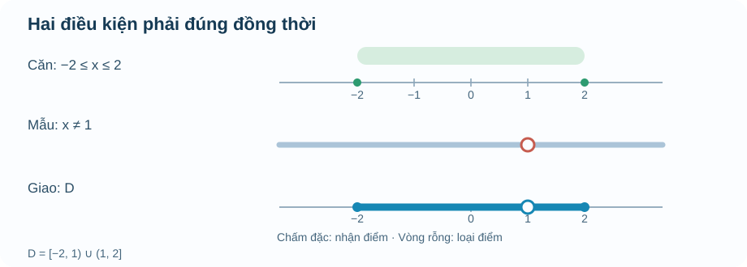
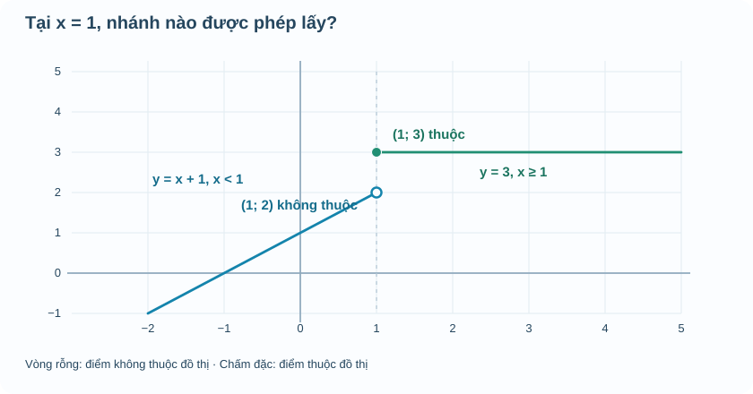
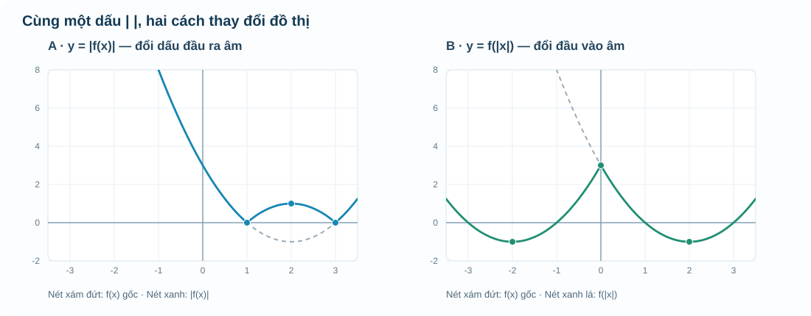
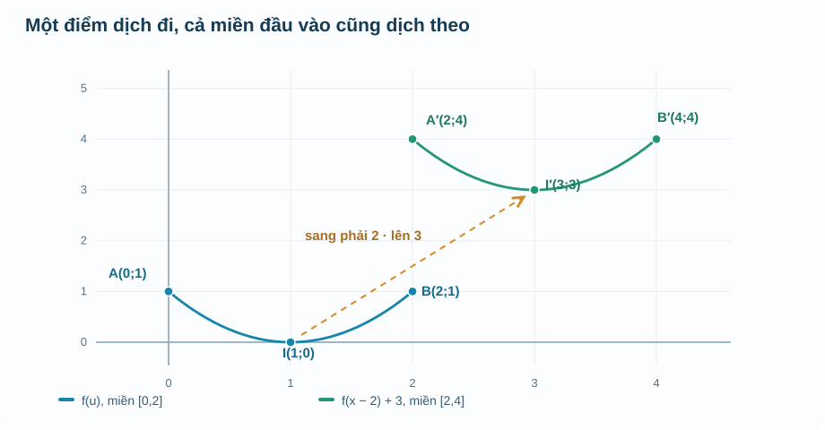

# AUTHORING — Chuyên đề 1 M1–M3/M6: ONE SOURCE R05

PACKET_ID: THPT-TOPIC1-M1M3-M6-DELTA-C-R05-20261110
STANDARD_ID: SLM-THPT-QUALITY-ONE
STANDARD_VERSION: 1.2.0
PERMANENT_SOURCES: THPT v2.1 exactly 5
S1: KNTT G10 T2 B15/B16 and G11 T2 B31 (printed/PDF receipt in sources 14/20)
LANE: AUTHORING / CONTENT_READY: NO / RELEASE: NO
R18_BASELINE_BLOB: 2340ea4975b37a457363eea59dd617070934983c (immutable, independently reviewed)

Only review NEW DELTA_C M1–M3 and M6: 4 SVG, 4 HTML interactive labs, 11 public DRAFT items (7 APP + 4 Written), new knowledge and Q15 source evidence. Do not review M4/M5/M7 or the unchanged R18 M6. All private 30 RD1 items remain owner-held; no Mastery.
R04 transport blob 72ed291e65f1a321fcc6150e81319362631a96eb is SUPERSEDED. Historical self-QA files may say 17 or 14; authoritative current Q15 decision is SOURCE 22 with 11. No new canonical IDs granted; full cross-bank semantic and NotebookLM independent review remain HOLD.

## Prompt NotebookLM — 5 sentences

Hãy review độc lập chỉ DELTA_C mới Chuyên đề 1 M1–M3/M6 trong file R05 theo SGK/SBT Kết nối tri thức, đúng 5 Permanent Sources THPT v2.1 và SLM-THPT-QUALITY-ONE/1.2.0 Q01–Q18.
Kiểm từng outcome, hình SVG/HTML và bản chất toán về miền/tập giá trị, bước nhảy, biến đổi trị tuyệt đối, tiếp tuyến/đồ thị đạo hàm, phân biệt enrichment với Core.
Đối chiếu 11 ứng viên (7 APP, 4 Written) với item canonical SGK/Topic/Written/Anchor, nêu ứng viên phải REUSE/RETIRE và đánh giá điều kiện, lời giải, rubric, role/placement.
Trả Academic/PED verdict riêng, SOURCE_RECEIPT, OUTCOME_MATRIX, ITEM_REGISTER, Qxx, P0/P1/P2 và MINIMAL_DELTA theo item/outcome/model cùng Git blob SHA.
Không review lại R18 bất biến, không cấp CONTENT_READY, không đưa private RD1 hay Mastery lên public và không cấp quyền merge/deploy.

## Manifest exact SHA

| # | File | Git blob SHA | JS length |
|---:|---|---|---:|
| 1 | `Temp_TOPIC1_M1_DOMAIN_KNOWLEDGE_DELTA_C_R00_20261110.md` | `65abb522212389b93c1bdeb476fd4c5c26f5938b` | 8382 |
| 2 | `Temp_TOPIC1_M2_GRAPH_READING_KNOWLEDGE_DELTA_C_R00_20261110.md` | `458cae0e2c69e4df9fc4a88b643ceb4bff5a20da` | 6721 |
| 3 | `Temp_TOPIC1_M3_TRANSFORM_KNOWLEDGE_DELTA_C_R00_20261110.md` | `c46a5f0a0ce88b4e4128f15836fce0215900bcd9` | 11735 |
| 4 | `Temp_TOPIC1_M1_PUBLIC_PRACTICE_DRAFT_R00_20261110.md` | `c956563f8e3dc88f6a6277f493b32a629f5069ae` | 5675 |
| 5 | `Temp_TOPIC1_M2_M3_PUBLIC_PRACTICE_DRAFT_R00_20261110.md` | `469f196958dfb6e64a14c22171c376d85f7096d5` | 5754 |
| 6 | `Temp_FIG_TOPIC1_M1_DOMAIN_INTERSECTION_R00.svg` | `8f08db70a2ff31fc34e9bf1e29dd6f2d0228c637` | 2419 |
| 7 | `Temp_FIG_TOPIC1_M2_PIECEWISE_ENDPOINTS_R00.svg` | `1f3365787d724995150012bd22e29edad239e80d` | 2600 |
| 8 | `Temp_FIG_TOPIC1_M3_ABSOLUTE_GRAPH_COMPARE_R00.svg` | `a619790e25729f41535935237b05fe79ac9e57d0` | 13658 |
| 9 | `Temp_FIG_TOPIC1_M3_TRANSLATION_AND_DOMAIN_R00.svg` | `f51bb9efe25fda4dd630e21a17d9bfd6247e97f9` | 7062 |
| 10 | `Temp_TOPIC1_M1_DOMAIN_LAB_D5_R00.html` | `5e686de54b12fc8891e56343e0ed17a7cd35c505` | 5769 |
| 11 | `Temp_TOPIC1_M2_PIECEWISE_LAB_D5_R00.html` | `ca77c9158fc2a57ac0c6f4f52b30f36a33330814` | 4858 |
| 12 | `Temp_TOPIC1_M3_GRAPH_TRANSFORM_LAB_D5_R00.html` | `6c150da0406f559e13a1ae9d0eca3f5565790247` | 6871 |
| 13 | `Temp_TOPIC1_M1_M3_D5_MATH_SPEC_REVIEW_R01_20261110.md` | `a4018ff68f18a1ebc22c0107f64f61900b638322` | 4959 |
| 14 | `Temp_TOPIC1_M1_M3_S1_SBT_VISUAL_RECEIPT_R01_20261110.md` | `1d33342ccf660f41d94f5ebb6d7f428f2f8ef475` | 4103 |
| 15 | `Temp_TOPIC1_M1_M3_WRITTEN_ANCHOR_Q15_R02_20261110.md` | `f7020b945ba5216f4a0d24ddc4e474b705c32ed0` | 4332 |
| 16 | `Temp_TOPIC1_M1_M7_NOTEBOOK_GEMINI_CONTENT_VISUAL_CURATION_R01_20261110.md` | `59abab35723343c3c573ef4e2f4c42ec2c56bd6d` | 9007 |
| 17 | `Temp_TOPIC1_M6_DERIVATIVE_LINKED_GRAPHS_KNOWLEDGE_DELTA_C_R01_20261110.md` | `ec8d7db6d5672e273bd7f392b1260db124266f43` | 5716 |
| 18 | `Temp_TOPIC1_M6_TANGENT_DERIVATIVE_TWO_GRAPHS_D5_R00_20261110.html` | `ebf1f392dcc77fa5c94a2bfd75f500bd97dd7ae5` | 9318 |
| 19 | `Temp_TOPIC1_M6_TANGENT_D5_AUTHORING_QA_R01_20261110.md` | `8343467b912e684bad3cd45bd54c9612aefe99dc` | 5621 |
| 20 | `Temp_TOPIC1_M6_S1_SBT_SOURCE_RECEIPT_R01_20261110.md` | `b387ca72188bc6998a4d109157574ede770b7b0f` | 2954 |
| 21 | `Temp_TOPIC1_M1_M3_REUSE_AND_NEW_ITEM_MATRIX_R00_20261110.md` | `569eab312ecf505a762a7bc14304d9ea291f4ec9` | 5870 |
| 22 | `Temp_TOPIC1_Q15_CROSS_BANK_RETIRE_3_AND_11_CANDIDATES_R05_20261110.md` | `b8d2f49561ac4746b90ec4a50d2271d2823ebd2e` | 6107 |

## Expected 11 DRAFT ids

- `DRAFT-T1-M1-APP02`
- `DRAFT-T1-M1-APP05`
- `DRAFT-T1-M1-APP06`
- `DRAFT-T1-M1-WR01`
- `DRAFT-T1-M1-WR02`
- `DRAFT-T1-M2-APP05`
- `DRAFT-T1-M2-APP06`
- `DRAFT-T1-M2-WR01`
- `DRAFT-T1-M3-APP07`
- `DRAFT-T1-M3-APP09`
- `DRAFT-T1-M3-WR02`

## Nội dung từng nguồn, exact Git blob

---
### SOURCE 01 — `Temp_TOPIC1_M1_DOMAIN_KNOWLEDGE_DELTA_C_R00_20261110.md`

EXACT_GIT_BLOB_SHA: `65abb522212389b93c1bdeb476fd4c5c26f5938b`

`````markdown
# Chuyên đề Hàm số và đồ thị · M1 — Một đầu vào hợp lệ là gì?

**BẢN BỔ SUNG AUTHORING R00 · CHƯA REVIEW · DELTA_C.** Bài này bổ sung chiều sâu sư phạm cho M1 trong bản canonical R18, **không thay thế** văn bản R18 đã Academic/PED PASS. Phần nội dung dành cho học sinh bắt đầu sau đường kẻ ngang.

**Nguồn S1 được xem trực tiếp:** SGK Toán 10 Kết nối tri thức, tập hai, Bài 15 *Hàm số*, trang **in 5–10** (trang PDF **6–11**, kiểm tra cả số trang in). Nội dung ví dụ dưới đây do AUTHORING biên soạn mới, không trích nguyên văn SGK. Đối chiếu thêm cách diễn giải của bộ Notebook 12/22 chuyên đề (bản nghiên cứu chưa review) nhưng **không** lấy kết luận PASS từ đó.

---

## M1 · Một quy tắc phải đi kèm với miền đầu vào

Khi theo dõi chất lượng không khí, chúng ta có thể ghi nồng độ bụi ở từng thời điểm. Ví dụ, tại 8 giờ máy đo cho một kết quả, tại 12 giờ cho kết quả khác. Điều quan trọng không chỉ là hai con số: **thời điểm** đóng vai trò đầu vào, còn **nồng độ đo được** là đầu ra. Nếu ở cùng một thời điểm, cùng một phép đo lại được gán hai kết quả trái ngược mà không giải thích vì sao, bảng đó chưa mô tả một hàm số theo quy tắc ta đã chọn.

Ta gọi \(f\) là một **hàm số xác định trên tập \(D\)** khi với **mỗi** \(x\in D\), quy tắc \(f\) cho **đúng một** giá trị thực \(f(x)\). Hai đầu vào khác nhau **được phép** cho cùng một đầu ra; điều bị cấm là **một đầu vào có hai đầu ra khác nhau**.

Nếu bảng ghi \(x=2\) hai lần và cả hai lần đều có \(y=5\), không có mâu thuẫn. Nhưng nếu một lần cho \(y=5\), lần khác cho \(y=7\), bảng đó không còn biểu diễn một hàm số \(y\) theo \(x\) với cách hiểu dữ liệu hiện tại.

**Phân biệt hai tập hợp:**

- **Tập xác định \(D\):** tất cả giá trị \(x\) được phép đưa vào quy tắc.
- **Tập giá trị \(T=\{f(x)\mid x\in D\}\):** tất cả kết quả **thực sự nhận được** khi đầu vào chạy trong \(D\).

Tập xác định không nhất thiết là toàn bộ số thực, cũng không nhất thiết là một khoảng. Nó có thể là một tập hữu hạn như \(\{0,1,2,3\}\), một đoạn, hoặc một tập có vài điểm bị loại.

### Ví dụ 1 · Khi công thức đúng nhưng đầu vào không thực tế

Một dịch vụ bán vé thu 8 nghìn đồng phí xử lý đơn và 12 nghìn đồng cho mỗi vé. Nếu mua \(n\) vé, với \(n\) là số nguyên dương, số tiền phải trả (nghìn đồng) là

\[
C(n)=8+12n.
\]

Về đại số, ta có thể thay \(n=2{,}5\) và nhận 38. Nhưng khách hàng không thể mua **hai vé rưỡi** theo mô hình đã nêu. Vì vậy, nếu số vé không bị giới hạn trên, miền đầu vào của **bài toán thực tế** là \(D=\{1,2,3,\ldots\}\), không phải \(\mathbb R\). Nếu đơn hàng chỉ được mua tối đa 6 vé, \(D\) thu hẹp thành \(\{1,2,\ldots,6\}\). Khi đó tập giá trị là \(\{20,32,44,56,68,80\}\).

**Vì sao cần phân biệt?** Một phép tính thực hiện được trên giấy chưa chắc mô tả được một tình huống được phép xảy ra. Khi đổi miền đầu vào, tập giá trị và câu trả lời tối ưu cũng có thể thay đổi.

## Mỗi phép toán đều có điều kiện

Ta thử xét

\[
h(x)=\frac{\sqrt{\,4-x^2\,}}{x-1}.
\]

Ở đây có **hai điều kiện độc lập**. Muốn căn bậc hai là số thực, biểu thức dưới căn phải không âm:

\[
4-x^2\ge 0\quad\Longleftrightarrow\quad -2\le x\le 2.
\]

Đồng thời, mẫu số không được bằng 0:

\[
x-1\ne 0\quad\Longleftrightarrow\quad x\ne 1.
\]

**Cả hai điều kiện phải đúng cùng lúc.** Vì vậy

\[
\boxed{D=[-2,2]\setminus\{1\}=[-2,1)\cup(1,2].}
\]

Chú ý cách dùng dấu ngoặc. Hai đầu mút \(-2\) và \(2\) **được nhận** vì căn bậc hai của 0 có nghĩa và mẫu số tại đó khác 0. Riêng \(x=1\) **bị loại** dù biểu thức dưới căn vẫn dương, vì mẫu số bằng 0. Các giá trị ngoài đoạn \([-2,2]\) bị loại do căn thức.



**Cách đọc hình:** hàng thứ nhất tô nhạt đoạn \([-2,2]\), biểu diễn điều kiện căn. Hàng thứ hai nhắc rằng điểm \(1\) bị loại bởi mẫu số. Hàng cuối thể hiện **giao** hai điều kiện: từ \(-2\) đến trước \(1\), rồi sau \(1\) đến \(2\). Vòng tròn rỗng ở \(1\) không phải điểm thuộc miền.

Một mô hình nhỏ để em tự chọn \(x\) và theo dõi điều kiện: **Temp_TOPIC1_M1_DOMAIN_LAB_D5_R00.html**. Mô hình là phương tiện quan sát, không thay phần giải thích bằng lời bên trên.

### Ví dụ 2 · Thử giá trị ở biên, ở điểm loại và bên ngoài

Với \(h\) trên, lần lượt xét \(x=-2,0,1,2,3\).

| Giá trị | Căn có nghĩa? | Mẫu khác 0? | Kết luận |
|---|---|---|---|
| \(x=-2\) | Có, vì \(4-(-2)^2=0\) | Có | \(h(-2)=0\) |
| \(x=0\) | Có, vì \(4-0^2=4\) | Có | \(h(0)=2/(-1)=-2\) |
| \(x=1\) | Có, vì \(4-1^2=3\) | **Không** | \(h(1)\) không xác định |
| \(x=2\) | Có, vì \(4-2^2=0\) | Có | \(h(2)=0\) |
| \(x=3\) | **Không**, vì \(4-3^2=-5\) | Có | \(h(3)\) không xác định trong \(\mathbb R\) |

Điều này cũng giải thích vì sao một giá trị \(x\) **không hợp lệ** không phải là “đầu vào cho kết quả sai”. Nó đơn giản không thuộc miền mà hàm đã được định nghĩa.

### Trường hợp dễ nhầm: căn nằm ở mẫu

Với biểu thức \(\displaystyle k(x)=\frac{1}{\sqrt{5-x}}\), căn ở **mẫu số**. Khi đó không đủ để yêu cầu \(5-x\ge0\). Nếu \(5-x=0\), mẫu sẽ bằng 0. Điều kiện chính xác là \(5-x>0\), tức \(x<5\). Vì vậy \(D_k=(-\infty,5)\), **không nhận** \(5\).

Một mẹo kiểm tra có lý do rõ ràng: hãy đọc biểu thức theo thứ tự cấu tạo. Có căn ở đâu? Có mẫu số ở đâu? Có phải kiểm đồng thời hai ràng buộc? Làm theo thứ tự này đáng tin cậy hơn việc ghi nhớ một bảng mẹo rời rạc.

## Tập giá trị không phải là tập xác định

Xét \(g(x)=(x-1)^2+2\) trên toàn bộ \(\mathbb R\). Vì bình phương không âm nên \(g(x)\ge2\), và khi \(x=1\) ta nhận đúng \(g(1)=2\). Khi \(|x-1|\) tăng không giới hạn, giá trị \(g(x)\) cũng tăng không giới hạn. Vậy \(T_g=[2,+\infty)\).

Nhưng nếu **chính quy tắc ấy** được xét trên đoạn \(D=[0,2]\), thì \(0\le(x-1)^2\le1\). Khi ấy \(g(x)\) chỉ nhận các giá trị từ 2 đến 3, tức \(T_g=[2,3]\). **Công thức không đổi, nhưng miền đầu vào đổi thì tập giá trị có thể đổi.** Sang M3, em sẽ dùng chính ý tưởng này để không chọn nhầm đỉnh parabol nằm ngoài miền bài toán.

## Vận dụng

**Bài 1 — Kiểm điều kiện trước khi tính.** Với hàm \(h(x)=\sqrt{4-x^2}/(x-1)\), em hãy dự đoán liệu \(x=-2, x=1, x=2, x=3\) có được phép hay không. Sau đó mới thử trên mô hình.

<details>
<summary>Đối chiếu</summary>

\(-2\) và \(2\) thuộc miền; \(1\) bị loại do mẫu bằng 0; \(3\) bị loại do biểu thức dưới căn âm. Nếu em đã loại nhầm \(2\), hãy nhớ \(\sqrt0=0\) có nghĩa.

</details>

**Bài 2 — Một dấu bằng có quan trọng không?** Hãy tìm tập xác định của \(k(x)=1/\sqrt{5-x}\), rồi so sánh với tập xác định của \(m(x)=\sqrt{5-x}\).

<details>
<summary>Đối chiếu</summary>

\(D_k=(-\infty,5)\) vì căn nằm ở mẫu và phải **khác 0**; \(D_m=(-\infty,5]\) vì một căn ở tử hoặc đứng riêng có thể bằng 0.

</details>

**Bài 3 — Đầu ra thay đổi theo miền.** Với \(g(x)=(x-1)^2+2\), tìm tập giá trị khi \(D=\mathbb R\) và khi \(D=[0,2]\). Giải thích bằng tính chất bình phương, không chỉ nhìn hình.

<details>
<summary>Đối chiếu</summary>

Trên \(\mathbb R\): \([2,+\infty)\). Trên \([0,2]\): \([2,3]\). Để chứng minh miền thứ hai, dùng \(-1\le x-1\le1\), suy ra \(0\le(x-1)^2\le1\); các giá trị từ 2 đến 3 đều đạt được: với mỗi \(y\in[2,3]\), chọn \(x=1+\sqrt{y-2}\in[1,2]\) thì \(g(x)=y\).

</details>

## Ghi nhớ để học tiếp

Một hàm số không chỉ là “thay số vào công thức”. Ta luôn phải biết **đầu vào nào được nhận, mỗi đầu vào cho bao nhiêu đầu ra, và khi đầu vào chạy trong miền thì những giá trị nào xuất hiện**. Khi đọc bảng hay đồ thị ở M2, miền quyết định chỗ nào điểm được vẽ; khi học parabol ở M3, miền quyết định có được chọn đỉnh để tối ưu hay không. Chính sự liên kết ấy khiến việc kiểm tập xác định trở thành bước có ý nghĩa, không phải thủ tục cho đủ bài.

---

## SOURCE / AUTHORING CONTROL (không render trong trang học sinh)

- **Canonical preserved:** R18 \`Temp_TOPIC_FUNCTIONS_FULL_PUBLIC_CANONICAL_SOURCE_R18_20261108.md\`, blob \`2340ea4975b37a457363eea59dd617070934983c\`, PR #782.
- **Source:** KNTT SGK Toán 10 tập 2, Bài 15, in5–10/PDF6–11. Các ví dụ vé, căn hỗn hợp và tập giá trị được tác giả bổ sung, không phải bài gốc SGK.
- **Proposed outcome scope:** G10-B15 function definition / domain / range / domain-in-context; mappings to canonical \`OUTCOME_ID\` cần đối soát trên R18 trước khi nhập.
- **DELTA_C_ACADEMIC_MATERIAL:** nội dung mới, SVG mới và bài mới phải NotebookLM đánh giá độc lập đúng 5 Permanent Sources v2.1 cùng S1, không tự PASS.
- **Placement:** Topic Kiến thức; 3 bài Vận dụng PUBLIC/formative, không dùng RD1, không tự ghi Mastery.

`````

---


### SOURCE 02 — `Temp_TOPIC1_M2_GRAPH_READING_KNOWLEDGE_DELTA_C_R00_20261110.md`

EXACT_GIT_BLOB_SHA: `458cae0e2c69e4df9fc4a88b643ceb4bff5a20da`

`````markdown
# Chuyên đề 1 · M2 — Đọc đúng đồ thị, điểm mốc và dữ kiện

**AUTHORING R00 · DELTA_C · CHƯA REVIEW.** Đây là phần kiến thức bổ sung cho mạch M2 của canonical R18, **không thay thế hoặc chép đè** nguồn đã Academic/PED PASS. Dự kiến sử dụng ở mục **Kiến thức** của Chuyên đề 1, sau M1 và trước M3.

**Nguồn SGK S1:** Toán 10 Kết nối tri thức, tập 2, Bài 15 *Hàm số*, trang in **5–10**, PDF **6–11**. Hai mô hình giá theo thời gian và đọc dữ kiện dưới đây là ví dụ tự biên soạn. Không xem hình minh họa là chứng minh hoặc là dữ liệu thực nghiệm có thật.

---

## Khi nhìn một đồ thị, ta biết chắc điều gì?

Giả sử một nhóm học sinh đo nhiệt độ nước trong cốc tại ba thời điểm:

| Thời gian \(t\) (phút) | 0 | 4 | 8 |
|---|---:|---:|---:|
| Nhiệt độ \(T\) (°C) | 20 | 30 | 36 |

Ba dấu chấm trên hệ trục thể hiện đúng **ba lần đo**. Nhưng nếu nối chúng bằng một đường cong trơn, các điểm nằm giữa không tự động trở thành số liệu đã đo. Đó có thể là một **cách mô hình hóa**, và nhiều đường cong khác nhau đều đi qua ba điểm đã biết.

Ví dụ tại phút thứ 2, không có dữ liệu đo trực tiếp. Nếu ta **giả định** nhiệt độ tăng đều từ phút 0 đến phút 4, phép nội suy cho \(T(2)=25\)°C. Nhưng con số 25 phụ thuộc vào giả định tăng đều, không suy ra chắc chắn chỉ từ ba lần đo.

**Điều cần nhớ:** hãy nhìn tên và đơn vị trên hai trục, xem các dấu chấm là **dữ liệu đã đo** hay điểm của **mô hình toán**, rồi mới đọc giá trị ở giữa. Nếu chỉ có bảng với ba mốc, nói “lúc nào nước cũng nóng dần” là kết luận quá mức.

### Miền rời rạc không phải một nét vẽ liên tục

Một bảng doanh thu theo **số vé** chỉ có đầu vào \(n=1,2,3,\ldots\). Khi vẽ, mỗi đầu vào được biểu diễn bằng một chấm. Đường thẳng đi qua các chấm có thể giúp nhìn xu hướng, nhưng không được tự coi \(n=2{,}5\) là số vé hợp lệ. Như vậy, từ M1 sang M2, **tập xác định vẫn quyết định điểm nào thuộc đồ thị**.

## Vì sao chấm rỗng và chấm đặc có ý nghĩa?

Một số quy tắc thay đổi tại một thời điểm hoặc một mức đầu vào. Xét:

\[
f(x)=
\begin{cases}
x+1,&x<1,\\
3,&x\ge1.
\end{cases}
\]

Ta phải đọc **điều kiện trước khi thay số**. Với \(x=0\), dùng \(x+1\), được \(f(0)=1\). Với \(x=2\), dùng giá trị không đổi 3, được \(f(2)=3\). Riêng tại \(x=1\), công thức đầu **không** áp dụng vì yêu cầu \(x<1\); công thức thứ hai **có** áp dụng vì \(x\ge1\), nên \(f(1)=3\).



Ở \(x=1\), nhánh \(y=x+1\) tiến đến tung độ 2 nhưng **không nhận** điểm \((1;2)\), nên hình vẽ dùng vòng tròn rỗng. Nhánh \(y=3\) **nhận** điểm \((1;3)\), nên phải tô đặc. Hai vị trí này có cùng hoành độ nhưng chỉ một điểm thuộc đồ thị.

Nếu người vẽ tô đặc cả hai điểm, ta sẽ có **một đầu vào \(x=1\) nhưng hai đầu ra khác nhau**. Hình đó không còn biểu diễn đúng một hàm số. Vì vậy nét rỗng/đặc không phải chi tiết trang trí: nó giúp thể hiện chính xác định nghĩa hàm số.

### Ví dụ 1 · Thay một dấu bằng, thay giá trị tại điểm

Giữ nguyên hai công thức nhưng sửa điều kiện thành:

\[
g(x)=
\begin{cases}
x+1,&x\le1,\\
3,&x>1.
\end{cases}
\]

Khi ấy \(g(1)=2\) thay vì 3. Hình vẽ phải đổi: \((1;2)\) thành điểm đặc và \((1;3)\) thành vòng tròn rỗng. Hai đồ thị chỉ khác **giá trị tại đúng một đầu vào**, nhưng giá trị đó phải được thể hiện chính xác.

Mô hình nhỏ \`Temp_TOPIC1_M2_PIECEWISE_LAB_D5_R00.html\` cho phép di chuyển \(x\) qua hai phía của mốc 1. Thử \(x=0{,}99\), \(x=1\), \(x=1{,}01\). Quan sát rằng ta **không** có quyền nối hai đầu nhánh để làm hình “mượt” hơn.

### Ví dụ 2 · Đọc đúng bảng và điểm mốc

| x | 0 | 0,5 | 1 | 2 |
|---|---:|---:|---:|---:|
| f(x) | 1 | 1,5 | 3 | 3 |

Tại \(x=0{,}5\), nhánh thứ nhất cho \(0{,}5+1=1{,}5\). Tại \(x=1\) hoặc 2, nhánh thứ hai cho 3. Nếu đọc \(f(1)=2\), ta đã vô tình dùng sai nhánh.

## Đọc một nhánh không đủ để kết luận về cả hàm

Theo định nghĩa dùng trong chuyên đề này, hàm **đồng biến nghiêm ngặt** trên một khoảng \(K\) nếu với mọi \(x_1<x_2\) thuộc \(K\), ta có \(f(x_1)<f(x_2)\).

Nhánh \(x+1\) đang tăng về phía phải, nhưng nhánh \(y=3\) hoàn toàn **không tăng**. Vì thế không được nói \(f\) đồng biến nghiêm ngặt trên toàn bộ \(\mathbb R\). Một phản ví dụ rất ngắn: \(1<2\) nhưng \(f(1)=f(2)=3\), trái yêu cầu \(f(1)<f(2)\).

Cách diễn đạt chính xác là: \(f\) đồng biến nghiêm ngặt trên \((-\infty,1)\) và **không đổi** trên \([1,+\infty)\). Ngoài ra có một bước nhảy tại mốc 1: các giá trị gần 1 về phía trái gần 2, còn giá trị ngay tại mốc và bên phải bằng 3. Sau này M5 sẽ giải thích chặt chẽ điều này bằng giới hạn một phía và liên tục; ở M2, ta chỉ cần hiểu **đọc điểm nào theo quy tắc nào**.

## Vận dụng — trước khi mở Đối chiếu

**Vận dụng 1.** Với \(f\) ở trên, hãy tính \(f(-1)\), \(f(1)\), \(f(1{,}5)\). Nêu nhánh tính tương ứng.

<details><summary>Đối chiếu</summary>

\(f(-1)=0\) từ nhánh \(x<1\). \(f(1)=3\) và \(f(1{,}5)=3\) từ nhánh \(x\ge1\). Nếu tính \(f(1)=2\), cần quay lại dấu bằng ở điều kiện thứ hai.

</details>

**Vận dụng 2.** Các điểm \((1;2)\), \((1;3)\), \((0;1)\) có thuộc đồ thị của \(f\) không? Không cần nhìn hình để đoán; hãy kiểm trực tiếp bằng công thức.

<details><summary>Đối chiếu</summary>

\((1;2)\) không thuộc vì \(f(1)=3\). Hai điểm còn lại thuộc vì \(f(1)=3\) và \(f(0)=1\). Một tọa độ \(x\) được phép chưa có nghĩa là mọi điểm \((x,y)\) đều nằm trên đồ thị.

</details>

**Vận dụng 3.** Một bạn cho rằng \(f\) đồng biến trên cả \(\mathbb R\) vì đường thẳng bên trái có hệ số góc dương. Hãy đưa phản ví dụ.

<details><summary>Đối chiếu</summary>

Lấy \(x_1=1\), \(x_2=2\). Ta có \(x_1<x_2\), nhưng \(f(x_1)=f(x_2)=3\). Như vậy \(f\) không đồng biến **nghiêm ngặt** trên toàn bộ \(\mathbb R\). Không được suy từ một nhánh ra cả miền.

</details>

## Ghi nhớ để nối sang M3

Khi đọc đồ thị, hãy tách ba câu hỏi: **đầu vào nào được nhận, điểm nào thật sự thuộc đồ thị, và kết luận đang nói về một điểm, một đoạn hay cả khoảng?** Không dùng một nét vẽ để thay điều kiện toán học. Sang M3, khi khảo sát parabol trên một miền bị giới hạn, ba câu hỏi này vẫn quan trọng như khi đọc hàm từng đoạn.

---

### AUTHORING CONTROL — KHÔNG RENDER CHO HỌC SINH

- S1: SGK KNTT Toán 10 Tập 2, B15 in5–10/PDF6–11, đã kiểm ảnh trước đó. Ví dụ \(f,g\) và bảng nhiệt độ là ví dụ do tác giả biên soạn.
- R18 canonical blob \`2340ea4975b37a457363eea59dd617070934983c\` phải giữ bất biến. M2 cũ đã có một ví dụ hàm từng đoạn với mô hình giá theo thời gian; phần mới có mục đích **chấm rỗng/đặc + phản ví dụ đồng biến trên miền**; QA Q15 phải quyết định có dùng một item đã tồn tại hay phát hành thêm item mới.
- Câu Vận dụng trong bản kiến thức là hoạt động công khai, **không** dùng RD1 hoặc ghi Mastery.
- \`DELTA_C_ACADEMIC_MATERIAL\`; chưa NotebookLM Academic/PED PASS, chưa CONTENT_READY. Không thay Golden UI/website.

`````

---


### SOURCE 03 — `Temp_TOPIC1_M3_TRANSFORM_KNOWLEDGE_DELTA_C_R00_20261110.md`

EXACT_GIT_BLOB_SHA: `c46a5f0a0ce88b4e4128f15836fce0215900bcd9`

`````markdown
# Chuyên đề 1 · M3 — Từ parabol đến hai phép biến đổi đồ thị

**AUTHORING R00 · DELTA_C · CHƯA REVIEW.** Phần bổ sung cho mạch M3 của canonical R18; **không sửa hoặc sao chép đè** các định nghĩa, ví dụ và item đã PASS. Phạm vi mới tập trung vào hai phép biến đổi \(y=|f(x)|\), \(y=f(|x|)\), cách giải thích bằng hình và điều kiện \(a\ne0\). Mảng tối ưu chỉ thêm một tình huống làm cầu nối M1–M3.

**Nguồn S1:** SGK Toán 10 Kết nối tri thức tập hai, Bài 16 *Hàm số bậc hai*, trang in **11–18** / trang PDF **12–19** (Bài 16 đầy đủ; các hình và ví dụ trên trang 13–14 chỉ là một phần), đã đối chiếu số trang in và đồ thị. Hai phép biến đổi với trị tuyệt đối và tình huống vận dụng là nội dung bổ sung do AUTHORING biên soạn, **không tuyên bố là yêu cầu bắt buộc của bài SGK**.

---

## Vì sao một dấu giá trị tuyệt đối có thể đổi hẳn hình đồ thị?

Ở M1, em đã biết phải xem đầu vào nào được nhận. Ở M2, em học cách đọc điểm thuộc đồ thị, điểm bị loại và cách một đường biểu diễn biến đổi. Bây giờ, chúng ta thử đặt một thay đổi **rất nhỏ trong cách viết công thức** và xem đồ thị thay đổi ra sao.

Xét hàm số

\[
f(x)=x^2-4x+3=(x-2)^2-1.
\]

Từ dạng bình phương, ta thấy đỉnh \(I(2;-1)\), trục đối xứng \(x=2\) và đồ thị mở lên. Hai nghiệm của \(f(x)=0\) là \(x=1\) và \(x=3\). Trong khoảng \(1<x<3\), đồ thị nằm **dưới** trục hoành vì \(f(x)<0\); ngoài khoảng ấy, \(f(x)\ge0\).

Trên nền này, chúng ta tạo hai đồ thị mới:

\[
g(x)=|f(x)|,\qquad h(x)=f(|x|).
\]

Hai công thức có cùng dấu gạch đứng, nhưng chúng yêu cầu hai hành động hoàn toàn khác nhau. Với \(g\), ta tính xong giá trị \(f(x)\) rồi mới lấy trị tuyệt đối của **đầu ra**. Với \(h\), ta lấy trị tuyệt đối của **đầu vào** trước rồi mới đưa vào quy tắc \(f\).

## 1. Giá trị tuyệt đối ở bên ngoài: \(y=|f(x)|\)

Nhớ rằng \(|u|=u\) khi \(u\ge0\), còn \(|u|=-u\) khi \(u<0\). Vì vậy,

\[
|f(x)|=\begin{cases}
f(x),&f(x)\ge0,\\
-f(x),&f(x)<0.
\end{cases}
\]

Đây chính là cách dựng đồ thị:

- Giữ nguyên mọi điểm nằm **trên hoặc ngay** trục \(Ox\).
- Lấy các điểm có tung độ âm rồi **đổi dấu tung độ**, tức phản chiếu phần nằm dưới \(Ox\) lên trên.
- Không đổi hoành độ của bất kỳ điểm nào.

Với ví dụ trên, đoạn cong giữa \(x=1\) và \(x=3\) vốn nằm dưới \(Ox\) được lật lên. Hai giao điểm \((1;0)\) và \((3;0)\) giữ nguyên; đỉnh cũ \((2;-1)\) trở thành điểm \((2;1)\) trên phần được lật.

Lấy \(x=2\): \(f(2)=-1\), nên \(|f(2)|=1\). Nếu em thấy điểm của \(g\) tại \(x=2\) vẫn có tung độ \(-1\), hình đã vẽ sai vì trị tuyệt đối **không thể âm**.

**Tập xác định:** \(g(x)=|f(x)|\) được tính ở đúng những \(x\) mà \(f(x)\) được xác định. Việc lấy trị tuyệt đối **đầu ra** không tự tạo ra đầu vào mới.

## 2. Giá trị tuyệt đối ở bên trong: \(y=f(|x|)\)

Lần này ta đổi **đầu vào**:

\[
f(|x|)=\begin{cases}
f(x),&x\ge0,\\
f(-x),&x<0.
\end{cases}
\]

Nếu \(f\) xác định trên \(\mathbb R\), hãy giữ nửa đồ thị của \(f\) ở phía **bên phải trục tung** (\(x\ge0\)); sau đó phản chiếu nửa đó sang phía trái. Lúc này hai vị trí \(x\) và \(-x\) luôn cho cùng đầu ra, vì \(|x|=|-x|\). Do đó đồ thị mới **đối xứng qua trục tung**.

Với \(f(x)=x^2-4x+3\), ta có \(h(x)=x^2-4|x|+3\). Đỉnh \((2;-1)\) của nửa bên phải được giữ lại, và có một điểm đối xứng \((-2;-1)\) bên trái. Đồ thị mới **không còn là đồ thị của một hàm bậc hai duy nhất** trên toàn \(\mathbb R\), dù từng phía của nó được vẽ từ một phần parabol.

Một cách kiểm nhanh:

\[
f(-2)=15,\qquad f(|-2|)=f(2)=-1,
\]
\[
|f(2)|=1,\qquad f(|2|)=f(2)=-1.
\]

Như vậy, không được viết \(f(|x|)=|f(x)|\) nếu chưa có lý do đặc biệt: chỉ tại \(x=2\), hai giá trị đã khác nhau.

**Nếu miền của \(f\) không phải toàn bộ \(\mathbb R\):** với \(h(x)=f(|x|)\), đầu vào \(x\) chỉ hợp lệ khi **\(|x|\) thuộc tập xác định của \(f\)**. Quy tắc phản chiếu này luôn cần kiểm miền. Ví dụ, nếu \(f\) chỉ được định nghĩa trên \([1,3]\), thì \(f(|x|)\) được định nghĩa trên \([-3,-1]\cup[1,3]\), không phải toàn bộ \(\mathbb R\).



**Hướng đọc hình:** cả hai khung dùng trục và màu nhất quán. Đường xám nét đứt là \(f(x)\) gốc, đường màu là phép biến đổi được nêu ở tiêu đề. Ở khung \(|f(x)|\), quan sát phần âm được lật qua \(Ox\); ở khung \(f(|x|)\), quan sát nửa bên phải được sao đối xứng sang trái. Nếu hai đường trùng một đoạn, chúng vẫn là hai quy tắc cần phân biệt.

Mô hình tương tác D5 \`Temp_TOPIC1_M3_GRAPH_TRANSFORM_LAB_D5_R00.html\` cho phép bật từng phép biến đổi. Hãy thử với \(a=1,b=-4,c=3\), sau đó đổi dấu hoặc độ lớn của \(a\) và quan sát. Đừng bật tất cả ngay: nên dự đoán hình dạng trước rồi mới so sánh.

## 3. Dấu trừ ở bên trong lại làm đồ thị dịch sang phải?

Một ý tưởng có giá trị từ bộ Notebook 22 chuyên đề là **đọc phép tịnh tiến bằng đầu vào và đầu ra**, thay vì bắt học sinh thuộc lòng câu “trừ là sang phải, cộng là sang trái”. Ta có thể tự suy ra điều đó.

Giả sử em đã biết một điểm \(A(u;f(u))\) thuộc đồ thị gốc \(y=f(x)\). Bây giờ xét hàm

\[
g(x)=f(x-2)+3.
\]

Để phần \(f(x-2)\) sử dụng **đúng đầu vào cũ \(u\)**, ta phải chọn \(x-2=u\), tức \(x=u+2\). Khi ấy đầu ra bằng \(f(u)+3\). Như vậy điểm \(A(u;f(u))\) chuyển thành

\[
A'(u+2;f(u)+3).
\]

Điều này giải thích được cả hai chiều: **dịch sang phải 2 đơn vị** vì hoành độ mới lớn hơn 2; **dịch lên trên 3 đơn vị** vì tung độ mới lớn hơn 3. Nếu chỉ nhìn thấy dấu trừ trước số 2 rồi đoán “dịch trái”, em đã nhầm giữa giá trị **đưa vào máy tính** và vị trí **điểm trên đồ thị mới**.

### Ví dụ · Miền của đồ thị cũng phải dịch

Xét \(f(u)=(u-1)^2\), nhưng chỉ định nghĩa trên \(D_f=[0,2]\). Đồ thị gốc là **một đoạn parabol** từ \(A(0;1)\), qua đỉnh \(I(1;0)\) đến \(B(2;1)\); đừng vẽ kéo dài toàn bộ hai nhánh vì miền đầu vào đã được giới hạn.

Đặt \(g(x)=f(x-2)+3\). Muốn \(g(x)\) có nghĩa, phải có \(x-2\in[0,2]\), tức

\[
\boxed{D_g=[2,4].}
\]

Từ ba điểm gốc, ta nhận \(A'(2;4)\), \(I'(3;3)\), \(B'(4;4)\). Trên miền mới, \(g(x)\) nhận tất cả giá trị từ 3 đến 4, tức \(T_g=[3,4]\). **Đồ thị, tập xác định và tập giá trị đều được xét đúng trong miền được cho**; phép tịnh tiến không làm xuất hiện vô hạn điểm mới ở ngoài đoạn.



**Cách đọc hình:** đường xanh dương là **đoạn đồ thị gốc**, đường xanh lá là **đoạn sau khi dịch**. Mũi tên nét đứt chỉ sự chuyển từ đỉnh \(I\) đến \(I'\). Hãy đọc cả các mốc \(x=0,2,4\) trên trục hoành; chỉ nhìn hai đỉnh thôi thì chưa đủ nhận ra miền mới.

### Vận dụng · Tự chuyển một hàm không phải parabol

Giả sử \(f(x)=\sqrt{x}\) chỉ xét trên \([0,4]\). Hãy dự đoán tập xác định và tập giá trị của \(h(x)=f(x+1)-2\) trước khi nhìn phần đối chiếu.

<details><summary>Đối chiếu</summary>

Để \(f(x+1)\) có nghĩa, cần \(x+1\in[0,4]\), nên \(-1\le x\le3\). Vậy \(D_h=[-1,3]\). Vì \(f\) nhận tất cả giá trị trong \([0,2]\) trên miền gốc, sau khi trừ 2 vào **đầu ra**, \(h\) nhận các giá trị \([-2,0]\). Đồ thị dịch **sang trái 1** và **xuống 2**; cách đọc dấu vẫn được giải thích bằng phép thế \(x+1=u\), không cần học thuộc máy móc.

</details>

**Điều kiện quan trọng:** công thức \(f(x-a)+b\) không cho phép bỏ qua tập xác định gốc. Nếu \(f\) chỉ có nghĩa với \(u\in D_f\), miền mới phải là \(\{x:x-a\in D_f\}\), dù hình vẽ được tịnh tiến bằng cách nào. Các phép tịnh tiến này là phần **mở rộng trực quan** của M3; không tự ghi thành Core bắt buộc của SGK Bài 16.

## 4. Vì sao \(a=0\) không còn là parabol?

Hàm bậc hai có dạng \(f(x)=ax^2+bx+c\) với điều kiện bắt buộc **\(a\ne0\)**. Khi \(a=0\), ta chỉ còn \(f(x)=bx+c\): đó là hàm bậc nhất nếu \(b\ne0\), hoặc hàm hằng nếu \(b=0\).

Công thức hoành độ đỉnh \(x=-b/(2a)\) **không áp dụng** khi \(a=0\), vì lúc đó mẫu số bằng 0. Một mô hình đồ thị tốt phải nhận ra trường hợp này; không được âm thầm thay \(a=0\) thành một số nhỏ khác 0 để tiếp tục vẽ parabol.

Nếu \(a\ne0\), viết

\[
f(x)=a\left(x+\frac{b}{2a}\right)^2+c-\frac{b^2}{4a}
\]

giúp ta tìm trục và đỉnh bằng suy luận từ bình phương. Nếu cần đếm nghiệm của \(f(x)=0\), dùng biệt thức \(\Delta=b^2-4ac\) khi **đúng là** phương trình bậc hai. Đỉnh và nghiệm là hai câu hỏi khác nhau: **đỉnh** nói đến vị trí thấp nhất/cao nhất của parabol trên \(\mathbb R\); **nghiệm** nói tới nơi đồ thị gặp trục \(Ox\).

## 5. Đỉnh đẹp chưa chắc là đáp án đúng của bài toán

Giả sử độ cao (m) của một vật theo thời gian \(t\) (giây) được mô phỏng bởi

\[
H(t)=-(t-3)^2+9,
\]

nhưng ta chỉ quan sát trong **hai giây đầu**, tức \(t\in[0,2]\).

Trên toàn \(\mathbb R\), biểu thức có giá trị lớn nhất 9 tại \(t=3\). Tuy nhiên **\(t=3\) không thuộc khoảng quan sát**. Trong đoạn \([0,2]\), khi \(t\) tăng thì khoảng cách \(|t-3|\) giảm, nên \(H(t)\) tăng. Ta có \(H(0)=0\) và \(H(2)=8\). Vì vậy, trong hai giây được hỏi, độ cao lớn nhất là **8 m tại \(t=2\)**, không phải 9 m.

Đây là một bài toán **khác** với việc tìm cực đại trên toàn \(\mathbb R\). Ta phải quyết định miền đầu vào từ đề bài **trước** khi sử dụng thông tin về đỉnh. Điều này nối trực tiếp với M1, và là thói quen quan trọng khi học khảo sát hàm bằng đạo hàm ở các lớp sau.

## Vận dụng

**Vận dụng 1.** Với \(f(x)=x^2-4x+3\), hãy tự tính \(|f(2)|\), \(f(|2|)\), \(f(|-2|)\). Từ kết quả, giải thích hai phép biến đổi có tạo cùng đồ thị không.

<details><summary>Đối chiếu</summary>

\(f(2)=-1\), nên \(|f(2)|=1\); \(f(|2|)=f(2)=-1\); \(f(|-2|)=f(2)=-1\). Hai hàm \(g(x)=|f(x)|\) và \(h(x)=f(|x|)\) đã khác giá trị ở \(x=2\), nên không cùng đồ thị.

</details>

**Vận dụng 2.** Một bạn nói: “Vì \(a=0\) cũng vẽ được đồ thị, nên \(ax^2+bx+c\) vẫn là parabol và dùng được công thức đỉnh.” Em hãy chỉ ra lỗi.

<details><summary>Đối chiếu</summary>

Khi \(a=0\), biểu thức chỉ còn \(bx+c\), là đường thẳng nếu \(b\ne0\) hoặc hàm hằng nếu \(b=0\). Đồ thị vẫn tồn tại, nhưng **không phải parabol**, và công thức \(-b/(2a)\) không xác định.

</details>

**Vận dụng 3.** Từ biểu thức \(H(t)=-(t-3)^2+9\), tìm độ cao lớn nhất khi chỉ xét \(0\le t\le2\). Giải thích vì sao không chọn điểm đỉnh.

<details><summary>Đối chiếu</summary>

Tại \(t=0\), \(H=0\); tại \(t=2\), \(H=8\). Trên \([0,2]\), bình phương \((t-3)^2\) giảm khi \(t\) tăng nên \(H\) tăng, do đó lớn nhất tại \(t=2\), bằng 8. Đỉnh \(t=3\) ở ngoài miền được hỏi.

</details>

## Ghi nhớ

Phép \(f(x-a)+b\) thay đổi vị trí **đầu vào** và **đầu ra**: khi có điều kiện miền, cả tập xác định cũng phải đổi tương ứng. Trị tuyệt đối **ngoài** dấu hàm thay đổi **đầu ra** và lật phần đồ thị nằm dưới \(Ox\). Trị tuyệt đối **trong** dấu hàm thay đổi **đầu vào**, dùng nửa bên phải để tạo đối xứng qua \(Oy\) khi miền phù hợp. Cả hai phép biến đổi đều phải tôn trọng tập xác định. Khi có tham số \(a\), cần phân biệt rõ hàm bậc hai với trường hợp \(a=0\). Và khi làm một bài toán thực tế, không được lấy giá trị cực trị trên toàn trục số thay cho cực trị trên miền đề bài.

---

### AUTHORING CONTROL — KHÔNG RENDER CHO HỌC SINH

- S1: SGK Toán 10 KNTT T2, B16 trang in 11–18/PDF12–19. S1 xác nhận hàm bậc hai và tính chất parabol; phép biến đổi có trị tuyệt đối và phép tịnh tiến trên miền giới hạn là phần minh họa mở rộng, không tự coi là Core S1.
- Canonical preserved: R18 \`Temp_TOPIC_FUNCTIONS_FULL_PUBLIC_CANONICAL_SOURCE_R18_20261108.md\`, blob \`2340ea4975b37a457363eea59dd617070934983c\`, Draft PR #782.
- Proposed outcomes: đọc và biến đổi đồ thị; phân biệt trị tuyệt đối đầu vào/đầu ra; kiểm miền; biện luận \(a=0\), đọc miền cực trị. Đối chiếu R18 mapping trước khi chính thức gắn \`OUTCOME_ID\`.
- FIG D5 mới phải review đúng toán. HTML lab chưa được tự tuyên bố AP/Academic PASS. Các câu Vận dụng ở đây là công khai, không thay ngân hàng RD1 độc lập.
- \`DELTA_C_ACADEMIC_MATERIAL\`, cần NotebookLM targeted review đúng 5 Permanent Sources v2.1 + S1, sau Q01–Q18 và Q15 duplication review. Không \`CONTENT_READY\`.

`````

---


### SOURCE 04 — `Temp_TOPIC1_M1_PUBLIC_PRACTICE_DRAFT_R00_20261110.md`

EXACT_GIT_BLOB_SHA: `c956563f8e3dc88f6a6277f493b32a629f5069ae`

`````markdown
# Chuyên đề 1 · M1 — Luyện tập bổ sung về miền đầu vào và tập giá trị

**AUTHORING CANDIDATE R00 — NOT REVIEWED — DELTA_C.** Đây là các câu ứng viên mới được giữ lại sau kiểm tra trùng nội bộ, chỉ dùng ở *Luyện tập* hoặc *Vận dụng công khai*. Các ID \`DRAFT-*\` là tạm thời; **chưa** được đăng ký vào thư viện canonical Q15, chưa rà soát trùng nghĩa với ngân hàng hiện hành. **Không dùng làm Topic Readiness RD1.** Không thay câu/đáp án/rubric đã PASS.

## Nhóm A · Hiểu khái niệm trước khi tính

### DRAFT-T1-M1-APP02 · Rút gọn rồi có được nhận điểm bị loại?

Cho \(f(x)=\dfrac{x^2-1}{x-1}\). Một bạn rút gọn thành \(x+1\), rồi khẳng định tập xác định là \(\mathbb R\). Em hãy phản biện và nêu điều gì đúng, điều gì sai trong lời giải ấy.

<details><summary>Đối chiếu</summary>

Từ biểu thức **ban đầu**, mẫu số \(x-1\) yêu cầu \(x\ne1\). Trên miền ấy, \(\dfrac{(x-1)(x+1)}{x-1}=x+1\). Nhưng phép rút gọn chỉ hợp lệ khi \(x-1\ne0\), nên tập xác định của \(f\) vẫn là \(\mathbb R\setminus\{1\}\). Biểu thức mới \(x+1\), nếu được định nghĩa riêng, có miền rộng hơn; nó không tự làm thay đổi miền ban đầu của \(f\).

</details>

### DRAFT-T1-M1-APP05 · Đọc đúng điểm biên và điểm loại

Xét \(q(x)=\dfrac{\sqrt{9-x^2}}{x+2}\). Xác định tập xác định và kiểm các giá trị \(x=-3,-2,0,3\). Với các giá trị hợp lệ, hãy tính \(q(x)\).

<details><summary>Đối chiếu</summary>

Căn yêu cầu \(9-x^2\ge0\), tức \(-3\le x\le3\). Mẫu yêu cầu \(x+2\ne0\), tức \(x\ne-2\). Do đó \(D=[-3,-2)\cup(-2,3]\). Ta nhận \(-3,0,3\) và loại \(-2\): \(q(-3)=0\), \(q(0)=3/2\), \(q(3)=0\). Đầu mút được nhận vì căn bằng 0 là hợp lệ khi mẫu khác 0. Điểm \(-2\) bị loại dù biểu thức dưới căn dương.

</details>

### DRAFT-T1-M1-APP06 · Ba ràng buộc trong một biểu thức

Xét \(\displaystyle r(x)=\frac{\sqrt{x+2}}{(x-1)(x-3)}\). Tìm \(D\), rồi cho biết \(-2,1,3,4\) có thuộc miền hay không.

<details><summary>Đối chiếu</summary>

\(\sqrt{x+2}\) yêu cầu \(x\ge-2\); mẫu khác 0 yêu cầu \(x\ne1\), \(x\ne3\). Vậy \(D=[-2,+\infty)\setminus\{1,3\}\). Nhận \(-2\) và 4; loại 1 và 3. Không được loại \(-2\) chỉ vì tử có căn: căn bằng 0 ở **tử** là hợp lệ.

</details>

### DRAFT-T1-M1-WR01 · Phản biện một kết luận sai

Một bạn viết: “Vì \(\sqrt{x-1}\) xác định khi \(x\ge1\), nên \(\displaystyle\frac1{\sqrt{x-1}}\) cũng xác định khi \(x\ge1\)”. Em hãy giải thích lỗi, tìm tập xác định đúng và đưa ra một giá trị tại biên để kiểm chứng.

<details><summary>Đối chiếu và thang điểm đề xuất</summary>

**Lời giải:** Với mẫu \(\sqrt{x-1}\), cần đồng thời \(x-1\ge0\) để có căn và \(\sqrt{x-1}\ne0\) để mẫu không bằng 0. Hai điều kiện tương đương \(x-1>0\), tức \(D=(1,+\infty)\). Tại \(x=1\), mẫu bằng 0 nên biểu thức không xác định.

**Rubric dự kiến (3 điểm, chưa canonical):** 1 điểm nêu rõ vì sao căn ở mẫu không được bằng 0; 1 điểm suy ra đúng \(x>1\) và tập \(D\); 1 điểm đối chiếu được \(x=1\) làm phản ví dụ cho cách lập luận sai. Không thưởng điểm cho câu trả lời đúng nhưng thiếu giải thích nếu câu hỏi yêu cầu phản biện.

</details>

### DRAFT-T1-M1-WR02 · Rút gọn có làm mất một điểm trên đồ thị?

Cho hai hàm số

\[
f(x)=\frac{(x-1)\sqrt{x+1}}{x-1},
\qquad
g(x)=\sqrt{x+1}.
\]

Một bạn rút gọn \((x-1)\) rồi nói rằng hai hàm số hoàn toàn giống nhau. Em hãy:

(a) tìm tập xác định của từng hàm số;

(b) giải thích vì sao \(f(x)=g(x)\) tại mọi đầu vào thuộc tập xác định của \(f\), nhưng hai hàm số vẫn không bằng nhau với tư cách là hai hàm có miền xác định khác nhau;

(c) mô tả điểm phải bỏ khỏi đồ thị của \(g\) để được đồ thị của \(f\), và xác định **tập giá trị** của mỗi hàm.

<details><summary>Đối chiếu và rubric dự kiến</summary>

Để \(g(x)\) có nghĩa trong số thực, cần \(x+1\ge0\), nên \(D_g=[-1,+\infty)\).

Để \(f(x)\) có nghĩa, cần đồng thời \(x+1\ge0\) và \(x-1\ne0\), nên

\[
D_f=[-1,+\infty)\setminus\{1\}=[-1,1)\cup(1,+\infty).
\]

Khi \(x\in D_f\), ta mới được phép chia cả tử và mẫu cho \(x-1\), suy ra \(f(x)=\sqrt{x+1}=g(x)\). Tại \(x=1\), \(g(1)=\sqrt2\) có nghĩa, còn \(f(1)\) **không xác định** do mẫu bằng 0. Vì vậy hai hàm không có cùng miền và không thể coi là cùng một hàm.

Đồ thị \(f\) là đồ thị \(g\), nhưng **khuyết điểm** \((1;\sqrt2)\) (vòng tròn rỗng). Do căn bậc hai nhận mọi giá trị không âm khi \(x\ge-1\), ta có \(T_g=[0,+\infty)\). Với \(f\), giá trị \(\sqrt2\) không còn nhận được: muốn \(\sqrt{x+1}=\sqrt2\) thì nhất thiết \(x=1\), mà giá trị này bị loại. Mọi đầu ra không âm khác \(\sqrt2\) vẫn đạt được. Vậy

\[
T_f=[0,+\infty)\setminus\{\sqrt2\}.
\]

**Rubric dự kiến (6 điểm, chưa canonical):** 1 điểm tìm đúng \(D_g\); 1 điểm tìm đúng \(D_f\); 1 điểm nêu rõ điều kiện hợp lệ của phép rút gọn; 1 điểm nhận diện chính xác chỗ khuyết \((1;\sqrt2)\) trên đồ thị; 1 điểm tìm đúng \(T_g\); 1 điểm suy luận đúng \(T_f\) và vì sao mất giá trị \(\sqrt2\). Bài này là hoạt động tự đối chiếu công khai, không dùng làm RD1 hoặc ghi Mastery.

</details>


---

## Ma trận nguồn dự kiến, CHƯA CANONICAL

| DRAFT ID | Mức | Outcome candidate | Vai trò đề xuất |
|---|---|---|---|
| APP02 | thông hiểu | rút gọn phân thức không phục hồi điểm loại | TOPIC_PRACTICE |
| APP05–06 | vận dụng | giao nhiều điều kiện, điểm biên | TOPIC_PRACTICE |
| WR01–WR02 | giải thích | biện luận điều kiện, giới hạn kết luận | TOPIC_PRACTICE / WRITTEN candidate |

**Q15:** Trước khi đăng ký item phải đối chiếu các câu đã có trong R18, mã nguồn câu canonical SGK và thư viện Written/Anchor. Không được tạo câu mới chỉ để nhân bản cùng một câu với ID mới. Nếu trùng, giữ nguyên canonical item, thêm placement/role.

**Q16:** Toàn bộ 5 bài trên là luyện tập công khai, không RD1, không tự ghi Mastery, không hiện đáp án của RD1. **Q18:** SHA/receipt review targeted chưa có, trạng thái HOLD.

`````

---

### SOURCE 05 — `Temp_TOPIC1_M2_M3_PUBLIC_PRACTICE_DRAFT_R00_20261110.md`

EXACT_GIT_BLOB_SHA: `469f196958dfb6e64a14c22171c376d85f7096d5`

`````markdown
# Chuyên đề 1 · Luyện tập bổ sung cho M2–M3

**AUTHORING R00 — CÁC CÂU CHƯA REVIEW, CHƯA CANONICAL.** Bản này chứa **4 câu áp dụng và 2 bài tự luận Written candidate**. Tất cả thuộc Luyện tập hoặc Vận dụng công khai; không đưa vào Tự kiểm tra RD1, không sinh Mastery. DRAFT ID chỉ là vị trí theo dõi; đối chiếu Q15 với ngân hàng R18/SGK/Topic trước khi tạo item canonical. Có thể tái sử dụng một item đã duyệt bằng nhiều placement/role, không nhân bản một câu chỉ vì chuyển sang Topic.

## A. Đọc bảng và đồ thị — M2

### DRAFT-T1-M2-APP05 — Nhánh nào nhận đúng tại mốc?

Xét \(p(x)=2-x\) khi \(x\le1\) và \(p(x)=x+1\) khi \(x>1\). Hãy tính \(p(0),p(1),p(2)\) rồi cho biết ở \(x=1\), điểm \((1;1)\) hay \((1;2)\) phải được tô đặc.

<details><summary>Đối chiếu</summary>

\(p(0)=2\), \(p(1)=2-1=1\) do nhánh thứ nhất **nhận dấu bằng**, \(p(2)=3\) do nhánh thứ hai. Điểm \((1;1)\) tô đặc; \((1;2)\) chỉ là vị trí nhánh bên phải tiến gần khi \(x\) về 1, nên phải là vòng rỗng. Hai nhánh không được tự nối liền.

</details>

### DRAFT-T1-M2-APP06 — Hai nhánh đều tăng, cả hàm có tăng?

Xét \(r(x)=x+1\) khi \(x<0\), và \(r(x)=x-2\) khi \(x\ge0\). Cả hai nhánh đều là đường thẳng có hệ số góc dương. Có được kết luận \(r\) đồng biến nghiêm ngặt trên toàn \(\mathbb R\) không? Hãy kiểm riêng hai đầu vào ở hai phía mốc 0.

<details><summary>Đối chiếu</summary>

**Không.** Chẳng hạn, \(x_1=-0{,}5<x_2=0\) nhưng \(r(-0{,}5)=0{,}5\) trong khi \(r(0)=-2\), tức \(r(x_1)>r(x_2)\). Mỗi nhánh tăng trên khoảng riêng của mình, nhưng có **bước nhảy xuống** tại mốc 0, khiến hàm không tăng trên toàn miền. Cần kiểm cả chỗ chuyển nhánh, không chỉ dấu hệ số góc.

</details>

### DRAFT-T1-M2-WR01 — Tách dữ kiện khỏi suy luận

Một bảng chỉ ghi vận tốc của xe tại \(t=0\) là 10 km/h và tại \(t=10\) phút là 20 km/h. Hãy trình bày (a) điều gì biết chắc từ bảng; (b) điều gì chưa thể khẳng định về vận tốc lúc \(t=5\) phút; (c) nếu giả định vận tốc tăng đều theo thời gian, hãy tính vận tốc dự kiến ở phút thứ 5 và nêu giới hạn của kết quả.

<details><summary>Đối chiếu và rubric dự kiến</summary>

(a) Ta biết chính xác **hai giá trị được cho trong bảng** tại hai mốc. (b) Không xác định được vận tốc đúng lúc phút 5 nếu không có dữ liệu hoặc giả định thêm. (c) Dưới giả định vận tốc tăng tuyến tính theo thời gian, \(v(5)=10+(20-10)\cdot5/10=15\) km/h. Đó là kết quả **dự kiến theo mô hình**, không tự trở thành một quan sát có thật.

**Rubric tạm (4 điểm):** 1 điểm nêu đúng hai mốc; 1 điểm giải thích chưa đủ dữ kiện; 1 điểm tính đúng 15 km/h dưới giả định; 1 điểm phân biệt kết quả mô hình với dữ liệu đo.

</details>

## B. Parabol và hai phép biến đổi — M3

### DRAFT-T1-M3-APP07 — Nghiệm âm có được đưa vào |x|?

Cho \(f(x)=x^2+2x-3\). Hãy giải \(|f(x)|=0\) và \(f(|x|)=0\). Khi đặt \(u=|x|\), vì sao phải kiểm tra \(u\ge0\) trước khi suy ra \(x\)?

<details><summary>Đối chiếu</summary>

\(|f(x)|=0\iff f(x)=0\iff (x-1)(x+3)=0\), nên \(x=1\) hoặc \(x=-3\). Với \(f(|x|)=0\), đặt \(u=|x|\ge0\); ta có \(u^2+2u-3=(u-1)(u+3)=0\). Nghiệm \(u=-3\) **không thể** bằng \(|x|\), nên chỉ còn \(u=1\), tức \(x=\pm1\). Không phản chiếu nghiệm âm \(x=-3\) của hàm gốc rồi kết luận sai \(x=\pm3\).

</details>

### DRAFT-T1-M3-APP09 — Miền không liền nhau

Cho \(m(x)=5-(x-2)^2\) nhưng chỉ xét \(D=[0,1]\cup[3,4]\). Tìm GTNN và GTLN trên \(D\). Vì sao không được lấy giá trị 5 tại đỉnh của parabol làm GTLN trong bài?

<details><summary>Đối chiếu</summary>

Đỉnh của parabol là \((2;5)\), nhưng \(x=2\notin D\). Trên \([0,1]\), khi x tăng thì \(m(x)\) tăng từ \(m(0)=1\) tới \(m(1)=4\). Trên \([3,4]\), khi x tăng thì \(m(x)\) giảm từ \(m(3)=4\) xuống \(m(4)=1\). Vậy **GTLN trên D bằng 4** (đạt tại x=1 hoặc x=3) và **GTNN trên D bằng 1** (đạt tại x=0 hoặc x=4). Một miền có hai đoạn rời nhau không cho phép tự nối qua điểm x=2 đã bị loại.

</details>

### DRAFT-T1-M3-WR02 — Hai cách đặt dấu | |, hai đồ thị

Cho \(f(x)=x^2-4x+3\). Xét \(g(x)=|f(x)|\) và \(h(x)=f(|x|)\). (a) Hãy mô tả phần đồ thị thay đổi trong mỗi trường hợp. (b) Tính \(g(2),h(2),g(-2),h(-2)\). (c) Tìm các nghiệm của \(g(x)=0\) và \(h(x)=0\). Kết luận hai đồ thị có giống nhau không và giải thích.

<details><summary>Đối chiếu và rubric dự kiến</summary>

(a) \(g\) phản chiếu phần \(f<0\), tức giữa các nghiệm 1 và 3, lên trên \(Ox\). \(h\) lấy nửa \(x\ge0\) của \(f\) rồi phản chiếu sang trái \(Oy\). (b) \(g(2)=1\), \(h(2)=-1\); \(f(-2)=15\), nên \(g(-2)=15\) nhưng \(h(-2)=f(2)=-1\). (c) \(g(x)=0\) tại \(x=1,3\); \(h(x)=0\) tại \(x=\pm1,\pm3\). Hai đồ thị không trùng nhau.

**Rubric tạm (6 điểm):** 2 điểm mô tả đúng mỗi phép biến đổi và trục phản chiếu; 2 điểm tính đúng bốn giá trị; 1 điểm giải đúng hai tập nghiệm; 1 điểm kết luận khác nhau có căn cứ. Các lời giải này là đối chiếu của bài công khai, **không** dùng làm ngân hàng Tự kiểm tra kín.

</details>

---

## Kiểm soát trùng câu, vai trò, và review

| Nhóm | Số bài ứng viên | Mục tiêu năng lực | Trạng thái |
|---|---:|---|---|
| M2 · APP05–06 + WR01 | 3 | đọc dữ liệu, điều kiện biên, lập luận đồng biến | DRAFT, cần cross-bank Q15 |
| M3 · APP07, APP09 + WR02 | 3 | hai phép biến đổi trị tuyệt đối, kiểm điều kiện nghiệm trị tuyệt đối, cực trị có miền | DRAFT, cần cross-bank Q15 |
| **Tổng** | **6** | PUBLIC PRACTICE / WRITTEN CANDIDATE | **NOT CANONICAL** |

**Không trùng ID nội bộ**, nhưng một số bài cùng họ dạng với ví dụ R18 M2/M3 và gói R00 cũ; phải so sánh **stem, phương án, lời giải, rubric** trên nguồn canonical trước khi đưa vào thư viện chung. Nếu trùng chính câu, thêm placement/role vào một item duy nhất, không phát hành item khác ID. Các câu mới phải được NotebookLM phản biện về Academic/PED và Q01–Q18 đúng phần DELTA_C. Không sử dụng bất kỳ câu này làm chứng cứ RD1 độc lập sau khi đã lộ đáp án trong Practice.

`````

---

### SOURCE 06 — `Temp_FIG_TOPIC1_M1_DOMAIN_INTERSECTION_R00.svg`

EXACT_GIT_BLOB_SHA: `8f08db70a2ff31fc34e9bf1e29dd6f2d0228c637`

`````xml
<svg xmlns="http://www.w3.org/2000/svg" width="920" height="330" viewBox="0 0 920 330" role="img" aria-labelledby="title desc">
<title id="title">Tập xác định của căn thức trên mẫu số</title>
<desc id="desc">Điều kiện căn 4 trừ x bình phương không âm cho đoạn từ âm 2 đến 2; điều kiện mẫu x trừ 1 khác không loại điểm 1. Giao là đoạn từ âm 2 đến trước 1 hợp đoạn sau 1 đến 2, nhận hai đầu mút âm 2 và 2.</desc>
<rect width="920" height="330" rx="18" fill="#fbfdff"/>
<style>
  .title{font:600 22px system-ui,Arial,sans-serif;fill:#153a54}
  .lab{font:500 17px system-ui,Arial,sans-serif;fill:#2b4e66}
  .small{font:400 14px system-ui,Arial,sans-serif;fill:#44657c}
  .axis{stroke:#8da6b9;stroke-width:1.8;fill:none}
  .tick{stroke:#8da6b9;stroke-width:1.6}
  .point{stroke-width:2;stroke-linecap:round}
</style>
<text class="title" x="34" y="37">Hai điều kiện phải đúng đồng thời</text>
<text class="lab" x="34" y="86">Căn: −2 ≤ x ≤ 2</text>
<text class="lab" x="34" y="160">Mẫu: x ≠ 1</text>
<text class="lab" x="34" y="238">Giao: D</text>
<g transform="translate(0 2)">
  <rect x="440" y="56" width="280" height="22" rx="11" fill="#d6eddf"/>
  <path d="M344 100H816 M344 177H816 M344 254H816" class="axis"/>
  <g class="small" text-anchor="middle">
    <text x="440" y="120">−2</text>
    <text x="510" y="120">−1</text>
    <text x="580" y="120">0</text>
    <text x="650" y="120">1</text>
    <text x="720" y="120">2</text>
    <text x="440" y="273">−2</text>
    <text x="580" y="273">0</text>
    <text x="650" y="273">1</text>
    <text x="720" y="273">2</text>
  </g>
  <path d="M440 95V105 M510 95V105 M580 95V105 M650 95V105 M720 95V105 M440 250V260 M580 250V260 M650 250V260 M720 250V260" class="tick"/>
  <path d="M344 177H816" stroke="#abc4d8" stroke-width="7" stroke-linecap="round"/>
  <circle cx="650" cy="177" r="8" stroke="#c65c4f" stroke-width="3" fill="#fbfdff"/>
  <path d="M440 254H650 M650 254H720" stroke="#1687b4" stroke-width="9" fill="none"/>
  <circle cx="440" cy="254" r="6" fill="#1687b4"/>
  <circle cx="650" cy="254" r="8" stroke="#1687b4" stroke-width="3" fill="#fbfdff"/>
  <circle cx="720" cy="254" r="6" fill="#1687b4"/>
  <circle cx="440" cy="100" r="5" fill="#2e9b70"/>
  <circle cx="720" cy="100" r="5" fill="#2e9b70"/>
</g>
<text class="small" x="341" y="298">Chấm đặc: nhận điểm · Vòng rỗng: loại điểm</text>
<text class="small" x="34" y="318">D = [−2, 1) ∪ (1, 2]</text>
</svg>
`````

---


### SOURCE 07 — `Temp_FIG_TOPIC1_M2_PIECEWISE_ENDPOINTS_R00.svg`

EXACT_GIT_BLOB_SHA: `1f3365787d724995150012bd22e29edad239e80d`

`````xml
<svg xmlns="http://www.w3.org/2000/svg" viewBox="0 0 840 440" width="840" height="440" role="img" aria-labelledby="title desc">
<title id="title">Đồ thị hàm số từng đoạn: điểm rỗng và điểm đặc tại x bằng 1</title>
<desc id="desc">Hàm y=x+1 với x nhỏ hơn 1 tăng theo đường xanh dương và kết thúc bằng vòng rỗng tại điểm (1,2); hàm y=3 với x lớn hơn hoặc bằng 1 là đường xanh lá nằm ngang, nhận điểm (1,3) được tô đặc. Trục x nằm ngang, trục y thẳng đứng. Không có nét nối giữa hai điểm mốc.</desc>
<rect x="0" y="0" width="840" height="440" rx="16" fill="#fbfdff"/>
<style>
text{font-family:system-ui,Arial,sans-serif;fill:#25465e}.title{font-size:20px;font-weight:650}.lab{font-size:15px;font-weight:600}.hint{font-size:13px}.grid{stroke:#e1ecf2;stroke-width:1}.axis{stroke:#8da8bc;stroke-width:1.7}
</style>
<text x="28" y="32" class="title">Tại x = 1, nhánh nào được phép lấy?</text>
<g class="grid">
<path d="M165 68V350 M250 68V350 M335 68V350 M420 68V350 M505 68V350 M590 68V350 M675 68V350 M760 68V350"/>
<path d="M80 80H760 M80 125H760 M80 170H760 M80 215H760 M80 260H760 M80 305H760 M80 350H760"/>
</g>
<path class="axis" d="M335 68V360 M75 305H770" fill="none"/>
<g class="hint" text-anchor="middle">
<text x="165" y="371">−2</text><text x="250" y="371">−1</text><text x="335" y="371">0</text>
<text x="420" y="371">1</text><text x="505" y="371">2</text><text x="590" y="371">3</text><text x="675" y="371">4</text><text x="760" y="371">5</text>
</g>
<g class="hint" text-anchor="end">
<text x="68" y="354">−1</text><text x="68" y="309">0</text><text x="68" y="264">1</text>
<text x="68" y="219">2</text><text x="68" y="174">3</text><text x="68" y="129">4</text><text x="68" y="84">5</text>
</g>
<path d="M165 350L420 215" stroke="#1484ac" stroke-width="2.8" stroke-linecap="round" fill="none"/>
<path d="M420 170H760" stroke="#218f73" stroke-width="2.8" stroke-linecap="round" fill="none"/>
<path d="M420 80V350" stroke="#b4c7d6" stroke-width="1.2" stroke-dasharray="4 5"/>
<circle cx="420" cy="215" r="5.5" fill="#fbfdff" stroke="#1484ac" stroke-width="2.5"/>
<circle cx="420" cy="170" r="5.5" fill="#218f73" stroke="#fbfdff" stroke-width="1.1"/>
<text x="399" y="234" class="lab" text-anchor="end" style="fill:#146c8b">(1; 2) không thuộc</text>
<text x="438" y="155" class="lab" style="fill:#1b745f">(1; 3) thuộc</text>
<text x="170" y="205" class="lab" style="fill:#146c8b">y = x + 1, x &lt; 1</text>
<text x="535" y="197" class="lab" style="fill:#1b745f">y = 3, x ≥ 1</text>
<text x="28" y="411" class="hint">Vòng rỗng: điểm không thuộc đồ thị · Chấm đặc: điểm thuộc đồ thị</text>
</svg>
`````

---


### SOURCE 08 — `Temp_FIG_TOPIC1_M3_ABSOLUTE_GRAPH_COMPARE_R00.svg`

EXACT_GIT_BLOB_SHA: `a619790e25729f41535935237b05fe79ac9e57d0`

`````xml
<svg xmlns="http://www.w3.org/2000/svg" width="1100" height="430" viewBox="0 0 1100 430" role="img" aria-labelledby="title desc">
<title id="title">So sánh đồ thị trị tuyệt đối bên ngoài và bên trong dấu hàm</title>
<desc id="desc">Cả hai khung lấy hàm gốc f(x)=x bình phương trừ 4x cộng 3, nét xám đứt. Khung trái vẽ giá trị tuyệt đối của đầu ra, phần parabol âm giữa x bằng 1 và 3 được phản xạ lên trên trục x. Khung phải vẽ f của giá trị tuyệt đối của đầu vào, lấy nửa đồ thị x không âm và phản chiếu sang bên trái trục y, có hai điểm thấp nhất x bằng âm 2 và 2.</desc>
<style>.hdr{font:650 20px system-ui,Arial,sans-serif;fill:#153b54}.lab{font:600 17px system-ui,Arial,sans-serif;fill:#25465e}.tick{font:400 12px system-ui,Arial,sans-serif;fill:#5e788a}.note{font:400 13px system-ui,Arial,sans-serif;fill:#4c677a}</style>
<rect width="1100" height="430" rx="18" fill="#fbfdff"/>
<text x="30" y="35" class="hdr">Cùng một dấu | |, hai cách thay đổi đồ thị</text>
<text x="65" y="68" class="lab">A · y = |f(x)| — đổi dấu đầu ra âm</text>
<text x="605" y="68" class="lab">B · y = f(|x|) — đổi đầu vào âm</text>
<defs><clipPath id="c0"><rect x="65" y="95" width="420" height="260"/></clipPath><clipPath id="c1"><rect x="605" y="95" width="420" height="260"/></clipPath></defs>
<rect x="65" y="95" width="420" height="260" rx="8" fill="#fff" stroke="#d5e7ef"/><line x1="95" x2="95" y1="95" y2="355" stroke="#e8f0f5" stroke-width="1"/><text x="95" y="372" text-anchor="middle" class="tick">-3</text><line x1="155" x2="155" y1="95" y2="355" stroke="#e8f0f5" stroke-width="1"/><text x="155" y="372" text-anchor="middle" class="tick">-2</text><line x1="215" x2="215" y1="95" y2="355" stroke="#e8f0f5" stroke-width="1"/><text x="215" y="372" text-anchor="middle" class="tick">-1</text><line x1="275" x2="275" y1="95" y2="355" stroke="#e8f0f5" stroke-width="1"/><text x="275" y="372" text-anchor="middle" class="tick">0</text><line x1="335" x2="335" y1="95" y2="355" stroke="#e8f0f5" stroke-width="1"/><text x="335" y="372" text-anchor="middle" class="tick">1</text><line x1="395" x2="395" y1="95" y2="355" stroke="#e8f0f5" stroke-width="1"/><text x="395" y="372" text-anchor="middle" class="tick">2</text><line x1="455" x2="455" y1="95" y2="355" stroke="#e8f0f5" stroke-width="1"/><text x="455" y="372" text-anchor="middle" class="tick">3</text><line x1="65" x2="485" y1="355" y2="355" stroke="#e8f0f5" stroke-width="1"/><text x="54" y="359" text-anchor="end" class="tick">-2</text><line x1="65" x2="485" y1="303" y2="303" stroke="#e8f0f5" stroke-width="1"/><text x="54" y="307" text-anchor="end" class="tick">0</text><line x1="65" x2="485" y1="251" y2="251" stroke="#e8f0f5" stroke-width="1"/><text x="54" y="255" text-anchor="end" class="tick">2</text><line x1="65" x2="485" y1="199" y2="199" stroke="#e8f0f5" stroke-width="1"/><text x="54" y="203" text-anchor="end" class="tick">4</text><line x1="65" x2="485" y1="147" y2="147" stroke="#e8f0f5" stroke-width="1"/><text x="54" y="151" text-anchor="end" class="tick">6</text><line x1="65" x2="485" y1="95" y2="95" stroke="#e8f0f5" stroke-width="1"/><text x="54" y="99" text-anchor="end" class="tick">8</text><path d="M65 303H485 M275 95V355" stroke="#809db0" stroke-width="1.4" fill="none"/>
<rect x="605" y="95" width="420" height="260" rx="8" fill="#fff" stroke="#d5e7ef"/><line x1="635" x2="635" y1="95" y2="355" stroke="#e8f0f5" stroke-width="1"/><text x="635" y="372" text-anchor="middle" class="tick">-3</text><line x1="695" x2="695" y1="95" y2="355" stroke="#e8f0f5" stroke-width="1"/><text x="695" y="372" text-anchor="middle" class="tick">-2</text><line x1="755" x2="755" y1="95" y2="355" stroke="#e8f0f5" stroke-width="1"/><text x="755" y="372" text-anchor="middle" class="tick">-1</text><line x1="815" x2="815" y1="95" y2="355" stroke="#e8f0f5" stroke-width="1"/><text x="815" y="372" text-anchor="middle" class="tick">0</text><line x1="875" x2="875" y1="95" y2="355" stroke="#e8f0f5" stroke-width="1"/><text x="875" y="372" text-anchor="middle" class="tick">1</text><line x1="935" x2="935" y1="95" y2="355" stroke="#e8f0f5" stroke-width="1"/><text x="935" y="372" text-anchor="middle" class="tick">2</text><line x1="995" x2="995" y1="95" y2="355" stroke="#e8f0f5" stroke-width="1"/><text x="995" y="372" text-anchor="middle" class="tick">3</text><line x1="605" x2="1025" y1="355" y2="355" stroke="#e8f0f5" stroke-width="1"/><text x="594" y="359" text-anchor="end" class="tick">-2</text><line x1="605" x2="1025" y1="303" y2="303" stroke="#e8f0f5" stroke-width="1"/><text x="594" y="307" text-anchor="end" class="tick">0</text><line x1="605" x2="1025" y1="251" y2="251" stroke="#e8f0f5" stroke-width="1"/><text x="594" y="255" text-anchor="end" class="tick">2</text><line x1="605" x2="1025" y1="199" y2="199" stroke="#e8f0f5" stroke-width="1"/><text x="594" y="203" text-anchor="end" class="tick">4</text><line x1="605" x2="1025" y1="147" y2="147" stroke="#e8f0f5" stroke-width="1"/><text x="594" y="151" text-anchor="end" class="tick">6</text><line x1="605" x2="1025" y1="95" y2="95" stroke="#e8f0f5" stroke-width="1"/><text x="594" y="99" text-anchor="end" class="tick">8</text><path d="M605 303H1025 M815 95V355" stroke="#809db0" stroke-width="1.4" fill="none"/>
<g clip-path="url(#c0)"><path d="M65.0 -457.5 L68.0 -443.3 L71.0 -429.2 L74.0 -415.2 L77.0 -401.3 L80.0 -387.6 L83.0 -374.0 L86.0 -360.6 L89.0 -347.3 L92.0 -334.1 L95.0 -321.0 L98.0 -308.1 L101.0 -295.3 L104.0 -282.6 L107.0 -270.0 L110.0 -257.6 L113.0 -245.3 L116.0 -233.2 L119.0 -221.2 L122.0 -209.3 L125.0 -197.5 L128.0 -185.9 L131.0 -174.4 L134.0 -163.0 L137.0 -151.7 L140.0 -140.6 L143.0 -129.6 L146.0 -118.8 L149.0 -108.1 L152.0 -97.5 L155.0 -87.0 L158.0 -76.7 L161.0 -66.5 L164.0 -56.4 L167.0 -46.4 L170.0 -36.6 L173.0 -26.9 L176.0 -17.4 L179.0 -8.0 L182.0 1.3 L185.0 10.5 L188.0 19.5 L191.0 28.4 L194.0 37.2 L197.0 45.9 L200.0 54.4 L203.0 62.8 L206.0 71.0 L209.0 79.1 L212.0 87.1 L215.0 95.0 L218.0 102.7 L221.0 110.3 L224.0 117.8 L227.0 125.2 L230.0 132.4 L233.0 139.5 L236.0 146.4 L239.0 153.2 L242.0 159.9 L245.0 166.5 L248.0 172.9 L251.0 179.2 L254.0 185.4 L257.0 191.5 L260.0 197.4 L263.0 203.2 L266.0 208.8 L269.0 214.3 L272.0 219.7 L275.0 225.0 L278.0 230.1 L281.0 235.1 L284.0 240.0 L287.0 244.8 L290.0 249.4 L293.0 253.9 L296.0 258.2 L299.0 262.4 L302.0 266.5 L305.0 270.5 L308.0 274.3 L311.0 278.0 L314.0 281.6 L317.0 285.1 L320.0 288.4 L323.0 291.6 L326.0 294.6 L329.0 297.5 L332.0 300.3 L335.0 303.0 L338.0 305.5 L341.0 307.9 L344.0 310.2 L347.0 312.4 L350.0 314.4 L353.0 316.3 L356.0 318.0 L359.0 319.6 L362.0 321.1 L365.0 322.5 L368.0 323.7 L371.0 324.8 L374.0 325.8 L377.0 326.7 L380.0 327.4 L383.0 328.0 L386.0 328.4 L389.0 328.7 L392.0 328.9 L395.0 329.0 L398.0 328.9 L401.0 328.7 L404.0 328.4 L407.0 328.0 L410.0 327.4 L413.0 326.7 L416.0 325.8 L419.0 324.8 L422.0 323.7 L425.0 322.5 L428.0 321.1 L431.0 319.6 L434.0 318.0 L437.0 316.3 L440.0 314.4 L443.0 312.4 L446.0 310.2 L449.0 307.9 L452.0 305.5 L455.0 303.0 L458.0 300.3 L461.0 297.5 L464.0 294.6 L467.0 291.6 L470.0 288.4 L473.0 285.1 L476.0 281.6 L479.0 278.0 L482.0 274.3 L485.0 270.5" stroke="#9aaab7" stroke-width="2" fill="none" stroke-dasharray="6 5"/><path d="M65.0 -457.5 L68.0 -443.3 L71.0 -429.2 L74.0 -415.2 L77.0 -401.3 L80.0 -387.6 L83.0 -374.0 L86.0 -360.6 L89.0 -347.3 L92.0 -334.1 L95.0 -321.0 L98.0 -308.1 L101.0 -295.3 L104.0 -282.6 L107.0 -270.0 L110.0 -257.6 L113.0 -245.3 L116.0 -233.2 L119.0 -221.2 L122.0 -209.3 L125.0 -197.5 L128.0 -185.9 L131.0 -174.4 L134.0 -163.0 L137.0 -151.7 L140.0 -140.6 L143.0 -129.6 L146.0 -118.8 L149.0 -108.1 L152.0 -97.5 L155.0 -87.0 L158.0 -76.7 L161.0 -66.5 L164.0 -56.4 L167.0 -46.4 L170.0 -36.6 L173.0 -26.9 L176.0 -17.4 L179.0 -8.0 L182.0 1.3 L185.0 10.5 L188.0 19.5 L191.0 28.4 L194.0 37.2 L197.0 45.9 L200.0 54.4 L203.0 62.8 L206.0 71.0 L209.0 79.1 L212.0 87.1 L215.0 95.0 L218.0 102.7 L221.0 110.3 L224.0 117.8 L227.0 125.2 L230.0 132.4 L233.0 139.5 L236.0 146.4 L239.0 153.2 L242.0 159.9 L245.0 166.5 L248.0 172.9 L251.0 179.2 L254.0 185.4 L257.0 191.5 L260.0 197.4 L263.0 203.2 L266.0 208.8 L269.0 214.3 L272.0 219.7 L275.0 225.0 L278.0 230.1 L281.0 235.1 L284.0 240.0 L287.0 244.8 L290.0 249.4 L293.0 253.9 L296.0 258.2 L299.0 262.4 L302.0 266.5 L305.0 270.5 L308.0 274.3 L311.0 278.0 L314.0 281.6 L317.0 285.1 L320.0 288.4 L323.0 291.6 L326.0 294.6 L329.0 297.5 L332.0 300.3 L335.0 303.0 L338.0 300.5 L341.0 298.1 L344.0 295.8 L347.0 293.6 L350.0 291.6 L353.0 289.7 L356.0 288.0 L359.0 286.4 L362.0 284.9 L365.0 283.5 L368.0 282.3 L371.0 281.2 L374.0 280.2 L377.0 279.3 L380.0 278.6 L383.0 278.0 L386.0 277.6 L389.0 277.3 L392.0 277.1 L395.0 277.0 L398.0 277.1 L401.0 277.3 L404.0 277.6 L407.0 278.0 L410.0 278.6 L413.0 279.3 L416.0 280.2 L419.0 281.2 L422.0 282.3 L425.0 283.5 L428.0 284.9 L431.0 286.4 L434.0 288.0 L437.0 289.7 L440.0 291.6 L443.0 293.6 L446.0 295.8 L449.0 298.1 L452.0 300.5 L455.0 303.0 L458.0 300.3 L461.0 297.5 L464.0 294.6 L467.0 291.6 L470.0 288.4 L473.0 285.1 L476.0 281.6 L479.0 278.0 L482.0 274.3 L485.0 270.5" stroke="#1687b4" stroke-width="2.8" fill="none" stroke-linecap="round"/></g><circle cx="335.0" cy="303.0" r="4.5" fill="#1687b4" stroke="#fff" stroke-width="1"/><circle cx="395.0" cy="277.0" r="4.5" fill="#1687b4" stroke="#fff" stroke-width="1"/><circle cx="455.0" cy="303.0" r="4.5" fill="#1687b4" stroke="#fff" stroke-width="1"/>
<g clip-path="url(#c1)"><path d="M605.0 -457.5 L608.0 -443.3 L611.0 -429.2 L614.0 -415.2 L617.0 -401.3 L620.0 -387.6 L623.0 -374.0 L626.0 -360.6 L629.0 -347.3 L632.0 -334.1 L635.0 -321.0 L638.0 -308.1 L641.0 -295.3 L644.0 -282.6 L647.0 -270.0 L650.0 -257.6 L653.0 -245.3 L656.0 -233.2 L659.0 -221.2 L662.0 -209.3 L665.0 -197.5 L668.0 -185.9 L671.0 -174.4 L674.0 -163.0 L677.0 -151.7 L680.0 -140.6 L683.0 -129.6 L686.0 -118.8 L689.0 -108.1 L692.0 -97.5 L695.0 -87.0 L698.0 -76.7 L701.0 -66.5 L704.0 -56.4 L707.0 -46.4 L710.0 -36.6 L713.0 -26.9 L716.0 -17.4 L719.0 -8.0 L722.0 1.3 L725.0 10.5 L728.0 19.5 L731.0 28.4 L734.0 37.2 L737.0 45.9 L740.0 54.4 L743.0 62.8 L746.0 71.0 L749.0 79.1 L752.0 87.1 L755.0 95.0 L758.0 102.7 L761.0 110.3 L764.0 117.8 L767.0 125.2 L770.0 132.4 L773.0 139.5 L776.0 146.4 L779.0 153.2 L782.0 159.9 L785.0 166.5 L788.0 172.9 L791.0 179.2 L794.0 185.4 L797.0 191.5 L800.0 197.4 L803.0 203.2 L806.0 208.8 L809.0 214.3 L812.0 219.7 L815.0 225.0 L818.0 230.1 L821.0 235.1 L824.0 240.0 L827.0 244.8 L830.0 249.4 L833.0 253.9 L836.0 258.2 L839.0 262.4 L842.0 266.5 L845.0 270.5 L848.0 274.3 L851.0 278.0 L854.0 281.6 L857.0 285.1 L860.0 288.4 L863.0 291.6 L866.0 294.6 L869.0 297.5 L872.0 300.3 L875.0 303.0 L878.0 305.5 L881.0 307.9 L884.0 310.2 L887.0 312.4 L890.0 314.4 L893.0 316.3 L896.0 318.0 L899.0 319.6 L902.0 321.1 L905.0 322.5 L908.0 323.7 L911.0 324.8 L914.0 325.8 L917.0 326.7 L920.0 327.4 L923.0 328.0 L926.0 328.4 L929.0 328.7 L932.0 328.9 L935.0 329.0 L938.0 328.9 L941.0 328.7 L944.0 328.4 L947.0 328.0 L950.0 327.4 L953.0 326.7 L956.0 325.8 L959.0 324.8 L962.0 323.7 L965.0 322.5 L968.0 321.1 L971.0 319.6 L974.0 318.0 L977.0 316.3 L980.0 314.4 L983.0 312.4 L986.0 310.2 L989.0 307.9 L992.0 305.5 L995.0 303.0 L998.0 300.3 L1001.0 297.5 L1004.0 294.6 L1007.0 291.6 L1010.0 288.4 L1013.0 285.1 L1016.0 281.6 L1019.0 278.0 L1022.0 274.3 L1025.0 270.5" stroke="#9aaab7" stroke-width="2" fill="none" stroke-dasharray="6 5"/><path d="M605.0 270.5 L608.0 274.3 L611.0 278.0 L614.0 281.6 L617.0 285.1 L620.0 288.4 L623.0 291.6 L626.0 294.6 L629.0 297.5 L632.0 300.3 L635.0 303.0 L638.0 305.5 L641.0 307.9 L644.0 310.2 L647.0 312.4 L650.0 314.4 L653.0 316.3 L656.0 318.0 L659.0 319.6 L662.0 321.1 L665.0 322.5 L668.0 323.7 L671.0 324.8 L674.0 325.8 L677.0 326.7 L680.0 327.4 L683.0 328.0 L686.0 328.4 L689.0 328.7 L692.0 328.9 L695.0 329.0 L698.0 328.9 L701.0 328.7 L704.0 328.4 L707.0 328.0 L710.0 327.4 L713.0 326.7 L716.0 325.8 L719.0 324.8 L722.0 323.7 L725.0 322.5 L728.0 321.1 L731.0 319.6 L734.0 318.0 L737.0 316.3 L740.0 314.4 L743.0 312.4 L746.0 310.2 L749.0 307.9 L752.0 305.5 L755.0 303.0 L758.0 300.3 L761.0 297.5 L764.0 294.6 L767.0 291.6 L770.0 288.4 L773.0 285.1 L776.0 281.6 L779.0 278.0 L782.0 274.3 L785.0 270.5 L788.0 266.5 L791.0 262.4 L794.0 258.2 L797.0 253.9 L800.0 249.4 L803.0 244.8 L806.0 240.0 L809.0 235.1 L812.0 230.1 L815.0 225.0 L818.0 230.1 L821.0 235.1 L824.0 240.0 L827.0 244.8 L830.0 249.4 L833.0 253.9 L836.0 258.2 L839.0 262.4 L842.0 266.5 L845.0 270.5 L848.0 274.3 L851.0 278.0 L854.0 281.6 L857.0 285.1 L860.0 288.4 L863.0 291.6 L866.0 294.6 L869.0 297.5 L872.0 300.3 L875.0 303.0 L878.0 305.5 L881.0 307.9 L884.0 310.2 L887.0 312.4 L890.0 314.4 L893.0 316.3 L896.0 318.0 L899.0 319.6 L902.0 321.1 L905.0 322.5 L908.0 323.7 L911.0 324.8 L914.0 325.8 L917.0 326.7 L920.0 327.4 L923.0 328.0 L926.0 328.4 L929.0 328.7 L932.0 328.9 L935.0 329.0 L938.0 328.9 L941.0 328.7 L944.0 328.4 L947.0 328.0 L950.0 327.4 L953.0 326.7 L956.0 325.8 L959.0 324.8 L962.0 323.7 L965.0 322.5 L968.0 321.1 L971.0 319.6 L974.0 318.0 L977.0 316.3 L980.0 314.4 L983.0 312.4 L986.0 310.2 L989.0 307.9 L992.0 305.5 L995.0 303.0 L998.0 300.3 L1001.0 297.5 L1004.0 294.6 L1007.0 291.6 L1010.0 288.4 L1013.0 285.1 L1016.0 281.6 L1019.0 278.0 L1022.0 274.3 L1025.0 270.5" stroke="#218f73" stroke-width="2.8" fill="none" stroke-linecap="round"/></g><circle cx="695.0" cy="329.0" r="4.5" fill="#218f73" stroke="#fff" stroke-width="1"/><circle cx="815.0" cy="225.0" r="4.5" fill="#218f73" stroke="#fff" stroke-width="1"/><circle cx="935.0" cy="329.0" r="4.5" fill="#218f73" stroke="#fff" stroke-width="1"/>
<text x="65" y="405" class="note">Nét xám đứt: f(x) gốc · Nét xanh: |f(x)|</text>
<text x="605" y="405" class="note">Nét xám đứt: f(x) gốc · Nét xanh lá: f(|x|)</text>
</svg>
`````

---


### SOURCE 09 — `Temp_FIG_TOPIC1_M3_TRANSLATION_AND_DOMAIN_R00.svg`

EXACT_GIT_BLOB_SHA: `f51bb9efe25fda4dd630e21a17d9bfd6247e97f9`

`````xml
<svg xmlns="http://www.w3.org/2000/svg" viewBox="0 0 920 480" width="920" height="480" role="img" aria-labelledby="ttl desc">
<title id="ttl">Tịnh tiến một đoạn parabol sang phải hai đơn vị và lên trên ba đơn vị</title>
<desc id="desc">Đường xanh dương là f(u) bằng (u trừ 1) bình phương, chỉ trên đoạn đầu vào từ 0 đến 2. Đường xanh lá là g(x) bằng f(x trừ 2) cộng 3, chỉ trên đoạn đầu vào từ 2 đến 4. Điểm đỉnh từ I (1,0) chuyển thành I phẩy (3,3). Các đầu mút từ (0,1) và (2,1) chuyển thành (2,4) và (4,4). Hai đường chỉ được vẽ trên miền hợp lệ, không kéo dài ra vô cực.</desc>
<rect width="920" height="480" fill="#fbfdff" rx="16"/>
<text x="28" y="35" font-family="system-ui,Arial,sans-serif" font-size="21" font-weight="700" fill="#163b54">Một điểm dịch đi, cả miền đầu vào cũng dịch theo</text>
<line x1="188" y1="78" x2="188" y2="408" stroke="#e7eff5" stroke-width="1"/><text x="188" y="432" text-anchor="middle" font-family="system-ui,Arial,sans-serif" font-size="13" fill="#527183">0</text><line x1="324" y1="78" x2="324" y2="408" stroke="#e7eff5" stroke-width="1"/><text x="324" y="432" text-anchor="middle" font-family="system-ui,Arial,sans-serif" font-size="13" fill="#527183">1</text><line x1="460" y1="78" x2="460" y2="408" stroke="#e7eff5" stroke-width="1"/><text x="460" y="432" text-anchor="middle" font-family="system-ui,Arial,sans-serif" font-size="13" fill="#527183">2</text><line x1="596" y1="78" x2="596" y2="408" stroke="#e7eff5" stroke-width="1"/><text x="596" y="432" text-anchor="middle" font-family="system-ui,Arial,sans-serif" font-size="13" fill="#527183">3</text><line x1="732" y1="78" x2="732" y2="408" stroke="#e7eff5" stroke-width="1"/><text x="732" y="432" text-anchor="middle" font-family="system-ui,Arial,sans-serif" font-size="13" fill="#527183">4</text><line x1="107" y1="382.0" x2="815" y2="382.0" stroke="#e7eff5" stroke-width="1"/><text x="97" y="386.0" text-anchor="end" font-family="system-ui,Arial,sans-serif" font-size="13" fill="#527183">0</text><line x1="107" y1="325.3" x2="815" y2="325.3" stroke="#e7eff5" stroke-width="1"/><text x="97" y="329.3" text-anchor="end" font-family="system-ui,Arial,sans-serif" font-size="13" fill="#527183">1</text><line x1="107" y1="268.7" x2="815" y2="268.7" stroke="#e7eff5" stroke-width="1"/><text x="97" y="272.7" text-anchor="end" font-family="system-ui,Arial,sans-serif" font-size="13" fill="#527183">2</text><line x1="107" y1="212.0" x2="815" y2="212.0" stroke="#e7eff5" stroke-width="1"/><text x="97" y="216.0" text-anchor="end" font-family="system-ui,Arial,sans-serif" font-size="13" fill="#527183">3</text><line x1="107" y1="155.3" x2="815" y2="155.3" stroke="#e7eff5" stroke-width="1"/><text x="97" y="159.3" text-anchor="end" font-family="system-ui,Arial,sans-serif" font-size="13" fill="#527183">4</text><line x1="107" y1="98.7" x2="815" y2="98.7" stroke="#e7eff5" stroke-width="1"/><text x="97" y="102.7" text-anchor="end" font-family="system-ui,Arial,sans-serif" font-size="13" fill="#527183">5</text>
<path d="M188 78V408 M107 382H815" stroke="#8ba8ba" stroke-width="1.6" fill="none"/>
<path d="M188.0,325.3 L192.3,328.8 L196.5,332.2 L200.8,335.5 L205.0,338.6 L209.3,341.7 L213.5,344.6 L217.8,347.4 L222.0,350.1 L226.3,352.7 L230.5,355.2 L234.8,357.6 L239.0,359.9 L243.3,362.0 L247.5,364.1 L251.8,366.0 L256.0,367.8 L260.3,369.5 L264.5,371.2 L268.8,372.6 L273.0,374.0 L277.3,375.3 L281.5,376.5 L285.8,377.5 L290.0,378.5 L294.3,379.3 L298.5,380.0 L302.8,380.6 L307.0,381.1 L311.3,381.5 L315.5,381.8 L319.8,381.9 L324.0,382.0 L328.3,381.9 L332.5,381.8 L336.8,381.5 L341.0,381.1 L345.3,380.6 L349.5,380.0 L353.8,379.3 L358.0,378.5 L362.3,377.5 L366.5,376.5 L370.8,375.3 L375.0,374.0 L379.3,372.6 L383.5,371.2 L387.8,369.5 L392.0,367.8 L396.3,366.0 L400.5,364.1 L404.8,362.0 L409.0,359.9 L413.3,357.6 L417.5,355.2 L421.8,352.7 L426.0,350.1 L430.3,347.4 L434.5,344.6 L438.8,341.7 L443.0,338.6 L447.3,335.5 L451.5,332.2 L455.8,328.8 L460.0,325.3" stroke="#1585ac" stroke-width="2.8" fill="none" stroke-linecap="round"/>
<path d="M460.0,155.3 L464.3,158.8 L468.5,162.2 L472.8,165.5 L477.0,168.6 L481.3,171.7 L485.5,174.6 L489.8,177.4 L494.0,180.1 L498.3,182.7 L502.5,185.2 L506.8,187.6 L511.0,189.9 L515.3,192.0 L519.5,194.1 L523.8,196.0 L528.0,197.8 L532.3,199.5 L536.5,201.2 L540.8,202.6 L545.0,204.0 L549.3,205.3 L553.5,206.5 L557.8,207.5 L562.0,208.5 L566.3,209.3 L570.5,210.0 L574.8,210.6 L579.0,211.1 L583.3,211.5 L587.5,211.8 L591.8,211.9 L596.0,212.0 L600.3,211.9 L604.5,211.8 L608.8,211.5 L613.0,211.1 L617.3,210.6 L621.5,210.0 L625.8,209.3 L630.0,208.5 L634.3,207.5 L638.5,206.5 L642.8,205.3 L647.0,204.0 L651.3,202.6 L655.5,201.2 L659.8,199.5 L664.0,197.8 L668.3,196.0 L672.5,194.1 L676.8,192.0 L681.0,189.9 L685.3,187.6 L689.5,185.2 L693.8,182.7 L698.0,180.1 L702.3,177.4 L706.5,174.6 L710.8,171.7 L715.0,168.6 L719.3,165.5 L723.5,162.2 L727.8,158.8 L732.0,155.3" stroke="#249575" stroke-width="2.8" fill="none" stroke-linecap="round"/>
<defs><marker id="arrow" markerWidth="9" markerHeight="9" refX="7" refY="4" orient="auto"><path d="M1,1L7,4L1,7" fill="none" stroke="#d38b24" stroke-width="1.5"/></marker></defs>
<path d="M336 374L584 220" stroke="#d38b24" stroke-width="2" stroke-dasharray="7 6" fill="none" marker-end="url(#arrow)"/>
<circle cx="188" cy="325.3333333333333" r="5" fill="#1585ac" stroke="white" stroke-width="1.4"/><circle cx="324" cy="382" r="5" fill="#1585ac" stroke="white" stroke-width="1.4"/><circle cx="460" cy="325.3333333333333" r="5" fill="#1585ac" stroke="white" stroke-width="1.4"/>
<circle cx="460" cy="155.33333333333334" r="5" fill="#249575" stroke="white" stroke-width="1.4"/><circle cx="596" cy="212" r="5" fill="#249575" stroke="white" stroke-width="1.4"/><circle cx="732" cy="155.33333333333334" r="5" fill="#249575" stroke="white" stroke-width="1.4"/>
<text x="121" y="310" fill="#156a8a" font-size="15" font-weight="600" font-family="system-ui,Arial,sans-serif">A(0;1)</text><text x="315" y="399" fill="#156a8a" font-size="15" font-weight="600" font-family="system-ui,Arial,sans-serif">I(1;0)</text><text x="470" y="330" fill="#156a8a" font-size="15" font-weight="600" font-family="system-ui,Arial,sans-serif">B(2;1)</text>
<text x="475" y="139" fill="#1d785d" font-size="15" font-weight="600" font-family="system-ui,Arial,sans-serif">A′(2;4)</text><text x="608" y="211" fill="#1d785d" font-size="15" font-weight="600" font-family="system-ui,Arial,sans-serif">I′(3;3)</text><text x="733" y="136" fill="#1d785d" font-size="15" font-weight="600" font-family="system-ui,Arial,sans-serif">B′(4;4)</text>
<text x="340" y="268" fill="#a56c22" font-size="15" font-weight="600" font-family="system-ui,Arial,sans-serif">sang phải 2 · lên 3</text>
<rect x="65" y="444" width="18" height="4" rx="2" fill="#1585ac"/>
<text x="91" y="452" font-size="14" font-family="system-ui,Arial,sans-serif" fill="#345b74">f(u), miền [0,2]</text>
<rect x="355" y="444" width="18" height="4" rx="2" fill="#249575"/>
<text x="381" y="452" font-size="14" font-family="system-ui,Arial,sans-serif" fill="#345b74">f(x − 2) + 3, miền [2,4]</text>
</svg>
`````

---


### SOURCE 10 — `Temp_TOPIC1_M1_DOMAIN_LAB_D5_R00.html`

EXACT_GIT_BLOB_SHA: `5e686de54b12fc8891e56343e0ed17a7cd35c505`

`````html
<!doctype html>
<html lang="vi">
<head>
<meta charset="utf-8">
<meta name="viewport" content="width=device-width,initial-scale=1">
<title>M1 · Phòng thí nghiệm tập xác định</title>
<style>
:root{font-family:system-ui,-apple-system,"Segoe UI",Arial,sans-serif;color:#183850;background:#fff}
*{box-sizing:border-box}
body{margin:0;padding:16px}
.lab{width:min(100%,850px);margin:auto;border:1px solid #c7dfea;border-radius:16px;overflow:hidden;background:#fff}
header{padding:17px 20px;background:#eaf4fa}
h1{font-size:19px;line-height:1.45;margin:0 0 5px}
header p{margin:0;font-size:14px;line-height:1.65}
main{padding:16px 20px}
label{display:block;font-size:15px;font-weight:600;margin-bottom:8px}
input[type=range]{width:100%;accent-color:#1687b4;min-height:32px}
.range-row{display:flex;justify-content:space-between;font-size:12px;color:#536d81}
figure{margin:14px 0;background:#f9fcfe;border:1px solid #dcebf2;border-radius:12px;padding:6px}
svg{display:block;width:100%;height:auto}
.small{font-size:13px;color:#4c697d;line-height:1.65}
.buttons{display:flex;gap:8px;flex-wrap:wrap;margin:12px 0}
button{border:1px solid #b6d4e4;background:#fff;color:#15506f;padding:9px 12px;border-radius:9px;font:inherit;cursor:pointer}
button:hover,button:focus-visible{background:#e7f3fa;outline:2px solid #7cbcdc;outline-offset:1px}
.result{border:1px solid #d2e9ef;border-radius:12px;padding:14px;background:#f2f8fb;line-height:1.7}
.ok{color:#176d5a}.bad{color:#b14741}
strong{font-weight:650}
@media(max-width:480px){body{padding:8px}header,main{padding:13px}h1{font-size:17px}.buttons button{flex:1 0 25%}}
</style>
</head>
<body>
<section class="lab" aria-label="Phòng thí nghiệm tập xác định">
<header>
<h1>Miền đầu vào của hàm số</h1>
<p>Chọn một giá trị x để kiểm tra đồng thời điều kiện dưới căn và điều kiện mẫu số. Bài toán đang xét: <strong>h(x) = √(4 − x²) / (x − 1)</strong>.</p>
</header>
<main>
<label for="xinput">Giá trị x đang xét: <output id="xview" for="xinput">0</output></label>
<input id="xinput" aria-label="Chọn x từ âm 3 đến 3" type="range" min="-3" max="3" step="0.01" value="0">
<div class="range-row"><span>−3</span><span>0</span><span>3</span></div>
<figure>
<svg role="img" viewBox="0 0 730 160" aria-labelledby="dtitle ddesc" xmlns="http://www.w3.org/2000/svg">
<title id="dtitle">Trục số với miền nhận đầu vào</title>
<desc id="ddesc">Các giá trị từ âm 2 đến trước 1 và sau 1 đến 2 được nhận, gồm cả âm 2 và 2. Điểm 1 bị loại. Điểm chọn có màu cam.</desc>
<rect width="730" height="160" fill="#f9fcfe"/>
<line x1="52" y1="87" x2="678" y2="87" stroke="#8ba8bc" stroke-width="2"/>
<line x1="156.33" y1="87" x2="469.33" y2="87" stroke="#1687b4" stroke-width="6"/>
<line x1="469.33" y1="87" x2="573.67" y2="87" stroke="#1687b4" stroke-width="6"/>
<circle cx="156.33" cy="87" r="5.5" fill="#1687b4"/>
<circle cx="469.33" cy="87" r="7" fill="#f9fcfe" stroke="#1687b4" stroke-width="2.7"/>
<circle cx="573.67" cy="87" r="5.5" fill="#1687b4"/>
<g stroke="#8ba8bc" stroke-width="1.4">
<path d="M52 80v14 M156.33 80v14 M260.67 80v14 M365 80v14 M469.33 80v14 M573.67 80v14 M678 80v14" fill="none"/>
</g>
<g font-size="13" font-family="system-ui,Arial,sans-serif" text-anchor="middle" fill="#355a75">
<text x="52" y="116">−3</text><text x="156.33" y="116">−2</text><text x="260.67" y="116">−1</text>
<text x="365" y="116">0</text><text x="469.33" y="116">1</text><text x="573.67" y="116">2</text><text x="678" y="116">3</text>
</g>
<circle id="needle" cx="365" cy="87" r="6" fill="#ed912d" stroke="#fff" stroke-width="1.4"/>
<text x="365" y="39" font-size="13" text-anchor="middle" font-family="system-ui,Arial,sans-serif" fill="#2c5470">D = [−2, 1) ∪ (1, 2]</text>
<text x="365" y="149" font-size="12" text-anchor="middle" font-family="system-ui,Arial,sans-serif" fill="#52748c">Chấm đặc: được nhận · Vòng rỗng: bị loại</text>
</svg>
</figure>
<div class="buttons" aria-label="Chọn nhanh tình huống biên">
<button type="button" data-x="-2">x = −2</button>
<button type="button" data-x="0">x = 0</button>
<button type="button" data-x="1">x = 1</button>
<button type="button" data-x="2">x = 2</button>
<button type="button" data-x="3">x = 3</button>
</div>
<div class="result" id="result" role="status" aria-live="polite"></div>
<p class="small">Gợi ý quan sát: thử x = −2, 1 và 2. Căn bằng 0 không có vấn đề; mẫu bằng 0 mới làm giá trị không xác định. Hoạt động công khai này không chấm điểm hoặc ghi mức độ thành thạo.</p>
</main>
</section>
<script>
(function(){
"use strict";
const slider=document.getElementById("xinput");
const xview=document.getElementById("xview");
const needle=document.getElementById("needle");
const result=document.getElementById("result");
function fmt(v){return String(Math.round(v*100)/100).replace(".",",");}
function draw(){
 const x=Number(slider.value);
 const rad=4-x*x, denom=x-1;
 const a=rad>=-1e-9, b=Math.abs(denom)>1e-9;
 const permitted=a&&b;
 xview.textContent=fmt(x);
 needle.setAttribute("cx",String(52+(x+3)/6*626));
 const msgRoot=a?"Căn: đủ điều kiện (4 − x² ≥ 0).":"Căn: không đủ điều kiện (4 − x² < 0).";
 const msgDen=b?"Mẫu: đủ điều kiện (x − 1 ≠ 0).":"Mẫu: không đủ điều kiện (x − 1 = 0).";
 let resultText;
 if(permitted){
   const val=Math.sqrt(Math.max(0,rad))/denom;
   resultText="x thuộc D. h(x) ≈ "+fmt(val);
 } else {resultText="x không thuộc D; h(x) không xác định trong tập số thực.";}
 result.innerHTML="<div>"+msgRoot+"</div><div>"+msgDen+"</div><strong class='"+(permitted?"ok":"bad")+"'>"+resultText+"</strong>";
 needle.setAttribute("fill",permitted?"#ed912d":"#b65b56");
}
slider.addEventListener("input",draw);
document.querySelectorAll("button[data-x]").forEach(btn=>btn.addEventListener("click",()=>{slider.value=btn.dataset.x;draw();}));
draw();
})();
</script>
</body>
</html>
`````

---


### SOURCE 11 — `Temp_TOPIC1_M2_PIECEWISE_LAB_D5_R00.html`

EXACT_GIT_BLOB_SHA: `ca77c9158fc2a57ac0c6f4f52b30f36a33330814`

`````html
<!doctype html><html lang="vi"><head><meta charset="utf-8"><meta name="viewport" content="width=device-width,initial-scale=1"><title>Chuyên đề 1 M2 · Đồ thị hàm từng đoạn</title>
<style>
:root{font-family:system-ui,-apple-system,"Segoe UI",Arial,sans-serif;color:#173b53;background:white}
*{box-sizing:border-box}
body{margin:0;padding:14px}.card{max-width:850px;margin:auto;border:1px solid #c7dfe9;border-radius:16px;overflow:hidden}
header{background:#e9f4fa;padding:16px 19px}
h1{font-size:19px;margin:0 0 6px}p{margin:7px 0;line-height:1.6}
main{padding:15px 19px}figure{margin:12px 0;padding:6px;border:1px solid #e0edf4;border-radius:12px;background:#fcfeff}
svg{display:block;width:100%;height:auto}label{font-weight:600;display:block}
input{width:100%;accent-color:#1687b4;min-height:34px}
.buttons{display:flex;gap:8px;flex-wrap:wrap;margin:11px 0}
button{padding:9px 12px;border:1px solid #b7d4e4;border-radius:9px;background:#fff;color:#18506b;font:inherit;cursor:pointer}
button:focus-visible{outline:2px solid #126aa3;outline-offset:2px}
.output{padding:12px 14px;border:1px solid #d3e7f1;border-radius:11px;background:#f3f9fc;line-height:1.6}
.small{font-size:13px;color:#526f81}
@media(max-width:480px){body{padding:6px}header,main{padding:12px}h1{font-size:17px}}
</style></head><body>
<section class="card" aria-label="Phòng thí nghiệm hàm số từng đoạn">
<header><h1>Đọc đồ thị tại điểm đổi công thức</h1>
<p>Hàm số đang xét: <strong>f(x) = x + 1</strong> khi <strong>x &lt; 1</strong>; <strong>f(x) = 3</strong> khi <strong>x ≥ 1</strong>.</p></header>
<main>
<label for="x">Chọn giá trị x: <output id="val" for="x">0</output></label>
<input id="x" type="range" min="-2" max="3" step="0.01" value="0" aria-label="Chọn x để quan sát hai nhánh của đồ thị">
<figure><svg role="img" viewBox="0 0 720 355" aria-labelledby="ttl dsc" xmlns="http://www.w3.org/2000/svg">
<title id="ttl">Đường thẳng ở bên trái, nhánh hằng ở bên phải</title>
<desc id="dsc">Đường xanh dương biểu diễn y bằng x cộng 1 khi x nhỏ hơn 1, chấm rỗng ở (1,2). Đường xanh lá biểu diễn y bằng 3 khi x lớn hơn hoặc bằng 1, chấm đặc ở (1,3). Điểm cam di chuyển theo x đang chọn.</desc>
<rect width="720" height="355" fill="#fcfeff"/>
<g stroke="#e3edf3" stroke-width="1"><path d="M60 35V305 M145 35V305 M230 35V305 M315 35V305 M400 35V305 M485 35V305 M570 35V305 M655 35V305 M60 80H680 M60 125H680 M60 170H680 M60 215H680 M60 260H680 M60 305H680"/></g>
<g stroke="#8da7b7" stroke-width="1.5" fill="none"><path d="M315 35V310 M55 260H680"/></g>
<g font-family="system-ui,Arial" font-size="13" fill="#4b6b80" text-anchor="middle"><text x="145" y="329">−2</text><text x="230" y="329">−1</text><text x="315" y="329">0</text><text x="400" y="329">1</text><text x="485" y="329">2</text><text x="570" y="329">3</text></g>
<g font-family="system-ui,Arial" font-size="12" fill="#4b6b80" text-anchor="end"><text x="48" y="264">0</text><text x="48" y="219">1</text><text x="48" y="174">2</text><text x="48" y="129">3</text></g>
<path d="M145 305L400 170" stroke="#1687b4" stroke-width="2.8" fill="none" stroke-linecap="round"/>
<path d="M400 125H655" stroke="#218f73" stroke-width="2.8" fill="none" stroke-linecap="round"/>
<circle cx="400" cy="170" r="5.5" fill="#fcfeff" stroke="#1687b4" stroke-width="2.5"/>
<circle cx="400" cy="125" r="5.5" fill="#218f73"/>
<circle id="mark" cx="315" cy="215" r="5.5" fill="#ee922d" stroke="#fff" stroke-width="1.5"/>
<text x="400" y="22" text-anchor="middle" font-size="13" font-family="system-ui,Arial" fill="#345c74">○ (1;2) không thuộc · ● (1;3) thuộc</text>
</svg></figure>
<div class="buttons"><button type="button" data-x="0.99">x = 0,99</button><button type="button" data-x="1">x = 1</button><button type="button" data-x="1.01">x = 1,01</button><button type="button" data-x="2">x = 2</button></div>
<div class="output" id="result" role="status" aria-live="polite"></div>
<p class="small">Vận dụng: x = 1 phải dùng nhánh có dấu bằng. Đây là mô hình quan sát công khai, không phải Tự kiểm tra độc lập.</p>
</main></section>
<script>
(()=>{"use strict";
const slide=document.getElementById("x"),label=document.getElementById("val"),mark=document.getElementById("mark"),out=document.getElementById("result");
const show=v=>String(Math.round(v*100)/100).replace(".",",");
function render(){const x=Number(slide.value),left=x<1,y=left?x+1:3;label.textContent=show(x);
mark.setAttribute("cx",String(315+85*x));mark.setAttribute("cy",String(260-45*y));
out.textContent="x = "+show(x)+" thuộc nhánh "+(left?"x < 1":"x ≥ 1")+". Giá trị f(x) = "+show(y)+". "+(x===1?"Tại mốc, phải lấy điểm (1;3) được tô đặc.":"Đọc đúng điều kiện trước khi tính.");
}
slide.addEventListener("input",render);document.querySelectorAll("button[data-x]").forEach(b=>b.addEventListener("click",()=>{slide.value=b.dataset.x;render()}));render();
})();
</script></body></html>
`````

---


### SOURCE 12 — `Temp_TOPIC1_M3_GRAPH_TRANSFORM_LAB_D5_R00.html`

EXACT_GIT_BLOB_SHA: `6c150da0406f559e13a1ae9d0eca3f5565790247`

`````html
<!doctype html>
<html lang="vi"><head><meta charset="utf-8"><meta name="viewport" content="width=device-width,initial-scale=1">
<title>M3 · Parabol và hai phép biến đổi đồ thị</title>
<style>
:root{font-family:system-ui,-apple-system,"Segoe UI",Arial,sans-serif;color:#183b54;background:#fff}
*{box-sizing:border-box}body{margin:0;padding:12px}
.lab{max-width:880px;margin:auto;border:1px solid #c8dee9;border-radius:15px;overflow:hidden;background:#fff}
header{padding:15px 20px;background:#eaf5fb}h1{font-size:19px;margin:0 0 5px}
p{margin:6px 0;line-height:1.6}
main{padding:15px 20px}.controls{display:grid;grid-template-columns:repeat(3,minmax(0,1fr));gap:15px;margin:8px 0 13px}
label{font-size:14px;font-weight:650}
input[type=range]{width:100%;min-height:28px;accent-color:#1687b4}
.actions{display:flex;flex-wrap:wrap;gap:14px;align-items:center;margin-bottom:10px}
.actions label{display:flex;align-items:center;gap:6px;cursor:pointer}
input[type=checkbox]{accent-color:#1687b4;width:16px;height:16px}
button{font:inherit;background:#fff;border:1px solid #bad4e1;border-radius:9px;color:#174a66;padding:8px 11px;cursor:pointer}
button:focus-visible{outline:2px solid #1687b4;outline-offset:2px}
.canvaswrap{border:1px solid #deecf3;background:#fafdff;border-radius:12px;overflow:hidden}
canvas{display:block;width:100%;height:360px}
.summary{margin-top:10px;padding:11px 13px;border:1px solid #d5e9f2;background:#f5fafd;border-radius:11px;line-height:1.7;font-size:14px}
.small{font-size:13px;color:#557185}
@media(max-width:540px){body{padding:6px}header,main{padding:12px}.controls{gap:8px}h1{font-size:17px}canvas{height:315px}.actions{gap:9px}}
</style></head><body>
<section class="lab" aria-label="Mô hình Parabol và trị tuyệt đối">
<header><h1>Parabol và hai phép biến đổi đồ thị</h1>
<p>Quan sát từng phép biến đổi trước khi bật cùng lúc. Trị tuyệt đối <strong>bên ngoài</strong> thay đổi đầu ra; trị tuyệt đối <strong>bên trong</strong> thay đổi đầu vào.</p></header>
<main>
<div class="controls">
<div><label for="a">Hệ số a: <output id="oa">1</output></label><input id="a" type="range" min="-2" max="2" step="0.1" value="1"></div>
<div><label for="b">Hệ số b: <output id="ob">−4</output></label><input id="b" type="range" min="-4" max="4" step="0.1" value="-4"></div>
<div><label for="c">Hệ số c: <output id="oc">3</output></label><input id="c" type="range" min="-4" max="4" step="0.1" value="3"></div>
</div>
<div class="actions">
<label><input id="absOut" type="checkbox" checked> <span style="color:#126c94">y = |f(x)|</span></label>
<label><input id="absIn" type="checkbox"> <span style="color:#1b795d">y = f(|x|)</span></label>
<button id="reset" type="button">Đặt lại</button>
</div>
<div class="canvaswrap"><canvas id="graph" role="img" aria-label="Đồ thị f(x), giá trị tuyệt đối đầu ra và giá trị tuyệt đối đầu vào. Đọc chú giải văn bản ở bên dưới." height="360" width="760"></canvas></div>
<div class="summary" id="summary" role="status" aria-live="polite"></div>
<p class="small">Đường xám: f(x). Đường xanh dương: |f(x)|. Đường xanh lá: f(|x|). Nét vẽ thống nhất; không tô những mảng màu đặc. Cửa sổ đang hiển thị x từ −4 đến 4 và y từ −6 đến 12; đường có thể tiếp tục bên ngoài vùng này.</p>
<p class="small">Đây là hoạt động công khai để hiểu bài, không phải bài Tự kiểm tra và không ghi điểm thành thạo.</p>
</main></section>
<script>
(()=>{"use strict";
const ids=["a","b","c"],el=Object.fromEntries(ids.map(id=>[id,document.getElementById(id)]));
const canvas=document.getElementById("graph"),ctx=canvas.getContext("2d");
const summary=document.getElementById("summary"),out=document.getElementById("absOut"),inside=document.getElementById("absIn");
const xmin=-4,xmax=4,ymin=-6,ymax=12;
function nice(v){const n=Math.round(v*1000)/1000;return String(Object.is(n,-0)?0:n).replace("-","−").replace(".",",");}
function coef(){return ids.map(id=>Number(el[id].value));}
function f(a,b,c,x){return (a*x+b)*x+c;}
function draw(){
 const [a,b,c]=coef(),w=canvas.clientWidth||760,h=canvas.clientHeight||360,dpr=Math.min(window.devicePixelRatio||1,2);
 canvas.width=Math.round(w*dpr);canvas.height=Math.round(h*dpr);ctx.setTransform(dpr,0,0,dpr,0,0);
 ctx.fillStyle="#fafdff";ctx.fillRect(0,0,w,h);
 const left=44,right=w-17,top=18,bottom=h-33,plotW=right-left,plotH=bottom-top;
 const X=x=>left+(x-xmin)/(xmax-xmin)*plotW,Y=y=>top+(ymax-y)/(ymax-ymin)*plotH;
 ctx.lineWidth=1;ctx.strokeStyle="#e3edf3";ctx.font="12px system-ui,Arial";ctx.fillStyle="#557185";
 for(let x=-4;x<=4;x++){const xx=X(x);ctx.beginPath();ctx.moveTo(xx,top);ctx.lineTo(xx,bottom);ctx.stroke();if(x%2===0)ctx.fillText(String(x),xx-4,bottom+18)}
 for(let y=-6;y<=12;y+=3){const yy=Y(y);ctx.beginPath();ctx.moveTo(left,yy);ctx.lineTo(right,yy);ctx.stroke();ctx.fillText(String(y),3,yy+4)}
 ctx.strokeStyle="#91a9ba";ctx.lineWidth=1.4;ctx.beginPath();ctx.moveTo(X(0),top);ctx.lineTo(X(0),bottom);ctx.moveTo(left,Y(0));ctx.lineTo(right,Y(0));ctx.stroke();
 ctx.save();ctx.beginPath();ctx.rect(left,top,plotW,plotH);ctx.clip();
 function curve(fn,color,width,dash){ctx.beginPath();ctx.strokeStyle=color;ctx.lineWidth=width;ctx.setLineDash(dash||[]);
  const n=Math.max(250,Math.round(plotW));
  for(let i=0;i<=n;i++){const x=xmin+(xmax-xmin)*i/n,y=fn(x),xx=X(x),yy=Y(y);if(i===0)ctx.moveTo(xx,yy);else ctx.lineTo(xx,yy);}ctx.stroke();ctx.setLineDash([]);
 }
 curve(x=>f(a,b,c,x),"#8196a8",2,[]);
 if(out.checked)curve(x=>Math.abs(f(a,b,c,x)),"#1687b4",2.8,[]);
 if(inside.checked)curve(x=>f(a,b,c,Math.abs(x)),"#218f73",2.8,[]);
 ctx.restore();
 ["a","b","c"].forEach((id,i)=>document.getElementById("o"+id).textContent=nice([a,b,c][i]));
 let desc;if(Math.abs(a)<1e-9){desc=Math.abs(b)<1e-9?"a = 0 và b = 0: f là hàm hằng, không có đỉnh parabol.":"a = 0: f là hàm bậc nhất, không có đỉnh parabol; không được chia cho 2a.";}
 else{const hx=-b/(2*a),ky=f(a,b,c,hx),delta=b*b-4*a*c;desc="Đỉnh parabol: ("+nice(hx)+"; "+nice(ky)+"). Δ = "+nice(delta)+". "+(delta>1e-8?"Có hai nghiệm thực phân biệt.":Math.abs(delta)<=1e-8?"Có nghiệm kép.":"Không có nghiệm thực.");}
 const probe=f(a,b,c,2);
 const expression=Math.abs(a)<1e-9?(Math.abs(b)<1e-9?"f(x) = "+nice(c):"f(x) = "+nice(b)+"x + ("+nice(c)+")"):"f(x) = "+nice(a)+"x² + ("+nice(b)+")x + ("+nice(c)+")";
 summary.textContent=expression+". "+desc+" Ở x = 2: |f(2)| = "+nice(Math.abs(probe))+"; f(|2|) = "+nice(probe)+".";
}
let pending=false;function schedule(){if(pending)return;pending=true;requestAnimationFrame(()=>{pending=false;draw()});}
for(const id of ids)el[id].addEventListener("input",schedule);
out.addEventListener("change",schedule);inside.addEventListener("change",schedule);
document.getElementById("reset").addEventListener("click",()=>{el.a.value=1;el.b.value=-4;el.c.value=3;out.checked=true;inside.checked=false;draw()});
window.addEventListener("resize",schedule);draw();
})();
</script></body></html>
`````

---


### SOURCE 13 — `Temp_TOPIC1_M1_M3_D5_MATH_SPEC_REVIEW_R01_20261110.md`

EXACT_GIT_BLOB_SHA: `a4018ff68f18a1ebc22c0107f64f61900b638322`

`````markdown
# AUTHORING D5 R01 — Hồ sơ kiểm nội dung hình và mô hình M1–M3

**Scope:** Chỉ 3 SVG và 3 HTML độc lập \`Temp_*\` thuộc nhánh AUTHORING PR #801. Đây là **nguồn chứng cứ để reviewer đối chiếu với hình/mã thực**, không phải sơ đồ giao diện mới và không phải Academic/PED PASS. Cả 3 mô hình phục vụ phần **Kiến thức** hoặc **Vận dụng công khai**; không có ghi điểm, không có đề RD1.

## M1 · Căn và mẫu phải cùng hợp lệ

**Nguồn kiến thức:** \(h(x)=\dfrac{\sqrt{4-x^2}}{x-1}\). Từ \(4-x^2\ge0\) suy ra \(x\in[-2,2]\). Từ \(x-1\ne0\) suy ra \(x\ne1\). Phải lấy **giao** hai điều kiện, do đó

\[
D_h=[-2,1)\cup(1,2].
\]

| Chọn \(x\) | Căn có nghĩa | Mẫu khác 0 | Có thuộc \(D_h\)? | Kết quả khi có nghĩa |
|---:|---|---|---|---|
| −3 | không | có | không | không xác định |
| −2 | có (căn bằng 0) | có | **có** | \(h(-2)=0\) |
| 0 | có | có | **có** | \(h(0)=-2\) |
| 1 | có | **không** | không | không xác định |
| 2 | có (căn bằng 0) | có | **có** | \(h(2)=0\) |
| 3 | không | có | không | không xác định |

**SVG \`Temp_FIG_TOPIC1_M1_DOMAIN_INTERSECTION_R00.svg\`:** đường số đầu diễn giải điều kiện căn, đường số thứ hai nhắc điểm 1 bị loại, đường số cuối có điểm đặc tại −2, 2 và vòng rỗng tại 1. Không tô khối tối. **HTML \`Temp_TOPIC1_M1_DOMAIN_LAB_D5_R00.html\`:** slider \(x\in[-3,3]\), các nút −2,0,1,2,3 và phản hồi phân tích hai điều kiện trước khi tính; tại điểm không hợp lệ phải ghi “không xác định”, **không** ghi sai/0. Kiểm riêng hai đầu mút.

**Ngộ nhận D6:** loại nhầm điểm có căn bằng 0; chỉ kiểm căn mà quên mẫu; coi số không hợp lệ vẫn có một giá trị đầu ra.

## M2 · Chấm rỗng/đặc giải thích điều kiện nhánh

\[
f(x)=\begin{cases}x+1,&x<1,\\3,&x\ge1.\end{cases}
\]

| \(x\) | Nhánh phải dùng | \(f(x)\) | Điểm mốc cần giải thích |
|---:|---|---:|---|
| 0,99 | \(x<1\) | 1,99 | nhánh trái |
| 1 | **\(x\ge1\)** | **3** | **chấm đặc** \((1;3)\), **chấm rỗng** \((1;2)\) |
| 1,01 | \(x\ge1\) | 3 | nhánh phải |
| 2 | \(x\ge1\) | 3 | nhánh phải |

**SVG \`Temp_FIG_TOPIC1_M2_PIECEWISE_ENDPOINTS_R00.svg\`:** không được nối hai nhánh bằng một đoạn “cho đẹp”; ở \(x=1\) chỉ \((1;3)\) thuộc đồ thị. **HTML \`Temp_TOPIC1_M2_PIECEWISE_LAB_D5_R00.html\`:** khi x trượt qua 1, điểm di động có thể chuyển từ gần \((1;2)\) sang \((1;3)\), không có giá trị nằm giữa tại cùng \(x=1\). Trước khi kết luận đồng biến toàn miền, phải so mọi cặp trong miền; riêng \(f(1)=f(2)\) bác bỏ đồng biến **nghiêm ngặt** trên \(\mathbb R\).

**Ngộ nhận D6:** dùng nhánh \(x<1\) tại \(x=1\); tô đặc cả hai điểm ở cùng hoành độ; cho rằng cả hàm tăng nghiêm ngặt chỉ vì một nhánh tăng.

## M3 · Trị tuyệt đối đổi đầu vào khác đổi đầu ra

Với \(f(x)=x^2-4x+3=(x-2)^2-1\):

\[
g(x)=|f(x)|,\qquad k(x)=f(|x|).
\]

- \(g\) **giữ hoành độ** và đổi các **tung độ âm** thành dương: phần \(1<x<3\) lật lên qua \(Ox\), hai nghiệm \(1\), \(3\) giữ nguyên.
- \(k\) giữ nửa \(x\ge0\) của \(f\) rồi đối xứng nửa đó qua \(Oy\); \(k(-x)=k(x)\) khi các đầu vào hợp lệ.
- Với tập xác định bất kỳ \(D_f\), miền của \(g\) là \(D_f\), còn miền của \(k\) là \(\{x:|x|\in D_f\}\). Không tự giả định miền luôn là toàn \(\mathbb R\).

| \(x\) | \(f(x)\) | \(g(x)=|f(x)|\) | \(k(x)=f(|x|)\) |
|---:|---:|---:|---:|
| −2 | 15 | 15 | −1 |
| 1 | 0 | 0 | 0 |
| 2 | −1 | 1 | −1 |
| 3 | 0 | 0 | 0 |

Với \(g(x)=0\), \(x=1\) hoặc \(3\). Với \(k(x)=0\), \(x=\pm1,\pm3\). Cần giải đúng điều kiện \(u=|x|\ge0\) nếu đặt ẩn phụ.

**SVG \`Temp_FIG_TOPIC1_M3_ABSOLUTE_GRAPH_COMPARE_R00.svg\`:** hai ô dùng **cùng thang x/y**, có đường \(f(x)\) gốc nét đứt và mỗi phép biến đổi màu riêng; không tô mảng kín; điểm/đường đều nhỏ. **HTML \`Temp_TOPIC1_M3_GRAPH_TRANSFORM_LAB_D5_R00.html\`:** chọn hệ số \(a,b,c\), bật/tắt \(g\) và \(k\). Khi \(a=0\), **không** dùng công thức đỉnh \(-b/(2a)\); hiển thị \(f(x)=bx+c\) nếu \(b\ne0\) hoặc \(f(x)=c\) nếu \(b=0\). Hiển thị đúng \(\Delta=b^2-4ac\) và số nghiệm **chỉ khi \(a\ne0\)**. Không dùng \(a=0,01\) để giả vờ là parabol tại \(a=0\).

**Ngộ nhận D6:** hai công thức có dấu \(|\cdot|\) nên nghĩ là một; mất kiểm miền khi lấy \(|x|\); dùng đỉnh cho hàm tuyến tính; chọn đỉnh ngoài miền bài toán.

## D5 source-integrity / kiểm nhận khi đưa lên website

1. Khi review, **phải đối chiếu chính file SVG và HTML**, không chỉ nhận chứng cứ mô tả trong Markdown này; đồ thị Canvas có thể sai do lập trình dù công thức văn bản đúng.
2. Ghi lại Git blob SHA của **từng file hình/lab** và mã snapshot reviewer dùng; **đừng** lấy SHA này làm \`content_version\` item.
3. Bắt buộc QA MathJax, hình trên điện thoại, trục/tỉ lệ, màu và stroke, đầu mút, slider kéo/cảm ứng, keyboard focus, screen reader \`title/desc\`, performance và CSP phù hợp khi RELEASE tích hợp; chưa tự tuyên bố AP1–AP5 đã đạt trên website.
4. Cả ba mô hình đều \`PUBLIC_FORMATIVE_ONLY\`; không có đáp án hay hint của \`TOPIC_READINESS\`, không ghi Mastery.

**STATE:** \`D5_MATH_SPEC_WRITTEN\` · \`SVG_HTML_SOURCE_PENDING_INDEPENDENT_Q07\` · \`BROWSER_RENDER_QA_PENDING\` · \`DELTA_C_ACADEMIC_MATERIAL\`.

`````

---


### SOURCE 14 — `Temp_TOPIC1_M1_M3_S1_SBT_VISUAL_RECEIPT_R01_20261110.md`

EXACT_GIT_BLOB_SHA: `1d33342ccf660f41d94f5ebb6d7f428f2f8ef475`

`````markdown
# AUTHORING S1/SBT visual source receipt — Chuyên đề 1 M1–M3, 10/11/2026

**Purpose:** Khóa chứng cứ trang nguồn chính xác cho phần bổ sung \`DELTA_C\` của M1–M3. Bản này là hồ sơ **truy nguồn bằng mắt từ PDF thật**, không phải lời xác nhận Academic/PED PASS hay biên bản NotebookLM.

## 1. Tệp nguồn đã mở và định danh bằng SHA-256

| Loại | File PDF người dùng cung cấp | SHA-256 PDF gốc |
|---|---|---|
| SGK KNTT Toán 10 tập 2 | \`sach-giao-khoa-toan-10-tap-2-ket-noi-tri-thuc-voi-cuoc-song (2).pdf\` | \`ee8a00392e1c9fc5b213e574666cf1f8487548737e138573f28a988c640fafe6\` |
| SBT KNTT Toán 10 tập 2 | \`sach-bai-tap-toan-10-tap-2-ket-noi-tri-thuc-voi-cuoc-song.pdf\` | \`3cb33690e0627b9e8ac467c23625b7feb7d05a8422293db0e1b26e44ca6a78c7\` |

SGK có **102** trang PDF, SBT có **143** trang PDF; phần được mở là ảnh scan (trang kiểm có text layer rỗng). Công cụ đọc trang hình từ PDF, không suy trang in từ tên file. SBT chỉ dùng để kiểm họ dạng bài/độ sâu; **SGK S1 quyết định kiến thức cốt lõi**.

## 2. Trang sách đã xem trực tiếp

| Sách | Phạm vi | Trang **in trong sách** | Trang **PDF 1-based** | Trang **PDF 0-based** |
|---|---|---|---|---|
| SGK Toán 10 T2 | Trang mở đầu Chương VI | **4** | **5** | 4 |
| SGK Toán 10 T2 | Bài 15 · Hàm số | **5–10** | **6–11** | 5–10 |
| SGK Toán 10 T2 | Bài 16 · Hàm số bậc hai | **11–18** | **12–19** | 11–18 |
| SBT Toán 10 T2 | Bài 15 · Hàm số | **3–9** | **4–10** | 3–9 |
| SBT Toán 10 T2 | Bài 16 · Hàm số bậc hai | **10–15** | **11–16** | 10–15 |

Đã kết xuất và xem contact sheet liên tục của **15 trang SGK PDF 5–19** và **16 trang SBT PDF 4–19** (SBT có thêm các trang B17 để nhận diện ranh giới B16). Đối chiếu trực tiếp footer trang in trên trang B15 đầu tiên và trang B16 đầu tiên: trang in 5 ↔ PDF6, trang in 11 ↔ PDF12 (SGK); trang in 3 ↔ PDF4, trang in 10 ↔ PDF11 (SBT). Contact sheet là chứng cứ kiểm tra nội bộ, không đồng nghĩa từng bài tập đã được giải/QA toàn bộ.

## 3. Những gì nguồn thực hỗ trợ

- **M1**: khái niệm hàm số, tập xác định, phép đọc bảng/đồ thị và miền đầu vào; phép kiểm căn/mẫu được mở rộng từ quy tắc đại số đã học. Ví dụ dịch vụ bán vé và chứng minh tập giá trị là **bài tự biên soạn**, không chép SGK.
- **M2**: đồ thị hàm, xác định giá trị theo điểm/trục, đọc tính đồng biến/nghịch biến và dữ liệu theo bảng; nội suy tuyến tính là **mô hình giả định** khi thiếu đo trực tiếp. Hàm từng đoạn và điểm rỗng/đặc được diễn giải bổ sung để hiểu chính xác điều kiện tại mốc.
- **M3**: khái niệm hàm bậc hai \(a\ne0\), dạng đồ thị parabol, trục/đỉnh, chiều mở và biến thiên, vận dụng bài toán có miền; SBT B16 có các bài giải tích bằng parabol và tối ưu thực tế. **Hai phép biến đổi \(y=|f(x)|\) và \(y=f(|x|)\) là enrichment do AUTHORING tự thiết kế**, chưa được chứng minh là outcome Core bắt buộc của B16. Không tự biến phần bổ sung này thành chuẩn mới hoặc bắt học sinh thuộc như SGK.
- Hình SVG và HTML Canvas R00 là hình tác giả **tự dựng mới**, không chép ảnh in SGK/SBT; cần kiểm đúng điều kiện và tọa độ từng hình theo Q07/AP3.

## 4. Sai lệch pagination trước đó và cách xử lý

Các bản pilot M3 đầu tiên chỉ ghi **SGK B16 in 13–14 / PDF14–15** vì đó là hai trang đã xem để kiểm parabol. Đây là **phạm vi hình đã xem chọn lọc**, không phải toàn bộ B16. Khi đóng gói review phải dùng **B16 đầy đủ in 11–18 / PDF12–19** (đã chỉnh tài liệu M3 và checkpoint này). M1/M2 trước đó ghi B15 in 5–10/PDF6–11 là đúng phạm vi Bài 15; trang in 4/PDF5 là trang đầu Chương VI và được kiểm để hiểu bối cảnh.

**QA của nguồn:** \`S1_PRINTED_PDF_PAGINATION_VERIFIED\`; \`SBT_PRINTED_PDF_PAGINATION_VERIFIED\`; \`S1_SBT_FAMILY_SCOPE_VISUAL_REVIEWED\`; \`FULL_ACADEMIC_PED_REVIEW=PENDING\`.

## 5. Cổng tiếp theo

Reviewer NotebookLM cần đúng **5 Permanent Sources THPT v2.1**, SGK/SBT được định danh ở trên, 3 phần Kiến thức + Luyện tập + D5 mới và bản canonical R18 chỉ làm bối cảnh. Chỉ review \`DELTA_C\` M1–M3, không mở lại PASS snapshot R18. Reviewer trả Academic/PED verdict, Q01–Q18, P0/P1/P2, MINIMAL_DELTA theo lesson/outcome/item. Khi không có bằng chứng reviewer, giữ \`ACADEMIC_REVIEW_PENDING\` và \`CONTENT_READY=NO\`.

`````

---


### SOURCE 15 — `Temp_TOPIC1_M1_M3_WRITTEN_ANCHOR_Q15_R02_20261110.md`

EXACT_GIT_BLOB_SHA: `f7020b945ba5216f4a0d24ddc4e474b705c32ed0`

`````markdown
# Q15 AUTHORING R02 — Đối chiếu 4 ứng viên Written M1–M3 với hai Written/Anchor B15 đã review

**Ngày:** 10/11/2026 · **Branch:** \`authoring/topic-functions-m1-domain-depth-d5-20261110\` · **Lane:** AUTHORING. Văn bản này là hồ sơ **so trùng có chứng cứ**, không cấp mới item canonical và không thay ngân hàng gốc.

## Nguồn gốc đã xác minh trực tiếp

| Source | Bằng chứng |
|---|---|
| \`docs/thpt-preview/thu-vien/tu-luan.md\` trên \`main\` | Blob \`4da918f36d30c9b7110099e81fc88943e5b7705b\`, có đúng hai Written B15 và rubric gốc |
| \`prototypes/thpt/shared-items/thpt-g10-chvi-reviewed-public-placement-v1.cjs\` | Blob \`1634608678b54c2bdf0598e8520a4cad15d5b1ae\`, chứa ID gốc B15 |
| R19 provenance được lưu ở nhánh #782 | Blob \`89851c0ae78ab53b4d89d50391579806bc4f0dd6\` |
| R18 public canonical source | Blob \`2340ea4975b37a457363eea59dd617070934983c\`, giữ nguyên |
| Source G10 Topic R01 | Blob \`57eaf0141a5db9bfba91f0e6c863fc7dcc638068\`, sáu câu công khai gốc khác với hai Written dưới đây |

**Hai item Written gốc không được tạo lại:**
- \`HPT-G10-CHVI-WRI-15-01\`: (a) tập xác định/tập giá trị của **bảng bốn đầu vào**; (b) điểm thuộc đồ thị; (c) giải thích cùng đầu ra không vi phạm tính hàm. **Rubric 5 điểm.** Được REUSE với placement ở Topic M1/M2, không đặt ID mới.
- \`HPT-G10-CHVI-WRI-15-02\`: mô hình **cước dịch vụ xe từng đoạn**: lập công thức, tính cước ở hai mốc, giải bài toán ngân sách; **rubric 6 điểm**, \`ANCHOR\` chỉ là nhãn. Được REUSE với placement ở Topic M2, không nhân bản đề/đáp án.

## So sánh 4 Written candidates \`DELTA_C\`

| DRAFT ID | So với nguồn gốc | Đóng góp kiến thức cụ thể | Quyết định AUTHORING |
|---|---|---|---|
| \`DRAFT-T1-M1-WR01\` | Không giống hai bài gốc: không chỉ lập D từ bảng | Phản biện nhầm \(\sqrt{x-1}\) và \(1/\sqrt{x-1}\); chứng minh phải loại \(x=1\), rubric giải thích lí do | **RETAIN_DISTINCT_CANDIDATE**, review toán + sư phạm trước ID chính thức |
| \`DRAFT-T1-M1-WR02\` (sửa 10/11) | Bản cũ yêu cầu D/T của bảng miền rời rạc, **gần** WRI-15-01 nên đã bỏ | Bản mới giải thích **rút gọn phân thức có căn không thể phục hồi điểm bị loại**; chứng minh đồ thị khuyết điểm \((1,\sqrt2)\) và **mất đúng một giá trị** trong tập giá trị | **RETAIN_DISTINCT_CANDIDATE**, tích hợp O02 (miền) + O03 (đồ thị), cần review độ phù hợp SGK và không chép APP02 |
| \`DRAFT-T1-M2-WR01\` | Bài WRI-15-01 cho bảng xác định giá trị, không yêu cầu nhận ra điểm chưa đo | Phân biệt **số liệu thực đo** với **nội suy có giả định**; dự báo vận tốc phút thứ 5 cần giải thích giới hạn | **RETAIN_DISTINCT_CANDIDATE**, review sự phù hợp outcome O03 |
| \`DRAFT-T1-M3-WR02\` | Hai Written B15 không chứa biến đổi \(|f(x)|/f(|x|)\) | Giải thích hình phản chiếu, so giá trị/đếm nghiệm, chỉ ra **khác đầu vào và đầu ra** | **ENRICHMENT_REVIEW_HOLD**, reviewer quyết định có phù hợp chặng M3 hay nên chuyển sang mục mở rộng |

**Giới hạn kiểm chứng Q15:** 4 ứng viên trên được đối chiếu **trực tiếp với hai Written B15** và các câu công khai G10/Topic R01 đã truy xuất, không có nghĩa đã so hết Written/Anchor của toàn bộ THPT và ngân hàng nội dung phiên bản mới nhất. Một thay số khác cũng không tự làm thành câu mới. Bản mới M1 WR02 kiểm sâu hơn APP02: APP02 mới xét miền khi rút gọn phân thức hữu tỉ, trong khi WR02 buộc chứng minh điểm khuyết và sự thay đổi **tập giá trị**; reviewer vẫn có quyền yêu cầu chỉ gắn role/placement thay vì mint item.

## Q15 + Q16 áp dụng

1. **Mọi câu gốc REUSE** giữ nguyên \`item_id\`, stem/answer/solution/rubric và \`content_version\` thực của nguồn; không sao chép lại ở bank Topic. \`ANCHOR\` chỉ là nhãn, không có ID khác.
2. **DRAFT** chưa có \`item_id\` canonical hay \`content_version\`; chỉ duy trì mã theo dõi R00 trong hồ sơ. Sau review nếu câu thật sự mới mới được đăng ký **một** nguồn canonical.
3. Hai Written gốc và 4 ứng viên trên đều là **PUBLIC SELF-CHECK**; người học có thể tự mở "Đối chiếu". **Không được tái sử dụng** những câu đã lộ này cho \`TOPIC_READINESS\` chính thức và không ghi Skill Mastery từ tự luận tự đối chiếu.
4. Bảo vệ \`PRIVATE_RD1\`: không đưa đề, đáp án, rubric hoặc chi tiết đánh giá kín lên Git công khai.

**STATE:** \`G10_WRITTEN_SOURCE_2_OF_2_VERIFIED\`; \`G10_WRITTEN_DUPLICATION_CORRECTED\`; \`4_NEW_WRITTEN_CANDIDATES_RETAINED_UNREVIEWED\`; \`Q15_FULL_BANK_NOT_CLOSED\`; \`NO_CONTENT_READY\`.

`````

---


### SOURCE 16 — `Temp_TOPIC1_M1_M7_NOTEBOOK_GEMINI_CONTENT_VISUAL_CURATION_R01_20261110.md`

EXACT_GIT_BLOB_SHA: `59abab35723343c3c573ef4e2f4c42ec2c56bd6d`

`````markdown
# AUTHORING — Chọn lọc học liệu Notebook/Gemini cho Chuyên đề 1 M1–M7 (R01, 10/11/2026)

**Mục đích:** cụ thể hóa chỉ đạo chủ dự án: tận dụng nội dung thật sự tốt từ Notebook/Gemini, dựa vào kết quả tự kiểm nguồn/toán và **không sao chép nguyên bộ**. Đây là **sổ nguồn và quyết định tác giả**, không phải thay nguồn SGK/SBT, không tự cấp Academic/PED PASS cho thay đổi lớn. Không áp dụng một khuôn cứng cho mọi chặng.

## 1. Nguồn Notebook thực sự đã đọc

Archive do chủ dự án cấp: \`Notebook chuyên đề.zip\`, các đường dẫn nội bộ:
1. \`Notebook chuyên đề/22 chuyên đề/hoc-lieu-tu-hoc-toan-thpt-nhanh-2.md\` — phần **Chuyên đề 5: Hàm số, đồ thị và phép biến đổi** và **Chuyên đề 6–10** cho các mạch mở rộng.
2. \`Notebook chuyên đề/Temp_TOPIC_01_HAM_SO_VA_DO_THI_FULL_PUBLIC_R00.md\` — bộ **12 chuyên đề**: khái niệm hàm, cực trị, khảo sát, ví dụ; file có tình trạng dự thảo riêng và không mang Academic/PED PASS của nguồn R18.
3. \`Notebook chuyên đề/22 chuyên đề/Decoding_Reality.pptx\` và PDF 15 trang — **15 slide đều là ảnh raster toàn trang**, không là tập SVG/chữ vector editable.
4. \`Notebook chuyên đề/22 chuyên đề/mo-hinh-toan-hoc-tuong-tac-v2.html\`, \`interactive_visual_im_ca880bfaa690d985.html\` — mã tương tác; mô hình của Gemini ưu tiên làm **tham chiếu phong cách giao diện sáng**, không sao chép CSS/framework.

Các tài liệu Notebook là **nguồn ý tưởng bổ sung**, chưa được phép thay S1. Phần nguồn academic chính vẫn là SGK/SBT KNTT S1 và R18 đã review, blob \`2340ea4975b37a457363eea59dd617070934983c\`.

## 2. Chọn lọc và xử lý cụ thể

| Ý từ Notebook / Gemini | Vị trí trong Chuyên đề 1 | Quyết định theo nguồn thực |
|---|---|---|
| Hàm số như máy nhận đầu vào, cần hiểu **miền hợp lệ** | M1 | **Nhận tinh thần giải thích**, dùng ví dụ vé, căn/mẫu và tập giá trị đã tự kiểm; không lấy nguyên câu Notebook |
| Trị tuyệt đối ở **đầu ra** \(|f(x)|\) khác ở **đầu vào** \(f(|x|)\) | M3 | **Đã biên soạn lại bằng suy luận + SVG + lab**, giữ miền đúng; đây là enrichment, không khẳng định là Core SGK B16 |
| Dịch đồ thị \(f(x-a)+b\) phải giải thích **vì sao dấu trừ dịch phải** | M3 | **Đã bổ sung** ví dụ \(f(u)=(u-1)^2\) trên [0,2], dịch sang phải 2/lên 3, miền mới [2,4], và hình SVG mới; kiểm điều kiện của miền |
| Nội suy dữ liệu từ vài mốc không tự là số đo | M2 | **Đã biên soạn độc lập**, nêu rõ giả định cần thiết và giới hạn mô hình |
| Giới hạn dạng \(0/0\), nhân liên hợp | M5 | **R18 đã có** lý do chọn phương pháp và trường hợp biên; ưu tiên **tái sử dụng** nguồn PASS, không nhân thêm bài cùng dạng chỉ để tăng số lượng |
| Đạo hàm là giới hạn tốc độ trung bình | M6 | **R18 đã có** secant→tangent, unit, trường hợp góc nhọn và D5; không thay bằng bản Notebook ngắn hơn |
| Xét tối ưu từ bài toán hình trụ, số liệu \(V=2000\pi\) | M7 | Phương pháp đại số Notebook có thể dùng làm **ứng viên ví dụ thêm** nếu tạo ra outcome khác; R18 đã có bài hộp không nắp, miền \(0<x<10\), nên **chưa nhân thêm câu** vì chưa chứng minh lợi ích độc lập |
| “\(f'(x)=0\) ⇒ đổi chiều ⇒ cực trị” ở Nhánh II, Chuyên đề 10 | M7 | **REJECT_MATH_ERROR**: phát biểu suy diễn này sai. Lấy \(f(x)=x^3\), \(f'(0)=0\) nhưng không có cực trị. R18 M7.1 đã có phản ví dụ đúng; tuyệt đối không sao chép câu sai |
| Lập trình mô hình nhìn được trước công thức | M1–M3 | **Nhận**, nhưng là \`D5 PUBLIC_FORMATIVE_ONLY\`, không dùng làm bài kiểm tra độc lập, không ghi Mastery |
| Tiêu đề ngắn gọn, sáng; giải thích thân thiện nhưng không “nén” câu | Kiến thức toàn Topic | **Nhận định hướng chủ dự án**, giữ \`Vận dụng\` và \`Đối chiếu\` ở tiêu đề/nút; phần lời giảng được phép tự nhiên, có chiều sâu. Không lập chuẩn UX thứ hai |

**Kiểm toán toán đáng chú ý:** Bộ 22, Nhánh II, Chuyên đề 5 đưa ví dụ \(f(x)=x^2-4x+3\), so số nghiệm \(|f(x)|=m\): kết luận \(m<0:0\), \(m=0:2\), \(0<m<1:4\), \(m=1:3\), \(m>1:2\) là **đúng** (giao với đường ngang); có thể dùng làm bài nâng cao sau khi review, không cần thêm một item clone trước đó. Bộ 22, Chuyên đề 10 ngược lại có lỗi logic đạo hàm nêu trên — do đó **không** đánh giá nguồn theo cảm giác “nhiều hình là chắc đúng”.

## 3. Phần M4–M7 đã đạt độ sâu ở R18: chủ động không viết lại

| Mạch R18 có Academic/PED PASS theo snapshot | Học liệu và hình chia sẻ đã có | Quyết định |
|---|---|---|
| **M4** chẵn/lẻ, tuần hoàn, sin/cos/tan/cot, mũ và log | **5 SVG gốc**: FIG-G11-B03-01..04_R01.svg và FIG-G11-CHVI-B20-01_R00.svg; nêu miền, biên độ, chu kỳ, điều kiện log và hướng tự chữa | **REUSE_R18_NO_DELTA**. Notebook 22 cung cấp trực giác; R18 đã giải thích đủ. Không viết lại chỉ để khác lời |
| **M5** giới hạn và liên tục | **2 SVG gốc**: FIG-G11-B16-01_R01.svg, FIG-G11-B17-01_R01.svg; có giới hạn một phía, lỗ, bậc nhảy, định lý nghiệm tồn tại | **REUSE_R18_NO_DELTA**. Giữ ví dụ/đáp án/rubric đã duyệt |
| **M6** đạo hàm và ý nghĩa | **5 SVG gốc**: FIG-G11-CHIX-B31-01/02, B32-01/02, B33-01_R00.svg; tốc độ trung bình vs tức thời, tiếp tuyến, quy tắc hàm hợp, đơn vị và D6 | **REUSE_R18_NO_DELTA**. Không hạ độ sâu thành bảng công thức |
| **M7** dấu đạo hàm, khảo sát, tối ưu | **6 SVG gốc**: G12_B01..B05 nhiều hình, gồm dấu đạo hàm, cực trị đoạn, tiệm cận, đồ thị phân thức/đa thức, bài hộp 30×20 | **REUSE_R18_NO_DELTA**. R18 đã sửa bẫy “đạo hàm 0 ⇒ cực trị” và phân biệt cực trị/cực đại toàn cục |

Như vậy, M4–M7 **không có lý do để review lại** chỉ vì tiếp nhận ý tưởng Notebook. Nguồn PASS được bảo toàn. Những thay đổi thật sự có nội dung mới tập trung ở M1–M3, ghi \`DELTA_C\` chứ không tự coi là tương đương.

## 4. Khai thác 15 slide có kiểm toán

| Slide | Ý tưởng từ hình | Sử dụng phù hợp (không chép nguyên slide) | Gate |
|---:|---|---|---|
| 1 | Bìa “Giải mã thực tế” | Không đưa nguyên vào phần giải thích một công thức | \`DECORATIVE_ONLY\` |
| 2 | Năm góc nhìn toán | Có thể dùng để định hướng **toàn chương trình**; không ép thành 7 mạch M1–M7 | \`MAP_CANDIDATE\` |
| 3 | Nhận diện biến thiên | M7 mở câu hỏi “đồ thị đang tăng/giảm vì sao?” | \`RE-DRAW_OR_CROP\`, kiểm trục và điểm |
| 4 | Đỉnh và tối ưu | M7.1–M7.2, giúp đọc dấu đạo hàm | \`RE-DRAW_OR_CROP\`, kiểm dấu/điểm/cực trị |
| 5 | Tối ưu kỹ thuật/vận tải/kinh tế | M7.5–M7.6 minh họa ứng dụng có miền | \`EXTERNAL_NUMERIC_CLAIMS_HOLD\`: các con số hiệu quả thực tế chưa có nguồn độc lập |
| 6 | Hình học không gian | **Chuyên đề 2**, không ép vào Chuyên đề 1 | \`DEFER_TOPIC2\` |
| 7 | Khoảng cách ngắn nhất trong không gian | **Chuyên đề 2** | \`DEFER_TOPIC2\` |
| 8 | Số hóa Oxyz | **Chuyên đề 2** | \`DEFER_TOPIC2\` |
| 9 | Vectơ và quãng cách | **Chuyên đề 2**, phải kiểm toán tọa độ và con số trước khi dùng | \`DEFER_TOPIC2_MATH_CHECK\` |
| 10 | Hình học tổng hợp và tọa độ | **Chuyên đề 2**, là so sánh cách nhìn | \`DEFER_TOPIC2\` |
| 11 | Trực giác xác suất có điều kiện/Bayes | Chuyên đề xác suất, **không** nhét vào Hàm số | \`DEFER_PROBABILITY\` |
| 12 | Ví dụ Bayes xét nghiệm | Chuyên đề xác suất, **không** dùng trực tiếp | **\`HOLD_MATH_ERROR\`**: số gốc cho \(0{,}9/(0{,}9+499{,}95)\approx 0{,}1797\%\), không phải 17,97% |
| 13 | Bayes/search map | Chuyên đề xác suất; dữ liệu tìm kiếm chỉ là hình tượng nếu không có nguồn | \`DEFER_VERIFY_DATA\` |
| 14 | Bản đồ tri thức tổng thể | Có thể là hình dẫn nhập nhưng không thay bản đồ outcome của Topic | \`ORIENTATION_ONLY\` |
| 15 | Kết thúc/trang trí | Không đưa vào giảng giải lý thuyết | \`DECORATIVE_ONLY\` |

**Về phong cách:** slide rất mạnh về hình không gian, các quan hệ sáng/tối và nhấn ý chính. Trên **nền sáng Gemini / Golden UI** đã chọn, chuyển hóa quan hệ thị giác thành **SVG/Canvas rõ trục, nhãn, kích thước chữ, nét**, không đưa nguyên screenshot nền đen nhiều chữ lên mobile. Chỉ sử dụng khi việc nhìn hình giúp hiểu ý, không đạt quota số hình.

## 5. Quyết định xử lý và kiểm soát

- **TỰ KIỂM CÓ THỂ CHẤP NHẬN:** ý tưởng giải thích **tương đương** với snapshot đã review, cách chia đoạn, metadata, placement/reuse không sửa toán → xử lý bằng \`DELTA_A_UI\` hoặc \`DELTA_B_SOURCE_EQUIVALENT\` có chứng cứ; không mở Academic/PED review toàn Topic.
- **PHẢI PHẢN BIỆN ĐỘC LẬP THEO CHUẨN GỐC:** M1–M3 bổ sung định nghĩa, suy luận, ví dụ, hình và bài mới thực chất \`DELTA_C_ACADEMIC_MATERIAL\`. Chủ dự án có thể duyệt định hướng và tác giả có thể tự QA nguồn; nhưng **tự QA không được giả làm Academic+PED PASS độc lập** hay biến bản nháp thành \`CONTENT_READY\` khi Q18/review receipt chưa có. Nếu muốn đổi cơ chế review bắt buộc, dùng \`STANDARD_CHANGE_REQUEST\` theo chuẩn duy nhất, không tạo một bộ “self-PASS” song song.
- **HÌNH/HTML:** bảo vệ một \`FIG_ID\`/mã nguồn hình và nhiều vị trí sử dụng khi phù hợp; các mô hình D5 là \`PUBLIC_FORMATIVE\`, không xâm nhập \`TOPIC_READINESS\`.
- **KẾT CẤU** người học vẫn ba mục \`Kiến thức / Luyện tập / Tự kiểm tra\`, bản đồ/chặng nằm trong \`Kiến thức\`; thuật ngữ tiêu đề \`Vận dụng\`, nút \`Đối chiếu\`.

**Checkpoint:** \`M4_M7_R18_REUSE_DECIDED\`; \`M1_M3_NOTEBOOK_SELECTIVE_DELTA_C\`; \`SLIDE_CURATED_15_OF_15\`; \`NO_NEW_REVIEW_FOR_UNCHANGED_R18\`; \`DELTA_C_TARGETED_REVIEW_REQUIRED\`; \`CONTENT_READY=NO\`; \`NO_MERGE_DEPLOY\`.

`````

---


### SOURCE 17 — `Temp_TOPIC1_M6_DERIVATIVE_LINKED_GRAPHS_KNOWLEDGE_DELTA_C_R01_20261110.md`

EXACT_GIT_BLOB_SHA: `ec8d7db6d5672e273bd7f392b1260db124266f43`

`````markdown
# Chuyên đề 1 · M6 — Khi đồ thị và đạo hàm kể cùng một câu chuyện

**Vị trí:** Kiến thức → M6, sau ý nghĩa thương sai phân và trước bài luyện tập về tiếp tuyến. **Loại nguồn:** bổ sung \`DELTA_C\`, chưa thay canonical R18. **Outcome liên quan:** \`TOP-FUNC-M6-O01\` (tốc độ tức thời), \`TOP-FUNC-M6-O03\` (cát tuyến–tiếp tuyến), liên hệ sang M7 (dấu đạo hàm và cực trị). Các ví dụ gốc, hình B31-01/B31-02 và item bank cũ được dùng chung, không chép nhân bản.

## Vì sao cần nhìn cả hai đồ thị?

Khi nhìn một đường cong đang đi lên, ta thường nói “hàm đang tăng”; nhưng phát biểu này mới mô tả hình dạng, chưa cho biết **nó tăng nhanh hay chậm tại một thời điểm**. Đạo hàm giúp đo điều đó. Điểm quan trọng là đạo hàm không chỉ xuất hiện trong bảng công thức: từ một điểm trên đồ thị, ta có thể nhìn thấy đạo hàm bằng cách cho điểm thứ hai tiến sát lại và quan sát **độ dốc của đường thẳng qua hai điểm**.

Chọn \(M(x_0;f(x_0))\) và điểm lân cận \(N(x_0+h;f(x_0+h))\), với \(h\ne0\). Cát tuyến \(MN\) có hệ số góc

\[
k_h=\frac{f(x_0+h)-f(x_0)}{h}.
\]

Ở đây h có thể **dương** hoặc **âm**: h dương đặt N về bên phải M, h âm đặt N về bên trái. Nếu hai cách tiến đến M cho cùng một giới hạn hữu hạn, ta có đạo hàm

\[
f'(x_0)=\lim_{h\to0} k_h.
\]

Đường thẳng qua M mang hệ số góc đó là tiếp tuyến, có phương trình \(y-f(x_0)=f'(x_0)(x-x_0)\). Chú ý: không phải cứ lấy \(h=0\) vào thương sai phân là tính được đạo hàm, vì khi đó mẫu bằng 0.

## Mô hình tương tác — đọc hình như thế nào?

[Mở nguồn mô hình D5: Cát tuyến, tiếp tuyến và đồ thị đạo hàm](Temp_TOPIC1_M6_TANGENT_DERIVATIVE_TWO_GRAPHS_D5_R00_20261110.html)

*Đây là mô hình AUTHORING để đối chiếu; liên kết tới file nguồn độc lập trong cùng thư mục, chưa phải bản nhúng website.*

Khung bên trái cho thấy đồ thị \(y=f(x)\) (xanh dương), cát tuyến qua M và N (cam nét đứt) và tiếp tuyến tại M (xanh lá). Khung bên phải cho thấy đồ thị \(y=f'(x)\), điểm cam tương ứng với hoành độ \(x_0\) đang chọn. **Đừng chỉ quan sát đường thẳng quay:** hãy so giá trị hệ số góc cát tuyến và đạo hàm hiển thị bên dưới. Khi thu nhỏ \(|h|\), hai số phải tiến gần nhau.

Mô hình **tự co giãn thang trục khi cần**, để cả hai điểm M và N vẫn nằm trong khung ngay cả khi chọn \(x_0=\pm2\) và \(|h|=1{,}5\). Vì vậy, khi quan sát đồ thị giữa hai trạng thái, hãy đọc lại các mốc trên trục: hình trông dốc hơn chưa chắc hệ số góc đại số lớn hơn. Phép so sánh có giá trị vẫn là các con số \(k_h\) và \(f'(x_0)\) được tính từ cùng công thức.

## Ví dụ 1 — Đạo hàm bằng 0 và hàm thật sự đổi chiều

Chọn \(f(x)=x^3/3-x\), có \(f'(x)=x^2-1\). Khi \(x_0=1\), đạo hàm bằng 0: tiếp tuyến nằm ngang. Nhưng vì sao ở đây hàm có **cực tiểu**?

Khi \(x\) nằm giữa \(-1\) và \(1\), \(x^2-1<0\) nên hàm giảm; khi \(x>1\), \(x^2-1>0\) nên hàm tăng. Vì hàm chuyển **từ giảm sang tăng** tại \(x=1\), đây là cực tiểu địa phương. Tương tự, \(x=-1\) là cực đại địa phương do dấu đạo hàm chuyển từ dương sang âm.

Tại \(x_0=1\), nếu lấy \(h>0\), cát tuyến có độ dốc hơi dương; nếu lấy \(h<0\), độ dốc hơi âm. Cả hai phía cùng tiến về 0 khi \(h\to0\). Ta có thể tự kiểm bằng khai triển:

\[
\frac{f(1+h)-f(1)}{h}=h+\frac{h^2}{3},\qquad h\ne0.
\]

Giới hạn bằng 0, đúng với \(f'(1)=0\). Tuy nhiên, **chỉ biết giới hạn bằng 0 chưa giải thích được cực tiểu**: kết luận cực trị cần xét dấu đạo hàm hoặc so giá trị hàm ở lân cận.

## Ví dụ 2 — Tiếp tuyến nằm ngang nhưng không có cực trị

Chọn \(g(x)=x^3\). Ta có \(g'(x)=3x^2\), do đó \(g'(0)=0\): tiếp tuyến tại gốc O nằm ngang. Nếu chỉ nhớ câu “đạo hàm bằng 0 thì cực trị”, ta sẽ dự đoán sai.

Thật vậy, khi \(x<0\), \(g(x)<0\); khi \(x>0\), \(g(x)>0\). Hàm vẫn tăng khi đi qua O. Về dấu đạo hàm, \(g'(x)>0\) ở hai phía của 0 (trừ tại chính 0), không có chuyển từ tăng sang giảm hoặc ngược lại. Vì vậy O **không** là cực trị.

Thương sai phân tại O bằng

\[
\frac{g(h)-g(0)}{h}=h^2 \quad (h\ne0).
\]

Dù h dương hay âm, hệ số góc cát tuyến đều **dương** và tiến về 0. Nhìn cả hai khung giúp ta thấy điều mà một giá trị \(g'(0)=0\) không thể tự nói hết: **đạo hàm bằng 0 là điều kiện cần ở cực trị trong của hàm khả vi, nhưng không phải điều kiện đủ**.

## Vận dụng — Cùng đạo hàm bằng 0, hai kết luận khác nhau

Xét \(p(x)=x^3\) và \(q(x)=x^4\). Cả hai đều có đạo hàm bằng 0 tại \(x=0\). Hãy giải thích bằng dấu đạo hàm hoặc bằng cách so giá trị hàm gần 0: hàm nào có cực trị tại 0, hàm nào không? Hãy nêu lý do **trước khi** mở đối chiếu.

<details><summary>Đối chiếu</summary>

Với \(p(x)=x^3\), ta có \(p'(x)=3x^2>0\) ở cả hai phía của 0 (trừ tại 0), nên hàm tăng qua 0 và không có cực trị.

Với \(q(x)=x^4\), \(q(x)\ge0=q(0)\) với mọi x; vì vậy \(x=0\) là điểm **cực tiểu**, đồng thời là điểm đạt giá trị nhỏ nhất trên toàn \(\mathbb R\). Nếu dùng dấu đạo hàm: \(q'(x)=4x^3<0\) khi x<0 và >0 khi x>0, nên hàm đổi từ giảm sang tăng.

**Bài học:** cùng có tiếp tuyến nằm ngang nhưng bản chất hai điểm rất khác. Chỉ giá trị \(f'(0)=0\) chưa đủ để quyết định cực trị; cần xét sự thay đổi ở hai phía.

</details>

**Nếu em đang nhầm:** Nếu chưa phân biệt độ dốc cát tuyến với tiếp tuyến, quay lại M6.1 và giảm dần \(|h|\). Nếu chưa rõ điều kiện cực trị, đọc lại M7.1 về dấu đạo hàm trước và sau điểm đang xét. Hoạt động Vận dụng này **công khai, tự đối chiếu**, không dùng làm câu Tự kiểm tra độc lập hoặc ghi Skill Mastery.

---

**AUTHORING provenance:** học liệu bổ sung do tác giả tự biên soạn, lấy mô hình #4 của file 10-in-1 làm ý tưởng, đã sửa ngộ nhận “\(f'=0\) ⇒ cực trị”. Mạch cát tuyến/đạo hàm và hình nền được tái sử dụng từ canonical R18 (blob \`2340ea4975b37a457363eea59dd617070934983c\`), không sửa snapshot đó. Đây là \`DELTA_C_ACADEMIC_MATERIAL\` **chưa independent Academic/PED PASS**, cần review đúng phần chịu ảnh hưởng trước khi promoted.

`````

---


### SOURCE 18 — `Temp_TOPIC1_M6_TANGENT_DERIVATIVE_TWO_GRAPHS_D5_R00_20261110.html`

EXACT_GIT_BLOB_SHA: `ebf1f392dcc77fa5c94a2bfd75f500bd97dd7ae5`

`````html
<!doctype html>
<html lang="vi"><head><meta charset="utf-8"><meta name="viewport" content="width=device-width,initial-scale=1">
<title>Đạo hàm · Từ cát tuyến đến tiếp tuyến</title>
<style>
:root{font-family:system-ui,-apple-system,"Segoe UI",Arial,sans-serif;color:#183b54;background:#fff}
*{box-sizing:border-box}
body{margin:0;padding:12px}
.d5-card{max-width:920px;margin:auto;background:#fff;border:1px solid #c7dfe9;border-radius:16px;overflow:hidden}
.d5-top{background:#eaf4fa;padding:17px 20px}
.d5-top h1{font-size:20px;line-height:1.4;margin:0 0 7px}
.d5-top p{margin:0;line-height:1.7;font-size:15px}
.d5-main{padding:17px 20px}
.d5-controls{display:grid;grid-template-columns:repeat(2,minmax(0,1fr));gap:16px}
.d5-control{min-width:0}
.d5-control label{display:block;font-size:14px;font-weight:650;margin-bottom:5px}
.d5-control select{padding:9px;border-radius:8px;border:1px solid #b9d6e5;background:#fff;color:#183b54;max-width:100%;width:100%;font:inherit}
.d5-control input{width:100%;min-height:35px;accent-color:#1687b4}
.d5-actions{display:flex;flex-wrap:wrap;gap:8px;margin:13px 0}
.d5-actions button{padding:8px 13px;border:1px solid #bad5e3;background:white;color:#18516e;font:inherit;border-radius:9px;cursor:pointer}
.d5-actions button:focus-visible,.d5-control select:focus-visible,.d5-control input:focus-visible{outline:2px solid #1687b4;outline-offset:2px}
.d5-graphs{display:grid;grid-template-columns:repeat(2,minmax(0,1fr));gap:13px}
.d5-graph{border:1px solid #dceaf2;background:#fbfdff;border-radius:12px;overflow:hidden}
.d5-graph h2{font-size:15px;margin:0;padding:10px 13px;background:#f1f8fc}
.d5-graph canvas{display:block;width:100%;height:285px}
.d5-info{margin-top:13px;background:#f3f9fc;border:1px solid #d7eaf2;border-radius:11px;padding:12px 14px;line-height:1.75;font-size:14px}
.d5-foot{margin-top:10px;color:#526f81;line-height:1.7;font-size:13px}
@media(max-width:640px){body{padding:7px}.d5-top,.d5-main{padding:13px}.d5-graphs,.d5-controls{grid-template-columns:1fr}.d5-graph canvas{height:250px}.d5-top h1{font-size:18px}}
</style></head><body>
<section class="d5-card" aria-label="Mô hình đạo hàm và tiếp tuyến">
<header class="d5-top"><h1>Đạo hàm: từ cát tuyến đến tiếp tuyến</h1>
<p>Chọn một điểm M trên đồ thị, thu hẹp khoảng Δx từ bên trái hoặc bên phải để so độ dốc của cát tuyến với tiếp tuyến. Đồ thị ở khung bên phải cho biết đạo hàm thay đổi ra sao. Hãy thử cả trường hợp tiếp tuyến nằm ngang <strong>nhưng không có cực trị</strong>.</p></header>
<main class="d5-main">
<div class="d5-controls">
<div class="d5-control"><label for="fn">Chọn hàm số</label>
<select id="fn"><option value="turn">f(x) = x³/3 − x (có hai cực trị)</option><option value="flat">f(x) = x³ (đạo hàm bằng 0 nhưng không cực trị)</option></select></div>
<div class="d5-control"><label for="x">Hoành độ tiếp điểm x₀: <output id="xvalue" for="x">0</output></label>
<input id="x" type="range" min="-2" max="2" step="0.05" value="0"></div>
<div class="d5-control"><label for="step">Khoảng Δx = h: <output id="hvalue" for="step">1</output></label>
<input id="step" type="range" min="0.05" max="1.5" step="0.05" value="1"></div>
<div class="d5-control"><label for="side">Điểm N tiến đến M từ phía nào?</label><select id="side"><option value="1">Từ bên phải (h &gt; 0)</option><option value="-1">Từ bên trái (h &lt; 0)</option></select></div>
</div>
<div class="d5-actions"><button type="button" data-x="-1">x₀ = −1</button><button type="button" data-x="0">x₀ = 0</button><button type="button" data-x="1">x₀ = 1</button><button type="button" id="reset">Đặt lại</button></div>
<div class="d5-graphs">
<div class="d5-graph"><h2>Đồ thị f(x) và hai đường qua M</h2><canvas id="graph" role="img" aria-label="Đồ thị f(x) xanh dương, cát tuyến nét đứt màu cam và tiếp tuyến xanh lá. Nội dung chính xác mô tả trong khung chữ bên dưới."></canvas></div>
<div class="d5-graph"><h2>Đồ thị f′(x): dấu đạo hàm</h2><canvas id="derivative" role="img" aria-label="Đồ thị đạo hàm với điểm được đánh dấu tại x không. Dấu của đạo hàm được giải thích bằng chữ."></canvas></div>
</div>
<div class="d5-info" id="info" role="status" aria-live="polite"></div>
<p class="d5-foot">Đường xanh dương: f(x). Xanh lá: tiếp tuyến tại M có hệ số góc f′(x₀). Cam nét đứt: cát tuyến qua M và N ứng với Δx = h. Khi kéo tới gần biên, thang trục có thể tự co dãn để luôn nhìn được M và N. Tại một điểm có đạo hàm bằng 0, <strong>chưa thể kết luận có cực trị</strong>; cần quan sát dấu đạo hàm hai phía hoặc lập luận tương đương.</p>
<p class="d5-foot">Hoạt động công khai trong phần Kiến thức/Vận dụng, không chấm chính thức và không ghi Skill Mastery.</p>
</main></section>
<script>
(function(){
"use strict";
const get=id=>document.getElementById(id);
const mode=get("fn"),x=get("x"),step=get("step"),side=get("side"),info=get("info");
function model(){if(mode.value==="flat")return{f:t=>t*t*t,df:t=>3*t*t,name:"x³"};return{f:t=>t*t*t/3-t,df:t=>t*t-1,name:"x³/3 − x"};}
function pretty(v){const a=Math.round(v*1000)/1000;return String(Object.is(a,-0)?0:a).replace("-","−").replace(".",",");}
function setup(canvas){const w=canvas.clientWidth||420,h=canvas.clientHeight||285,dpr=Math.min(window.devicePixelRatio||1,2);canvas.width=Math.round(w*dpr);canvas.height=Math.round(h*dpr);const c=canvas.getContext("2d");c.setTransform(dpr,0,0,dpr,0,0);c.fillStyle="#fbfdff";c.fillRect(0,0,w,h);return {c,w,h};}
function plot(canvas,fun,rangeX,rangeY,curveOptions,extra){
 const {c,w,h}=setup(canvas),left=39,right=w-15,top=17,bottom=h-28;
 const xx=t=>left+(t-rangeX[0])/(rangeX[1]-rangeX[0])*(right-left);
 const yy=t=>bottom-(t-rangeY[0])/(rangeY[1]-rangeY[0])*(bottom-top);
 c.lineWidth=1;c.strokeStyle="#e1edf4";c.font="12px system-ui,Arial";c.fillStyle="#557286";
 for(let k=Math.ceil(rangeX[0]);k<=Math.floor(rangeX[1]);k++){const px=xx(k);c.beginPath();c.moveTo(px,top);c.lineTo(px,bottom);c.stroke();c.fillText(String(k),px-4,bottom+17);}
 const tickStep=Math.max(1,Math.ceil((rangeY[1]-rangeY[0])/12));
 for(let k=Math.ceil(rangeY[0]/tickStep)*tickStep;k<=Math.floor(rangeY[1]);k+=tickStep){const py=yy(k);c.beginPath();c.moveTo(left,py);c.lineTo(right,py);c.stroke();c.fillText(String(k),4,py+4);}
 c.lineWidth=1.4;c.strokeStyle="#839eb1";c.beginPath();c.moveTo(xx(0),top);c.lineTo(xx(0),bottom);c.moveTo(left,yy(0));c.lineTo(right,yy(0));c.stroke();
 c.save();c.beginPath();c.rect(left,top,right-left,bottom-top);c.clip();
 function curve(fn,color,width,dashes=[]){c.strokeStyle=color;c.lineWidth=width;c.setLineDash(dashes);c.beginPath();for(let i=0;i<=320;i++){const t=rangeX[0]+(rangeX[1]-rangeX[0])*i/320;const pos=[xx(t),yy(fn(t))];if(i===0)c.moveTo(...pos);else c.lineTo(...pos);}c.stroke();c.setLineDash([]);}
 curve(fun,curveOptions.color||"#1687b4",2.6);
 function dot(px,py,fill){c.beginPath();c.arc(xx(px),yy(py),5.4,0,2*Math.PI);c.fillStyle=fill;c.fill();c.lineWidth=1.3;c.strokeStyle="#fff";c.stroke();}
 extra({curve,dot,c,xx,yy});c.restore();
}
function draw(){
 const m=model(),x0=Number(x.value),h=Number(step.value)*Number(side.value),y0=m.f(x0),next=m.f(x0+h),sec=(next-y0)/h,tan=m.df(x0);
 get("xvalue").textContent=pretty(x0);get("hvalue").textContent=pretty(h);
 const xN=x0+h;
 const graphRangeX=[Math.min(-2.6,xN-0.35),Math.max(2.6,xN+0.35)];
 const graphYBound=Math.ceil(Math.max(mode.value==="flat"?10:5,Math.abs(y0)*1.18,Math.abs(next)*1.18));
 plot(get("graph"),m.f,graphRangeX,[-graphYBound,graphYBound],{color:"#1687b4"},o=>{
 o.curve(t=>y0+tan*(t-x0),"#218f73",2.2);
 o.curve(t=>y0+sec*(t-x0),"#e9922a",2,[6,5]);
 o.dot(x0,y0,"#e9922a");o.dot(x0+h,next,"#1687b4");
 });
 plot(get("derivative"),m.df,[-2.6,2.6],mode.value==="flat"?[-1,13]:[-2,7.5],{color:"#218f73"},o=>{
 o.dot(x0,tan,"#e9922a");
 o.c.beginPath();o.c.moveTo(o.xx(x0),o.yy(0));o.c.lineTo(o.xx(x0),o.yy(tan));o.c.strokeStyle="#e9922a";o.c.setLineDash([4,4]);o.c.lineWidth=1.5;o.c.stroke();o.c.setLineDash([]);
 });
 let explanation;
 if(mode.value==="flat"&&Math.abs(x0)<1e-9)explanation="Tại x₀ = 0, f′(0) = 0 nên tiếp tuyến nằm ngang, nhưng f(x) = x³ vẫn tăng qua 0. Không có cực trị tại đây: đạo hàm không đổi dấu khi đi qua 0.";
 else if(mode.value==="turn"&&Math.abs(Math.abs(x0)-1)<1e-9)explanation=x0<0?"Đạo hàm đổi từ dương sang âm khi qua −1, nên f đạt cực đại địa phương tại x = −1.":"Đạo hàm đổi từ âm sang dương khi qua 1, nên f đạt cực tiểu địa phương tại x = 1.";
 else explanation=tan>0?"Tại x₀ đang chọn, đạo hàm dương nên đồ thị tăng ở lân cận x₀ (trong ví dụ này).":tan<0?"Tại x₀ đang chọn, đạo hàm âm nên đồ thị giảm ở lân cận x₀ (trong ví dụ này).":"f′(x₀) = 0. Cần xét dấu ở hai bên để quyết định có cực trị hay không.";
 info.textContent="f(x) = "+m.name+"; x₀ = "+pretty(x0)+"; f(x₀) = "+pretty(y0)+". Cát tuyến: [f(x₀+h) − f(x₀)]/h = "+pretty(sec)+". Tiếp tuyến: f′(x₀) = "+pretty(tan)+". "+explanation;
}
let busy=false;function schedule(){if(busy)return;busy=true;requestAnimationFrame(()=>{busy=false;draw()});}
[mode,x,step,side].forEach(el=>el.addEventListener("input",schedule));
document.querySelectorAll("button[data-x]").forEach(btn=>btn.addEventListener("click",()=>{x.value=btn.dataset.x;draw()}));
get("reset").addEventListener("click",()=>{mode.value="turn";x.value="0";step.value="1";side.value="1";draw()});
window.addEventListener("resize",schedule);
draw();
})();
</script></body></html>
`````

---


### SOURCE 19 — `Temp_TOPIC1_M6_TANGENT_D5_AUTHORING_QA_R01_20261110.md`

EXACT_GIT_BLOB_SHA: `8343467b912e684bad3cd45bd54c9612aefe99dc`

`````markdown
# AUTHORING M6 · Mô hình cát tuyến–tiếp tuyến và đồ thị đạo hàm — Source/QA R01

**Ngày:** 10/11/2026 · **Phần học:** Chuyên đề Hàm số & đồ thị, M6 (đạo hàm), bố trí **trong Kiến thức**, sau giải thích ý nghĩa giới hạn của thương sai phân và trước Vận dụng. **Không** tạo tab học chính thứ tư; không tạo Core riêng.

## 1. Nguồn đã kiểm và lựa chọn

- Canonical R18 đã Academic/PED PASS của Chuyên đề 1: \`Temp_TOPIC_FUNCTIONS_FULL_PUBLIC_CANONICAL_SOURCE_R18_20261108.md\`, Git blob \`2340ea4975b37a457363eea59dd617070934983c\`, không chỉnh sửa. Trong M6.1 đã có **thương sai phân/tốc độ tức thời**; M6.2 có hình D5 gốc \`FIG-G11-CHIX-B31-01_R00.svg\`, đồ thị f(x)=x², cát tuyến và tiếp tuyến, source blob \`ca0a19f3931983632f88754bf4317d012add6b79\`. Mô hình mới **bổ sung sự liên kết với f′ và phản ví dụ cực trị**, không thay hình hoặc cách giải đã review.
- File HTML 10-in-1 người dùng cung cấp, SHA-256 \`b303b6ed23c47f79f6f49bbb5d42288bebd5c66a6f11e509bed16dce754848db\`, mô hình số **4** được dùng làm ý tưởng. Không sao chép nguyên, vì câu \`f'(x)=0 ⇒ cực trị\` trong nguồn sai tổng quát và nguồn không thực sự vẽ f′(x).
- **Mô hình AUTHORING đã dựng mới:** \`Temp_TOPIC1_M6_TANGENT_DERIVATIVE_TWO_GRAPHS_D5_R00_20261110.html\`, Git blob **\`ebf1f392dcc77fa5c94a2bfd75f500bd97dd7ae5\`**.

## 2. Giá trị tự học/đọc hình

**Giải thích trước khi thao tác:** cát tuyến qua \(M(x_0;f(x_0))\), \(N(x_0+h;f(x_0+h))\) có độ dốc \((f(x_0+h)-f(x_0))/h\) khi \(h\ne0\). Nếu các độ dốc có giới hạn hữu hạn khi \(h\to0\) từ cả hai phía, đó là đạo hàm \(f'(x_0)\), hệ số góc tiếp tuyến tại M. Học sinh có thể chọn \(h>0\) **hoặc** \(h<0\), thu nhỏ \(|h|\), đối chiếu số với tiếp tuyến thực và đồ thị **f′(x)** cạnh bên.

**Hai tình huống để nhận bản chất:**
1. \(f(x)=x^3/3-x\), \(f'(x)=x^2-1\): tại \(x=-1\), đạo hàm đổi từ dương sang âm ⇒ cực đại địa phương; tại \(x=1\), đổi từ âm sang dương ⇒ cực tiểu địa phương.
2. \(f(x)=x^3\), \(f'(x)=3x^2\): tại \(x=0\), đạo hàm bằng 0 nhưng \(f\) vẫn tăng qua điểm đó; **không có cực trị**. Đây là phản ví dụ bắt buộc để sửa lỗi ở nguồn 10-in-1.

**D6:** Khi học sinh coi cát tuyến là tiếp tuyến dù h còn lớn, hãy giảm \(|h|\) và so lại độ dốc. Khi học sinh coi “tiếp tuyến nằm ngang” là đủ cực trị, hãy đổi sang \(f=x^3\) và đọc dấu \(f'\) ở hai bên 0. Không dùng một hình vẽ duy nhất thay chứng minh.

### Vận dụng (không đăng ký item canonical mới ở giai đoạn này)

Với \(f(x)=x^3\), chọn \(x_0=0\) và h=0,1. Dự đoán trước: cát tuyến có độ dốc dương hay âm? Khi đổi h thành −0,1, dấu của độ dốc có đổi không? Vì sao tiếp tuyến vẫn nằm ngang?

<details><summary>Đối chiếu</summary>

\((f(h)-f(0))/h=h^2\) với mọi \(h\ne0\), nên cả h=0,1 và h=−0,1 đều cho độ dốc **0,01** dương. Khi \(h\to0\), thương tiến về 0, vì vậy \(f'(0)=0\), tiếp tuyến ngang. Tuy nhiên \(f'(x)=3x^2>0\) với mọi \(x\ne0\); hàm không đổi chiều tăng tại 0, nên điểm này không phải cực trị.

</details>

## 3. Kiểm tra toán/logic có chứng cứ

**Math invariants:**
- Với \(x^3/3-x\): đạo hàm \(x^2-1\), hai nghiệm ±1; dấu f′ trên (−∞,−1), (−1,1), (1,∞) tương ứng +,−,+.
- Với \(x^3\): f′=3x², chỉ 0 tại x=0, không có biến đổi dấu.
- Thương của \(x^3\) tại \(x_0=0\): \(h^2\to0\) khi h→0 **cả hai phía**, không là 0 khi h còn khác 0.

**D5 smoke trên blob mới sau sửa thang đồ thị:** JavaScript trích từ đúng blob SHA trên, chạy trong V8 với DOM/Canvas **mô phỏng** ở bề rộng 390,820,1440 px. Mỗi cấu hình đã thử 12 tình huống: cực tiểu + cực đại khi f=x³/3−x; đạo hàm 0 không cực trị khi f=x³; cát tuyến với h âm; đạo hàm tại x₀=±2 bằng 12; **hai thang tung độ đổi theo hàm để giữ tiếp điểm trong khung**; hai Canvas vẽ lại; nút reset; ba nút chuyển nhanh x₀=−1,0,1. Những phép thử này là logic với DOM/Canvas giả lập. **12/12 mỗi cấu hình, tổng 36/36 PASS, 0 JS exception.** Không API mạng, không CDN, có các slider và nút keyboard focus, thông báo văn bản \`aria-live\`.

**Q07 kiểm tọa độ Canvas ở các điểm cực đoan (mock, chưa browser thật):** Sau khi phát hiện N bị cắt khỏi khung ở lựa chọn \(x_0=\pm2, |h|=1{,}5\) cho \(f(x)=x^3\), tác giả đã sửa **thang X/Y động** và khoảng chia trục phù hợp. Dùng Canvas \`arc\` spy trong môi trường giả lập, ở bề rộng 390/820/1440, mỗi cấu hình kiểm 4 trường hợp (flat tại ±2 với h=±1,5 và turn tại ±1 với h=±0,1): **12/12** phép kiểm xác nhận cả hai điểm M/N nằm trong khung đồ thị và giá trị đạo hàm hiển thị đúng. Đây là QA vị trí tọa độ nguồn Canvas **trong mock**, không là chứng cứ pixel, Safari, keyboard hay touch thực. Nguồn mới SHA \`ebf1f392dcc77fa5c94a2bfd75f500bd97dd7ae5\`.

**Giới hạn:** phép thử dùng Canvas context mock, **không phải Chromium browser render/QA responsive/thiết bị thật**. Hình sau render, hiển thị công thức trong website, ánh xạ source/model/figure trên nhiều placement, kiểm keyboard screen-reader/touch vẫn phải QA đúng HEAD. Không ghi Mastery, không làm bài Tự kiểm tra.

## 4. Tách delta đúng chuẩn

- Chỉ **cập nhật nguồn phần bổ sung**, không sửa M6 R18 đã PASS.
- Mô hình thêm **hai đồ thị liên kết, phản ví dụ và cách dẫn dắt**, nên phân loại \`DELTA_C_ACADEMIC_MATERIAL\` cho **phần bổ sung M6**; targeted independent Academic/PED Q01–Q18 theo đúng scope của asset/diễn giải này, **không review lại R18**.
- Không tự gán \`CONTENT_READY\`, \`MODEL_PUBLISHED\`, \`AP3_PASS\` hoặc tiến độ học sinh. Khi được duyệt, gắn một \`MODEL_ID\` canonical và nhiều placement cùng asset/hash; nhánh RELEASE chịu tích hợp và Golden UI.
- **Gate V2 TOPIC #790 vẫn OPEN.**

**STATE:** \`MODEL4_MATH_FIXED_AND_IMPLEMENTED_IN_AUTHORING\` · \`MOCKED_JS_24_24_PASS\` · \`REAL_BROWSER_RENDER_PENDING\` · \`INDEPENDENT_DELTA_C_REVIEW_PENDING\`.

`````

---


### SOURCE 20 — `Temp_TOPIC1_M6_S1_SBT_SOURCE_RECEIPT_R01_20261110.md`

EXACT_GIT_BLOB_SHA: `b387ca72188bc6998a4d109157574ede770b7b0f`

`````markdown
# S1/SBT SOURCE RECEIPT — Chuyên đề 1, M6: Đạo hàm–tiếp tuyến và dấu đạo hàm

**Ngày:** 10/11/2026 · **Lane:** AUTHORING · **Scope:** chỉ phần bổ sung M6 \`DELTA_C\`. Đây là **kiểm nguồn trực tiếp từ PDF đã được cung cấp**, không phải Academic/PED PASS cho phần mới.

## Sách gốc đã kiểm hình trang PDF

| Nguồn | Tên PDF | SHA-256 byte gốc | Bài | Trang **in trong sách** | Trang **PDF** 1-based |
|---|---|---|---|---|---|
| SGK KNTT Toán 11 tập 2 | \`sach-giao-khoa-toan-11-tap-2-ket-noi-tri-thuc-voi-cuoc-song (2).pdf\` | \`14ec0da7fa3d7c7365ed7f64599fc1e26484eccf1557301c57012ae64338e491\` | **Bài 31 · Định nghĩa và ý nghĩa của đạo hàm** | **81–87** | **82–88** |
| SBT KNTT Toán 11 tập 2 | \`sach-bai-tap-toan-11-tap-2-ket-noi-tri-thuc-voi-cuoc-song.pdf\` | \`a7c3d5ee9770377e16d7df97c531a2bc081fa47c8266fd4ad3438cba0d04e189\` | **Bài 31 · Định nghĩa và ý nghĩa của đạo hàm** | **54–57** | **55–58** |

Đã render **contact sheet liên tiếp SGK PDF 79–97 và SBT PDF 43–61**, kiểm ranh giới các bài. SGK B31 mở đầu PDF82/trang in81 và B32 bắt đầu PDF89/trang in88. SBT B31 mở đầu PDF55/trang in54 và B32 bắt đầu PDF59/trang in58. Đã mở **ảnh toàn trang** SGK PDF83 (in82: định nghĩa đạo hàm, giới hạn hữu hạn, h khác 0, ví dụ) và PDF89 (in88: mở B32), SBT PDF55 (in54: ý nghĩa hình học, phương trình tiếp tuyến). Đây là chứng cứ phân biệt **trang sách in** với **trang thứ tự PDF**, không suy từ filename.

**Phạm vi toán trực tiếp từ S1:**
- Đạo hàm tại điểm trong khoảng được định nghĩa bằng \(\lim_{x\to x_0}(f(x)-f(x_0))/(x-x_0)\) khi giới hạn hữu hạn tồn tại, tương đương cách viết dùng \(h\to0\).
- Hệ số góc tiếp tuyến là \(f'(x_0)\); phương trình tiếp tuyến qua \((x_0;f(x_0))\) là \(y-f(x_0)=f'(x_0)(x-x_0)\).
- Nội dung **hai biểu diễn liên kết f/f′ và phản ví dụ \(x^3\) so với \(x^4\)** là minh họa sư phạm do AUTHORING tự biên soạn, dựa vào kiến thức về đạo hàm/dấu đạo hàm ở các mạch có liên quan; không lấy đó làm trích dẫn nguyên văn SGK B31. Mô hình không được thay định nghĩa giới hạn bằng câu “kéo slider gần 0 là chứng minh”.

**Điều kiện cần lưu ý cho reviewer:** mô hình dùng hai hàm đa thức trên toàn \(\mathbb R\), nên giới hạn đạo hàm hai phía tại mọi x₀ đều hợp lệ; \(h=0\) bị loại trong thương sai phân; xét \(f'=0\) không thể tự suy cực trị. Chú thích hình/Canvas phải ghi đúng điểm và hệ số góc, hiển thị điểm tại x₀=±2 trong khuôn hình khi f=x³.

**Bảo toàn:** canonical R18 \`Temp_TOPIC_FUNCTIONS_FULL_PUBLIC_CANONICAL_SOURCE_R18_20261108.md\`, Git blob \`2340ea4975b37a457363eea59dd617070934983c\` không thay đổi; hình \`FIG-G11-CHIX-B31-01_R00.svg\` và \`...B31-02_R00.svg\` gốc dùng chung theo placement, không sao chép nguồn thành câu mới. Bản M6 mới đang \`DELTA_C\`, **chưa** có reviewer độc lập Academic/PED verdict và \`SOURCE_RECEIPT\` NotebookLM.

**STATE:** \`S1_SBT_PAGINATION_VISUAL_VERIFIED\`; \`S1_DEFINITION_AND_TANGENT_SOURCE_VERIFIED\`; \`M6_SUPPLEMENT_DELTA_C_REVIEW_PENDING\`; \`CONTENT_READY=NO\`.

`````

---


### SOURCE 21 — `Temp_TOPIC1_M1_M3_REUSE_AND_NEW_ITEM_MATRIX_R00_20261110.md`

EXACT_GIT_BLOB_SHA: `569eab312ecf505a762a7bc14304d9ea291f4ec9`

`````markdown
# Chuyên đề 1 M1–M3 — bản đồ dùng chung item và phân loại ứng viên mới (AUTHORING R00)

**Phạm vi:** chỉ M1–M3 của Topic 1, không tạo bank song song. Các ánh xạ **existing** bên dưới được trích từ chính nguồn R18 đã PASS (Git blob \`2340ea4975b37a457363eea59dd617070934983c\`), phần “2. Luyện tập — một nguồn câu hỏi và rubric dùng chung”. Chúng **không đồng nghĩa** đã đối chiếu xong stem/đáp án/rubric/content_version của từng item tại bank gốc. Không sao chép stem/key/rubric đã có vào tài liệu này.

## I. Khung dùng chung đã có từ R18

| Outcome R18 | Ý chính và mạch | Canonical EXISTING public item reference, dùng placement (không clone) | D6 gốc |
|---|---|---|---|
| \`TOP-G10-FUNC-O01\` | M1 · quy tắc đơn trị, bảng x lặp, tập giá trị | \`THPT-G10-B15-C01\` | \`HELP-G10-B15-01\` |
| \`TOP-G10-FUNC-O02\` | M1 · miền xác định/tập giá trị, căn và mẫu | \`THPT-G10-B15-C02\`, \`THPT-G10-B15-P01\` | \`HELP-G10-B15-02\` |
| \`TOP-G10-FUNC-O03\` | M2 · giá trị/điểm trên đồ thị, nội suy | \`THPT-G10-TOP-FUNC-P01\` | \`HELP-G10-B15-01\` |
| \`TOP-G10-FUNC-O04\` | M2 · đồng biến/nghịch biến nghiêm ngặt trên khoảng | \`THPT-G10-B15-P03\` | \`HELP-G10-B15-01\` |
| \`TOP-G10-FUNC-O05\` | M2 · điểm mốc hàm từng đoạn/miền mô hình | \`THPT-G10-B15-P02\` | \`HELP-G10-B15-02\` |
| \`TOP-G10-FUNC-O06\` | M3 · phân biệt bậc hai với a=0 | \`THPT-G10-TOP-FUNC-P02\` | \`HELP-G10-B16-01\` |
| \`TOP-G10-FUNC-O07\` | M3 · dạng đỉnh, trục đối xứng, hoàn bình phương | \`THPT-G10-TOP-FUNC-P03\` | \`HELP-G10-B16-01\` |
| \`TOP-G10-FUNC-O08\` | M3 · giao trục/biệt thức/đối xứng | \`THPT-G10-TOP-FUNC-P04\` | \`HELP-G10-B16-01\` |
| \`TOP-G10-FUNC-O09\` | M3 · đơn điệu/cực trị trên miền hạn chế | \`THPT-G10-TOP-FUNC-P05\` | \`HELP-G10-B16-02\` |
| \`TOP-G10-FUNC-O10\` | M3 · mô hình, đơn vị và tối ưu trong miền | \`THPT-G10-TOP-FUNC-P06\` | \`HELP-G10-B16-02\` |

**Quy tắc:** nếu cần cho học sinh làm một câu gốc ở trang Topic, chỉ thêm **placement** vào item_id trên; không nhân bản stem/đáp án/rubric. Khi học sinh cần HELP trong Topic, phải render đủ hướng tự sửa tại chỗ (dùng một source chung), không bắt chuyển qua nhánh SGK mới học được kiến thức bắt buộc.

## II. Ma trận ứng viên mới và mức nguy cơ trùng

| DRAFT ID | Outcome gợi ý | Điểm mới mong muốn | Q15 action trước khi nhận |
|---|---|---|---|
| \`DRAFT-T1-M1-APP02\` | O02 | rút gọn phân thức không phục hồi điểm bị loại | so stem+rubric hiện hành |
| \`DRAFT-T1-M1-APP05\` | O02 | căn \(9-x^2\), mẫu \(x+2\), kiểm bốn giá trị ở biên/điểm loại | cùng họ dạng với M1, nhưng stem khác; vẫn so bank |
| \`DRAFT-T1-M1-APP06\` | O02 | ba ràng buộc căn/mẫu | so item gốc |
| \`DRAFT-T1-M1-WR01\` | O02 | phản biện căn ở mẫu, rubric lý do | so Written đã có |
| \`DRAFT-T1-M1-WR02\` | O02/O03 | rút gọn làm khuyết một điểm trên đồ thị và mất một giá trị trong tập giá trị | so Written, có suy luận sâu hơn APP02 |
| \`DRAFT-T1-M2-APP05\` | O05 | đổi điều kiện trong hàm từng đoạn | so \`THPT-G10-B15-P02\` |
| \`DRAFT-T1-M2-APP06\` | O04/O05 | **hai nhánh đều tăng nhưng cả hàm không tăng do bước nhảy xuống** | so O04/O05 |
| \`DRAFT-T1-M2-WR01\` | O03 | trả lời tự luận phân biệt quan sát và dự báo | so 2 Written G10 B15 |
| \`DRAFT-T1-M3-APP07\` | **extension M3/O08** | số nghiệm sau hai biến đổi | kiểm S1 scope/Q02 và item bank |
| \`DRAFT-T1-M3-APP09\` | O09 | tối ưu trên **hai đoạn rời** | so \`THPT-G10-TOP-FUNC-P05\` |
| \`DRAFT-T1-M3-WR02\` | **extension M3/O08** | chứng minh khác nhau giữa \(|f|\) và \(f(|x|)\) | so Written hiện có; targeted review |

**Phân loại thận trọng:** 11 DRAFT ID chỉ là *candidates*. Các bài ghi HIGH không được chuyển thành câu mới canonical chỉ vì có mã riêng. Tác giả/reviewer cần quyết định: (i) dùng lại item gốc; (ii) giữ dạng Vận dụng trong Kiến thức mà không đăng ký item Luyện tập; (iii) cho phép một **item mới khác thực sự** khi có lý do chiều sâu và bằng chứng nguồn.

## III. Q15 semantic dedup bổ sung (10/11/2026)

Đã loại khỏi danh sách item mới APP03 M1 (căn ở mẫu chỉ đổi ký hiệu so với WR01), APP04 M2 (cùng bài nội suy tuyến tính với WR01), APP06 M3 (tính `|f(x)|` và `f(|x|)` đã có trong Vận dụng Kiến thức và WR02). Những câu này không được mint `item_id` mới; kiến thức và đối chiếu đã có trong nguồn chung. Còn 11 ứng viên (7 APP, 4 Written); đối chiếu ngữ nghĩa toàn bộ bank SGK/Topic/Written vẫn HOLD.

## IV. Trước review/CONTENT_READY

1. Mỗi câu được giữ lại cần mapping chính thức \`item_id ↔ outcome_id ↔ placement ↔ role ↔ content_version ↔ source SHA\`, đồng bộ một bank đáp án/lời giải/rubric duy nhất.
2. Các dạng \(|f(x)|\), \(f(|x|)\) trong M3 là **mở rộng sư phạm** trên cơ sở hàm số bậc hai; reviewer phải xác định mức phù hợp với S1, không gọi mọi kiến thức mở rộng là Core bắt buộc.
3. Đối chiếu câu gốc của SGK/Topic/Written trước khi chốt hồ sơ; nếu nguồn gốc không sẵn, ghi \`Q15_SEMANTIC_HOLD\`, không tự suy các ID chính thức là khác câu.
4. **PRIVATE RD1:** câu độc lập/kết quả/rubric không đăng lên GitHub; các câu có lời giải công khai ở đây không dùng lại cho RD1 sau khi đã bị nhìn thấy.
5. Snapshot PASS R18 bất biến vẫn nguyên vẹn; việc bổ sung DELTA_C chỉ review phần chịu ảnh hưởng (M1–M3), không ép review lại M4–M7.

**STATE:** \`REUSE_MAP_FROM_R18_VERIFIED\` · \`Q15_SEMANTIC_HOLD\` · \`NEW_CONTENT_REVIEW_PENDING\` · \`NO_CONTENT_READY\`.


## V. Quyết định Q15 R05 có hiệu lực (10/11/2026)

Đối chiếu tiếp với canonical public B15, Topic G10 P02 và nguồn Kiến thức bổ sung đã rút ba candidate `DRAFT-T1-M1-APP01`, `DRAFT-T1-M1-APP04`, `DRAFT-T1-M3-APP08` vì trùng thao tác/số liệu/công cụ đã có; **không mint item_id mới**. Căn cứ và 11 ứng viên còn lại được khóa tại `Temp_TOPIC1_Q15_CROSS_BANK_RETIRE_3_AND_11_CANDIDATES_R05_20261110.md`. Phần III là lịch sử rút 3 candidate trước R04; tổng cộng 6 DRAFT đã rút từ R00. Q15 semantic toàn bank vẫn HOLD; reviewer độc lập chỉ đánh giá các ứng viên còn lại.

`````

---

### SOURCE 22 — `Temp_TOPIC1_Q15_CROSS_BANK_RETIRE_3_AND_11_CANDIDATES_R05_20261110.md`

EXACT_GIT_BLOB_SHA: `b8d2f49561ac4746b90ec4a50d2271d2823ebd2e`

`````markdown
# AUTHORING Q15 R05 — Quyết định lọc tiếp ứng viên Chuyên đề 1 M1–M3

**Ngày:** 10/11/2026 · **Lane:** AUTHORING · **Standard:** SLM-THPT-QUALITY-ONE/1.2.0, Q01–Q18.  
**Trạng thái:** PRE-REVIEW CANONICAL TRIAGE; **không phải NotebookLM verdict**, không cấp PASS; **CONTENT_READY=NO**.  
**Base protected:** R18 Academic/PED PASS trên đúng snapshot, Git blob \`2340ea4975b37a457363eea59dd617070934983c\`. Không sửa R18, M4/M5/M7, private RD1, website, Golden, Firebase hay Mastery.

## 1. Nguồn xác minh có giới hạn

- SOURCE SGK formative B15: \`docs/assets/javascripts/thpt-chvi-reviewed-formative-v1.js\`, blob \`1223d4c2b574433479c5d222dbeff363718ee4bb\`; đối chiếu 6 item B15 C01/C02/P01–P04 (public only).
- SOURCE SGK Kiến thức B15/B16: \`docs/thpt-preview/sgk/chuong-vi/bai-15.md\` blob \`72ed03b1cb625f157bb49064cf1df2100856e057\`; \`bai-16.md\` blob \`a0fc509e1c08b7ee90225dee3994d6b3fa84e21a\`.
- SOURCE Topic G10 R01: Git blob \`57eaf0141a5db9bfba91f0e6c863fc7dcc638068\`; 6 item P01–P06 đã được đọc trực tiếp trong audit R01 trên nhánh.
- SOURCE Written hiện hành: \`docs/thpt-preview/thu-vien/tu-luan.md\`, blob \`4da918f36d30c9b7110099e81fc88943e5b7705b\`; hai B15 Written \`HPT-G10-CHVI-WRI-15-01\` (bảng/đồ thị) và \`-02\` (hàm từng đoạn, phí theo quãng đường).
- SOURCE R18 M1–M3: \`Temp_TOPIC_FUNCTIONS_FULL_PUBLIC_CANONICAL_SOURCE_R18_20261108.md\`, blob \`2340ea4975b37a457363eea59dd617070934983c\`. Đã đọc EX-M1-01, EX-M1-02, EX-M2-03, EX-M3-03 và TRY tương ứng.
- SOURCE Delta new Knowledge: \`Temp_TOPIC1_M1_DOMAIN_KNOWLEDGE_DELTA_C_R00_20261110.md\` blob \`65abb522212389b93c1bdeb476fd4c5c26f5938b\`; M3 knowledge \`Temp_TOPIC1_M3_TRANSFORM_KNOWLEDGE_DELTA_C_R00_20261110.md\` blob \`c46a5f0a0ce88b4e4128f15836fce0215900bcd9\`.
- Original scoped audits: \`Temp_TOPIC1_M1_M3_Q15_REAL_BANK_AUDIT_R01_20261110.md\` và \`Temp_TOPIC1_M1_M3_WRITTEN_ANCHOR_Q15_R02_20261110.md\`. Mới đối chiếu nguồn **đã nêu**, chưa chứng minh uniqueness toàn ngân hàng lớp 10–12.

## 2. Từ 14 DRAFT xuống 11 DRAFT trước review — không mint canonical ID

| DRAFT ID rút khỏi danh sách candidate Luyện tập mới | Chứng cứ đối chiếu | Quyết định |
|---|---|---|
| \`DRAFT-T1-M1-APP01\` | Hỏi bảng có cùng x và cùng y hay hai y; thao tác này đã được giải trong R18 EX-M1-01, đồng thời B15 C01 đã là canonical public bài nhận diện đơn trị | \`REUSE_KNOWLEDGE_OR_EXISTING_ITEM\`; không lập item thứ hai chỉ vì đảo phản ví dụ |
| \`DRAFT-T1-M1-APP04\` | Bài phí xử lý 8 + 12n với n nguyên 1–6, cùng **số liệu, điều kiện, tập giá trị** như ví dụ Kiến thức M1 Delta; lời giải đã công khai | \`REUSE_KNOWLEDGE_EXAMPLE\`; không biến bài đã lộ lời giải thành canonical Luyện tập mới |
| \`DRAFT-T1-M3-APP08\` | Kỹ năng a=0 ⇒ không còn hàm bậc hai đã có ở \`THPT-G10-TOP-FUNC-P02\`, cùng mạch giải thích M3; phần tính nghiệm đường thẳng chưa chứng minh họ dạng sâu khác | \`REUSE_TOPIC_P02_AND_KNOWLEDGE\`; không mint ID mới chỉ thêm phép tính bậc nhất |

**Ba ID trên là mã DRAFT chưa từng canonical**; rút candidate không xóa đánh giá, đáp án hay ID học viên. Chúng có thể ở dạng minh họa/đối chiếu sư phạm đã có nhưng **không đăng ký** câu mới.

**Lưu ý lịch sử:** R00 có 17 ứng viên, R04 đã loại 3 (\`M1-APP03\`, \`M2-APP04\`, \`M3-APP06\`) thành 14; R05 rút tiếp 3 thành **11 = 7 APP + 4 Written**. Tổng 6 DRAFT đã loại qua hai vòng Q15. Con số này chỉ đếm ứng viên mới, **không** giảm coverage của R18 đã PASS.

## 3. 11 ứng viên còn phải được reviewer đánh giá độc lập

| Candidate | Mapping gợi ý | Điều khác biệt cần reviewer kiểm tra | Status |
|---|---|---|---|
| M1-APP02 | TOP-G10-FUNC-O02 | Phản biện phép rút gọn mẫu có điểm loại | REVIEW_PENDING |
| M1-APP05 | O02 | Căn có miền kín, mẫu loại điểm trong miền; so với EX và các dạng cùng phương pháp | SEMANTIC_RECHECK |
| M1-APP06 | O02 | Căn trên nửa trục, mẫu loại hai điểm; kiểm xem đủ khác APP05 để tạo item | SEMANTIC_RECHECK |
| M1-WR01 | O02 | Căn ở mẫu buộc điều kiện nghiêm ngặt, phản biện tại biên/rubric | REVIEW_PENDING |
| M1-WR02 | O02/O03 | Lỗ đồ thị sau rút gọn, mất đúng một giá trị trong tập giá trị/rubric | REVIEW_PENDING |
| M2-APP05 | O05 | Nhánh có mốc đóng/mở khác nhau và chấm đồ thị; so B15-P02 và EX-M2-03 | SEMANTIC_RECHECK |
| M2-APP06 | O04/O05 | Hai nhánh tăng nhưng toàn hàm không tăng do bước nhảy xuống | REVIEW_PENDING |
| M2-WR01 | O03 | Dữ kiện quan sát khác giá trị nội suy theo giả định, diễn giải hạn chế dự báo | REVIEW_PENDING |
| M3-APP07 | O08 (extension) | So nghiệm của |f(x)| và f(|x|) với điều kiện u≥0; kiểm overlap WR02 | ENRICHMENT_REVIEW_HOLD |
| M3-APP09 | O09 | Tối ưu parabol trên hai đoạn rời, đỉnh nằm trong khoảng bị loại | REVIEW_PENDING |
| M3-WR02 | O08 (extension) | Hai biến đổi trị tuyệt đối, phản chiếu đồ thị, tính giá trị/nghiệm và rubric | ENRICHMENT_REVIEW_HOLD |

**Nguồn hai file Practice vừa khóa:** M1 5 DRAFT blob \`c956563f8e3dc88f6a6277f493b32a629f5069ae\`; M2/M3 6 DRAFT blob \`469f196958dfb6e64a14c22171c376d85f7096d5\`. Trong 11 ứng viên còn lại **không có item_id/content_version canonical được cấp**. Reviewer có thể tiếp tục yêu cầu REUSE/RETIRE khi còn cùng suy luận; không mặc định 11/11 là NEW.

## 4. Ranh giới bảo vệ và cổng chưa đóng

- \`Q15_FULL_CROSS_BANK_SEMANTIC=HOLD\`: cần đối chiếu các phiên bản/nguồn SGK/Topic/Written/Anchor liên quan trước cấp ID mới, role/placement/content_version/source SHA, gồm nguồn ngoài B15/B16.
- \`Q01–Q14/Q18\`: DELTA_C M1–M3/M6, hình/HTML và 11 ứng viên mới cần NotebookLM **Academic lẫn PED** theo outcome/item/model; dùng đúng 5 Permanent v2.1 và SGK/SBT S1. Không đòi review lại R18 bất biến.
- \`Q07_REAL_BROWSER_QA=PENDING\`; mock DOM/Canvas/SymPy là chứng cứ hạn chế, không phải AP PASS hoặc kiểm iPad Safari.
- \`Q16\`: RD1 30 câu kín giữ ở owner, không dùng public candidate làm readiness độc lập; không ghi Mastery.
- \`V2_TOPIC_INTAKE_ISSUE_790=OPEN\`, không tạo \`ready/\` manifest, REGISTER promotion, merge/deploy khi chưa đủ điều kiện.

**Kết luận AUTHORING:** \`11_DRAFT_REVIEW_CANDIDATES\`, \`7_APP_4_WRITTEN\`, \`R18_PRESERVED\`, \`Q15_FULL_BANK_HOLD\`, \`INDEPENDENT_REVIEW_PENDING\`, \`CONTENT_READY_NO\`.

`````

---

**Kết thúc:** R05 là nguồn review hiện hành, mọi học liệu mới còn PENDING independent Academic/PED and canonical Q15. Không được suy từ QA tự kiểm thành CONTENT_READY.
