# CHUYÊN ĐỀ 1 · HÀM SỐ VÀ ĐỒ THỊ

## KIẾN THỨC · M1–M7

Em học theo một đường đi liên tục: **miền đầu vào → đọc đúng chứng cứ → hiểu đồ thị và biến đổi → các họ hàm → giới hạn → đạo hàm → khảo sát, tối ưu**. Ở mỗi phần, hãy **tự thử** trước khi mở **Đối chiếu**. Hình vẽ giúp em quan sát nhưng không thay điều kiện và lập luận toán.

## M1 — Hàm số không phải một biểu thức, mà là một quy tắc có miền đầu vào

### Tại sao cần định nghĩa đầu vào trước?

Một thiết bị tính tiền trả \(y=8x\) nghìn đồng cho \(x\) vé. Nếu x là **số vé thực bán**, các giá trị hợp lệ là \(D=\{0,1,2,\ldots\}\); 2,5 vé không phải một đầu vào được phép. Nếu coi \(y=8x\) đơn thuần như biểu thức đại số thì có thể tính ở x=2,5, nhưng kết quả **không mô tả đúng việc bán nguyên vé**. Hàm số phải gắn quy tắc với tập xác định.

**Khái niệm hình thành:** Một hàm số \(f:D\to\mathbb R\) gán cho **mỗi** \(x\in D\) **đúng một** số thực \(f(x)\). Không yêu cầu hai x khác nhau phải cho hai kết quả khác nhau. \(\mathrm{Range}(f)=\{f(x):x\in D\}\) là tập giá trị **đầu ra thật nhận được**; không nhầm với tập tất cả số thực hay tập đích ký hiệu khi định nghĩa.

**EX-M1-01 — Bảng có x lặp, tại sao vẫn là hàm?**

| x | 0 | 1 | 1 | 3 |
|---|---:|---:|---:|---:|
| y | 2 | 4 | 4 | 9 |

Với đầu vào 1, cả hai hàng đều cho 4: không có mâu thuẫn, đây vẫn là hàm số trên \(D=\{0,1,3\}\) với tập giá trị \(\{2,4,9\}\). Nếu một hàng thay thành \(x=1,\ y=7\), cùng x lại sinh 4 và 7 nên **không còn quy tắc đơn trị**. **Lý do kiểm như thế:** nhiệm vụ là xác minh “mỗi x cho đúng một y”, không phải kiểm mỗi y chỉ thuộc một x.

**TỰ THỬ M1-T01.** Bảng \(x=(0,1,2)\), \(y=(5,5,8)\) có phải hàm số không? Tập giá trị có ba phần tử không?

Đã suy nghĩ? Mở đối chiếu

Có, mỗi x có đúng một y. Tập giá trị \(\{5,8\}\) có hai phần tử, vì giá trị 5 lặp không làm nó thành giá trị mới. Nếu còn nhầm “hàm số” với “một-một”, quay lại EX-M1-01.

### Khi một công thức có nhiều điều kiện, phải lấy giao

**EX-M1-02 — Miền căn và mẫu:** \(g(x)=\dfrac{\sqrt{x+2}}{x-1}\). Căn đòi \(x+2\ge0\Rightarrow x\ge-2\); mẫu đòi \(x-1\ne0\Rightarrow x\ne1\). Hai điều kiện cùng đúng cho miền
\[
D=[-2,1)\cup(1,+\infty).
\]
**Tại sao x=−2 được nhận?** \(\sqrt0=0\) hợp lệ, còn mẫu −3 khác 0. **Tại sao x=1 bị loại?** Mẫu bằng 0, bất kể căn có nghĩa.

**EX-M1-03 — Miền toán học khác miền dữ liệu:** mô hình \(F(q)=-(q-4)^2+25\), q là số sản phẩm nguyên trong ngày và \(0\le q\le8\). Hàm đa thức xác định trên mọi số thực **về mặt đại số**; nhưng trong mô hình doanh nghiệp chỉ xem q thuộc \(\{0,1,\ldots,8\}\). Đỉnh tại q=4 là một phương án có thể sản xuất. Nếu sau đó dữ kiện giới hạn chỉ 0–3 sản phẩm, kết luận tốt nhất phải đổi. **Bài học:** muốn tối ưu, em phải giữ đúng miền có ý nghĩa thực tế.

**TỰ THỬ M1-T02.** \(h(x)=\sqrt{5-x}/(x-1)\). Điều kiện nào đến từ căn, điều kiện nào đến từ mẫu? \(x=5\) có được nhận không?

Đã làm? Mở đối chiếu

Cần \(5-x\ge0\Rightarrow x\le5\), và \(x\ne1\). Vậy \(D=(-\infty,1)\cup(1,5]\); x=5 được nhận vì căn bằng 0 và mẫu bằng 4. Nếu loại x=5, em đã dùng nhầm điều kiện “căn phải dương” thay vì “không âm”.

### M1 · Tự khám phá miền và tập giá trị bằng hình

### M1 · Nhìn hình để lấy giao các điều kiện

Ta thử xét

\[
h(x)=\frac{\sqrt{\,4-x^2\,}}{x-1}.
\]

Ở đây có **hai điều kiện độc lập**. Muốn căn bậc hai là số thực, biểu thức dưới căn phải không âm:

\[
4-x^2\ge 0\quad\Longleftrightarrow\quad -2\le x\le 2.
\]

Đồng thời, mẫu số không được bằng 0:

\[
x-1\ne 0\quad\Longleftrightarrow\quad x\ne 1.
\]

**Cả hai điều kiện phải đúng cùng lúc.** Vì vậy

\[
\boxed{D=[-2,2]\setminus\{1\}=[-2,1)\cup(1,2].}
\]

Chú ý cách dùng dấu ngoặc. Hai đầu mút \(-2\) và \(2\) **được nhận** vì căn bậc hai của 0 có nghĩa và mẫu số tại đó khác 0. Riêng \(x=1\) **bị loại** dù biểu thức dưới căn vẫn dương, vì mẫu số bằng 0. Các giá trị ngoài đoạn \([-2,2]\) bị loại do căn thức.

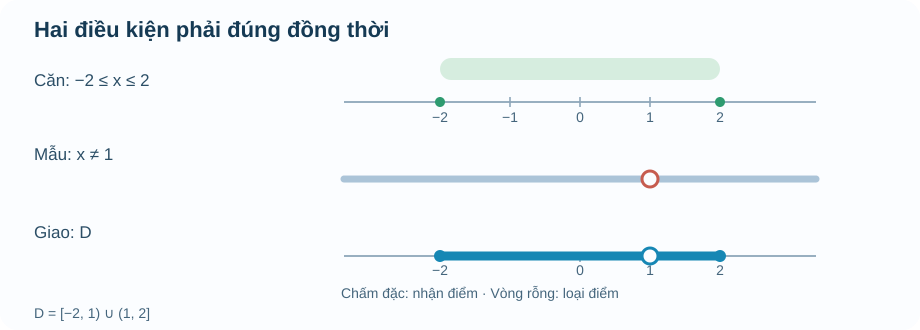

**Cách đọc hình:** hàng thứ nhất tô nhạt đoạn \([-2,2]\), biểu diễn điều kiện căn. Hàng thứ hai nhắc rằng điểm \(1\) bị loại bởi mẫu số. Hàng cuối thể hiện **giao** hai điều kiện: từ \(-2\) đến trước \(1\), rồi sau \(1\) đến \(2\). Vòng tròn rỗng ở \(1\) không phải điểm thuộc miền.

[Thử mô hình tương tác miền căn và mẫu](Temp_TOPIC1_M1_DOMAIN_LAB_D5_R00.html). Hãy tự kiểm các điểm biên trước khi kéo thanh điều khiển. Mô hình là phương tiện quan sát, không thay phần giải thích bằng lời bên trên.

### Ví dụ 2 · Thử giá trị ở biên, ở điểm loại và bên ngoài

Với \(h\) trên, lần lượt xét \(x=-2,0,1,2,3\).

| Giá trị | Căn có nghĩa? | Mẫu khác 0? | Kết luận |
|---|---|---|---|
| \(x=-2\) | Có, vì \(4-(-2)^2=0\) | Có | \(h(-2)=0\) |
| \(x=0\) | Có, vì \(4-0^2=4\) | Có | \(h(0)=2/(-1)=-2\) |
| \(x=1\) | Có, vì \(4-1^2=3\) | **Không** | \(h(1)\) không xác định |
| \(x=2\) | Có, vì \(4-2^2=0\) | Có | \(h(2)=0\) |
| \(x=3\) | **Không**, vì \(4-3^2=-5\) | Có | \(h(3)\) không xác định trong \(\mathbb R\) |

Điều này cũng giải thích vì sao một giá trị \(x\) **không hợp lệ** không phải là “đầu vào cho kết quả sai”. Nó đơn giản không thuộc miền mà hàm đã được định nghĩa.

### Trường hợp dễ nhầm: căn nằm ở mẫu

Với biểu thức \(\displaystyle k(x)=\frac{1}{\sqrt{5-x}}\), căn ở **mẫu số**. Khi đó không đủ để yêu cầu \(5-x\ge0\). Nếu \(5-x=0\), mẫu sẽ bằng 0. Điều kiện chính xác là \(5-x>0\), tức \(x<5\). Vì vậy \(D_k=(-\infty,5)\), **không nhận** \(5\).

Một mẹo kiểm tra có lý do rõ ràng: hãy đọc biểu thức theo thứ tự cấu tạo. Có căn ở đâu? Có mẫu số ở đâu? Có phải kiểm đồng thời hai ràng buộc? Làm theo thứ tự này đáng tin cậy hơn việc ghi nhớ một bảng mẹo rời rạc.

### M1 · Cùng công thức, đổi miền thì tập giá trị có thể đổi

Xét \(g(x)=(x-1)^2+2\) trên toàn bộ \(\mathbb R\). Vì bình phương không âm nên \(g(x)\ge2\), và khi \(x=1\) ta nhận đúng \(g(1)=2\). Khi \(|x-1|\) tăng không giới hạn, giá trị \(g(x)\) cũng tăng không giới hạn. Vậy \(T_g=[2,+\infty)\).

Nhưng nếu **chính quy tắc ấy** được xét trên đoạn \(D=[0,2]\), thì \(0\le(x-1)^2\le1\). Khi ấy \(g(x)\) chỉ nhận các giá trị từ 2 đến 3, tức \(T_g=[2,3]\). **Công thức không đổi, nhưng miền đầu vào đổi thì tập giá trị có thể đổi.** Sang M3, em sẽ dùng chính ý tưởng này để không chọn nhầm đỉnh parabol nằm ngoài miền bài toán.

## M2 — Đọc bảng và đồ thị: Điều gì biết chắc, điều gì mới là phỏng đoán?

### Một đồ thị không tự sinh thêm dữ kiện

Một bảng đo nhiệt độ ở 8 giờ, 12 giờ và 16 giờ **chỉ xác nhận các số liệu được đo ở ba thời điểm**. Nếu ta nối chúng bằng một đường cong, phần giữa là **giả định mô hình hay cách nội suy**, không thể khẳng định nhiệt độ thật tại 10 giờ chỉ từ ba điểm. Trục ngang cho biết đại lượng **đầu vào và đơn vị**, trục đứng là **đầu ra và đơn vị**; dấu chấm rỗng/đặc nói điểm có thuộc miền hay không.

**EX-M2-01 — Kiểm tra điểm trên đồ thị:** \(f(x)=|x-3|+2\), miền \(\mathbb R\). Điểm \(A(1,4)\) thuộc vì \(f(1)=4\). Điểm \(B(4,4)\) không thuộc vì \(f(4)=3\), dù cả x=4 và y=4 đều là số hợp lệ riêng lẻ. Đỉnh chữ V \((3,2)\) là giá trị nhỏ nhất, tập giá trị \([2,+\infty)\). **Chọn cách kiểm bằng thay x** vì câu hỏi là một **điểm**, chưa cần phương pháp đạo hàm hay đồ thị chi tiết.

### “Đồng biến” là một kết luận trên cả khoảng, không phải hai phép đo

Với \(K\) là một **khoảng** trong miền, ta gọi hàm **đồng biến nghiêm ngặt** nếu với mọi \(x_1<x_2\in K\), \(f(x_1)<f(x_2)\); nghịch biến nghiêm ngặt nếu luôn \(f(x_1)>f(x_2)\). Lưu ý một số tài liệu dùng “không giảm” theo nghĩa yếu; trong nội dung này khi ghi đồng biến/nghịch biến dùng bất đẳng thức **nghiêm ngặt** để tránh đổi nghĩa giữa bài.

**EX-M2-02 — Hai điểm giống nhau không nói cả khoảng:** \(f(x)=x^2\). Trên \((-\infty,0)\), khi x tăng từ −3 đến −1, f giảm từ 9 xuống 1; trên \((0,+\infty)\), f tăng. Trục tung phân cách hai hướng. Không được nói “hàm luôn tăng” chỉ vì thấy đồ thị nửa bên phải đi lên. **Nếu miền rời thành nhiều khoảng**, chỉ kết luận tăng/giảm trên từng khoảng khi có bằng chứng, không nối qua điểm bị loại như các hàm tan/cot và phân thức ở M4/M7.

**TỰ THỬ M2-T01.** \(f(x)=x^2\) trên \(D=[-3,-1]\). Hàm tăng hay giảm? Tìm GTLN/GTNN trên chính D.

Đã tự thử? Mở đối chiếu

Với x âm tiến dần đến 0, bình phương giảm, nên hàm giảm trên D; GTLN \(f(-3)=9\), GTNN \(f(-1)=1\). Không áp dụng “parabol mở lên nên luôn tăng”.

### Đọc đúng điểm chuyển công thức

**EX-M2-03 — Một mô hình giá theo thời lượng:** cho \(P(t)=5t\) (nghìn đồng) nếu \(0\le t\le2\); và \(P(t)=10+3(t-2)\) nếu \(t>2\), t tính bằng giờ. Đúng tại t=2, ta dùng nhánh đầu và \(P(2)=10\); t=3 dùng nhánh hai cho \(P(3)=13\). Hai nhánh tiến tới **cùng** giá trị 10 ở t=2: đồ thị không có bước nhảy tại mốc đó, nhưng vẫn **đổi độ dốc**. Đây là mô hình tính giờ lẻ liên tục giả định, không tự suy dịch vụ thực tế thu tiền đúng như công thức.

**TỰ THỬ M2-T02.** Giả sử nhánh thứ hai thay bằng \(P(t)=12+3(t-2)\) khi t>2, còn nhánh đầu giữ nguyên. Giá ngay ở t=2 là bao nhiêu? Đồ thị có bậc nhảy không?

Đã thử? Mở đối chiếu

Tại t=2 dùng nhánh đầu nên \(P(2)=10\). Khi t tiến đến 2 từ bên phải, giá tiến tới 12, cao hơn 10; đồ thị có bước nhảy, không liên tục tại mốc. Nếu ghi P(2)=12, em đã bỏ qua điều kiện t>2 của nhánh thứ hai.

**Để đọc hình:** minh họa SGK B15 ở PDF 1-based p8/p9 gồm đồ thị, bảng tăng/giảm và mô hình theo khối lượng/tốc độ. Khi dựng tại Topic, nguồn hình phải có ID, chú giải trục/đơn vị, mốc thuộc miền, mô tả bằng chữ đủ hiểu khi hình không tải và không ép học sinh mở SGK. Một hình đồ thị không thay lời giải về **vì sao** kết luận tăng/giảm đúng.

### M2 · Luyện đọc chứng cứ và chấm rỗng/đặc

### Tự thử — Ba dấu chấm có quyết định được cả nét cong?

Có ba vị trí được ghi trên một tờ giấy: \((0;1)\), \((1;0)\), \((2;1)\). Hai bạn học sinh muốn vẽ đường biểu diễn giữa các mốc. Một bạn chọn \(f(x)=(x-1)^2\), bạn kia chọn \(g(x)=|x-1|\), **cùng chỉ xét \(D=[0,2]\)**.

Hãy tự thay \(x=0,1,2\) vào cả hai công thức: **đường nào đi qua đúng ba điểm?** Rồi dự đoán ở \(x=0{,}5\), hai bạn có vẽ cùng một điểm không. Đừng mở hình khi chưa thử tính.

Đối chiếu và xem hai đường trên cùng hệ trục

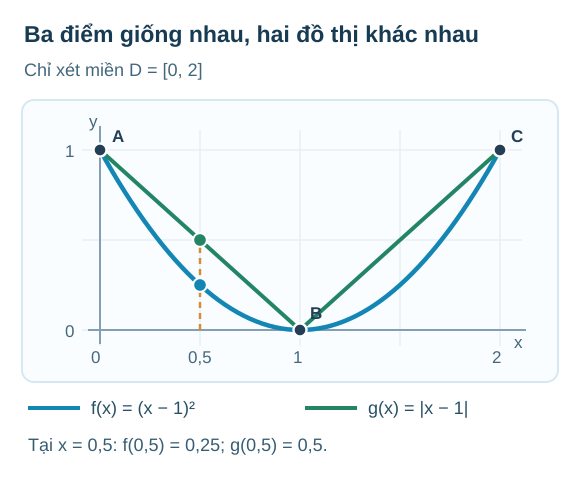

Cả hai công thức đều cho các giá trị lần lượt **1, 0, 1** ở \(x=0,1,2\). Nhưng tại \(x=0{,}5\):
\[
f(0{,}5)=(0{,}5-1)^2=0{,}25,\qquad
g(0{,}5)=|0{,}5-1|=0{,}5.
\]
Vì vậy **ba điểm riêng lẻ không xác định duy nhất đường nối giữa chúng**. Hai đường hợp lệ theo đúng ba mốc nhưng mô tả những giá trị ở giữa khác nhau.

**Điều quyết định nằm ở dữ kiện được cho:** Nếu chỉ biết *ba cặp số*, em không có quyền khẳng định giá trị ở giữa. Nếu bài toán **cho hẳn quy tắc** \(f(x)=(x-1)^2\) và miền \(D=[0,2]\), thì tại mọi \(x\in D\) ta có thể tính \(f(x)\); cả đoạn parabol trong miền ấy được xác định bằng công thức. Nhưng nếu chỉ cho bảng ba điểm, không được tự giả định nó là parabol.

Đây là cầu nối từ M1 sang M2: **M1 xác định đầu vào nào hợp lệ; M2 hỏi những giá trị nào thật sự được dữ kiện hoặc quy tắc xác định.** Ở M3, ta sẽ còn dùng chính đoạn parabol \(f(x)=(x-1)^2\) trên \([0,2]\) để tìm hiểu khi dịch đồ thị, **miền đầu vào cũng phải dịch theo**.

**Điều cần nhớ:** hãy nhìn tên và đơn vị trên hai trục, xem các dấu chấm là **dữ liệu đã đo** hay điểm của **mô hình toán**, rồi mới đọc giá trị ở giữa. Nếu chỉ có bảng với ba mốc, nói “lúc nào nước cũng nóng dần” là kết luận quá mức.

### Miền rời rạc không phải một nét vẽ liên tục

Một bảng doanh thu theo **số vé** chỉ có đầu vào \(n=1,2,3,\ldots\). Khi vẽ, mỗi đầu vào được biểu diễn bằng một chấm. Đường thẳng đi qua các chấm có thể giúp nhìn xu hướng, nhưng không được tự coi \(n=2{,}5\) là số vé hợp lệ. Như vậy, từ M1 sang M2, **tập xác định vẫn quyết định điểm nào thuộc đồ thị**.

### M2 · Một dấu bằng làm thay đổi đúng một điểm

Khi đã biết công thức hoặc quy tắc, ta còn phải đọc **đúng điều kiện tại điểm đổi nhánh**: một nét nối thêm cho đẹp có thể tạo ra điểm không thuộc hàm. **Trong ví dụ mới này**, ta dùng lại ký hiệu \(f\) cho hàm từng đoạn dưới đây (khác hàm \(f(x)=(x-1)^2\) ở hoạt động ba điểm). Xét:

\[
f(x)=
\begin{cases}
x+1,&x<1,\\
3,&x\ge1.
\end{cases}
\]

Ta phải đọc **điều kiện trước khi thay số**. Với \(x=0\), dùng \(x+1\), được \(f(0)=1\). Với \(x=2\), dùng giá trị không đổi 3, được \(f(2)=3\). Riêng tại \(x=1\), công thức đầu **không** áp dụng vì yêu cầu \(x<1\); công thức thứ hai **có** áp dụng vì \(x\ge1\), nên \(f(1)=3\).

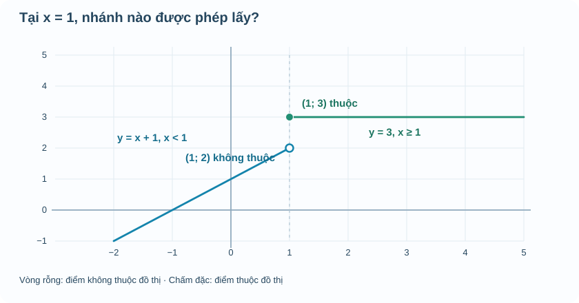

Ở \(x=1\), nhánh \(y=x+1\) tiến đến tung độ 2 nhưng **không nhận** điểm \((1;2)\), nên hình vẽ dùng vòng tròn rỗng. Nhánh \(y=3\) **nhận** điểm \((1;3)\), nên phải tô đặc. Hai vị trí này có cùng hoành độ nhưng chỉ một điểm thuộc đồ thị.

Nếu người vẽ tô đặc cả hai điểm, ta sẽ có **một đầu vào \(x=1\) nhưng hai đầu ra khác nhau**. Hình đó không còn biểu diễn đúng một hàm số. Vì vậy nét rỗng/đặc không phải chi tiết trang trí: nó giúp thể hiện chính xác định nghĩa hàm số.

### Ví dụ 1 · Thay một dấu bằng, thay giá trị tại điểm

Giữ nguyên hai công thức nhưng sửa điều kiện thành:

\[
g(x)=
\begin{cases}
x+1,&x\le1,\\
3,&x>1.
\end{cases}
\]

Khi ấy \(g(1)=2\) thay vì 3. Hình vẽ phải đổi: \((1;2)\) thành điểm đặc và \((1;3)\) thành vòng tròn rỗng. Hai đồ thị chỉ khác **giá trị tại đúng một đầu vào**, nhưng giá trị đó phải được thể hiện chính xác.

[Mô hình tương tác đổi nhánh](Temp_TOPIC1_M2_PIECEWISE_LAB_D5_R00.html) cho phép di chuyển \(x\) qua hai phía của mốc 1. Thử \(x=0{,}99\), \(x=1\), \(x=1{,}01\). Quan sát rằng ta **không** có quyền nối hai đầu nhánh để làm hình “mượt” hơn.

### Ví dụ 2 · Đọc đúng bảng và điểm mốc

| x | 0 | 0,5 | 1 | 2 |
|---|---:|---:|---:|---:|
| f(x) | 1 | 1,5 | 3 | 3 |

Tại \(x=0{,}5\), nhánh thứ nhất cho \(0{,}5+1=1{,}5\). Tại \(x=1\) hoặc 2, nhánh thứ hai cho 3. Nếu đọc \(f(1)=2\), ta đã vô tình dùng sai nhánh.

### M2 · Kiểm toàn miền trước khi nói đồng biến

Theo định nghĩa dùng trong chuyên đề này, hàm **đồng biến nghiêm ngặt** trên một khoảng \(K\) nếu với mọi \(x_1<x_2\) thuộc \(K\), ta có \(f(x_1)<f(x_2)\).

Nhánh \(x+1\) đang tăng về phía phải, nhưng nhánh \(y=3\) hoàn toàn **không tăng**. Vì thế không được nói \(f\) đồng biến nghiêm ngặt trên toàn bộ \(\mathbb R\). Một phản ví dụ rất ngắn: \(1<2\) nhưng \(f(1)=f(2)=3\), trái yêu cầu \(f(1)<f(2)\).

Cách diễn đạt chính xác là: \(f\) đồng biến nghiêm ngặt trên \((-\infty,1)\) và **không đổi** trên \([1,+\infty)\). Ngoài ra có một bước nhảy tại mốc 1: các giá trị gần 1 về phía trái gần 2, còn giá trị ngay tại mốc và bên phải bằng 3. Sau này M5 sẽ giải thích chặt chẽ điều này bằng giới hạn một phía và liên tục; ở M2, ta chỉ cần hiểu **đọc điểm nào theo quy tắc nào**.

## M3 — Vì sao parabol có một “điểm ngoặt”, và đỉnh không luôn là lựa chọn tối ưu?

### Hình thành bản chất bằng bình phương, không học thuộc tọa độ đỉnh trước

Với hàm bậc hai \(f(x)=ax^2+bx+c\), **\(a\ne0\)**. Trên miền toán học \(\mathbb R\), ta có
\[
f(x)=a\left(x+\frac b{2a}\right)^2+c-\frac{b^2}{4a}
=a(x-h)^2+k,\quad h=-\frac b{2a},\ k=f(h).
\]
Do \((x-h)^2\ge0\), khi a>0 đồ thị có giá trị **nhỏ nhất** k trên \(\mathbb R\), khi a<0 có giá trị **lớn nhất** k. Hai điểm \(x=h-d\) và \(x=h+d\) có cùng đầu ra vì các bình phương bằng nhau; trục đối xứng là **\(x=h\)**, đỉnh **\(I(h,k)\)**. Nếu \(a=0\), biểu thức chỉ là bậc nhất/hằng, không gọi parabol.

**EX-M3-01 — Đỉnh, trục, chiều mở đều xuất phát từ một phép biến đổi:** \(f(x)=2x^2-8x+3=2(x-2)^2-5\). Vì 2>0 nên parabol mở lên, đỉnh I(2,−5), trục x=2, GTNN toàn R −5. Lấy các điểm đối xứng \(f(1)=f(3)=-3\), giao Oy \((0,3)\). Không cần đoán các điểm từ một bức hình mờ.

**TỰ THỬ M3-T01.** \(f(x)=-x^2+6x-5\). Đưa về dạng đỉnh, nêu chiều mở, đỉnh và giá trị lớn nhất trên toàn \(\mathbb R\).

Đã biến đổi? Mở đối chiếu

\(f(x)=-(x-3)^2+4\), mở xuống, đỉnh \((3,4)\), GTLN toàn R là 4. Nếu ra −4, hãy khai triển \(-(x-3)^2+4=-x^2+6x-5\) để kiểm dấu.

### Một parabol có thể không gặp trục hoành

**EX-M3-02 — Phải kiểm nghiệm trước khi vẽ giao trục:** \(f(x)=x^2-6x+11=(x-3)^2+2>0\) với mọi x. Đồ thị mở lên, đỉnh \((3,2)\) nằm **trên** Ox và không cắt Ox. Cùng kết luận từ \(\Delta=(-6)^2-4\cdot1\cdot11=-8<0\). Giao Oy \((0,11)\) luôn có nếu miền là R; nhưng trong mô hình hạn chế miền chỉ giữ giao Oy khi x=0 được phép. **Vì sao chọn cách bình phương?** Nó cho ngay khoảng giá trị và chiều mở; biệt thức cho số nghiệm/giao Ox; hai công cụ bổ sung nhau.

### Phải xét miền mô hình trước khi tìm cực trị

**EX-M3-03 — Đỉnh ngoài miền, kết luận khác đi:** \(g(x)=-(x-5)^2+20\) nhưng chỉ xét \(D=[0,3]\). Đỉnh ở x=5 **không thuộc D**. Vì x tăng từ 0 đến 3 thì \((x-5)^2\) giảm, g tăng trên đoạn. \(g(0)=-5\), \(g(3)=16\): GTNN −5, GTLN 16, không phải 20. **Tại sao không dùng thẳng công thức k?** k là GTLN của *toàn R*, trong khi bài hỏi miền con.

**TỰ THỬ M3-T02.** Hàm \(p(x)=(x+2)^2-4\) chỉ xét trên \([-1,2]\). Có được nhận GTNN −4 của parabol toàn R không? Tìm GTNN/GTLN trong miền đã cho.

Đã thử? Mở đối chiếu

Không, đỉnh x=−2 nằm ngoài \([-1,2]\). Trên đoạn này x+2>0 nên p tăng; \(p(-1)=-3\) là GTNN, \(p(2)=12\) là GTLN. Nếu em nhận −4, quay lại bước so đỉnh với miền.

**EX-M3-04 — Tối ưu với số lượng nguyên và giới hạn thực tế:** mô hình lợi nhuận \(L(q)=-(q-4)^2+25\) triệu đồng, số lượng sản phẩm nguyên trong \(\{0,1,\ldots,8\}\). Đỉnh q=4 là số nguyên hợp lệ và cho GTLN 25 triệu đồng. Nếu chỉ có thể làm tối đa 3 sản phẩm, miền đổi thành \(\{0,1,2,3\}\), giá trị tốt nhất là \(L(3)=24\) triệu đồng. **Không biến đáp án trong miền khác thành đáp án của bài mới.**

**Tự phác thảo để kiểm hiểu bài:** Với \(y=(x-2)^2-1\), đỉnh là \(I(2;-1)\), trục đối xứng \(x=2\), giao \(Ox\) tại \(x=1,3\), giao \(Oy\) tại \((0;3)\). Hãy đặt các điểm ấy lên một hệ trục rồi nối thành parabol mở lên. Nếu đề chỉ lấy một miền con, chỉ vẽ phần đồ thị ứng với miền con đó.

**TỰ THỬ M3-T03.** \(u(x)=x^2-6x+8\). Tìm trục, đỉnh và các giao Ox; giải thích vì sao hai nghiệm cách trục một khoảng bằng nhau.

Đã tự làm? Mở đối chiếu

\(u=(x-3)^2-1\). Đỉnh (3,−1), trục x=3; \(u=0\iff(x-3)^2=1\) nên x=2 hoặc 4. Hai nghiệm đối xứng vì nằm tại 3−1 và 3+1. Nếu quên lý do đối xứng, quay lại bình phương \((x-h)^2\).

### M3 · Hai chiếc máy: đổi đầu vào hay đổi đầu ra?

Ở M1, em đã biết phải xem **đầu vào nào được nhận**. Ở M2, em học cách phân biệt **điểm đo được, đồ thị do công thức xác định** và điểm thuộc miền hay bị loại; em còn thấy hai đường khác nhau có thể cùng đi qua ba mốc. Bây giờ ta thử thay đổi vị trí **một dấu trị tuyệt đối** và xem nó tác động đến đầu vào, đầu ra và đồ thị như thế nào.

Xét hàm số

\[
f(x)=x^2-4x+3=(x-2)^2-1.
\]

Từ dạng bình phương, ta thấy đỉnh \(I(2;-1)\), trục đối xứng \(x=2\) và đồ thị mở lên. Hai nghiệm của \(f(x)=0\) là \(x=1\) và \(x=3\). Trong khoảng \(1<x<3\), đồ thị nằm **dưới** trục hoành vì \(f(x)<0\); ngoài khoảng ấy, \(f(x)\ge0\).

Trên nền này, chúng ta tạo hai đồ thị mới:

\[
g(x)=|f(x)|,\qquad h(x)=f(|x|).
\]

Hai công thức có cùng dấu gạch đứng, nhưng chúng yêu cầu hai hành động hoàn toàn khác nhau. Với \(g\), ta tính xong giá trị \(f(x)\) rồi mới lấy trị tuyệt đối của **đầu ra**. Với \(h\), ta lấy trị tuyệt đối của **đầu vào** trước rồi mới đưa vào quy tắc \(f\).

### Tự thử · Hai chiếc máy xử lý cùng một đầu vào

Em hãy hình dung có hai chiếc máy đều dùng **cùng công thức** \(f(x)=x^2-4x+3\), nhưng thứ tự xử lý khác nhau. Máy A nhận số \(x\), tính \(f(x)\), **sau cùng** mới lấy trị tuyệt đối kết quả. Máy B lấy trị tuyệt đối của \(x\) **ngay từ cửa vào**, rồi mới tính \(f\). Dấu \(|\ |\) nằm ở đâu sẽ quyết định máy đổi **đầu vào** hay **đầu ra**.

Cho \(x=-2\). Em đã biết \(f(-2)=15\) và \(f(2)=-1\). **Trước khi xem hình**, hãy tự trả lời hai câu: Máy A cho bao nhiêu? Máy B cho bao nhiêu? Máy nào có thể cho một đầu ra âm? Hãy thử viết đường đi của số \(-2\) qua từng máy.

Đối chiếu hai đường đi và xem sơ đồ

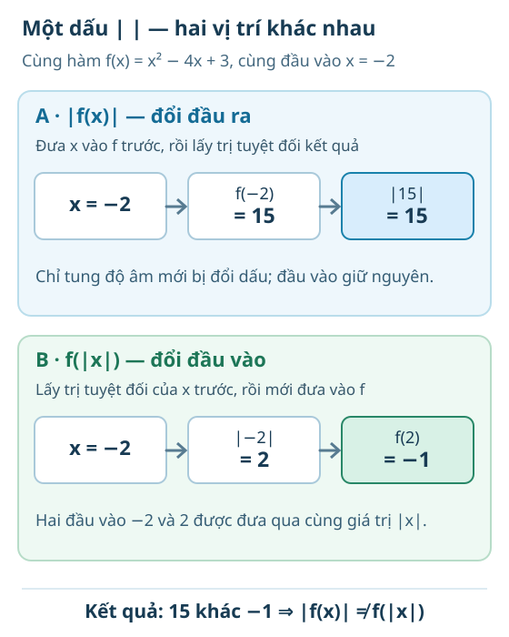

- **Máy A:** \(-2\longrightarrow f(-2)=15\longrightarrow |15|=15\). Ta chỉ can thiệp vào **kết quả** của \(f\); vì vậy \(|f(x)|\) không âm.
- **Máy B:** \(-2\longrightarrow |-2|=2\longrightarrow f(2)=-1\). Ta thay **số đem vào f**, nên \(f(|x|)\) vẫn có thể âm.

Cùng một đầu vào \(-2\), hai đường đi cho \(15\) và \(-1\). Đừng đổi chỗ hai thao tác: \(f(|x|)\) và \(|f(x)|\) không phải một công thức.

**Mang dự đoán sang đồ thị:** Máy A giữ nguyên hoành độ và chỉ lật những điểm có tung độ âm qua trục \(Ox\). Máy B sử dụng cùng giá trị \(|x|\) cho hai vị trí \(x\) và \(-x\), nên hình mới đối xứng qua trục \(Oy\) trên những đầu vào được phép. Em sẽ thấy và giải thích hai điều ấy ở mô hình ngay dưới đây; không cần học thuộc quy tắc vẽ trước khi hiểu thứ tự thao tác.

### M3A. Giá trị tuyệt đối ở bên ngoài: \(y=|f(x)|\)

Nhớ rằng \(|u|=u\) khi \(u\ge0\), còn \(|u|=-u\) khi \(u<0\). Vì vậy,

\[
|f(x)|=\begin{cases}
f(x),&f(x)\ge0,\\
-f(x),&f(x)<0.
\end{cases}
\]

Đây chính là cách dựng đồ thị:

- Giữ nguyên mọi điểm nằm **trên hoặc ngay** trục \(Ox\).
- Lấy các điểm có tung độ âm rồi **đổi dấu tung độ**, tức phản chiếu phần nằm dưới \(Ox\) lên trên.
- Không đổi hoành độ của bất kỳ điểm nào.

Với ví dụ trên, đoạn cong giữa \(x=1\) và \(x=3\) vốn nằm dưới \(Ox\) được lật lên. Hai giao điểm \((1;0)\) và \((3;0)\) giữ nguyên; đỉnh cũ \((2;-1)\) trở thành điểm \((2;1)\) trên phần được lật.

Lấy \(x=2\): \(f(2)=-1\), nên \(|f(2)|=1\). Nếu em thấy điểm của \(g\) tại \(x=2\) vẫn có tung độ \(-1\), hình đã vẽ sai vì trị tuyệt đối **không thể âm**.

**Tập xác định:** \(g(x)=|f(x)|\) được tính ở đúng những \(x\) mà \(f(x)\) được xác định. Việc lấy trị tuyệt đối **đầu ra** không tự tạo ra đầu vào mới.

### M3B. Giá trị tuyệt đối ở bên trong: \(y=f(|x|)\)

Lần này ta đổi **đầu vào**:

\[
f(|x|)=\begin{cases}
f(x),&x\ge0,\\
f(-x),&x<0.
\end{cases}
\]

Nếu \(f\) xác định trên \(\mathbb R\), hãy giữ nửa đồ thị của \(f\) ở phía **bên phải trục tung** (\(x\ge0\)); sau đó phản chiếu nửa đó sang phía trái. Lúc này hai vị trí \(x\) và \(-x\) luôn cho cùng đầu ra, vì \(|x|=|-x|\). Do đó đồ thị mới **đối xứng qua trục tung**.

Với \(f(x)=x^2-4x+3\), ta có \(h(x)=x^2-4|x|+3\). Đỉnh \((2;-1)\) của nửa bên phải được giữ lại, và có một điểm đối xứng \((-2;-1)\) bên trái. Đồ thị mới **không còn là đồ thị của một hàm bậc hai duy nhất** trên toàn \(\mathbb R\), dù từng phía của nó được vẽ từ một phần parabol.

Một cách kiểm nhanh:

\[
f(-2)=15,\qquad f(|-2|)=f(2)=-1,
\]
\[
|f(2)|=1,\qquad f(|2|)=f(2)=-1.
\]

Như vậy, không được viết \(f(|x|)=|f(x)|\) nếu chưa có lý do đặc biệt: chỉ tại \(x=2\), hai giá trị đã khác nhau.

**Nếu miền của \(f\) không phải toàn bộ \(\mathbb R\):** với \(h(x)=f(|x|)\), đầu vào \(x\) chỉ hợp lệ khi **\(|x|\) thuộc tập xác định của \(f\)**. Quy tắc phản chiếu này luôn cần kiểm miền. Ví dụ, nếu \(f\) chỉ được định nghĩa trên \([1,3]\), thì \(f(|x|)\) được định nghĩa trên \([-3,-1]\cup[1,3]\), không phải toàn bộ \(\mathbb R\).

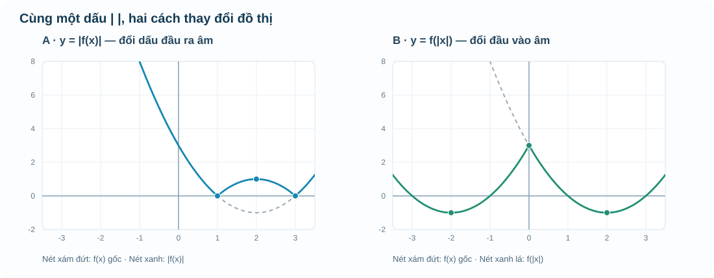

**Hướng đọc hình:** cả hai khung dùng trục và màu nhất quán. Đường xám nét đứt là \(f(x)\) gốc, đường màu là phép biến đổi được nêu ở tiêu đề. Ở khung \(|f(x)|\), quan sát phần âm được lật qua \(Ox\); ở khung \(f(|x|)\), quan sát nửa bên phải được sao đối xứng sang trái. Nếu hai đường trùng một đoạn, chúng vẫn là hai quy tắc cần phân biệt.

[Mô hình tự thử phép biến đổi](Temp_TOPIC1_M3_GRAPH_TRANSFORM_LAB_D5_R00.html) cho phép bật từng phép biến đổi. Hãy thử với \(a=1,b=-4,c=3\), sau đó đổi dấu hoặc độ lớn của \(a\) và quan sát. Đừng bật tất cả ngay: nên dự đoán hình dạng trước rồi mới so sánh.

### M3C. Tự suy ra quy tắc tịnh tiến từ đầu vào

Một ý tưởng có giá trị từ bộ Notebook 22 chuyên đề là **đọc phép tịnh tiến bằng đầu vào và đầu ra**, thay vì bắt học sinh thuộc lòng câu “trừ là sang phải, cộng là sang trái”. Ta có thể tự suy ra điều đó.

**Nối với M2:** Em còn nhớ ba điểm \((0;1)\), \((1;0)\), \((2;1)\) cùng nằm trên parabol và đồ thị chữ V không? Nếu đề chỉ cho ba điểm, em **chưa được tự chọn** đường nào để dịch. Nhưng khi đề xác định rõ hàm \(f(u)=(u-1)^2\) trên \(D=[0,2]\), ta đã biết **chính xác đoạn parabol phải dịch**. Ví dụ ở mục này dùng lại hàm \(f\) ấy của M2; đây là **hàm mới so với \(f(x)=x^2-4x+3\)** trong hai phép trị tuyệt đối ở phía trên.

Giả sử em đã biết một điểm \(A(u;f(u))\) thuộc đồ thị gốc \(y=f(x)\). Bây giờ xét hàm

\[
g(x)=f(x-2)+3.
\]

Để phần \(f(x-2)\) sử dụng **đúng đầu vào cũ \(u\)**, ta phải chọn \(x-2=u\), tức \(x=u+2\). Khi ấy đầu ra bằng \(f(u)+3\). Như vậy điểm \(A(u;f(u))\) chuyển thành

\[
A'(u+2;f(u)+3).
\]

Điều này giải thích được cả hai chiều: **dịch sang phải 2 đơn vị** vì hoành độ mới lớn hơn 2; **dịch lên trên 3 đơn vị** vì tung độ mới lớn hơn 3. Nếu chỉ nhìn thấy dấu trừ trước số 2 rồi đoán “dịch trái”, em đã nhầm giữa giá trị **đưa vào máy tính** và vị trí **điểm trên đồ thị mới**.

### Ví dụ · Miền của đồ thị cũng phải dịch

Ta xét đúng \(f(u)=(u-1)^2\) của M2, **với tập xác định \(D_f=[0,2]\)**. Đồ thị gốc là **một đoạn parabol** từ \(A(0;1)\), qua đỉnh \(I(1;0)\) đến \(B(2;1)\); đừng vẽ kéo dài toàn bộ hai nhánh vì miền đầu vào đã được giới hạn.

Đặt \(g(x)=f(x-2)+3\). Muốn \(g(x)\) có nghĩa, phải có \(x-2\in[0,2]\), tức

\[
\boxed{D_g=[2,4].}
\]

Từ ba điểm gốc, ta nhận \(A'(2;4)\), \(I'(3;3)\), \(B'(4;4)\). Trên miền mới, \(g(x)\) nhận tất cả giá trị từ 3 đến 4, tức \(T_g=[3,4]\). **Đồ thị, tập xác định và tập giá trị đều được xét đúng trong miền được cho**; phép tịnh tiến không làm xuất hiện vô hạn điểm mới ở ngoài đoạn.

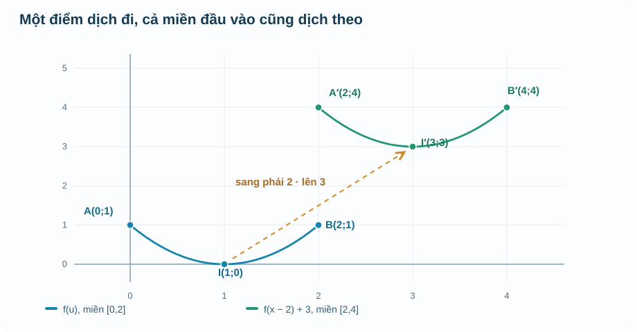

**Cách đọc hình:** đường xanh dương là **đoạn đồ thị gốc**, đường xanh lá là **đoạn sau khi dịch**. Mũi tên nét đứt chỉ sự chuyển từ đỉnh \(I\) đến \(I'\). Hãy đọc cả các mốc \(x=0,2,4\) trên trục hoành; chỉ nhìn hai đỉnh thôi thì chưa đủ nhận ra miền mới.

### Vận dụng · Tự chuyển một hàm không phải parabol

Giả sử \(f(x)=\sqrt{x}\) chỉ xét trên \([0,4]\). Hãy dự đoán tập xác định và tập giá trị của \(h(x)=f(x+1)-2\) trước khi nhìn phần đối chiếu.

Đối chiếu

Để \(f(x+1)\) có nghĩa, cần \(x+1\in[0,4]\), nên \(-1\le x\le3\). Vậy \(D_h=[-1,3]\). Vì \(f\) nhận tất cả giá trị trong \([0,2]\) trên miền gốc, sau khi trừ 2 vào **đầu ra**, \(h\) nhận các giá trị \([-2,0]\). Đồ thị dịch **sang trái 1** và **xuống 2**; cách đọc dấu vẫn được giải thích bằng phép thế \(x+1=u\), không cần học thuộc máy móc.

**Điều kiện quan trọng:** công thức \(f(x-a)+b\) không cho phép bỏ qua tập xác định gốc. Nếu \(f\) chỉ có nghĩa với \(u\in D_f\), miền mới phải là \(\{x:x-a\in D_f\}\), dù hình vẽ được tịnh tiến bằng cách nào. Các phép tịnh tiến này là phần **mở rộng trực quan** của M3; không tự ghi thành Core bắt buộc của SGK Bài 16.

### Cầu nối · Từ đỉnh parabol đến câu hỏi “đạt ít nhất một mức”

Một bài toán tối ưu không phải lúc nào cũng chỉ hỏi **giá trị lớn nhất**. Đôi khi người ta hỏi: *Những phương án nào đạt ít nhất một mức lợi nhuận hoặc diện tích cho trước?* Bài toán ấy vẫn xuất phát từ chính **dạng đỉnh** em vừa học, không cần đoán nghiệm từ hình.

Giả sử \(F(x)=k-c(x-h)^2\) với \(c>0\), chỉ xét các \(x\) thuộc **miền hợp lệ \(D\)**. Vì \(c(x-h)^2\ge0\), ta đã biết \(F(x)\le k\). Với một ngưỡng \(m\), muốn \(F(x)\ge m\), ta biến đổi:

\[
k-c(x-h)^2\ge m
\quad\Longleftrightarrow\quad
(x-h)^2\le\frac{k-m}{c}.
\]

- **Nếu \(m>k\):** vế phải âm, còn bình phương không âm ⇒ **không có phương án nào** đạt ngưỡng.
- **Nếu \(m=k\):** chỉ có ứng viên \(x=h\); nó chỉ là phương án thật khi \(h\in D\).
- **Nếu \(m<k\):** đặt \(r=\sqrt{(k-m)/c}>0\), bất đẳng thức trở thành \(|x-h|\le r\), hay \(h-r\le x\le h+r\). **Bước cuối cùng** phải lấy giao đoạn này với \(D\); nếu bài đòi số lượng nguyên, chỉ chọn các số nguyên trong giao ấy.

**Tự thử trước khi mở Đối chiếu.** Một mô hình giả định \(Q(t)=16-(t-3)^2\), nhưng chỉ xét \(0\le t\le5\). Trong những thời điểm nào mô hình dự báo \(Q(t)\ge12\)? Hãy dự đoán bằng khoảng cách tới \(t=3\), không cần vẽ hình hoặc học thuộc bảng dấu.

Đối chiếu · Từ ngưỡng quay về miền

\(16-(t-3)^2\ge12\) tương đương \((t-3)^2\le4\), tức \(|t-3|\le2\), hay \(1\le t\le5\). Giao với miền cho trước \([0,5]\) vẫn là **\([1,5]\)**. Nếu mô hình chỉ được xét đến \(t=4\), đáp án phải đổi thành \([1,4]\). Đó là lý do **miền hợp lệ** luôn đi cùng mỗi kết luận, dù công thức đã biến đổi đúng.

**Em dùng kiến thức này ở đâu?** Khi gặp bài ứng dụng tính diện tích, chi phí hoặc lợi nhuận có câu “không nhỏ hơn một mức”, hãy thực hiện ba bước: lập hàm và miền → dùng dạng đỉnh để chuyển điều kiện ngưỡng thành \(|x-h|\le r\) (nếu có nghiệm) → **giao với miền và diễn đạt kèm đơn vị**. Cách giải này giúp tự học được bài vận dụng tích hợp; không phải một quy tắc chỉ áp dụng cho mọi parabol ở mọi miền.

## Cầu nối để em không phải học lại khi lên lớp 11–12

- M1 cho em **miền**. Nó quyết định chỗ nào phép log/căn/tiệm cận/đạo hàm ở M4–M7 có nghĩa và chỗ nào mô hình vật lý bắt buộc loại.
- M2 cho em **cách đọc và giới hạn chứng cứ**. Khi gặp hàm lượng giác chia thành nhánh, giới hạn một phía hay tiếp tuyến, em luôn kiểm điểm rỗng/đặc, khoảng và ý nghĩa trục.
- M3 cho em ý nghĩa **cực trị** xuất phát từ dạng bình phương. Sau này M7 dùng dấu đạo hàm cho họ hàm phức tạp hơn, nhưng vẫn phải kiểm miền và phân biệt **cực trị địa phương** với **GTLN/GTNN trên miền hỏi**.
- **Không tạo Chuyên đề chia theo lớp.** Người học có thể đi thẳng đến mảng cần thiết, với lời nhắc tiền đề và liên kết nội bộ trong cùng Topic.

## M1–M3 · Khi em hiểu sai, nên quay lại chỗ nào?

| Biểu hiện người học | Lỗi bản chất | Đường sửa ngay trên trang |
|---|---|---|
| Gọi bảng có hai x khác nhau cùng y là không phải hàm | Nhầm đơn trị với một-một | M1 EX01 + TRY T01 |
| Quên x=−2 được nhận trong căn hoặc quên x=1 bị loại ở mẫu | Không lấy giao điều kiện, nhầm dấu căn | M1 EX02 + TRY T02 |
| Dự đoán số đo giữa hai mốc như chắc chắn | Nhầm nội suy mô hình với dữ kiện đã quan sát | M2 lời dẫn + EX01; phải hỏi nguồn chứng cứ |
| Nói hàm tăng từ hai điểm hay nối qua điểm loại | Chưa kiểm “mọi cặp x” trên một khoảng | M2 EX02 + TRY T01; HELP-G10-B15-02 |
| Thay nhánh sai ở điểm nối | Bỏ điều kiện \(<,\le\) | M2 EX03 + TRY T02; HELP-G10-B15-02 |
| Đưa đỉnh/parabol ra ngoài miền mô hình | Quên miền khả thi | M3 EX03/04 + TRY T02; HELP-G10-B16-02 |
| Bảo parabol nào cũng cắt Ox | Nhầm chiều mở với vị trí so trục | M3 EX02; HELP-G10-B16-02 |
| Nhầm dấu a, trục x=h, hoặc bình phương hoàn chỉnh | Không hiểu vì sao có đỉnh | M3 EX01 + TRY T01/T03; HELP-G10-B16-01 |

---

## M4.0. Khởi động: Không phải đại lượng nào cũng thay đổi như một đường parabol

Em đã biết bảng giá trị và đồ thị có thể cho biết đại lượng đang tăng hay giảm. Nhưng có những tình huống rất khác:

- Nhiệt độ thay đổi lên xuống, rồi một kiểu biến thiên có thể lặp lại.
- Giá trị một khoản tiền tăng theo cùng **tỉ lệ** sau mỗi kỳ, chứ không phải tăng thêm cùng một lượng.
- Có lúc ta biết kết quả sau nhiều kỳ nhưng muốn tính ngược xem **sau bao nhiêu kỳ** đạt được kết quả ấy.

Để chọn đúng cách mô tả, em hỏi ba điều: *đại lượng lặp lại hay tích lũy? đầu vào được phép là gì? nhìn đồ thị có thể kết luận gì và chưa thể kết luận gì?* Phần này học ngay trong Chuyên đề, không yêu cầu mở bài SGK nào trước.

**Kiến thức chuẩn bị ngay tại đây.** Góc có thể đo bằng radian: một vòng tròn là \(2\pi\) radian, nửa vòng là \(\pi\), một phần tư vòng là \(\pi/2\). Trên đường tròn đơn vị, điểm \(M\) ứng với góc \(x\) có hoành độ \(\cos x\) và tung độ \(\sin x\); từ đó \(\cos^2x+\sin^2x=1\). Em không cần thuộc một danh sách giá trị trước khi xem bảng điểm mốc ở M4.2.

## M4.1. Trước khi nhìn dạng cong: Đồ thị có đối xứng hay lặp lại không?

### Hàm chẵn và hàm lẻ là gì?

Xét \(f(x)=x^2\). Thử \(x=2\) và \(-2\) đều cho \(4\), nên đồ thị trái và phải trục tung khớp nhau. Nếu \(f(-x)=f(x)\) với **mọi** \(x\) được phép thì ta gọi là hàm **chẵn**; đồ thị đối xứng qua trục \(Oy\).

Với \(g(x)=x^3\), \(g(-x)=-g(x)\): quay đồ thị một nửa vòng quanh gốc \(O\) thu lại cùng đồ thị. Đó là hàm **lẻ**, đối xứng qua gốc tọa độ.

**Điều kiện không được bỏ:** tập xác định \(D\) của hàm chẵn/lẻ phải đối xứng qua 0: nếu \(x\in D\) thì \(-x\in D\). Chỉ thử \(x=1\) và \(-1\) chưa thể chứng minh cho mọi \(x\). Một hàm **không nhất thiết** chẵn hoặc lẻ, ví dụ \(x^2+x\). Và hàm lẻ không nhất thiết có điểm \((0,0)\): chẳng hạn \(\cot x\) không xác định tại 0. Nếu miền không đối xứng thì không gọi chẵn/lẻ theo định nghĩa trên.

### Hàm tuần hoàn: "lặp" có nghĩa toán học chính xác

Một hàm có **chu kỳ** \(T>0\) nếu với mọi \(x\in D\), \(x+T\) và \(x-T\) vẫn nằm trong \(D\), đồng thời \(f(x+T)=f(x)\). Cả **miền** cũng cần lặp, không phải chỉ vài điểm trùng giá trị. Nếu có chu kỳ dương nhỏ nhất, ta gọi là **chu kỳ cơ bản**.

Ví dụ \(f(x)=\sin x\) lặp lại sau \(2\pi\) vì quay thêm một vòng thì tung độ không đổi. Khi đối số có hệ số, \(h(x)=\sin(3x)\) lặp sau \(T=2\pi/3\), vì \(3(x+T)=3x+2\pi\). Hệ số lớn làm đồ thị lặp **nhanh hơn**, không làm chu kỳ dài gấp ba.

**Phản ví dụ quan trọng:** hàm hằng \(f(x)=4\) có mọi số \(T>0\) là chu kỳ, nhưng không có **chu kỳ dương nhỏ nhất**. Và một dao động có chu kỳ 12 giờ không nhất thiết có biên độ 12: chu kỳ đo trên trục **đầu vào**, còn biên độ là độ lệch lớn nhất so với mức trung bình trên trục **đầu ra**.

**TRY-M4-01 — Tự thử trước ví dụ.** \(u(x)=x^4\) trên \(\mathbb R\) có đối xứng qua trục tung không? \(v(x)=x^3\) đối xứng qua đâu? Vì sao chỉ nhìn vài điểm chưa đủ chứng minh?

Đã nghĩ xong? Mở phần đối chiếu

Vì \(u(-x)=(-x)^4=x^4=u(x)\), u chẵn, đối xứng qua trục tung. Vì \(v(-x)=(-x)^3=-v(x)\), v lẻ, đối xứng qua gốc O. Hai khẳng định dùng công thức cho mọi x, không dựa vào vài điểm.

## M4.2. Từ một vòng quay đến bốn loại đồ thị lượng giác

### Cách đọc đường tròn đơn vị và bảng mốc

Khi \(M\) di chuyển hết một vòng, tọa độ chạy qua các điểm mốc sau:

| Góc \(x\) | \(0\) | \(\pi/2\) | \(\pi\) | \(3\pi/2\) | \(2\pi\) |
|---|---:|---:|---:|---:|---:|
| \(\sin x\) — tung độ | 0 | 1 | 0 | −1 | 0 |
| \(\cos x\) — hoành độ | 1 | 0 | −1 | 0 | 1 |

Vì M luôn thuộc đường tròn bán kính 1, \(-1\le\sin x,\cos x\le1\). Bảng có **năm mốc giúp đọc hình**, nhưng để kết luận tăng/giảm trên cả khoảng cần dùng đường tròn hoặc tính chất/đồ thị, không suy chỉ từ hai đầu mút.

### Hàm sin

Hàm \(y=\sin x\) có tập xác định \(\mathbb R\), tập giá trị \([-1,1]\); là **hàm lẻ**, chu kỳ cơ bản \(2\pi\). Đồ thị đi qua gốc O; một chu kỳ có thể bắt đầu tại \((0,0)\), đạt 1 ở \(\pi/2\), về 0 ở \(\pi\), tới −1 ở \(3\pi/2\), rồi trở về 0 tại \(2\pi\).

Với \(k\in\mathbb Z\): hàm đồng biến trên từng khoảng \((-\pi/2+2k\pi,\ \pi/2+2k\pi)\) và nghịch biến trên từng khoảng \((\pi/2+2k\pi,\ 3\pi/2+2k\pi)\). Các đầu mút có thể được xét khi giải bài toán tăng/giảm trên đoạn; đừng tự suy một khoảng dài đi qua nhiều cực trị vẫn đồng biến.

### Hàm cos

Hàm \(y=\cos x\) cũng có tập xác định \(\mathbb R\), tập giá trị \([-1,1]\), chu kỳ cơ bản \(2\pi\), nhưng là **hàm chẵn**, đối xứng qua trục tung. Tại \(x=0\) đồ thị ở mức 1; tại \(\pi/2\) bằng 0; tại \(\pi\) bằng −1.

Với \(k\in\mathbb Z\): cos nghịch biến trên từng khoảng \((2k\pi,\ (2k+1)\pi)\) và đồng biến trên từng khoảng \(((2k-1)\pi,\ 2k\pi)\). Nếu hỏi khoảng trong đoạn cụ thể, hãy giao những khoảng này với đoạn đầu vào đã cho, không chép nguyên các mốc ở một chu kỳ khác.

### Vì sao tan và cot bị "đứt" thành từng nhánh?

Ta định nghĩa \(\tan x=\sin x/\cos x\), chỉ khi \(\cos x\ne0\); vì vậy \(D_{\tan}=\mathbb R\setminus\{\pi/2+k\pi:k\in\mathbb Z\}\). Tương tự, \(\cot x=\cos x/\sin x\), chỉ khi \(\sin x\ne0\); \(D_{\cot}=\mathbb R\setminus\{k\pi:k\in\mathbb Z\}\).

Cả tan và cot đều có tập giá trị \(\mathbb R\), **hàm lẻ** trên miền tương ứng và chu kỳ cơ bản \(\pi\). Trên mỗi khoảng xác định nối liền hai giá trị bị loại kề nhau, tan **đồng biến**: \((-\pi/2+k\pi,\ \pi/2+k\pi)\); cot **nghịch biến**: \((k\pi,\ (k+1)\pi)\).

Khi x đến gần một điểm loại, giá trị có thể tăng/giảm vô hạn; đồ thị có nhánh tiến sát đường thẳng đứng. **Không nối qua tiệm cận đứng**; không thế vào phép chia có mẫu bằng 0. Ví dụ \(\tan0=0\) nhưng \(\cot0\) không xác định; \(\tan(\pi/4)=\cot(\pi/4)=1\). Không nói "tan tăng trên cả \(\mathbb R\)" vì tan không được xác định tại những điểm loại.

### Đọc đồ thị bằng năm câu hỏi

1. Trục ngang đang đo **góc** theo radian hay một đại lượng thời gian đã quy đổi? Trục đứng có đơn vị gì?
2. Miền đầu vào liên tục hay có các **điểm bị loại**?
3. Giá trị đầu ra nằm trong \([-1,1]\) hay không bị chặn?
4. Chu kỳ đọc theo trục x là \(2\pi\) hay \(\pi\)? Có đối xứng qua \(Oy\) hay \(O\)?
5. Hàm tăng/giảm trên **từng khoảng nào**, có nhánh bị ngắt không?

**Quan sát bốn đồ thị rồi đối chiếu với miền và chu kỳ:**

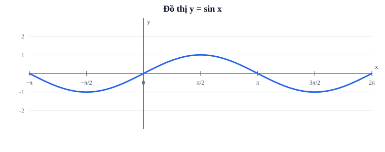

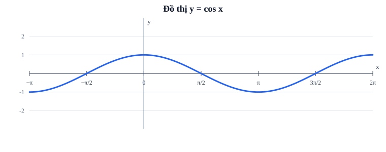

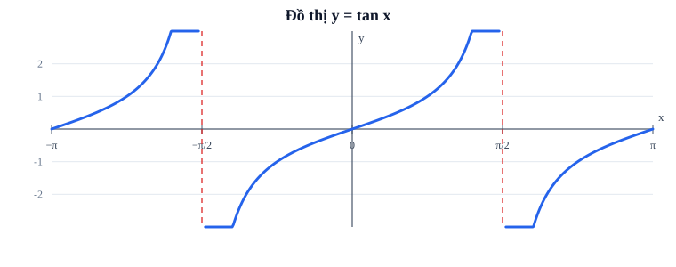

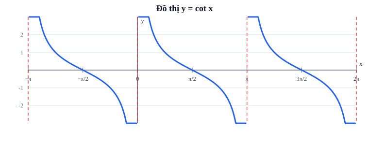

**Trước khi kết luận:** hãy ghi trục, đơn vị góc, các điểm loại và một chu kỳ; không nối các nhánh tan/cot qua nơi biểu thức không xác định.

**TRY-M4-02.** Khi M quay thêm một vòng, \(\sin(x+2\pi)\) thay đổi không? Khi x tiến đến \(\pi/2\) từ bên trái, \(\tan x\) có thể tiếp tục kéo qua điểm \(\pi/2\) để nối nhánh bên phải không?

Em đã thử? Mở đối chiếu

Sin giữ nguyên vì cùng tung độ trên đường tròn; tan không xác định ở \(\pi/2\), phải để hai nhánh rời nhau. Nếu em thấy tan là một nét xuyên qua vạch đứng, quay về điều kiện \(\cos x\ne0\).

## M4.3. Mô tả một dao động thật — phải phân biệt chu kỳ với biên độ

Xét mô hình tự tạo \(T(t)=21+3\cos(\pi t/6)\), nhiệt độ tính bằng °C, \(t\) tính bằng **giờ** và \(t\ge0\). Ở đây 21 là mức trung bình của mô hình, 3 là **biên độ theo trục nhiệt độ**, còn \(\pi/6\) là hệ số đổi một giờ thành góc quay. Chu kỳ là \(P=2\pi/(\pi/6)=12\) giờ.

\(T(0)=24\), \(T(3)=21\), \(T(6)=18\), \(T(12)=24\); miền giá trị theo mô hình là \([18,24]\)°C. **Cảnh báo:** đây là mô hình giả định do tác giả tạo, không phải dự báo nhiệt độ thật; dữ kiện thời tiết thực có thể không lặp đều. Nếu mô hình chỉ được xác nhận trong \(0\le t\le12\), không kéo đồ thị sang 24 giờ rồi gọi là số đo.

**TRY-M4-03.** Nếu \(h(t)=5+2\sin(\pi t/4)\), hãy tự xác định mức giữa, biên độ, chu kỳ và giá trị lớn nhất/nhỏ nhất trong một chu kỳ.

Đã thử? Đối chiếu

Mức giữa 5, biên độ 2, chu kỳ \(2\pi/(\pi/4)=8\) đơn vị t, khoảng giá trị \([3,7]\). Không gọi 8 là biên độ vì 8 thuộc trục t.

## M4.4. Khi mỗi bước nhân theo một tỷ lệ: Hàm mũ

**Câu hỏi nảy sinh.** Một tài khoản được cộng thêm 10% số dư sau *mỗi kỳ*. Số tiền không cộng đều một khoản cố định: sau mỗi kỳ nó **nhân 1,1**. Số dư ban đầu \(B_0\), qua \(n\) kỳ nguyên được mô hình hóa \(B(n)=B_0\cdot 1{,}1^n\). Ta cần một quy tắc cho đầu vào là số kỳ hoặc thời gian: đó là lý do xuất hiện hàm mũ.

Với \(a>0,\ a\ne1\), hàm \(y=a^x\) có **biến nằm ở số mũ**; x nhận mọi số thực, giá trị luôn dương, đồ thị qua \((0,1)\) và \((1,a)\), liên tục và có đường tiệm cận ngang \(y=0\) ở phía phù hợp. Nếu \(a>1\), đồ thị **tăng** trên \(\mathbb R\); nếu \(0<a<1\), **giảm** trên \(\mathbb R\). Hàm \(y=x^2\) hay \(y=x^3\) có biến ở **cơ số**, không phải hàm mũ theo định nghĩa này.

Đọc \(2^x\): x từ 0 lên 1 làm giá trị từ 1 lên 2; thêm một đơn vị nữa từ 2 lên 4; khi x giảm xa về phía âm, giá trị tiến gần 0 nhưng không bằng 0. Với \((1/2)^x\), x tăng thì các giá trị \(1,1/2,1/4,\ldots\) giảm; \(x=-2\) cho giá trị 4, vẫn dương. Không suy mọi hàm mũ đều tăng.

**Miền mô hình khác miền toán học:** \(a^x\) xác định trên toàn \(\mathbb R\), nhưng nếu x là số tháng đã trôi qua từ hôm nay thì thường chỉ nhận \(x\ge0\); nếu đề cho cập nhật vào cuối mỗi tháng, x có thể chỉ nhận các số nguyên không âm. Đừng dùng \(x=2{,}5\) tháng như một số liệu đã quan sát khi chưa cho phép nội suy thời gian liên tục.

**TRY-M4-04.** So sánh \(2^x\) và \((1/2)^x\) tại \(x=0,1,2\). Hàm nào tăng khi x tăng? Vì sao không áp dụng kết luận đó cho \(x^2\) trên toàn \(\mathbb R\)?

Đã tính? Mở đối chiếu

\(2^x:1,2,4\) tăng; \((1/2)^x:1,1/2,1/4\) giảm. \(x^2\) không phải hàm mũ và trên \(\mathbb R\) giảm trước 0 rồi tăng sau 0. Nếu bị nhầm, hãy chỉ đúng vị trí xuất hiện biến x ở công thức.

## M4.5. Khi biết kết quả và muốn tìm đầu vào: Lôgarit

Nếu \(2^x=8\), em tìm được \(x=3\). Việc hỏi **phải nâng cơ số 2 lên mũ bao nhiêu để được 8** dẫn tới lôgarit: \(\log_2 8=3\). Tổng quát,
\[
 y=\log_a x\quad\Longleftrightarrow\quad a^y=x,\qquad a>0,\ a\ne1,\ x>0.
\]

Lôgarit **không** nhận đầu vào bằng 0 hay âm trong số thực, vì \(a^y>0\). Hàm \(y=\log_a x\) xác định trên \((0,+\infty)\), có tập giá trị \(\mathbb R\), liên tục trên miền, đi qua \((1,0)\) và \((a,1)\); nếu \(a>1\) thì tăng, nếu \(0<a<1\) thì giảm. Khi x tiến về \(0^+\), giá trị tiến ra vô cực theo dấu phụ thuộc cơ số; do đó trục \(x=0\) là **tiệm cận đứng**.

**Vì sao hai đồ thị đối xứng qua \(y=x\)?** Trên hàm mũ, đầu vào x sinh đầu ra y. Trên hàm log cùng cơ số, ta **đổi vai** hai đại lượng: điểm \((p,q)\) trên \(y=a^x\) tương ứng điểm \((q,p)\) trên \(y=\log_a x\). Ví dụ \(3^2=9\) cho cặp \((2,9)\leftrightarrow(9,2)\). Đó là phản xạ qua \(y=x\), **không phải đổi dấu** tọa độ.

Ví dụ cơ số nhỏ hơn 1: \((1/2)^{-3}=8\) nên \(\log_{1/2}8=-3\); \(\log_{1/2}x\) nghịch biến khi x tăng dù tập giá trị vẫn là \(\mathbb R\). Đừng suy log của số lớn hơn 1 luôn dương.

**Khi giải hoặc xét miền:** với \(h(x)=\log_2(x+4)\), điều kiện là \(x+4>0\), tức \(x>-4\). Nếu \(h(x)=3\), thì \(x+4=2^3=8\) nên \(x=4\), và x=4 thỏa miền. **Lý do chọn phương pháp:** ta đảo hàm log sang mũ *sau khi* kiểm điều kiện, không lấy log của đối số âm.

**Cách đọc hai đồ thị hàm ngược:** Hãy đối chiếu cặp \((0,1)\leftrightarrow(1,0)\) và \((1,a)\leftrightarrow(a,1)\); đường \(y=x\) là trục phản xạ. Chú ý miền \(x>0\) của logarit và hướng tăng/giảm tùy cơ số.

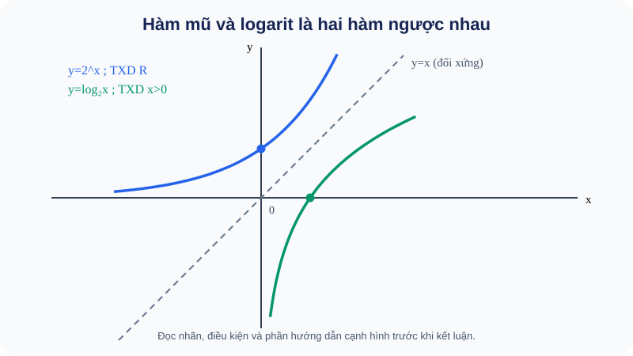

**TRY-M4-05.** Không dùng máy tính, hãy tìm \(\log_3(1/9)\) và cho biết \(\log_3(-9)\) có nghĩa trong số thực không.

Đã thử? Mở đối chiếu

\(3^{-2}=1/9\), vậy \(\log_3(1/9)=-2\). \(\log_3(-9)\) không xác định trong \(\mathbb R\). Nếu vướng, quay lại điều kiện \(x>0\) của hàm log.

### M4–M7 · Cùng một hàm qua bốn câu hỏi

## Một hàm số xuyên suốt bốn chặng: \(f(x)=\log_2x\)

Đừng vội học bốn công cụ như bốn danh sách công thức tách rời. Hãy giữ nguyên một hàm số, nhưng đổi **câu hỏi**: M4 hỏi đầu vào và cách thay đổi; M5 hỏi điều gì xảy ra sát ranh giới; M6 hỏi độ dốc tại một điểm hợp lệ; M7 kết hợp các kết quả để hiểu toàn bộ đồ thị.

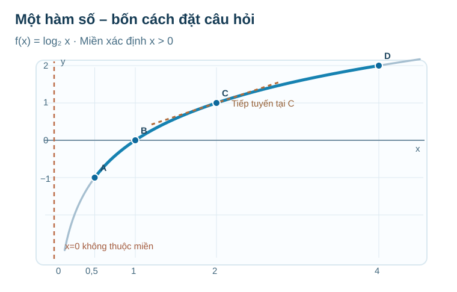

**Đọc hình:** A(0,5;−1), B(1;0), C(2;1), D(4;2). Nét đứt đứng tại \(x=0\) là **tiệm cận**, không thuộc đồ thị; đoạn xanh đậm tương ứng miền con \([0{,}5;4]\); nét nâu là **tiếp tuyến ở C**, không phải một nhánh khác của f.

### M4 · Quy tắc nào nhận đầu vào nào?

Một bạn nói: “\(2^0=1\), vậy chắc \(\log_2 0=1\).” Em hãy phản biện. Trước khi mở lời giải, điền bảng:

| \(x\) | \(1/2\) | \(1\) | \(2\) | \(4\) |
|---|---:|---:|---:|---:|
| \(\log_2x\) | ? | ? | ? | ? |

Đối chiếu M4 · Điều kiện không phải một quy định tùy ý

\(\log_2x=y\) có nghĩa \(2^y=x\). Vì \(2^y>0\) với mọi \(y\in\mathbb R\), không có số mũ thực nào cho đầu ra bằng 0. Do đó **\(D_f=(0,+\infty)\)**. Bốn ô lần lượt là **−1, 0, 1, 2**. Hai hàm \(y=2^x\) và \(y=\log_2x\) đổi chỗ đầu vào và đầu ra, nên các điểm tương ứng phản xạ qua \(y=x\). Nếu nhầm, quay lại M4.5 để giải thích “lôgarit là số mũ cần tìm”.

## M4.6. Ví dụ có suy luận — phải chọn công cụ vì bản chất tình huống (D2/PED5)

**EX-M4-01 (đối xứng và miền).** \(f(x)=(x^2-1)/x\), x khác 0. Hỏi chẵn/lẻ.  
*Vì sao không nhìn một phía của hình?* Phải kiểm **mọi x thuộc miền**; D là \(\mathbb R\setminus\{0\}\) đối xứng. \(f(-x)=(({-x})^2-1)/(-x)=-f(x)\). Hàm lẻ, đồ thị đối xứng qua gốc, nhưng **không có điểm tại \(x=0\)**. Không gọi đồ thị đi qua O.

**EX-M4-02 (miền chứa nhiều điều kiện).** \(g(x)=\sqrt{1+\cos x}/\sin x\).  
*Vì sao kiểm miền trước khi rút gọn?* \(1+\cos x\ge0\) với mọi x vì cos thuộc \([-1,1]\), nhưng mẫu sin không được bằng 0. Kết luận \(D=\mathbb R\setminus\{k\pi:k\in\mathbb Z\}\). Đừng quên \(\pi\) chỉ vì căn luôn xác định. Nếu biểu thức có cách rút gọn thì vẫn phải bảo toàn miền gốc.

**EX-M4-03 (chu kỳ có hệ số).** \(q(x)=3\sin(2x-\pi/5)\).  
Vì thay \(x\) bởi \(x+\pi\) làm đối số tăng \(2\pi\), chu kỳ cơ bản là \(\pi\). Biên độ là 3, miền giá trị \([-3,3]\). Dịch pha \(-\pi/5\) thay vị trí điểm đạt cực đại nhưng không đổi biên độ hay chu kỳ. **Không** lấy \(2\pi\cdot2\) làm chu kỳ; hệ số 2 là tốc độ chạy qua góc.

**EX-M4-04 (đọc tan/cot ở một điểm loại).** Xét \(r(x)=\tan(2x)\).  
\(\cos(2x)\ne0\) tương đương \(2x\ne\pi/2+k\pi\), tức \(x\ne\pi/4+k\pi/2\). Chu kỳ cơ bản \(T=\pi/2\). Nếu chỉ thấy tan có chu kỳ \(\pi\) rồi bỏ qua 2 ở đối số, miền và đồ thị sẽ sai; kiểm bằng cách xét \(r(x+\pi/2)=r(x)\) trên đúng miền. 

**EX-M4-05 (đọc mô hình tuần hoàn và đơn vị).** \(T(t)=21+3\cos(\pi t/6)\), \(0\le t\le12\), đơn vị °C.  
\(T(0)=24\), \(T(6)=18\); phạm vi giá trị \([18,24]\) và chu kỳ **của công thức toán** là 12 giờ. Nhưng trong bộ dữ kiện chỉ cho một ngày/đoạn 12 giờ, em **không kết luận** nhiệt độ thực tế ngày sau có cùng mẫu. Công thức mô hình có thể mở rộng toán học, dữ liệu thực tế không tự động được xác thực ngoài miền.

**EX-M4-06 (mô hình tăng theo phần trăm).** Giá trị ban đầu 200 nghìn đồng, mỗi kỳ nhân \(1{,}1\) và chỉ đo ở các kỳ nguyên \(n\ge0\).  
\(V(n)=200(1{,}1)^n\) nghìn đồng. Qua 2 kỳ, \(V(2)=242\) nghìn đồng. Chênh kỳ thứ nhất là 20 nghìn, kỳ thứ hai là 22 nghìn: tăng theo **tỷ lệ** 10%, không tăng cố định 20 nghìn. Không dùng giá trị \(V(1{,}5)\) như số liệu của hệ thống nếu kỳ chỉ cho số nguyên.

**EX-M4-07 (đi từ đầu ra về đầu vào).** Nếu mô hình \(N(t)=40\cdot2^t\) được dùng với thời gian liên tục \(t\ge0\), khi nào N đạt 320?  
Chia hai vế cho 40 (khác 0): \(2^t=8\). Vì 8 là \(2^3\), \(t=3\). Ở tình huống không ra lũy thừa nguyên quen thuộc, giải bằng \(t=\log_2(320/40)\) hoặc máy tính theo điều kiện đầu bài. **Vì sao chọn log?** Đây là bài toán ngược của hàm mũ; không giải bằng công thức phương trình bậc hai.

**EX-M4-08 (đọc đồ thị log chuyển dịch).** \(h(x)=\log_2(x+4)\).  
Miền \(x>-4\); đồ thị là đồ thị \(\log_2 x\) dịch sang trái 4 đơn vị, vì cần đầu vào gốc là \(u=x+4\). Tiệm cận đứng \(x=-4\), không phải \(x=0\). \(h(-3)=0\) và \(h(4)=3\). **Kiểm:** \(-3+4=1>0\), \(4+4=8>0\). Nếu đổi dấu và viết x>4, em đã dịch sai hướng.

## M4.9. Nếu em hiểu sai, quay lại đúng chỗ

| Tình huống | Dấu hiệu quan sát | Sửa lỗi theo ý nghĩa, ví dụ và đường quay lại |
|---|---|---|
| HELP-A | Gọi hàm lẻ chỉ vì đi qua gốc, hoặc quên miền đối xứng | Quay lại M4.1; viết D, thay \(-x\), so \(f(-x)\) với \(f(x)\) và \(-f(x)\); thử phản ví dụ \(f(x)=x^2+x\) |
| HELP-B | Tính tan/cot tại chỗ mẫu bằng 0, nối đồ thị qua nhánh đứt | Quay lại M4.2; xác định sin/cos ở mẫu, gạch điểm loại trên trục x, dùng FIG tan/cot và giải ví dụ miền trước |
| HELP-C | Nhầm biên độ với chu kỳ, hoặc đổi đơn vị thời gian | Quay lại M4.3; chỉ rõ trục dọc mức lệch, trục ngang khoảng lặp; làm lại TRY-M4-03 |
| HELP-D | Nói mọi \(a^x\) tăng hoặc coi \(x^2\) là hàm mũ | Quay lại M4.4, lập bảng x=0,1,2 cho cơ số >1 và giữa 0–1; kiểm biến nằm ở vị trí nào |
| HELP-E | Lấy log số âm hoặc quên miền của log trong căn | Quay lại M4.5, viết \(a^y=x>0\) và lấy giao tất cả điều kiện trước khi giải |
| HELP-F | Hiểu hàm ngược là đổi dấu hoặc phản xạ qua Oy | Quay lại M4.5 và hình FIG-B20; viết cặp đầu vào/đầu ra \((p,q)\to(q,p)\) |
| HELP-G | Coi số kỳ nguyên thành thời gian liên tục mà không nói giả định | Quay lại M4.4 và EX-M4-06; viết rõ tập đầu vào mô hình, kiểm dữ kiện có cho nội suy hay không |

---

## M5.1. Nhìn gần một điểm: Giá trị ở điểm và xu hướng gần điểm là hai chuyện

Hãy lấy \(f(x)=\dfrac{x^2-4}{x-2}\) với điều kiện \(x\ne2\). Khi x bằng 2, mẫu bằng 0 nên **không có \(f(2)\)**. Nhưng khi x rất gần 2 mà khác 2, ta phân tích tử thành \((x-2)(x+2)\), rồi rút gọn được \(f(x)=x+2\). Một bảng nhỏ minh họa:

| x | 1,9 | 1,99 | 2,01 | 2,1 |
|---|---:|---:|---:|---:|
| f(x) | 3,9 | 3,99 | 4,01 | 4,1 |

Bảng không phải chứng minh tổng quát; bước biến đổi đại số trên mọi x khác 2 mới giúp ta hiểu vì sao giá trị tiến về **4**. Ta viết
\[
\lim_{x\to2}\frac{x^2-4}{x-2}=4.
\]
Ký hiệu \(\lim\) đọc là “giới hạn”; dòng trên nói về các đầu vào **đang tiến sát 2**, không đòi đầu vào thực sự bằng 2. Vì thế **có giới hạn** không có nghĩa **có giá trị tại điểm**, càng không có nghĩa **liên tục**.

**Cách đọc hình:** xem FIG-G11-B16-01_R01.svg, nguồn hình chuẩn. Trục hoành là x, trục tung là y. Hãy nhìn đường thẳng đi gần \((2,4)\) từ hai bên; vòng tròn rỗng nhắc rằng điểm (2,4) **không thuộc đồ thị của hàm gốc**. Không vẽ chấm đặc ở đó vì chưa có \(f(2)\). Hình chỉ minh họa, bước kiểm toán dùng định nghĩa/biến đổi và miền xác định.

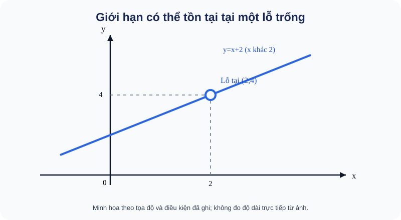

**Kiến thức cần nắm:** với \(a\) là điểm mà miền xác định có các giá trị x khác a tiến sát được, \(\lim_{x\to a}f(x)=L\) diễn tả đầu ra f(x) tiến sát L khi x tiến sát a trong miền hợp lệ. Giới hạn hữu hạn là xu thế tới một số thực L. Nếu xét \(\lim_{x\to a^-}\) ta chỉ đến từ **trái** (x<a), còn \(\lim_{x\to a^+}\) là từ **phải** (x>a). Với điểm được tiếp cận từ cả hai phía, **giới hạn hai phía hữu hạn tồn tại bằng L khi và chỉ khi hai giới hạn một phía cùng bằng L**.

**TRY-M5-01 — Tự thử trước khi xem mẫu:** \(h(x)=(x^2-9)/(x-3)\) nếu \(x\ne3\). Giá trị \(h(3)\) có không? Khi x tiến sát 3, h(x) tiến về mấy?

Đã tự làm? Mở đối chiếu

\(h(3)\) không tồn tại do mẫu bằng 0. Với \(x\ne3\), h(x)=x+3; do đó giới hạn khi x→3 bằng 6. Hai kết luận khác nhau và đều đúng.

## M5.2. Vì sao phải tách trái và phải? Một ngưỡng có thể đổi quy tắc

Một bãi giữ xe (mô hình giả định) tính 10 nghìn đồng khi \(0<t\le1\) giờ và 20 nghìn đồng khi \(t>1\). Đúng tại t=1, giá là 10. Nhưng khi t tiến tới 1 từ bên trái, giá cứ là 10; từ bên phải, giá cứ là 20. Vì hai phía **không khớp**, \(\lim_{t\to1}C(t)\) không tồn tại (theo giới hạn hữu hạn hai phía), mặc dù C(1) có giá trị. Đừng lấy trung bình 15 làm “giới hạn”.

Một tình huống khác: \(g(x)=1/(x-1)\). Khi x tiến gần 1 từ bên phải, mẫu là số dương nhỏ, giá trị tăng không bị chặn tới \(+\infty\). Khi đến từ bên trái, mẫu âm nhỏ, giá trị xuống \(-\infty\). Dấu \(+\infty\) hay \(-\infty\) mô tả hướng không bị chặn, **không phải giá trị thực để thế vào công thức**; không cộng hai phía để lấy một kết quả.

**Có bao giờ cả hai phía tiến đến cùng một \(+\infty\)?** Có. Với \(g(x)=1/(x-1)^2\), từ cả trái lẫn phải đều có giá trị dương và tăng không bị chặn. Khi đó ta viết \(\lim_{x\to1}g(x)=+\infty\); nhưng đó **không phải một giới hạn hữu hạn**, không thể gọi hàm liên tục tại 1, và 1 không thuộc miền xác định.

**Phương pháp lựa chọn:** với phân thức có mẫu tiến về 0 và tử không về 0, hãy xét **dấu** gần điểm và từng phía. Nếu cả tử và mẫu đều về 0, đó là dạng chưa xác định \(0/0\): phải biến đổi trước khi suy kết quả.

**TRY-M5-02:** \(\lim_{x\to0^-}1/x\) và \(\lim_{x\to0^+}1/x\) đi về đâu? \(\lim_{x\to0}1/x\) có tồn tại dưới dạng một số hữu hạn không?

Mở phần đối chiếu

Từ trái \(1/x\to-\infty\), từ phải \(1/x\to+\infty\). Hai phía khác nhau; không có giới hạn hữu hạn hai phía. Đừng viết 0 chỉ vì tử “không đổi”.

## M5.3. Khi x đi rất xa: Giá trị sẽ ổn định hay tăng không bị chặn?

“Tiến gần một điểm” và “x tăng mãi” không phải cùng câu hỏi. Khi x→+\infty, ta xét những x dương lớn dần không bị chặn; x→−\infty là những x âm có độ lớn tăng dần. Hai hướng có thể cho hành vi khác nhau.

Ví dụ \(p(x)=\dfrac{3x+2}{x+4}=3-\dfrac{10}{x+4}\). Khi x→+\infty hoặc x→−\infty, phân số thứ hai tiến về 0, nên p(x) tiến về 3. Trên đồ thị, đường \(y=3\) là một mức mà hàm tiến sát ở rất xa; ta có thể gọi đó là một **tiệm cận ngang** khi học tiếp mạch khảo sát đồ thị.

Khi gặp đa thức hữu tỉ, chia cả tử và mẫu cho lũy thừa x bậc cao nhất thích hợp thường làm lộ xu thế. Ví dụ \(\lim_{x\to+\infty}(2x^2+3x)/(x^2+1)=2\), vì chia cho \(x^2\) được \((2+3/x)/(1+1/x^2)\). Chỉ áp dụng các phép tính giới hạn trên các miền cho phép và mẫu giới hạn không bằng 0 ở bước lấy thương.

**Bẫy cực kỳ thường gặp: căn bậc hai không “trả lại nguyên x” khi x âm.** \(\sqrt{x^2}=|x|\), bằng x nếu \(x\ge0\) nhưng bằng −x nếu x<0. Do đó
\[
\lim_{x\to-\infty}\frac{\sqrt{x^2+9}}x
=\lim_{x\to-\infty}\frac{|x|\sqrt{1+9/x^2}}x=-1.
\]
Nếu em viết \(\sqrt{x^2}=x\) ở phía âm, kết quả thành +1 là sai dấu. Cách an toàn là ghi **miền dấu của x** trước khi đưa x ra ngoài căn.

**Giới hạn của một hiệu có căn:** \(\sqrt{x^2+x}-x\) khi x→+\infty nhìn qua có dạng \(\infty-\infty\), không được “trừ hai vô cực bằng 0”. Nhân liên hợp khi x đủ lớn dương:
\[
\sqrt{x^2+x}-x=\frac{x}{\sqrt{x^2+x}+x}
=\frac1{\sqrt{1+1/x}+1}\longrightarrow\frac12.
\]
Nhân liên hợp là nhân với một biểu thức đi đôi để tạo **hiệu hai bình phương**, không phải một mẹo chọn tùy ý; cần kiểm mẫu mới khác 0 trong vùng xét.

**TRY-M5-03:** Khi \(x\to-\infty\), \(\sqrt{x^2}/x\) bằng 1 hay −1? Lý do nằm ở điều kiện nào?

Tự nghĩ rồi mở đáp án

Với x âm, \(\sqrt{x^2}=|x|=-x\), nên \(|x|/x=-1\). Điều kiện x<0 quyết định dấu.

### M5 · Tiến rất gần điểm bị loại có giống chạm vào điểm ấy?

Ở M4 ta biết \(x=0\) không hợp lệ. Nhưng khi \(x>0\) tiến dần về 0, đường cong đi xuống mãi. Có cần một **điểm thật** trên trục tung để giải thích hành vi đó?

**Tự thử:** tính \(\log_2(1/2),\log_2(1/4),\log_2(1/8),\log_2(1/16)\); dự đoán xu thế.

Đối chiếu M5 · Giới hạn không tự tạo ra giá trị tại điểm

Các giá trị là **−1, −2, −3, −4**. Tổng quát, \(x=2^{-n}\to0^+\) thì \(\log_2x=-n\to-\infty\). Kết hợp tính đơn điệu, liên tục của hàm log trên \((0,+\infty)\), suy ra
\[
\lim_{x\to0^+}\log_2x=-\infty.
\]
Đây là xu thế không bị chặn từ **phía phải**, không phải giá trị \(f(0)\). Trục \(x=0\) là một **tiệm cận đứng**. Nếu gặp “lỗ đồ thị” có giới hạn hữu hạn ở M5.1, hãy phân biệt nó với tình huống này.

## M5.4. Một sơ đồ chọn phương pháp, không học thuộc quy tắc một cách máy móc

| Em nhìn thấy | Việc nên làm và lý do | Khi nào phải dừng/đổi cách |
|---|---|---|
| Hàm đa thức, phân thức có mẫu không bằng 0 gần điểm | Dùng tính liên tục/phép toán giới hạn, thay giá trị hợp lệ | Nếu mẫu tiến về 0 thì không dùng quy tắc thương một cách máy móc |
| \(0/0\) | Tìm nhân tử chung hoặc nhân liên hợp để xem quy tắc gần điểm | Rút gọn không tạo lại giá trị tại điểm vốn bị loại |
| Tử → số khác 0, mẫu → 0 | Xét dấu trái/phải, có thể ra \(+\infty\)/\(-\infty\) | Không viết “\(1/0\)” như một số |
| x→±∞, đa thức/hữu tỉ | Chia theo bậc trội, kiểm dấu và hệ số | Đừng suy chỉ từ giá trị tại một x rất lớn |
| Có căn chứa \(x^2\), đặc biệt x→−∞ | Tách \(|x|\) rồi dùng dấu của x | Không lấy \(\sqrt{x^2}=x\) cho mọi x |
| Một đồ thị có lỗ hoặc nhảy | Kiểm trái/phải trước, rồi so với giá trị thật | Chỉ nhìn hình không chứng minh toàn bộ điều kiện |

**EX-M5-01 — Vì sao được rút gọn khi tính giới hạn nhưng không được lấp lỗ?**
Cho \(f(x)=(x^2-16)/(x-4)\) với \(x\ne4\). Ta có \(f(x)=x+4\) với x khác 4, nên \(\lim_{x\to4}f(x)=8\). Điều này **không** chứng minh f(4)=8; nếu muốn f liên tục tại 4, phải bổ sung giá trị 8 khi mô hình cho phép.

**EX-M5-02 — Nhìn dấu trước khi tính.**
Cho \(g(x)=4/(x+2)\). Tại x→−2⁻, mẫu âm rất nhỏ nên g→−∞; tại x→−2⁺ mẫu dương rất nhỏ nên g→+\infty. Vì vậy không có giới hạn hữu hạn hai phía tại −2, và đường x=−2 là một vị trí tiệm cận đứng. Chọn **phương pháp dấu** vì tử không tiến về 0.

**EX-M5-03 — Nhân liên hợp nhằm khử 0/0.**
Tính \(\lim_{x\to0}(\sqrt{9+x}-3)/x\). Nhân cả tử/mẫu với \(\sqrt{9+x}+3\) cho \(x/ [x(\sqrt{9+x}+3)]\) khi x≠0; giới hạn \(=1/6\). Không thế x=0 vào phân thức gốc, chỉ lấy giới hạn sau biến đổi.

**EX-M5-04 — Mô hình tiến sát một mức hiệu quả.**
Với \(E(t)=80t/(t+4)\), t≥0 tính bằng giờ, khi t→+\infty thì \(E(t)=80-320/(t+4)\to80\) (đơn vị E do đề quy định). **Không nói E(t)=80 ở một thời điểm hữu hạn** vì \(320/(t+4)>0\) với t≥0. Giới hạn là mức tiến sát của mô hình, không phải lời hứa vật lý nó đạt đúng 80.

## M5.5. Từ xu thế sang sự liên tục: Có “lỗ” hay “bậc nhảy” không?

Một hàm liên tục ở một điểm a khi giá trị **đúng ở a** khớp với xu thế ở các điểm rất gần a. Ở điểm có thể tiếp cận từ hai phía, cần cả ba điều:

1. \(f(a)\) có nghĩa — a thuộc tập xác định.
2. Giới hạn hữu hạn \(\lim_{x\to a}f(x)\) tồn tại.
3. Hai kết quả bằng nhau: \(\lim_{x\to a}f(x)=f(a)\).

**Bớt một điều đều có thể sai.** Với \(f(x)=(x^2-4)/(x-2)\) khi x≠2, giới hạn bằng 4 nhưng không có f(2); cần “vá” bằng cách định nghĩa \(f(2)=4\). Nếu cố định \(f(2)=9\), đường cong gần điểm vẫn tiến tới 4 nhưng chấm đặc lại ở độ cao 9 nên **gián đoạn**.

**Hình cần đọc tại Topic:** FIG-G11-B17-01_R01.svg, nguồn hình chuẩn. Chú ý **vòng tròn rỗng** thể hiện giá trị tiến gần (không nhận) và **chấm đặc** cho biết giá trị thật. Đọc tọa độ cụ thể của các ký hiệu theo hình; không mặc định mọi vòng tròn rỗng đều là “tiệm cận đứng”. Đọc hình trước; ba điều kiện ở trên là căn cứ kết luận.

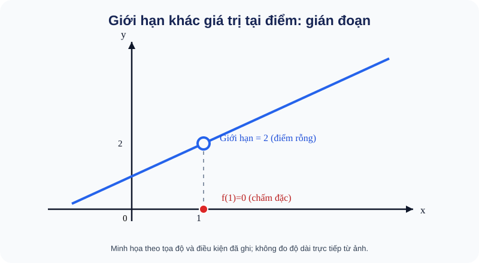

**Tại nơi công thức đổi:** giả sử
\[
h(x)=\begin{cases}2x+1,&x<2,\\m+x,&x\ge2.\end{cases}
\]
Khi tiến đến 2 từ trái, giá trị tới 5. Từ phải, giá trị tới \(m+2\), và \(h(2)=m+2\). Muốn liên tục tại 2 phải và đủ \(m+2=5\), tức \(m=3\). Không chỉ so hai công thức rồi quên điều kiện x thuộc nhánh nào; ngay tại 2 thuộc nhánh thứ hai.

**TRY-M5-04:** Nếu cùng biểu thức x+2 khi x≠2 được bổ sung \(f(2)=7\), giới hạn tại 2 là mấy, hàm liên tục không?

Đã nghĩ? Mở đối chiếu

Giới hạn vẫn bằng 4, nhưng giá trị ở điểm là 7. Hàm không liên tục tại 2. Thay một giá trị đúng tại điểm không đổi xu thế từ các điểm x khác 2.

## M5.6. Liên tục trên một khoảng và trên một đoạn không hoàn toàn giống nhau

Nếu một hàm liên tục **trên khoảng mở \((a,b)\)**, phải liên tục tại mọi điểm trong khoảng. Nhưng để liên tục **trên đoạn \([a,b]\)**, còn cần tiếp cận đầu mút từ **phía nằm trong đoạn**:
\[
\lim_{x\to a^+}f(x)=f(a),\qquad
\lim_{x\to b^-}f(x)=f(b).
\]
Không yêu cầu hàm xác định ở phía trái a hay phía phải b. Ví dụ \(f(x)=\sqrt{x}\) liên tục trên \([0,9]\), dù f không có giá trị thực ở x<0. Tại 0 phải xét phía phải và tại 9 xét phía trái.

Tính liên tục được bảo toàn khi cộng, trừ, nhân các hàm liên tục; khi chia phải bảo đảm **mẫu khác 0 tại điểm xét**. Đa thức liên tục trên toàn \(\mathbb R\), phân thức hữu tỉ liên tục tại các điểm mà mẫu khác 0; \(\sqrt{g(x)}\) chỉ nói trong miền biểu thức có nghĩa với g phù hợp. Các họ hàm lượng giác, mũ, log đã học M4 có tính liên tục trên **các khoảng xác định phù hợp**, không suy các khoảng nhảy qua điểm loại của tan/cot/log.

**EX-M5-05 — Kiểm miền trước khi nói “liên tục”.**
Cho \(r(x)=\frac{x+3}{x^2-1}\). Miền là \(\mathbb R\setminus\{-1,1\}\). Vì là thương của đa thức với mẫu khác 0 trên miền, r liên tục trên từng khoảng \((-\infty,-1)\), \((-1,1)\), \((1,+\infty)\). Không nối ba khoảng để khẳng định liên tục trên cả \(\mathbb R\). **Nên chọn cách này** vì không có điểm ghép cần điều chỉnh: chỉ cần xác định điểm mẫu 0.

**EX-M5-06 — Liên tục trên đoạn có đầu mút căn.**
\(k(x)=\sqrt{9-x^2}\) trên \([-3,3]\). Căn xác định với \(9-x^2\ge0\), nghĩa là \(-3\le x\le3\). Hàm liên tục trên \((-3,3)\); khi x→−3⁺ hoặc 3⁻, k(x)→0 đúng bằng k(−3)=k(3)=0. Vậy liên tục trên \([-3,3]\). Không xét căn bên ngoài đoạn vì đó không thuộc miền.

**TRY-M5-05:** \(g(x)=1/(x-2)\) có thể gọi là liên tục trên \([0,4]\) không? Vì sao, dù đồ thị trông “mượt” trên từng nhánh?

Mở đối chiếu

Không, g không xác định tại x=2 thuộc đoạn [0,4]; không thể liên tục trên cả đoạn. Nó liên tục trên các khoảng loại 2. Xem lại điều kiện tập xác định trước khi nói “vẽ một nét”.

## M5.7. Một ứng dụng bất ngờ: Chưa biết nghiệm ở đâu, vẫn biết ít nhất một nghiệm tồn tại

Đặt bài toán: tìm nghiệm \(f(x)=0\) không dễ. Nhưng nếu đồ thị **liên tục trên cả đoạn** \([a,b]\) và hai giá trị ở hai đầu **trái dấu**, đường cong phải vượt qua mức 0 ở ít nhất một điểm trong khoảng. Đây là hệ quả thường gọi là **định lí giá trị trung gian** cho mức 0:
\[
f\text{ liên tục trên }[a,b],\quad f(a)f(b)<0
\quad\Longrightarrow\quad
\exists\,c\in(a,b):f(c)=0.
\]

**Giới hạn áp dụng quan trọng:** định lí cho biết **tồn tại**, không tự cho biết nghiệm duy nhất hay chính xác c bằng số mấy. Nếu hàm không liên tục trên cả đoạn, hai giá trị trái dấu **không đủ** để suy có nghiệm.

**EX-M5-07 — Tại sao nghiệm phải xuất hiện?** \(p(x)=x^3+2x-4\). Đây là đa thức, liên tục trên [1,2]. \(p(1)=1+2-4=-1<0\), \(p(2)=8+4-4=8>0\). Do đó tồn tại ít nhất một nghiệm trong (1,2). Không cần biến đổi giải phương trình bậc ba để kết luận sự tồn tại. Bằng luận điểm dấu đầu mút alone, **chưa được nói duy nhất**.

**EX-M5-08 — Khi bỏ mất điều kiện, kết luận sai.** Đặt \(q(x)=-1\) khi x<0 và \(q(x)=1\) khi x≥0. Trên [-1,1] có \(q(-1)=-1\), \(q(1)=1\) trái dấu, nhưng q không nhận giá trị 0 tại bất kỳ x nào: hàm **bị nhảy** ở 0, không liên tục tại 0. Vậy dấu trái nhau mà thiếu liên tục không chứng minh có nghiệm.

**TRY-M5-06:** \(u(x)=x^2-2\) trên [1,2]. Có thể chứng minh có nghiệm trong (1,2) mà không tìm căn 2 không? Có khẳng định được duy nhất chỉ từ điều kiện đổi dấu không?

Mở đối chiếu

u là đa thức liên tục trên [1,2], u(1)=−1 và u(2)=2 nên có ít nhất một nghiệm trong (1,2). Riêng định lí đổi dấu chưa chứng minh duy nhất; muốn kết luận duy nhất phải lập luận bổ sung về tính tăng của u trên [1,2].

## M5.9. Nếu em gặp khó, quay lại bài nào?

| Dấu hiệu em đang gặp | Quay lại đúng ý cần học |
|---|---|
| Tưởng giới hạn là giá trị tại điểm | M5.1: phân biệt điểm rỗng với giá trị tiến sát |
| Quên xét giới hạn trái và phải | M5.2: so hai phía ở chỗ đổi nhánh |
| Không chắc hàm liên tục tại điểm nối | M5.5: kiểm giá trị thực tại điểm và hai giới hạn một phía |
| Áp dụng định lí đổi dấu cho hàm bị nhảy | M5.7: kiểm liên tục trên cả đoạn trước khi kết luận có nghiệm |

Sau phần Kiến thức, em có thể chọn bài **tự luận dùng chung** trong thư viện Luyện tập; hãy thử làm ra giấy trước khi mở rubric và chỉ dùng kết quả để tự điều chỉnh cách học.

---

## M6.1 — Vì sao vận tốc trung bình chưa trả lời câu hỏi “ngay lúc này”?

Nếu đi được 100 m trong 20 s, tốc độ trung bình bằng 5 m/s, nhưng từng giây có thể nhanh, chậm khác nhau. Khi đại lượng s(t) là **vị trí có dấu** trên trục, độ thay đổi trung bình từ thời điểm t đến t+h là

\[
\frac{s(t+h)-s(t)}{h},\qquad h\ne0.
\]

Tử là độ dời có dấu, nên kết quả là **vận tốc trung bình có dấu** (m/s), không nhất thiết là tốc độ trung bình theo tổng quãng đường nếu vật quay đầu.

Hãy xét mô hình s(t)=t²+2t (m) với t≥0 (s). Quanh t=2:

\[
\frac{s(2+h)-s(2)}h
=\frac{(2+h)^2+2(2+h)-8}h
=6+h
\]

với h khác 0 và thời điểm hợp lệ. Khi h ngày càng gần 0, thương tiến tới 6; ta nói vận tốc **tức thời** lúc t=2 là 6 m/s. Đây là lý do cần khái niệm **giới hạn** từ M5. Không thay h=0 vào phân thức gốc: nó chưa xác định ở h=0.

Tổng quát, nếu giới hạn hữu hạn

\[
f'(a)=\lim_{h\to0}\frac{f(a+h)-f(a)}h
\]

tồn tại ở điểm a thuộc **phần trong của miền xác định**, ta gọi đó là đạo hàm tại a và hàm là **khả vi** ở a. Có thể dùng dạng tương đương giới hạn của [f(x)−f(a)]/(x−a) khi x tiến a. Đạo hàm f'(a) là **một số**, còn f'(x) là **một hàm** cho độ dốc tức thời tại các điểm trong miền thích hợp.

**Lưu ý miền:** ở điểm đầu mút chỉ tiếp cận từ một phía, có thể nói về đạo hàm một phía, nhưng không coi là đạo hàm hai phía trên khoảng. f(x)=√x xác định tại 0; thương bên phải [√h−0]/h=1/√h tiến +∞, không có đạo hàm hữu hạn tại 0.

**Tự thử M6-T01.** Tự tính thương sai phân của f(x)=x² tại a=1 rồi giải thích giá trị khi h→0. Vì sao h=0 không phải bước đầu?

Đã thử xong? Mở đối chiếu

Thương bằng ((1+h)²−1)/h=2+h với h≠0; giới hạn bằng 2. h=0 làm mẫu 0 ở phân thức ban đầu. Nếu còn lẫn, quay lại s(t) ở đầu mục.

## M6.2 — Từ cát tuyến đến tiếp tuyến, và khi đồ thị có góc nhọn

Trên đồ thị y=f(x), lấy P(a,f(a)) và Q(a+h,f(a+h)). Hệ số góc đường thẳng **cát tuyến** PQ chính là thương sai phân. Nếu độ dốc của các cát tuyến tiến đến một giá trị hữu hạn khi Q tiến sát P, đường thẳng qua P với độ dốc ấy là **tiếp tuyến**. Phương trình:

\[
y-f(a)=f'(a)(x-a).
\]

**Vì sao không viết luôn y=f'(a)x?** Vì tiếp tuyến phải đi qua điểm P đã biết, chứ không nhất thiết đi qua gốc O.

**Quan sát hình:** FIG-G11-CHIX-B31-01_R00.svg, nguồn hình chuẩn. Đọc điểm P(1,1) và Q(1,8;3,24) trên y=x²; độ dốc cát tuyến là 2,8. Khi Q trượt dần đến P, độ dốc tiến 2. Tiếp tuyến tại P là y−1=2(x−1), tức y=2x−1. Không dùng một hình chụp cát tuyến cố định như chứng minh giới hạn.

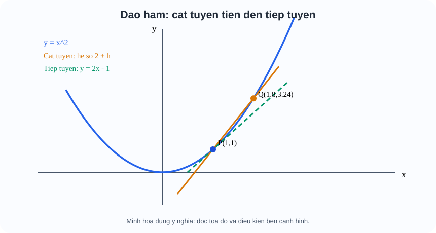

**Liên tục có đủ để có đạo hàm không?** Không. Hàm y=|x| liên tục tại 0 nhưng thương |h|/h bằng −1 với h<0 và +1 với h>0; hai giới hạn một phía khác nhau. Vì thế không có đạo hàm tại góc nhọn. **Có đạo hàm thì liên tục**, còn chiều đảo lại là sai. Hình FIG-G11-CHIX-B31-02_R00.svg: đọc hai nhánh gặp nhau ở O nhưng độ dốc −1 và +1, không gộp chúng thành một tiếp tuyến.

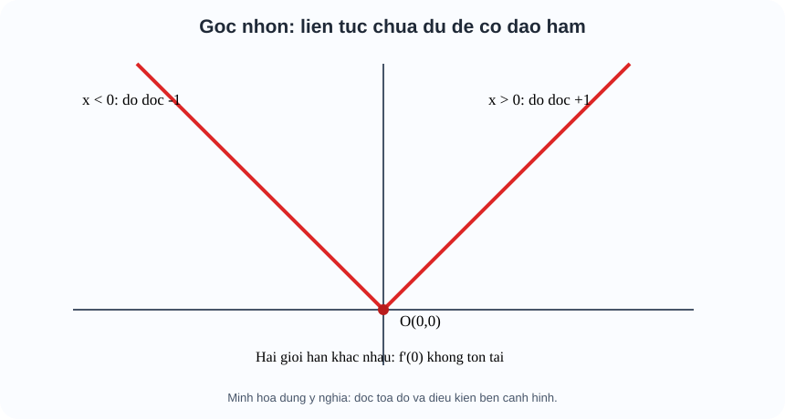

**Ví dụ có suy luận:** f(x)=x²−2x+3 tại a=2. Ta có f(2)=3, f'(x)=2x−2 nên f'(2)=2. Tiếp tuyến đi qua (2,3) và có hệ số góc 2: y−3=2(x−2), hay y=2x−1. Nếu học sinh viết y=2x, kiểm lại khi x=2 sẽ cho y=4, không đi qua (2,3).

**Tự thử M6-T02.** y=|x−2| liên tục tại x=2 không? Hệ số góc trái và phải là gì?

Đã tự làm? Mở đối chiếu

Hàm liên tục, nhận giá trị 0 tại 2 và tiến về 0 từ hai phía. Thương sai phân tại 2 từ trái bằng −1, từ phải +1, nên không khả vi tại 2. Nếu nhầm, quay lại hình góc nhọn.

### M6 · Tự thử với hai đồ thị f và f′

[Tự thử mô hình cát tuyến, tiếp tuyến và đồ thị đạo hàm](Temp_TOPIC1_M6_TANGENT_DERIVATIVE_TWO_GRAPHS_D5_R00_20261110.html)

Khung bên trái cho thấy đồ thị \(y=f(x)\) (xanh dương), cát tuyến qua M và N (cam nét đứt) và tiếp tuyến tại M (xanh lá). Khung bên phải cho thấy đồ thị \(y=f'(x)\), điểm cam tương ứng với hoành độ \(x_0\) đang chọn. **Đừng chỉ quan sát đường thẳng quay:** hãy so giá trị hệ số góc cát tuyến và đạo hàm hiển thị bên dưới. Khi thu nhỏ \(|h|\), hai số phải tiến gần nhau.

Mô hình **tự co giãn thang trục khi cần**, để cả hai điểm M và N vẫn nằm trong khung ngay cả khi chọn \(x_0=\pm2\) và \(|h|=1{,}5\). Vì vậy, khi quan sát đồ thị giữa hai trạng thái, hãy đọc lại các mốc trên trục: hình trông dốc hơn chưa chắc hệ số góc đại số lớn hơn. Phép so sánh có giá trị vẫn là các con số \(k_h\) và \(f'(x_0)\) được tính từ cùng công thức.

### Ví dụ 1 — Đạo hàm bằng 0 và hàm thật sự đổi chiều

Chọn \(f(x)=x^3/3-x\), có \(f'(x)=x^2-1\). Khi \(x_0=1\), đạo hàm bằng 0: tiếp tuyến nằm ngang. Nhưng vì sao ở đây hàm có **cực tiểu**?

Khi \(x\) nằm giữa \(-1\) và \(1\), \(x^2-1<0\) nên hàm giảm; khi \(x>1\), \(x^2-1>0\) nên hàm tăng. Vì hàm chuyển **từ giảm sang tăng** tại \(x=1\), đây là cực tiểu địa phương. Tương tự, \(x=-1\) là cực đại địa phương do dấu đạo hàm chuyển từ dương sang âm.

Tại \(x_0=1\), nếu lấy \(h>0\), cát tuyến có độ dốc hơi dương; nếu lấy \(h<0\), độ dốc hơi âm. Cả hai phía cùng tiến về 0 khi \(h\to0\). Ta có thể tự kiểm bằng khai triển:

\[
\frac{f(1+h)-f(1)}{h}=h+\frac{h^2}{3},\qquad h\ne0.
\]

Giới hạn bằng 0, đúng với \(f'(1)=0\). Tuy nhiên, **chỉ biết giới hạn bằng 0 chưa giải thích được cực tiểu**: kết luận cực trị cần xét dấu đạo hàm hoặc so giá trị hàm ở lân cận.

### Ví dụ 2 — Tiếp tuyến nằm ngang nhưng không có cực trị

Chọn \(g(x)=x^3\). Ta có \(g'(x)=3x^2\), do đó \(g'(0)=0\): tiếp tuyến tại gốc O nằm ngang. Nếu chỉ nhớ câu “đạo hàm bằng 0 thì cực trị”, ta sẽ dự đoán sai.

Thật vậy, khi \(x<0\), \(g(x)<0\); khi \(x>0\), \(g(x)>0\). Hàm vẫn tăng khi đi qua O. Về dấu đạo hàm, \(g'(x)>0\) ở hai phía của 0 (trừ tại chính 0), không có chuyển từ tăng sang giảm hoặc ngược lại. Vì vậy O **không** là cực trị.

Thương sai phân tại O bằng

\[
\frac{g(h)-g(0)}{h}=h^2 \quad (h\ne0).
\]

Dù h dương hay âm, hệ số góc cát tuyến đều **dương** và tiến về 0. Nhìn cả hai khung giúp ta thấy điều mà một giá trị \(g'(0)=0\) không thể tự nói hết: **đạo hàm bằng 0 là điều kiện cần ở cực trị trong của hàm khả vi, nhưng không phải điều kiện đủ**.

### Tự thử vận dụng — Cùng đạo hàm bằng 0, hai kết luận khác nhau

Xét \(p(x)=x^3\) và \(q(x)=x^4\). Cả hai đều có đạo hàm bằng 0 tại \(x=0\). Hãy giải thích bằng dấu đạo hàm hoặc bằng cách so giá trị hàm gần 0: hàm nào có cực trị tại 0, hàm nào không? Hãy nêu lý do **trước khi** mở đối chiếu.

Đối chiếu

Với \(p(x)=x^3\), ta có \(p'(x)=3x^2>0\) ở cả hai phía của 0 (trừ tại 0), nên hàm tăng qua 0 và không có cực trị.

Với \(q(x)=x^4\), \(q(x)\ge0=q(0)\) với mọi x; vì vậy \(x=0\) là điểm **cực tiểu**, đồng thời là điểm đạt giá trị nhỏ nhất trên toàn \(\mathbb R\). Nếu dùng dấu đạo hàm: \(q'(x)=4x^3<0\) khi x<0 và >0 khi x>0, nên hàm đổi từ giảm sang tăng.

**Bài học:** cùng có tiếp tuyến nằm ngang nhưng bản chất hai điểm rất khác. Chỉ giá trị \(f'(0)=0\) chưa đủ để quyết định cực trị; cần xét sự thay đổi ở hai phía.

**Nếu em đang nhầm:** Nếu chưa phân biệt độ dốc cát tuyến với tiếp tuyến, quay lại M6.1 và giảm dần \(|h|\). Nếu chưa rõ điều kiện cực trị, đọc lại M7.1 về dấu đạo hàm trước và sau điểm đang xét. Hoạt động Vận dụng này **công khai, tự đối chiếu**, không dùng làm câu Tự kiểm tra độc lập hoặc ghi Skill Mastery.

## M6.3 — Tại sao cần bảng đạo hàm? Quy tắc là hệ quả của thay đổi

Tính giới hạn thương sai phân từ đầu cho mọi biểu thức dài rất dễ sai. Các quy tắc sau có ý nghĩa: tổng thay đổi từ hai phần, tích thay đổi vì **cả hai thừa số**, và hàm hợp thay đổi qua **hai tầng**.

Nếu u(x), v(x) khả vi tại điểm đang xét:

\[
(c)'=0,\quad (u\pm v)'=u'\pm v',\quad (cu)'=cu',
\]
\[
(uv)'=u'v+uv',\qquad (u/v)'=\frac{u'v-uv'}{v^2}\quad(v\ne0).
\]

**Bản chất quy tắc tích:** diện tích hình chữ nhật có hai cạnh u và v. Khi chúng đổi thêm Δu, Δv, diện tích tăng vΔu+uΔv+ΔuΔv. Khi chia cho Δx rồi cho Δx→0, nếu u,v khả vi, hạng chéo bậc hai mất đi; còn hai đóng góp vu'+uv'. **Hình minh họa:** FIG-G11-CHIX-B32-01_R00.svg, đọc vùng uv cũ, hai dải bổ sung và góc chéo nhỏ.

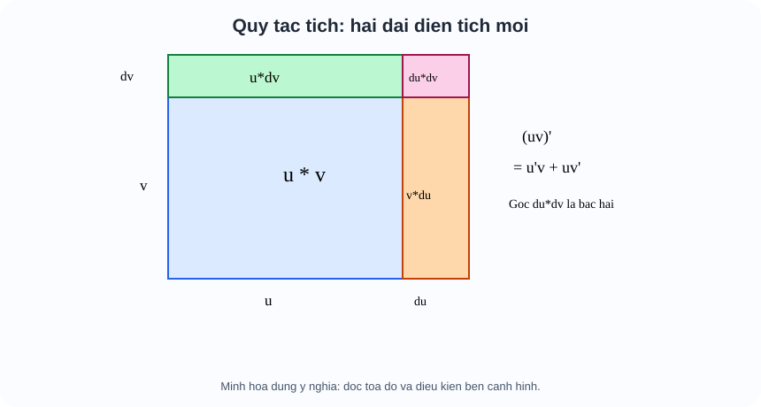

**Bản chất quy tắc dây chuyền:** f(x)=g(u(x)): trước hết x làm u thay, sau đó u làm g thay. Vì vậy f'=g'(u(x))u'(x) trên những điểm các đạo hàm phù hợp tồn tại. Hình FIG-G11-CHIX-B32-02_R00.svg, đọc hai mũi tên x→u→g(u), không bỏ đạo hàm tầng trong.

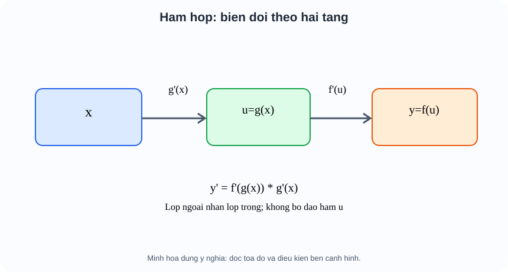

**Ví dụ 1 — tích và hợp:** F(x)=(x²+1)sin(2x). Tầng ngoài là **tích**; bên trong sin lại có **hàm hợp**:

\[
F'=2x\sin(2x)+2(x^2+1)\cos(2x).
\]

Không viết 2x·2cos(2x), vì đó là nhân hai đạo hàm, bỏ qua hai phần của quy tắc tích.

**Ví dụ 2 — thương và miền:** G(x)=x²/(x+1), điều kiện x≠−1. Chọn quy tắc thương:

\[
G'=\frac{2x(x+1)-x^2}{(x+1)^2}
=\frac{x(x+2)}{(x+1)^2}\quad(x\ne-1).
\]

Việc có công thức đơn giản không làm G hay G' nhận thêm giá trị ở x=−1.

**Tự thử M6-T03.** Lấy đạo hàm f(x)=x(x²+1) theo tích, rồi khai triển và lấy đạo hàm để kiểm.

Đã tính? Mở đối chiếu

f'=1·(x²+1)+x·2x=3x²+1. Khai triển f=x³+x cũng được 3x²+1. Nếu chỉ có 2x, em đã nhầm (uv)' với u'v'.

## M6.4 — Bảng công cụ chỉ dùng sau khi đã kiểm điều kiện

| Họ hàm | Công thức trên miền hợp lệ |
|---|---|
| c, x^n | (c)'=0; (x^n)'=n x^(n−1), khi hàm và quy tắc được định nghĩa; n nguyên là trường hợp cơ bản |
| √x | (√x)'=1/(2√x) chỉ khi x>0; √0 có nghĩa nhưng đạo hàm hữu hạn tại 0 không có |
| sin x, cos x | (sin x)'=cos x, (cos x)'=−sin x trên R |
| tan x, cot x | (tan x)'=1/cos²x khi cos x≠0; (cot x)'=−1/sin²x khi sin x≠0 |
| e^x, a^x | (e^x)'=e^x; (a^x)'=a^x ln a với a>0, a≠1 |
| ln x, log_a x | (ln x)'=1/x và (log_a x)'=1/(x ln a) với x>0, a>0, a≠1 |
| u(x) hợp | (sin u)'=u' cos u; (e^u)'=u'e^u; (ln u)'=u'/u với u>0; (√u)'=u'/(2√u) với u>0 |

**Nhắc tiền đề ở ngay Topic:** ln x là logarit cơ số e, với e>1; log_a x hỏi “phải nâng cơ số a lên mũ nào để được x”, nên đối số x phải dương. Tan x=sin x/cos x nên cos x khác 0; cot x=cos x/sin x nên sin x khác 0. Đạo hàm của hàm hợp không thể “bỏ tầng trong”.

**Cách chọn phép tính:** (1) ghi tập xác định gốc; (2) nhìn cấu trúc ngoài: tổng, tích, thương, hay hợp; (3) tính đạo hàm từng thành phần và tầng trong; (4) kiểm lại miền, dấu, mẫu; (5) nếu tại một điểm đặc biệt công thức không hợp lệ, quay về **định nghĩa thương sai phân**. Không tự suy đạo hàm tồn tại tại đầu mút của căn hay điểm loại của log/tan.

**Ví dụ 3 — căn:** H(x)=√(9−x²) xác định trên [−3,3], nhưng

\[
H'(x)=-x/\sqrt{9-x^2}\quad\text{chỉ trên }(-3,3).
\]

Tại ±3, căn bằng 0, mẫu đạo hàm không hợp lệ; không mở rộng đạo hàm sang hai đầu mút.

**Ví dụ 4 — tan hợp:** T(x)=tan(2x), miền x≠π/4+kπ/2 (k nguyên). T'(x)=2/cos²(2x) trên mỗi khoảng xác định. Dấu đạo hàm dương không có nghĩa T là một hàm đồng biến trên **toàn R**, vì miền bị chia nhánh.

**Ví dụ 5 — log hợp:** L(x)=ln(x²+1) có miền R; L'(x)=2x/(x²+1). Đạo hàm của x²+1 là 2x, không phải 1.

**Ví dụ 6 — mũ cơ số khác e:** N(x)=2^(−x) cho mọi x thực; N'=−2^(−x)ln2 <0. Dấu âm từ đạo hàm −x giải thích hàm giảm.

**Tự thử M6-T04.** Tìm miền và đạo hàm f(x)=ln(3x−1). Tại sao lời giải 1/(3x−1) thiếu một bước?

Đã thử? Mở đối chiếu

Miền x>1/3; f'=3/(3x−1) trên miền. Cần nhân đạo hàm tầng trong 3x−1 bằng 3.

### M6 · Tốc độ thay đổi ngay tại điểm hợp lệ

Ở M5, ta quan sát hành vi **gần ranh giới**. M6 hỏi câu mới: *gần một điểm hợp lệ, đầu ra đổi nhanh thế nào khi đầu vào đổi rất ít?*

Tại \(x=2\), ta biết \(f(2)=1\). Hãy nhìn nét tiếp tuyến nâu ở C: nó đi qua tọa độ nào? Nó nghiêng lên hay xuống?

Đối chiếu M6 · Dùng đạo hàm nhưng không quên điểm tiếp xúc

Với \(x>0\),
\[
f'(x)=\frac{1}{x\ln 2}>0.
\]
Tại x=2, \(f'(2)=1/(2\ln2)\approx0{,}72135\). Tiếp tuyến qua C(2;1) là
\[
y-1=\frac{1}{2\ln2}(x-2).
\]
Không được viết \(y=f'(2)x\): cách ấy quên điểm \((2,1)\). Cũng không được lấy đạo hàm tại x=0 vì chính hàm f chưa xác định ở đó. Để phân biệt **liên tục** với **khả vi**, quay lại góc nhọn của \(y=|x|\) trong M6.2.

## M6.5 — Đạo hàm cấp hai: vận tốc cũng thay đổi

Nếu s(t) là vị trí (m), v(t)=s'(t) là vận tốc có dấu (m/s), a(t)=v'(t)=s''(t) là gia tốc có dấu (m/s²). Ta lấy đạo hàm lần hai vì **muốn biết chính vận tốc đang đổi thế nào**, không vì một công thức thuộc lòng.

Với s(t)=12t−3t² (m) trên 0≤t≤4 (s), ở các thời điểm trong khoảng:
\[
v(t)=12-6t,\qquad a(t)=-6\ {\rm m/s^2}.
\]
Tại t=1, v=+6 và a=−6, trái dấu: tốc độ |v| đang giảm. Tại t=3, v=−6 và a=−6, cùng dấu: vật chuyển động theo chiều âm nhưng tốc độ |v| đang tăng. Tại t=2, v=0, xét hai khoảng lân cận thay vì gọi “nhanh/chậm” bằng quy tắc dấu đúng tại điểm dừng.

**Quan sát hình:** FIG-G11-CHIX-B33-01_R00.svg, có chuỗi quan hệ vị trí→vận tốc→gia tốc. Hướng dẫn đọc: xem tên đại lượng và đơn vị trên từng trục, rồi đối chiếu dấu v,a theo từng khoảng.

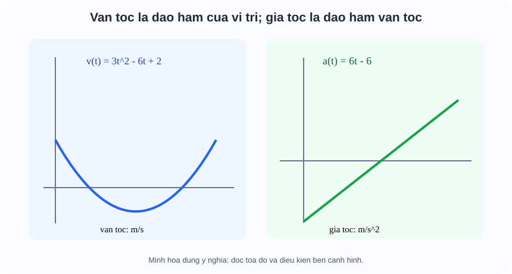

**Ví dụ 7 — tính hai lần:** f(x)=x³−3x²+2x có f'=3x²−6x+2, f''=6x−6. Tại x=1, f''=0; trong trường hợp này f'' đổi dấu qua 1, nên đồ thị đổi chiều lõm tại đó. Nhưng **chỉ riêng f''(a)=0 chưa chứng minh điểm uốn**. Phản ví dụ f(x)=x⁴: f''(x)=12x²≥0 cả hai phía của 0, f''(0)=0 nhưng không đổi chiều lõm.

**Cảnh báo không được nhầm:** f'(a)=0 là tiếp tuyến ngang, chưa đủ chứng minh cực trị; f''(a)>0 không đồng nghĩa f tăng tại a; gia tốc âm không đồng nghĩa vật luôn chậm dần. Việc khảo sát biến thiên/tối ưu cần dấu đạo hàm trên **các khoảng**, đó là mạch M7 tiếp theo.

**Tự thử M6-T05.** Với s(t)=t³−3t, tính vận tốc và gia tốc tại t=2, kể đơn vị nếu s (m), t (s).

Đã làm? Mở đối chiếu

v(t)=3t²−3, a(t)=6t; v(2)=9 m/s, a(2)=12 m/s². Nếu em ghi đơn vị gia tốc m/s, hãy nhớ gia tốc là vận tốc thay đổi theo thời gian.

**Tự thử M6-T06.** f(x)=x⁴ có f''(0)=0. Có được kết luận x=0 là điểm uốn không?

Đã giải thích? Mở đối chiếu

Không. f''(x)=12x² dương ở cả hai phía của 0, nên không có đổi chiều lõm. Cần thêm điều kiện/kiểm tra, không chỉ thế x=0.

## M6.6 — Khi em sai, nên quay lại đâu?

| Lỗi cụ thể | Bản chất bị bỏ quên | Cách sửa ngay tại Topic |
|---|---|---|
| Thế h=0 trước khi rút gọn | Thương sai phân chỉ định nghĩa khi h khác 0 | Quay lại M6.1 và TRY T01; khai triển rồi lấy giới hạn |
| Nói mọi hàm liên tục đều khả vi | Góc nhọn có hai độ dốc khác nhau | Quay lại hình B31-02 và TRY T02 |
| Viết y=f'(a)x | Tiếp tuyến còn phải qua (a,f(a)) | Dùng công thức y−f(a)=f'(a)(x−a) ở M6.2 |
| (uv)'=u'v' | Hai thừa số cùng tạo thay đổi | M6.3, hình hai dải diện tích, TRY T03 |
| Quên đạo hàm tầng trong | Hàm hợp thay qua hai tầng | M6.3–4, hình B32-02, TRY T04 |
| Công thức hợp lệ nhưng vượt miền | Mẫu/log/căn loại điểm đầu vào | M6.4, viết miền trước công thức |
| Gia tốc âm luôn chậm dần | Cần cả dấu vận tốc và gia tốc | M6.5, so t=1 và t=3 |
| f''(a)=0 suy ngay điểm uốn | Không đủ chứng cứ đổi chiều lõm | M6.5, x⁴ và TRY T06 |

---

## M7.0. Một đường cong nói được gì mà một vài giá trị không nói được?

Nếu em chỉ biết hàm số tại ba thời điểm, em biết ba “bức ảnh”. Nhưng muốn biết khi nào giá trị **đang tăng**, khi nào **đang giảm**, lúc nào tốt nhất hoặc khi x đi rất xa sẽ ra sao, em phải hiểu chuyển động của **cả đường cong**. Những công cụ đã có ở Topic:

- M1–M3: hàm số, miền xác định, cách đọc tọa độ và đồ thị.
- M4: các kiểu tăng/giảm, chu kỳ và họ hàm đặc biệt.
- M5: giới hạn, hành vi gần điểm và xa vô tận, liên tục.
- M6: đạo hàm \(f'(x)\) là tốc độ thay đổi tức thời của đầu ra theo đầu vào.

Ở đây em sẽ **kết hợp** các công cụ ấy. Không cần quay sang SGK để hoàn thành một bước kiến thức bắt buộc.

## M7.1. Dấu đạo hàm: Đường cong đang đi lên hay đi xuống?

Trước tiên, hãy tưởng tượng em đi trên đường cong từ **trái sang phải**. Đạo hàm dương nghĩa là tiếp tuyến nghiêng lên, âm nghĩa là nghiêng xuống. Trên một **khoảng liên tục và khả vi thích hợp**, nếu \(f'(x)>0\) khắp khoảng thì f **đồng biến**; nếu \(f'(x)<0\) khắp khoảng thì f **nghịch biến**. Có những trường hợp \(f'=0\) tại vài điểm nhưng hàm vẫn đồng biến, nên không được đòi “dương mọi điểm” như một điều kiện cần.

**EX-M7-01 — Đọc dấu trước khi đặt tên cực trị.** Cho \(f(x)=x^3-3x\), miền \(\mathbb R\). Ta có \(f'(x)=3x^2-3=3(x-1)(x+1)\).

| Khoảng của x | \((-\infty,-1)\) | \((-1,1)\) | \((1,+\infty)\) |
|---|---:|---:|---:|
| Dấu \(f'(x)\) | + | − | + |
| Hàm f | Tăng | Giảm | Tăng |

Vì hàm đổi **tăng → giảm** khi qua −1, \(f(-1)=2\) là **cực đại địa phương**. Qua +1, đổi **giảm → tăng**, \(f(1)=-2\) là **cực tiểu địa phương**. Chính **đổi dấu** và giá trị tại điểm làm nên kết luận, không phải mỗi phép giải \(f'=0\).

**Một bẫy cần hiểu:** \(g(x)=x^3\) có \(g'(0)=0\) nhưng g vẫn tăng từ trái sang phải qua 0; không có cực đại/cực tiểu tại đó. Tại điểm f' không tồn tại, cũng phải xét dấu/hành vi, ví dụ \(g(x)=|x|\) có cực tiểu tại 0 dù không có đạo hàm ở đó.

**Cách đọc hình dấu đạo hàm:** Hãy đọc hai trục, điểm x=−1,1, các dấu +/− trên khoảng và chiều mũi tên. Đừng chỉ nhìn hình rồi điền dấu mà quên kiểm đại số \(f'\).

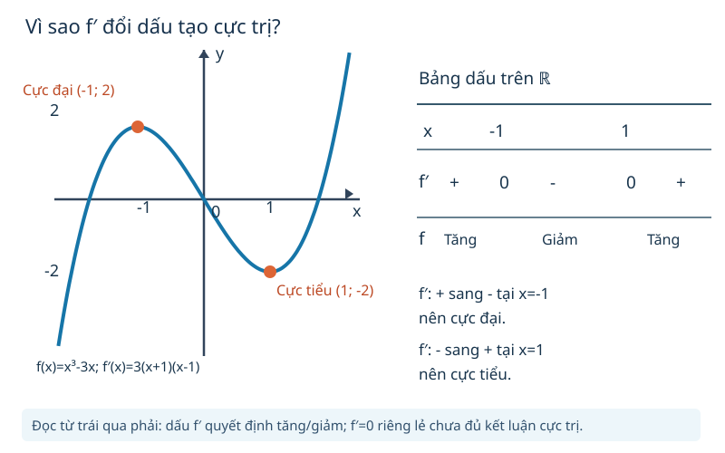

**TỰ THỬ M7-T01.** \(h(x)=x^3\). Đạo hàm bằng 0 tại x=0. Có thể kết luận cực trị không? Nêu một lý do bằng dấu hoặc lập luận so sánh giá trị.

Tự nghĩ xong? Mở đối chiếu

Không. \(h'(x)=3x^2\ge0\) và h tăng qua 0; với x<0, h(x)<0=h(0), còn x>0, h(x)>0. Không đổi từ tăng sang giảm hoặc ngược lại, nên h(0) không là cực trị.

**Luôn tôn trọng miền:** \(r(x)=1/(x-1)\) có \(r'(x)=-1/(x-1)^2<0\) trên hai khoảng \((-\infty,1)\), \((1,+\infty)\). Ta nói r **giảm trên từng khoảng đó**, không gọi “giảm trên toàn \(\mathbb R\)” hoặc kết nối qua x=1 vì hàm không xác định tại 1.

## M7.2. Cực trị quanh một điểm khác giá trị lớn nhất/nhỏ nhất trên miền

Một **cực đại địa phương** chỉ so với những điểm **ở gần** nó. **GTLN trên miền D** phải là giá trị lớn hơn hoặc bằng **mọi** giá trị f(x) trên D, và phải **đạt tại một x∈D**. Tương tự với GTNN. Vì vậy, một “đỉnh cục bộ” có thể không là cao nhất trên cả miền.

**Vì sao kiểm cả đầu mút?** Trên đoạn đóng \([a,b]\), nếu f liên tục, luôn đạt GTLN và GTNN. Các điểm cần kiểm trong bài khả vi thông thường là **đầu mút**, các điểm \(f'=0\), và các điểm f' không tồn tại nhưng f vẫn xác định. Nếu đoạn bị ràng buộc bởi miền khác, cần giao miền trước; không thế một giá trị ngoài miền vào bảng.

**EX-M7-02 — So các ứng viên, không chỉ giải đạo hàm.** Với \(q(x)=x^2\) trên \([-2,1]\), đạo hàm \(q'(x)=2x\), bằng 0 tại 0. So \(q(-2)=4\), \(q(0)=0\), \(q(1)=1\): **GTLN = 4 đạt ở −2**, GTNN = 0 đạt ở 0. Đỉnh thấp nhất nằm trong đoạn; cao nhất lại ở đầu mút.

**Trái lại, trên khoảng mở \((0,1)\)**, \(x^2\) luôn dương và nhỏ hơn 1, nhưng **không đạt** 0 hoặc 1 trong miền; do đó **không có GTLN hay GTNN** trên khoảng này, dù có cận trên/cận dưới. Câu “có giới hạn bằng 1 khi x→1⁻” không làm cho x=1 trở thành một điểm trong miền.

**Đọc hình:** \`G12_B02_FIG01_GLOBAL_MIN_MAX_CLOSED_INTERVAL_R00.svg\` minh họa **một hàm khác** \(y=x^2-4x+1\) trên [0,5], **không phải đồ thị của \(q=x^2\)**. Học sinh hãy đọc: f(0)=1, f(2)=−3 (thấp nhất), f(5)=6 (cao nhất); xác định các điểm có/không nằm trong đoạn. Không ghép nhầm lời giải EX-M7-02 vào hình B02.

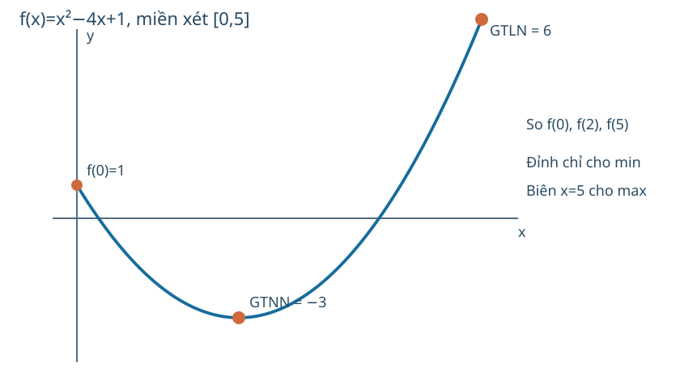

**TỰ THỬ M7-T02.** \(f(x)=x^2\) trên \((-1,2)\). Giá trị f nhỏ nhất có tồn tại không? Có GTLN không? Giải thích bằng miền, không chỉ ghi số 4.

Đã thử? Mở đối chiếu

GTNN bằng 0 và đạt tại x=0 (thuộc khoảng). Không có GTLN: khi x→2⁻ thì x² tiến sát 4 nhưng x=2 không thuộc khoảng; mọi giá trị thực tế trong miền đều <4. Phải phân biệt GTNN đạt được với cận trên không đạt.

### M7 · Cùng công thức, nhưng phải hỏi **trên miền nào?**

Em có ba kết luận: \(D=(0,+\infty)\); khi \(x\to0^+\) thì f tiến ra \(-\infty\); \(f'(x)>0\) trên D. **Hãy tự thử hai câu** trước khi xem:

1. Trên **toàn miền** \((0,+\infty)\), hàm có GTNN/GTLN không?
2. Trên **đoạn** \([1/2,4]\), GTNN/GTLN bằng mấy và đạt ở đâu?

Đối chiếu M7 · Miền khác thì kết luận cũng khác

Trên \((0,+\infty)\), f tăng, có giới hạn \(-\infty\) khi \(x\to0^+\), và tiến \(+\infty\) khi \(x\to+\infty\). **Không có GTNN và GTLN** trên toàn miền. Không có giá trị hàm tại tiệm cận x=0.

Trên \([1/2,4]\), f liên tục và tăng; **GTNN = −1** tại \(x=1/2\), **GTLN = 2** tại \(x=4\). Cả hai đầu mút thuộc miền con nên hai giá trị này **được đạt**. Nếu nhận vô cực làm giá trị lớn nhất/nhỏ nhất trên đoạn, quay lại M1 (miền) và M7.2 (phân biệt cận với giá trị đạt được).

**Tổng kết cách học:** M4 xác định quy tắc và miền; M5 đọc hành vi ở ranh giới; M6 đo độ dốc tại một điểm hợp lệ; M7 kết hợp miền, giới hạn, đạo hàm để kết luận cho **toàn đồ thị hoặc miền được hỏi**. Một hàm số có thể trả lời nhiều câu hỏi mà không cần học lại từ đầu.

## M7.3. Đồ thị ở gần điểm loại và ở rất xa: Khi nào gọi là tiệm cận?

Một đường **tiệm cận đứng** \(x=a\) được xác định khi f(x) tăng/giảm không bị chặn (\(+\infty\) hoặc \(-\infty\)) khi x→a từ **ít nhất một phía hợp lệ**. Chỉ có “mẫu bằng 0” chưa chứng minh tiệm cận đứng: phải xét giới hạn của **hàm gốc**.

**Phản ví dụ lỗ đồ thị:** \(f(x)=(x^2-1)/(x-1)\), x≠1, bằng x+1 khi x≠1; giới hạn khi x→1 bằng 2, **hữu hạn**, nên x=1 **không** là tiệm cận đứng, chỉ là lỗ tại (1,2).

Một **tiệm cận ngang** \(y=L\) xuất hiện nếu \(\lim_{x\to+\infty}f(x)=L\) hoặc \(\lim_{x\to-\infty}f(x)=L\). Hai phía vô cực có thể cho hai giá trị khác nhau; hàm có thể cắt tiệm cận ngang tại chỗ khác. Một **tiệm cận xiên** \(y=ax+b\) với a≠0 đòi \(f(x)-(ax+b)\to0\) khi x→+∞ hoặc −∞. Chỉ vì đồ thị trông gần một đường nghiêng trên hình vẽ chưa đủ: hãy kiểm **hiệu tiến 0**.

**EX-M7-03 — Dấu mẫu và tiệm cận ngang/đứng.** \(f(x)=(3x+1)/(x-2)=3+7/(x-2)\). Miền x≠2. Khi x→2⁻, \(7/(x-2)\to-\infty\); khi x→2⁺, nó→+\infty. Vậy x=2 là tiệm cận đứng. Khi x→±∞, phần 7/(x−2)→0, nên y=3 là tiệm cận ngang ở cả hai phía. **Không nối hai nhánh qua x=2.**

**Đọc hình:** \`G12_B03_FIG01_ASYMPTOTES_R00.svg\`, vẽ **đúng** f(x)=(3x+1)/(x−2): trục x/y, nét đứt x=2/y=3, nhánh trái dưới y=3 và phải trên y=3. Nét đứt biểu diễn tiệm cận, **không thuộc đồ thị f**.

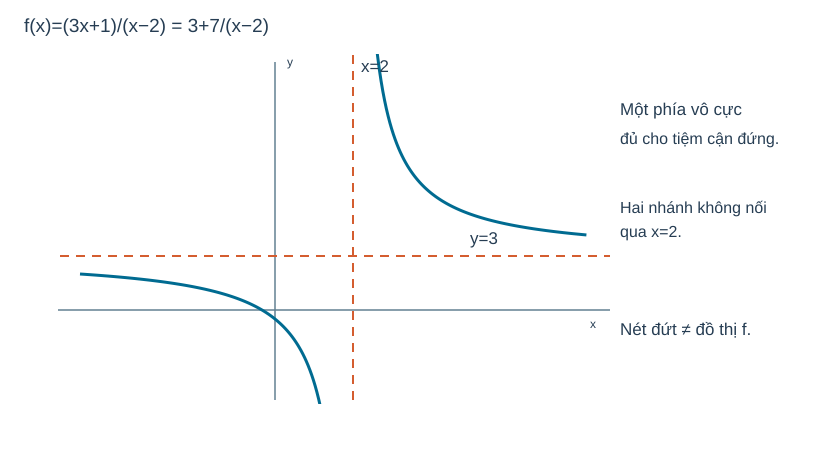

**EX-M7-04 — Tiệm cận xiên từ phần dư.** \(g(x)=x+1+2/(x-1)\), x≠1. Hiệu \(g(x)-(x+1)=2/(x-1)\to0\) khi x→±∞; vậy y=x+1 là tiệm cận xiên. x=1 là tiệm cận đứng vì 2/(x−1) không bị chặn gần 1. Ở bài này không gọi y=x+1 là một tiệm cận ngang vì hệ số x bằng 1≠0.

**TỰ THỬ M7-T03.** \(r(x)=(x^2-9)/(x-3)\), x≠3. Có tiệm cận đứng x=3 không? Nêu phép biến đổi hợp lệ và giới hạn tại x=3.

Đã thử? Mở đối chiếu

Không. Với x≠3, r=x+3 nên giới hạn khi x→3 bằng 6. Điểm (3,6) là lỗ, không phải chỗ đồ thị chạy vô cực. Quay lại M5 nếu còn lẫn “không xác định” với “vô cực”.

## M7.4. Khảo sát và vẽ đồ thị không phải một danh sách bước vô nghĩa

Lý do cần **một bức tranh toàn cục** là: chỉ đạo hàm chưa nói có lỗ/tiệm cận không; chỉ giới hạn chưa nói tăng/giảm; chỉ nghiệm chưa cho biết hình dáng. Hãy kết hợp theo đúng câu hỏi cần trả lời:

1. **Miền D:** x nào được phép? Mọi bước sau phải tôn trọng D.
2. **Điểm có ý nghĩa:** giao trục, điểm \(f'=0\), điểm f' không có nghĩa nhưng f có nghĩa; không đánh đồng chúng.
3. **Chiều biến thiên và cực trị:** xét dấu f' trên **từng khoảng** bị chia bởi nghiệm, điểm loại và miền.
4. **Hành vi ở biên/xa vô cực:** giới hạn một phía, tiệm cận nếu có.
5. **Bảng biến thiên & nét đồ thị:** đặt đủ điểm/tiệm cận, hướng mũi tên và kiểm xem nét có xuyên điểm cấm không.
6. **Đối xứng nếu có:** kiểm \(f(-x)=\pm f(x)\) với miền đối xứng hoặc một phép biến đổi thực sự, không phán đoán chỉ bằng mắt.

**EX-M7-05 — Một phân thức, tất cả manh mối có liên hệ.**
Xét \(g(x)=(x+2)/(x-1)=1+3/(x-1)\).
- Miền \(D=\mathbb R\setminus\{1\}\).
- Giao Ox: \(x=-2\) (tử 0, mẫu ≠0), giao Oy: \((0,-2)\).
- \(g'(x)=-3/(x-1)^2<0\) ở mọi x thuộc D. **G giảm trên hai khoảng riêng** \((-\infty,1)\), \((1,+\infty)\); không kết luận giảm xuyên x=1.
- Khi x→1⁻, g→−∞; x→1⁺, g→+∞; tiệm cận đứng x=1.
- Khi x→±∞, g→1; tiệm cận ngang y=1. Trên nhánh trái g<1, trên nhánh phải g>1.
- Bảng biến thiên gồm hai nhánh tách tại 1; do g'<0 trên từng nhánh, **không có cực trị nội tại** của hai nhánh.

**Đọc hình:** \`G12_B04_FIG01_RATIONAL_SURVEY_R00.svg\`, biểu diễn chính \(g\) trên. Kiểm lại hình bằng các số \((-2,0)\), \((0,-2)\), tiệm cận \(x=1\) và \(y=1\). Nếu hình không đọc rõ, mô tả trên đủ để tái dựng.

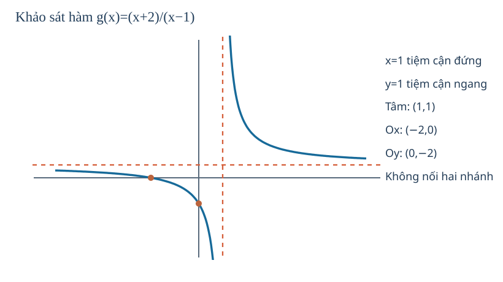

**EX-M7-06 — Một đa thức, không có tiệm cận.**
Cho \(h(x)=x^3-3x^2=x^2(x-3)\), miền R. Ta có \(h'=3x(x-2)\): dấu + trên \((-\infty,0)\), − trên \((0,2)\), + trên \((2,+\infty)\). Cực đại địa phương \(h(0)=0\); cực tiểu địa phương \(h(2)=-4\). Các nghiệm \(x=0\) (bội hai, đồ thị **chạm** Ox) và \(x=3\) (cắt Ox). Đa thức không có tiệm cận đứng, ngang hay xiên như các phân thức trên; khi x→±∞, h→±∞. Đồ thị không bị tách nhánh tại điểm loại.

**Đọc hình:** \`G12_B04_FIG02_CUBIC_SURVEY_R00.svg\`. Đọc điểm O, điểm (2,−4), điểm cắt Ox tại 3; một điểm có \(f'(0)=0\) còn có thể là cực đại vì dấu **thật sự đổi** qua 0.

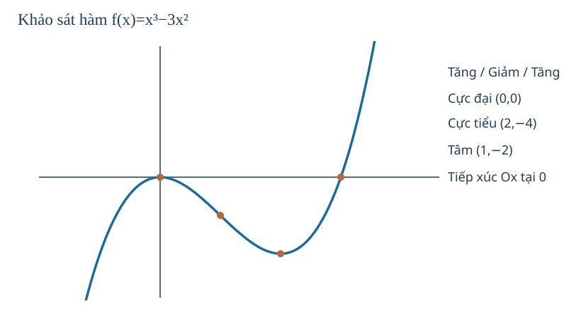

**TỰ THỬ M7-T04.** Với \(g(x)=(x+2)/(x-1)\), có được kẻ một nét liền đi qua x=1 không? g tăng/giảm trên những khoảng nào? Vì sao?

Mở đối chiếu

Không, g không xác định ở x=1 và có tiệm cận đứng ở đó. g' âm trên từng khoảng \((-\infty,1)\) và \((1,+\infty)\), nên giảm trên từng khoảng. Đừng lấy “g'<0” để nối xuyên điểm loại.

## M7.5. Tối ưu một tình huống thực: trước đạo hàm là **miền khả thi**

Trong thực tế, ta không thể chọn mọi số x chỉ vì công thức toán học có nghĩa. Một tấm bìa dài 30 cm và rộng 20 cm được cắt bốn hình vuông cạnh x cm rồi gấp thành hộp **không nắp**. Để hộp có đáy và chiều cao dương:
\[
x>0,\quad 30-2x>0,\quad20-2x>0
\quad\Rightarrow\quad 0<x<10.
\]
**Nếu em lấy x=12 theo một nghiệm đạo hàm mà bỏ miền vật lý, “đáy” có chiều rộng âm — không thể làm hộp.**

Thể tích hộp là \(V(x)=x(30-2x)(20-2x)\), đo bằng cm³. Khai triển:
\[
V(x)=600x-100x^2+4x^3,\quad
V'(x)=600-200x+12x^2=4(3x^2-50x+150).
\]
Giải \(V'=0\) được
\[
x_1=\frac{25-5\sqrt7}{3}\approx3{,}924,\qquad
x_2=\frac{25+5\sqrt7}{3}\approx12{,}743.
\]
Chỉ \(x_1\in(0,10)\). Vì V' dương trước \(x_1\) và âm từ \(x_1\) tới 10, thể tích đạt **GTLN** tại \(x=x_1\). Giá trị x₂ bị loại vì không làm được hộp. Hai đầu mút x→0⁺ và x→10⁻ cho V tiến về 0, nhưng trong miền hộp không suy biến **không có GTNN bằng 0 được đạt**; đó chỉ là cận dưới.

**Tại sao chọn dấu đạo hàm thay vì chỉ thử vài kích thước?** Thử một số giá trị có thể gợi đoán nhưng không bảo đảm lớn nhất. Đạo hàm, miền và giới hạn ở biên cho lập luận bao phủ mọi kích thước hợp lệ. **Giới hạn mô hình:** bỏ qua độ dày giấy, mép gấp, hao phí, nên kết luận là cực đại của mô hình hình học, không tự bảo đảm hiệu quả sản xuất thực tế.

**Cách đọc hình hộp không nắp:** chính xác mô tả tấm bìa **30×20 cm**, miền 0<x<10 và đỉnh tối ưu gần 3,924 cm. Hai đầu mút là vòng tròn rỗng; khi đọc hình, phải nhận ra **GTLN đạt trong miền** nhưng GTNN bằng 0 không đạt.

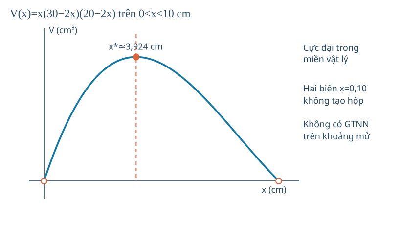

**EX-M7-07 — Tối ưu trong một miền mở vô hạn.** Một mô hình chi phí (đơn vị quy ước) \(C(x)=x+16/x\) với \(x>0\). Ta có \(C'(x)=1-16/x^2=(x^2-16)/x^2\), âm trên (0,4), dương trên (4,+∞). Vì vậy C giảm rồi tăng, **GTNN=8** đạt khi x=4. Khi x→0⁺ hoặc x→+∞, C→+∞ nên không có GTLN trên (0,+∞). Không chọn x âm, vì miền công thức thực tế đã nêu x>0.

**EX-M7-08 — Khi mô hình đã sai trước khi tính.** Nếu công thức lợi nhuận chỉ có nghĩa khi sản xuất ít nhất 10 sản phẩm mỗi ngày, một nghiệm \(f'(x)=0\) ở x=3 (sản phẩm) **không phải phương án kinh doanh hợp lệ**. Hãy viết miền \(x\in\mathbb Z, x\ge10\) (nếu sản phẩm phải nguyên) rồi cân nhắc nghiệm đạo hàm liên tục như **gợi ý** để kiểm các số nguyên lân cận, không gọi đạo hàm trực tiếp tại “số lượng rời rạc” là chứng minh tối ưu. Mức lợi nhuận thật có thể khác mô hình.

**TỰ THỬ M7-T05.** Tấm bìa 30×20 cm: tại sao x=0 và x=10 bị loại khỏi bài toán hộp không suy biến? Nghiệm x≈12,743 có dùng được không?

Đã tự giải thích? Mở đối chiếu

Tại x=0, hộp cao 0; tại x=10, chiều rộng đáy 20−2x=0. Cả hai đều không tạo hộp có thể tích dương. x≈12,743 còn lớn hơn 10 làm chiều rộng âm nên không hợp lệ. Luôn kiểm miền trước và sau khi giải V'=0.

**TỰ THỬ M7-T06.** \(C(x)=x+16/x\) trên x>0. Có GTNN không? Có GTLN không? Vì sao một điểm mà C'=0 chưa đủ nếu em không kiểm dấu và miền?

Mở phần đối chiếu

C'=1−16/x² đổi từ âm sang dương tại x=4; C(4)=8 là GTNN. C→+∞ khi x→0⁺ hoặc +∞ nên không có GTLN hữu hạn. Chỉ giải C'=0 chưa đủ nếu không kiểm rằng 4 thuộc miền và chiều biến thiên ở hai phía.

## M7.6. Đạo hàm là tốc độ thay đổi **có đơn vị**, không chỉ một bài hình học

Ở M6 em đã hiểu \(s'(t)\) là vận tốc có dấu của vị trí, còn \(s''(t)\) là gia tốc. Khi một hàm mô tả **nồng độ**, **số lượng**, **chi phí**, ta cũng hỏi cùng một điều: đầu ra thay đổi bao nhiêu khi đầu vào tăng thêm một lượng nhỏ?

- Nếu \(C(t)\) là nồng độ (mol/L) ở thời điểm t tính bằng giây, \(C'(t)\) có đơn vị mol/(L·s). Dấu và giá trị cho biết nồng độ **đang tăng/giảm với tốc độ tức thời** theo thời gian; không tự nói toàn bộ phản ứng đã hoàn tất.
- Nếu \(P(t)\) là số lượng cá thể trong mô hình liên tục theo t (năm), \(P'(t)\) có đơn vị cá thể/năm; với mô hình đếm cá thể thực tế theo năm nguyên, cần phân biệt đạo hàm của **hàm nội suy** và hiệu giữa hai số liệu năm liên tiếp.
- Nếu \(K(q)\) là chi phí theo số sản phẩm q, \(K'(q)\) có đơn vị tiền/sản phẩm, thường được diễn giải là **chi phí cận biên** trong mô hình liên tục. Không tự coi đạo hàm là chính xác số tiền tăng khi sản xuất thêm tròn một sản phẩm.

**EX-M7-09 — Chi phí cận biên khác đúng một đơn vị tăng thực tế.** Giả sử mô hình chi phí \(K(q)=100+3q+0{,}02q^2\) (nghìn đồng), q≥0 là số sản phẩm. Xét **mô hình nội suy cho q thực** thì \(K'(q)=3+0{,}04q\) (nghìn đồng/sản phẩm). Ở q=10, \(K'(10)=3{,}4\) nghìn đồng/sản phẩm, biểu thị tốc độ thay đổi **tức thời** của mô hình. Nếu sản xuất thực tế theo q nguyên, chi phí tăng từ 10 lên 11 sản phẩm đúng bằng \(K(11)-K(10)=3{,}42\) nghìn đồng, **không đúng bằng 3,4**. Chênh 0,02 do mô hình cong; nếu bước đủ nhỏ, thương sai phân mới tiến gần đạo hàm. **Lý do chọn phương pháp:** muốn biết xu thế gần q=10 dùng đạo hàm; muốn biết đúng thay đổi 10→11 thì dùng hiệu thực của mô hình.

**TỰ THỬ M7-T07.** Với \(K(q)=100+3q+0{,}02q^2\), tại q=0, đạo hàm bằng bao nhiêu? Nếu q là số sản phẩm nguyên, em có thể gọi \(K'(0)\) là tiền tăng **chính xác** khi làm sản phẩm đầu tiên không?

Đã thử? Mở đối chiếu

\(K'(0)=3\) nghìn đồng/sản phẩm theo mô hình liên tục. Mức tăng đúng \(K(1)-K(0)=3{,}02\) nghìn đồng, khác 3. Đạo hàm là tốc độ thay đổi cục bộ của mô hình, không tự thay thế hiệu trên một bước nguyên. Nếu lẫn, quay lại thương sai phân M6.1.

## M7.7. Nếu kết luận sai, hãy tìm lại tiền đề

| Dấu hiệu người học gặp | Chẩn đoán ý nghĩa bị thiếu | Hướng khắc phục trực tiếp trong Topic |
|---|---|---|
| \(f'(a)=0\Rightarrow\) cực trị | Điều kiện cần ở điểm khả vi không đủ; cần dấu hai phía hoặc lập luận khác | M7.1, phản ví dụ x³, TRY T01 |
| Cực đại địa phương = GTLN | Địa phương chỉ so gần, không so toàn miền | M7.2, bảng giá trị tại đầu mút và TRY T02 |
| Mọi giới hạn hữu hạn tại điểm loại là tiệm cận đứng | Lỗ không chạy ra vô cực | M7.3, rút gọn (x²−9)/(x−3), TRY T03 |
| \(f'<0\) nên giảm “trên R” dù có điểm loại | Dấu chỉ kiểm trên từng khoảng trong miền | M7.1, M7.4, TRY T04 |
| Chỉ dùng bảng đạo hàm để vẽ hình | Quên giao trục, giới hạn, điểm loại, tiệm cận, hình đối xứng | M7.4, đọc hai hình B04 |
| Nghiệm \(V'=0\) nằm ngoài miền vẫn chọn | Quên ràng buộc thực tế, đơn vị, đầu mút | M7.5, hình hộp và TRY T05 |
| Tối ưu trên khoảng mở mà tự nhận GTLN/GTTN ở biên không thuộc miền | Nhầm cận với giá trị đạt được | M7.2/M7.5, TRY T02/T06 |
| Gia tốc âm thì tốc độ luôn giảm | Cần cả dấu vận tốc và gia tốc | Quay lại M6.5 rồi tiếp M7.1 (không xem SGK bắt buộc) |
| Chi phí cận biên bằng đúng chi phí thêm một sản phẩm | Nhầm đạo hàm của mô hình liên tục với hiệu trên một bước rời rạc | M7.6, EX-M7-09 và TRY T07 |

---

### Gợi ý chuyển sang Luyện tập chung SGK–Chuyên đề

Những câu sau thuộc **một ngân hàng gốc**, không sao chép đề hoặc đáp án. Trong Luyện tập, em tự làm trước, sau đó mới dùng gợi ý hoặc đối chiếu. Những câu đã xem lời giải là bài ôn luyện, không phải câu kiểm tra độc lập.

| Mạch | Item gốc nên dùng | Mục tiêu và đường khắc phục |
|---|---|---|
| M4 | `THPT-G11-CHVI-B20-C03` → `THPT-G11-CHVI-B20-P01` | Miền log dịch và giải giá trị log; nếu sai, quay lại M4.5 |
| M5 | `THPT-G11-CHV-B16-C01` → `THPT-G11-CHV-B16-P07` | Giới hạn tại lỗ và mức bão hòa của mô hình; M5.1/M5.3 |
| M6 | `THPT-G11-CHIX-B31-P08` → `THPT-G11-CHIX-B31-P05` | Tiếp tuyến qua điểm và góc nhọn liên tục nhưng không khả vi; M6.2 |
| M7 | `THPT-G12-CHI-B01-P01` → `THPT-G12-CHI-B01-C04` | Dấu đạo hàm trên khoảng hợp lệ và phản ví dụ \(f'(a)=0\) nhưng không cực trị; M7.1/M7.2 |

Nếu còn thiếu chiều sâu ở một kỹ năng cụ thể, có thể thêm câu **thực sự khác năng lực cần đo**, không đặt hạn mức và không chỉ đổi số của bài cũ.

## Chuyển sang Luyện tập và Tự kiểm tra

Khi đã đọc đủ lý do, điều kiện và các ví dụ giải thích, em chuyển sang **Luyện tập** để giải bài theo kỹ năng: từ nhận diện, giải thích, tính toán đến vận dụng và tổng hợp. Mỗi câu có chỗ tự làm trước rồi mới tự chọn xem đối chiếu; em có thể quay lại đúng mạch kiến thức và hướng dẫn HELP nếu sai.

Phần **Tự kiểm tra** là bài đánh giá riêng bao quát toàn Chuyên đề, không dùng các câu đã xem giải làm chứng cứ độc lập. Đáp án, đánh giá đúng/sai và hướng dẫn giải chỉ được xem sau khi hoàn tất Final Submit.

---

---
