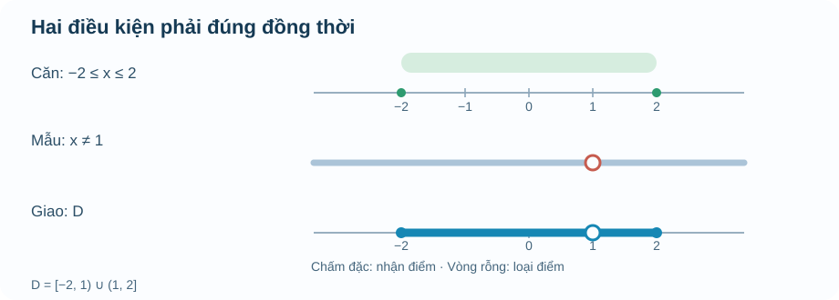

# Chuyên đề Hàm số và đồ thị · M1 — Một đầu vào hợp lệ là gì?

**BẢN BỔ SUNG AUTHORING R00 · CHƯA REVIEW · DELTA_C.** Bài này bổ sung chiều sâu sư phạm cho M1 trong bản canonical R18, **không thay thế** văn bản R18 đã Academic/PED PASS. Phần nội dung dành cho học sinh bắt đầu sau đường kẻ ngang.

**Nguồn S1 được xem trực tiếp:** SGK Toán 10 Kết nối tri thức, tập hai, Bài 15 *Hàm số*, trang **in 5–10** (trang PDF **6–11**, kiểm tra cả số trang in). Nội dung ví dụ dưới đây do AUTHORING biên soạn mới, không trích nguyên văn SGK. Đối chiếu thêm cách diễn giải của bộ Notebook 12/22 chuyên đề (bản nghiên cứu chưa review) nhưng **không** lấy kết luận PASS từ đó.

---

## M1 · Một quy tắc phải đi kèm với miền đầu vào

Khi theo dõi chất lượng không khí, chúng ta có thể ghi nồng độ bụi ở từng thời điểm. Ví dụ, tại 8 giờ máy đo cho một kết quả, tại 12 giờ cho kết quả khác. Điều quan trọng không chỉ là hai con số: **thời điểm** đóng vai trò đầu vào, còn **nồng độ đo được** là đầu ra. Nếu ở cùng một thời điểm, cùng một phép đo lại được gán hai kết quả trái ngược mà không giải thích vì sao, bảng đó chưa mô tả một hàm số theo quy tắc ta đã chọn.

Ta gọi \(f\) là một **hàm số xác định trên tập \(D\)** khi với **mỗi** \(x\in D\), quy tắc \(f\) cho **đúng một** giá trị thực \(f(x)\). Hai đầu vào khác nhau **được phép** cho cùng một đầu ra; điều bị cấm là **một đầu vào có hai đầu ra khác nhau**.

Nếu bảng ghi \(x=2\) hai lần và cả hai lần đều có \(y=5\), không có mâu thuẫn. Nhưng nếu một lần cho \(y=5\), lần khác cho \(y=7\), bảng đó không còn biểu diễn một hàm số \(y\) theo \(x\) với cách hiểu dữ liệu hiện tại.

**Phân biệt hai tập hợp:**

- **Tập xác định \(D\):** tất cả giá trị \(x\) được phép đưa vào quy tắc.
- **Tập giá trị \(T=\{f(x)\mid x\in D\}\):** tất cả kết quả **thực sự nhận được** khi đầu vào chạy trong \(D\).

Tập xác định không nhất thiết là toàn bộ số thực, cũng không nhất thiết là một khoảng. Nó có thể là một tập hữu hạn như \(\{0,1,2,3\}\), một đoạn, hoặc một tập có vài điểm bị loại.

### Ví dụ 1 · Khi công thức đúng nhưng đầu vào không thực tế

Một dịch vụ bán vé thu 8 nghìn đồng phí xử lý đơn và 12 nghìn đồng cho mỗi vé. Nếu mua \(n\) vé, với \(n\) là số nguyên dương, số tiền phải trả (nghìn đồng) là

\[
C(n)=8+12n.
\]

Về đại số, ta có thể thay \(n=2{,}5\) và nhận 38. Nhưng khách hàng không thể mua **hai vé rưỡi** theo mô hình đã nêu. Vì vậy, nếu số vé không bị giới hạn trên, miền đầu vào của **bài toán thực tế** là \(D=\{1,2,3,\ldots\}\), không phải \(\mathbb R\). Nếu đơn hàng chỉ được mua tối đa 6 vé, \(D\) thu hẹp thành \(\{1,2,\ldots,6\}\). Khi đó tập giá trị là \(\{20,32,44,56,68,80\}\).

**Vì sao cần phân biệt?** Một phép tính thực hiện được trên giấy chưa chắc mô tả được một tình huống được phép xảy ra. Khi đổi miền đầu vào, tập giá trị và câu trả lời tối ưu cũng có thể thay đổi.

## Mỗi phép toán đều có điều kiện

Ta thử xét

\[
h(x)=\frac{\sqrt{\,4-x^2\,}}{x-1}.
\]

Ở đây có **hai điều kiện độc lập**. Muốn căn bậc hai là số thực, biểu thức dưới căn phải không âm:

\[
4-x^2\ge 0\quad\Longleftrightarrow\quad -2\le x\le 2.
\]

Đồng thời, mẫu số không được bằng 0:

\[
x-1\ne 0\quad\Longleftrightarrow\quad x\ne 1.
\]

**Cả hai điều kiện phải đúng cùng lúc.** Vì vậy

\[
\boxed{D=[-2,2]\setminus\{1\}=[-2,1)\cup(1,2].}
\]

Chú ý cách dùng dấu ngoặc. Hai đầu mút \(-2\) và \(2\) **được nhận** vì căn bậc hai của 0 có nghĩa và mẫu số tại đó khác 0. Riêng \(x=1\) **bị loại** dù biểu thức dưới căn vẫn dương, vì mẫu số bằng 0. Các giá trị ngoài đoạn \([-2,2]\) bị loại do căn thức.

**Cách đọc hình:** hàng thứ nhất tô nhạt đoạn \([-2,2]\), biểu diễn điều kiện căn. Hàng thứ hai nhắc rằng điểm \(1\) bị loại bởi mẫu số. Hàng cuối thể hiện **giao** hai điều kiện: từ \(-2\) đến trước \(1\), rồi sau \(1\) đến \(2\). Vòng tròn rỗng ở \(1\) không phải điểm thuộc miền.

Một mô hình nhỏ để em tự chọn \(x\) và theo dõi điều kiện: **Temp_TOPIC1_M1_DOMAIN_LAB_D5_R00.html**. Mô hình là phương tiện quan sát, không thay phần giải thích bằng lời bên trên.

### Ví dụ 2 · Thử giá trị ở biên, ở điểm loại và bên ngoài

Với \(h\) trên, lần lượt xét \(x=-2,0,1,2,3\).

| Giá trị | Căn có nghĩa? | Mẫu khác 0? | Kết luận |
|---|---|---|---|
| \(x=-2\) | Có, vì \(4-(-2)^2=0\) | Có | \(h(-2)=0\) |
| \(x=0\) | Có, vì \(4-0^2=4\) | Có | \(h(0)=2/(-1)=-2\) |
| \(x=1\) | Có, vì \(4-1^2=3\) | **Không** | \(h(1)\) không xác định |
| \(x=2\) | Có, vì \(4-2^2=0\) | Có | \(h(2)=0\) |
| \(x=3\) | **Không**, vì \(4-3^2=-5\) | Có | \(h(3)\) không xác định trong \(\mathbb R\) |

Điều này cũng giải thích vì sao một giá trị \(x\) **không hợp lệ** không phải là “đầu vào cho kết quả sai”. Nó đơn giản không thuộc miền mà hàm đã được định nghĩa.

### Trường hợp dễ nhầm: căn nằm ở mẫu

Với biểu thức \(\displaystyle k(x)=\frac{1}{\sqrt{5-x}}\), căn ở **mẫu số**. Khi đó không đủ để yêu cầu \(5-x\ge0\). Nếu \(5-x=0\), mẫu sẽ bằng 0. Điều kiện chính xác là \(5-x>0\), tức \(x<5\). Vì vậy \(D_k=(-\infty,5)\), **không nhận** \(5\).

Một mẹo kiểm tra có lý do rõ ràng: hãy đọc biểu thức theo thứ tự cấu tạo. Có căn ở đâu? Có mẫu số ở đâu? Có phải kiểm đồng thời hai ràng buộc? Làm theo thứ tự này đáng tin cậy hơn việc ghi nhớ một bảng mẹo rời rạc.

## Tập giá trị không phải là tập xác định

Xét \(g(x)=(x-1)^2+2\) trên toàn bộ \(\mathbb R\). Vì bình phương không âm nên \(g(x)\ge2\), và khi \(x=1\) ta nhận đúng \(g(1)=2\). Khi \(|x-1|\) tăng không giới hạn, giá trị \(g(x)\) cũng tăng không giới hạn. Vậy \(T_g=[2,+\infty)\).

Nhưng nếu **chính quy tắc ấy** được xét trên đoạn \(D=[0,2]\), thì \(0\le(x-1)^2\le1\). Khi ấy \(g(x)\) chỉ nhận các giá trị từ 2 đến 3, tức \(T_g=[2,3]\). **Công thức không đổi, nhưng miền đầu vào đổi thì tập giá trị có thể đổi.** Sang M3, em sẽ dùng chính ý tưởng này để không chọn nhầm đỉnh parabol nằm ngoài miền bài toán.

## Vận dụng

**Bài 1 — Kiểm điều kiện trước khi tính.** Với hàm \(h(x)=\sqrt{4-x^2}/(x-1)\), em hãy dự đoán liệu \(x=-2, x=1, x=2, x=3\) có được phép hay không. Sau đó mới thử trên mô hình.

Đối chiếu

\(-2\) và \(2\) thuộc miền; \(1\) bị loại do mẫu bằng 0; \(3\) bị loại do biểu thức dưới căn âm. Nếu em đã loại nhầm \(2\), hãy nhớ \(\sqrt0=0\) có nghĩa.

**Bài 2 — Một dấu bằng có quan trọng không?** Hãy tìm tập xác định của \(k(x)=1/\sqrt{5-x}\), rồi so sánh với tập xác định của \(m(x)=\sqrt{5-x}\).

Đối chiếu

\(D_k=(-\infty,5)\) vì căn nằm ở mẫu và phải **khác 0**; \(D_m=(-\infty,5]\) vì một căn ở tử hoặc đứng riêng có thể bằng 0.

**Bài 3 — Đầu ra thay đổi theo miền.** Với \(g(x)=(x-1)^2+2\), tìm tập giá trị khi \(D=\mathbb R\) và khi \(D=[0,2]\). Giải thích bằng tính chất bình phương, không chỉ nhìn hình.

Đối chiếu

Trên \(\mathbb R\): \([2,+\infty)\). Trên \([0,2]\): \([2,3]\). Để chứng minh miền thứ hai, dùng \(-1\le x-1\le1\), suy ra \(0\le(x-1)^2\le1\); các giá trị từ 2 đến 3 đều đạt được: với mỗi \(y\in[2,3]\), chọn \(x=1+\sqrt{y-2}\in[1,2]\) thì \(g(x)=y\).

## Ghi nhớ để học tiếp

Một hàm số không chỉ là “thay số vào công thức”. Ta luôn phải biết **đầu vào nào được nhận, mỗi đầu vào cho bao nhiêu đầu ra, và khi đầu vào chạy trong miền thì những giá trị nào xuất hiện**. Khi đọc bảng hay đồ thị ở M2, miền quyết định chỗ nào điểm được vẽ; khi học parabol ở M3, miền quyết định có được chọn đỉnh để tối ưu hay không. Chính sự liên kết ấy khiến việc kiểm tập xác định trở thành bước có ý nghĩa, không phải thủ tục cho đủ bài.

---

## SOURCE / AUTHORING CONTROL (không render trong trang học sinh)

- **Canonical preserved:** R18 \`Temp_TOPIC_FUNCTIONS_FULL_PUBLIC_CANONICAL_SOURCE_R18_20261108.md\`, blob \`2340ea4975b37a457363eea59dd617070934983c\`, PR #782.
- **Source:** KNTT SGK Toán 10 tập 2, Bài 15, in5–10/PDF6–11. Các ví dụ vé, căn hỗn hợp và tập giá trị được tác giả bổ sung, không phải bài gốc SGK.
- **Proposed outcome scope:** G10-B15 function definition / domain / range / domain-in-context; mappings to canonical \`OUTCOME_ID\` cần đối soát trên R18 trước khi nhập.
- **DELTA_C_ACADEMIC_MATERIAL:** nội dung mới, SVG mới và bài mới phải NotebookLM đánh giá độc lập đúng 5 Permanent Sources v2.1 cùng S1, không tự PASS.
- **Placement:** Topic Kiến thức; 3 bài Vận dụng PUBLIC/formative, không dùng RD1, không tự ghi Mastery.
