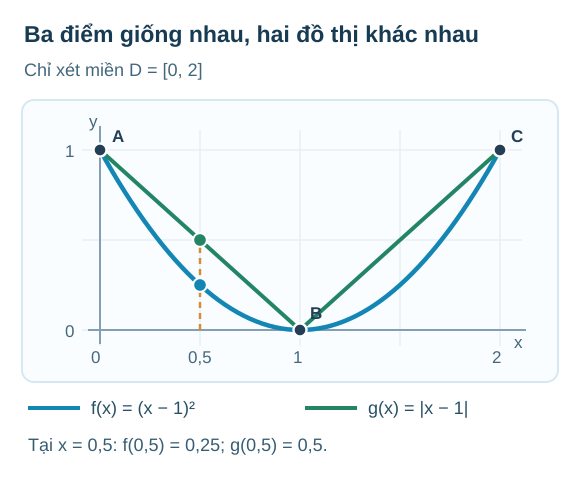
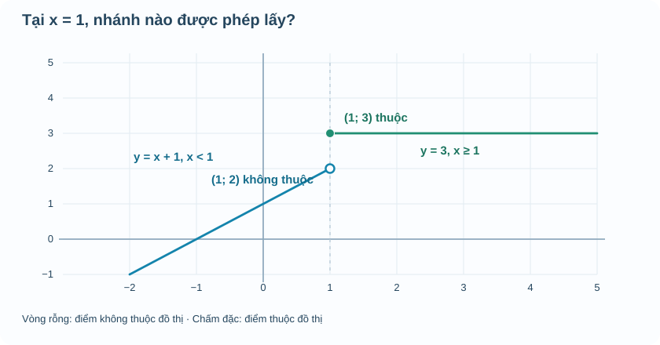

# Chuyên đề 1 · M2 — Đọc đúng đồ thị, điểm mốc và dữ kiện

**AUTHORING R00 · DELTA_C · CHƯA REVIEW.** Đây là phần kiến thức bổ sung cho mạch M2 của canonical R18, **không thay thế hoặc chép đè** nguồn đã Academic/PED PASS. Dự kiến sử dụng ở mục **Kiến thức** của Chuyên đề 1, sau M1 và trước M3.

**Nguồn SGK S1:** Toán 10 Kết nối tri thức, tập 2, Bài 15 *Hàm số*, trang in **5–10**, PDF **6–11**. Hai mô hình giá theo thời gian và đọc dữ kiện dưới đây là ví dụ tự biên soạn. Không xem hình minh họa là chứng minh hoặc là dữ liệu thực nghiệm có thật.

---

## Khi nhìn một đồ thị, ta biết chắc điều gì?

Giả sử một nhóm học sinh đo nhiệt độ nước trong cốc tại ba thời điểm:

| Thời gian \(t\) (phút) | 0 | 4 | 8 |
|---|---:|---:|---:|
| Nhiệt độ \(T\) (°C) | 20 | 30 | 36 |

Ba dấu chấm trên hệ trục thể hiện đúng **ba lần đo**. Nhưng nếu nối chúng bằng một đường cong trơn, các điểm nằm giữa không tự động trở thành số liệu đã đo. Đó có thể là một **cách mô hình hóa**, và nhiều đường cong khác nhau đều đi qua ba điểm đã biết.

Ví dụ tại phút thứ 2, không có dữ liệu đo trực tiếp. Nếu ta **giả định** nhiệt độ tăng đều từ phút 0 đến phút 4, phép nội suy cho \(T(2)=25\)°C. Nhưng con số 25 phụ thuộc vào giả định tăng đều, không suy ra chắc chắn chỉ từ ba lần đo.

### Tự thử — Ba dấu chấm có quyết định được cả nét cong?

Có ba vị trí được ghi trên một tờ giấy: \((0;1)\), \((1;0)\), \((2;1)\). Hai bạn học sinh muốn vẽ đường biểu diễn giữa các mốc. Một bạn chọn \(f(x)=(x-1)^2\), bạn kia chọn \(g(x)=|x-1|\), **cùng chỉ xét \(D=[0,2]\)**.

Hãy tự thay \(x=0,1,2\) vào cả hai công thức: **đường nào đi qua đúng ba điểm?** Rồi dự đoán ở \(x=0{,}5\), hai bạn có vẽ cùng một điểm không. Đừng mở hình khi chưa thử tính.

Đối chiếu và xem hai đường trên cùng hệ trục

Cả hai công thức đều cho các giá trị lần lượt **1, 0, 1** ở \(x=0,1,2\). Nhưng tại \(x=0{,}5\):
\[
f(0{,}5)=(0{,}5-1)^2=0{,}25,\qquad
g(0{,}5)=|0{,}5-1|=0{,}5.
\]
Vì vậy **ba điểm riêng lẻ không xác định duy nhất đường nối giữa chúng**. Hai đường hợp lệ theo đúng ba mốc nhưng mô tả những giá trị ở giữa khác nhau.

**Điều quyết định nằm ở dữ kiện được cho:** Nếu chỉ biết *ba cặp số*, em không có quyền khẳng định giá trị ở giữa. Nếu bài toán **cho hẳn quy tắc** \(f(x)=(x-1)^2\) và miền \(D=[0,2]\), thì tại mọi \(x\in D\) ta có thể tính \(f(x)\); cả đoạn parabol trong miền ấy được xác định bằng công thức. Nhưng nếu chỉ cho bảng ba điểm, không được tự giả định nó là parabol.

Đây là cầu nối từ M1 sang M2: **M1 xác định đầu vào nào hợp lệ; M2 hỏi những giá trị nào thật sự được dữ kiện hoặc quy tắc xác định.** Ở M3, ta sẽ còn dùng chính đoạn parabol \(f(x)=(x-1)^2\) trên \([0,2]\) để tìm hiểu khi dịch đồ thị, **miền đầu vào cũng phải dịch theo**.

**Điều cần nhớ:** hãy nhìn tên và đơn vị trên hai trục, xem các dấu chấm là **dữ liệu đã đo** hay điểm của **mô hình toán**, rồi mới đọc giá trị ở giữa. Nếu chỉ có bảng với ba mốc, nói “lúc nào nước cũng nóng dần” là kết luận quá mức.

### Miền rời rạc không phải một nét vẽ liên tục

Một bảng doanh thu theo **số vé** chỉ có đầu vào \(n=1,2,3,\ldots\). Khi vẽ, mỗi đầu vào được biểu diễn bằng một chấm. Đường thẳng đi qua các chấm có thể giúp nhìn xu hướng, nhưng không được tự coi \(n=2{,}5\) là số vé hợp lệ. Như vậy, từ M1 sang M2, **tập xác định vẫn quyết định điểm nào thuộc đồ thị**.

## Vì sao chấm rỗng và chấm đặc có ý nghĩa?

Một số quy tắc thay đổi tại một thời điểm hoặc một mức đầu vào. Xét:

\[
f(x)=
\begin{cases}
x+1,&x<1,\\
3,&x\ge1.
\end{cases}
\]

Ta phải đọc **điều kiện trước khi thay số**. Với \(x=0\), dùng \(x+1\), được \(f(0)=1\). Với \(x=2\), dùng giá trị không đổi 3, được \(f(2)=3\). Riêng tại \(x=1\), công thức đầu **không** áp dụng vì yêu cầu \(x<1\); công thức thứ hai **có** áp dụng vì \(x\ge1\), nên \(f(1)=3\).

Ở \(x=1\), nhánh \(y=x+1\) tiến đến tung độ 2 nhưng **không nhận** điểm \((1;2)\), nên hình vẽ dùng vòng tròn rỗng. Nhánh \(y=3\) **nhận** điểm \((1;3)\), nên phải tô đặc. Hai vị trí này có cùng hoành độ nhưng chỉ một điểm thuộc đồ thị.

Nếu người vẽ tô đặc cả hai điểm, ta sẽ có **một đầu vào \(x=1\) nhưng hai đầu ra khác nhau**. Hình đó không còn biểu diễn đúng một hàm số. Vì vậy nét rỗng/đặc không phải chi tiết trang trí: nó giúp thể hiện chính xác định nghĩa hàm số.

### Ví dụ 1 · Thay một dấu bằng, thay giá trị tại điểm

Giữ nguyên hai công thức nhưng sửa điều kiện thành:

\[
g(x)=
\begin{cases}
x+1,&x\le1,\\
3,&x>1.
\end{cases}
\]

Khi ấy \(g(1)=2\) thay vì 3. Hình vẽ phải đổi: \((1;2)\) thành điểm đặc và \((1;3)\) thành vòng tròn rỗng. Hai đồ thị chỉ khác **giá trị tại đúng một đầu vào**, nhưng giá trị đó phải được thể hiện chính xác.

Mô hình nhỏ \`Temp_TOPIC1_M2_PIECEWISE_LAB_D5_R00.html\` cho phép di chuyển \(x\) qua hai phía của mốc 1. Thử \(x=0{,}99\), \(x=1\), \(x=1{,}01\). Quan sát rằng ta **không** có quyền nối hai đầu nhánh để làm hình “mượt” hơn.

### Ví dụ 2 · Đọc đúng bảng và điểm mốc

| x | 0 | 0,5 | 1 | 2 |
|---|---:|---:|---:|---:|
| f(x) | 1 | 1,5 | 3 | 3 |

Tại \(x=0{,}5\), nhánh thứ nhất cho \(0{,}5+1=1{,}5\). Tại \(x=1\) hoặc 2, nhánh thứ hai cho 3. Nếu đọc \(f(1)=2\), ta đã vô tình dùng sai nhánh.

## Đọc một nhánh không đủ để kết luận về cả hàm

Theo định nghĩa dùng trong chuyên đề này, hàm **đồng biến nghiêm ngặt** trên một khoảng \(K\) nếu với mọi \(x_1<x_2\) thuộc \(K\), ta có \(f(x_1)<f(x_2)\).

Nhánh \(x+1\) đang tăng về phía phải, nhưng nhánh \(y=3\) hoàn toàn **không tăng**. Vì thế không được nói \(f\) đồng biến nghiêm ngặt trên toàn bộ \(\mathbb R\). Một phản ví dụ rất ngắn: \(1<2\) nhưng \(f(1)=f(2)=3\), trái yêu cầu \(f(1)<f(2)\).

Cách diễn đạt chính xác là: \(f\) đồng biến nghiêm ngặt trên \((-\infty,1)\) và **không đổi** trên \([1,+\infty)\). Ngoài ra có một bước nhảy tại mốc 1: các giá trị gần 1 về phía trái gần 2, còn giá trị ngay tại mốc và bên phải bằng 3. Sau này M5 sẽ giải thích chặt chẽ điều này bằng giới hạn một phía và liên tục; ở M2, ta chỉ cần hiểu **đọc điểm nào theo quy tắc nào**.

## Vận dụng — trước khi mở Đối chiếu

**Vận dụng 1.** Với \(f\) ở trên, hãy tính \(f(-1)\), \(f(1)\), \(f(1{,}5)\). Nêu nhánh tính tương ứng.

Đối chiếu

\(f(-1)=0\) từ nhánh \(x<1\). \(f(1)=3\) và \(f(1{,}5)=3\) từ nhánh \(x\ge1\). Nếu tính \(f(1)=2\), cần quay lại dấu bằng ở điều kiện thứ hai.

**Vận dụng 2.** Các điểm \((1;2)\), \((1;3)\), \((0;1)\) có thuộc đồ thị của \(f\) không? Không cần nhìn hình để đoán; hãy kiểm trực tiếp bằng công thức.

Đối chiếu

\((1;2)\) không thuộc vì \(f(1)=3\). Hai điểm còn lại thuộc vì \(f(1)=3\) và \(f(0)=1\). Một tọa độ \(x\) được phép chưa có nghĩa là mọi điểm \((x,y)\) đều nằm trên đồ thị.

**Vận dụng 3.** Một bạn cho rằng \(f\) đồng biến trên cả \(\mathbb R\) vì đường thẳng bên trái có hệ số góc dương. Hãy đưa phản ví dụ.

Đối chiếu

Lấy \(x_1=1\), \(x_2=2\). Ta có \(x_1<x_2\), nhưng \(f(x_1)=f(x_2)=3\). Như vậy \(f\) không đồng biến **nghiêm ngặt** trên toàn bộ \(\mathbb R\). Không được suy từ một nhánh ra cả miền.

## Ghi nhớ để nối sang M3

Khi đọc đồ thị, hãy tách ba câu hỏi: **đầu vào nào được nhận, điểm nào thật sự thuộc đồ thị, và kết luận đang nói về một điểm, một đoạn hay cả khoảng?** Không dùng một nét vẽ để thay điều kiện toán học. **Hãy nhớ hình hai đường cùng đi qua ba điểm:** khi sang M3, ta chỉ giữ công thức \(f(x)=(x-1)^2\) trên **đúng miền \([0,2]\)**. Một phép dịch đồ thị không cho phép tự nối thêm điểm ngoài miền; em sẽ thấy ba điểm \((0;1)\), \((1;0)\), \((2;1)\) chuyển đi đâu khi dịch sang phải và lên trên.

---

### AUTHORING CONTROL — KHÔNG RENDER CHO HỌC SINH

- S1: SGK KNTT Toán 10 Tập 2, B15 in5–10/PDF6–11, đã kiểm ảnh trước đó. Ví dụ \(f,g\) và bảng nhiệt độ là ví dụ do tác giả biên soạn.
- Ví dụ ba mốc / hai công thức \((x-1)^2\) và \(|x-1|\) cùng SVG đi kèm là **bổ sung minh họa tác giả tự kiểm**, không giả làm tình huống đo đạc SGK; mô hình parabol giới hạn này được **tái sử dụng** ở M3, không tạo item đánh giá độc lập.
- R18 canonical blob \`2340ea4975b37a457363eea59dd617070934983c\` phải giữ bất biến. M2 cũ đã có một ví dụ hàm từng đoạn với mô hình giá theo thời gian; phần mới có mục đích **chấm rỗng/đặc + phản ví dụ đồng biến trên miền**; QA Q15 phải quyết định có dùng một item đã tồn tại hay phát hành thêm item mới.
- Câu Vận dụng trong bản kiến thức là hoạt động công khai, **không** dùng RD1 hoặc ghi Mastery.
- \`DELTA_C_ACADEMIC_MATERIAL\`; chưa NotebookLM Academic/PED PASS, chưa CONTENT_READY. Không thay Golden UI/website.
