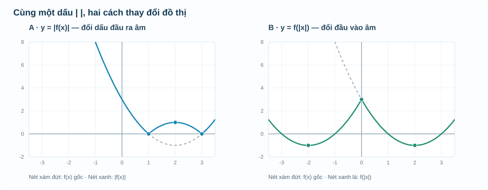

# Chuyên đề 1 · M3 — Từ parabol đến hai phép biến đổi đồ thị

**AUTHORING R00 · DELTA_C · CHƯA REVIEW.** Phần bổ sung cho mạch M3 của canonical R18; **không sửa hoặc sao chép đè** các định nghĩa, ví dụ và item đã PASS. Phạm vi mới tập trung vào hai phép biến đổi \(y=|f(x)|\), \(y=f(|x|)\), cách giải thích bằng hình và điều kiện \(a\ne0\). Mảng tối ưu chỉ thêm một tình huống làm cầu nối M1–M3.

**Nguồn S1:** SGK Toán 10 Kết nối tri thức tập hai, Bài 16 *Hàm số bậc hai*, trang in **11–18** / trang PDF **12–19** (Bài 16 đầy đủ; các hình và ví dụ trên trang 13–14 chỉ là một phần), đã đối chiếu số trang in và đồ thị. Hai phép biến đổi với trị tuyệt đối và tình huống vận dụng là nội dung bổ sung do AUTHORING biên soạn, **không tuyên bố là yêu cầu bắt buộc của bài SGK**.

---

## Vì sao một dấu giá trị tuyệt đối có thể đổi hẳn hình đồ thị?

Ở M1, em đã biết phải xem đầu vào nào được nhận. Ở M2, em học cách đọc điểm thuộc đồ thị, điểm bị loại và cách một đường biểu diễn biến đổi. Bây giờ, chúng ta thử đặt một thay đổi **rất nhỏ trong cách viết công thức** và xem đồ thị thay đổi ra sao.

Xét hàm số

\[
f(x)=x^2-4x+3=(x-2)^2-1.
\]

Từ dạng bình phương, ta thấy đỉnh \(I(2;-1)\), trục đối xứng \(x=2\) và đồ thị mở lên. Hai nghiệm của \(f(x)=0\) là \(x=1\) và \(x=3\). Trong khoảng \(1<x<3\), đồ thị nằm **dưới** trục hoành vì \(f(x)<0\); ngoài khoảng ấy, \(f(x)\ge0\).

Trên nền này, chúng ta tạo hai đồ thị mới:

\[
g(x)=|f(x)|,\qquad h(x)=f(|x|).
\]

Hai công thức có cùng dấu gạch đứng, nhưng chúng yêu cầu hai hành động hoàn toàn khác nhau. Với \(g\), ta tính xong giá trị \(f(x)\) rồi mới lấy trị tuyệt đối của **đầu ra**. Với \(h\), ta lấy trị tuyệt đối của **đầu vào** trước rồi mới đưa vào quy tắc \(f\).

## 1. Giá trị tuyệt đối ở bên ngoài: \(y=|f(x)|\)

Nhớ rằng \(|u|=u\) khi \(u\ge0\), còn \(|u|=-u\) khi \(u<0\). Vì vậy,

\[
|f(x)|=\begin{cases}
f(x),&f(x)\ge0,\\
-f(x),&f(x)<0.
\end{cases}
\]

Đây chính là cách dựng đồ thị:

- Giữ nguyên mọi điểm nằm **trên hoặc ngay** trục \(Ox\).
- Lấy các điểm có tung độ âm rồi **đổi dấu tung độ**, tức phản chiếu phần nằm dưới \(Ox\) lên trên.
- Không đổi hoành độ của bất kỳ điểm nào.

Với ví dụ trên, đoạn cong giữa \(x=1\) và \(x=3\) vốn nằm dưới \(Ox\) được lật lên. Hai giao điểm \((1;0)\) và \((3;0)\) giữ nguyên; đỉnh cũ \((2;-1)\) trở thành điểm \((2;1)\) trên phần được lật.

Lấy \(x=2\): \(f(2)=-1\), nên \(|f(2)|=1\). Nếu em thấy điểm của \(g\) tại \(x=2\) vẫn có tung độ \(-1\), hình đã vẽ sai vì trị tuyệt đối **không thể âm**.

**Tập xác định:** \(g(x)=|f(x)|\) được tính ở đúng những \(x\) mà \(f(x)\) được xác định. Việc lấy trị tuyệt đối **đầu ra** không tự tạo ra đầu vào mới.

## 2. Giá trị tuyệt đối ở bên trong: \(y=f(|x|)\)

Lần này ta đổi **đầu vào**:

\[
f(|x|)=\begin{cases}
f(x),&x\ge0,\\
f(-x),&x<0.
\end{cases}
\]

Nếu \(f\) xác định trên \(\mathbb R\), hãy giữ nửa đồ thị của \(f\) ở phía **bên phải trục tung** (\(x\ge0\)); sau đó phản chiếu nửa đó sang phía trái. Lúc này hai vị trí \(x\) và \(-x\) luôn cho cùng đầu ra, vì \(|x|=|-x|\). Do đó đồ thị mới **đối xứng qua trục tung**.

Với \(f(x)=x^2-4x+3\), ta có \(h(x)=x^2-4|x|+3\). Đỉnh \((2;-1)\) của nửa bên phải được giữ lại, và có một điểm đối xứng \((-2;-1)\) bên trái. Đồ thị mới **không còn là đồ thị của một hàm bậc hai duy nhất** trên toàn \(\mathbb R\), dù từng phía của nó được vẽ từ một phần parabol.

Một cách kiểm nhanh:

\[
f(-2)=15,\qquad f(|-2|)=f(2)=-1,
\]
\[
|f(2)|=1,\qquad f(|2|)=f(2)=-1.
\]

Như vậy, không được viết \(f(|x|)=|f(x)|\) nếu chưa có lý do đặc biệt: chỉ tại \(x=2\), hai giá trị đã khác nhau.

**Nếu miền của \(f\) không phải toàn bộ \(\mathbb R\):** với \(h(x)=f(|x|)\), đầu vào \(x\) chỉ hợp lệ khi **\(|x|\) thuộc tập xác định của \(f\)**. Quy tắc phản chiếu này luôn cần kiểm miền. Ví dụ, nếu \(f\) chỉ được định nghĩa trên \([1,3]\), thì \(f(|x|)\) được định nghĩa trên \([-3,-1]\cup[1,3]\), không phải toàn bộ \(\mathbb R\).

**Hướng đọc hình:** cả hai khung dùng trục và màu nhất quán. Đường xám nét đứt là \(f(x)\) gốc, đường màu là phép biến đổi được nêu ở tiêu đề. Ở khung \(|f(x)|\), quan sát phần âm được lật qua \(Ox\); ở khung \(f(|x|)\), quan sát nửa bên phải được sao đối xứng sang trái. Nếu hai đường trùng một đoạn, chúng vẫn là hai quy tắc cần phân biệt.

Mô hình tương tác D5 \`Temp_TOPIC1_M3_GRAPH_TRANSFORM_LAB_D5_R00.html\` cho phép bật từng phép biến đổi. Hãy thử với \(a=1,b=-4,c=3\), sau đó đổi dấu hoặc độ lớn của \(a\) và quan sát. Đừng bật tất cả ngay: nên dự đoán hình dạng trước rồi mới so sánh.

## 3. Vì sao \(a=0\) không còn là parabol?

Hàm bậc hai có dạng \(f(x)=ax^2+bx+c\) với điều kiện bắt buộc **\(a\ne0\)**. Khi \(a=0\), ta chỉ còn \(f(x)=bx+c\): đó là hàm bậc nhất nếu \(b\ne0\), hoặc hàm hằng nếu \(b=0\).

Công thức hoành độ đỉnh \(x=-b/(2a)\) **không áp dụng** khi \(a=0\), vì lúc đó mẫu số bằng 0. Một mô hình đồ thị tốt phải nhận ra trường hợp này; không được âm thầm thay \(a=0\) thành một số nhỏ khác 0 để tiếp tục vẽ parabol.

Nếu \(a\ne0\), viết

\[
f(x)=a\left(x+\frac{b}{2a}\right)^2+c-\frac{b^2}{4a}
\]

giúp ta tìm trục và đỉnh bằng suy luận từ bình phương. Nếu cần đếm nghiệm của \(f(x)=0\), dùng biệt thức \(\Delta=b^2-4ac\) khi **đúng là** phương trình bậc hai. Đỉnh và nghiệm là hai câu hỏi khác nhau: **đỉnh** nói đến vị trí thấp nhất/cao nhất của parabol trên \(\mathbb R\); **nghiệm** nói tới nơi đồ thị gặp trục \(Ox\).

## 4. Đỉnh đẹp chưa chắc là đáp án đúng của bài toán

Giả sử độ cao (m) của một vật theo thời gian \(t\) (giây) được mô phỏng bởi

\[
H(t)=-(t-3)^2+9,
\]

nhưng ta chỉ quan sát trong **hai giây đầu**, tức \(t\in[0,2]\).

Trên toàn \(\mathbb R\), biểu thức có giá trị lớn nhất 9 tại \(t=3\). Tuy nhiên **\(t=3\) không thuộc khoảng quan sát**. Trong đoạn \([0,2]\), khi \(t\) tăng thì khoảng cách \(|t-3|\) giảm, nên \(H(t)\) tăng. Ta có \(H(0)=0\) và \(H(2)=8\). Vì vậy, trong hai giây được hỏi, độ cao lớn nhất là **8 m tại \(t=2\)**, không phải 9 m.

Đây là một bài toán **khác** với việc tìm cực đại trên toàn \(\mathbb R\). Ta phải quyết định miền đầu vào từ đề bài **trước** khi sử dụng thông tin về đỉnh. Điều này nối trực tiếp với M1, và là thói quen quan trọng khi học khảo sát hàm bằng đạo hàm ở các lớp sau.

## Vận dụng

**Vận dụng 1.** Với \(f(x)=x^2-4x+3\), hãy tự tính \(|f(2)|\), \(f(|2|)\), \(f(|-2|)\). Từ kết quả, giải thích hai phép biến đổi có tạo cùng đồ thị không.

Đối chiếu

\(f(2)=-1\), nên \(|f(2)|=1\); \(f(|2|)=f(2)=-1\); \(f(|-2|)=f(2)=-1\). Hai hàm \(g(x)=|f(x)|\) và \(h(x)=f(|x|)\) đã khác giá trị ở \(x=2\), nên không cùng đồ thị.

**Vận dụng 2.** Một bạn nói: “Vì \(a=0\) cũng vẽ được đồ thị, nên \(ax^2+bx+c\) vẫn là parabol và dùng được công thức đỉnh.” Em hãy chỉ ra lỗi.

Đối chiếu

Khi \(a=0\), biểu thức chỉ còn \(bx+c\), là đường thẳng nếu \(b\ne0\) hoặc hàm hằng nếu \(b=0\). Đồ thị vẫn tồn tại, nhưng **không phải parabol**, và công thức \(-b/(2a)\) không xác định.

**Vận dụng 3.** Từ biểu thức \(H(t)=-(t-3)^2+9\), tìm độ cao lớn nhất khi chỉ xét \(0\le t\le2\). Giải thích vì sao không chọn điểm đỉnh.

Đối chiếu

Tại \(t=0\), \(H=0\); tại \(t=2\), \(H=8\). Trên \([0,2]\), bình phương \((t-3)^2\) giảm khi \(t\) tăng nên \(H\) tăng, do đó lớn nhất tại \(t=2\), bằng 8. Đỉnh \(t=3\) ở ngoài miền được hỏi.

## Ghi nhớ

Trị tuyệt đối **ngoài** dấu hàm thay đổi **đầu ra** và lật phần đồ thị nằm dưới \(Ox\). Trị tuyệt đối **trong** dấu hàm thay đổi **đầu vào**, dùng nửa bên phải để tạo đối xứng qua \(Oy\) khi miền phù hợp. Cả hai phép biến đổi đều phải tôn trọng tập xác định. Khi có tham số \(a\), cần phân biệt rõ hàm bậc hai với trường hợp \(a=0\). Và khi làm một bài toán thực tế, không được lấy giá trị cực trị trên toàn trục số thay cho cực trị trên miền đề bài.

---

### AUTHORING CONTROL — KHÔNG RENDER CHO HỌC SINH

- S1: SGK Toán 10 KNTT T2, B16 trang in 11–18/PDF12–19. S1 xác nhận hàm bậc hai và tính chất parabol; phép biến đổi có trị tuyệt đối là phần minh họa mở rộng, không tự coi là Core S1.
- Canonical preserved: R18 \`Temp_TOPIC_FUNCTIONS_FULL_PUBLIC_CANONICAL_SOURCE_R18_20261108.md\`, blob \`2340ea4975b37a457363eea59dd617070934983c\`, Draft PR #782.
- Proposed outcomes: đọc và biến đổi đồ thị; phân biệt trị tuyệt đối đầu vào/đầu ra; kiểm miền; biện luận \(a=0\), đọc miền cực trị. Đối chiếu R18 mapping trước khi chính thức gắn \`OUTCOME_ID\`.
- FIG D5 mới phải review đúng toán. HTML lab chưa được tự tuyên bố AP/Academic PASS. Các câu Vận dụng ở đây là công khai, không thay ngân hàng RD1 độc lập.
- \`DELTA_C_ACADEMIC_MATERIAL\`, cần NotebookLM targeted review đúng 5 Permanent Sources v2.1 + S1, sau Q01–Q18 và Q15 duplication review. Không \`CONTENT_READY\`.
