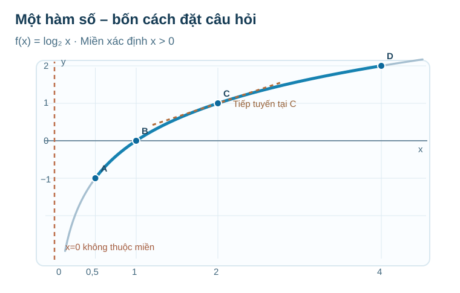

# Chuyên đề Hàm số và đồ thị · Cầu nối M4 → M5 → M6 → M7

*Học liệu bổ sung đặt ở **Kiến thức** của Chuyên đề. Vẫn chỉ có ba phần **Kiến thức / Luyện tập / Tự kiểm tra**. Không tạo Core riêng.*

## Một hàm số xuyên suốt bốn chặng: \(f(x)=\log_2x\)

Đừng vội học bốn công cụ như bốn danh sách công thức tách rời. Hãy giữ nguyên một hàm số, nhưng đổi **câu hỏi**: M4 hỏi đầu vào và cách thay đổi; M5 hỏi điều gì xảy ra sát ranh giới; M6 hỏi độ dốc tại một điểm hợp lệ; M7 kết hợp các kết quả để hiểu toàn bộ đồ thị.

**Đọc hình:** A(0,5;−1), B(1;0), C(2;1), D(4;2). Nét đứt đứng tại \(x=0\) là **tiệm cận**, không thuộc đồ thị; đoạn xanh đậm tương ứng miền con \([0{,}5;4]\); nét nâu là **tiếp tuyến ở C**, không phải một nhánh khác của f.

### M4 · Quy tắc nào nhận đầu vào nào?

Một bạn nói: “\(2^0=1\), vậy chắc \(\log_2 0=1\).” Em hãy phản biện. Trước khi mở lời giải, điền bảng:

| \(x\) | \(1/2\) | \(1\) | \(2\) | \(4\) |
|---|---:|---:|---:|---:|
| \(\log_2x\) | ? | ? | ? | ? |

Đối chiếu M4 · Điều kiện không phải một quy định tùy ý

\(\log_2x=y\) có nghĩa \(2^y=x\). Vì \(2^y>0\) với mọi \(y\in\mathbb R\), không có số mũ thực nào cho đầu ra bằng 0. Do đó **\(D_f=(0,+\infty)\)**. Bốn ô lần lượt là **−1, 0, 1, 2**. Hai hàm \(y=2^x\) và \(y=\log_2x\) đổi chỗ đầu vào và đầu ra, nên các điểm tương ứng phản xạ qua \(y=x\). Nếu nhầm, quay lại M4.5 để giải thích “lôgarit là số mũ cần tìm”.

### M5 · Tiến rất gần điểm bị loại có giống chạm vào điểm ấy?

Ở M4 ta biết \(x=0\) không hợp lệ. Nhưng khi \(x>0\) tiến dần về 0, đường cong đi xuống mãi. Có cần một **điểm thật** trên trục tung để giải thích hành vi đó?

**Tự thử:** tính \(\log_2(1/2),\log_2(1/4),\log_2(1/8),\log_2(1/16)\); dự đoán xu thế.

Đối chiếu M5 · Giới hạn không tự tạo ra giá trị tại điểm

Các giá trị là **−1, −2, −3, −4**. Tổng quát, \(x=2^{-n}\to0^+\) thì \(\log_2x=-n\to-\infty\). Kết hợp tính đơn điệu, liên tục của hàm log trên \((0,+\infty)\), suy ra
\[
\lim_{x\to0^+}\log_2x=-\infty.
\]
Đây là xu thế không bị chặn từ **phía phải**, không phải giá trị \(f(0)\). Trục \(x=0\) là một **tiệm cận đứng**. Nếu gặp “lỗ đồ thị” có giới hạn hữu hạn ở M5.1, hãy phân biệt nó với tình huống này.

### M6 · Tốc độ thay đổi ngay tại điểm hợp lệ

Ở M5, ta quan sát hành vi **gần ranh giới**. M6 hỏi câu mới: *gần một điểm hợp lệ, đầu ra đổi nhanh thế nào khi đầu vào đổi rất ít?*

Tại \(x=2\), ta biết \(f(2)=1\). Hãy nhìn nét tiếp tuyến nâu ở C: nó đi qua tọa độ nào? Nó nghiêng lên hay xuống?

Đối chiếu M6 · Dùng đạo hàm nhưng không quên điểm tiếp xúc

Với \(x>0\),
\[
f'(x)=\frac{1}{x\ln 2}>0.
\]
Tại x=2, \(f'(2)=1/(2\ln2)\approx0{,}72135\). Tiếp tuyến qua C(2;1) là
\[
y-1=\frac{1}{2\ln2}(x-2).
\]
Không được viết \(y=f'(2)x\): cách ấy quên điểm \((2,1)\). Cũng không được lấy đạo hàm tại x=0 vì chính hàm f chưa xác định ở đó. Để phân biệt **liên tục** với **khả vi**, quay lại góc nhọn của \(y=|x|\) trong M6.2.

### M7 · Cùng công thức, nhưng phải hỏi **trên miền nào?**

Em có ba kết luận: \(D=(0,+\infty)\); khi \(x\to0^+\) thì f tiến ra \(-\infty\); \(f'(x)>0\) trên D. **Hãy tự thử hai câu** trước khi xem:

1. Trên **toàn miền** \((0,+\infty)\), hàm có GTNN/GTLN không?
2. Trên **đoạn** \([1/2,4]\), GTNN/GTLN bằng mấy và đạt ở đâu?

Đối chiếu M7 · Miền khác thì kết luận cũng khác

Trên \((0,+\infty)\), f tăng, có giới hạn \(-\infty\) khi \(x\to0^+\), và tiến \(+\infty\) khi \(x\to+\infty\). **Không có GTNN và GTLN** trên toàn miền. Không có giá trị hàm tại tiệm cận x=0.

Trên \([1/2,4]\), f liên tục và tăng; **GTNN = −1** tại \(x=1/2\), **GTLN = 2** tại \(x=4\). Cả hai đầu mút thuộc miền con nên hai giá trị này **được đạt**. Nếu nhận vô cực làm giá trị lớn nhất/nhỏ nhất trên đoạn, quay lại M1 (miền) và M7.2 (phân biệt cận với giá trị đạt được).

**Tổng kết cách học:** M4 xác định quy tắc và miền; M5 đọc hành vi ở ranh giới; M6 đo độ dốc tại một điểm hợp lệ; M7 kết hợp miền, giới hạn, đạo hàm để kết luận cho **toàn đồ thị hoặc miền được hỏi**. Một hàm số có thể trả lời nhiều câu hỏi mà không cần học lại từ đầu.

## Luyện tập tiếp theo · dùng chung đúng câu SGK đã có

Các câu sau là **item công khai gốc**, đưa sang Topic bằng **placement**, không sao chép đề/đáp án/rubric. Học sinh có thể tự mở gợi ý sau khi thử; câu đã lộ lời giải dùng ôn luyện, không coi là Tự kiểm tra độc lập.

| Mạch | Item gốc nên dùng | Mục tiêu và đường khắc phục |
|---|---|---|
| M4 | `THPT-G11-CHVI-B20-C03` → `THPT-G11-CHVI-B20-P01` | Miền log dịch và giải giá trị log; nếu sai, quay lại M4.5 |
| M5 | `THPT-G11-CHV-B16-C01` → `THPT-G11-CHV-B16-P07` | Giới hạn tại lỗ và mức bão hòa của mô hình; M5.1/M5.3 |
| M6 | `THPT-G11-CHIX-B31-P08` → `THPT-G11-CHIX-B31-P05` | Tiếp tuyến qua điểm và góc nhọn liên tục nhưng không khả vi; M6.2 |
| M7 | `THPT-G12-CHI-B01-P01` → `THPT-G12-CHI-B01-C04` | Dấu đạo hàm trên khoảng hợp lệ và phản ví dụ \(f'(a)=0\) nhưng không cực trị; M7.1/M7.2 |

Nếu còn thiếu chiều sâu ở một kỹ năng cụ thể, có thể thêm câu **thực sự khác năng lực cần đo**, không đặt hạn mức và không chỉ đổi số của bài cũ.

---

### AUTHORING CONTROL — KHÔNG RENDER CHO HỌC SINH

- **Vai trò:** Student-facing knowledge bridge theo owner-approved authoring workflow; không sửa đè R18 blob `2340ea4975b37a457363eea59dd617070934983c`. Khi compose, rải đúng các chặng M4–M7 tại vị trí bài tương ứng, không tạo tab thứ tư.
- **Hình:** `Temp_FIG_TOPIC1_M4_M7_LOG_ONE_FUNCTION_STORY_R10.svg`, Git blob `6e6622388ce07dfcb4473c599a48e59a706def7e`. Chưa chạy thực tế trên website/iOS/Safari.
- **Bank source exact:** M4 B20 `33cf4229baa63ac70b4ca1b640a5be8414ed54c1`; M5 B16 `cbe3608a8551b85440e955835706f7046d88ef7d`; M6 B31 `eda6fdf74345d93cd23e77008d2dcc9a9f6c7111`; M7 G12 B01 `4286fa7ea291ecd9c3f0504156ccb80d6e1baa9a`. **8/8 ID present and exact source confirmed**. No extra `item_id`, no private RD1, no Mastery.
- **Math QA:** verify special points 1/2,1,2,4; derivative/tangent and domain restrictions, limit/interval extrema. This is author QA, not automatic independent Academic/PED PASS.
- **State:** `CONTENT_READY=NO`, no merge/deploy; independent review only if a material mathematical/pedagogical question remains.
