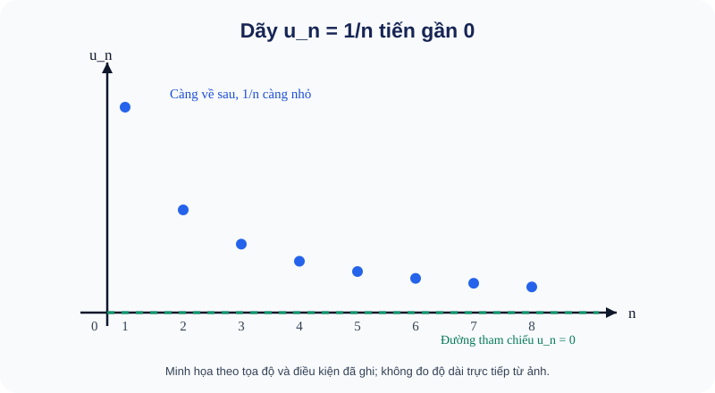
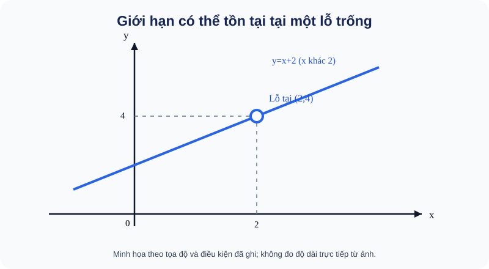
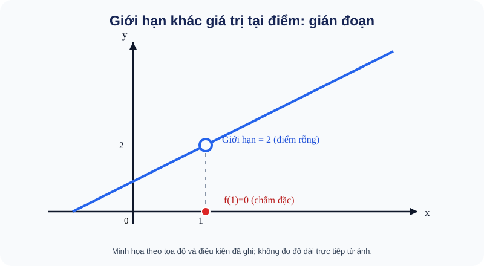

# Giới hạn dãy số, giới hạn hàm số và tính liên tục (Toán 11, ChV) — TOPIC PUBLIC R00

**ACADEMIC_DRAFT_NOT_CONTENT_READY:** gói thứ bảy trong chuỗi AUTHORING; đúng phạm vi nghiên cứu PLAN22-08 Giới hạn và Tính liên tục theo catalog 22, không tự coi đây là TOPIC_ID website. Đạo hàm thuộc PLAN22-09 và Ứng dụng đạo hàm PLAN22-10, không nhập vào Topic này. Bản thảo nghiên cứu cũ ghi nhầm Giới hạn ở ChIII; đã đối chiếu lại S1 SGK ChV B15–B17 và original R03 receipt SBT.

**SGK/SBT KNTT S1:** G11 T1 ChV SGK B15 104–110, B16 111–118, B17 119–122, cuối ChV123. SBT B15 75–78, B16 79–83, B17 84–86, cuối ChV 87–90, theo original R03 primary-PDF receipt. Original 36 public reviewed IDs + six new original public IDs, không clone stems/keys/rubrics hoặc nhập 17 RD1 kín.

**Hành trình độc lập:** chỉ ba trang Kiến thức/Luyện tập/Tự kiểm tra, không có Topic Core. Trong Kiến thức có 9 mô-đun từ dãy → hàm → liên tục, mỗi mô-đun WHY, tiền đề, bản chất, worked method, giới hạn, Tự thử mở tự nguyện và D6; không cần đi sang SGK để tìm nội dung thiết yếu.

<!-- TOPIC_KNOWLEDGE_BEGIN -->
# Kiến thức

=== "I · Giới hạn của dãy số (B15)"

    === "01. Giới hạn hữu hạn và vô cực của dãy số"

        #### M01 · Giới hạn hữu hạn và vô cực của dãy số

        **Vì sao cần học?** Nhiệt độ chênh lệch còn 1/n độ sau n bước ngày càng nhỏ; giá trị **tiến gần** 0 chứ không đòi một ngày bất kỳ đúng 0. Một dãy số được quan sát qua tất cả chỉ số nguyên dương \(n\), không biến n thành thời gian liên tục.

        **Tiền đề và bản chất.** \(\lim_{n\to\infty}u_n=L\) mô tả \(u_n\) ngày càng gần L khi n đủ lớn. Ví dụ \(u_n=4+5/n\) có hiệu \(|u_n-4|=5/n\to0\), nên giới hạn 4. Dãy \(u_n=-2n\to-\infty\), giá trị giảm vượt mọi ngưỡng âm khi n tăng; \(\infty\) không là một số thực để thế vào phép tính. Dãy \((-1)^n\) dao động giữa ±1 và không có giới hạn.

        **Ví dụ giải thích lựa chọn.** Xét \(v_n=(3n+1)/(n+2)\): chia tử/mẫu cho n, \(v_n=(3+1/n)/(1+2/n)\to3\). Ta chọn phép chia n vì hai tử/mẫu đều tăng bậc một và mẫu giới hạn thành 1 khác 0.

        **Giới hạn áp dụng.** Không kết luận giới hạn từ 2–3 số đầu; đừng viết \(1/\infty=0\) như phép chia trong số thực, mà sử dụng tính chất \(1/n\to0\).

        **Năng lực cần đạt theo outcome:**

        - **G11-B15-FINITE_SEQUENCE:** Giới hạn hữu hạn là tiến gần L; không đòi u_n bằng L tại một n.

        - **G11-B15-INFINITE_SEQUENCE:** Phân biệt +∞/−∞ và dao động không hội tụ; ký hiệu vô cực không phải giá trị số thực.

        **Tự thử trước Core/Practice (M01-TRY01, formative, không sinh item_id):** Với u_n=−3+7/n (n≥1), tìm lim u_n; dãy w_n=(−1)^n có giới hạn không? Giải thích.

        

Đối chiếu — mở sau khi tự giải

        lim u_n=−3 vì 7/n→0. w_n không có giới hạn vì các số hạng chẵn và lẻ lần lượt 1 và −1, không cùng tiến đến một số.

        

        **D6 / phục hồi:** Nếu cố thay n=∞ như một số, quay về các số n=10,100,1000 và chênh lệch tới −3; để bác hội tụ, so hai dãy chỉ số chẵn/lẻ. Sau đó quay về bài luyện đúng outcome trong một nguồn canonical; không ghi Mastery từ đối chiếu.

    === "02. Phép toán giới hạn dãy số và dấu khi đưa căn"

        #### M02 · Phép toán giới hạn dãy số và dấu khi đưa căn

        **Bản chất trước công thức.** Có thể cộng, nhân hai giới hạn hữu hạn, và chia nếu giới hạn mẫu **khác 0**. Với phân thức đa thức theo n, chia theo bậc cao nhất. Nếu gặp \(\sqrt{n^2}\), do n≥1 nên \(\sqrt{n^2}=n\), nhưng với x có thể âm thì \(\sqrt{x^2}=|x|\), không luôn là x.

        **Ví dụ từng bước.** \(\lim_{n\to\infty}\frac{5n^2+2}{2n^2+n}=\lim\frac{5+2/n^2}{2+1/n}=5/2\). Với \(\sqrt{n^2+2n}/n\), do n>0, biểu thức là \(\sqrt{1+2/n}\to1\); nếu mẫu là n ở chiều n→−∞ thì cần dấu trị tuyệt đối và kết quả có thể khác.

        **Khi nào chọn cách nào?** Bậc cao nhất → chia bậc; dạng căn trừ căn → nhân liên hợp; phân thức có mẫu tiến 0 → xét hai phía, không áp luật thương hữu hạn máy móc.

        **Năng lực cần đạt theo outcome:**

        - **G11-B15-LIMIT_ARITHMETIC:** Chia theo bậc n; luật thương cần mẫu giới hạn khác0, căn n² có trị tuyệt đối.

        **Tự thử trước Core/Practice (M02-TRY01, formative, không sinh item_id):** Tính lim(n→∞)(4n²−n)/(2n²+3); vì sao không thay n=∞ như phép tính số học?

        

Đối chiếu — mở sau khi tự giải

        Chia n²: (4−1/n)/(2+3/n²)→2 vì mẫu giới hạn 2≠0. ∞ là ký hiệu hướng tiến, không là một số để thế.

        

        **D6 / phục hồi:** Nếu nhầm hệ số bậc cao nhất, chỉ ra bậc 2 của tử/mẫu, chia n² ở cả hai rồi mới lấy giới hạn. Sau đó quay về bài luyện đúng outcome trong một nguồn canonical; không ghi Mastery từ đối chiếu.

    === "03. Cấp số nhân lùi vô hạn và ứng dụng hội tụ"

        #### M03 · Cấp số nhân lùi vô hạn và ứng dụng hội tụ

        **WHY.** Một quãng đường được chia còn một nửa sau mỗi bước tạo tổng nhiều đoạn không ngừng tăng số lượng đoạn; tổng quãng đường vẫn có thể tiến tới một số hữu hạn.

        **Hình thành công thức.** Với \(u_1=a, u_n=aq^{n-1}\) và \(|q|<1\), tổng n số hạng \(S_n=a(1-q^n)/(1-q)\). Vì \(q^n\to0\), tổng lùi vô hạn \(S=a/(1-q)\). **Điều kiện bắt buộc** \(|q|<1\); riêng q=1, q=−1 hay |q|>1 không được tự áp công thức này.

        **Worked example.** Tổng \(12-6+3-\frac32+\cdots\) có a=12 và q=−1/2: \(S=12/(1+1/2)=8\). Đổi dấu không làm tổng phân kỳ khi độ lớn co với |q|<1. Nếu ban đầu một đoạn dài 4m, mỗi đoạn tiếp theo dài 1/2 đoạn trước, tổng giới hạn \(4/(1-1/2)=8\)m; phải nói *mô hình chia đoạn* chứ không suy vật thể có vô hạn đoạn thật.

        **Vì sao không dùng một dãy bất kỳ?** Công thức tổng lùi chỉ cho số hạng tạo cấp số nhân với |q|<1; không suy chỉ từ một mẫu vài đoạn.

        **Năng lực cần đạt theo outcome:**

        - **G11-B15-GEOMETRIC:** Tổng CSN lùi chỉ dùng |q|<1; xét q âm hay q=1 riêng.

        - **G11-B15-GEOMETRIC_APPLICATION:** Ứng dụng đoạn/chiết khấu theo tỉ lệ với mô hình rời rạc và điều kiện q.

        **Tự thử trước Core/Practice (M03-TRY01, formative, không sinh item_id):** Tổng 9+3+1+1/3+… có giới hạn bao nhiêu? Cho biết công bội và điều kiện.

        

Đối chiếu — mở sau khi tự giải

        a=9,q=1/3, |q|<1, nên S=9/(1−1/3)=27/2=13,5.

        

        **D6 / phục hồi:** Nếu cộng 9+3=12 rồi nghĩ tổng dưới 13, hãy thêm 1 và 1/3. Nếu nhầm 1−q với 1+q, kiểm q đang dương. Sau đó quay về bài luyện đúng outcome trong một nguồn canonical; không ghi Mastery từ đối chiếu.

=== "II · Giới hạn hàm số (B16)"

    === "04. Giới hạn hàm số tại điểm và phép khử dạng 0/0"

        #### M04 · Giới hạn hàm số tại điểm và phép khử dạng 0/0

        **Tại sao cần?** Biểu thức \((x^2-4)/(x-2)\) không có giá trị tại 2, nhưng trên đồ thị ở các điểm *gần* 2 vẫn tiến sát tới độ cao 4. Giới hạn hỏi hành vi gần điểm, không phải giá trị tại điểm.

        **PRE.** \(\lim_{x\to a}f(x)=L\) xét x tiến đến a **với x khác a** trong miền hàm. Để nói giới hạn hai phía, giá trị từ trái và phải phải cùng tiến đến L. Ta không thể thay trực tiếp vào biểu thức cho dạng 0/0, vì 0/0 không có giá trị.

        **Ví dụ giải thích chọn cách.** Với x≠2, \((x^2-4)/(x-2)=(x-2)(x+2)/(x-2)=x+2\). Bởi vậy lim khi x→2 bằng 4; nhân tử được khử chỉ trên miền x≠2, không tự làm f(2) tồn tại. Với \((\sqrt{x+5}-3)/(x-4)\), nhân liên hợp thành \(1/(\sqrt{x+5}+3)\) cho x≠4, giới hạn bằng 1/6. Chọn liên hợp khi tử là hiệu căn và đang 0/0.

        **Đọc SVG:** vòng tròn rỗng ở (2,4) nghĩa là không có giá trị tại điểm; đường thẳng ở hai bên cùng đến (2,4) giải thích giới hạn vẫn tồn tại.

        **Năng lực cần đạt theo outcome:**

        - **G11-B16-LIMIT_AT_POINT:** Xét x tiến gần a từ cả hai phía và x≠a; lim không thay f(a).

        - **G11-B16-ALGEBRAIC_TECHNIQUES:** Khử 0/0 bằng phân tích nhân tử hoặc liên hợp; giữ điều kiện x≠a.

        **Tự thử trước Core/Practice (M04-TRY01, formative, không sinh item_id):** Tính lim(x→3)(x²−9)/(x−3); biểu thức ban đầu có xác định ở x=3 không?

        

Đối chiếu — mở sau khi tự giải

        Với x≠3, (x²−9)/(x−3)=x+3 nên giới hạn là 6. Tại 3 mẫu bằng 0 nên biểu thức gốc không xác định.

        

        **D6 / phục hồi:** Đừng thay x=3 vào 0/0; hãy phân tích hiệu hai bình phương, giữ điều kiện x≠3 và so hai phía. Sau đó quay về bài luyện đúng outcome trong một nguồn canonical; không ghi Mastery từ đối chiếu.

    === "05. Giới hạn một phía và giới hạn vô cực"

        #### M05 · Giới hạn một phía và giới hạn vô cực

        **MEANING:** Một hàm có thể tiến tới hai giá trị khác nhau khi x tới điểm a từ trái và phải. Giới hạn hai phía hữu hạn tồn tại chỉ khi hai giới hạn một phía tồn tại và bằng nhau. Với \(\lim_{x\to a}f(x)=+\infty\), giá trị hàm tăng vượt mọi M dương khi x đủ gần a trong miền; không coi +∞ là giá trị của f(a).

        **Ví dụ có suy luận.** \(f(x)=1/(x-2)\): khi x→2− mẫu âm rất nhỏ ⇒ f→−∞; khi x→2+ mẫu dương rất nhỏ ⇒ f→+∞. Vì hai phía khác hướng nên không có giới hạn hai phía duy nhất (không được ghi +∞). Ngược lại \(g(x)=1/(x-2)^2\) có hai phía đều →+∞. Trên một hàm từng phần, tính giới hạn từng nhánh và so trước khi kết luận.

        **Phương pháp và giới hạn.** Muốn đọc dấu ∞, vẽ bảng dấu mẫu theo hai phía; không dùng quy tắc thương hữu hạn nếu mẫu giới hạn 0. Một đường tiệm cận đứng có thể gắn với một phía hoặc hai phía đạt vô cực, nhưng cần kiểm định nghĩa trên miền xác định.

        **Năng lực cần đạt theo outcome:**

        - **G11-B16-ONE_SIDED:** Giới hạn hai phía chỉ khi hai giới hạn trái/phải tương thích.

        - **G11-B16-INFINITE_LIMIT:** Kiểm dấu ở mỗi phía; 1/(x−a) và 1/(x−a)² khác nhau.

        **Tự thử trước Core/Practice (M05-TRY01, formative, không sinh item_id):** Tìm giới hạn trái và phải của h(x)=3/(x−1) tại x=1. Hàm có giới hạn hai phía hữu hạn không?

        

Đối chiếu — mở sau khi tự giải

        x→1−: h→−∞; x→1+: h→+∞. Không có giới hạn hữu hạn hai phía tại x=1.

        

        **D6 / phục hồi:** Nếu cả hai phía cùng ký hiệu +∞, thử x=0,9 và x=1,1 để thấy dấu mẫu trái/phải khác nhau. Sau đó quay về bài luyện đúng outcome trong một nguồn canonical; không ghi Mastery từ đối chiếu.

    === "06. Giới hạn tại vô cực và ý nghĩa trong mô hình"

        #### M06 · Giới hạn tại vô cực và ý nghĩa trong mô hình

        **WHY:** Nhiều quá trình mô hình tăng thời gian t nhưng giá trị tiến gần một ngưỡng. Giới hạn khi x→∞ khác giới hạn gần một điểm hữu hạn.

        **METHOD:** Với phân thức có bậc tử/mẫu bằng nhau, chia theo bậc cao nhất; \(\lim_{x\to+\infty}(3x^2+1)/(x^2+2)=3\). Cần phân biệt x→−∞: \(\sqrt{x^2}=|x|=-x\) khi x<0, nên \(\sqrt{x^2}/x\to-1\) lúc x→−∞ (không phải 1).

        **Mô hình thực tế thận trọng.** Giả sử R(t)=(t²−9)/(t−3) với t≠3, và t là thời gian đo (đơn vị giây). Trước và sau t=3, R(t)=t+3 nên khi t tiến gần 3, R tiến gần 6. Nhưng R(3) theo công thức gốc không có giá trị: mô hình khuyết dữ liệu tại t=3. Một giới hạn *không tự điền* dữ liệu thực, cũng không cho phép ngoại suy mô hình vô hạn ngoài phạm vi thực tế.

        **Khi không dùng.** Không thay x=∞ vào biểu thức đại số; nếu bậc tử/mẫu khác nhau, xét bậc và dấu trước khi kết luận.

        **Năng lực cần đạt theo outcome:**

        - **G11-B16-LIMIT_AT_INFINITY:** Chia theo bậc x; với x→−∞, √x²=|x|=−x.

        - **G11-B16-REAL_CONTEXT:** Giới hạn mô tả xu hướng gần thời điểm bị khuyết chứ không bổ sung giá trị đo ở điểm.

        **Tự thử trước Core/Practice (M06-TRY01, formative, không sinh item_id):** Tính lim(x→−∞)√(x²)/x; giải thích vì sao không là +1.

        

Đối chiếu — mở sau khi tự giải

        Với x âm, √(x²)=|x|=−x, nên √(x²)/x=−1; giới hạn là −1.

        

        **D6 / phục hồi:** Thay x=−10 và x=−100 để thấy √(x²) dương, x âm; sửa lỗi quên trị tuyệt đối. Sau đó quay về bài luyện đúng outcome trong một nguồn canonical; không ghi Mastery từ đối chiếu.

=== "III · Hàm số liên tục và tổng hợp (B17)"

    === "07. Điều kiện liên tục tại một điểm và hàm sơ cấp"

        #### M07 · Điều kiện liên tục tại một điểm và hàm sơ cấp

        **Vì sao cần?** Một đồ thị có thể tiến gần độ cao 2 khi x→1 nhưng tại đúng x=1 lại được gán f(1)=0. Không thể nói liên tục chỉ vì hai phía của đồ thị gần nhau.

        **Ba điều kiện cần.** Hàm f liên tục tại a khi f(a) được xác định, \(\lim_{x\to a}f(x)\) tồn tại hữu hạn và bằng f(a). Trên đầu mút miền xác định, chỉ xét giới hạn một phía **từ trong miền**. Đa thức liên tục trên R; phân thức hữu tỉ liên tục nơi mẫu khác 0; căn bậc hai liên tục trên miền có nghĩa.

        **WORKED EXAMPLE:** f(x)=(x²−1)/(x−1) khi x≠1, còn f(1)=c. Với x≠1, f(x)=x+1 →2 khi x→1. Muốn liên tục phải chọn c=2. Trái lại nếu g(1)=0, g(x)=x+1 với x≠1, đồ thị có chấm rỗng ở (1,2) và chấm đặc ở (1,0) nên gián đoạn.

        **Giới hạn.** Không nói liên tục ở nơi hàm không xác định; với \(\sqrt{2x+1}\), miền x≥−1/2, tại x=4 hàm bằng3 và giới hạn bằng3. Tại x=−1 không có giá trị hàm.

        **Năng lực cần đạt theo outcome:**

        - **G11-B17-CONTINUITY_POINT:** Liên tục tại a cần f(a) xác định, lim hai phía tồn tại và bằng f(a).

        - **G11-B17-ELEMENTARY_CONTINUITY:** Đa thức liên tục, căn hữu hạn trên miền, phân thức nơi mẫu khác0.

        **Tự thử trước Core/Practice (M07-TRY01, formative, không sinh item_id):** Cho f(x)=x²−1 khi x≠2, f(2)=k. Tìm k để f liên tục tại x=2.

        

Đối chiếu — mở sau khi tự giải

        lim(x→2)(x²−1)=3; phải chọn k=f(2)=3.

        

        **D6 / phục hồi:** Nếu chỉ tìm giới hạn mà không nêu giá trị tại điểm, kiểm lần lượt (1) miền, (2) lim, (3) so f(a). Sau đó quay về bài luyện đúng outcome trong một nguồn canonical; không ghi Mastery từ đối chiếu.

    === "08. Liên tục trên khoảng, đoạn và phép toán liên tục"

        #### M08 · Liên tục trên khoảng, đoạn và phép toán liên tục

        **MEANING:** Liên tục trên khoảng (a,b) nghĩa là liên tục tại từng điểm trong khoảng. Liên tục trên đoạn [a,b] thêm liên tục từ phải tại a và từ trái tại b. Khi ghép các hàm liên tục, tổng/tích còn liên tục; thương chỉ liên tục tại điểm mẫu khác 0.

        **Worked example:** \(h(x)=\sqrt{x+4}/(x-1)\). Miền x≥−4, x≠1. Tại x=5, tử √9=3 và mẫu 4≠0, nên h liên tục với h(5)=3/4. Không thể kết luận h liên tục trên [-4,5] vì x=1 bị loại. Trên khoảng [2,5], mọi x làm mẫu khác 0 và căn xác định nên h liên tục trên đoạn này.

        **Khi nào chọn phương pháp?** Cần kiểm miền và các điểm mẫu 0 trước khi dùng định lý; đối với hàm từng phần, kiểm riêng tại điểm ghép. Không đánh đồng liên tục *trên mỗi khoảng con* với liên tục *trên cả đoạn chứa điểm gián đoạn*.

        **Năng lực cần đạt theo outcome:**

        - **G11-B17-CONTINUITY_INTERVAL:** Trên đoạn cần thêm giới hạn từ trong miền tại hai đầu mút.

        - **G11-B17-CONTINUITY_OPERATIONS:** Tổng/tích/thương liên tục khi từng hàm liên tục và mẫu khác0.

        **Tự thử trước Core/Practice (M08-TRY01, formative, không sinh item_id):** Hàm g(x)=(x+1)/(x−2) có liên tục trên [3,5] không? Có liên tục trên [1,3] không?

        

Đối chiếu — mở sau khi tự giải

        Trên [3,5], x−2 luôn khác 0 nên có. Trên [1,3], x=2 nằm trong đoạn và g không xác định, nên không liên tục cả đoạn.

        

        **D6 / phục hồi:** Khoanh những điểm làm mẫu bằng0 rồi xem khoảng/đoạn đang xét có chứa chúng không; nhớ kiểm cả đầu mút. Sau đó quay về bài luyện đúng outcome trong một nguồn canonical; không ghi Mastery từ đối chiếu.

    === "09. Định lý nghiệm, mạch liên thông ba khái niệm"

        #### M09 · Định lý nghiệm, mạch liên thông ba khái niệm

        **WHY:** Đôi khi không giải được phương trình chính xác nhưng có thể khẳng định nó có nghiệm trong một khoảng, bằng tính liên tục và đổi dấu.

        **Định lý tồn tại nghiệm.** Nếu f liên tục trên [a,b] và f(a)f(b)<0 thì tồn tại c∈(a,b) sao cho f(c)=0. Điều này bảo đảm **ít nhất một nghiệm**, không bảo đảm duy nhất; nếu không đổi dấu cũng không tự kết luận không có nghiệm.

        **Worked example:** f(x)=x³+x−1 là đa thức, liên tục trên [0,1]; f(0)=−1<0, f(1)=1>0 nên có ít nhất một nghiệm trong (0,1). Lý do chọn định lý thay vì giải bằng công thức là đề yêu cầu sự tồn tại, không cần nghiệm tường minh.

        **Mạch tích hợp.** Dãy \(u_n=2+1/n\to2\), mỗi u_n≠2. Với \(F(x)=(x²−4)/(x−2)\) khi x≠2 và F(2)=c, giới hạn hàm ở 2 là 4; đồng thời \(F(u_n)=4+1/n\to4\). Chọn c=4 khiến F liên tục tại 2. Sự trùng hai kết quả từ dãy và hàm minh họa cùng một xu thế, nhưng chỉ kiểm dọc một dãy **không đủ** chứng minh giới hạn hàm hai phía trong mọi bài toán; ở đây dùng phép rút nhân tử để chứng minh thật.

        **Điều kiện.** Phải xác minh f liên tục trên cả đoạn và hai đầu trái dấu trước khi dùng định lý nghiệm; không dùng nó cho hàm có lỗ chưa được khắc phục.

        **Năng lực cần đạt theo outcome:**

        - **G11-B17-ZERO_EXISTENCE:** Định lý nghiệm cần liên tục trên [a,b] và trái dấu tại hai đầu; bảo đảm ít nhất một nghiệm.

        - **G11-CHV-INTEGRATED:** Liên kết giới hạn dãy, giới hạn hàm và tính liên tục nhưng không lấy một dãy đại diện chứng minh đủ mọi hướng.

        **Tự thử trước Core/Practice (M09-TRY01, formative, không sinh item_id):** Chứng minh x³−2x−2=0 có ít nhất một nghiệm trên (1,2) mà không giải chính xác.

        

Đối chiếu — mở sau khi tự giải

        f(x)=x³−2x−2 là đa thức nên liên tục trên [1,2]; f(1)=−3<0, f(2)=2>0 ⇒ có ít nhất một nghiệm trong (1,2).

        

        **D6 / phục hồi:** Nếu nói 'chắc chắn một nghiệm duy nhất', hãy đọc lại kết luận: đổi dấu+liên tục chỉ cho tồn tại ít nhất một. Nếu dùng f(a)f(b)<0 mà không kiểm liên tục, cần bổ sung điều kiện. Sau đó quay về bài luyện đúng outcome trong một nguồn canonical; không ghi Mastery từ đối chiếu.

**Cách đọc SVG B15:** Các điểm u_n=1/n nằm phía trên đường u=0 và thấp dần theo n, không chạm 0 ở bất cứ n hữu hạn; đường x chỉ có chỉ số nguyên.

**Cách đọc SVG B16:** Điểm trống ở (2,4) cho biết giá trị tại x=2 chưa xác định, nhưng hai phía của đường tiến đến cao độ 4 nên lim bằng 4.

**Cách đọc SVG B17:** Vòng rỗng (1,2) mô tả giá trị tiệm cận; chấm đặc (1,0) là f(1). Do 2≠0 nên gián đoạn ở 1.

<!-- TOPIC_KNOWLEDGE_END -->

<!-- TOPIC_PRACTICE_BEGIN -->
# Luyện tập

**Canonical:** 36 public IDs gốc duy nhất trong [index](prototypes/thpt/shared-items/Temp_TOPIC_LIMITS_CONTINUITY_G11_CANONICAL_SOURCE_INDEX_R00_20261112.md) (Git blob `2e7871bcaec3f42f145262af4badd2ae0c602565`), sáu câu bổ sung trong [extension](prototypes/thpt/shared-items/Temp_TOPIC_LIMITS_CONTINUITY_G11_PUBLIC_EXTENSION_06ITEM_R00_20261112.md) (Git blob `9d1277c5ddcd148a2aa267c13180efae4068417b`) = **42 canonical PUBLIC IDs**, 17 outcomes, sáu Written/Anchor gốc cùng rubric. Mỗi outcome có ít nhất hai item tham chiếu; không sao chép đề, đáp án, lời giải, rubric của SGK sang file mới.

| Chặng | Năng lực thực hành và chiều sâu |
|---|---|
| B15 Giới hạn dãy | Dãy hội tụ/không hội tụ, giới hạn ±∞, chia bậc, căn và điều kiện tổng CSN lùi |
| B16 Giới hạn hàm | Lỗ trống, 0/0, liên hợp, hai phía, dấu giới hạn vô cực, tại vô cực, mô hình khuyết điểm |
| B17 Liên tục | Giá trị tại điểm, liên tục trên khoảng/đoạn, căn/thương và miền, định lý có nghiệm, nối dãy–hàm |

**Tập luyện:** ghi miền xác định, giá trị tại điểm, điều kiện của định lý trước phép biến đổi; nêu lý do chọn phân tích nhân tử, liên hợp, xét một phía hay liên tục. Với Written, chỉ so rubric thủ công, không auto Mastery; thẻ D6 dẫn trở lại từng kiến thức bắt buộc.

<!-- TOPIC_PRACTICE_END -->

<!-- TOPIC_SELF_CHECK_BEGIN -->
# Tự kiểm tra

**Công khai và tự đối chiếu:** `CLIENT_SELF_CHECK_NO_MASTERY` chỉ là placement 9 câu public đã học, không phải held-out Topic Readiness. RELEASE phải bảo đảm không hint, answer, đánh dấu đúng/sai hoặc Tutor **trước Final Submit của toàn lượt**, không tự ghi Skill Mastery từ public Practice hoặc tự luận.

| Mảng | ID canonical đã có, dùng lại không clone | Ôn sai |
|---|---|---|
| Giới hạn dãy | `THPT-G11-CHV-B15-P01`, `THPT-G11-CHV-B15-P03` | M01–M02 |
| Tổng CSN lùi | `THPT-G11-TOPLIM-ADD01` | M03 |
| Giới hạn tại điểm / một phía | `THPT-G11-CHV-B16-P01`, `THPT-G11-CHV-B16-P03` | M04–M05 |
| Giới hạn tại vô cực | `THPT-G11-CHV-B16-P04` | M06 |
| Liên tục | `THPT-G11-CHV-B17-P02`, `THPT-G11-CHV-B17-P03` | M07–M08 |
| Mạch tổng hợp | `THPT-G11-TOPLIM-ADD05` | M09 |

**Q16:** Chỉ chín placement công khai đã xem, tuyệt đối không lấy làm bằng chứng độc lập. 17 RD1 ChV gốc giữ kín bởi chủ dự án, không đưa câu/đáp án/lời giải/rubric kín vào GitHub.

<!-- TOPIC_SELF_CHECK_END -->

<!-- AUTHOR_ONLY_METADATA_BEGIN -->
# Phụ lục tác giả — không render trên giao diện học sinh

STANDARD_ID: SLM-THPT-QUALITY-ONE
STANDARD_VERSION: 3.0.1
LEARNING_PATH: TOPIC
RELEASE_SCOPE: FULL_TOPIC_LEARNING_PATH
CONTENT_STATE: CANDIDATE_UNDER_AUTHOR_SELF_QA
TOPIC_ID: UNASSIGNED_OWNER_DECISION
SOURCE_INDEX_PATH: prototypes/thpt/shared-items/Temp_TOPIC_LIMITS_CONTINUITY_G11_CANONICAL_SOURCE_INDEX_R00_20261112.md
SOURCE_INDEX_BLOB: 2e7871bcaec3f42f145262af4badd2ae0c602565
PUBLIC_EXTENSION_PATH: prototypes/thpt/shared-items/Temp_TOPIC_LIMITS_CONTINUITY_G11_PUBLIC_EXTENSION_06ITEM_R00_20261112.md
PUBLIC_EXTENSION_BLOB: 9d1277c5ddcd148a2aa267c13180efae4068417b
PUBLIC_ITEM_COUNT: 42
OUTCOMES: 17
KNOWLEDGE_MODULES: 9
FIRST_TRIES: 9
ORIGINAL_WRITTEN_COUNT: 6
PRIVATE_RD1_IMPORTED: 0
ASSESSMENT_MODE: CLIENT_SELF_CHECK_NO_MASTERY

## LESSON_OUTCOME_MATRIX

| module | outcome | public canonical refs |
|---|---|---:|
| M01 | `G11-B15-FINITE_SEQUENCE` | 2 |
| M01 | `G11-B15-INFINITE_SEQUENCE` | 2 |
| M02 | `G11-B15-LIMIT_ARITHMETIC` | 4 |
| M03 | `G11-B15-GEOMETRIC` | 2 |
| M03 | `G11-B15-GEOMETRIC_APPLICATION` | 3 |
| M04 | `G11-B16-LIMIT_AT_POINT` | 2 |
| M04 | `G11-B16-ALGEBRAIC_TECHNIQUES` | 3 |
| M05 | `G11-B16-ONE_SIDED` | 2 |
| M05 | `G11-B16-INFINITE_LIMIT` | 2 |
| M06 | `G11-B16-LIMIT_AT_INFINITY` | 2 |
| M06 | `G11-B16-REAL_CONTEXT` | 2 |
| M07 | `G11-B17-CONTINUITY_POINT` | 5 |
| M07 | `G11-B17-ELEMENTARY_CONTINUITY` | 2 |
| M08 | `G11-B17-CONTINUITY_INTERVAL` | 3 |
| M08 | `G11-B17-CONTINUITY_OPERATIONS` | 2 |
| M09 | `G11-B17-ZERO_EXISTENCE` | 2 |
| M09 | `G11-CHV-INTEGRATED` | 2 |

## ITEM_OUTCOME_MATRIX

| item_id | outcome_id | role | source_type | exact_source_blob |
|---|---|---|---|---|
| `THPT-G11-CHV-B15-C01` | `G11-B15-FINITE_SEQUENCE` | TOPIC_PRACTICE | SGK_CANONICAL_REUSE | `7934757ed06de4ae4b63dbc351ef524fc054e0d0` |
| `THPT-G11-CHV-B15-C02` | `G11-B15-INFINITE_SEQUENCE` | TOPIC_PRACTICE | SGK_CANONICAL_REUSE | `7934757ed06de4ae4b63dbc351ef524fc054e0d0` |
| `THPT-G11-CHV-B15-C03` | `G11-B15-GEOMETRIC` | TOPIC_PRACTICE | SGK_CANONICAL_REUSE | `7934757ed06de4ae4b63dbc351ef524fc054e0d0` |
| `THPT-G11-CHV-B15-P01` | `G11-B15-LIMIT_ARITHMETIC` | TOPIC_PRACTICE | SGK_CANONICAL_REUSE | `7934757ed06de4ae4b63dbc351ef524fc054e0d0` |
| `THPT-G11-CHV-B15-P02` | `G11-B15-FINITE_SEQUENCE` | TOPIC_PRACTICE | SGK_CANONICAL_REUSE | `7934757ed06de4ae4b63dbc351ef524fc054e0d0` |
| `THPT-G11-CHV-B15-P03` | `G11-B15-LIMIT_ARITHMETIC` | TOPIC_PRACTICE | SGK_CANONICAL_REUSE | `7934757ed06de4ae4b63dbc351ef524fc054e0d0` |
| `THPT-G11-CHV-B15-P04` | `G11-B15-LIMIT_ARITHMETIC` | TOPIC_PRACTICE | SGK_CANONICAL_REUSE | `7934757ed06de4ae4b63dbc351ef524fc054e0d0` |
| `THPT-G11-CHV-B15-P05` | `G11-B15-INFINITE_SEQUENCE` | TOPIC_PRACTICE | SGK_CANONICAL_REUSE | `7934757ed06de4ae4b63dbc351ef524fc054e0d0` |
| `THPT-G11-CHV-B15-P06` | `G11-B15-GEOMETRIC_APPLICATION` | TOPIC_PRACTICE | SGK_CANONICAL_REUSE | `7934757ed06de4ae4b63dbc351ef524fc054e0d0` |
| `THPT-G11-CHV-B15-P07` | `G11-B15-GEOMETRIC_APPLICATION` | TOPIC_PRACTICE | SGK_CANONICAL_REUSE | `7934757ed06de4ae4b63dbc351ef524fc054e0d0` |
| `THPT-G11-CHV-B16-C01` | `G11-B16-LIMIT_AT_POINT` | TOPIC_PRACTICE | SGK_CANONICAL_REUSE | `7934757ed06de4ae4b63dbc351ef524fc054e0d0` |
| `THPT-G11-CHV-B16-C02` | `G11-B16-ONE_SIDED` | TOPIC_PRACTICE | SGK_CANONICAL_REUSE | `7934757ed06de4ae4b63dbc351ef524fc054e0d0` |
| `THPT-G11-CHV-B16-C03` | `G11-B16-INFINITE_LIMIT` | TOPIC_PRACTICE | SGK_CANONICAL_REUSE | `7934757ed06de4ae4b63dbc351ef524fc054e0d0` |
| `THPT-G11-CHV-B16-P01` | `G11-B16-ALGEBRAIC_TECHNIQUES` | TOPIC_PRACTICE | SGK_CANONICAL_REUSE | `7934757ed06de4ae4b63dbc351ef524fc054e0d0` |
| `THPT-G11-CHV-B16-P02` | `G11-B16-ALGEBRAIC_TECHNIQUES` | TOPIC_PRACTICE | SGK_CANONICAL_REUSE | `7934757ed06de4ae4b63dbc351ef524fc054e0d0` |
| `THPT-G11-CHV-B16-P03` | `G11-B16-ONE_SIDED` | TOPIC_PRACTICE | SGK_CANONICAL_REUSE | `7934757ed06de4ae4b63dbc351ef524fc054e0d0` |
| `THPT-G11-CHV-B16-P04` | `G11-B16-LIMIT_AT_INFINITY` | TOPIC_PRACTICE | SGK_CANONICAL_REUSE | `7934757ed06de4ae4b63dbc351ef524fc054e0d0` |
| `THPT-G11-CHV-B16-P05` | `G11-B16-LIMIT_AT_INFINITY` | TOPIC_PRACTICE | SGK_CANONICAL_REUSE | `7934757ed06de4ae4b63dbc351ef524fc054e0d0` |
| `THPT-G11-CHV-B16-P06` | `G11-B16-INFINITE_LIMIT` | TOPIC_PRACTICE | SGK_CANONICAL_REUSE | `7934757ed06de4ae4b63dbc351ef524fc054e0d0` |
| `THPT-G11-CHV-B16-P07` | `G11-B16-REAL_CONTEXT` | TOPIC_PRACTICE | SGK_CANONICAL_REUSE | `7934757ed06de4ae4b63dbc351ef524fc054e0d0` |
| `THPT-G11-CHV-B17-C01` | `G11-B17-CONTINUITY_POINT` | TOPIC_PRACTICE | SGK_CANONICAL_REUSE | `7934757ed06de4ae4b63dbc351ef524fc054e0d0` |
| `THPT-G11-CHV-B17-C02` | `G11-B17-CONTINUITY_POINT` | TOPIC_PRACTICE | SGK_CANONICAL_REUSE | `7934757ed06de4ae4b63dbc351ef524fc054e0d0` |
| `THPT-G11-CHV-B17-C03` | `G11-B17-ELEMENTARY_CONTINUITY` | TOPIC_PRACTICE | SGK_CANONICAL_REUSE | `7934757ed06de4ae4b63dbc351ef524fc054e0d0` |
| `THPT-G11-CHV-B17-P01` | `G11-B17-CONTINUITY_OPERATIONS` | TOPIC_PRACTICE | SGK_CANONICAL_REUSE | `7934757ed06de4ae4b63dbc351ef524fc054e0d0` |
| `THPT-G11-CHV-B17-P02` | `G11-B17-CONTINUITY_POINT` | TOPIC_PRACTICE | SGK_CANONICAL_REUSE | `7934757ed06de4ae4b63dbc351ef524fc054e0d0` |
| `THPT-G11-CHV-B17-P03` | `G11-B17-ZERO_EXISTENCE` | TOPIC_PRACTICE | SGK_CANONICAL_REUSE | `7934757ed06de4ae4b63dbc351ef524fc054e0d0` |
| `THPT-G11-CHV-B17-P04` | `G11-B17-CONTINUITY_POINT` | TOPIC_PRACTICE | SGK_CANONICAL_REUSE | `7934757ed06de4ae4b63dbc351ef524fc054e0d0` |
| `THPT-G11-CHV-B17-P05` | `G11-B17-CONTINUITY_INTERVAL` | TOPIC_PRACTICE | SGK_CANONICAL_REUSE | `7934757ed06de4ae4b63dbc351ef524fc054e0d0` |
| `THPT-G11-CHV-B17-P06` | `G11-B17-CONTINUITY_INTERVAL` | TOPIC_PRACTICE | SGK_CANONICAL_REUSE | `7934757ed06de4ae4b63dbc351ef524fc054e0d0` |
| `THPT-G11-CHV-B17-P07` | `G11-B17-ZERO_EXISTENCE` | TOPIC_PRACTICE | SGK_CANONICAL_REUSE | `7934757ed06de4ae4b63dbc351ef524fc054e0d0` |
| `THPT-G11-CHV-B15-W01` | `G11-B15-LIMIT_ARITHMETIC` | TOPIC_WRITTEN | SGK_CANONICAL_REUSE | `7934757ed06de4ae4b63dbc351ef524fc054e0d0` |
| `THPT-G11-CHV-B15-W02-ANCHOR` | `G11-B15-GEOMETRIC_APPLICATION` | TOPIC_WRITTEN | SGK_CANONICAL_REUSE | `7934757ed06de4ae4b63dbc351ef524fc054e0d0` |
| `THPT-G11-CHV-B16-W01` | `G11-B16-LIMIT_AT_POINT` | TOPIC_WRITTEN | SGK_CANONICAL_REUSE | `7934757ed06de4ae4b63dbc351ef524fc054e0d0` |
| `THPT-G11-CHV-B16-W02-ANCHOR` | `G11-B16-ALGEBRAIC_TECHNIQUES` | TOPIC_WRITTEN | SGK_CANONICAL_REUSE | `7934757ed06de4ae4b63dbc351ef524fc054e0d0` |
| `THPT-G11-CHV-B17-W01` | `G11-B17-CONTINUITY_POINT` | TOPIC_WRITTEN | SGK_CANONICAL_REUSE | `7934757ed06de4ae4b63dbc351ef524fc054e0d0` |
| `THPT-G11-CHV-B17-W02-ANCHOR` | `G11-B17-CONTINUITY_INTERVAL` | TOPIC_WRITTEN | SGK_CANONICAL_REUSE | `7934757ed06de4ae4b63dbc351ef524fc054e0d0` |
| `THPT-G11-TOPLIM-ADD01` | `G11-B15-GEOMETRIC` | TOPIC_PRACTICE | TOPIC_NEW_CANDIDATE | `9d1277c5ddcd148a2aa267c13180efae4068417b` |
| `THPT-G11-TOPLIM-ADD02` | `G11-B16-REAL_CONTEXT` | TOPIC_PRACTICE | TOPIC_NEW_CANDIDATE | `9d1277c5ddcd148a2aa267c13180efae4068417b` |
| `THPT-G11-TOPLIM-ADD03` | `G11-B17-ELEMENTARY_CONTINUITY` | TOPIC_PRACTICE | TOPIC_NEW_CANDIDATE | `9d1277c5ddcd148a2aa267c13180efae4068417b` |
| `THPT-G11-TOPLIM-ADD04` | `G11-B17-CONTINUITY_OPERATIONS` | TOPIC_PRACTICE | TOPIC_NEW_CANDIDATE | `9d1277c5ddcd148a2aa267c13180efae4068417b` |
| `THPT-G11-TOPLIM-ADD05` | `G11-CHV-INTEGRATED` | TOPIC_PRACTICE | TOPIC_NEW_CANDIDATE | `9d1277c5ddcd148a2aa267c13180efae4068417b` |
| `THPT-G11-TOPLIM-ADD06` | `G11-CHV-INTEGRATED` | TOPIC_PRACTICE | TOPIC_NEW_CANDIDATE | `9d1277c5ddcd148a2aa267c13180efae4068417b` |

## Q18_AUTHOR_PRECHECK

- Q01/02 S1 ChV G11 original R03 receipt + 17 outcome; Q03–Q08 9 concept-first modules + three original SVG reused SHA, six original Written and six new public item solutions + D6; Q09–14 PED 9 first tries with self-open reveal and WHY/conditions/method; Q15 42 canonical one stem/key/rubric each; Q16 zero protected/private source, nine public placements no Mastery; Q17 only three independent Topic pages, no Core; Q18 selfQA receipt required before CONTENT_READY.
<!-- AUTHOR_ONLY_METADATA_END -->