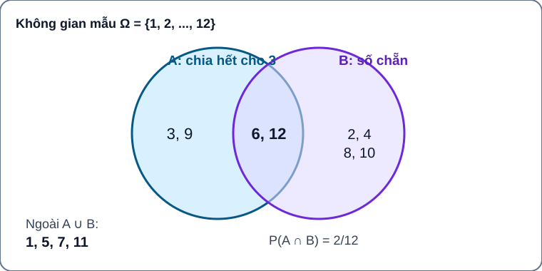
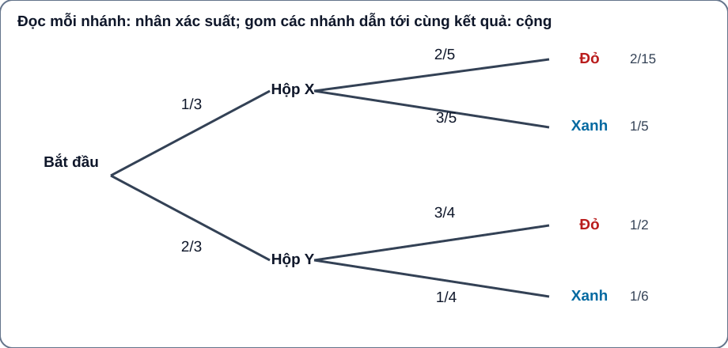

# Xác suất — ứng viên Chuyên đề 3 xuyên lớp 10–12 · AUTHORING R01

> **Lưu ý quy hoạch:** Tên/mã thứ tự **“Chuyên đề 3” chưa được chủ dự án khóa trong danh mục 22 chuyên đề THPT**. Đây là gói nội dung Topic Xác suất hiện hữu được biên tập tiếp, không phải quyết định đổi taxonomy hoặc gắn tuyến/URL website. Nguồn gốc 2026-10-28 có reviewer PASS theo **snapshot cũ** và vẫn giữ nguyên.

**Mục tiêu:** Học sinh đi từ “kết quả nào có thể xảy ra?” tới “khi có thông tin mới, xác suất thay đổi thế nào?” bằng một lộ trình tự học độc lập: **Kiến thức / Luyện tập / Tự kiểm tra**. Không có Core riêng. Học sinh không cần phải mở bài SGK khác để hiểu khái niệm bắt buộc.

<!-- TOPIC_KNOWLEDGE_BEGIN -->
# Kiến thức

Ba chặng xây trên nhau: mô hình ngẫu nhiên → kết hợp biến cố → xác suất khi có thêm thông tin. Khi học, tự đoán trước, kiểm tra điều kiện phép thử và làm **Tự thử**, chỉ sau đó mở **Đối chiếu**.

=== "1 · Mô hình ngẫu nhiên (nền tảng)"

    === "1. Phép thử, không gian mẫu và biến cố"

        #### Phép thử, không gian mẫu và biến cố

        Một phép thử ngẫu nhiên có nhiều kết quả có thể xuất hiện, nhưng không biết chắc kết quả của một lần thực hiện. Tập tất cả kết quả sơ cấp là **không gian mẫu** \(\Omega\). Mỗi kết quả ghi nhận phải được mô tả rõ: số nào được chọn, thứ tự các lượt có quan trọng hay không, thẻ có được trả lại hay không.

        Một **biến cố** \(A\) là tập con \(A\subseteq\Omega\): chỉ gồm những kết quả khiến câu phát biểu của \(A\) đúng. \(A=\varnothing\) là biến cố không thể, \(A=\Omega\) là biến cố chắc chắn.

        **Ví dụ hướng dẫn:** Rút đều một thẻ trong bảy thẻ mang số \(1,2,\ldots,7\). Khi đó \(\Omega=\{1,2,3,4,5,6,7\}\). Biến cố “lấy được số nguyên tố” có tập kết quả \(\{2,3,5,7\}\); biến cố đối là \(\{1,4,6\}\). Không được gọi “số nguyên tố” là một kết quả sơ cấp duy nhất.

        **Tự chốt kiến thức:** Hãy luôn viết \(\Omega\) trước khi đếm; một cặp có thứ tự \((a,b)\) khác cặp không thứ tự \(\{a,b\}\).

        **Tự thử trước khi xem lời giải** (TOPIC-PROB-M01-TRY01): Gieo đều xúc xắc sáu mặt, biến cố “ra số chia hết cho 3” gồm những kết quả nào?

        

Đối chiếu

        Gồm {3, 6}; không gian mẫu là {1,2,3,4,5,6}, không phải hai *loại* kết quả.

        

        **Khi sai cần làm gì?** Nhầm kết quả sơ cấp với biến cố → Viết lại Ω theo dữ kiện, chọn một kết quả thực tế và hỏi nó có thuộc biến cố không. Sau đó tự giải lại một câu cùng mục tiêu khác dữ kiện, không tự nhận đã đạt kiểm tra độc lập.

    === "2. Đồng khả năng và cách tính xác suất"

        #### Đồng khả năng và cách tính xác suất

        Đối với không gian mẫu hữu hạn với **mọi kết quả sơ cấp đồng khả năng**, xác suất của \(A\) là
        \[
        P(A)=\frac{n(A)}{n(\Omega)},\qquad n(\Omega)>0.
        \]
        Nếu đề chỉ nói có ba “loại kết quả”, chưa thể kết luận mỗi loại có xác suất \(1/3\). Phải xác định các kết quả sơ cấp thực sự có cơ hội như nhau, rồi mới đếm.

        **Ví dụ hướng dẫn:** Một hộp có 8 phiếu khác nhau, mang nhãn \(A,A,B,B,B,C,C,C\), chọn ngẫu nhiên đều một phiếu. Không gian mẫu là 8 **phiếu vật lí**. Biến cố “nhãn B” có xác suất \(3/8\); ba nhãn A, B, C **không** có xác suất \(1/3\). Mô hình này dùng để *dạy kiến thức*, không lấy làm câu Tự kiểm tra độc lập.

        **Kiểm tra trước khi tính:** Có đang đếm nhóm không thứ tự trong khi mẫu gốc là chuỗi có thứ tự không? Các kết quả được đếm có thực sự đồng khả năng không? Nếu không, không được dùng công thức cổ điển theo tỉ số đơn giản.

        **Tự thử trước khi xem lời giải** (TOPIC-PROB-M02-TRY01): Hộp có 3 phiếu nhãn A và 1 phiếu nhãn B, rút đều một phiếu. Có được nói P(B)=1/2 vì có hai nhãn?

        

Đối chiếu

        Không. Mỗi phiếu vật lí đồng khả năng, nên P(B)=1/4; hai *nhãn* không đồng khả năng.

        

        **Khi sai cần làm gì?** Đếm theo nhãn thay vì phiếu đồng khả năng → Phân biệt phiếu vật lí với nhãn; liệt kê toàn bộ kết quả có xác suất bằng nhau. Sau đó tự giải lại một câu cùng mục tiêu khác dữ kiện, không tự nhận đã đạt kiểm tra độc lập.

    === "3. Biến cố đối và xác suất bé"

        #### Biến cố đối và xác suất bé

        Với biến cố \(A\) trong \(\Omega\), biến cố đối \(\bar A=\Omega\setminus A\) gồm tất cả kết quả **không** làm \(A\) xảy ra. Hai tập không giao nhau và hợp bằng \(\Omega\), nên
        \[
        P(\bar A)=1-P(A).
        \]
        Cách tính biến cố đối hữu ích khi đếm trực tiếp các trường hợp “ít nhất một” khó hơn đếm trường hợp “không có”.

        **Ví dụ hướng dẫn:** Có 20 phiếu khác nhau được chọn đều, trong đó 2 phiếu thưởng. Biến cố \(A\) là “không trúng thưởng”. Khi đó \(P(A)=18/20=9/10\); biến cố đối “trúng một trong hai phiếu thưởng” có xác suất \(1/10\).

        **Nguyên lí xác suất bé:** Một biến cố có \(0<P(A)\ll 1\) vẫn có thể xảy ra. Không suy ra biến cố không thể và không khẳng định số lần xảy ra trong một số lượt thử bằng chính xác “số lượt × xác suất”.

        **Tự thử trước khi xem lời giải** (TOPIC-PROB-M03-TRY01): Có 2 thẻ thưởng trong 10 thẻ khác nhau, rút đều 1 thẻ. P(không trúng) là bao nhiêu?

        

Đối chiếu

        8/10=4/5. Dùng biến cố đối của “trúng thưởng”, kiểm kết quả trong [0,1].

        

        **Khi sai cần làm gì?** Nhầm biến cố đối với biến cố khác bất kỳ → Viết A và Ω\A, kiểm chúng rời nhau và hợp đúng Ω. Sau đó tự giải lại một câu cùng mục tiêu khác dữ kiện, không tự nhận đã đạt kiểm tra độc lập.

    === "4. Đếm kết quả bằng tổ hợp và sơ đồ cây"

        #### Đếm kết quả bằng tổ hợp và sơ đồ cây

        Có hai kiểu phép thử cần phân biệt:

        - **Chọn đồng thời không xét thứ tự:** chọn \(k\) trong \(n\) vật khác nhau và mọi nhóm đồng khả năng, tổng số kết quả là \(\binom nk\). Số trường hợp thuận lợi phải được đếm cùng kiểu “nhóm” này.
        - **Thực hiện tuần tự:** dùng quy tắc nhân theo số lựa chọn từng bước hoặc sơ đồ cây. Nếu không hoàn lại, số lựa chọn ở bước sau thay đổi; nếu có hoàn lại, số lựa chọn có thể giữ nguyên. **Không được tự động coi mọi lá cây là đồng khả năng**, trừ khi đã kiểm chứng cách chọn ở mỗi giai đoạn.

        **Ví dụ hướng dẫn (tổ hợp):** Có 8 lá phiếu khác nhau đánh số từ 1 đến 8, bốc đồng thời 3 phiếu và mọi bộ 3 đồng khả năng. Số nhóm là \(\binom83=56\). Có 4 phiếu mang số chẵn; biến cố “cả ba số đều chẵn” có \(\binom43=4\) nhóm thuận lợi, do đó \(P=4/56=1/14\).

        **Ví dụ hướng dẫn (đếm theo bước):** Có 4 chiếc thẻ khác nhau; rút liên tiếp 2 thẻ không hoàn lại. Mỗi kết quả là một **cặp có thứ tự**, với \(4\cdot3=12\) khả năng đồng đều nếu rút đều mỗi bước. Nếu bốc đồng thời 2 thẻ không xét thứ tự thì mô hình lại có \(\binom42=6\) nhóm, không thể trộn hai mẫu khi lập tỉ số.

        **Tự thử trước khi xem lời giải** (TOPIC-PROB-M04-TRY01): Từ 5 học sinh chọn một cặp không phân vai. Có bao nhiêu cặp? Nếu chọn lớp trưởng rồi lớp phó thì bao nhiêu?

        

Đối chiếu

        Không phân vai: C(5,2)=10. Có hai vai: 5×4=20. Trật tự quyết định mô hình.

        

        **Khi sai cần làm gì?** Nhầm có/không thứ tự → Vẽ hai chỗ trống cho hai vai, sau đó so với một nhóm không phân vai. Sau đó tự giải lại một câu cùng mục tiêu khác dữ kiện, không tự nhận đã đạt kiểm tra độc lập.

    === "5. Chọn đúng mô hình trước khi tính"

        #### Chọn đúng mô hình trước khi tính

        Trước khi giải một bài xác suất, học sinh cần tự trả lời: (1) Kết quả sơ cấp là gì? (2) Đồng khả năng đã được xác nhận chưa? (3) Thứ tự có quan trọng không? (4) Có hoàn lại không? (5) Biến cố thuận lợi là tập nào? (6) Có thể dùng biến cố đối, đếm theo nhóm hoặc sơ đồ cây nào để tránh đếm sót hay đếm trùng?

        **Bài mẫu phân tích sai lầm (không chấm điểm):** Khi gieo hai xúc xắc phân biệt, 11 tổng số chấm từ 2 đến 12 không đồng khả năng; chẳng hạn tổng 2 chỉ do một cặp, trong khi tổng 7 do sáu cặp. Nếu tính xác suất biến cố theo số “loại tổng” thay vì 36 cặp có thứ tự đồng khả năng thì mô hình sai dù phép chia đúng số học.

        **Tự đánh giá sau phần Kiến thức:** Một xác suất hợp lệ luôn ở \([0,1]\), nhưng điều đó **chưa đủ** chứng minh phương pháp đếm là đúng. Trình bày bằng lời vì sao các kết quả đang đếm có khả năng như nhau.

        **Tự thử trước khi xem lời giải** (TOPIC-PROB-M05-TRY01): Hai đồng xu công bằng được tung độc lập, ghi theo thứ tự. Có mấy kết quả sơ cấp và P(cả hai ngửa)?

        

Đối chiếu

        Bốn kết quả NN,NS,SN,SS đồng khả năng; một kết quả NN nên xác suất 1/4. Không đếm {NS,SN} thành một kết quả khi còn xét thứ tự.

        

        **Khi sai cần làm gì?** Đếm sai nhánh nhiều bước → Vẽ cây có thứ tự và ghi điều kiện trả lại/không trả lại trước khi nhân. Sau đó tự giải lại một câu cùng mục tiêu khác dữ kiện, không tự nhận đã đạt kiểm tra độc lập.

=== "2 · Kết hợp các biến cố"

    === "1. Hợp, giao và xung khắc"

        #### Hợp, giao và xung khắc

        **Vì sao cần học?** Một người có thể thích cả bóng đá và bóng rổ. Khi hỏi “thích ít nhất một”, ta cần gom hai nhóm nhưng không được đếm một người hai lần. Trong xác suất, mỗi **biến cố** là một tập kết quả.

        - **Hợp** \(A\cup B\): xảy ra \(A\) hoặc \(B\) (kể cả cả hai).
        - **Giao** \(A\cap B\): đồng thời xảy ra cả \(A\) và \(B\).
        - **Xung khắc**: \(A\cap B=\varnothing\), không thể xảy ra cùng lần thử. Biến cố đối \(\bar A\) là trường hợp đặc biệt của xung khắc với \(A\), đồng thời \(A\cup\bar A=\Omega\).

        **Ví dụ có suy luận.** Chọn đều một số từ 1 đến 12; \(A\): chia hết cho 3, \(B\): chẵn. Ta có \(A=\{3,6,9,12\}\), \(B=\{2,4,6,8,10,12\}\), \(A\cap B=\{6,12\}\). Hợp gồm \(4+6-2=8\) kết quả, nên \(P(A\cup B)=8/12=2/3\). Hai biến cố này **không xung khắc** vì có hai kết quả chung.

        **Hướng dẫn đọc hình:** Nhìn vùng chỉ thuộc A, chỉ thuộc B, vùng chồng nhau và vùng ở ngoài cả hai. Đếm vùng chồng **một lần** khi tìm hợp.

        **Tự thử trước khi xem lời giải** (TOPIC-PROB-M06-TRY01): Chọn đều một số từ 1 đến 12; A chia hết cho 3, B chẵn. Giao có mấy phần tử? Hợp có mấy?

        

Đối chiếu

        Giao {6,12} có 2; hợp có 4+6−2=8 phần tử. Hợp không đếm giao hai lần.

        

        **Khi sai cần làm gì?** Cộng hai tập mà không loại giao → Đánh dấu các phần tử chung, dùng hình hai tập và trừ đúng một lần. Sau đó tự giải lại một câu cùng mục tiêu khác dữ kiện, không tự nhận đã đạt kiểm tra độc lập.

    

    **Đọc hình:** Vùng chồng là giao, gồm 6 và 12; toàn bộ hai hình tròn là hợp (8 kết quả), còn bốn số bên ngoài không thuộc hợp. Hình chỉ minh họa bài toán số 1–12, không mặc định xác suất của mọi tình huống đều đồng khả năng.

    === "2. Độc lập không phải xung khắc"

        #### Độc lập không phải xung khắc

        **Vì sao cần học?** Đầu ra của hai thiết bị có thể không ảnh hưởng nhau, còn hai lần rút thẻ *không hoàn lại* thường phụ thuộc nhau. Ta cần tiêu chuẩn chính xác để quyết định có được nhân xác suất riêng hay không.

        Hai biến cố \(A,B\) **độc lập** khi việc biết \(A\) xảy ra không làm thay đổi khả năng xảy ra \(B\). Trong các tình huống hữu hạn đang xét, kiểm bằng
        \[
        P(A\cap B)=P(A)P(B).
        \]
        Đây là **điều kiện**, không phải công thức luôn đúng.

        **Ví dụ có suy luận.** Tung hai đồng xu công bằng, độc lập; xét kết quả có thứ tự \(\{NN,NS,SN,SS\}\). \(A\): xu đầu ngửa; \(B\): xu sau ngửa. Ta có \(P(A)=P(B)=1/2\), \(P(A\cap B)=1/4=(1/2)(1/2)\): độc lập. Trái lại, nếu \(C\) là “cả hai đều ngửa” và \(D\) là “xu đầu sấp” thì \(C\cap D=\varnothing\) nhưng \(P(C),P(D)>0\); chúng **xung khắc nhưng không độc lập**.

        **Giới hạn:** Không suy độc lập chỉ vì hai biến cố có thể đồng thời xảy ra; phải xem mô hình hoặc kiểm công thức.

        **Tự thử trước khi xem lời giải** (TOPIC-PROB-M07-TRY01): Hai lần tung đồng xu công bằng độc lập. Biến cố “xu đầu ngửa” và “xu sau ngửa” có độc lập không?

        

Đối chiếu

        Có. P(A∩B)=1/4=P(A)P(B); việc biết xu đầu không đổi xác suất xu sau.

        

        **Khi sai cần làm gì?** Tưởng xung khắc đồng nghĩa độc lập → Kiểm P(A∩B) và P(A)P(B); khi giao rỗng và hai xác suất dương, chúng không độc lập. Sau đó tự giải lại một câu cùng mục tiêu khác dữ kiện, không tự nhận đã đạt kiểm tra độc lập.

    === "3. Quy tắc cộng xác suất"

        #### Quy tắc cộng xác suất

        **Từ đếm người đến công thức.** Nếu cộng số phần tử của \(A\) và \(B\), mỗi phần tử của giao đã được tính hai lần. Vì thế
        \[
        P(A\cup B)=P(A)+P(B)-P(A\cap B).
        \]
        Công thức đúng cho **mọi** hai biến cố trong cùng mô hình xác suất. Nếu chúng xung khắc thì giao bằng 0 và chỉ còn phép cộng.

        **Ví dụ có suy luận.** Trong 50 người được chọn đều, 30 thích hoạt động A, 25 thích B, 10 thích cả hai. Số thích ít nhất một là \(30+25-10=45\), nên xác suất \(45/50=9/10\). Ta không cần giả thiết hai sở thích độc lập. Kiểm lại: 45 không vượt 50; hợp phải chứa từng biến cố.

        **Sai lầm điển hình:** Cộng \(P(A)+P(B)\) mà quên trừ giao, dẫn tới xác suất có thể vượt 1.

        **Tự thử trước khi xem lời giải** (TOPIC-PROB-M08-TRY01): Trong 40 người, 25 thích A, 20 thích B, 10 thích cả hai. P(thích ít nhất một) là bao nhiêu?

        

Đối chiếu

        (25+20−10)/40=35/40=7/8. Không cần giả độc lập.

        

        **Khi sai cần làm gì?** Cộng xác suất làm kết quả lớn hơn 1 → Liệt kê giao A∩B, trừ phần đó và kiểm hợp nằm trong [max(PA,PB),1]. Sau đó tự giải lại một câu cùng mục tiêu khác dữ kiện, không tự nhận đã đạt kiểm tra độc lập.

    === "4. Quy tắc nhân độc lập và biến cố đối"

        #### Quy tắc nhân độc lập và biến cố đối

        **Vì sao cần học?** Với hai hệ thống hoạt động độc lập, đôi khi câu hỏi là “cả hai cùng làm việc”, nhưng đôi khi là “ít nhất một làm việc”. Mỗi câu cần một cách nhìn khác.

        Chỉ khi \(A,B\) **độc lập**, ta mới viết \(P(A\cap B)=P(A)P(B)\). Tính “ít nhất một xảy ra” thường dễ bằng biến cố đối:
        \[
        P(A\cup B)=1-P(\bar A\cap\bar B).
        \]
        Nếu \(A,B\) độc lập thì \(\bar A,\bar B\) cũng độc lập.

        **Ví dụ có suy luận.** Hai thiết bị độc lập có xác suất chạy được \(3/4\) và \(4/5\). Cả hai chạy: \((3/4)(4/5)=3/5\). Cả hai hỏng: \((1/4)(1/5)=1/20\). Ít nhất một chạy: \(1-1/20=19/20\). So sánh ba câu hỏi trước khi chọn công thức.

        **Giới hạn:** Khi rút liên tiếp không hoàn lại hoặc có quan hệ nguyên nhân, không tự nhân hai xác suất biên; sang mảng Xác suất có điều kiện để giải quyết đúng.

        **Tự thử trước khi xem lời giải** (TOPIC-PROB-M09-TRY01): Hai thiết bị độc lập, xác suất hỏng 1/5 và 1/4. P(ít nhất một thiết bị hoạt động)?

        

Đối chiếu

        1−(1/5)(1/4)=19/20. Lấy biến cố đối của “cả hai hỏng”.

        

        **Khi sai cần làm gì?** Nhân không kiểm độc lập hoặc quên biến cố đối → Hỏi liệu kết quả trước có đổi cơ hội lần sau; nếu “ít nhất một”, thử tính “không có cái nào”. Sau đó tự giải lại một câu cùng mục tiêu khác dữ kiện, không tự nhận đã đạt kiểm tra độc lập.

=== "3 · Có thêm thông tin và đảo xác suất"

    === "1. Xác suất có điều kiện"

        #### Xác suất có điều kiện

        Khi đã biết biến cố \(B\) xảy ra, ta chỉ xét những kết quả nằm trong \(B\). Xác suất có điều kiện của \(A\) khi biết \(B\) được viết \(P(A\mid B)\) và được định nghĩa bởi
        \[
        P(A\mid B)=\frac{P(A\cap B)}{P(B)},\qquad P(B)>0.
        \]
        Nếu các kết quả sơ cấp ban đầu đồng khả năng, có thể hình dung việc đếm chỉ trên nhóm \(B\): \(P(A\mid B)=n(A\cap B)/n(B)\), **khi các kết quả bên trong B cũng đồng khả năng**. Không được đổi \(P(A\mid B)\) thành \(P(B\mid A)\); hai đại lượng có ý nghĩa khác nhau.

        **Giải thích dễ hiểu:** Trong một lớp, xác suất "đi xe đạp trong số học sinh nữ" có mẫu số là số học sinh nữ, không phải cả lớp; xác suất "là nữ trong số học sinh đi xe đạp" lại dùng mẫu số là số học sinh đi xe đạp.

        **Điều kiện bắt buộc:** Nếu \(P(B)=0\), công thức trên không xác định. Không suy ra xác suất có điều kiện của một biến cố không thể bằng 0.

        **Tự thử trước khi xem lời giải** (TOPIC-PROB-M10-TRY01): Một lớp có 15 bạn nữ, 9 bạn nam; 9 nữ, 5 nam thích vẽ. P(thích vẽ | là nữ) và P(là nữ | thích vẽ) có bằng nhau?

        

Đối chiếu

        Lần lượt 9/15=3/5 và 9/(9+5)=9/14. Hai điều kiện có mẫu số khác nhau.

        

        **Khi sai cần làm gì?** Đảo A|B thành B|A → Gạch chân nhóm *đã biết* làm mẫu số, lập bảng 2 chiều trước khi chia. Sau đó tự giải lại một câu cùng mục tiêu khác dữ kiện, không tự nhận đã đạt kiểm tra độc lập.

    === "2. Quy tắc nhân tổng quát"

        #### Quy tắc nhân tổng quát

        Từ định nghĩa có điều kiện,
        \[
        P(A\cap B)=P(B)P(A\mid B)\quad\text{khi }P(B)>0.
        \]
        Tương đương \(P(A\cap B)=P(A)P(B\mid A)\) khi \(P(A)>0\). Với **hai biến cố độc lập** và điều kiện tương ứng để xác suất có điều kiện được xác định, \(P(A\mid B)=P(A)\), nên công thức nhân rút về \(P(A\cap B)=P(A)P(B)\) đã học ở lớp 11.

        **Ví dụ bằng lời:** Rút lần lượt không hoàn lại sẽ làm số lượng vật ở lượt sau thay đổi. Không được nhân hai xác suất riêng như thể hai lượt độc lập. Muốn tính xác suất "lượt 1 màu đỏ và lượt 2 màu xanh", dùng xác suất đỏ ở lượt 1 nhân xác suất xanh ở lượt 2 **khi đã biết lượt 1 đỏ**.

        **Chống nhầm lẫn:** Hai biến cố xung khắc có xác suất dương thì không độc lập. Sự độc lập không được kết luận chỉ vì hai biến cố được phát biểu bằng hai câu khác nhau.

        **Tự thử trước khi xem lời giải** (TOPIC-PROB-M11-TRY01): Hộp 3 thẻ đỏ, 2 thẻ xanh; rút hai thẻ không hoàn lại. P(lần 1 đỏ và lần 2 xanh)?

        

Đối chiếu

        (3/5)×(2/4)=3/10; lượt thứ hai có điều kiện sau khi đã rút đỏ.

        

        **Khi sai cần làm gì?** Nhân hai xác suất không điều kiện sau khi rút không hoàn lại → Đổi xác suất lần sau thành P(B|A), ghi số vật còn trong hộp. Sau đó tự giải lại một câu cùng mục tiêu khác dữ kiện, không tự nhận đã đạt kiểm tra độc lập.

    === "3. Xác suất toàn phần"

        #### Xác suất toàn phần

        Giả sử \(B\) và \(\bar B\) tạo thành hai nhánh đầy đủ, không giao nhau, với \(0<P(B)<1\). Với biến cố \(A\),
        \[
        P(A)=P(B)P(A\mid B)+P(\bar B)P(A\mid\bar B).
        \]
        Ta cộng các **xác suất đồng thời trên các nhánh**, chứ không cộng trực tiếp \(P(A\mid B)\) và \(P(A\mid\bar B)\).

        **Cách làm bài:** (1) xác định đúng các nhánh \(B,\bar B\); (2) đọc xác suất chọn nhánh; (3) đọc xác suất A khi biết từng nhánh; (4) nhân trên mỗi nhánh; (5) cộng các nhánh rời nhau.

        **Vận dụng mở rộng:** Với nhiều nhánh \(B_1,\ldots,B_n\) tạo thành phân hoạch của \(\Omega\) và các nhánh có xác suất dương, \(P(A)=\sum_i P(B_i)P(A\mid B_i)\). Đây là cách mở rộng mô hình hai nhánh; hãy thành thạo trường hợp hai nhánh trước khi xử lí nhiều nhóm.

        **Tự thử trước khi xem lời giải** (TOPIC-PROB-M12-TRY01): Chọn nguồn A 60%, nguồn B 40%; xác suất lỗi theo nguồn lần lượt 5% và 10%. P(hàng lỗi)?

        

Đối chiếu

        (3/5)(1/20)+(2/5)(1/10)=7/100. Hai nhánh nguồn là một phân hoạch và phải cộng.

        

        **Khi sai cần làm gì?** Nhánh không tạo thành phân hoạch → Kiểm các nhánh rời nhau, phủ hết Ω, tổng xác suất nhánh bằng 1. Sau đó tự giải lại một câu cùng mục tiêu khác dữ kiện, không tự nhận đã đạt kiểm tra độc lập.

    === "4. Bayes và tỉ lệ nền"

        #### Bayes và tỉ lệ nền

        Từ công thức nhân và xác suất toàn phần, với \(P(A)>0\):
        \[
        P(B\mid A)=
        \frac{P(B)P(A\mid B)}
             {P(B)P(A\mid B)+P(\bar B)P(A\mid\bar B)}.
        \]
        Đây là **cách đảo chiều câu hỏi**: đã thấy kết quả \(A\), muốn biết khả năng nguyên nhân \(B\). Không được khẳng định \(P(B\mid A)=P(A\mid B)\).

        **Tỉ lệ nền:** Một nhánh có tỉ lệ xuất hiện ban đầu rất nhỏ thì, dù kết quả A khá hay gặp trong nhánh đó, xác suất "thuộc nhánh đó khi đã thấy A" vẫn phụ thuộc xác suất của tất cả nhánh khác. Khi tính Bayes, phải tính **mẫu số toàn bộ các đường đi đến A**.

        **Tự kiểm tra lý luận:** Các nhánh thực sự phủ hết trường hợp chưa? Xác suất có điều kiện nào cần mẫu số dương? Nếu câu hỏi đổi từ \(P(A\mid B)\) sang \(P(B\mid A)\), đã nhân đúng tỉ lệ nền chưa? Kết quả có thuộc \([0,1]\) và có ý nghĩa theo tình huống không?

        **Tự thử trước khi xem lời giải** (TOPIC-PROB-M13-TRY01): Chọn X với xác suất 1/3 (đỏ 2/5) hoặc Y với xác suất 2/3 (đỏ 3/4). Biết đã rút đỏ, P(Y|đỏ)?

        

Đối chiếu

        P(đỏ)=2/15+1/2=19/30; P(Y và đỏ)=1/2; kết quả (1/2)/(19/30)=15/19.

        

        **Khi sai cần làm gì?** Quên tỷ lệ nền ở Bayes → Tính từng xác suất đường đi từ nguyên nhân đến kết quả, cộng toàn phần rồi mới đảo. Sau đó tự giải lại một câu cùng mục tiêu khác dữ kiện, không tự nhận đã đạt kiểm tra độc lập.

## Ví dụ kết nối các mảng kiến thức

**Mô hình đúng trước phép chia.** Rút đều một thẻ trong 8 thẻ vật lí, nhãn A xuất hiện hai lần, nhãn B ba lần, nhãn C ba lần. Xác suất nhãn B là $3/8$, không phải $1/3$ vì ba *nhãn* không đồng khả năng. Khi đếm 2 thẻ đồng thời không hoàn lại, xác định rõ có/không thứ tự trước khi dùng tổ hợp.

**Kiểm độc lập bằng phép tính.** Chọn số đều trong $\{1,2,\ldots,10\}$. A là số chẵn, B chia hết cho 3. $P(A)=1/2$, $P(B)=3/10$, $P(A\cap B)=1/10\ne3/20$: không độc lập. Dù hai biến cố có giao, điều đó chưa đủ kết luận.

**Bayes cần tỉ lệ nền.** Chọn hộp X xác suất $1/3$ với tỷ lệ đỏ $2/5$, hộp Y xác suất $2/3$ với tỷ lệ đỏ $3/4$. Khi biết đã rút đỏ, xác suất chọn Y là $15/19$, vì phải tính cả đường dẫn đến đỏ từ X và Y. Kiểm lại bằng cách thay kết quả vào công thức và xác nhận giá trị nằm trong khoảng từ 0 đến 1.

**Đọc cây:** Đọc từ trái sang phải: xác suất mỗi đường đi là tích; xác suất đỏ là tổng hai đường kết thúc ở đỏ: $2/15+1/2=19/30$. Muốn tìm hộp Y khi đã biết đỏ, lấy đường Y→đỏ là $1/2$ chia cho tổng $19/30$, được $15/19$. Đừng tráo $P(\text{đỏ}\mid Y)$ với $P(Y\mid\text{đỏ})$.

<!-- TOPIC_KNOWLEDGE_END -->

<!-- TOPIC_PRACTICE_BEGIN -->
# Luyện tập

**Cách học:** Chọn một câu cơ bản trong cùng mục tiêu, tự giải thích *vì sao* được sử dụng phép đếm/cộng/nhân/có điều kiện, sau đó mới chuyển câu vận dụng và Written. Mọi ID dưới đây là **tham chiếu tới một nguồn canonical SGK/Topic**, không viết lại key hoặc rubric ở đây; khi hiển thị trong engine thực, học sinh chỉ xem lời giải đúng chế độ học đã được RELEASE kiểm.

## Nền tảng ngẫu nhiên

| Bài canonical (một nguồn) | Outcome cần chứng minh | Cách sử dụng |
|---|---|---|
| `THPT-G10-B26-C01` | `G10-B26-EXPERIMENT_SAMPLE_SPACE` | Luyện tập theo mức gốc và tự đối chiếu sau khi nộp |
| `THPT-G10-B26-P02` | `G10-B26-EVENT_SUBSET` | Luyện tập theo mức gốc và tự đối chiếu sau khi nộp |
| `THPT-G10-B26-C02` | `G10-B26-CLASSICAL_RATIO` | Luyện tập theo mức gốc và tự đối chiếu sau khi nộp |
| `THPT-G10-B26-P01` | `G10-B26-COMPLEMENT` | Luyện tập theo mức gốc và tự đối chiếu sau khi nộp |
| `THPT-G10-B26-P03` | `G10-B26-CLASSICAL_RATIO` | Luyện tập theo mức gốc và tự đối chiếu sau khi nộp |
| `THPT-G10-B26-P04` | `G10-B26-SCOPE_SMALL_PROBABILITY` | Luyện tập theo mức gốc và tự đối chiếu sau khi nộp |
| `THPT-G10-B26-P05` | `G10-B27-EQUIPROBABLE_MODELLING` | Luyện tập theo mức gốc và tự đối chiếu sau khi nộp |
| `THPT-G10-B27-P05` | `G10-B27-EQUIPROBABLE_MODELLING` | Luyện tập theo mức gốc và tự đối chiếu sau khi nộp |
| `THPT-G10-B27-C01` | `G10-B27-COUNTING_OUTCOMES` | Luyện tập theo mức gốc và tự đối chiếu sau khi nộp |
| `THPT-G10-B27-P01` | `G10-B27-COUNTING_OUTCOMES` | Luyện tập theo mức gốc và tự đối chiếu sau khi nộp |
| `THPT-G10-B27-P02` | `G10-B27-COMPLEMENT_PROBABILITY` | Luyện tập theo mức gốc và tự đối chiếu sau khi nộp |
| `THPT-G10-B27-P03` | `G10-B27-TREE_SEQUENCE` | Luyện tập theo mức gốc và tự đối chiếu sau khi nộp |
| `THPT-G10-B27-C02` | `G10-B27-TREE_SEQUENCE` | Luyện tập theo mức gốc và tự đối chiếu sau khi nộp |
| `THPT-G10-B27-P04` | `G10-B27-MULTISTEP_CONTEXT` | Luyện tập theo mức gốc và tự đối chiếu sau khi nộp |
| `THPT-G10-CHIX-W26-01` | `G10-B26-EVENT_SUBSET` | Written/Anchor chung, tự luận có rubric gốc |
| `THPT-G10-CHIX-W27-ANCHOR-01` | `G10-B27-MULTISTEP_CONTEXT` | Written/Anchor chung, tự luận có rubric gốc |

**Thử chuyển dạng:** Chỉ dùng xác suất cổ điển khi đồng khả năng; với hợp/giao kiểm xung khắc/độc lập; với Bayes phân biệt xác suất nguyên nhân trước và sau quan sát. Khi sai quay lại tab tương ứng và Tự thử trước khi làm câu khác.

## Hợp/giao/độc lập

| Bài canonical (một nguồn) | Outcome cần chứng minh | Cách sử dụng |
|---|---|---|
| `THPT-G11-B28-P01` | `G11-B28-EVENT_UNION_INTERSECTION` | Luyện tập theo mức gốc và tự đối chiếu sau khi nộp |
| `THPT-G11-B28-P02` | `G11-B28-INDEPENDENT_EVENTS` | Luyện tập theo mức gốc và tự đối chiếu sau khi nộp |
| `THPT-G11-B28-P03` | `G11-B28-DISJOINT_EVENTS` | Luyện tập theo mức gốc và tự đối chiếu sau khi nộp |
| `THPT-G11-B29-P01` | `G11-B29-ADDITION_GENERAL` | Luyện tập theo mức gốc và tự đối chiếu sau khi nộp |
| `THPT-G11-B29-P02` | `G11-B29-ADDITION_DISJOINT` | Luyện tập theo mức gốc và tự đối chiếu sau khi nộp |
| `THPT-G11-B29-P03` | `G11-B29-ADDITION_GENERAL` | Luyện tập theo mức gốc và tự đối chiếu sau khi nộp |
| `THPT-G11-B30-P01` | `G11-B30-MULTIPLICATION_INDEPENDENT` | Luyện tập theo mức gốc và tự đối chiếu sau khi nộp |
| `THPT-G11-B30-P02` | `G11-B30-MULTIPLICATION_INDEPENDENT` | Luyện tập theo mức gốc và tự đối chiếu sau khi nộp |
| `THPT-G11-B30-P03` | `G11-B30-COMBINED_RULES` | Luyện tập theo mức gốc và tự đối chiếu sau khi nộp |
| `THPT-G11-CHVIII-W30-ANCHOR-01` | `G11-B30-COMBINED_RULES` | Written/Anchor chung, tự luận có rubric gốc |

**Thử chuyển dạng:** Chỉ dùng xác suất cổ điển khi đồng khả năng; với hợp/giao kiểm xung khắc/độc lập; với Bayes phân biệt xác suất nguyên nhân trước và sau quan sát. Khi sai quay lại tab tương ứng và Tự thử trước khi làm câu khác.

## Điều kiện/toàn phần/Bayes

| Bài canonical (một nguồn) | Outcome cần chứng minh | Cách sử dụng |
|---|---|---|
| `THPT-G12-B18-P01` | `G12-B18-CONDITIONAL_INTERPRETATION` | Luyện tập theo mức gốc và tự đối chiếu sau khi nộp |
| `THPT-G12-B18-P02` | `G12-B18-CONDITIONAL_FORMULA` | Luyện tập theo mức gốc và tự đối chiếu sau khi nộp |
| `THPT-G12-B18-P03` | `G12-B18-GENERAL_MULTIPLICATION` | Luyện tập theo mức gốc và tự đối chiếu sau khi nộp |
| `THPT-G12-B18-P04` | `G12-B18-INDEPENDENCE_CONNECTION` | Luyện tập theo mức gốc và tự đối chiếu sau khi nộp |
| `THPT-G12-B18-P05` | `G12-B18-GENERAL_MULTIPLICATION` | Luyện tập theo mức gốc và tự đối chiếu sau khi nộp |
| `THPT-G12-CHVI-W18-01` | `G12-B18-CONDITIONAL_FORMULA` | Written/Anchor chung, tự luận có rubric gốc |
| `THPT-G12-B19-P01` | `G12-B19-TOTAL_PROBABILITY` | Luyện tập theo mức gốc và tự đối chiếu sau khi nộp |
| `THPT-G12-B19-P02` | `G12-B19-BAYES_REVERSE` | Luyện tập theo mức gốc và tự đối chiếu sau khi nộp |
| `THPT-G12-B19-P03` | `G12-B19-TREE_MODEL` | Luyện tập theo mức gốc và tự đối chiếu sau khi nộp |
| `THPT-G12-B19-P04` | `G12-B19-BASE_RATE_REASONING` | Luyện tập theo mức gốc và tự đối chiếu sau khi nộp |
| `THPT-G12-B19-P05` | `G12-B19-TOTAL_PROBABILITY` | Luyện tập theo mức gốc và tự đối chiếu sau khi nộp |
| `THPT-G12-CHVI-W19-ANCHOR-01` | `G12-B19-BAYES_REVERSE` | Written/Anchor chung, tự luận có rubric gốc |

**Thử chuyển dạng:** Chỉ dùng xác suất cổ điển khi đồng khả năng; với hợp/giao kiểm xung khắc/độc lập; với Bayes phân biệt xác suất nguyên nhân trước và sau quan sát. Khi sai quay lại tab tương ứng và Tự thử trước khi làm câu khác.

**Giới hạn học liệu mở rộng:** `THPT-G12-B19-P05` (toàn phần/Bayes ba nhánh) là **SUPPORT_EXTENSION**, không gắn nhãn Core G12 bắt buộc. Không có bản câu hoặc rubric thứ hai vì nó được đặt thêm vào Topic.

<!-- TOPIC_PRACTICE_END -->

<!-- TOPIC_SELF_CHECK_BEGIN -->
# Tự kiểm tra

Đây là một **lượt tự đối chiếu công khai** nhằm giúp người học nhận ra phần cần ôn, **không** phải bộ `TOPIC_READINESS` độc lập và không cấp Mastery. Trước khi nhấn **Final Submit**, giao diện không được hiển thị gợi ý, đúng/sai, đáp án, lời giải hoặc Tutor. Sau Final Submit, học sinh mới được chọn **Đối chiếu**, tự ghi điều cần sửa và quay về Tự thử/D6 tương ứng.

| Chặng | Ba câu tham chiếu đã công khai, không nhân bản | Ôn lại |
|---|---|---|
| Mô hình ngẫu nhiên | `THPT-G10-B26-P01`, `THPT-G10-B27-P02`, `THPT-G10-B27-P04` | Mảng 1, các tab biến cố đối và đếm có điều kiện |
| Kết hợp biến cố | `THPT-G11-B28-P03`, `THPT-G11-B29-P01`, `THPT-G11-B30-P02` | Mảng 2, kiểm xung khắc/độc lập trước khi cộng/nhân |
| Xác suất có điều kiện | `THPT-G12-B18-P02`, `THPT-G12-B19-P01`, `THPT-G12-B19-P04` | Mảng 3, đổi điều kiện, toàn phần và tỷ lệ nền |

**Ranh giới chính thức:** 12 câu `TOPIC_READINESS` owner-held đã được review theo snapshot lịch sử, **không hiển thị đề, key, lời giải/rubric hoặc tự kích hoạt trong website**. Bộ 9 câu công khai trên đã từng dùng Practice nên không chứng minh độc lập và không ghi kỹ năng thành thạo.

<!-- TOPIC_SELF_CHECK_END -->

<!-- AUTHOR_ONLY_METADATA_BEGIN -->
# Phụ lục tác giả (KHÔNG HIỂN THỊ cho học sinh)

**Phiên bản:** `SLM-THPT-QUALITY-ONE v3.0.1`; `LEARNING_PATH=TOPIC`; `RELEASE_SCOPE=FULL_TOPIC_LEARNING_PATH`; `AUTHORING_R01`; `TOPIC_SEQUENCE=PROVISIONAL_3`.

**S1 scope theo receipt học thuật 2026-10-28:** Toán 10 KNTT T2 B26–B27 (SGK trang in 77–89, SBT 60–74), Toán 11 T2 B28–B30 (SGK 63–82, SBT 42–55), Toán 12 T2 B18–B19 (SGK 42–58, SBT 40–64). Đây là **trích dẫn từ receipt reviewer**, không phải lời tuyên bố đã tự mở lại toàn bộ trang scan S1 trong lượt này.

**Lịch sử review chỉ đúng snapshot cũ:** G10 foundation 5 modules/10 outcomes/16 placements PASS; G11 4 modules/7 outcomes/10 items PASS; G12 4 modules/8 outcomes/12 items PASS; EX-G12-B19-02 đã được xác minh đúng dữ kiện X=1/3,Y=2/3, xác suất đỏ 2/5 và 3/4, kết quả 15/19. 12 RD1 owner-held có reviewer academic PASS trên bản private cũ nhưng **không** là phép chứng minh browser/Final Submit. Không khẳng định một reviewer mới đã PASS bản R01 này.

**Nguồn được giữ nguyên:** G10 `79022ced781efe0b7273160730347a5b937a5daf`; G12 Knowledge `8a47a34cc4d06972c2922cf79e1d013045fee311`; G11 public bank `bb6010e7718e71885a49440e63692a62ccc2a2e8`; G12 public bank `156061dd3bb240ddac21183df21a12637e1b5b09`; protected coverage metadata `210533b6ec71510d5cd23cd23e37b1efd06e8301`. G11 Knowledge source blob `f0b812b565e303dcc2d6e89b72dcd939f6085d75`; reviewer composite receipt blob `a50675f8899aa317d8f02c63ea5b53bbf2d6ccb2`. Các nguồn này từ historical authoring commit `b99297c1470d9ef3f273c8393a39427172c38fba` không tự biến thành metadata production hay duplicated bank.

## 25 outcome và 38 canonical public IDs

| item_id (canonical) | primary_outcome | role | nguồn |
|---|---|---|---|
| `THPT-G10-B26-C01` | `G10-B26-EXPERIMENT_SAMPLE_SPACE` | TOPIC_PRACTICE | SGK_REUSE |
| `THPT-G10-B26-P02` | `G10-B26-EVENT_SUBSET` | TOPIC_PRACTICE | SGK_REUSE |
| `THPT-G10-B26-C02` | `G10-B26-CLASSICAL_RATIO` | TOPIC_PRACTICE | SGK_REUSE |
| `THPT-G10-B26-P01` | `G10-B26-COMPLEMENT` | TOPIC_PRACTICE | SGK_REUSE |
| `THPT-G10-B26-P03` | `G10-B26-CLASSICAL_RATIO` | TOPIC_PRACTICE | SGK_REUSE |
| `THPT-G10-B26-P04` | `G10-B26-SCOPE_SMALL_PROBABILITY` | TOPIC_PRACTICE | SGK_REUSE |
| `THPT-G10-B26-P05` | `G10-B27-EQUIPROBABLE_MODELLING` | TOPIC_PRACTICE | SGK_REUSE |
| `THPT-G10-B27-P05` | `G10-B27-EQUIPROBABLE_MODELLING` | TOPIC_PRACTICE | SGK_REUSE |
| `THPT-G10-B27-C01` | `G10-B27-COUNTING_OUTCOMES` | TOPIC_PRACTICE | SGK_REUSE |
| `THPT-G10-B27-P01` | `G10-B27-COUNTING_OUTCOMES` | TOPIC_PRACTICE | SGK_REUSE |
| `THPT-G10-B27-P02` | `G10-B27-COMPLEMENT_PROBABILITY` | TOPIC_PRACTICE | SGK_REUSE |
| `THPT-G10-B27-P03` | `G10-B27-TREE_SEQUENCE` | TOPIC_PRACTICE | SGK_REUSE |
| `THPT-G10-B27-C02` | `G10-B27-TREE_SEQUENCE` | TOPIC_PRACTICE | SGK_REUSE |
| `THPT-G10-B27-P04` | `G10-B27-MULTISTEP_CONTEXT` | TOPIC_PRACTICE | SGK_REUSE |
| `THPT-G10-CHIX-W26-01` | `G10-B26-EVENT_SUBSET` | TOPIC_WRITTEN | SGK_REUSE |
| `THPT-G10-CHIX-W27-ANCHOR-01` | `G10-B27-MULTISTEP_CONTEXT` | TOPIC_WRITTEN | SGK_REUSE |
| `THPT-G11-B28-P01` | `G11-B28-EVENT_UNION_INTERSECTION` | TOPIC_PRACTICE | REVIEWED_AUTHORING_CANDIDATE |
| `THPT-G11-B28-P02` | `G11-B28-INDEPENDENT_EVENTS` | TOPIC_PRACTICE | REVIEWED_AUTHORING_CANDIDATE |
| `THPT-G11-B28-P03` | `G11-B28-DISJOINT_EVENTS` | TOPIC_PRACTICE | REVIEWED_AUTHORING_CANDIDATE |
| `THPT-G11-B29-P01` | `G11-B29-ADDITION_GENERAL` | TOPIC_PRACTICE | REVIEWED_AUTHORING_CANDIDATE |
| `THPT-G11-B29-P02` | `G11-B29-ADDITION_DISJOINT` | TOPIC_PRACTICE | REVIEWED_AUTHORING_CANDIDATE |
| `THPT-G11-B29-P03` | `G11-B29-ADDITION_GENERAL` | TOPIC_PRACTICE | REVIEWED_AUTHORING_CANDIDATE |
| `THPT-G11-B30-P01` | `G11-B30-MULTIPLICATION_INDEPENDENT` | TOPIC_PRACTICE | REVIEWED_AUTHORING_CANDIDATE |
| `THPT-G11-B30-P02` | `G11-B30-MULTIPLICATION_INDEPENDENT` | TOPIC_PRACTICE | REVIEWED_AUTHORING_CANDIDATE |
| `THPT-G11-B30-P03` | `G11-B30-COMBINED_RULES` | TOPIC_PRACTICE | REVIEWED_AUTHORING_CANDIDATE |
| `THPT-G11-CHVIII-W30-ANCHOR-01` | `G11-B30-COMBINED_RULES` | TOPIC_WRITTEN | REVIEWED_AUTHORING_CANDIDATE |
| `THPT-G12-B18-P01` | `G12-B18-CONDITIONAL_INTERPRETATION` | TOPIC_PRACTICE | REVIEWED_AUTHORING_CANDIDATE |
| `THPT-G12-B18-P02` | `G12-B18-CONDITIONAL_FORMULA` | TOPIC_PRACTICE | REVIEWED_AUTHORING_CANDIDATE |
| `THPT-G12-B18-P03` | `G12-B18-GENERAL_MULTIPLICATION` | TOPIC_PRACTICE | REVIEWED_AUTHORING_CANDIDATE |
| `THPT-G12-B18-P04` | `G12-B18-INDEPENDENCE_CONNECTION` | TOPIC_PRACTICE | REVIEWED_AUTHORING_CANDIDATE |
| `THPT-G12-B18-P05` | `G12-B18-GENERAL_MULTIPLICATION` | TOPIC_PRACTICE | REVIEWED_AUTHORING_CANDIDATE |
| `THPT-G12-CHVI-W18-01` | `G12-B18-CONDITIONAL_FORMULA` | TOPIC_WRITTEN | REVIEWED_AUTHORING_CANDIDATE |
| `THPT-G12-B19-P01` | `G12-B19-TOTAL_PROBABILITY` | TOPIC_PRACTICE | REVIEWED_AUTHORING_CANDIDATE |
| `THPT-G12-B19-P02` | `G12-B19-BAYES_REVERSE` | TOPIC_PRACTICE | REVIEWED_AUTHORING_CANDIDATE |
| `THPT-G12-B19-P03` | `G12-B19-TREE_MODEL` | TOPIC_PRACTICE | REVIEWED_AUTHORING_CANDIDATE |
| `THPT-G12-B19-P04` | `G12-B19-BASE_RATE_REASONING` | TOPIC_PRACTICE | REVIEWED_AUTHORING_CANDIDATE |
| `THPT-G12-B19-P05` | `G12-B19-TOTAL_PROBABILITY` | TOPIC_PRACTICE | REVIEWED_AUTHORING_CANDIDATE |
| `THPT-G12-CHVI-W19-ANCHOR-01` | `G12-B19-BAYES_REVERSE` | TOPIC_WRITTEN | REVIEWED_AUTHORING_CANDIDATE |

| Phân tầng | Outcome ID |
|---|---|
| G10 | `G10-B26-EXPERIMENT_SAMPLE_SPACE` |
| G10 | `G10-B26-EVENT_SUBSET` |
| G10 | `G10-B26-COMPLEMENT` |
| G10 | `G10-B26-CLASSICAL_RATIO` |
| G10 | `G10-B26-SCOPE_SMALL_PROBABILITY` |
| G10 | `G10-B27-COUNTING_OUTCOMES` |
| G10 | `G10-B27-TREE_SEQUENCE` |
| G10 | `G10-B27-COMPLEMENT_PROBABILITY` |
| G10 | `G10-B27-EQUIPROBABLE_MODELLING` |
| G10 | `G10-B27-MULTISTEP_CONTEXT` |
| G11 | `G11-B28-EVENT_UNION_INTERSECTION` |
| G11 | `G11-B28-DISJOINT_EVENTS` |
| G11 | `G11-B28-INDEPENDENT_EVENTS` |
| G11 | `G11-B29-ADDITION_DISJOINT` |
| G11 | `G11-B29-ADDITION_GENERAL` |
| G11 | `G11-B30-MULTIPLICATION_INDEPENDENT` |
| G11 | `G11-B30-COMBINED_RULES` |
| G12 | `G12-B18-CONDITIONAL_INTERPRETATION` |
| G12 | `G12-B18-CONDITIONAL_FORMULA` |
| G12 | `G12-B18-GENERAL_MULTIPLICATION` |
| G12 | `G12-B18-INDEPENDENCE_CONNECTION` |
| G12 | `G12-B19-TOTAL_PROBABILITY` |
| G12 | `G12-B19-BAYES_REVERSE` |
| G12 | `G12-B19-TREE_MODEL` |
| G12 | `G12-B19-BASE_RATE_REASONING` |

**D5:** hai SVG nguyên bản của AUTHORING (Venn 12 kết quả và cây X/Y Bayes); phải kiểm tiếp browser/touch/MathJax và fallback khi RELEASE tiếp nhận. **D6:** 13 đường lỗi→tiền đề→thử lại đã đặt sát từng tab. **Q15:** 38 câu gốc, 38 mapping item–outcome chính; chín placement public self-check không tạo item mới. **Q16:** private RD1 chỉ count/metadata, không public stems/keys/rubrics.

**Trạng thái:** `Q18_CONTENT_CHECK_PENDING` cho kiểm thử sâu toàn bộ R01 và hoàn tất custody SHA/hash của private RD1, và `TOPIC_03_TAXONOMY_PROVISIONAL`; **không tuyên bố CONTENT_READY, RELEASEREADY hoặc deploy** trong nguồn này. Có thể tự nghiệm thu sau khi kiểm tất cả kết quả/toán/PED/S1 ảnh hưởng và đóng one receipt/V2/ready/REGISTER. Chủ dự án là người khóa thứ tự Chuyên đề.
<!-- AUTHOR_ONLY_METADATA_END -->
