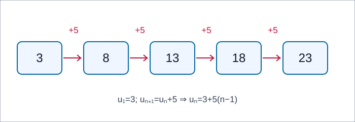
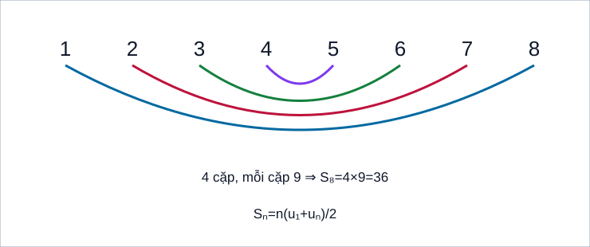
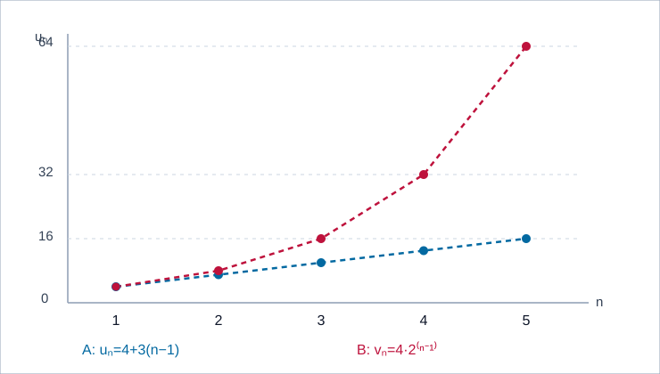

# Dãy số – Cấp số cộng – Cấp số nhân (Toán 11) · FULL PUBLIC TOPIC R00

**AUTHORING DRAFT:** Chưa CONTENT_READY trước khi source-locked Q18 review; là gói thứ sáu theo thứ tự biên soạn, không gán mã TOPIC_ID official và không quyết định PLAN22-07 chính thức. Hành trình đầy đủ độc lập Toán 11 KNTT Chương II B05–B07.

**S1:** G11 KNTT T1 SGK B05 42–47, B06 48–51, B07 52–55, cuối chương 56–57; SBT B05 31–34, B06 35–36, B07 37–39, cuối chương 40–43 theo nguồn R03 SBT PDF. Nguồn 42 câu gốc có Academic/PED verdict theo SGK source snapshot, không tự suy là Topic PASS; thêm đúng 2 public câu cho outcome so sánh chưa có primary question.

<!-- TOPIC_KNOWLEDGE_BEGIN -->
# Kiến thức

Hành trình gồm 9 mô-đun: định nghĩa dãy số, truy hồi/đơn điệu/chặn, công sai/số hạng/tổng, công bội/số hạng/tổng, lãi kép có điều kiện và phân biệt mô hình. Tự thử rồi mới tự mở Đối chiếu. Các kiến thức bắt buộc nằm ngay trong Topic, không phải nhảy sang SGK.

=== "I · Dãy số và công sai"

    === "01. Dãy số, miền chỉ số và công thức tường minh"

        #### M01 · Dãy số, miền chỉ số và công thức tường minh

        **WHY – Bài toán:** Số lượt truy cập trong ngày thứ n được biểu diễn bằng \(u_n\). Khác với một đoạn đường liên tục, dãy số cho mỗi *chỉ số nguyên* một giá trị; chỉ số phải được hiểu trước khi thay công thức.

        **PRE & MEANING:** Dãy số là một hàm trên \(\mathbb N^*=\{1,2,\ldots\}\) hoặc \(\{1,\ldots,N\}\) với dãy hữu hạn. Có thể cho bằng bảng, công thức \(u_n=f(n)\) hay truy hồi với giá trị khởi đầu. Dãy vô hạn không được khẳng định quy luật chỉ từ ba số đầu.

        **WORKED EXAMPLE / WHY THIS METHOD:** Cho \(u_n=n^2-2n\). Ta tính trực tiếp \(u_1=-1,u_2=0,u_3=3,u_5=15\). Vì có công thức số hạng tổng quát nên không cần liệt kê mọi số hạng trung gian. \(n=0\) không thuộc miền đang xét nên không thể tự đặt “số hạng đầu” là \(u_0\).

        **LIMIT:** Phân biệt chỉ số n, giá trị \(u_n\) và số lượng số hạng; nếu đề là một tập chỉ số hữu hạn thì không ngoại suy tới n lớn hơn N.

        **Outcome chi tiết:**

        - **G11-B05-SEQUENCE-DEFINITION:** Nêu định nghĩa và miền áp dụng, không phỏng đoán từ vài dữ kiện.

        - **G11-B05-EXPLICIT-TERM:** Chọn biểu thức tường minh/hiệu liên tiếp theo dữ kiện, giữ n−1 bước.

        **Tự thử trước Core (M01-TRY01, không tạo item_id):** Cho (u_n=3n-4) với n≥1. Viết u₁,u₂,u₃ và u₈. Có thể lấy n=0 làm số hạng đầu không?

        

Đối chiếu sau khi tự thử

        (u_1=-1,u_2=2,u_3=5,u_8=20). Không; miền chỉ số đã bắt đầu từ n=1.

        

        **D6:** Viết bảng n=1,2,3 dưới các số hạng và thay trực tiếp vào công thức để sửa lỗi lệch chỉ số. Sau đó làm bài canonical tương ứng, không ghi Mastery.

    === "02. Truy hồi, tăng giảm và tính bị chặn"

        #### M02 · Truy hồi, tăng giảm và tính bị chặn

        **WHY:** Một hiện tượng có thể được mô tả chỉ bằng quy tắc “ngày sau tính từ ngày trước”, nên cần phương pháp truy hồi. Nhưng một truy hồi không có \(u_1\) thì chưa định nghĩa duy nhất dãy.

        **MEANING BEFORE FORMULA:** \(u_1=3,u_{n+1}=u_n+5\) cho 3,8,13,18,... Dãy tăng khi \(u_{n+1}>u_n\) mọi n hợp lệ; xét hiệu để chứng minh, không chỉ nhìn vài số đầu. Bị chặn trên nghĩa là tồn tại M sao cho \(u_n\le M\) mọi n; bị chặn dưới tương tự.

        **WORKED EXAMPLE / PROOF:** \(u_n=n/(n+1)\). Lấy hiệu \(u_{n+1}-u_n=1/[(n+1)(n+2)]>0\) nên tăng. Đồng thời \(0<u_n<1\), chứng minh bị chặn. Dãy tăng có thể vẫn bị chặn, không mâu thuẫn. Ngược lại \(u_n=(-1)^n\) bị chặn nhưng không tăng/giảm đơn điệu.

        **READ FIGURE:** Ở sơ đồ truy hồi 3→8→13→18→23, bốn mũi tên +5 là bốn bước, không phải năm. Đường mũi tên không tạo hàm liên tục giữa các số nguyên.

        **Outcome chi tiết:**

        - **G11-B05-RECURRENCE:** Dùng đúng giá trị khởi đầu và chỉ số để dựng dãy.

        - **G11-B05-MONOTONICITY:** Kiểm dấu hiệu liên tiếp với mọi n.

        - **G11-B05-BOUNDS:** Chứng minh bất đẳng thức chặn mọi n thay vì nhìn đồ thị ngắn.

        **Tự thử trước Core (M02-TRY01, không tạo item_id):** Cho u₁=2, uₙ₊₁=uₙ+4. Tính u₄; chứng minh dãy tăng và xét có bị chặn trên không.

        

Đối chiếu sau khi tự thử

        u₂=6,u₃=10,u₄=14; mọi hiệu bằng 4>0 nên tăng. (u_n=2+4(n-1)) tăng không giới hạn, không bị chặn trên.

        

        **D6:** Nếu chỉ thấy bốn số đầu hữu hạn mà kết luận bị chặn, thử tìm M áp dụng cho **mọi** n. Sau đó làm bài canonical tương ứng, không ghi Mastery.

    === "03. Công sai và số hạng tổng quát của cấp số cộng"

        #### M03 · Công sai và số hạng tổng quát của cấp số cộng

        **WHY:** Trong sơ đồ xếp ghế, mỗi hàng *thêm đúng ba chiếc*; đó là sự thay đổi theo hiệu, không phải theo tỉ số.

        **MEANING:** CSC thỏa \(u_{n+1}-u_n=d\) cố định mọi n. Để từ \(u_1\) đến \(u_n\), thực hiện n−1 bước cộng d nên \(u_n=u_1+(n-1)d\). d có thể âm, dương hoặc bằng 0. CSC với d âm là dãy giảm.

        **WORKED EXAMPLES / METHOD:** \(10,7,4,1,\ldots\) có d=−3 nên \(u_6=10+5(-3)=-5\). Nếu \(u_4=13,u_9=28\), chênh lệch năm bước là \(15=5d\) ⇒ d=3 và u₁=4. Chọn lấy hiệu giữa hai số hạng đã biết vì nhanh và tránh tính từng số trung gian.

        **LIMIT:** Việc 3 số đầu trông như CSC không đủ để chứng minh cả dãy vô hạn theo đúng quy tắc.

        **Outcome chi tiết:**

        - **G11-B06-AP-DEFINITION:** Nêu định nghĩa và miền áp dụng, không phỏng đoán từ vài dữ kiện.

        - **G11-B06-AP-NTH:** Chọn biểu thức tường minh/hiệu liên tiếp theo dữ kiện, giữ n−1 bước.

        **Tự thử trước Core (M03-TRY01, không tạo item_id):** CSC có u₂=7, u₆=23. Tìm d,u₁,u₁₀.

        

Đối chiếu sau khi tự thử

        (d=(23-7)/(6-2)=4), (u_1=7-4=3); (u_{10}=3+9cdot4=39).

        

        **D6:** Hãy ghi dãy chỉ số 2→3→4→5→6 để thấy chỉ có bốn bước, không phải sáu. Sau đó làm bài canonical tương ứng, không ghi Mastery.

<!-- MODULES_INSERT -->

**Hướng dẫn đọc:** tại n=1,2,3,4,5 các giá trị là 3,8,13,18,23. Mỗi mũi tên cộng 5. Các ô là số hạng rời rạc, không phải đồ thị thời gian liên tục.

**Hướng dẫn đọc:** cặp 1+8, 2+7, 3+6, 4+5 đều là 9 nên S_8=4×9=36; làm rõ vì sao tổng CSC n số hạng bằng n lần trung bình hai đầu.

**Hướng dẫn đọc:** A có 4,7,10,13,16 và B có 4,8,16,32,64; tới chỉ số 5 hai dãy khác biệt 16 và 64; đường nét đứt không là nội suy giá trị giữa các chỉ số.

<!-- TOPIC_KNOWLEDGE_END -->

<!-- TOPIC_PRACTICE_BEGIN -->
# Luyện tập

**Một ngân hàng canonical, nhiều placement:** 42 câu SGK public gốc tại prototypes/thpt/shared-items/Temp_TOPIC_SEQUENCES_G11_CANONICAL_SOURCE_INDEX_R00_20261112.md (Git blob 19415049b78891955ce13ce3c10ea7279eceb2c7), 2 câu bổ sung công khai tại prototypes/thpt/shared-items/Temp_TOPIC_SEQUENCES_G11_PUBLIC_EXTENSION_02ITEM_R00_20261112.md (Git blob e64d7addbc5659618fc1a2c6296f075d62ee96bd), 44 unique IDs toàn Topic. Sáu câu Written/Anchor gốc dùng rubric một nguồn, không clone sang Topic.

| Mảng | Chọn phương pháp |
|---|---|
| M01–M02 | Miền n, dãy tường minh và truy hồi, dấu hiệu tăng/bị chặn có chứng minh mọi n |
| M03–M05 | Hiệu không đổi, CSC: số hạng thứ n, tính chất 3 số, tổng n số và mô hình hàng ghế |
| M06–M08 | Tỉ số/truy hồi q, CSN gồm q âm/q=1, tổng hữu hạn, lãi kép có điều kiện |
| M09 | Hai câu ADD01/ADD02: chọn CSC/CSN theo bản chất, dãy hằng và phản ví dụ |

**Luyện có chiều sâu:** mỗi kết quả phải có giải thích điều kiện, miền chỉ số và lý do dùng phương pháp. Đáp án, lời giải và rubric mở từ **cùng item_id** gốc. Practice và tự đối chiếu không ghi Mastery.

<!-- TOPIC_PRACTICE_END -->

<!-- TOPIC_SELF_CHECK_BEGIN -->
# Tự kiểm tra

**Chỉ tự đối chiếu công khai** `CLIENT_SELF_CHECK_NO_MASTERY`. 9 câu công khai đã luyện được tái sử dụng làm placement, không phải held-out TOPIC_READINESS. Trong sản phẩm website RELEASE phải khóa đáp án, gợi ý, đúng/sai và Tutor tới **sau Final Submit** toàn lượt, không có ghi Mastery.

| Mảng | Item IDs reused | Trở về |
|---|---|---|
| Dãy số và truy hồi | `THPT-G11-B05-P01`, `THPT-G11-B05-P02` | M01–M02 |
| Tính chất dãy số | `THPT-G11-B05-P03` | M02 |
| CSC | `THPT-G11-B06-P01`, `THPT-G11-B06-P03` | M03–M05 |
| CSN | `THPT-G11-B07-P02`, `THPT-G11-B07-P04`, `THPT-G11-B07-P06` | M06–M08 |
| So sánh quy luật | `THPT-G11-TOPSEQ-ADD01` | M09 |

**Private RD1:** 19 câu Chương II gốc owner-held không nhập source Git. Public placement đã xem không thể dùng như đánh giá độc lập hay Mastery.

<!-- TOPIC_SELF_CHECK_END -->

<!-- AUTHOR_ONLY_METADATA_BEGIN -->
# Phụ lục tác giả — không render trên website học sinh

STANDARD_ID: SLM-THPT-QUALITY-ONE
STANDARD_VERSION: 3.0.1
LEARNING_PATH: TOPIC
RELEASE_SCOPE: FULL_TOPIC_LEARNING_PATH
CONTENT_STATE: CANDIDATE_UNDER_AUTHOR_SELF_QA
TOPIC_ID: UNASSIGNED_OWNER_DECISION
SOURCE_INDEX_PATH: prototypes/thpt/shared-items/Temp_TOPIC_SEQUENCES_G11_CANONICAL_SOURCE_INDEX_R00_20261112.md
SOURCE_INDEX_BLOB: 19415049b78891955ce13ce3c10ea7279eceb2c7
PUBLIC_EXTENSION_PATH: prototypes/thpt/shared-items/Temp_TOPIC_SEQUENCES_G11_PUBLIC_EXTENSION_02ITEM_R00_20261112.md
PUBLIC_EXTENSION_BLOB: e64d7addbc5659618fc1a2c6296f075d62ee96bd
PUBLIC_ITEM_COUNT: 44
OUTCOMES: 16
KNOWLEDGE_MODULES: 9
FIRST_TRIES: 9
ORIGINAL_WRITTEN_COUNT: 6
PRIVATE_RD1_IMPORTED: 0
ASSESSMENT_MODE: CLIENT_SELF_CHECK_NO_MASTERY

## ITEM_OUTCOME_MATRIX

| item_id | outcome_id | role | source_type | exact_source_blob |
|---|---|---|---|---|
| `THPT-G11-B05-C01` | `G11-B05-SEQUENCE-DEFINITION` | TOPIC_PRACTICE | SGK_CANONICAL_REUSE | `2101e2a248e0cf53ee11847b913b937cebcd0806` |
| `THPT-G11-B05-C02` | `G11-B05-EXPLICIT-TERM` | TOPIC_PRACTICE | SGK_CANONICAL_REUSE | `2101e2a248e0cf53ee11847b913b937cebcd0806` |
| `THPT-G11-B05-C03` | `G11-B05-RECURRENCE` | TOPIC_PRACTICE | SGK_CANONICAL_REUSE | `2101e2a248e0cf53ee11847b913b937cebcd0806` |
| `THPT-G11-B05-C04` | `G11-B05-MONOTONICITY` | TOPIC_PRACTICE | SGK_CANONICAL_REUSE | `2101e2a248e0cf53ee11847b913b937cebcd0806` |
| `THPT-G11-B05-P01` | `G11-B05-EXPLICIT-TERM` | TOPIC_PRACTICE | SGK_CANONICAL_REUSE | `2101e2a248e0cf53ee11847b913b937cebcd0806` |
| `THPT-G11-B05-P02` | `G11-B05-RECURRENCE` | TOPIC_PRACTICE | SGK_CANONICAL_REUSE | `2101e2a248e0cf53ee11847b913b937cebcd0806` |
| `THPT-G11-B05-P03` | `G11-B05-MONOTONICITY` | TOPIC_PRACTICE | SGK_CANONICAL_REUSE | `2101e2a248e0cf53ee11847b913b937cebcd0806` |
| `THPT-G11-B05-P04` | `G11-B05-BOUNDS` | TOPIC_PRACTICE | SGK_CANONICAL_REUSE | `2101e2a248e0cf53ee11847b913b937cebcd0806` |
| `THPT-G11-B05-P05` | `G11-B05-SEQUENCE-DEFINITION` | TOPIC_PRACTICE | SGK_CANONICAL_REUSE | `2101e2a248e0cf53ee11847b913b937cebcd0806` |
| `THPT-G11-B05-P06` | `G11-B05-EXPLICIT-TERM` | TOPIC_PRACTICE | SGK_CANONICAL_REUSE | `2101e2a248e0cf53ee11847b913b937cebcd0806` |
| `THPT-G11-B05-P07` | `G11-B05-RECURRENCE` | TOPIC_PRACTICE | SGK_CANONICAL_REUSE | `2101e2a248e0cf53ee11847b913b937cebcd0806` |
| `THPT-G11-B05-P08` | `G11-B05-BOUNDS` | TOPIC_PRACTICE | SGK_CANONICAL_REUSE | `2101e2a248e0cf53ee11847b913b937cebcd0806` |
| `THPT-G11-B06-C01` | `G11-B06-AP-DEFINITION` | TOPIC_PRACTICE | SGK_CANONICAL_REUSE | `2101e2a248e0cf53ee11847b913b937cebcd0806` |
| `THPT-G11-B06-C02` | `G11-B06-AP-NTH` | TOPIC_PRACTICE | SGK_CANONICAL_REUSE | `2101e2a248e0cf53ee11847b913b937cebcd0806` |
| `THPT-G11-B06-C03` | `G11-B06-AP-SUM` | TOPIC_PRACTICE | SGK_CANONICAL_REUSE | `2101e2a248e0cf53ee11847b913b937cebcd0806` |
| `THPT-G11-B06-C04` | `G11-B06-AP-THREE-TERMS` | TOPIC_PRACTICE | SGK_CANONICAL_REUSE | `2101e2a248e0cf53ee11847b913b937cebcd0806` |
| `THPT-G11-B06-P01` | `G11-B06-AP-NTH` | TOPIC_PRACTICE | SGK_CANONICAL_REUSE | `2101e2a248e0cf53ee11847b913b937cebcd0806` |
| `THPT-G11-B06-P02` | `G11-B06-AP-DEFINITION` | TOPIC_PRACTICE | SGK_CANONICAL_REUSE | `2101e2a248e0cf53ee11847b913b937cebcd0806` |
| `THPT-G11-B06-P03` | `G11-B06-AP-SUM` | TOPIC_PRACTICE | SGK_CANONICAL_REUSE | `2101e2a248e0cf53ee11847b913b937cebcd0806` |
| `THPT-G11-B06-P04` | `G11-B06-AP-NTH` | TOPIC_PRACTICE | SGK_CANONICAL_REUSE | `2101e2a248e0cf53ee11847b913b937cebcd0806` |
| `THPT-G11-B06-P05` | `G11-B06-AP-THREE-TERMS` | TOPIC_PRACTICE | SGK_CANONICAL_REUSE | `2101e2a248e0cf53ee11847b913b937cebcd0806` |
| `THPT-G11-B06-P06` | `G11-B06-AP-APPLICATION` | TOPIC_PRACTICE | SGK_CANONICAL_REUSE | `2101e2a248e0cf53ee11847b913b937cebcd0806` |
| `THPT-G11-B06-P07` | `G11-B06-AP-SUM` | TOPIC_PRACTICE | SGK_CANONICAL_REUSE | `2101e2a248e0cf53ee11847b913b937cebcd0806` |
| `THPT-G11-B06-P08` | `G11-B06-AP-APPLICATION` | TOPIC_PRACTICE | SGK_CANONICAL_REUSE | `2101e2a248e0cf53ee11847b913b937cebcd0806` |
| `THPT-G11-B07-C01` | `G11-B07-GP-DEFINITION` | TOPIC_PRACTICE | SGK_CANONICAL_REUSE | `2101e2a248e0cf53ee11847b913b937cebcd0806` |
| `THPT-G11-B07-C02` | `G11-B07-GP-NTH` | TOPIC_PRACTICE | SGK_CANONICAL_REUSE | `2101e2a248e0cf53ee11847b913b937cebcd0806` |
| `THPT-G11-B07-C03` | `G11-B07-GP-SUM` | TOPIC_PRACTICE | SGK_CANONICAL_REUSE | `2101e2a248e0cf53ee11847b913b937cebcd0806` |
| `THPT-G11-B07-C04` | `G11-B07-GP-THREE-TERMS` | TOPIC_PRACTICE | SGK_CANONICAL_REUSE | `2101e2a248e0cf53ee11847b913b937cebcd0806` |
| `THPT-G11-B07-P01` | `G11-B07-GP-DEFINITION` | TOPIC_PRACTICE | SGK_CANONICAL_REUSE | `2101e2a248e0cf53ee11847b913b937cebcd0806` |
| `THPT-G11-B07-P02` | `G11-B07-GP-NTH` | TOPIC_PRACTICE | SGK_CANONICAL_REUSE | `2101e2a248e0cf53ee11847b913b937cebcd0806` |
| `THPT-G11-B07-P03` | `G11-B07-GP-SUM` | TOPIC_PRACTICE | SGK_CANONICAL_REUSE | `2101e2a248e0cf53ee11847b913b937cebcd0806` |
| `THPT-G11-B07-P04` | `G11-B07-GP-SUM` | TOPIC_PRACTICE | SGK_CANONICAL_REUSE | `2101e2a248e0cf53ee11847b913b937cebcd0806` |
| `THPT-G11-B07-P05` | `G11-B07-GP-THREE-TERMS` | TOPIC_PRACTICE | SGK_CANONICAL_REUSE | `2101e2a248e0cf53ee11847b913b937cebcd0806` |
| `THPT-G11-B07-P06` | `G11-B07-GP-APPLICATION` | TOPIC_PRACTICE | SGK_CANONICAL_REUSE | `2101e2a248e0cf53ee11847b913b937cebcd0806` |
| `THPT-G11-B07-P07` | `G11-B07-GP-DEFINITION` | TOPIC_PRACTICE | SGK_CANONICAL_REUSE | `2101e2a248e0cf53ee11847b913b937cebcd0806` |
| `THPT-G11-B07-P08` | `G11-B07-GP-APPLICATION` | TOPIC_PRACTICE | SGK_CANONICAL_REUSE | `2101e2a248e0cf53ee11847b913b937cebcd0806` |
| `THPT-G11-CHII-W05-01` | `G11-B05-MONOTONICITY` | TOPIC_WRITTEN | SGK_CANONICAL_REUSE | `2101e2a248e0cf53ee11847b913b937cebcd0806` |
| `THPT-G11-CHII-W05-02-ANCHOR` | `G11-B05-RECURRENCE` | TOPIC_WRITTEN | SGK_CANONICAL_REUSE | `2101e2a248e0cf53ee11847b913b937cebcd0806` |
| `THPT-G11-CHII-W06-01` | `G11-B06-AP-SUM` | TOPIC_WRITTEN | SGK_CANONICAL_REUSE | `2101e2a248e0cf53ee11847b913b937cebcd0806` |
| `THPT-G11-CHII-W06-02-ANCHOR` | `G11-B06-AP-APPLICATION` | TOPIC_WRITTEN | SGK_CANONICAL_REUSE | `2101e2a248e0cf53ee11847b913b937cebcd0806` |
| `THPT-G11-CHII-W07-01` | `G11-B07-GP-SUM` | TOPIC_WRITTEN | SGK_CANONICAL_REUSE | `2101e2a248e0cf53ee11847b913b937cebcd0806` |
| `THPT-G11-CHII-W07-02-ANCHOR` | `G11-B07-GP-APPLICATION` | TOPIC_WRITTEN | SGK_CANONICAL_REUSE | `2101e2a248e0cf53ee11847b913b937cebcd0806` |
| `THPT-G11-TOPSEQ-ADD01` | `G11-CHII-STRUCTURAL-COMPARISON` | TOPIC_PRACTICE | TOPIC_NEW_CANDIDATE | `e64d7addbc5659618fc1a2c6296f075d62ee96bd` |
| `THPT-G11-TOPSEQ-ADD02` | `G11-CHII-STRUCTURAL-COMPARISON` | TOPIC_PRACTICE | TOPIC_NEW_CANDIDATE | `e64d7addbc5659618fc1a2c6296f075d62ee96bd` |

## AUTHOR_PRE_SIGNOFF
Q01–Q02 S1 and 16 outcomes; Q03–Q08 D1–D6 and SVG/Written; Q09–Q14 PED first try/D6; Q15 one canonical item_id, Q16 public no Mastery/private 0, Q17 three Topic pages/no separate Core, Q18 author receipt/source lock required before CONTENT_READY.
<!-- AUTHOR_ONLY_METADATA_END -->